<div style="page-break-after: always;"></div>


# Mastering Modern DevOps: A Comprehensive Guide to Infrastructure, Automation, and Cloud-Native Technologies (Second Edition)

## About the Author

**Christian Chostak** is a principal DevOps architect, cloud-native systems engineer, and technical leader with well over a decade of hands-on experience designing, automating, and securing resilient production infrastructure at scale. Throughout his career, he has spearheaded high-velocity DevOps, Platform Engineering, and DevSecOps transformations across organizations ranging from hyper-growth cloud-native startups to global enterprise financial and technology institutions. Christian's deep technical specialization spans declarative and programmatic Infrastructure as Code (AWS CDK v2, OpenTofu/Terraform, Pulumi, Crossplane), cloud-native container orchestration and kernel networking (Kubernetes, Amazon EKS, Cilium eBPF, Istio Ambient Mesh), keyless CI/CD and GitOps delivery architectures (GitHub Actions OIDC, Argo CD, Flux v2), OpenTelemetry observability pipelines, and cryptographic software supply chain security (SLSA, Sigstore Cosign, Kyverno).

Beyond his production architecture and systems engineering work, Christian is deeply committed to rigorous technical education and open knowledge sharing within the global cloud-native community. He is a frequent speaker at international engineering conferences and technical symposiums, where he dissects architectural lessons from large-scale distributed systems migrations and production incident post-mortems. His passion for engineering mentorship centers on guiding software engineers, systems administrators, platform engineers, and Site Reliability Engineers (SREs) from fragile manual operations to deterministic, self-healing cloud-native architectures.

Christian holds multiple top-tier industry certifications, including **AWS Certified DevOps Engineer – Professional** and **Certified Kubernetes Administrator (CKA)**, and earned a **Master's degree in Software Engineering** from IPP.

In this **Second Edition** of *Mastering Modern DevOps: A Comprehensive Guide to Infrastructure, Automation, and Cloud-Native Technologies*, Christian delivers a ground-up, phrase-by-phrase modernization of every foundational discipline—updating cloud SDKs, immutable OS pipelines, OCI v1.1 artifact registries, containerd 2.0 runtimes, Kubernetes v1.31+ orchestration, and eBPF runtime security—while introducing four comprehensive chapters dedicated to Internal Developer Platforms (IDPs), eBPF networking and sidecarless service meshes, OpenTelemetry with AI-augmented SRE, and SLSA/Sigstore software supply chain security.

## Preface to the Second Edition

*Mastering Modern DevOps: A Comprehensive Guide to Infrastructure, Automation, and Cloud-Native Technologies (Second Edition)* is an authoritative, production-grade engineering blueprint written for practitioners, architects, and technical leaders who build, operate, and secure modern cloud-native systems.

Since the publication of the First Edition, the cloud-native engineering landscape has undergone a fundamental structural transformation. Deprecated vendor services and legacy container tooling have given way to open standards, cryptographic identity federation, kernel-level telemetry, and declarative platform abstractions. A true Second Edition demands far more than appending new topics to existing text; every chapter in this volume has been rewritten from the ground up to reflect 2026 production engineering standards:

1. **Keyless Identity Federation and Programmatic Cloud IaC (Chapters 1–3)**: Static long-lived IAM access keys have been replaced across the board with short-lived OpenID Connect (OIDC) federation, AWS IAM Identity Center, and EKS Pod Identity. Infrastructure synthesis is built on **AWS CDK v2** (`aws-cdk-lib`) with automated policy-as-code validation via `cdk-nag`, **AWS SDK for Python (Boto3 v1.35+) and Go v2** with adaptive client-side rate limiting, and immutable image pipelines combining **Ansible**, **Molecule**, **HashiCorp Packer**, and reproducible **Nix / Devcontainer** toolchains.
2. **OCI v1.1 Supply Chains, BuildKit, and Kubernetes v1.31+ (Chapters 4–7)**: Legacy source control and deprecated registry layers have been superseded by keyless **GitHub Actions** and **GitLab CI** pipelines, **OCI v1.1 artifact registries** (Amazon ECR, Harbor, GitHub Container Registry) utilizing the Referrers API to bind CycloneDX SBOMs and Cosign signatures directly to container digests, **containerd 2.0** with **BuildKit** secret mounts and **Chainguard Wolfi / Distroless** base images, and **Kubernetes v1.31+** powered by **Karpenter** node consolidation, the **Kubernetes Gateway API**, **Pod Security Admission (PSA)**, and **KEDA** event-driven autoscaling.
3. **Unified OpenTelemetry, eBPF Runtime Security, and Multi-Cloud GitOps (Chapters 8–18)**: Disconnected monitoring silos have converged onto the **OpenTelemetry (OTel) Collector**, **Prometheus with Thanos/Mimir**, **Grafana Loki**, and **Grafana Tempo** driven by SLO error budgets. Pipeline and runtime security now enforce shift-left admission control via **Kyverno** and **OPA Gatekeeper**, kernel-level threat detection via **Falco eBPF**, and dynamic secret synchronization via the **External Secrets Operator (ESO)**. Infrastructure orchestration spans **Gateway API** and **Envoy** traffic management, **Serverless WebAssembly / AWS Lambda SnapStart**, **OpenTofu / Terraform v1.9+** with native test frameworks, **Argo CD ApplicationSets**, and **DAG-driven workflow engines**.
4. **The New Cloud-Native Frontier: IDPs, eBPF Meshes, AI-Augmented SRE, and SLSA Level 3 (Chapters 19–22)**: Four dedicated chapters explore the architectural pillars defining elite engineering organizations today:
   - **Platform Engineering and Internal Developer Platforms (Chapter 19)**: Eliminating ticket-ops and cognitive overload through product-managed IDPs built on **Backstage**, **Crossplane Composition Functions**, and **Kratix** promises.
   - **eBPF Cloud-Native Networking and Sidecarless Service Meshes (Chapter 20)**: Replacing kube-proxy `iptables` bottlenecks and high-memory sidecar proxies with **Cilium eBPF**, **Hubble** L7 flow visibility, **Tetragon** kernel enforcement, and **Istio Ambient Mode** (`ztunnel` and waypoint proxies).
   - **OpenTelemetry Collector Pipelines and AI-Augmented SRE (Chapter 21)**: Implementing zero-code eBPF auto-instrumentation, tail-based sampling, **Grafana Beyla**, continuous eBPF CPU/memory profiling, and **AI-augmented Site Reliability Engineering (AIOps)** for automated incident triage and root-cause correlation.
   - **Software Supply Chain Security with SLSA and Sigstore (Chapter 22)**: Achieving verifiable build provenance (**SLSA Build Level 3**), keyless cryptographic signing with **Sigstore Cosign**, **Fulcio**, and **Rekor**, automated **Syft/Trivy SBOM** attestation, and **Kyverno** cryptographic admission enforcement.


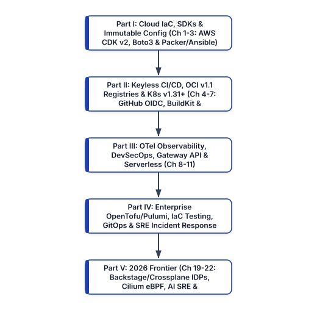


Every architectural pattern, configuration manifest, and code implementation in this book is engineered for immediate applicability in production environments. Welcome to the Second Edition of *Mastering Modern DevOps*.


<div style="page-break-after: always;"></div>


# Reader Guide: Who Should Read This Book and How to Use It

## Target Audience and Engineering Roles

*Mastering Modern DevOps: A Comprehensive Guide to Infrastructure, Automation, and Cloud-Native Technologies (Second Edition)* is written for practicing engineers, technical architects, and engineering leaders who design, build, secure, and operate distributed cloud-native systems. Because modern DevOps and Platform Engineering dissolve traditional boundaries between software construction and infrastructure operations, this book is structured to serve five core technical personas:

1. **DevOps, Platform, and Site Reliability Engineers (SREs)**: Practitioners responsible for Kubernetes cluster lifecycle management, Infrastructure as Code (IaC) module design, CI/CD and GitOps pipelines, observability stacks, and on-call reliability will find production-ready architectures covering AWS CDK v2, OpenTofu/Terraform, Crossplane, Karpenter, Cilium eBPF, OpenTelemetry, and SLSA Level 3 supply chains.
2. **Backend and Full-Stack Software Engineers**: Application developers who want to master how their services are packaged, attested, deployed, and observed in production will gain deep technical fluency in multi-stage BuildKit container builds, Distroless/Wolfi runtime hardening, AWS SDK resilience patterns (adaptive retries, paginators, EKS Pod Identity), Kubernetes Gateway API routing, and distributed tracing instrumentation.
3. **Cloud Architects and Infrastructure Engineers**: Systems administrators and cloud engineers transitioning from imperative script-based administration or legacy virtual machines to declarative, immutable cloud-native architectures will find rigorous step-by-step blueprints for eliminating configuration drift and automating multi-region failover.
4. **DevSecOps and Security Engineers**: Application security and cloud security engineers tasked with securing software delivery pipelines and Kubernetes runtimes will learn how to replace manual security review gates with automated policy-as-code (`cdk-nag`, Kyverno, OPA Gatekeeper), kernel-level runtime security (Falco and Tetragon eBPF), dynamic secret injection (HashiCorp Vault / OpenBao and External Secrets Operator), and keyless Sigstore Cosign attestations.
5. **Engineering Directors, VPs of Engineering, and Technical Educators**: Engineering leaders designing team topologies, establishing DORA and SPACE telemetry, or chartering an Internal Developer Platform (IDP) initiative will gain a comprehensive architectural framework for reducing developer cognitive load while strengthening operational governance.

## Architectural Structure of the Book

This book is organized into five cohesive parts spanning 22 chapters, progressing deliberately from programmatic cloud foundations to autonomous platform engineering:


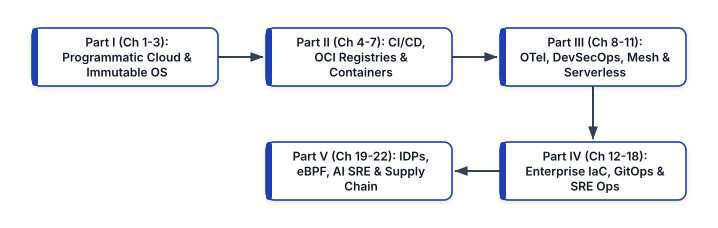


- **Part I: Programmatic Cloud Infrastructure and Immutable Configuration (Chapters 1–3)** establishes the foundation of programmatic cloud engineering using AWS CDK v2 (`aws-cdk-lib` and `cdk-nag`), resilient cloud-native application integration with the AWS SDK (Boto3 v1.35+, Go v2, and JavaScript v3), and immutable host and container configuration using Ansible, Molecule, HashiCorp Packer, and Nix/Devcontainers.
- **Part II: Keyless Delivery Pipelines, OCI v1.1 Registries, and Container Orchestration (Chapters 4–7)** details end-to-end software packaging and orchestration: keyless OIDC CI/CD pipelines in GitHub Actions and GitLab CI, OCI v1.1 artifact registries (Amazon ECR and Harbor) with cryptographic referrers, containerd 2.0 and BuildKit image optimization on Wolfi/Distroless bases, and production orchestration on Kubernetes v1.31+ (EKS Auto Mode, Karpenter, Gateway API, and KEDA) alongside Amazon ECS on AWS Fargate.
- **Part III: Unified Observability, DevSecOps, Service Meshes, and Serverless Compute (Chapters 8–11)** covers production operations and runtime architecture: unified telemetry pipelines with the OpenTelemetry Collector, Prometheus/Thanos/Mimir, Loki, and Tempo; shift-left and runtime security with Kyverno, Falco eBPF, Trivy, and External Secrets Operator; high-performance ingress and service mesh routing with Envoy, Gateway API, and Istio; and event-driven serverless architectures across AWS Lambda, Google Cloud Functions (2nd Gen), and Azure Functions.
- **Part IV: Enterprise Infrastructure at Scale, Verification, GitOps, and Incident Response (Chapters 12–18)** addresses multi-team governance and operational resilience: multi-cloud IaC with OpenTofu/Terraform and Pulumi; automated infrastructure verification using Terratest, native Terraform tests, and Open Policy Agent (OPA); pull-based Kubernetes reconciliation with Argo CD ApplicationSets and Flux v2; DAG-driven workflow orchestration with Apache Airflow and Rundeck; and high-reliability incident management using SLO burn-rate alerts, PagerDuty, and blameless post-mortems.
- **Part V: The 2026 Cloud-Native Frontier (Chapters 19–22)** explores the four architectural pillars of modern cloud-native engineering: Internal Developer Platforms with Backstage, Crossplane, and Kratix; eBPF kernel networking and sidecarless service meshes with Cilium, Hubble, Tetragon, and Istio Ambient Mode; AI-augmented SRE and zero-code eBPF telemetry with OpenTelemetry; and cryptographic software supply chain security with SLSA Build Level 3 and Sigstore.

## How to Use Code Examples and Architectural Blueprints

Every chapter follows a rigorous engineering pedagogy: we begin with the underlying systems architecture and failure modes of legacy approaches, analyze the mechanics of modern cloud-native protocols and tools, and walk through complete, production-hardened code implementations.

All code listings, YAML manifests, HCL modules, TypeScript constructs, and Python automation scripts in this Second Edition adhere to strict production security and maintainability conventions:

- **Zero Long-Lived Static Credentials**: No example in this book relies on hardcoded API tokens or static IAM user access keys. All cloud interactions authenticate via short-lived OIDC tokens, IAM Identity Center sessions, or workload identity bindings (EKS Pod Identity / IRSA).
- **Pinned Immutable Versions and Digests**: Container bases, GitHub Actions workflows, and infrastructure providers use explicit semantic versions or cryptographic SHA-256 digests to prevent upstream tag-mutation attacks.
- **Print-Safe Formatting**: Complex commands and configuration blocks are structured cleanly across multiple lines so that every expression remains legible both in print and on screen without horizontal truncation.

Whether you read this volume sequentially from cover to cover to build a holistic mental model of cloud-native engineering, or use individual chapters as an architectural desk reference during production design reviews, the patterns in this book will equip you to engineer resilient, observable, and verifiable systems.


<div style="page-break-after: always;"></div>


# Introduction: Understanding Modern DevOps

Modern DevOps is an engineering discipline, organizational operating model, and architectural philosophy that unifies software development, infrastructure engineering, security verification, and production reliability into a single continuous feedback loop. Rather than treating deployment and operations as downstream handoffs executed after application code is written, modern DevOps treats infrastructure, delivery pipelines, observability, and security policies as version-controlled software systems engineered alongside the product itself.

In contemporary cloud-native organizations, software systems no longer consist of monolithic binaries deployed quarterly onto static virtual machines. Modern architectures comprise dozens or hundreds of polyglot microservices, event-driven serverless functions, managed cloud data stores, and Kubernetes workloads scaling dynamically across multi-zone cloud environments. Managing this distributed complexity without sacrificing engineering velocity or system stability requires deterministic automation, declarative state reconciliation, and high-cardinality telemetry.


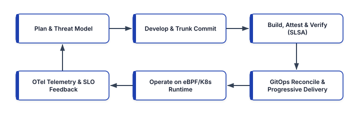


## The Structural Failure of Traditional Operational Silos

To understand why modern DevOps architectures are structured the way they are, we must first examine the systemic failure modes of traditional, functionally siloed IT organizations. Historically, technology departments divided engineering into two adversarial camps with conflicting incentives:

- **Application Development Teams** were measured and rewarded by feature velocity—shipping new business capabilities as rapidly as possible. Because developers were insulated from the operational consequences of memory leaks, unindexed database queries, missing timeouts, or brittle configuration files, reliability and operability were routinely deferred as secondary concerns.
- **Systems Administration and Operations Teams** were measured and rewarded by stability and uptime. Because every production change introduced the risk of an outage—and because operations engineers had to wake up at 3:00 AM to repair systems they did not design—their rational defensive response was to resist change through bureaucratic Change Advisory Boards (CABs), manual runbooks, and multi-week freeze windows.

This structural incentive misalignment created the classic **"Wall of Confusion."** Developers threw unverified artifacts over the wall to operations; operations locked down environments and gated deployments behind ticket queues. Ironically, batching months of code changes into massive, infrequent releases increased the blast radius of every deployment, resulting in prolonged outages, frantic manual rollbacks, and finger-pointing between teams.

Agile software development methodologies (such as Scrum and Extreme Programming) solved the upstream requirements bottleneck between product management and software developers by introducing iterative sprints and continuous customer feedback. However, Agile stopped at the boundary of the source code repository. Fast code iteration combined with manual, ticket-driven infrastructure provisioning merely shifted the bottleneck downstream into deployment and operations. DevOps emerged to abolish that boundary altogether.

## The Five Architectural Pillars of Modern DevOps

In a 2026 cloud-native engineering organization, DevOps is executed through five interlocking technical and cultural pillars:

### 1. Cross-Functional Ownership and Platform Engineering
Modern engineering teams operate under the **"You build it, you run it"** model pioneered at Amazon, supported by a dedicated **Internal Developer Platform (IDP)**. Product engineering teams own the full lifecycle of their services—from architectural design and code commits to SLO monitoring and on-call incident response. To prevent this full-lifecycle ownership from overwhelming developers with infrastructure complexity, a dedicated Platform Engineering team builds and maintains self-service "Golden Paths" (using tools such as Backstage, Crossplane, and AWS CDK constructs) that abstract underlying cloud and Kubernetes primitives behind safe, compliant interfaces.

### 2. Everything as Code and Immutable Infrastructure
Manual configuration via cloud web consoles (`ClickOps`) or ad-hoc SSH sessions into production servers is strictly prohibited. Every layer of the stack is codified, versioned in Git, peer-reviewed via pull requests, and validated automatically:
- **Infrastructure as Code (IaC)**: Cloud networks, IAM roles, Kubernetes clusters, and managed databases are provisioned programmatically via AWS CDK v2, OpenTofu/Terraform, Pulumi, or Crossplane.
- **Immutable Compute Artifacts**: Virtual machine images (AMIs) and OCI container images are built deterministically via Packer and BuildKit. Servers and containers are never mutated in place in production; any configuration or patch change triggers the synthesis of a brand-new, cryptographically signed artifact that replaces the old instance.
- **Policy and Security as Code**: Compliance guardrails, network policies, and RBAC constraints are evaluated automatically at build time (`cdk-nag`, Checkov, OPA) and admission time (Kyverno, OPA Gatekeeper).

### 3. Continuous Integration, Continuous Delivery, and GitOps Reconciliation
Code integration occurs continuously against a shared trunk or short-lived feature branches. Every commit triggers an automated, hermetic pipeline that compiles the source, executes unit and integration suites, performs Static Application Security Testing (SAST) and Software Composition Analysis (SCA), generates a CycloneDX or SPDX Software Bill of Materials (SBOM), and signs the resulting OCI image using keyless Sigstore Cosign federation.

For deployment, modern DevOps decouples Continuous Integration from Continuous Delivery using **GitOps**. Rather than granting external CI runners privileged cluster-admin credentials to push changes into production, autonomous in-cluster controllers (**Argo CD** or **Flux v2**) continuously pull desired state declarations from Git repositories and reconcile the live Kubernetes state against the committed specification.

### 4. Unified OpenTelemetry Observability and SLO Engineering
Modern distributed systems fail in complex, non-linear ways that legacy host-level CPU and disk-space alerts cannot detect. Modern DevOps replaces fragmented monitoring tools with unified **OpenTelemetry (OTel)** pipelines collecting high-cardinality metrics, structured logs, distributed traces, and continuous eBPF profiles.

Instead of alerting on noisy infrastructure symptoms, teams manage reliability through **Service Level Indicators (SLIs)**, **Service Level Objectives (SLOs)**, and **Error Budgets**:
- An **SLI** is a quantitative measure of user-visible service health (for example, the proportion of HTTP `POST /checkout` requests completing in under `250ms` with a non-`5xx` status).
- An **SLO** is the target reliability threshold over a rolling window (such as `99.9%` success over 28 days).
- The **Error Budget** (`100% - SLO`, or `0.1%` corresponding to `40.32 minutes` of permitted degradation per 28-day window) serves as an objective control mechanism between product velocity and operational stability. So long as error budget remains, teams deploy aggressively and run chaos experiments; if a fast burn rate threatens to exhaust the budget, engineering effort automatically pivots to reliability remediation.

### 5. Shift-Left and Runtime DevSecOps
Security is no longer a compliance audit conducted weeks before a release. Modern DevSecOps embeds cryptographic verification and least-privilege controls across the entire lifecycle:
- **Keyless Workload Identity**: Static API keys and long-lived cloud credentials are eradicated in favor of OIDC federation in CI/CD and workload identity bindings (EKS Pod Identity) at runtime.
- **Supply Chain Provenance**: Artifacts must carry verifiable **SLSA Build Level 3** provenance attestations before admission controllers permit them to schedule on production nodes.
- **Kernel-Level Runtime Enforcement**: Even after an image passes pre-deployment checks, eBPF security agents (**Falco** and **Cilium Tetragon**) monitor Linux kernel system calls in real time to detect and terminate anomalous process executions, unauthorized file reads, or unexpected outbound network connections.

## Quantifying Engineering Performance: DORA and SPACE Metrics

High-performing engineering organizations do not rely on intuition to evaluate their DevOps maturity; they measure systemic flow and stability using the empirically validated **DORA (DevOps Research and Assessment)** four key metrics alongside the **SPACE** developer productivity framework:

```
+-----------------------------------------------------+
|          THE FOUR DORA KEY METRICS (2026)           |
+------------------------+----------------------------+
| VELOCITY / THROUGHPUT  | STABILITY / RESILIENCE     |
+------------------------+----------------------------+
| 1. Deployment Freq.    | 3. Change Failure Rate     |
|    Elite: On-demand    |    Elite: 0% - 5% of       |
|    (multi deploys/day) |    changes need rollback   |
|                        |                            |
| 2. Lead Time for Chg.  | 4. Failed Deploy Recovery  |
|    Elite: < 1 hour     |    (formerly MTTR)         |
|    from commit to prod |    Elite: < 1 hour         |
+------------------------+----------------------------+
```

Decades of empirical research confirm a critical architectural insight: **speed and stability are not trade-offs; they are mutually reinforcing.** Teams that deploy small, incremental changes multiple times per day via automated pipelines and progressive delivery controllers (such as Argo Rollouts or Flagger) experience drastically lower change failure rates and recover from incidents orders of magnitude faster than organizations that batch changes into monthly release trains.

## Systemic Challenges in Modern DevOps Adoption

Transitioning an organization to cloud-native DevOps involves overcoming four recurring anti-patterns:

1. **The "DevOps Rebranding" Anti-Pattern**: Renaming an existing ticket-driven systems administration group to the "DevOps Team" without changing workflow boundaries or automating self-service interfaces simply creates a new bottleneck. True transformation requires shifting from ticket-driven fulfillment to product-managed platform APIs.
2. **Developer Cognitive Overload**: Asking application developers to write raw 500-line Kubernetes manifests, configure IAM trust policies, tune Prometheus scrape configs, and manage Terraform state files leads to burnout and misconfiguration. Successful organizations pair DevOps ownership with Internal Developer Platforms that expose curated, high-level abstractions.
3. **Tool Sprawl and Integration Fragility**: Adopting dozens of disconnected point solutions for CI, secret management, logging, and scanning creates heavy maintenance overhead. Standardizing on open specifications—such as **OCI v1.1** for artifacts, **OpenTelemetry** for observability, **CNI/Gateway API** for networking, and **OIDC** for identity—prevents vendor lock-in and simplifies integration.
4. **Day-2 Drift in Mixed Environments**: Organizations often automate Day-1 provisioning with IaC but revert to manual hotfixes during Day-2 incidents. Enforcing strict GitOps reconciliation loops and revoking human write access to production environments ensures that Git remains the single source of truth at all times.

## Summary

Modern DevOps transforms software delivery from a fragile sequence of manual handoffs into a deterministic, observable, and cryptographically verifiable engineering system. By combining collaborative ownership, declarative Infrastructure as Code, keyless CI/CD and GitOps automation, unified OpenTelemetry observability, and zero-trust security, engineering organizations can scale both innovation velocity and production resilience simultaneously.


<div style="page-break-after: always;"></div>


# The Evolution of DevOps: From Silos to Cloud-Native Engineering

The discipline known today as DevOps did not emerge in a vacuum; it is the culmination of four decades of systems engineering evolution, driven by the relentless growth of distributed computing scale and the economic necessity of rapid software iteration. Tracing this lineage—from sequential Waterfall mainframes and early configuration management scripts to Kubernetes orchestration, GitOps, Internal Developer Platforms (IDPs), and eBPF kernel telemetry—provides essential architectural context for why modern cloud-native stacks are designed the way they are.


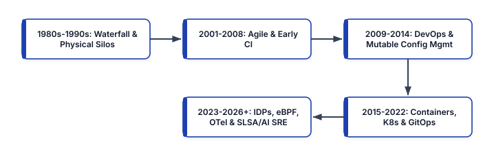


## Phase 1: Waterfall, Physical Data Centers, and Operational Silos (1980s–1990s)

Throughout the 1980s and 1990s, enterprise software engineering was modeled after civil construction and physical manufacturing. Governed by the sequential **Waterfall model**, projects progressed linearly through multi-month phases: Requirements Gathering, Systems Design, Implementation, Integration Testing, and Operations Handover.

This software lifecycle mirrored the physical constraints of on-premises data centers. Provisioning a new production environment required submitting capital expenditure purchase orders, waiting months for physical rack-mounted servers and SAN storage arrays to ship, racking and cabling hardware, manually installing operating systems from physical media, and hand-editing configuration files in `/etc`.

Because infrastructure was scarce, expensive, and treated as long-lived "pet" servers nurtured by hand for years, organizations optimized for hardware utilization and change avoidance. Development teams wrote code in local environments that bore little resemblance to production Solaris, AIX, or Linux clusters. When a quarterly or annual release arrived, operations teams spent sleepless weekends following 100-page Word-document runbooks to deploy monolithic `.ear` or `.war` archives—inevitably encountering environment drift, missing shared libraries, and undocumented firewall rules.

## Phase 2: The Agile Revolution and Continuous Integration (2001–2008)

In February 2001, seventeen software practitioners published the *Manifesto for Agile Software Development*, catalyzing a fundamental shift away from rigid Waterfall specifications toward iterative development, small batch sizes, and continuous customer collaboration. Frameworks such as **Extreme Programming (XP)** and **Scrum** introduced automated unit testing, Test-Driven Development (TDD), and early **Continuous Integration (CI)** servers (such as CruiseControl and Hudson) that compiled code automatically whenever developers committed to version control.

Simultaneously, server virtualization (led by VMware ESX and Xen) decoupled operating systems from physical hardware, while the launch of **Amazon Elastic Compute Cloud (EC2)** and **Simple Storage Service (S3)** in 2006 transformed infrastructure from a capital procurement process into a programmable HTTP API.

Yet a critical bottleneck remained: while Agile enabled development teams to produce shippable code increments every two weeks, IT operations remained bound to manual server administration and ITIL Change Advisory Boards. Code piled up in staging environments waiting for operations approval, proving that software agility is impossible without infrastructure agility.

## Phase 3: The Birth of DevOps and First-Generation Configuration Management (2009–2014)

The catalyst for unifying Agile development with programmable operations crystallized between 2008 and 2009:

- At the **2008 Agile Conference** in Toronto, **Andrew Clay Shafer** and **Patrick Debois** met to discuss "Agile Infrastructure"—applying version control and automated testing practices to systems administration.
- At the **June 2009 O'Reilly Velocity Conference**, Flickr engineers **John Allspaw** and **Paul Hammond** delivered their landmark presentation, *"10+ Deploys per Day: Dev and Ops Cooperation at Flickr."* They demonstrated how shared automated deployment pipelines, feature flags, unified telemetry dashboards, and mutual trust between developers and operations allowed Flickr to deploy to production over ten times daily without sacrificing stability.
- Inspired by that talk, **Patrick Debois** organized the first **DevOpsDays** conference in Ghent, Belgium, in October 2009, coining the term **DevOps** and igniting a global engineering movement.
- In 2010, **Jez Humble** and **David Farley** published *Continuous Delivery*, formalizing the architecture of the automated **Deployment Pipeline**, while **Gene Kim**, **Kevin Behr**, and **George Spafford** codified the **Three Ways of DevOps** (Systems Thinking/Flow, Amplify Feedback Loops, and Culture of Continual Experimentation) in *The Phoenix Project* (2013) and *The DevOps Handbook* (2016).

Technologically, this era was defined by **first-generation Configuration Management** tools—**CFEngine**, **Puppet**, **Chef**, and subsequently **Ansible** and **SaltStack**—alongside early declarative cloud provisioning via **AWS CloudFormation** (2011) and **HashiCorp Terraform** (2014). Operations engineers began storing server state in Git. However, most deployments in this era still relied on **mutable infrastructure**: long-running virtual machines where convergence agents ran every 30 minutes to mutate packages and configuration files in place, leaving systems vulnerable to subtle package drift and partial convergence failures.

## Phase 4: The Container Revolution, Kubernetes, and GitOps (2015–2022)

Between 2013 and 2015, two technological breakthroughs shifted the industry from mutable virtual machines to immutable, declarative cloud-native systems:

1. **Linux Containers and OCI Standardization**: While Linux kernel namespaces and control groups (`cgroups`) had existed for years, **Docker** (2013) combined them with a layered copy-on-write filesystem and an intuitive image registry workflow. For the first time, an application and its exact user-space dependencies could be packaged into a single, immutable artifact that executed identically on a developer's laptop, a CI runner, and a production cluster. In 2015, the **Open Container Initiative (OCI)** standardized container runtime and image specifications, leading to lightweight, daemonless runtimes like **containerd** and **CRI-O**.
2. **Kubernetes and the Cloud Native Computing Foundation (CNCF)**: Drawn from Google's internal Borg cluster manager, **Kubernetes** was open-sourced in 2014 and donated as the founding project of the **CNCF** in 2015. Kubernetes introduced a revolutionary operational paradigm: **continuous declarative reconciliation**. Instead of writing imperative scripts to start processes on specific IP addresses, engineers submitted desired state manifests (`Deployment`, `Service`, `Ingress`) to an API server, and control-loop controllers continuously drove actual cluster state toward desired state.

As microservice architectures scaled on Kubernetes, supporting disciplines rapidly matured:
- **Prometheus** (2012/2016 CNCF) popularized pull-based dimensional time-series metrics and PromQL, while **Envoy Proxy** and **Istio** introduced dynamic Layer-7 traffic shifting and mutual TLS (mTLS) service meshes.
- **GitOps** (coined by Weaveworks in 2017 and realized at scale through **Flux** and **Argo CD**) extended Kubernetes reconciliation to Git repositories, eliminating push-based CI deployment scripts in favor of autonomous in-cluster pull controllers.
- **Site Reliability Engineering (SRE)**—codified by Google in 2016—provided the mathematical framework of SLIs, SLOs, Error Budgets, and toil elimination that brought engineering rigor to production operations.

## Phase 5: The Contemporary Cloud-Native Era (2023–2026 and Beyond)

While Kubernetes, containers, and IaC solved low-level infrastructure orchestration, their widespread adoption exposed a new set of scaling challenges in the early 2020s: developer cognitive overload from YAML sprawl, performance overhead from `iptables` and sidecar proxies, telemetry vendor lock-in, and sophisticated software supply chain attacks (such as SolarWinds, Log4Shell, and upstream CI compromises).

The modern 2026 DevOps architecture—the subject of this Second Edition—directly resolves these challenges across five transformative dimensions:

```
+-----------------------------------------------------+
|    EVOLUTION OF CLOUD-NATIVE ARCHITECTURES (2026)   |
+--------------------+--------------------------------+
| FIRST-GEN (2018+)  | 2026 SECOND EDITION STANDARD   |
+--------------------+--------------------------------+
| Raw K8s YAML &     | Internal Developer Platforms   |
| Ticket Queues      | (Backstage, Crossplane, Kratix)|
+--------------------+--------------------------------+
| Static IAM Keys &  | Keyless OIDC, EKS Pod Identity |
| Mutable Patching   | & Chainguard Wolfi/Distroless  |
+--------------------+--------------------------------+
| iptables & Heavy   | Cilium eBPF Routing, Tetragon  |
| Sidecar Proxies    | & Istio Ambient Sidecarless    |
+--------------------+--------------------------------+
| Disconnected       | Unified OpenTelemetry (OTel),  |
| Telemetry Agents   | eBPF Profiling & AI SRE        |
+--------------------+--------------------------------+
| Unverified Tags    | OCI v1.1 Referrers, CycloneDX, |
| (`:latest`)        | SLSA L3 & Sigstore Cosign      |
+--------------------+--------------------------------+
```

### 1. From Ticket-Ops and YAML Sprawl to Platform Engineering (IDPs)
Rather than forcing every product developer to become an expert in Kubernetes CNI tuning, IAM policy syntax, and Terraform state management, modern organizations treat their internal infrastructure as a product. Platform teams build **Internal Developer Platforms (IDPs)** using **Backstage** as the developer portal, **Crossplane** to expose custom Kubernetes APIs (`CompositeResourceDefinitions`) that provision cloud resources declaratively, and **Kratix** to orchestrate multi-cluster platform promises.

### 2. From `iptables` and Sidecar Proxies to Kernel-Native eBPF
Traditional Kubernetes networking relied on `iptables` rules that scaled poorly (`O(N)` latency degradation) in clusters with thousands of services, while first-generation service meshes injected a resource-heavy Envoy sidecar proxy into every single application pod. Today, **Extended Berkeley Packet Filter (eBPF)** allows sandboxed programs to run directly inside the Linux kernel socket and XDP layers. **Cilium** replaces `iptables` altogether, **Hubble** provides zero-overhead network observability, **Tetragon** and **Falco** enforce kernel-level security policies, and **Istio Ambient Mode** decouples L4 mTLS (`ztunnel`) and L7 policy enforcement from application pods.

### 3. From Proprietary Telemetry Agents to OpenTelemetry and AI-Augmented SRE
The convergence of OpenTracing and OpenCensus into **OpenTelemetry (OTel)**—now the second highest-velocity project in the CNCF after Kubernetes—has established a single, vendor-neutral wire protocol (**OTLP**) and collector architecture for metrics, logs, traces, and continuous profiles. Combined with eBPF auto-instrumentation (**Grafana Beyla** / OTel eBPF) and **AI-augmented SRE** engines that correlate high-cardinality trace anomalies against recent GitOps deployments and SLO burn rates, mean time to detection and root-cause isolation has dropped from hours to seconds.

### 4. From Implicit Trust to Cryptographic Supply Chain Provenance (SLSA & Sigstore)
Modern DevSecOps assumes that upstream dependencies and build environments are constant targets of compromise. Consequently, production clusters no longer trust container images simply because they reside in a private registry. Pipelines now generate **SLSA Build Level 3** provenance and **CycloneDX/SPDX SBOMs**, sign them using short-lived OIDC identities via **Sigstore Cosign** and **Fulcio** (recorded in the immutable **Rekor** transparency log), attach them via the **OCI v1.1 Referrers API**, and enforce cryptographic verification at Kubernetes admission time via **Kyverno**.

## Architectural Strategies for Sustaining DevOps Evolution

As you implement the technologies covered throughout this book, keep four enduring architectural principles at the forefront of your engineering strategy:

1. **Optimize for Cognitive Load and Fast Feedback**: Every tool or process added to a delivery pipeline must either reduce cognitive load for engineers or shorten the feedback loop between writing code and observing its behavior in production.
2. **Default to Declarative Reconciliation Over Imperative Scripting**: Imperative scripts execute once and leave systems vulnerable to subsequent drift. Declarative control loops (whether in Kubernetes, Crossplane, or Argo CD) continuously self-heal infrastructure when reality diverges from intent.
3. **Eliminate Long-Lived Secrets and Static Trust**: Treat every static credential as a liability waiting to be leaked. Design every pipeline, SDK client, and microservice around ephemeral, cryptographically verifiable workload identities.
4. **Measure Reliability Through User Experience**: Uptime percentages of individual servers are meaningless if users cannot complete transactions. Anchor all architectural decisions, deployment gates, and incident response workflows to user-centric SLIs, SLOs, and Error Budgets.


<div style="page-break-after: always;"></div>


# Chapter 1: Mastering AWS CDK: Programmatic Infrastructure as Code

Infrastructure as Code (IaC) has evolved from static, ten-thousand-line YAML or JSON templates into full-featured software engineering frameworks. While first-generation declarative templates such as raw AWS CloudFormation eliminated manual console provisioning (`ClickOps`), they forced engineers to express complex cloud topologies without loops, type safety, modular encapsulation, or unit-testable abstractions. Copy-pasting hundreds of lines of YAML across staging and production environments inevitably reintroduced configuration drift and human error.

The **AWS Cloud Development Kit (AWS CDK v2)** resolves this tension by combining the expressive power of general-purpose programming languages—TypeScript, Python, Go, Java, and C#—with the deterministic state reconciliation of the AWS CloudFormation deployment engine. When you write an AWS CDK application, you do not execute imperative API calls directly against AWS endpoints; instead, you construct an in-memory object graph (the **Construct Tree**) that compiles—or *synthesizes*—into a deterministic **Cloud Assembly** containing CloudFormation templates, asset manifests, and deployment metadata.

In this chapter, we examine the internal architecture of AWS CDK v2 (`aws-cdk-lib` and `constructs` v10), configure keyless authentication via **AWS IAM Identity Center (SSO)** and **OpenID Connect (OIDC)**, engineer multi-tier production stacks using L1, L2, and L3 constructs, enforce shift-left compliance via **CDK Aspects** and **`cdk-nag`**, write fine-grained assertion suites, and automate multi-account delivery pipelines.


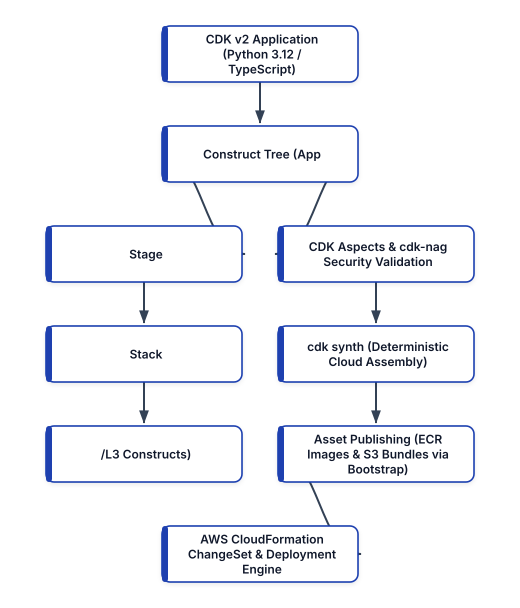


## The Architecture of AWS CDK v2 and the JSII Runtime

To use AWS CDK effectively in production, it is essential to understand how its multi-language engine and synthesis lifecycle work under the hood.

In legacy AWS CDK v1 (now deprecated and superseded by v2), every AWS service was distributed as a separate package (`@aws-cdk/aws-s3`, `@aws-cdk/aws-lambda`, and so on), which frequently caused dependency version mismatches when upgrading constructs. **AWS CDK v2** consolidated the entire stable construct library into a single monolithic package—`aws-cdk-lib` (in Python and TypeScript/npm)—paired with the standalone `constructs` v10 library, which defines the universal `Construct` base class used across AWS CDK, **CDK for Terraform (CDKTF)**, and **CDK for Kubernetes (cdk8s)**.

### How JSII Enables Polyglot Constructs
The AWS CDK core team writes the Construct Library once in **TypeScript**. Rather than maintaining separate ports in Python, Java, C#, and Go, AWS CDK uses **JSII (JavaScript Interop Interface)**. During compilation, JSII inspects the TypeScript type definitions and generates native language bindings for every target ecosystem. When you instantiate a construct in Python 3.12, the Python runtime communicates with an embedded Node.js JSII kernel process that executes the underlying TypeScript construct logic and returns strongly typed Python objects. This architecture guarantees that new AWS service features and security defaults ship simultaneously across all supported languages.

### The Four Phases of the CDK Lifecycle
Every execution of `cdk synth` or `cdk deploy` progresses deterministically through four distinct phases:

1. **Construction (Initialization)**: Your Python or TypeScript code executes, instantiating the root `App`, one or more `Stack` instances, and the nested tree of `Construct` nodes. During this phase, high-level L2 constructs automatically configure least-privilege IAM policies, security group rules, and resource dependencies.
2. **Preparation**: Constructs that implement the `inspect` or preparation hooks finalize cross-resource references and resolve lazy tokens (`Lazy.string()`, `Lazy.list()`).
3. **Validation (and Aspect Execution)**: The CDK framework traverses every node in the Construct Tree and invokes registered **Aspects** (`IAspect.visit()`), such as `cdk-nag` security scanners or corporate tagging enforcers, followed by each construct's `validate()` method. If any security or structural violation is recorded as an error annotation, synthesis halts immediately before touching AWS.
4. **Synthesis**: The Construct Tree serializes its state into the `cdk.out/` directory—known as the **Cloud Assembly**. This directory contains the generated CloudFormation JSON templates, asset manifests for container images and Lambda bundles, and tree metadata.

```
+-----------------------------------------------------+
|       AWS CDK v2 CONSTRUCT ABSTRACTION LEVELS       |
+-----------------+-----------------------------------+
| CONSTRUCT LEVEL | ARCHITECTURAL CHARACTERISTICS     |
+-----------------+-----------------------------------+
| L1 Constructs   | Direct 1:1 mappings of raw CFN    |
| (Cfn* Classes)  | resources (e.g. s3.CfnBucket).    |
|                 | Zero security defaults; used only |
|                 | for Day-0 escape hatches.         |
+-----------------+-----------------------------------+
| L2 Constructs   | Curated AWS abstractions (e.g.,   |
| (Standard Lib)  | s3.Bucket, kms.Key). Includes     |
|                 | secure defaults and intent-based  |
|                 | IAM grants (.grant_read_write()). |
+-----------------+-----------------------------------+
| L3 Constructs   | Multi-resource architectural      |
| (Patterns)      | patterns (e.g. Fargate + ALB) or  |
|                 | enterprise Golden Path modules.   |
+-----------------+-----------------------------------+
```

## Modern Workstation Setup and Keyless AWS Authentication

To run AWS CDK v2 in a 2026 engineering environment, you need **Node.js 22 LTS** (required by the JSII runtime and CDK CLI), **Python 3.12+** (for Python CDK development), and **AWS CLI v2**.

### Installing the Runtime and CDK v2 CLI
On Linux or macOS, verify that Node.js 22 LTS and Python 3.12+ are installed, then install the AWS CDK v2 CLI globally via `npm`:

```bash
# Verify Node.js 22+ and Python 3.12+ runtimes
node --version
python3 --version

# Install the latest AWS CDK v2 CLI globally
npm install -g aws-cdk@latest

# Confirm CDK v2 CLI installation
cdk --version
```

### Eliminating Static IAM Access Keys with AWS IAM Identity Center
In legacy AWS workflows, engineers ran `aws configure` and pasted long-lived IAM User access keys (`AKIA...`) into `~/.aws/credentials` in plaintext. **Storing static IAM access keys on developer laptops or in CI/CD secret stores is a critical security anti-pattern.** Leaked static keys remain one of the leading causes of cloud account compromises.

Modern AWS engineering mandates **short-lived, dynamically rotated session credentials** issued via **AWS IAM Identity Center (formerly AWS SSO)** for local development and **OpenID Connect (OIDC)** federation for CI/CD pipelines.

To configure keyless local authentication with AWS CLI v2, execute `aws configure sso`:

```bash
aws configure sso
```

The interactive prompt configures a named profile in `~/.aws/config` that authenticates through your organization's identity provider (such as Okta, Entra ID, or Keycloak) with hardware MFA and issues temporary STS credentials valid for 1 to 8 hours:

```ini
# ~/.aws/config
[sso-session enterprise-org]
sso_start_url = https://d-9067abc123.awsapps.com/start
sso_region = us-east-1
sso_registration_scopes = sso:account:access

[profile platform-dev]
sso_session = enterprise-org
sso_account_id = 111122223333
sso_role_name = PlatformEngineerAccess
region = us-west-2
output = json
```

Whenever you begin a development session, acquire fresh temporary credentials via the browser-backed OAuth 2.0 device authorization flow:

```bash
# Authenticate and cache temporary STS credentials
aws sso login --profile platform-dev

# Export profile for CDK CLI and Boto3 SDK discovery
export AWS_PROFILE=platform-dev

# Verify caller identity via STS
aws sts get-caller-identity
```

## Bootstrapping Target Environments Securely

Before deploying AWS CDK v2 stacks into an AWS account and region, the target environment must be **bootstrapped**. Because CDK applications frequently bundle local assets—such as Lambda function source code, static web assets, or Dockerfile builds—and because CloudFormation templates larger than 51,200 bytes cannot be passed inline via API calls, CDK provisions a dedicated `CDKToolkit` staging stack in each target `(account, region)` pair.

The modern CDK v2 bootstrap template provisions:
- An encrypted **Amazon S3 staging bucket** for CloudFormation templates and file assets.
- An **Amazon ECR repository** for container image assets built via BuildKit.
- Five scoped **IAM roles** (`LookupRole`, `FilePublishingRole`, `ImagePublishingRole`, `DeployRole`, and `CloudFormationExecutionRole`) that enable least-privilege cross-account deployments.
- An **SSM Parameter** (`/cdk-bootstrap/hnb659fds/version`) used by CDK to verify bootstrap compatibility.

In production environments, always bootstrap with explicit KMS encryption, termination protection, and a scoped execution policy:

```bash
cdk bootstrap aws://111122223333/us-west-2 \
  --cloudformation-execution-policies \
  arn:aws:iam::aws:policy/AdministratorAccess \
  --termination-protection \
  --trust 999988887777
```

In this command, `--trust 999988887777` permits a central CI/CD deployment account (`999988887777`) to assume the bootstrap deployment roles in the workload account (`111122223333`) without sharing static credentials across accounts.

## Initializing and Structuring a Production Python CDK v2 Project

To initialize a new Python CDK v2 project, create an empty directory and invoke `cdk init`:

```bash
mkdir platform-infra && cd platform-infra
cdk init app --language python
```

Create or activate the virtual environment and configure `requirements.txt` to include `aws-cdk-lib`, `constructs`, `cdk-nag` (for automated security policy enforcement), and `pytest` (for unit testing):

```text
# requirements.txt
aws-cdk-lib>=2.160.0,<3.0.0
constructs>=10.3.0,<11.0.0
cdk-nag>=2.28.0,<3.0.0
pytest>=8.3.0,<9.0.0
```

Install the dependencies into your isolated environment:

```bash
source .venv/bin/activate
pip install --upgrade pip
pip install -r requirements.txt
```

### Enterprise Multi-Stack Project Layout
As an infrastructure repository scales beyond a single proof-of-concept stack, organizing stateful resources (VPCs, KMS keys, RDS databases) separately from stateless compute (ECS Fargate services, Lambda functions) is critical to isolate blast radius and lifecycle cadence. A well-structured CDK v2 repository follows this layout:

```text
platform-infra/
├── app.py
├── cdk.json
├── requirements.txt
├── constructs_lib/
│   ├── __init__.py
│   └── secure_static_site.py
├── stacks/
│   ├── __init__.py
│   ├── network_stack.py
│   ├── data_stack.py
│   └── compute_stack.py
└── tests/
    ├── __init__.py
    └── test_platform_stacks.py
```

## Engineering Production Infrastructure with L2 and L3 Constructs

Let us build a production-grade infrastructure stack in `stacks/compute_stack.py` that demonstrates the power of L2 constructs, automatic dependency resolution, least-privilege `.grant_*()` IAM methods, and KMS encryption by default.

Suppose we are building an asynchronous order-processing microservice where an **AWS Lambda** function (running Python 3.12 on AWS Graviton2 `ARM_64` architecture) processes messages from an encrypted **Amazon SQS** queue (backed by a Dead-Letter Queue) and stores processed payloads in a KMS-encrypted **Amazon S3** bucket with public access strictly blocked:

```python
# stacks/compute_stack.py
from aws_cdk import (
    Duration,
    RemovalPolicy,
    Stack,
    aws_kms as kms,
    aws_lambda as _lambda,
    aws_lambda_event_sources as event_sources,
    aws_s3 as s3,
    aws_sqs as sqs,
)
from constructs import Construct


class OrderProcessingStack(Stack):
    def __init__(
        self,
        scope: Construct,
        construct_id: str,
        **kwargs,
    ) -> None:
        super().__init__(scope, construct_id, **kwargs)

        # 1. Customer-Managed KMS Key with Key Rotation
        cmk = kms.Key(
            self,
            "OrderEncryptionKey",
            enable_key_rotation=True,
            pending_window=Duration.days(30),
            removal_policy=RemovalPolicy.RETAIN,
        )

        # 2. Hardened S3 Bucket (Zero Public Access)
        self.archive_bucket = s3.Bucket(
            self,
            "OrderArchiveBucket",
            encryption=s3.BucketEncryption.KMS,
            encryption_key=cmk,
            bucket_key_enabled=True,
            block_public_access=(
                s3.BlockPublicAccess.BLOCK_ALL
            ),
            enforce_ssl=True,
            versioned=True,
            removal_policy=RemovalPolicy.RETAIN,
        )

        # 3. Dead-Letter Queue (DLQ) & Primary Queue
        dlq = sqs.Queue(
            self,
            "OrderProcessingDLQ",
            encryption=sqs.QueueEncryption.KMS,
            encryption_master_key=cmk,
            enforce_ssl=True,
            retention_period=Duration.days(14),
        )

        self.order_queue = sqs.Queue(
            self,
            "OrderProcessingQueue",
            encryption=sqs.QueueEncryption.KMS,
            encryption_master_key=cmk,
            enforce_ssl=True,
            visibility_timeout=Duration.seconds(90),
            receive_message_wait_time=(
                Duration.seconds(20)
            ),
            dead_letter_queue=sqs.DeadLetterQueue(
                max_receive_count=3,
                queue=dlq,
            ),
        )

        # 4. Graviton2 Python 3.12 Lambda Processor
        self.processor_fn = _lambda.Function(
            self,
            "OrderProcessorFn",
            runtime=_lambda.Runtime.PYTHON_3_12,
            architecture=_lambda.Architecture.ARM_64,
            handler="index.handler",
            timeout=Duration.seconds(30),
            memory_size=512,
            tracing=_lambda.Tracing.ACTIVE,
            code=_lambda.Code.from_inline(
                "import os, json\n"
                "def handler(event, context):\n"
                "    b = os.environ['BUCKET_NAME']\n"
                "    return {'ok': True, 'b': b}"
            ),
            environment={
                "BUCKET_NAME": (
                    self.archive_bucket.bucket_name
                ),
            },
        )

        # 5. Intent-Based Least-Privilege IAM Grants
        self.archive_bucket.grant_write(
            self.processor_fn
        )
        self.processor_fn.add_event_source(
            event_sources.SqsEventSource(
                self.order_queue,
                batch_size=10,
                report_batch_item_failures=True,
            )
        )
```

Notice what happens when `self.archive_bucket.grant_write(self.processor_fn)` is called on the L2 construct:
1. CDK inspects the `OrderArchiveBucket` and detects that it is encrypted with a customer-managed KMS key (`OrderEncryptionKey`).
2. CDK automatically attaches an IAM policy statement to `OrderProcessorFn`'s execution role granting `s3:PutObject` and `s3:AbortMultipartUpload` scoped strictly to that bucket's ARN.
3. Simultaneously, CDK grants `kms:Encrypt`, `kms:ReEncrypt*`, and `kms:GenerateDataKey*` on `OrderEncryptionKey` to the Lambda role. In raw CloudFormation or Terraform, forgetting to grant KMS key permissions alongside S3 bucket permissions is one of the most common causes of runtime `AccessDenied` failures. L2 constructs eliminate this entire class of defect.

### Implicit vs. Explicit Resource Dependencies
In 95% of cases, AWS CDK resolves deployment ordering implicitly via **Tokens**. When we pass `self.archive_bucket.bucket_name` into the `environment` dictionary of `OrderProcessorFn`, CDK inserts an unresolved CloudFormation `{ "Ref": "OrderArchiveBucket..." }` token. CloudFormation inspects that token reference and guarantees that the S3 bucket is created before the Lambda function.

When working with low-level **L1 constructs (`Cfn*`)** or custom resources where a dependency is operational rather than reference-based (for example, waiting for a VPC NAT Gateway route to propagate before starting an instance), you can declare an explicit dependency on the Construct Tree node:

```python
# Explicit node dependency between constructs
nat_route.node.add_dependency(internet_gateway_att)
```

## Authoring Reusable L3 Enterprise Constructs

One of the highest-leverage practices in Platform Engineering is packaging organizational security standards into reusable **L3 Constructs** distributed via a private Python index or npm registry (such as AWS CodeArtifact).

In legacy tutorials, static websites were frequently configured by setting `public_read_access=True` directly on an S3 bucket. In modern cloud security, public S3 buckets are strictly prohibited by AWS Organizations Service Control Policies (SCPs). Instead, static assets must reside in a completely private, KMS/SSE-S3 encrypted S3 bucket fronted by an **Amazon CloudFront distribution** using **Origin Access Control (OAC)** and TLS 1.2/1.3 enforcement.

Here is how to encapsulate this compliant architecture into a reusable L3 construct in `constructs_lib/secure_static_site.py`:

```python
# constructs_lib/secure_static_site.py
from aws_cdk import (
    RemovalPolicy,
    aws_cloudfront as cloudfront,
    aws_cloudfront_origins as origins,
    aws_s3 as s3,
    aws_s3_deployment as s3deploy,
)
from constructs import Construct


class SecureStaticSite(Construct):
    def __init__(
        self,
        scope: Construct,
        construct_id: str,
        asset_path: str,
    ) -> None:
        super().__init__(scope, construct_id)

        # Private S3 Bucket with SSL & Public Block
        self.site_bucket = s3.Bucket(
            self,
            "PrivateSiteBucket",
            encryption=s3.BucketEncryption.S3_MANAGED,
            block_public_access=(
                s3.BlockPublicAccess.BLOCK_ALL
            ),
            enforce_ssl=True,
            versioned=True,
            removal_policy=RemovalPolicy.RETAIN,
        )

        # CloudFront Distribution with Origin Access
        # Control (OAC) and HTTPS Redirect
        default_behav = cloudfront.BehaviorOptions(
            origin=(
                origins.S3BucketOrigin
                .with_origin_access_control(
                    self.site_bucket
                )
            ),
            viewer_protocol_policy=(
                cloudfront.ViewerProtocolPolicy
                .REDIRECT_TO_HTTPS
            ),
            compress=True,
        )

        self.distribution = cloudfront.Distribution(
            self,
            "SiteDistribution",
            default_root_object="index.html",
            minimum_protocol_version=(
                cloudfront.SecurityPolicyProtocol
                .TLS_V1_2_2021
            ),
            default_behavior=default_behav,
        )

        # Deploy Static Bundle & Invalidate Cache
        s3deploy.BucketDeployment(
            self,
            "AssetDeployment",
            sources=[
                s3deploy.Source.asset(asset_path)
            ],
            destination_bucket=self.site_bucket,
            distribution=self.distribution,
            distribution_paths=["/*"],
        )
```

Because every resource inside `SecureStaticSite` is scoped to `self` (the construct's own namespace), you can instantiate `SecureStaticSite` ten times inside the same stack (`SecureStaticSite(self, "DocsPortal", "./docs")`, `SecureStaticSite(self, "AdminUI", "./admin")`), and CDK's hierarchical path hashing guarantees globally unique logical IDs and physical resource names without collision.

## Shift-Left Governance with CDK Aspects and `cdk-nag`

Waiting until a CloudFormation deployment fails—or worse, until a post-deployment Cloud Security Posture Management (CSPM) scan flags a violation—slows down engineering velocity. AWS CDK v2 implements the **Visitor Pattern** via **Aspects (`IAspect`)**, allowing you to inspect, mutate, or validate every single construct in the tree before synthesis completes.

The industry-standard library for CDK security validation is **`cdk-nag`**, which bundles rule packs mapped to the **AWS Solutions Security Matrix**, **NIST 800-53 rev 5**, **HIPAA**, and **PCI-DSS**.

Here is how to wire both a custom cost-allocation tagging Aspect and `cdk-nag`'s `AwsSolutionsChecks` into `app.py`:

```python
# app.py
import os
import aws_cdk as cdk
from aws_cdk import Aspects, Tags
from cdk_nag import AwsSolutionsChecks, NagSuppressions
from stacks.compute_stack import OrderProcessingStack

app = cdk.App()

env = cdk.Environment(
    account=os.environ.get(
        "CDK_DEFAULT_ACCOUNT", "111122223333"
    ),
    region=os.environ.get(
        "CDK_DEFAULT_REGION", "us-west-2"
    ),
)

order_stack = OrderProcessingStack(
    app,
    "ProdOrderProcessingStack",
    env=env,
)

# Apply mandatory FinOps cost-allocation tags to all
# taggable resources in the Construct Tree
Tags.of(app).add("Environment", "production")
Tags.of(app).add("CostCenter", "CC-4092-Platform")
Tags.of(app).add("ManagedBy", "aws-cdk-v2")

# Documented, auditable suppression for L2 managed IAM
NagSuppressions.add_stack_suppressions(
    order_stack,
    [
        {
            "id": "AwsSolutions-IAM4",
            "reason": (
                "AWSLambdaBasicExecutionRole scoped "
                "exclusively to CloudWatch Logs."
            ),
        },
        {
            "id": "AwsSolutions-S1",
            "reason": (
                "S3 data events captured centrally "
                "via AWS Organization CloudTrail."
            ),
        },
    ],
)

# Enforce AWS Solutions security checks at synth time
Aspects.of(app).add(
    AwsSolutionsChecks(verbose=True)
)

app.synth()
```

When you execute `cdk synth`, `AwsSolutionsChecks` walks every L1 CloudFormation resource inside `ProdOrderProcessingStack`. If an engineer accidentally adds an unencrypted SQS queue, an overly permissive IAM wildcard policy (`*`), or an S3 bucket without `enforce_ssl=True`, `cdk synth` fails immediately with a detailed rule remediation report.

## Testing Infrastructure Code with `aws_cdk.assertions`

Because AWS CDK synthesizes deterministic CloudFormation templates, you can execute fast, offline unit tests in milliseconds using `pytest` and the `aws_cdk.assertions` module included directly inside `aws-cdk-lib`.

Assertion tests fall into two categories:
1. **Fine-Grained Assertions (`Template.has_resource_properties`, `Capture`, `Match`)**: Verify critical security properties, runtime configurations, and IAM policies.
2. **Snapshot Tests**: Compare the synthesized template against a committed baseline to detect unintended regressions during construct refactoring.

Below is a comprehensive `pytest` suite in `tests/test_platform_stacks.py`:

```python
# tests/test_platform_stacks.py
import aws_cdk as cdk
from aws_cdk.assertions import Capture, Match, Template
from stacks.compute_stack import OrderProcessingStack


def test_s3_bucket_enforces_kms_and_blocks_public():
    app = cdk.App()
    stack = OrderProcessingStack(
        app, "TestOrderStack"
    )
    template = Template.from_stack(stack)

    # Verify KMS encryption and public access block
    sse_cfg = [
        {
            "BucketKeyEnabled": True,
            "ServerSideEncryptionByDefault": {
                "SSEAlgorithm": "aws:kms",
                "KMSMasterKeyID": Match.any_value(),
            },
        }
    ]
    template.has_resource_properties(
        "AWS::S3::Bucket",
        {
            "BucketEncryption": {
                "ServerSideEncryptionConfiguration": (
                    sse_cfg
                )
            },
            "PublicAccessBlockConfiguration": {
                "BlockPublicAcls": True,
                "BlockPublicPolicy": True,
                "IgnorePublicAcls": True,
                "RestrictPublicBuckets": True,
            },
        },
    )


def test_lambda_uses_arm64_python312_and_active_xray():
    app = cdk.App()
    stack = OrderProcessingStack(
        app, "TestOrderStack"
    )
    template = Template.from_stack(stack)

    timeout_capture = Capture()
    template.has_resource_properties(
        "AWS::Lambda::Function",
        {
            "Runtime": "python3.12",
            "Architectures": ["arm64"],
            "TracingConfig": {"Mode": "Active"},
            "Timeout": timeout_capture,
        },
    )
    assert timeout_capture.as_number() == 30


def test_sqs_queue_configured_with_dlq_redrive():
    app = cdk.App()
    stack = OrderProcessingStack(
        app, "TestOrderStack"
    )
    template = Template.from_stack(stack)

    # Expect primary queue + DLQ = 2 queues
    template.resource_count_is("AWS::SQS::Queue", 2)
    template.has_resource_properties(
        "AWS::SQS::Queue",
        {
            "VisibilityTimeout": 90,
            "RedrivePolicy": {
                "deadLetterTargetArn": (
                    Match.any_value()
                ),
                "maxReceiveCount": 3,
            },
        },
    )
```

Execute the test suite using `pytest`:

```bash
pytest -v tests/
```

Notice that because `aws-cdk-lib` v2 bundles `aws_cdk.assertions` natively, no separate `aws-cdk.assertions` v1 package installation is required, and the entire test suite runs without making a single network call to AWS.

## Continuous Delivery with Modern CDK Pipelines and OIDC

Once your CDK application is tested and validated via `cdk-nag`, how should it be deployed across Staging and Production accounts? In modern 2026 architectures, teams use one of two patterns:

1. **GitHub Actions / GitLab CI with Keyless OIDC Federation** running `cdk diff` on pull requests and `cdk deploy --require-approval never` on merges to `main`.
2. **Self-Mutating AWS CDK Pipelines (`aws_cdk.pipelines.CodePipeline`)** integrated with GitHub via **AWS CodeConnections (formerly CodeStar Connections)**. Note that AWS deprecated AWS CodeCommit for new customers, and the legacy CDK v1 `CdkPipeline` / `SimpleSynthAction` classes have been superseded by the modern `CodePipeline` and `ShellStep` APIs.

Here is how to define a multi-stage, self-mutating CDK v2 pipeline using `CodePipeline`, `ShellStep`, and a GitHub CodeConnection:

```python
# stacks/pipeline_stack.py
import aws_cdk as cdk
from aws_cdk import Stack, Stage, pipelines
from constructs import Construct
from stacks.compute_stack import OrderProcessingStack


class ApplicationStage(Stage):
    def __init__(
        self,
        scope: Construct,
        construct_id: str,
        **kwargs,
    ) -> None:
        super().__init__(scope, construct_id, **kwargs)
        OrderProcessingStack(
            self, "OrderProcessingService"
        )


class PlatformPipelineStack(Stack):
    def __init__(
        self,
        scope: Construct,
        construct_id: str,
        connection_arn: str,
        **kwargs,
    ) -> None:
        super().__init__(scope, construct_id, **kwargs)

        source = (
            pipelines.CodePipelineSource.connection(
                "enterprise-org/platform-infra",
                "main",
                connection_arn=connection_arn,
            )
        )

        synth_step = pipelines.ShellStep(
            "SynthAndValidate",
            input=source,
            commands=[
                "npm install -g aws-cdk",
                "pip install -r requirements.txt",
                "pytest -v tests/",
                "cdk synth",
            ],
        )

        pipeline = pipelines.CodePipeline(
            self,
            "PlatformDeliveryPipeline",
            cross_account_keys=True,
            synth=synth_step,
        )

        # Deploy to Staging Account automatically
        staging = ApplicationStage(
            self,
            "Staging",
            env=cdk.Environment(
                account="222233334444",
                region="us-west-2",
            ),
        )
        pipeline.add_stage(staging)

        # Deploy to Production Account with Approval
        prod = ApplicationStage(
            self,
            "Production",
            env=cdk.Environment(
                account="333344445555",
                region="us-west-2",
            ),
        )
        pipeline.add_stage(
            prod,
            pre=[
                pipelines.ManualApprovalStep(
                    "PromoteToProd"
                )
            ],
        )
```

When `SynthAndValidate` runs, it executes `pytest` and `cdk synth` (which triggers `cdk-nag`). If all unit tests and security aspects pass, the pipeline self-mutates if new stages were added, publishes assets to the target accounts' bootstrap buckets, and rolls out the CloudFormation change sets across Staging and Production using short-lived cross-account IAM roles.

## Summary

AWS CDK v2 elevates Infrastructure as Code from static configuration files to a disciplined software engineering practice. By combining the unified `aws-cdk-lib` and `constructs` v10 hierarchy with keyless AWS IAM Identity Center authentication, hardened L2/L3 constructs, automated `cdk-nag` Aspect validation, and `aws_cdk.assertions` unit testing, engineering teams can provision complex multi-account cloud architectures with high velocity and cryptographic confidence. In Chapter 2, we move from provisioning cloud infrastructure to building resilient cloud-native applications using the AWS SDK.


<div style="page-break-after: always;"></div>


# Chapter 2: AWS SDK: Engineering Resilient Cloud-Native Applications

Provisioning cloud infrastructure via AWS CDK v2 is only half of the cloud-native equation; modern distributed applications must also interact directly with cloud data planes and control planes at runtime. Whether a microservice is streaming multi-gigabyte telemetry archives to Amazon S3, executing atomic conditional transactions against Amazon DynamoDB, publishing events to Amazon EventBridge, or invoking downstream AWS Lambda functions, all runtime communication flows through the **AWS Software Development Kit (AWS SDK)**.

However, a naive integration of the AWS SDK—instantiating default clients inside request handlers, relying on default retry policies, ignoring pagination tokens, or authenticating with static credentials—will inevitably fail under production load. Cloud networks experience transient packet loss, managed services enforce strict token-bucket rate limits (`ProvisionedThroughputExceededException`, `SlowDown`, `ThrottlingException`), and unconfigured socket timeouts can hang application worker threads indefinitely.

In this chapter, we engineer production-grade cloud integrations using **AWS SDK for Python (Boto3 v1.35+ / Botocore)** alongside modern architectural patterns applicable to **AWS SDK for Go v2** and **AWS SDK for JavaScript v3**. We examine zero-trust workload identity credential chains (**EKS Pod Identity**, **IRSA**, and **IMDSv2**), client-side **Adaptive Retry Mode**, high-concurrency connection pooling, **Paginators** and **Waiters**, multipart S3 streaming, idempotent DynamoDB transactions, **OpenTelemetry (ADOT)** distributed tracing, and hermetic unit testing with **Moto v5**.


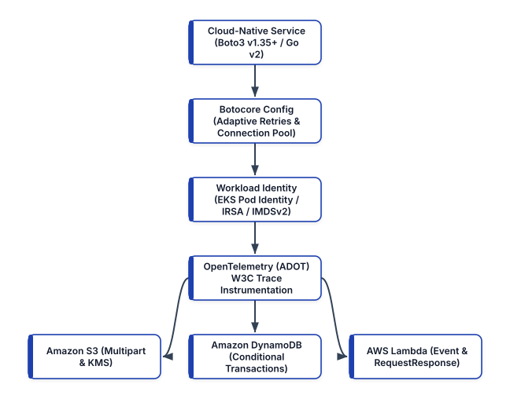


## The Architecture of Modern AWS SDKs

Across all major programming languages, AWS has modernized its SDK architecture around modular service clients, pluggable middleware pipelines, and non-blocking I/O:

1. **AWS SDK for Python (Boto3 v1.35+ and Botocore)**: Built on top of the low-level `botocore` library, which implements AWS Signature Version 4 (`SigV4` and `SigV4a` multi-region signing), HTTP connection pooling (`urllib3`), event hooks, paginators, and retry state machines.
2. **AWS SDK for JavaScript / TypeScript v3 (`@aws-sdk/client-*`)**: Completely modularized into separate per-service packages (`@aws-sdk/client-s3`, `@aws-sdk/client-dynamodb`) to minimize serverless bundle sizes and cold-start latency.
3. **AWS SDK for Go v2 (`aws-sdk-go-v2`)**: Designed around zero-reflection performance, context-aware cancellation (`context.Context`), and strongly typed middleware stacks.

### Low-Level Clients vs. High-Level Resources in Boto3
In Boto3, AWS historically exposed two distinct interfaces:
- **High-Level `boto3.resource()`**: An object-oriented wrapper (such as `s3 = boto3.resource("s3")`) available only for a small subset of legacy AWS services. The AWS SDK team has frozen the `resource` interface and does not build `resource` abstractions for new AWS services.
- **Low-Level `boto3.client()`**: A direct, 1:1 data-driven client generated automatically from official Botocore service JSON models. It supports 100% of AWS APIs, exposes predictable dictionary payloads, integrates cleanly with static type checkers (`boto3-stubs` / `mypy`), and avoids hidden lazy-loading network calls.

**Production Best Practice**: Standardize on `boto3.client()` across all production microservices and automation tooling. Furthermore, because creating a `boto3.client()` parses massive JSON service definitions and initializes TLS connection pools, **always instantiate clients once at module or worker initialization time** (or inside a thread-safe dependency injection container) rather than recreating them inside hot request handlers or Lambda `handler()` invocations.

## Zero-Trust Credential Resolution Chains

A foundational rule of modern DevSecOps is that application code must never contain hardcoded AWS Access Keys (`AKIA...`) or read static secrets from `.env` files. Instead, the AWS SDK uses a deterministic **Credential Provider Chain** that automatically discovers short-lived, auto-rotating AWS STS (Security Token Service) credentials from the runtime environment.

```
+-----------------------------------------------------+
|       BOTO3 / BOTOCORE CREDENTIAL CHAIN (2026)      |
+------+----------------------------------------------+
| STEP | CREDENTIAL SOURCE & PRODUCTION USE CASE      |
+------+----------------------------------------------+
| 1    | Explicit Session Parameters (STS AssumeRole  |
|      | cross-account delegation or Moto tests).     |
+------+----------------------------------------------+
| 2    | Environment Variables (AWS_ACCESS_KEY_ID,    |
|      | AWS_SESSION_TOKEN) injected by AWS Lambda    |
|      | runtime or GitHub Actions OIDC step.         |
+------+----------------------------------------------+
| 3    | Container & Kubernetes Workload Identity:    |
|      | - EKS Pod Identity (169.254.170.23 token)    |
|      | - EKS IRSA (AWS_WEB_IDENTITY_TOKEN_FILE)     |
|      | - ECS Task Roles (Container Relative URI)    |
+------+----------------------------------------------+
| 4    | AWS IAM Identity Center (SSO) Profile        |
|      | (~/.aws/config) for local workstation dev.   |
+------+----------------------------------------------+
| 5    | EC2 Instance Metadata Service v2 (IMDSv2)    |
|      | via session-oriented PUT token requests.     |
+------+----------------------------------------------+
```

### EKS Pod Identity vs. IRSA
When running microservices on Amazon EKS (Kubernetes v1.31+), **EKS Pod Identity** is the modern successor to IAM Roles for Service Accounts (IRSA). Unlike IRSA—which required configuring an OIDC provider per cluster and embedding cluster-specific OIDC URLs inside IAM role trust policies—EKS Pod Identity runs an AWS-managed node daemon (`eks-pod-identity-agent`) listening on a link-local address (`169.254.170.23`).

When a Kubernetes Pod starts with an associated ServiceAccount, the EKS control plane automatically injects `AWS_CONTAINER_CREDENTIALS_FULL_URI` and `AWS_CONTAINER_AUTHORIZATION_TOKEN_FILE` into the container. Boto3 v1.34+ detects these variables natively, exchanges the projected Kubernetes service account token for temporary IAM credentials, and refreshes them seamlessly in the background before expiration. Your Python code requires **zero authentication boilerplate**.

## Resilience Engineering: Adaptive Retries, Timeouts, and Pooling

By default, a newly initialized Boto3 client uses conservative defaults (`max_pool_connections=10`, `connect_timeout=60`, `read_timeout=60`, and `legacy` or `standard` retry mode). In a high-throughput microservice or an asynchronous worker pool, these defaults create severe operational risks:
- If a downstream AWS API experiences latency degradation, a 60-second read timeout will block worker threads and trigger cascading HTTP `503 Service Unavailable` failures across upstream services.
- If 50 concurrent threads share a single `boto3.client()` with a connection pool size of 10, 40 threads will constantly discard and renegotiate TLS handshakes, spiking CPU utilization and tail latency.

### Configuring `botocore.config.Config` with Adaptive Retry Mode
Botocore supports three retry modes: `legacy`, `standard`, and `adaptive`. **Adaptive Retry Mode** builds upon `standard` exponential backoff with full jitter by adding a **client-side token-bucket rate limiter** (based on the CUBIC congestion control algorithm). When your application receives a `ThrottlingException` or `SlowDown` response from AWS, the client dynamically throttles its own outbound request rate to match the downstream service's available capacity, preventing retry storms during partial brownouts.

Here is the production factory pattern for creating hardened, resilient Boto3 clients:

```python
# cloud_clients.py
import os
import boto3
from botocore.config import Config


def create_resilient_client(
    service_name: str,
    region_name: str | None = None,
):
    """Instantiate a production-hardened Boto3 client
    with adaptive retries, strict socket timeouts,
    and expanded connection pooling.
    """
    target_region = region_name or os.environ.get(
        "AWS_REGION", "us-west-2"
    )

    resilient_config = Config(
        region_name=target_region,
        signature_version="v4",
        # Adaptive mode enables client-side rate
        # limiting + exponential backoff with jitter
        retries={
            "mode": "adaptive",
            "max_attempts": 5,
        },
        # Fail fast on dead sockets; bound read latency
        connect_timeout=3,
        read_timeout=10,
        # Keep TCP connections warm and support
        # concurrent worker threads without churn
        tcp_keepalive=True,
        max_pool_connections=50,
    )

    session = boto3.session.Session()
    return session.client(
        service_name, config=resilient_config
    )
```

## Eliminating Polling Loops with Paginators and Waiters

Two of the most frequent bugs in cloud automation scripts are incomplete list results caused by ignoring API pagination and flaky deployments caused by hardcoded `time.sleep()` loops.

### Mastering Paginators
Most AWS list and query APIs return at most 1,000 items per HTTP response (or 1 MB of data in DynamoDB) along with a `NextContinuationToken` or `LastEvaluatedKey`. If you call `s3_client.list_objects_v2(Bucket="my-bucket")` directly on a bucket containing 25,000 objects, your code silently ignores 24,000 objects.

Instead of manually managing continuation tokens in `while` loops, always use Botocore **Paginators**, which lazily yield pages (and support server-side filtering alongside client-side **JMESPath** filtering via `.search()`):

```python
# s3_inventory.py
from cloud_clients import create_resilient_client


def list_large_parquet_files(
    bucket_name: str, prefix: str, min_bytes: int
) -> list[str]:
    """Use a Botocore Paginator with JMESPath filtering
    to find objects larger than min_bytes across keys
    without exhausting application memory.
    """
    s3_client = create_resilient_client("s3")
    paginator = s3_client.get_paginator(
        "list_objects_v2"
    )

    page_iterator = paginator.paginate(
        Bucket=bucket_name,
        Prefix=prefix,
        PaginationConfig={"PageSize": 1000},
    )

    # Filter results directly using a JMESPath query
    jmespath_expr = (
        f"Contents[?Size >= `{min_bytes}` "
        f"&& ends_with(Key, `.parquet`)].Key"
    )

    matched_keys: list[str] = []
    for key in page_iterator.search(jmespath_expr):
        if key is not None:
            matched_keys.append(key)

    return matched_keys
```

### Mastering Waiters
When an API call initiates an asynchronous state transition—such as creating a DynamoDB table, launching an EC2 instance, or invalidating a CloudFront distribution—calling `time.sleep(30)` is either too slow or too short. Botocore **Waiters** poll the underlying `describe_*` API at service-tuned intervals with customizable backoff ceilings:

```python
# Wait deterministically for DynamoDB table activation
dynamodb_client = create_resilient_client("dynamodb")
waiter = dynamodb_client.get_waiter("table_exists")

waiter.wait(
    TableName="orders-production",
    WaiterConfig={
        "Delay": 5,
        "MaxAttempts": 24,
    },
)
```

## High-Throughput Amazon S3 Operations and KMS Security

Amazon S3 serves as the backbone for object storage, data lakehouse tables (Apache Iceberg / Parquet), and build artifacts. When transferring objects larger than a few megabytes, using raw `put_object` or `get_object` over a single HTTP stream underutilizes network bandwidth and forces a full re-upload if a connection drops at 99%.

Instead, use `boto3.s3.transfer.TransferConfig` with `upload_fileobj` and `download_fileobj`. This invokes the `s3transfer` engine to split streams automatically into parallel multipart chunks, compute SHA-256 checksums (`ChecksumAlgorithm="SHA256"`), and enforce KMS server-side encryption:

```python
# s3_transfer_service.py
from typing import BinaryIO
from boto3.s3.transfer import TransferConfig
from botocore.exceptions import ClientError
from cloud_clients import create_resilient_client

# Configure parallel multipart transfers:
# 16 MB threshold, 16 MB chunk size, 10 worker threads
MULTIPART_CONFIG = TransferConfig(
    multipart_threshold=16 * 1024 * 1024,
    multipart_chunksize=16 * 1024 * 1024,
    max_concurrency=10,
    use_threads=True,
)


def upload_encrypted_artifact(
    stream: BinaryIO,
    bucket: str,
    object_key: str,
    kms_key_arn: str,
) -> bool:
    """Stream an artifact to S3 via parallel multipart
    uploads, SHA-256 integrity checks, and KMS SSE.
    """
    s3_client = create_resilient_client("s3")
    extra_args = {
        "ServerSideEncryption": "aws:kms",
        "SSEKMSKeyId": kms_key_arn,
        "BucketKeyEnabled": True,
        "ChecksumAlgorithm": "SHA256",
        "ContentType": "application/octet-stream",
    }

    try:
        s3_client.upload_fileobj(
            Fileobj=stream,
            Bucket=bucket,
            Key=object_key,
            ExtraArgs=extra_args,
            Config=MULTIPART_CONFIG,
        )
        return True
    except ClientError as exc:
        err_code = exc.response.get("Error", {}).get(
            "Code", "Unknown"
        )
        raise RuntimeError(
            f"S3 upload failed [{err_code}]: {exc}"
        ) from exc
```

## Idempotent and Conditional Amazon DynamoDB Engineering

Amazon DynamoDB delivers consistent single-digit millisecond latency at virtually any scale, making it the default state store for serverless and cloud-native microservices. However, writing production DynamoDB code requires two architectural safeguards:
1. **On-Demand Billing (`PAY_PER_REQUEST`) or Warm Throughput**: Avoids manual capacity unit provisioning guesswork for spiky workloads.
2. **Idempotent Conditional Writes (`ConditionExpression`)**: Because Adaptive Retry Mode (or upstream message queues like SQS and EventBridge) employs *at-least-once* delivery semantics, a network timeout after DynamoDB commits a write can trigger a duplicate retry. Without a `ConditionExpression` checking an idempotency key or version counter, retries can corrupt state or double-charge customers.

Here is a complete, production-grade DynamoDB repository using the low-level client, optimistic concurrency control (`version`), and atomic conditional expressions:

```python
# order_repository.py
from datetime import datetime, timezone
from botocore.exceptions import ClientError
from cloud_clients import create_resilient_client


class OrderRepository:
    def __init__(self, table_name: str) -> None:
        self.table_name = table_name
        self.client = create_resilient_client(
            "dynamodb"
        )

    def create_order_idempotent(
        self,
        order_id: str,
        customer_id: str,
        amount_cents: int,
    ) -> dict[str, str]:
        """Insert a new order only if order_id does not
        already exist. Safely handles duplicate calls.
        """
        now_iso = datetime.now(
            timezone.utc
        ).isoformat()

        try:
            self.client.put_item(
                TableName=self.table_name,
                Item={
                    "pk": {"S": f"ORDER#{order_id}"},
                    "sk": {"S": "METADATA"},
                    "customer_id": {"S": customer_id},
                    "amount_cents": {
                        "N": str(amount_cents)
                    },
                    "status": {"S": "PENDING"},
                    "version": {"N": "1"},
                    "updated_at": {"S": now_iso},
                },
                ConditionExpression=(
                    "attribute_not_exists(pk)"
                ),
            )
            return {
                "order_id": order_id,
                "status": "CREATED",
            }
        except ClientError as exc:
            code = exc.response["Error"]["Code"]
            if (
                code
                == "ConditionalCheckFailedException"
            ):
                # Idempotent replay: order exists
                return {
                    "order_id": order_id,
                    "status": "ALREADY_EXISTS",
                }
            raise

    def transition_order_status(
        self,
        order_id: str,
        expected_version: int,
        new_status: str,
    ) -> int:
        """Optimistic locking update: bumps version
        atomically only if current version matches.
        """
        next_ver = expected_version + 1
        now_iso = datetime.now(
            timezone.utc
        ).isoformat()

        self.client.update_item(
            TableName=self.table_name,
            Key={
                "pk": {"S": f"ORDER#{order_id}"},
                "sk": {"S": "METADATA"},
            },
            UpdateExpression=(
                "SET #st = :new_st, "
                "#ver = :next_ver, "
                "updated_at = :now"
            ),
            ConditionExpression="#ver = :exp_ver",
            ExpressionAttributeNames={
                "#st": "status",
                "#ver": "version",
            },
            ExpressionAttributeValues={
                ":new_st": {"S": new_status},
                ":exp_ver": {
                    "N": str(expected_version)
                },
                ":next_ver": {"N": str(next_ver)},
                ":now": {"S": now_iso},
            },
        )
        return next_ver
```

## Invoking AWS Lambda and Tracing with OpenTelemetry (ADOT)

When invoking AWS Lambda functions programmatically via Boto3, engineers must choose between two execution models:
- **Synchronous (`InvocationType="RequestResponse"`)**: Blocks until the function returns a payload. Importantly, a `200 OK` HTTP status from the Lambda control plane only means Lambda accepted the invocation; if the function's Python code raised an unhandled exception, the response dictionary contains a `"FunctionError": "Unhandled"` key that you must explicitly inspect!
- **Asynchronous (`InvocationType="Event"`)**: Hands the event off to Lambda's internal durable queue (returning `202 Accepted` immediately) with built-in retries and Dead-Letter Queue / On-Failure Destination support.

```python
# lambda_invoker.py
import json
from cloud_clients import create_resilient_client


def invoke_risk_scorer_sync(
    function_name: str, payload: dict
) -> dict:
    """Invoke a Lambda function synchronously & verify
    both transport and execution-level errors.
    """
    lambda_client = create_resilient_client("lambda")
    response = lambda_client.invoke(
        FunctionName=function_name,
        InvocationType="RequestResponse",
        Payload=json.dumps(payload).encode("utf-8"),
    )

    raw_body = response["Payload"].read().decode(
        "utf-8"
    )
    parsed = json.loads(raw_body) if raw_body else {}

    # Crucial check: HTTP 200 can still carry a
    # runtime FunctionError inside the payload
    if "FunctionError" in response:
        err_type = response["FunctionError"]
        raise RuntimeError(
            f"Lambda runtime error [{err_type}]: "
            f"{parsed}"
        )

    return parsed
```

### Modernizing Distributed Tracing: From Legacy X-Ray SDK to OpenTelemetry (ADOT)
In first-generation AWS serverless applications, developers instrumented code using the proprietary `aws-xray-sdk` library. AWS has officially shifted its observability strategy to **OpenTelemetry (OTel)** via the **AWS Distro for OpenTelemetry (ADOT)**.

By attaching the managed ADOT Lambda Layer (`arn:aws:lambda:<region>:901920570463:layer:aws-otel-python-<arch>-ver-1-25-0:1`) or installing `opentelemetry-instrumentation-botocore`, every outbound Boto3 call to S3, DynamoDB, SQS, or Lambda automatically injects W3C `traceparent` and X-Ray trace headers without vendor lock-in:

```python
# telemetry_handler.py
from opentelemetry import trace
from opentelemetry.instrumentation.botocore import (
    BotocoreInstrumentor,
)
from order_repository import OrderRepository

# Auto-instrument all Botocore/Boto3 API calls once
# at module initialization time (outside the handler)
BotocoreInstrumentor().instrument()
tracer = trace.get_tracer("order.service.tracer")
repo = OrderRepository(table_name="orders-production")


def lambda_handler(event: dict, context: object):
    with tracer.start_as_current_span(
        "process_checkout_order"
    ) as span:
        order_id = event["order_id"]
        customer_id = event["customer_id"]
        amount = int(event["amount_cents"])

        span.set_attribute("order.id", order_id)
        span.set_attribute(
            "order.amount_cents", amount
        )

        result = repo.create_order_idempotent(
            order_id=order_id,
            customer_id=customer_id,
            amount_cents=amount,
        )
        return result
```

Because `BotocoreInstrumentor().instrument()` hooks directly into Botocore's event system, every `put_item` or `upload_fileobj` call emits rich OpenTelemetry span attributes (`rpc.system="aws-api"`, `rpc.service="DynamoDB"`, `aws.dynamodb.table_names`, `http.status_code`) that can be exported simultaneously to **AWS X-Ray**, **Grafana Tempo**, or **Datadog**.

## Hermetic Unit Testing with Moto v5 and Pytest

Testing application logic that relies on Boto3 should never require deploying to a shared development AWS account or mocking internal Botocore methods with brittle `unittest.mock.patch` calls. **Moto v5 (`moto[s3,dynamodb]`)** intercepts Botocore HTTP requests in memory and emulates stateful AWS APIs—including DynamoDB `ConditionExpression` evaluation, S3 KMS metadata, and pagination tokens—with complete fidelity.

Here is a complete, hermetic `pytest` test suite verifying our `OrderRepository` idempotency and optimistic locking logic using `@mock_aws`:

```python
# test_order_repository.py
import os
import boto3
import pytest
from botocore.exceptions import ClientError
from moto import mock_aws
from order_repository import OrderRepository


@pytest.fixture(autouse=True)
def aws_test_env(monkeypatch):
    """Ensure dummy credentials so tests never touch
    real AWS endpoints or developer SSO sessions.
    """
    monkeypatch.setenv("AWS_ACCESS_KEY_ID", "testing")
    monkeypatch.setenv(
        "AWS_SECRET_ACCESS_KEY", "testing"
    )
    monkeypatch.setenv("AWS_REGION", "us-west-2")


@mock_aws
def test_idempotent_order_creation_and_locking():
    # Provision in-memory DynamoDB table via Moto v5
    ddb = boto3.client(
        "dynamodb", region_name="us-west-2"
    )
    ddb.create_table(
        TableName="orders-test",
        KeySchema=[
            {
                "AttributeName": "pk",
                "KeyType": "HASH",
            },
            {
                "AttributeName": "sk",
                "KeyType": "RANGE",
            },
        ],
        AttributeDefinitions=[
            {
                "AttributeName": "pk",
                "AttributeType": "S",
            },
            {
                "AttributeName": "sk",
                "AttributeType": "S",
            },
        ],
        BillingMode="PAY_PER_REQUEST",
    )

    repo = OrderRepository(table_name="orders-test")

    # 1. First creation succeeds
    first = repo.create_order_idempotent(
        "ord-101", "cust-9", 4500
    )
    assert first["status"] == "CREATED"

    # 2. Duplicate retry is safely caught
    retry = repo.create_order_idempotent(
        "ord-101", "cust-9", 4500
    )
    assert retry["status"] == "ALREADY_EXISTS"

    # 3. Optimistic lock update with version=1 succeeds
    new_ver = repo.transition_order_status(
        "ord-101",
        expected_version=1,
        new_status="PAID",
    )
    assert new_ver == 2

    # 4. Stale version=1 update raises conflict
    with pytest.raises(ClientError) as exc_info:
        repo.transition_order_status(
            "ord-101",
            expected_version=1,
            new_status="SHIPPED",
        )
    err = exc_info.value.response["Error"]["Code"]
    assert err == "ConditionalCheckFailedException"
```

For multi-container integration tests that require executing actual Lambda containers, Step Functions state machines, or SQS-to-Lambda event source mappings locally in CI, teams pair unit-level `moto` tests with **LocalStack** running as an ephemeral service container.

## Summary

Engineering cloud-native applications with the AWS SDK requires designing for partial network failures, API rate limits, and zero-trust authentication from day one. By combining keyless workload identities (EKS Pod Identity and IAM Identity Center), `botocore.config.Config` with Adaptive Retry Mode, Botocore Paginators and Waiters, multipart KMS-encrypted S3 transfers, conditional DynamoDB transactions, OpenTelemetry auto-instrumentation, and hermetic Moto v5 tests, your microservices will operate with predictable resilience at scale. In Chapter 3, we turn our attention to operating system configuration management and immutable image pipelines.


<div style="page-break-after: always;"></div>


# Chapter 3: Configuration Management and Immutable Infrastructure Pipelines

Managing operating system packages, kernel parameters, system daemons, and security baselines across thousands of compute nodes is one of the foundational challenges of systems engineering. Historically, organizations managed servers by provisioning a base operating system and relying on systems administrators—or long-running configuration agents—to mutate files and upgrade packages in place over multi-year lifecycles.

In modern cloud-native engineering, the role of configuration management has undergone a profound architectural shift. Rather than treating production virtual machines and bare-metal servers as long-lived, mutable "pets" patched in place over SSH, modern DevOps combines **declarative configuration management (`ansible-core` 2.17+)** with **immutable image pipelines (HashiCorp Packer)** and **hermetic development environments (Nix Flakes and Devcontainers)**.

In this chapter, we analyze the failure modes of mutable infrastructure drift, master modern **Ansible** using Fully Qualified Collection Names (FQCN) and zero-port-22 **AWS Systems Manager (SSM)** transport, structure reusable hardening roles, automate role verification with **`ansible-lint`** and **`Molecule`**, bake immutable Golden AMIs with **Packer HCL2**, and standardize developer toolchains with **Nix and Devcontainers**.


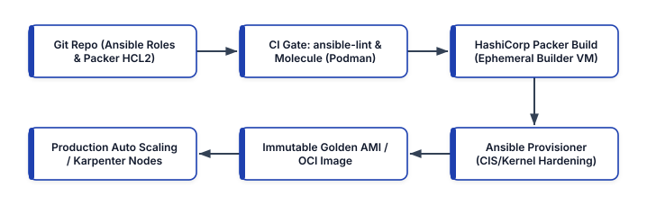


## Mutable Convergence vs. Immutable Infrastructure

To design a reliable configuration management strategy, you must understand the trade-offs between **mutable convergence** and **immutable replacement**.

### The Failure Modes of Mutable Drift
In first-generation configuration management, tools like Puppet, Chef, SaltStack, or periodic Ansible cron jobs ran directly against live production servers every 30 minutes to "converge" the host toward a desired state. While vastly superior to manual administration, mutable in-place convergence suffers from four systemic failure modes at scale:

1. **Unbounded State Outside Managed Scope**: Configuration management manifests only declare the files and packages you explicitly remember to manage. If an engineer runs a temporary debugging command, or an OS package post-install script modifies an unmanaged file in `/etc`, that mutation persists indefinitely, creating **"Snowflake" servers**.
2. **Non-Atomic Partial Convergence Failures**: When `apt` or `dnf` upgrades 40 system libraries across a 500-node fleet in place and an upstream repository mirror times out on 12 nodes halfway through the run, your production fleet is left in a fractured, half-upgraded state during live customer traffic.
3. **Slow Autoscaling Cold Starts**: When an Auto Scaling Group or Kubernetes node provisioner launches a vanilla OS image under a traffic spike and must run a 15-minute configuration management playbook before joining the cluster, your application cannot scale fast enough to absorb the load.
4. **SSH Bastion Attack Surface**: Running push-based configuration management against live production servers traditionally required exposing TCP port 22 and managing SSH key distribution across every host.

```
+-----------------------------------------------------+
|   MUTABLE CONVERGENCE VS. IMMUTABLE PIPELINES       |
+--------------------+--------------------------------+
| DIMENSION          | MODERN 2026 HYBRID STRATEGY    |
+--------------------+--------------------------------+
| Primary OS &       | Immutable Golden Images baked  |
| Runtime Delivery   | via Packer + Ansible (AMIs) or |
|                    | BuildKit (OCI Containers).     |
+--------------------+--------------------------------+
| Instance / Node    | Never patched in place; nodes  |
| Patching Lifecycle | are drained, terminated, and   |
|                    | replaced (Max Lifetime <= 14d).|
+--------------------+--------------------------------+
| Live Fleet Day-2   | Used for bare-metal servers or |
| Ansible Execution  | emergency zero-day mitigation  |
|                    | via AWS SSM transport.         |
+--------------------+--------------------------------+
| Local & CI         | Declarative Nix Flakes and     |
| Toolchains         | OCI Devcontainers.             |
+--------------------+--------------------------------+
```

### How Ansible Fits into an Immutable Architecture
Does immutable infrastructure make Ansible obsolete? **Not at all.** Writing raw, 500-line Bash shell scripts inside a Packer template or cloud-init userdata block is brittle, non-idempotent, and impossible to unit-test. In a modern 2026 pipeline, **Ansible serves as the declarative, testable configuration engine executed inside Packer during image baking**, as well as the fleet orchestration engine for bare-metal nodes and zero-SSH Systems Manager operations.

## Modern Ansible Architecture: `ansible-core`, Collections, and FQCN

Around version 2.10+, the Ansible project decoupled its core execution engine (**`ansible-core`**) from community and vendor modules, which are now distributed as independently versioned **Ansible Collections** (`ansible.posix`, `amazon.aws`, `kubernetes.core`, `community.general`).

In modern **Ansible (`ansible-core` 2.17+)**, short module names (such as `yum` or `copy`) are deprecated in production style guides because they create namespace collisions across collections. Every task must use its **Fully Qualified Collection Name (FQCN)**—for example, `ansible.builtin.dnf`, `ansible.builtin.template`, `ansible.builtin.systemd_service`, and `ansible.posix.sysctl`.

### Installing Modern Ansible and Execution Environments
Instead of polluting global system Python packages, install `ansible-core`, `ansible-lint`, and `molecule` inside an isolated Python 3.12 virtual environment (or run them inside a containerized **Ansible Execution Environment** via `ansible-navigator`):

```bash
python3 -m venv .venv
source .venv/bin/activate
pip install --upgrade pip

# Install ansible-core, linter, and Molecule testing
pip install \
  "ansible-core>=2.17.0,<2.18.0" \
  "ansible-lint>=24.9.0" \
  "molecule>=24.9.0" \
  "molecule-plugins[podman]>=23.5.0"
```

To pin external Ansible Collections deterministically across your team and CI runners, declare them in `requirements.yml`:

```yaml
# requirements.yml
---
collections:
  - name: ansible.posix
    version: ">=1.5.4"
  - name: amazon.aws
    version: ">=8.2.0"
  - name: community.general
    version: ">=9.4.0"
```

Install the pinned collections using `ansible-galaxy`:

```bash
ansible-galaxy collection install -r requirements.yml
```

## Zero-SSH Fleet Management with Dynamic Inventory and AWS SSM

In traditional infrastructure, engineers maintained static `/etc/ansible/hosts` files containing hardcoded IP addresses and connected over SSH bastion hosts (`jumpboxes`). In cloud environments where instances launch and terminate dynamically, static inventories are immediately obsolete, and opening inbound TCP port 22 violates zero-trust network policies.

Modern Ansible solves both problems simultaneously by combining the **`amazon.aws.aws_ec2` Dynamic Inventory Plugin** with the **`community.aws.aws_ssm` Connection Plugin**. Instances run the lightweight AWS SSM Agent with no inbound network ports open at all; Ansible queries the EC2 API dynamically by resource tags and tunnels module execution over encrypted IAM-authenticated SSM sessions:

```yaml
# inventory/aws_ec2.yml
---
plugin: amazon.aws.aws_ec2
regions:
  - us-west-2
filters:
  instance-state-name: running
  "tag:ManagedBy": ansible
keyed_groups:
  - key: tags.Role
    prefix: role
    separator: "_"
  - key: tags.Environment
    prefix: env
    separator: "_"
compose:
  # Connect via Instance ID over AWS SSM (Zero SSH!)
  ansible_host: instance_id
  ansible_connection: "'community.aws.aws_ssm'"
  ansible_aws_ssm_region: "'us-west-2'"
  ansible_aws_ssm_bucket_name: >-
    'enterprise-ssm-session-staging-us-west-2'
```

When you execute `ansible-inventory -i inventory/aws_ec2.yml --graph`, Ansible dynamically discovers all running EC2 instances tagged `ManagedBy=ansible` and groups them automatically into host groups such as `@role_k8s_worker` and `@env_production`.

## Engineering an Idempotent Linux Security Hardening Role

Let us engineer a production-grade Ansible role named `linux_baseline` that configures kernel network and memory security parameters (`sysctl`), enforces SSH daemon hardening (`sshd_config` with validation prior to restart), and configures NTP time synchronization (`chrony`).

A standardized Ansible role follows a deterministic directory layout:

```text
roles/linux_baseline/
├── defaults/
│   └── main.yml
├── handlers/
│   └── main.yml
├── meta/
│   └── main.yml
├── tasks/
│   └── main.yml
└── templates/
    └── sshd_config.j2
```

### 1. Defining Role Defaults (`defaults/main.yml`)
Variables placed in `defaults/main.yml` have the lowest precedence in Ansible, allowing callers to override them cleanly per environment (`group_vars/env_production.yml`) without modifying the role itself:

```yaml
# roles/linux_baseline/defaults/main.yml
---
linux_baseline_sysctl_params:
  net.ipv4.ip_forward: 1
  net.ipv4.conf.all.rp_filter: 1
  net.ipv4.conf.all.accept_source_route: 0
  net.ipv4.conf.all.send_redirects: 0
  net.ipv4.tcp_syncookies: 1
  kernel.kptr_restrict: 2
  kernel.dmesg_restrict: 1
  fs.protected_hardlinks: 1
  fs.protected_symlinks: 1
  vm.max_map_count: 262144

linux_baseline_ssh_port: 22
linux_baseline_ssh_max_auth_tries: 3
```

### 2. Authoring Idempotent Tasks with FQCN (`tasks/main.yml`)
Every task in `tasks/main.yml` uses an explicit FQCN, sets restrictive file permissions (`mode`), and validates configuration files (`validate: /usr/sbin/sshd -t -f %s`) before writing them to disk so that a syntax error can never lock out a node or break a daemon restart:

```yaml
# roles/linux_baseline/tasks/main.yml
---
- name: Install mandatory security and time packages
  ansible.builtin.package:
    name:
      - chrony
      - auditd
      - openssh-server
    state: present
  become: true

- name: Enforce kernel hardening sysctl parameters
  ansible.posix.sysctl:
    name: "{{ item.key }}"
    value: "{{ item.value }}"
    sysctl_file: /etc/sysctl.d/99-cis-hardening.conf
    state: present
    reload: true
  loop: >-
    {{ linux_baseline_sysctl_params | dict2items }}
  become: true

- name: Deploy hardened sshd_config with syntax check
  ansible.builtin.template:
    src: sshd_config.j2
    dest: /etc/ssh/sshd_config
    owner: root
    group: root
    mode: "0600"
    validate: "/usr/sbin/sshd -t -f %s"
  notify: Restart sshd service
  become: true

- name: Ensure chronyd and auditd services are active
  ansible.builtin.systemd_service:
    name: "{{ item }}"
    state: started
    enabled: true
  loop:
    - chronyd
    - auditd
  become: true
```

### 3. Event-Driven Handlers (`handlers/main.yml`)
Handlers execute at the end of a play **only if** a notifying task reported `changed: true`. Even if five separate tasks notify `Restart sshd service`, Ansible deduplicates the notification and restarts the daemon exactly once:

```yaml
# roles/linux_baseline/handlers/main.yml
---
- name: Restart sshd service
  ansible.builtin.systemd_service:
    name: sshd
    state: restarted
  become: true
```

### 4. Hardened Jinja2 Template (`templates/sshd_config.j2`)
```jinja2
# {{ ansible_managed }}
Port {{ linux_baseline_ssh_port }}
Protocol 2
PermitRootLogin no
PasswordAuthentication no
PermitEmptyPasswords no
KbdInteractiveAuthentication no
PubkeyAuthentication yes
MaxAuthTries {{ linux_baseline_ssh_max_auth_tries }}
X11Forwarding no
AllowTcpForwarding no
ClientAliveInterval 300
ClientAliveCountMax 2
UsePAM yes
```

## Continuous Verification with `ansible-lint` and `Molecule`

In a professional DevOps pipeline, configuration management code is subjected to the same static analysis and automated testing gates as application code.

### Static Analysis with `ansible-lint`
`ansible-lint` inspects playbooks, roles, and handlers against production rule sets—catching missing FQCN declarations, risky file permissions (`risky-file-permissions`), unquoted octal file modes (`0600` vs `"0600"`), and non-idempotent `command`/`shell` usages where native modules exist:

```bash
# Run strict production profile linting
ansible-lint --profile production roles/linux_baseline/
```

### Ephemeral Container Testing with `Molecule`
How do you verify that an Ansible role actually converges cleanly, is 100% idempotent on its second run, and places the system into the expected state before baking an AMI? **Molecule** automates the entire test lifecycle using ephemeral **Podman** or **Docker** systemd-enabled containers (`molecule.yml`):

```yaml
# roles/linux_baseline/molecule/default/molecule.yml
---
driver:
  name: podman
platforms:
  - name: al2023-hardened-test
    image: public.ecr.aws/amazonlinux/amazonlinux:2023
    command: /sbin/init
    privileged: true
    pre_build_image: true
provisioner:
  name: ansible
  config_options:
    defaults:
      callbacks_enabled: profile_tasks
verifier:
  name: ansible
```

Inside `roles/linux_baseline/molecule/default/verify.yml`, you write declarative Ansible assertions that inspect the live container state after convergence:

```yaml
# roles/linux_baseline/molecule/default/verify.yml
---
- name: Verify Linux Baseline Security Hardening
  hosts: all
  gather_facts: true
  tasks:
    - name: Read active kernel ip_forward value
      ansible.builtin.command:
        cmd: sysctl -n net.ipv4.ip_forward
      register: sysctl_ip_fwd
      changed_when: false

    - name: Assert sysctl and sshd hardening state
      ansible.builtin.assert:
        that:
          - sysctl_ip_fwd.stdout == "1"
        fail_msg: "Kernel sysctl hardening failed!"
```

Executing `molecule test` runs the complete verification matrix:
1. `dependency`: Pulls required Ansible Collections.
2. `create`: Starts the ephemeral systemd container.
3. `converge`: Applies the `linux_baseline` role against the container.
4. `idempotence`: Re-runs the `linux_baseline` role a second time and **fails the build if any task reports `changed > 0`**.
5. `verify`: Executes `verify.yml` assertions.
6. `destroy`: Tears down the test container.

## Baking Immutable Golden AMIs with HashiCorp Packer (HCL2)

Once our `linux_baseline` Ansible role passes `ansible-lint` and `molecule test`, we integrate it into **HashiCorp Packer** to build immutable, KMS-encrypted **Golden Amazon Machine Images (AMIs)**.

When Packer runs in CI/CD, it launches a temporary EC2 builder instance from the latest upstream Amazon Linux 2023 or Ubuntu 24.04 LTS base image, connects to the builder instance, executes our `site.yml` Ansible playbook to install packages and apply CIS kernel hardening, strips temporary SSH keys and history logs, snapshots the EBS volume into a new encrypted AMI, and terminates the temporary builder VM.

Here is a complete, production-grade Packer HCL2 template (`golden-node.pkr.hcl`):

```hcl
# golden-node.pkr.hcl
packer {
  required_version = ">= 1.11.0"
  required_plugins {
    amazon = {
      source  = "github.com/hashicorp/amazon"
      version = "~> 1.3"
    }
    ansible = {
      source  = "github.com/hashicorp/ansible"
      version = "~> 1.1"
    }
  }
}

variable "aws_region" {
  type    = string
  default = "us-west-2"
}

variable "kms_key_id" {
  type    = string
  default = "alias/golden-ami-encryption-key"
}

data "amazon-ami" "al2023_arm64" {
  region      = var.aws_region
  most_recent = true
  owners      = ["amazon"]
  filters = {
    name                = "al2023-ami-2023.*-arm64"
    root-device-type    = "ebs"
    virtualization-type = "hvm"
  }
}

locals {
  build_ts = formatdate("YYYYMMDD-hhmm", timestamp())
  ami_name = "golden-al2023-arm64-${local.build_ts}"
}

source "amazon-ebs" "hardened_al2023" {
  region        = var.aws_region
  source_ami    = data.amazon-ami.al2023_arm64.id
  instance_type = "t4g.medium"
  ssh_username  = "ec2-user"
  ami_name      = local.ami_name

  # Enforce EBS encryption and IMDSv2 on Golden AMI
  encrypt_boot = true
  kms_key_id   = var.kms_key_id
  imds_support = "v2.0"

  launch_block_device_mappings {
    device_name           = "/dev/xvda"
    volume_size           = 30
    volume_type           = "gp3"
    iops                  = 3000
    throughput            = 125
    delete_on_termination = true
  }

  tags = {
    Name        = local.ami_name
    BaseAMI     = data.amazon-ami.al2023_arm64.id
    HardenedBy  = "ansible-linux-baseline"
    Architecture = "arm64"
  }
}

build {
  name    = "golden-image-pipeline"
  sources = ["source.amazon-ebs.hardened_al2023"]

  # Run verified Ansible hardening playbook
  provisioner "ansible" {
    playbook_file = "./playbooks/site.yml"
    user          = "ec2-user"
    extra_arguments = [
      "--extra-vars",
      "ansible_python_interpreter=/usr/bin/python3"
    ]
  }

  # Clean machine-id and temporary logs before snapshot
  provisioner "shell" {
    inline = [
      "sudo truncate -s 0 /etc/machine-id",
      "sudo rm -rf /tmp/* /var/tmp/*",
      "sudo dnf clean all"
    ]
  }

  post-processor "manifest" {
    output     = "packer-manifest.json"
    strip_path = true
  }
}
```

Validate and execute the Packer image build via the CLI:

```bash
packer init golden-node.pkr.hcl
packer validate golden-node.pkr.hcl
packer build golden-node.pkr.hcl
```

When `packer build` completes, it outputs `packer-manifest.json` containing the newly minted `artifact_id` (`ami-0987654321fedcba0`), which downstream AWS CDK v2 stacks or Karpenter `EC2NodeClass` manifests consume to roll out immutable nodes across the cluster.

## Reproducible Engineering Toolchains with Nix Flakes and Devcontainers

Configuration drift does not only afflict production servers; it also plagues engineering workstations and CI runners. When one developer runs Ansible 2.14, another runs Ansible 2.17, and a third uses an outdated version of Packer or `cdk-nag`, builds fail unpredictably.

Modern Platform Engineering eliminates workstation drift using **Nix Flakes (`flake.nix`)** and **Development Containers (`devcontainer.json`)**.

Here is a declarative `flake.nix` that pins the exact cryptographic hashes of Python 3.12, `ansible-core`, `ansible-lint`, `packer`, `awscli2`, and `nodejs_22` across Linux (x86_64 and ARM64) and macOS (Apple Silicon):

```nix
# flake.nix
{
  description = "Immutable DevOps Toolchain";

  inputs = {
    nixpkgs.url = "github:NixOS/nixpkgs/nixos-24.11";
    flake-utils.url = "github:numtide/flake-utils";
  };

  outputs = { self, nixpkgs, flake-utils }:
    flake-utils.lib.eachDefaultSystem (system:
      let
        pkgs = import nixpkgs { inherit system; };
      in
      {
        devShells.default = pkgs.mkShell {
          buildInputs = with pkgs; [
            python312
            ansible
            ansible-lint
            packer
            awscli2
            nodejs_22
            jq
          ];
          shellHook = ''
            echo "DevOps 2026 Toolchain Ready"
          '';
        };
      }
    );
}
```

By running `nix develop` (or integrating with `direnv`), any engineer or CI job entering the repository directory is placed immediately into an isolated, bit-for-bit reproducible shell containing the exact toolchain versions required by the platform.

### Standardizing Containerized Workstations with Devcontainers (`devcontainer.json`)
For engineering organizations that standardize on containerized IDE workflows (such as VS Code Dev Containers, GitHub Codespaces, or DevPod), the **Development Container Specification (`devcontainer.json`)** complements Nix Flakes by encapsulating the OS user space, editor extensions, language servers, and security linters inside an OCI image.

Here is a production `.devcontainer/devcontainer.json` specification that pairs a Wolfi/Ubuntu container base with pre-configured Ansible, Packer, and AWS CLI v2 features:

```json
{
  "name": "Platform Configuration Engineering",
  "image": "mcr.microsoft.com/devcontainers/base",
  "features": {
    "ghcr.io/devcontainers/features/aws-cli:1": {
      "version": "latest"
    },
    "ghcr.io/devcontainers/features/terraform:1": {
      "version": "1.9",
      "installSentinel": false
    }
  },
  "postCreateCommand": "pip install -r reqs.txt",
  "customizations": {
    "vscode": {
      "extensions": [
        "redhat.ansible",
        "hashicorp.hcl",
        "ms-python.python"
      ],
      "settings": {
        "ansible.validation.lint.enabled": true,
        "ansible.validation.lint.path": "ansible-lint"
      }
    }
  },
  "remoteUser": "vscode"
}
```

### Containerized Ansible Execution Environments (`execution-environment.yml`)
At the enterprise scale, running Ansible playbooks from individual laptops or ad-hoc CI runners introduces Python dependency conflicts between collection requirements (for example, `amazon.aws` requiring specific `boto3` versions while `kubernetes.core` requires specific `kubernetes` Python client versions).

Modern Ansible resolves this via **Ansible Execution Environments (EEs)** built with **`ansible-builder`** and executed via **`ansible-navigator`** or **AWX / Red Hat Ansible Automation Platform**. An Execution Environment packages `ansible-core`, Python dependencies (`requirements.txt`), Ansible Collections (`requirements.yml`), and system libraries (`bindep.txt`) into a single immutable OCI container image:

```yaml
# execution-environment.yml
---
version: 3
images:
  base_image:
    name: quay.io/fedora/fedora-minimal:40
dependencies:
  ansible_core:
    package_pip: ansible-core==2.17.4
  ansible_runner:
    package_pip: ansible-runner
  galaxy: requirements.yml
  python: requirements.txt
additional_build_steps:
  prepend_base:
    - RUN microdnf update -y && microdnf clean all
```

Building and executing playbooks inside this deterministic container image requires only two commands:

```bash
# Build the immutable Ansible Execution Environment OCI
ansible-builder build \
  --tag ghcr.io/enterprise-org/ansible-ee:2026.1

# Run playbooks deterministically inside the EE image
ansible-navigator run playbooks/site.yml \
  --execution-environment-image \
  ghcr.io/enterprise-org/ansible-ee:2026.1 \
  --mode stdout
```

## Summary

Modern configuration management has evolved from mutating long-lived servers in place to engineering deterministic, immutable infrastructure pipelines. By authoring idempotent Ansible roles with strict FQCN syntax, verifying every change automatically with `ansible-lint` and `Molecule`, baking encrypted Golden AMIs with HashiCorp Packer, managing live systems without SSH via AWS SSM, and pinning local and CI toolchains with Nix Flakes, Devcontainers, and Ansible Execution Environments, organizations eliminate configuration drift at its root. In Chapter 4, we connect these infrastructure and application artifacts into automated, keyless CI/CD and GitOps pipelines.


<div style="page-break-after: always;"></div>


# Chapter 4: CI/CD Pipelines: Keyless Automation, Static Analysis, and GitOps Delivery

Continuous Integration and Continuous Delivery (CI/CD) form the central nervous system of a modern software engineering organization. Every line of application code, infrastructure construct, security policy, and Kubernetes manifest reaches production through an automated pipeline. Yet the architecture of CI/CD pipelines has changed dramatically over the past five years. First-generation pipelines—characterized by pet Jenkins servers running `cp myapp.war /srv/tomcat/webapps` over SSH, storing long-lived cloud administrator credentials in CI secret vaults, and executing imperative `kubectl apply` commands from external runners—have proven both operationally brittle and vulnerable to supply chain compromise.

In a 2026 cloud-native architecture, CI/CD is engineered around four strict principles:
1. **Trunk-Based Continuous Integration with DAG Parallelism**: Developers merge small, frequent commits into `main` verified by Directed Acyclic Graph (DAG) pipelines that execute linting, unit tests, Static Application Security Testing (SAST), and Software Composition Analysis (SCA) in parallel.
2. **Keyless OpenID Connect (OIDC) Federation**: CI runners never store static AWS, GCP, or Azure access keys. Every build job requests a cryptographically signed, short-lived OIDC JWT (`id-token: write`) scoped to the exact repository, branch, and environment.
3. **Immutable, Signed OCI Artifacts and SBOMs**: The output of Continuous Integration is never a mutable file copied onto a server; it is an immutable Open Container Initiative (OCI) artifact identified by its cryptographic `@sha256` digest, accompanied by a CycloneDX/SPDX Software Bill of Materials (SBOM) and a keyless **Sigstore Cosign** signature.
4. **Decoupled Pull-Based GitOps Delivery**: External CI runners do not hold cluster-admin credentials to push changes into production Kubernetes clusters. Instead, CI commits the verified image digest to a GitOps environment repository, and in-cluster controllers (**Argo CD** or **Flux v2**) pull and reconcile the desired state.

In this chapter, we engineer production pipelines across **GitHub Actions (with OIDC keyless federation)**, **GitLab CI/CD (with DAG `needs:` and `id_tokens`)**, **Kubernetes-native pipelines (Tekton and ephemeral Kubernetes Jenkins agents)**, integrated security gates (**Ruff, Semgrep, SonarQube, and Trivy**), and **Flux v2 / Argo CD GitOps** delivery.


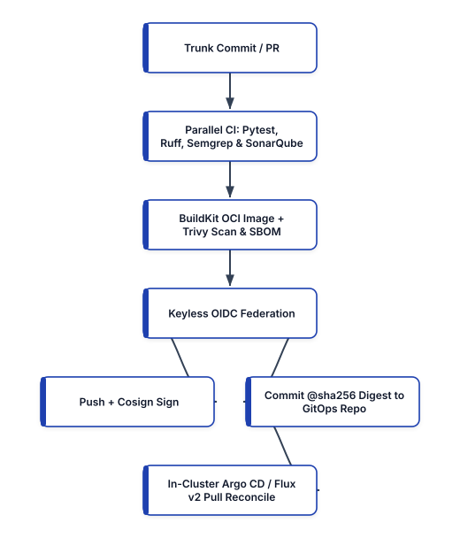


## Architectural Evolution: From Push-Based Scripts to Keyless GitOps Pipelines

To appreciate why modern pipelines separate Continuous Integration (CI) from Continuous Delivery (CD), consider the blast radius of a traditional push-based pipeline. When a CI runner stores a static `AWS_SECRET_ACCESS_KEY` and a privileged `KUBECONFIG` token in its environment variables so it can run `helm upgrade` or `kubectl apply` against production, any compromise of a third-party CI plugin or upstream dependency during a build immediately grants the attacker full administrative control over production clusters.

```
+-----------------------------------------------------+
|        LEGACY PUSH CI/CD VS. MODERN CI + GITOPS     |
+------------------+----------------------------------+
| LAYER            | MODERN 2026 PRODUCTION STANDARD  |
+------------------+----------------------------------+
| Source Control & | Trunk-Based Dev on GitHub/GitLab |
| Branching Model  | (AWS CodeCommit is deprecated).  |
+------------------+----------------------------------+
| Cloud Auth       | Keyless OIDC Federation scoped   |
| from CI Runners  | by repo/branch JWT claims.       |
+------------------+----------------------------------+
| Code Quality &   | Fast AST Linters (Ruff), Semgrep |
| SAST / SCA Gates | SonarQube, and Trivy CVE/SBOM.   |
+------------------+----------------------------------+
| Packaging &      | BuildKit rootless OCI build +    |
| Provenance       | Cosign keyless sign + SLSA L3.   |
+------------------+----------------------------------+
| Production       | Pull-based GitOps via Argo CD or |
| Deployment       | Flux v2; zero cluster keys in CI.|
+------------------+----------------------------------+
```

By terminating the CI pipeline's responsibility at the artifact registry and the GitOps configuration repository, the production Kubernetes API server can remain completely private inside a VPC with zero inbound access from external CI SaaS networks.

## Engineering Keyless CI Workflows with GitHub Actions and OIDC

**GitHub Actions** executes workflows defined in `.github/workflows/*.yml` on ephemeral virtual machines or Kubernetes-managed Actions Runner Controller (ARC) pods.

### How Keyless OIDC Federation Works Under the Hood
When you configure `permissions: id-token: write` in a GitHub Actions job, GitHub's OIDC provider (`https://token.actions.githubusercontent.com`) mints a JSON Web Token (JWT) signed by GitHub's private key. This JWT contains verifiable claims identifying the exact workflow context:
- `iss`: `https://token.actions.githubusercontent.com`
- `aud`: `sts.amazonaws.com`
- `sub`: `repo:enterprise-org/payments-service:ref:refs/heads/main`
- `job_workflow_ref`: The exact workflow file and commit SHA being executed.

When the workflow calls `aws-actions/configure-aws-credentials@v4`, it presents this JWT to AWS Security Token Service (`AssumeRoleWithWebIdentity`). AWS STS verifies GitHub's cryptographic signature and checks the IAM Role's Trust Policy condition:

```json
{
  "Version": "2012-10-17",
  "Statement": [
    {
      "Effect": "Allow",
      "Principal": {
        "Federated": "arn:aws:iam::111122223333:oidc"
      },
      "Action": "sts:AssumeRoleWithWebIdentity",
      "Condition": {
        "StringEquals": {
          "oidc:aud": "sts.amazonaws.com",
          "oidc:sub": "repo:org/payments:ref:main"
        }
      }
    }
  ]
}
```

If the `sub` claim matches, AWS STS returns temporary credentials valid for a single hour. Feature branches (`refs/heads/feat-*`) cannot assume the production publishing role because their `sub` claim fails the strict `StringEquals` check.

### Complete Production GitHub Actions Pipeline
Below is a production-hardened `.github/workflows/ci-release.yml` workflow. Notice three critical security and performance practices:
1. **Least-Privilege `permissions` Block**: Top-level permissions are set to `contents: read`, elevating to `id-token: write` and `packages: write` only in the build/publish job.
2. **Parallel Quality and SAST Matrix**: **Ruff** (high-speed Rust-based Python linter/formatter), **Semgrep** (AST-based SAST security analysis), and **Pytest** run prior to building container layers.
3. **Integrated Trivy Vulnerability Scanning and Keyless Cosign Signing**: The built OCI image is scanned by **Trivy** for `CRITICAL` and `HIGH` CVEs with available fixes (`--ignore-unfixed`), pushed by digest to Amazon ECR, and signed keylessly with **Sigstore Cosign**.

```yaml
# .github/workflows/ci-release.yml
name: Production Keyless CI & Supply Chain Pipeline

on:
  push:
    branches: ["main"]
  pull_request:
    branches: ["main"]

permissions:
  contents: read

env:
  AWS_REGION: us-west-2
  ECR_REGISTRY: 111122223333.dkr.ecr.us-west-2.aws
  IMAGE_REPO: payments-service

jobs:
  quality-and-sast:
    name: Lint, SAST & Unit Tests
    runs-on: ubuntu-24.04
    steps:
      - name: Checkout Source Code
        uses: actions/checkout@v4

      - name: Set up Python 3.12 with Dependency Cache
        uses: actions/setup-python@v5
        with:
          python-version: "3.12"
          cache: "pip"

      - name: Install Application & Test Dependencies
        run: |
          python -m pip install --upgrade pip
          pip install ruff pytest pytest-cov semgrep
          pip install -r requirements.txt

      - name: Run Ruff Fast Linter & Format Check
        run: |
          ruff check .
          ruff format --check .

      - name: Run Semgrep SAST Security Rules
        run: |
          semgrep scan --config auto --error .

      - name: Execute Unit Tests with Coverage Gate
        run: |
          pytest --cov=src --cov-fail-under=85 tests/

  build-scan-and-sign:
    name: Build OCI Image, Scan CVEs & Sign
    needs: [quality-and-sast]
    if: >-
      github.event_name == 'push' &&
      github.ref == 'refs/heads/main'
    runs-on: ubuntu-24.04
    permissions:
      contents: read
      id-token: write
      security-events: write
    outputs:
      image_digest: ${{ steps.build.outputs.digest }}
    steps:
      - name: Checkout Repository
        uses: actions/checkout@v4

      - name: Set up Docker Buildx (BuildKit)
        uses: docker/setup-buildx-action@v3

      - name: Assume AWS Role via Keyless OIDC
        uses: aws-actions/configure-aws-credentials@v4
        with:
          role-to-assume: >-
            arn:aws:iam::111122223333:role/GHAEcrRole
          aws-region: ${{ env.AWS_REGION }}

      - name: Login to Amazon ECR
        uses: aws-actions/amazon-ecr-login@v2

      - name: Build & Push OCI Image with Cache
        id: build
        uses: docker/build-push-action@v6
        with:
          context: .
          push: true
          tags: >-
            ${{ env.ECR_REGISTRY }}/payments:latest
          cache-from: type=gha
          cache-to: type=gha,mode=max
          provenance: mode=max
          sbom: true

      - name: Scan Image with Trivy for Critical CVEs
        uses: aquasecurity/trivy-action@0.28.0
        with:
          image-ref: >-
            ${{ steps.build.outputs.digest }}
          format: "table"
          exit-code: "1"
          ignore-unfixed: true
          vuln-type: "os,library"
          severity: "CRITICAL,HIGH"

      - name: Install Sigstore Cosign CLI
        uses: sigstore/cosign-installer@v3.7.0

      - name: Sign Image Digest Keylessly via OIDC
        env:
          COSIGN_YES: "true"
        run: |
          IMAGE_URI="${ECR_REGISTRY}/${IMAGE_REPO}"
          DIGEST="${{ steps.build.outputs.digest }}"
          cosign sign "${IMAGE_URI}@${DIGEST}"
```

Notice the `provenance: mode=max` and `sbom: true` flags passed to `docker/build-push-action@v6`. BuildKit automatically generates an **SPDX Software Bill of Materials** and a **SLSA Provenance attestation** and attaches them directly to the image manifest in Amazon ECR, while `cosign sign` binds a cryptographic signature verified by GitHub's OIDC identity.

## GitLab CI/CD: DAG Pipelines, Kubernetes Runners, and `id_tokens`

In **GitLab CI/CD**, pipeline orchestration is defined in `.gitlab-ci.yml` and executed by **GitLab Runners**.

### Modernizing GitLab Runner Architecture
Historically, teams registered GitLab Runners manually on static virtual machines using a shared registration token. In GitLab 17+ (2026 standards), the legacy runner registration token flow has been replaced by **Runner Authentication Tokens (`glrt-...`)** deployed onto Kubernetes clusters via the official **GitLab Runner Helm Chart** using the **Kubernetes Executor**. Whenever a job starts, the runner dynamically provisions an isolated Kubernetes Pod with strict CPU/memory resource limits, executes the build steps inside rootless containers, and destroys the Pod immediately upon completion.

### Modern `.gitlab-ci.yml` Syntax: `rules:`, `needs:` DAGs, and `id_tokens:`
Two major syntax modernizations distinguish contemporary GitLab CI pipelines from legacy configurations:
1. **`rules:` Replaces Deprecated `only:` and `except:`**: The legacy `only: [master]` syntax is deprecated. Modern pipelines use expressive `rules:` blocks supporting boolean comparisons against `$CI_PIPELINE_SOURCE`, `$CI_COMMIT_BRANCH`, and file-path change detection (`changes:`).
2. **Directed Acyclic Graph (DAG) Execution via `needs:`**: By default, GitLab waits for every job in Stage A to finish before starting any job in Stage B. Adding `needs:` allows downstream jobs to start the instant their specific prerequisite finishes, cutting total pipeline wall-clock duration by 40–60%.
3. **First-Class OIDC via `id_tokens:`**: GitLab natively injects OIDC JWTs into environment variables specified under `id_tokens:`.

Here is a production `.gitlab-ci.yml` pipeline implementing DAG execution, SonarQube/Semgrep SAST, keyless AWS OIDC federation, and GitOps promotion:

```yaml
# .gitlab-ci.yml
stages:
  - verify
  - package
  - gitops_promote

variables:
  AWS_REGION: "us-west-2"
  ECR_HOST: "111122223333.dkr.ecr.us-west-2.aws"
  APP_IMAGE: "$ECR_HOST/payments-service"
  PYTHON_IMAGE: "python:3.12-slim-bookworm"

default:
  interruptible: true

lint_and_sast:
  stage: verify
  image: $PYTHON_IMAGE
  script:
    - pip install ruff semgrep
    - ruff check .
    - semgrep scan --config auto --error .
  rules:
    - if: $CI_PIPELINE_SOURCE == "merge_request_event"
    - if: $CI_COMMIT_BRANCH == $CI_DEFAULT_BRANCH

unit_tests:
  stage: verify
  image: $PYTHON_IMAGE
  script:
    - pip install pytest pytest-cov -r requirements.txt
    - pytest --cov=src --junitxml=report.xml
  artifacts:
    when: always
    reports:
      junit: report.xml
  rules:
    - if: $CI_PIPELINE_SOURCE == "merge_request_event"
    - if: $CI_COMMIT_BRANCH == $CI_DEFAULT_BRANCH

build_and_push_oci:
  stage: package
  # DAG: starts as soon as verify jobs succeed
  needs: ["lint_and_sast", "unit_tests"]
  image:
    name: gcr.io/kaniko-project/executor:v1.23.2-debug
    entrypoint: [""]
  id_tokens:
    GITLAB_OIDC_TOKEN:
      aud: https://gitlab.example.com
  script:
    - mkdir -p /kaniko/.docker
    # Configure Kaniko to exchange GitLab OIDC token
    - TOKEN_FILE="/tmp/oidc_token"
    - export AWS_WEB_IDENTITY_TOKEN_FILE="$TOKEN_FILE"
    - echo "$GITLAB_OIDC_TOKEN" > "$TOKEN_FILE"
    - ROLE="arn:aws:iam::111122223333:role/GitLabRole"
    - export AWS_ROLE_ARN="$ROLE"
    - /kaniko/executor
      --context "${CI_PROJECT_DIR}"
      --dockerfile "${CI_PROJECT_DIR}/Dockerfile"
      --destination "${APP_IMAGE}:${CI_COMMIT_SHA}"
      --digest-file /tmp/digest
    - echo "DIGEST=$(cat /tmp/digest)" >> build.env
  artifacts:
    reports:
      dotenv: build.env
  rules:
    - if: $CI_COMMIT_BRANCH == $CI_DEFAULT_BRANCH
```

Notice how `build_and_push_oci` uses **Kaniko** (or **BuildKit rootless**) to build and push the container image inside an unprivileged Kubernetes Pod without mounting `/var/run/docker.sock` (`Docker-in-Docker`), completely eliminating privileged container escape risks on the CI runner cluster.

## Kubernetes-Native Pipelines: Tekton, Argo Workflows, and Ephemeral Jenkins

While SaaS orchestrators like GitHub Actions and GitLab CI dominate cloud repositories, many regulated enterprises run self-hosted pipelines directly inside their Kubernetes clusters.

### Cloud-Native Execution with Tekton Pipelines and Argo Workflows
In Kubernetes-native CI architectures, **Tekton Pipelines** (a CNCF graduated project) and **Argo Workflows** replace monolithic CI servers with Kubernetes Custom Resource Definitions (CRDs):
- In **Tekton**, you define reusable `Task` CRDs (composed of sequential container `steps` sharing an emptyDir `/workspace` volume) and orchestrate them via `Pipeline` and `PipelineRun` CRDs.
- Because every `PipelineRun` is a native Kubernetes object, there is no central JVM coordinator to become a single point of failure, and workload identity is handled natively via Kubernetes `ServiceAccount` annotations (EKS Pod Identity or IRSA).

Here is a production Tekton `Task` and `Pipeline` specification (`tekton-pipeline.yaml`) that executes rootless **SonarQube** static quality analysis, **Ruff/Pytest** verification, and **BuildKit** daemonless image publishing inside an isolated Kubernetes namespace:

```yaml
# tekton-pipeline.yaml
apiVersion: tekton.dev/v1
kind: Task
metadata:
  name: pytest-and-sonarqube-gate
  namespace: ci-workloads
spec:
  params:
    - name: sonar-host-url
      type: string
    - name: sonar-project-key
      type: string
  workspaces:
    - name: source
  steps:
    - name: unit-test-coverage
      image: python:3.12-slim-bookworm
      workingDir: $(workspaces.source.path)
      script: |
        #!/usr/bin/env bash
        set -euo pipefail
        pip install ruff pytest pytest-cov
        pip install -r requirements.txt
        ruff check .
        pytest --cov=src --cov-report=xml:coverage.xml

    - name: sonarqube-quality-gate
      image: sonarsource/sonar-scanner-cli:11.1
      workingDir: $(workspaces.source.path)
      env:
        - name: SONAR_TOKEN
          valueFrom:
            secretKeyRef:
              name: sonarqube-ci-token
              key: token
      script: |
        #!/usr/bin/env sh
        set -eu
        KEY="$(params.sonar-project-key)"
        sonar-scanner \
          -Dsonar.projectKey="${KEY}" \
          -Dsonar.sources=src \
          -Dsonar.python.coverage.reportPaths=cov.xml \
          -Dsonar.host.url=$(params.sonar-host-url) \
          -Dsonar.qualitygate.wait=true
---
apiVersion: tekton.dev/v1
kind: Pipeline
metadata:
  name: microservice-ci-pipeline
  namespace: ci-workloads
spec:
  workspaces:
    - name: shared-workspace
  params:
    - name: git-url
      type: string
    - name: git-revision
      type: string
      default: main
    - name: image-reference
      type: string
  tasks:
    - name: fetch-repository
      taskRef:
        name: git-clone
      workspaces:
        - name: output
          workspace: shared-workspace
      params:
        - name: url
          value: $(params.git-url)
        - name: revision
          value: $(params.git-revision)

    - name: verify-and-scan
      runAfter: ["fetch-repository"]
      taskRef:
        name: pytest-and-sonarqube-gate
      workspaces:
        - name: source
          workspace: shared-workspace
      params:
        - name: sonar-host-url
          value: "https://sonar.internal.example.com"
        - name: sonar-project-key
          value: "payments-service"
```

Notice the `-Dsonar.qualitygate.wait=true` flag passed to `sonar-scanner`. This instructs the Tekton step to poll SonarQube's webhook state machine until the server-side AST analysis finishes, failing the `TaskRun` immediately if new code coverage drops below 80%, duplicated lines exceed 3%, or any security hotspot/vulnerability rating is worse than `A`.

### Modernizing Existing Enterprise Jenkins with Ephemeral Kubernetes Pod Agents
For organizations maintaining existing **Jenkins** investments, the legacy practice of running builds on static, shared agent VMs (`agent any`) or copying `.war` files onto Tomcat servers is strictly obsolete. Modern Jenkins architectures use the **Jenkins Kubernetes Plugin** combined with **Configuration as Code (JCasC)** so that the controller spins up an ephemeral, multi-container Kubernetes Pod for every single `Jenkinsfile` execution and tears it down immediately afterward:

```groovy
// Jenkinsfile (Ephemeral Kubernetes Pod Agent)
pipeline {
  agent {
    kubernetes {
      yaml '''
        apiVersion: v1
        kind: Pod
        spec:
          serviceAccountName: jenkins-ci-oidc-sa
          securityContext:
            runAsNonRoot: true
            runAsUser: 1000
          containers:
          - name: python
            image: python:3.12-slim-bookworm
            command: ["sleep", "infinity"]
          - name: trivy
            image: aquasec/trivy:0.56.2
            command: ["sleep", "infinity"]
      '''
    }
  }
  stages {
    stage('Lint & Unit Test') {
      steps {
        container('python') {
          sh '''
            python -m venv /tmp/venv
            . /tmp/venv/bin/activate
            pip install ruff pytest -r requirements.txt
            ruff check .
            pytest tests/
          '''
        }
      }
    }
    stage('Filesystem & Dependency Scan') {
      steps {
        container('trivy') {
          sh '''
            trivy fs --scanners vuln,secret,misconfig \
              --severity CRITICAL,HIGH \
              --exit-code 1 .
          '''
        }
      }
    }
  }
}
```

## Closing the Loop: Pull-Based GitOps Delivery with Argo CD and Flux v2

Once our CI pipeline has compiled, tested, scanned, pushed, and cryptographically signed the OCI image (`payments-service@sha256:4a8b9c...`), how does that artifact reach Staging and Production?

Rather than running `kubectl set image` from the CI runner, the pipeline updates a declarative **Kustomize** overlay or **HelmRelease** manifest inside a dedicated GitOps repository (`enterprise-org/k8s-gitops-fleet`), or relies on **Flux Image Automation Controller** / **Argo CD Image Updater** to observe the registry directly.

Here is how a **Flux v2 `Kustomization`** and **`HelmRelease`** (or **Argo CD `Application`**) continuously reconciles the production cluster state from Git and automatically rolls back if health checks fail:

```yaml
# clusters/production/payments-kustomization.yaml
apiVersion: kustomize.toolkit.fluxcd.io/v1
kind: Kustomization
metadata:
  name: payments-service-prod
  namespace: flux-system
spec:
  interval: 2m0s
  path: ./apps/production/payments-service
  prune: true
  wait: true
  timeout: 3m0s
  sourceRef:
    kind: GitRepository
    name: fleet-infra
  # Verify Cosign signature before applying!
  verify:
    provider: cosign
  healthChecks:
    - apiVersion: apps/v1
      kind: Deployment
      name: payments-service
      namespace: payments
```

When the in-cluster controller detects a new commit in `apps/production/payments-service/kustomization.yaml` pinning the newly verified `@sha256` image digest:
1. It validates the commit's cryptographic signature.
2. It applies the updated `Deployment` manifest to the local Kubernetes API server.
3. Paired with a progressive delivery controller such as **Argo Rollouts** or **Flagger**, traffic shifts gradually (`5% -> 25% -> 50% -> 100%`) while querying Prometheus SLO metrics. If the HTTP `5xx` error rate or P99 latency breaches the threshold during the canary window, the controller aborts the rollout and routes 100% of traffic back to the previous revision automatically.

## Summary

Modern CI/CD pipelines have evolved from brittle, credential-laden shell scripts into cryptographically verifiable software factories. By standardizing on trunk-based DAG workflows in GitHub Actions and GitLab CI, eliminating static cloud secrets via OIDC workload identity federation, enforcing shift-left SAST and CVE gates with Ruff, Semgrep, and Trivy, building rootless OCI images with BuildKit/Kaniko, signing digests with Sigstore Cosign, and decoupling deployment via pull-based GitOps controllers, engineering teams achieve both elite deployment velocity and zero-trust supply chain security. In Chapter 5, we examine the OCI v1.1 artifact registries and package repositories that store and govern these artifacts.


<div style="page-break-after: always;"></div>


# Chapter 5: Artifact Repositories and OCI v1.1 Supply Chain Registries

Every modern software system is assembled from a complex graph of binary artifacts: operating system base layers, language packages (Python wheels, npm tarballs, Go modules, Maven JARs, Rust crates), Helm charts, Open Policy Agent (OPA) bundles, WebAssembly (Wasm) modules, and Open Container Initiative (OCI) container images. If a CI/CD pipeline pulls dependencies directly from public internet registries on every build without caching, provenance verification, or namespace isolation, the organization is exposed to three severe operational and security risks:
1. **Upstream Outages and Rate-Limiting**: A transient outage or anonymous pull rate-limit on Docker Hub, PyPI, or npm immediately halts production builds and Kubernetes node autoscaling across the entire enterprise.
2. **Tag Mutation Attacks**: In container and package registries that permit mutable tags, an attacker (or human error) can overwrite `v1.4.2` or `latest` with a malicious binary while keeping the tag string identical.
3. **Dependency Confusion and Typosquatting**: If an internal package name (`@corp/auth-utils` or `payments-common`) is registered by an attacker on public npm or PyPI with a higher semantic version number (`99.0.0`), misconfigured package managers will silently pull and execute the attacker's public package over the private internal library.

Modern DevOps architectures eliminate these failure modes by placing **OCI v1.1-compliant artifact registries** and **language package repositories** at the center of the software supply chain. In this chapter, we examine the architecture of **OCI v1.1 registries**, master the **OCI Referrers API** and **ORAS** for attaching SBOMs and **Sigstore Cosign** signatures to image digests, engineer production registries with **Amazon ECR**, **CNCF Harbor** (which completely superseded legacy, archived frontends like Portus), **JFrog Artifactory**, and **Sonatype Nexus**, and enforce **Dependency Confusion** defenses in **AWS CodeArtifact**.


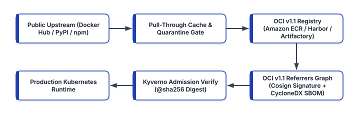


## The OCI v1.1 Revolution: Content-Addressable Universal Registries

Historically, teams operated separate storage backends for every artifact type: a Docker Registry v2 for container images, a ChartMuseum server for Helm charts, and file servers for security policies and SBOMs. The **Open Container Initiative (OCI) Image and Distribution Specifications v1.1** unified these silos by transforming container registries into **universal, content-addressable Merkle-tree object stores**.

### How Content-Addressable Digests Work
In an OCI v1.1 registry (such as **Amazon ECR**, **CNCF Harbor**, **GitHub Container Registry `ghcr.io`**, or **Google Artifact Registry**), human-readable tags (`v2.1.0`, `main`, `latest`) are merely mutable pointers. The true identity of every artifact is its **cryptographic SHA-256 digest**, calculated over the canonical JSON representation of its OCI Manifest or Image Index:

```text
111122223333.dkr.ecr.us-west-2.aws/pay@sha256:8f4b2c...
```

An OCI Manifest contains:
- **`mediaType`**: Identifies the manifest structure (`application/vnd.oci.image.manifest.v1+json`).
- **`artifactType`**: Identifies the payload type (for example, `application/vnd.cncf.helm.config.v1+json` for a Helm chart, `application/vnd.cyclonedx+json` for a CycloneDX SBOM, or `application/vnd.dev.cosign.artifact.sig.v1+json` for a Cosign signature).
- **`config`**: A content-addressable blob descriptor containing runtime configuration.
- **`layers`**: An ordered array of content-addressable blob descriptors (each identified by its own `sha256` digest and byte size).
- **`subject` (Introduced in OCI v1.1)**: An optional descriptor pointing to another manifest's `sha256` digest in the same repository.

```
+-----------------------------------------------------+
|       OCI v1.1 REFERRERS GRAPH (MERKLE DAG)         |
+-----------------------------------------------------+
|                                                     |
|  [Multi-Arch Index: payments@sha256:8f4b2c...]      |
|     |                                |              |
|     +--> linux/amd64 Manifest        +--> arm64     |
|                                                     |
|     ^                 ^                  ^          |
|     | (subject)       | (subject)        | (subject)|
|  +--+----------+   +--+-----------+   +--+--------+ |
|  | Cosign OIDC |   | CycloneDX    |   | SLSA L3   | |
|  | Signature   |   | SBOM v1.6    |   | Provenance| |
|  +-------------+   +--------------+   +-----------+ |
+-----------------------------------------------------+
```

### The OCI v1.1 Referrers API and ORAS CLI
Before OCI v1.1, attaching a Software Bill of Materials (SBOM) or a cryptographic signature to a container image required encoding the image's digest into ugly pseudo-tags (such as `sha256-8f4b2c.sbom` or `sha256-8f4b2c.sig`), which cluttered repository tag listings and complicated lifecycle garbage collection.

With the **OCI v1.1 `subject` field and Referrers API (`/v2/<name>/referrers/<digest>`)**, tools like **ORAS (OCI Registry As Storage)**, **Sigstore Cosign**, and **Trivy** attach supply chain metadata directly to the parent image digest as a child node in a Directed Acyclic Graph (DAG). When a lifecycle policy deletes an expired container image, the registry automatically garbage-collects all of its attached SBOMs, signatures, and vulnerability attestations.

Here is how to use the **ORAS CLI** and **Syft** in a pipeline to generate a CycloneDX JSON SBOM, attach it to a container image via the OCI v1.1 Referrers API, and query the resulting supply chain graph:

```bash
# 1. Define the immutable OCI image digest URI
REG="111122223333.dkr.ecr.us-west-2.amazonaws.com"
DIGEST="sha256:8f4b2c9e1a7d3b5c0e2f4a6b8d0c2e4f"
IMAGE_REF="${REG}/payments@${DIGEST}"

# 2. Generate CycloneDX 1.6 SBOM from image digest
syft "${IMAGE_REF}" -o cyclonedx-json=sbom.cdx.json

# 3. Attach SBOM to image via OCI v1.1 subject field
oras attach \
  --artifact-type application/vnd.cyclonedx+json \
  "${IMAGE_REF}" \
  sbom.cdx.json:application/vnd.cyclonedx+json

# 4. Query the OCI v1.1 Referrers API to inspect the
#    attached SBOMs, Cosign signatures, & attestations
oras discover -o tree "${IMAGE_REF}"
```

Executing `oras discover -o tree` renders the complete cryptographic provenance tree bound to that specific image digest.

### Inspecting OCI v1.1 Manifests and Referrers with `crane` and `skopeo`
In production debugging and CI automation, pulling a 2 GB container image merely to inspect its labels, architecture variants, or attached SBOMs wastes time and network bandwidth. Modern container engineers use lightweight, daemonless OCI registry tools—specifically Google's **`crane`** (from `go-containerregistry`) and Red Hat's **`skopeo`**—to interact directly with the OCI Distribution HTTP API without a local Docker daemon.

For example, when `oras attach` binds our CycloneDX SBOM to `payments@sha256:8f4b2c...`, you can inspect the raw OCI v1.1 referrer manifest JSON using `crane manifest`:

```json
{
  "schemaVersion": 2,
  "mediaType": "application/vnd.oci.image.manifest.v1",
  "artifactType": "application/vnd.cyclonedx+json",
  "config": {
    "mediaType": "application/vnd.oci.empty.v1+json",
    "digest": "sha256:44136fa355b3678a1146ad16f7e8649",
    "size": 2
  },
  "layers": [
    {
      "mediaType": "application/vnd.cyclonedx+json",
      "digest": "sha256:9b1c8e2a4d6f8a0b2c4e6f8a0b2c",
      "size": 48120,
      "annotations": {
        "org.opencontainers.image.title": "sbom.json"
      }
    }
  ],
  "subject": {
    "mediaType": "application/vnd.oci.image.index.v1",
    "digest": "sha256:8f4b2c9e1a7d3b5c0e2f4a6b8d0c",
    "size": 1842
  }
}
```

Notice two defining features of this OCI v1.1 manifest:
1. **`config.mediaType` is `application/vnd.oci.empty.v1+json`**: Non-container artifacts (like SBOMs, OPA policies, or Helm charts) that do not need a container runtime configuration JSON use the standardized 2-byte `{}` empty config blob (`sha256:44136fa...`).
2. **`subject` points directly to the parent image digest**: Any OCI v1.1-compliant registry automatically indexes this `subject.digest` field and returns this manifest whenever an admission controller queries `GET /v2/payments/referrers/sha256:8f4b2c...?artifactType=application/vnd.cyclonedx%2Bjson`.

You can also copy images across registries (for example, promoting a verified image from a staging Harbor registry to a production Amazon ECR registry across cloud boundaries) using `crane copy` or `skopeo copy --all`, which streams compressed layer blobs directly from registry to registry without decompressing them onto disk.

## Amazon ECR: Immutable Tags, Pull-Through Caches, and Lifecycle Governance

For workloads running on AWS (Amazon EKS, Amazon ECS on Fargate, and AWS Lambda), **Amazon Elastic Container Registry (Amazon ECR)** provides a fully managed, OCI v1.1-compliant registry backed by Amazon S3 durability and IAM/KMS access controls.

To harden Amazon ECR for production in 2026, four architectural controls must be enabled on every repository:

1. **Tag Immutability (`ImageTagMutability="IMMUTABLE"`)**: Prevents any user or CI job from overwriting an existing version tag (`v1.2.0`), forcing every new build to publish a distinct tag and digest.
2. **KMS Envelope Encryption**: Encrypts all stored layers at rest using a Customer-Managed KMS Key (CMK).
3. **Enhanced Scanning with Amazon Inspector**: Unlike legacy basic scanning (which only scanned on push), **Amazon Inspector Enhanced Scanning** continuously monitors pushed images against live CVE feeds and emits an EventBridge alert the moment a newly disclosed zero-day CVE affects an already-stored image layer.
4. **Pull-Through Cache Rules**: Automatically caches public upstream images from **Amazon ECR Public**, **Kubernetes Registry (`registry.k8s.io`)**, **GitHub Container Registry (`ghcr.io`)**, **Chainguard**, and **Docker Hub** inside your private regional ECR registry. When a Kubernetes node pulls `111122223333.dkr.ecr.us-west-2.amazonaws.com/k8s-cache/pause:3.10`, ECR fetches it once from upstream, caches it locally in your region, scans it, and serves all subsequent pulls over private VPC endpoints (`com.amazonaws.us-west-2.ecr.dkr` and `s3`).

Here is how to provision a hardened Amazon ECR repository with tag immutability, KMS encryption, automated lifecycle pruning, and a Kubernetes pull-through cache rule using **AWS CDK v2** (`aws-cdk-lib`):

```python
# stacks/ecr_registry_stack.py
from aws_cdk import (
    Duration,
    RemovalPolicy,
    Stack,
    aws_ecr as ecr,
    aws_kms as kms,
)
from constructs import Construct


class HardenedContainerRegistryStack(Stack):
    def __init__(
        self,
        scope: Construct,
        construct_id: str,
        **kwargs,
    ) -> None:
        super().__init__(scope, construct_id, **kwargs)

        # 1. KMS Key for ECR Layer Encryption
        ecr_kms = kms.Key(
            self,
            "EcrLayerEncryptionKey",
            enable_key_rotation=True,
            removal_policy=RemovalPolicy.RETAIN,
        )

        # 2. Pull-Through Cache for registry.k8s.io
        ecr.CfnPullThroughCacheRule(
            self,
            "K8sUpstreamPullThroughCache",
            ecr_repository_prefix="k8s-upstream",
            upstream_registry_url="registry.k8s.io",
        )

        # 3. Immutable, KMS-Encrypted Application Repo
        self.payments_repo = ecr.Repository(
            self,
            "PaymentsServiceRepo",
            repository_name="payments-service",
            image_tag_mutability=(
                ecr.TagMutability.IMMUTABLE
            ),
            encryption=ecr.RepositoryEncryption.KMS,
            encryption_key=ecr_kms,
            image_scan_on_push=True,
            removal_policy=RemovalPolicy.RETAIN,
        )

        # 4. Lifecycle Policy: Purge untagged images
        #    after 3 days; retain last 30 prod releases
        self.payments_repo.add_lifecycle_rule(
            description="Expire untagged layers in 3d",
            tag_status=ecr.TagStatus.UNTAGGED,
            max_image_age=Duration.days(3),
            rule_priority=1,
        )
        self.payments_repo.add_lifecycle_rule(
            description="Retain last 30 tagged images",
            tag_status=ecr.TagStatus.ANY,
            max_image_count=30,
            rule_priority=2,
        )
```

## Cloud-Native Self-Hosted Registries with CNCF Harbor

In hybrid-cloud, multi-cloud, or air-gapped sovereign Kubernetes environments where teams require a vendor-neutral OCI v1.1 registry, **Harbor** (a CNCF Graduated project) is the undisputed industry standard. *(Note: Early first-generation Docker Registry web wrappers such as SUSE Portus have been permanently archived and deprecated; all self-hosted enterprise registry deployments should standardize on CNCF Harbor, JFrog Artifactory, or Sonatype Nexus.)*

Harbor provides a cloud-native architecture purpose-built for Kubernetes and DevSecOps:
- **Project-Level Multi-Tenancy and OIDC**: Integrates natively with enterprise OIDC providers (Keycloak, Okta, Entra ID, Dex) and issues scoped **Robot Accounts** for CI/CD pipelines.
- **Pluggable Vulnerability Scanning (Trivy)**: Scans container images and OCI Helm charts on push and on a nightly schedule.
- **Built-In Deployment Security Gates**: Harbor enforces project-level **Prevent Vulnerable Images from Running** policies (blocking any `docker pull` / `crictl pull` of an image containing a CVE above a configured CVSS v3 threshold, such as `HIGH` or `CRITICAL`) and **Cosign / Notation Signature Enforcement** (blocking pulls of unsigned images at the registry layer itself).
- **P2P Distribution for AI/ML and Large Images**: Integrates with **CNCF Dragonfly** and **Kraken** peer-to-peer distribution networks to pre-heat and distribute 20 GB+ AI/ML model weights and container images across thousands of GPU worker nodes without saturating registry egress bandwidth.

Here is a production `values.yaml` configuration for deploying **Harbor** onto Kubernetes via Helm with **Trivy** scanning, S3 object storage, and strict TLS:

```yaml
# harbor-values.yaml
expose:
  type: clusterIP
  tls:
    enabled: true
    certSource: secret
    secret:
      secretName: harbor-tls-cert
  clusterIP:
    name: harbor-core

externalURL: https://registry.internal.example.com

persistence:
  enabled: true
  imageChartStorage:
    type: s3
    s3:
      region: us-west-2
      bucket: enterprise-harbor-oci-storage-prod
      encrypt: true
      secure: true
      v4auth: true

trivy:
  enabled: true
  vulnType: "os,library"
  severity: "UNKNOWN,LOW,MEDIUM,HIGH,CRITICAL"
  ignoreUnfixed: false
  resources:
    requests:
      cpu: 500m
      memory: 1Gi
    limits:
      cpu: 2000m
      memory: 2Gi

metrics:
  enabled: true
  serviceMonitor:
    enabled: true
```

## Universal Package Governance: JFrog Artifactory, Sonatype Nexus, and AWS CodeArtifact

While OCI v1.1 registries store containers, Helm charts, and supply chain attestations, application builds also consume thousands of language-specific libraries from **PyPI**, **npm**, **Maven Central**, **NuGet**, **Cargo**, and **Go Proxy**.

Universal artifact managers—including **JFrog Artifactory**, **Sonatype Nexus Repository**, and **AWS CodeArtifact**—organize language repositories into a three-tier topology:

```
+-----------------------------------------------------+
|     THREE-TIER ENTERPRISE REPOSITORY TOPOLOGY       |
+------------------+----------------------------------+
| REPOSITORY TIER  | ARCHITECTURAL ROLE & CONTROLS    |
+------------------+----------------------------------+
| 1. Local /       | Stores internal first-party      |
|    Hosted Repo   | packages (`@corp/*`) built by    |
|                  | internal CI pipelines.           |
+------------------+----------------------------------+
| 2. Remote /      | Caches & scans public upstream   |
|    Proxy Repo    | packages (PyPI, npm, Maven).     |
|                  | Blocks malware & copyleft libs.  |
+------------------+----------------------------------+
| 3. Virtual /     | Exposes a single URL endpoint,   |
|    Group Repo    | enforcing Local-first resolution.|
+------------------+----------------------------------+
```

### Defending Against Dependency Confusion Attacks in AWS CodeArtifact
In 2021, security researcher Alex Birsan demonstrated **Dependency Confusion**: if a company uses an internal Python package named `acme-telemetry==1.2.0` hosted in a private repository, and an attacker uploads a package with the exact same name `acme-telemetry==99.0.0` to public PyPI, `pip install acme-telemetry` configured with both an `--index-url` and `--extra-index-url` will download and execute `99.0.0` from public PyPI because `99.0.0 > 1.2.0`.

To eliminate Dependency Confusion in **AWS CodeArtifact** (as well as Artifactory and Nexus), you must enforce two mandatory controls:
1. **Never use `pip --extra-index-url`**: Configure clients (`pip`, `uv`, `npm`, `mvn`) to point **exclusively** to your single internal CodeArtifact repository endpoint (`--index-url`), letting CodeArtifact manage upstream connections on the server side.
2. **Enforce Package Origin Controls (`put-package-origin-configuration`)**: When you publish an internal package (`corp-payments-sdk`) to AWS CodeArtifact, lock its package origin configuration to `upstream=BLOCK` and `publish=ALLOW`. Even if an attacker registers `corp-payments-sdk` on public PyPI with version `999.0.0`, AWS CodeArtifact is cryptographically forbidden from fetching any version of `corp-payments-sdk` from the public PyPI upstream connection!

Here is a complete automation script demonstrating keyless authentication to **AWS CodeArtifact**, configuring `pip`, and locking internal package origin controls against Dependency Confusion:

```bash
#!/usr/bin/env bash
set -euo pipefail

DOMAIN="enterprise-artifacts"
OWNER="111122223333"
REPO="python-virtual-repo"
REGION="us-west-2"

# 1. Authenticate pip to AWS CodeArtifact using short-
#    lived STS/OIDC token (valid for 12 hours)
aws codeartifact login \
  --tool pip \
  --domain "${DOMAIN}" \
  --domain-owner "${OWNER}" \
  --repository "${REPO}" \
  --region "${REGION}"

# 2. Lock internal package 'corp-payments-sdk' so
#    CodeArtifact NEVER fetches it from public PyPI
aws codeartifact put-package-origin-configuration \
  --domain "${DOMAIN}" \
  --domain-owner "${OWNER}" \
  --repository "${REPO}" \
  --format pypi \
  --package "corp-payments-sdk" \
  --restrictions publish=ALLOW,upstream=BLOCK \
  --region "${REGION}"
```

### Automated Quarantine Firewalls in JFrog Artifactory and Sonatype Nexus
In enterprise environments running **JFrog Artifactory (with JFrog Xray)** or **Sonatype Nexus Repository (with Nexus Firewall)**, the Remote/Proxy repository tier acts as an active security firewall between public package registries (PyPI, npm, Maven Central, Cargo) and internal developers:
- **Malware and Newly Published Package Quarantine**: Over 80% of open-source supply chain malware on npm and PyPI is detected within 48 hours of publication. Artifactory Curation and Nexus Firewall can be configured with a **Quarantine Age Policy** that holds newly published upstream package versions in quarantine until they pass automated static malware analysis (inspecting `setup.py` pre-install hooks and `package.json` `postinstall` scripts for obfuscated credential harvesting).
- **License Compliance Gates**: Automatically blocks packages bearing copyleft licenses (such as AGPLv3) from entering commercial microservice builds while permitting MIT, Apache-2.0, and BSD-3-Clause dependencies.
- **Artifactory Query Language (AQL) Lifecycle Cleanup**: In large enterprises generating terabytes of snapshot builds daily, engineers use AQL specifications (`cleanup-spec.json`) with the JFrog CLI (`jf rt del --spec=cleanup-spec.json`) to prune unpromoted staging artifacts that have not been downloaded in 30 days while preserving any artifact linked to a production build promotion record:

```json
{
  "files": [
    {
      "aql": {
        "items.find": {
          "repo": "docker-staging-local",
          "$and": [
            {
              "created": { "$before": "30d" }
            },
            {
              "stat.downloads": { "$eq": null }
            },
            {
              "@release.status": {
                "$ne": "promoted-to-prod"
              }
            }
          ]
        }
      }
    }
  ]
}
```

### Publishing and Consuming OCI Helm Charts and GitHub Attestations
In addition to language packages and container images, modern Kubernetes teams no longer host legacy `index.yaml`-based Helm chart web servers (which scaled poorly once `index.yaml` exceeded tens of megabytes). Since Helm v3.8+, **OCI Registry support is the standard mechanism for distributing Helm charts**:

```bash
# Package a Helm chart into a versioned .tgz archive
helm package ./charts/payments-service

# Push the Helm chart directly to an OCI v1.1 registry
ECR_CHARTS="oci://111122223333.dkr.ecr.us-west-2.aws"
helm push payments-service-2.4.0.tgz "${ECR_CHARTS}"

# Sign the OCI Helm chart digest keylessly with Cosign
CHART_DIGEST="sha256:3c9a1b..."
cosign sign "${ECR_CHARTS}/payments@${CHART_DIGEST}"
```

Similarly, for teams hosting source code and containers on **GitHub Container Registry (`ghcr.io`)**, GitHub's native `actions/attest-build-provenance@v2` and `actions/attest-sbom@v2` actions generate Sigstore-signed **in-toto SLSA v1.0 provenance bundles** and push them directly to `ghcr.io` via the OCI v1.1 Referrers API, allowing downstream consumers to verify any package with a single CLI call (`gh attestation verify oci://ghcr.io/enterprise-org/payments-service:v2.4.0 --owner enterprise-org`).

## Summary

Artifact repositories and OCI v1.1 registries are the cryptographic vaults of a modern software supply chain. By replacing mutable tags and unverified public pulls with content-addressable `@sha256` digests, attaching CycloneDX SBOMs and Sigstore Cosign signatures via the OCI v1.1 Referrers API and ORAS, hardening Amazon ECR and CNCF Harbor with continuous vulnerability scanning and pull-through caches, and enforcing Package Origin Controls in AWS CodeArtifact to defeat Dependency Confusion, engineering teams guarantee that every binary entering production is authentic, immutable, and auditable. In Chapter 6, we dive deep into the container runtime engine—**containerd 2.0**, **BuildKit**, and minimal **Wolfi/Distroless** images—that builds and executes these OCI artifacts.


<div style="page-break-after: always;"></div>


# Chapter 6: Container Runtimes, BuildKit, and Minimal OCI Engineering

Containers are the foundational unit of software packaging and execution in modern cloud-native infrastructure. Yet a surprising number of engineers treat containers as "lightweight virtual machines" and continue to write Dockerfiles using decade-old patterns: pulling mutable `:latest` tags, running sequential single-stage builds that bake compilers and package managers into production images, executing processes as `UID 0 (root)`, and copying private API tokens into intermediate image layers.

To engineer high-performance, zero-trust container workloads in 2026, you must understand what a container actually is at the Linux kernel level, how the modern **Open Container Initiative (OCI)** runtime stack (**`containerd 2.0`**, **`containerd-shim-runc-v2`**, and **`runc` / `crun`**) executes workloads on Kubernetes nodes, how **BuildKit** compiles multi-architecture images using concurrent Directed Acyclic Graphs (DAGs) with secret and cache mounts, and how **Chainguard Wolfi** and **Google Distroless** base images eliminate entire classes of vulnerabilities and post-exploitation shells.


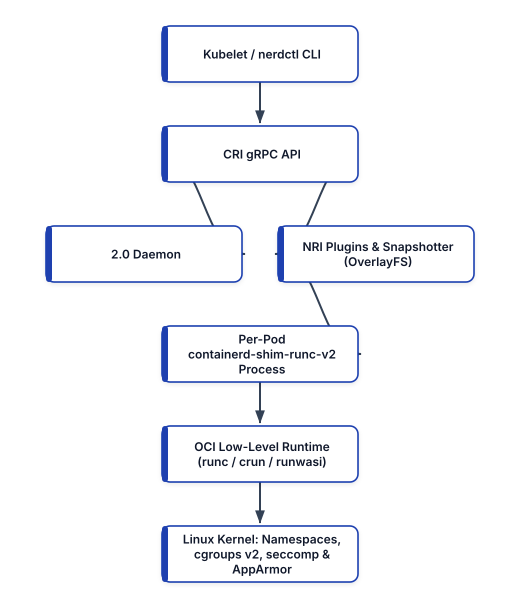


## Linux Kernel Primitives: What a Container Actually Is

There is no object called a "container" inside the Linux kernel source code. A container is simply a standard host Linux process (created via the `clone(2)` and `execve(2)` system calls) that has been restricted by three orthogonal kernel mechanisms:

### 1. Kernel Namespaces (Isolation of Visibility: *What a Process Can See*)
Linux namespaces partition global kernel resources so that a group of processes sees its own isolated view of the system:
- **`pid` (Process ID)**: The container's entry process becomes `PID 1` inside the namespace, isolated from inspecting or signaling host processes.
- **`net` (Network)**: Provides an isolated network stack (`lo`, virtual Ethernet `veth` pairs, routing tables, IP addresses, and socket ports).
- **`mnt` (Mount)**: Isolates the filesystem mount table, combined with `pivot_root(2)` to swap the root filesystem (`/`) to the container's unpacked OCI image bundle.
- **`uts` (UNIX Time-Sharing)**: Isolates the hostname and NIS domain name.
- **`ipc` (Inter-Process Communication)**: Isolates POSIX message queues and System V shared memory segments.
- **`user` (User Namespace)**: Maps a non-root UID/GID on the host (for example, `UID 165536`) to `UID 0` inside the container, forming the foundation of **rootless containers** and Kubernetes **User Namespaces** (`hostUsers: false` in Kubernetes v1.31+).
- **`cgroup` (Control Group Namespace)**: Virtualizes `/proc/self/cgroup` so the process only sees its own relative control group hierarchy.

### 2. Control Groups v2 (`cgroups v2` — Resource Governance: *What a Process Can Use*)
While namespaces control visibility, **`cgroups v2`** (the unified control group hierarchy mandated across modern Linux distributions since Ubuntu 22.04+, RHEL 9+, and Amazon Linux 2023) enforces hardware resource ceilings across CPU weight (`cpu.weight`), hard CPU bandwidth quotas (`cpu.max`), memory limits (`memory.max` and `memory.high`), Block I/O throughput (`io.max`), and maximum process/thread counts (`pids.max`, which prevents fork-bomb denial-of-service attacks). When a container allocates memory beyond its `memory.max` cgroup boundary, the Linux kernel Out-Of-Memory (OOM) killer immediately terminates the process with exit code `137` (`128 + SIGKILL(9)`).

### 3. OverlayFS Copy-on-Write Snapshotters
OCI container images consist of an ordered stack of immutable, read-only tar archives (layers). When a container starts, **`containerd`** uses the Linux **OverlayFS** filesystem driver to mount the read-only image layers as `lowerdir` and places a thin, ephemeral read-write directory (`upperdir`) on top. If 50 containers on the same Kubernetes node share the same base layer digest, all 50 containers share the exact same physical blocks on disk and in the Linux page cache (`lowerdir`), starting in milliseconds with near-zero storage overhead.

## The Modern Runtime Stack: `containerd 2.0`, CRI, and OCI `runc` / `crun`

In the early days of Docker, the monolithic `dockerd` daemon handled everything: CLI UX, image building, volume management, networking, and container execution. When Kubernetes originally launched, the `kubelet` had to talk to `dockerd` through a translation bridge called `dockershim`, which then called `containerd`, which called `runc`.

To eliminate this unnecessary indirection, Docker spun out **`containerd`** to the Cloud Native Computing Foundation (CNCF) and donated the low-level runtime **`runc`** to the **Open Container Initiative (OCI)**. Today, Kubernetes (`kubelet`) communicates directly with **`containerd 2.0`** over the gRPC **Container Runtime Interface (CRI)**.

```
+-----------------------------------------------------+
|     ARCHITECTURE OF CONTAINERD 2.0 RUNTIME STACK    |
+--------------------+--------------------------------+
| RUNTIME COMPONENT  | ARCHITECTURAL RESPONSIBILITY   |
+--------------------+--------------------------------+
| containerd 2.0     | High-level CNCF CRI daemon.    |
| (CRI Server)       | Pulls OCI v1.1 images, manages |
|                    | OverlayFS, CNI, & NRI plugins. |
+--------------------+--------------------------------+
| containerd-shim-   | Lightweight per-Pod daemonless |
| runc-v2            | parent process. Keeps stdio    |
|                    | open & reports exit codes.     |
+--------------------+--------------------------------+
| runc / crun        | Low-level OCI Runtime Spec.    |
| (or runwasi)       | Sets up namespaces, cgroups v2,|
|                    | seccomp, calls execve & EXITS. |
+--------------------+--------------------------------+
```

### Why `runc` Exits After Starting Your Container
A crucial architectural detail surprises many engineers: **`runc` (or its fast C-based alternative `crun`) is not a long-running parent process of your container.**
1. When `containerd` starts a Pod, it spawns a lightweight `containerd-shim-runc-v2` process.
2. The shim invokes `runc create` and `runc start`, pointing to an OCI runtime bundle (`config.json` and `rootfs/`).
3. `runc` makes the Linux kernel syscalls to set up the namespaces, `cgroups v2`, capabilities, and `seccomp` filters, starts your application binary inside the container, and **immediately exits**.
4. `containerd-shim-runc-v2` remains as the direct parent of your container process. Because of this decoupled architecture, you can upgrade or restart the `containerd` daemon on a production Kubernetes node **with zero downtime to running containers**!

### What is New in `containerd 2.0`
Released as a major milestone for the CNCF ecosystem, **`containerd 2.0`** introduces:
- **First-Class Node Resource Interface (NRI) Enabled by Default**: Allows security and observability plugins (like Cilium, Falco, or topology-aware hardware managers) to hook directly into container lifecycle events and adjust cgroup/device allocations without patching `containerd`.
- **Transfer Service API**: Moves image pull, unpack, and registry authentication logic from the client into `containerd` core, improving pull performance and OCI v1.1 compatibility.
- **Unified Sandbox API for MicroVMs and WebAssembly**: Allows `containerd 2.0` to orchestrate standard Linux containers (`runc`/`crun`), **Kata Containers / Firecracker microVMs**, and **WebAssembly workloads (`runwasi` / SpinKube)** side by side on the same node using `RuntimeClass`.

### Interacting Directly with `containerd` via `nerdctl` and `crictl`
On production Kubernetes worker nodes, the Docker daemon (`dockerd`) is not installed. Engineers interact with `containerd` directly using two CLI tools:
- **`crictl`**: The Kubernetes CRI debugging CLI used to inspect Pods (`crictl pods`), containers (`crictl ps`), logs (`crictl logs`), and images (`crictl images`) on a node.
- **`nerdctl`**: A Docker-compatible CLI built natively for `containerd` that supports rootless containers, BuildKit builds (`nerdctl build`), OCI lazy-pulling (eStargz / SOCI), and Cosign verification out of the box.

## Mastering BuildKit: Concurrent DAG Builds, Cache Mounts, and Secret Mounts

When you build a container image today using `docker buildx build` or `nerdctl build`, the build is executed by **BuildKit** (`moby/buildkit`). Unlike the legacy Docker builder—which executed Dockerfile lines sequentially from top to bottom—BuildKit compiles your `Dockerfile` into an intermediate representation called **LLB (Low-Level Builder)**, which models build stages as a **concurrent Directed Acyclic Graph (DAG)**.

Independent stages in a multi-stage Dockerfile execute in parallel, unused stages are skipped entirely, and only the changed files in the build context are transferred over gRPC.

To unlock BuildKit's modern directives, always place the `# syntax=docker/dockerfile:1` frontend pragma on **Line 1** of every `Dockerfile`.

### 1. Eliminating Layer Bloat with `--mount=type=cache`
In legacy Dockerfiles, engineers ran `pip install --no-cache-dir` or `rm -rf /var/cache/apt/*` to avoid baking hundreds of megabytes of package manager cache into the image layer. However, disabling the cache meant that changing a single line in `requirements.txt` forced `pip` or `go build` to re-download and re-compile every dependency from scratch.

BuildKit's `RUN --mount=type=cache,target=/root/.cache/pip` solves both problems simultaneously: BuildKit mounts a persistent, high-speed cache directory managed by the host builder during the `RUN` step, speeding up subsequent builds by 10x, **without ever committing the cache directory into the final OCI image layer**.

### 2. Eliminating Credential Leaks with `--mount=type=secret`
Never pass private repository tokens, `.npmrc` credentials, or AWS keys via `ARG` or `ENV` in a Dockerfile! Any value passed to `ARG` or `ENV` is permanently recorded in plain text inside the image's OCI configuration metadata and is visible to anyone who runs `docker history --no-trunc <image>` or `crane config <image>`.

Instead, use `RUN --mount=type=secret,id=pip_netrc,target=/root/.netrc`. BuildKit mounts the secret as an in-memory `tmpfs` file strictly for the duration of that single `RUN` instruction and unmounts it immediately; the secret never touches disk and leaves zero trace in any image layer.

## Zero-CVE Minimal Runtimes: Chainguard Wolfi and Google Distroless

What base image should you use for the final runtime stage of your multi-stage build?
- **Standard Debian/Ubuntu Base Images (`python:3.12`, `node:22`)**: Often exceed 900 MB uncompressed and include `bash`, `curl`, `wget`, `apt`, `gcc`, and hundreds of system libraries. Every unnecessary library is a source of weekly CVEs that break your CI Trivy gates, and the presence of `/bin/sh` and `curl` gives an attacker exploiting an application RCE vulnerability an immediate interactive reverse shell.
- **Alpine Linux (`alpine:3.20`)**: While small (~7 MB), Alpine uses **`musl libc`** instead of the standard GNU C Library (**`glibc`**). In Python, pre-compiled `manylinux` (`glibc`) binary wheels (`numpy`, `pydantic-core`, `cryptography`, `grpcio`) cannot be used directly on `musl` unless `musllinux` wheels exist, often forcing slow source compilations, and `musl`'s DNS resolver has historically exhibited subtle differences under high concurrency in Kubernetes.
- **Chainguard Wolfi (`cgr.dev/chainguard/*`) and Google Distroless (`gcr.io/distroless/*`)**: The 2026 gold standard for production containers. **Wolfi** is a Linux "undistro" designed specifically for containers: it uses standard **`glibc`** (ensuring 100% compatibility and peak performance with Python, Go, Rust, Node.js, and Java), is rebuilt continuously from source with built-in SPDX SBOMs and Sigstore signatures, and provides runtime images that contain **zero shell (`/bin/sh`), zero package manager (`apk`), non-root user (`UID 65532` `nonroot`) by default, and near-zero CVEs**.

```
+-----------------------------------------------------+
|        COMPARISON OF CONTAINER BASE IMAGES          |
+--------------------+--------+--------+--------------+
| BASE IMAGE         | LIBC   | SHELL  | TYPICAL CVEs |
+--------------------+--------+--------+--------------+
| python:3.12 (Full) | glibc  | Yes    | 40 - 150+    |
+--------------------+--------+--------+--------------+
| python:3.12-slim   | glibc  | Yes    | 10 - 35      |
+--------------------+--------+--------+--------------+
| python:3.12-alpine | musl   | Yes    | 0 - 5        |
+--------------------+--------+--------+--------------+
| gcr.io/distroless/ | glibc  | NO     | 0 - 3        |
| python3-debian12   |        | SHELL  |              |
+--------------------+--------+--------+--------------+
| cgr.dev/chainguard/| glibc  | NO     | 0 (Zero-CVE  |
| python:latest      |        | SHELL  | Daily Build) |
+--------------------+--------+--------+--------------+
```

### Production Multi-Stage Dockerfile (BuildKit + Secret/Cache Mounts + Wolfi/Distroless)
Here is a complete, production-hardened multi-stage `Dockerfile` for a Python 3.12 microservice that compiles dependencies in a builder stage using BuildKit cache and secret mounts, and copies only the immutable virtual environment into a shell-less, non-root runtime stage:

```dockerfile
# syntax=docker/dockerfile:1.10

# =====================================================
# STAGE 1: Hermetic Builder with Cache & Secret Mounts
# =====================================================
FROM cgr.dev/chainguard/python:latest-dev AS builder

WORKDIR /build

# Configure isolated virtual environment path
ENV VIRTUAL_ENV=/opt/venv
RUN python -m venv "${VIRTUAL_ENV}"
ENV PATH="${VIRTUAL_ENV}/bin:${PATH}"

# Copy only dependency manifests first to maximize
# BuildKit layer cache hits when source code changes
COPY --link requirements.txt ./

# Use BuildKit cache mount for pip wheels and secret
# mount for private CodeArtifact/Artifactory .netrc
RUN --mount=type=cache,target=/root/.cache/pip \
    --mount=type=secret,id=netrc,target=/root/.netrc \
    pip install --upgrade pip && \
    pip install --no-compile -r requirements.txt

# =====================================================
# STAGE 2: Hardened Shell-less Non-Root Runtime Image
# =====================================================
FROM cgr.dev/chainguard/python:latest AS runtime

# OCI Standard Image Annotations for Supply Chain Trace
LABEL org.opencontainers.image.title="payments" \
      org.opencontainers.image.vendor="Enterprise"

WORKDIR /app

# Copy pre-built virtualenv from builder using --link
# for independent layer rebasing and read-only perms
COPY --link --from=builder --chown=65532:65532 \
     /opt/venv /opt/venv

# Copy application source code with non-root ownership
COPY --link --chown=65532:65532 src/ /app/src/

ENV PATH="/opt/venv/bin:${PATH}" \
    PYTHONDONTWRITEBYTECODE=1 \
    PYTHONUNBUFFERED=1

# Run strictly as unprivileged nonroot UID/GID 65532
USER 65532:65532

EXPOSE 8080

# Exec-form ENTRYPOINT (ensures app receives SIGTERM
# directly as PID 1 without requiring /bin/sh)
ENTRYPOINT ["/opt/venv/bin/python", "-m", "src.server"]
```

Let us highlight three advanced engineering patterns in this `Dockerfile`:
1. **`COPY --link`**: Introduced in BuildKit, `--link` creates an independent layer tarball that does not depend on previous layers in the stage. If the base image `cgr.dev/chainguard/python:latest` is updated tomorrow for a security patch, BuildKit can rebase your application layers onto the new base image digest in milliseconds without re-running the build!
2. **Exec-Form `ENTRYPOINT ["...", "..."]` for Signal Handling**: Because the runtime image contains no `/bin/sh` shell (for security), using the shell form `ENTRYPOINT python -m src.server` would fail to start. Moreover, the JSON array exec-form launches Python directly as `PID 1` inside the container namespace, guaranteeing that when Kubernetes terminates a Pod and sends `SIGTERM`, your application receives `SIGTERM` immediately to drain active HTTP connections gracefully.
3. **Building with BuildKit Secret Injection**: To build this image while passing the local `~/.netrc` credential securely into Stage 1, execute:

```bash
ECR_REPO="111122223333.dkr.ecr.us-west-2.amazonaws.com"
docker buildx build \
  --platform linux/amd64,linux/arm64 \
  --secret id=netrc,src="${HOME}/.netrc" \
  --tag "${ECR_REPO}/payments:v2.4.0" \
  --push .
```

## Runtime Hardening: Capabilities, Read-Only RootFS, and `seccomp`

Hardening the container image is only half of container security; you must also constrain the kernel privileges granted to the container process at runtime.

By default, a standard container runtime still grants 14 Linux capabilities (such as `CAP_NET_RAW`, which allows crafting raw ICMP/ARP spoofing packets, and `CAP_CHOWN`) and allows the container to write files anywhere inside its OverlayFS `upperdir`.

In production (whether running via `docker run` / `nerdctl run` or inside a Kubernetes `securityContext`), always enforce the **Five Golden Runtime Constraints**:
1. **Run as Non-Root (`--user 65532:65532`)**: Prevents UID 0 privilege escalation if a kernel vulnerability is discovered.
2. **Prevent Privilege Escalation (`--security-opt=no-new-privileges:true`)**: Blocks binaries with `setuid` or `setgid` file bits from elevating privileges via `execve(2)`.
3. **Drop All Linux Capabilities (`--cap-drop=ALL`)**: Strips all 41 Linux kernel capabilities from the process bounding set. Add back individual capabilities (such as `--cap-add=NET_BIND_SERVICE`) only if strictly required.
4. **Immutable Read-Only Root Filesystem (`--read-only`)**: Mounts the container's `/` filesystem as strictly read-only (`EROFS`), preventing an attacker who achieves remote code execution from writing malware or modifying application `.py`/`.js` files on disk. Mount an in-memory, non-executable `tmpfs` volume (`--tmpfs /tmp:rw,noexec,nosuid,size=64m`) for temporary scratch files.
5. **Enforce `seccomp` (Secure Computing Mode) and AppArmor Profiles**: The Linux kernel exposes over 350 system calls (`syscalls`), yet a typical microservice requires fewer than 70. The default **`RuntimeDefault` seccomp profile** in `containerd` blocks dangerous syscalls such as `kexec_load` (booting a new kernel), `mount`, `reboot`, `swapon`, `ptrace`, and `bpf` from inside unprivileged containers.

Here is how to launch our container locally with `nerdctl` (or `docker`) enforcing all five kernel-level protections plus `cgroups v2` memory and PID limits:

```bash
ECR_REPO="111122223333.dkr.ecr.us-west-2.amazonaws.com"
nerdctl run -d \
  --name payments-hardened \
  --user 65532:65532 \
  --read-only \
  --tmpfs /tmp:rw,noexec,nosuid,size=64m \
  --cap-drop=ALL \
  --security-opt=no-new-privileges:true \
  --security-opt seccomp=default \
  --memory=512m \
  --cpus=1.0 \
  --pids-limit=128 \
  -p 8080:8080 \
  "${ECR_REPO}/payments:v2.4.0"
```

### How to Debug Shell-less Distroless / Wolfi Containers in Production
A common question from operations teams transitioning to Distroless or Chainguard Wolfi runtime images is: *"If there is no `/bin/sh`, `curl`, or `tcpdump` inside the container, how do we troubleshoot a live container during a production incident?"*

You never need debugging tools baked into your application image! Both `docker`/`nerdctl` and Kubernetes (via **Ephemeral Debug Containers**) allow you to attach a separate troubleshooting container directly into the target container's `pid`, `net`, and `ipc` namespaces on demand:

```bash
# Attach an ephemeral Wolfi debug toolbox into the live
# Pod's PID and Network namespaces on Kubernetes v1.31+
kubectl debug -it payments-service-7d9f8b-x4k2p \
  -n payments \
  --target=payments-container \
  --image=cgr.dev/chainguard/wolfi-base:latest \
  --profile=general
```

Inside the attached debug session, your target application's filesystem is immediately visible at `/proc/1/root`, and you share its network interfaces and process table—giving engineers full diagnostic visibility while keeping the production image 100% shell-less and immutable.

## Summary

Modern container engineering goes far beyond writing a basic `Dockerfile`. By understanding how Linux namespaces, `cgroups v2`, and OverlayFS isolate processes, leveraging the daemonless `containerd 2.0` and `runc`/`crun` CRI runtime stack, compiling multi-architecture images with BuildKit cache mounts (`--mount=type=cache`), secret mounts (`--mount=type=secret`), and `COPY --link`, adopting zero-CVE Chainguard Wolfi and Distroless base images, and enforcing read-only root filesystems with `--cap-drop=ALL` and `seccomp`, you eliminate entire categories of runtime vulnerabilities. In Chapter 7, we scale these hardened containers across production clusters using **Kubernetes v1.31+** and **Amazon ECS on AWS Fargate**.


<div style="page-break-after: always;"></div>


# Chapter 7: Container Orchestration: Kubernetes v1.31+, Karpenter, and Serverless Containers

Packaging a microservice into a hardened, rootless OCI container solves process isolation on a single Linux host. However, production cloud-native systems comprise hundreds or thousands of containers distributed across multi-zone compute fleets. Scheduling those containers across failure domains, reconciling node hardware failures, routing Layer-7 traffic with zero downtime during deployments, scaling replicas dynamically in response to event queues, and mounting encrypted persistent block storage require a distributed **Container Orchestration** control plane.

In this chapter, we examine the 2026 container orchestration landscape, dissect the control plane and data plane architecture of **Kubernetes v1.31+**, implement sub-minute just-in-time node provisioning and bin-packing with **Karpenter v1.0+ (and Amazon EKS Auto Mode)**, enforce **Pod Security Admission (PSA)** `restricted` standards, replace legacy `Ingress` manifests with the **Kubernetes Gateway API (`Gateway` and `HTTPRoute`)** for weighted canary and blue-green traffic shifting, configure event-driven autoscaling with **KEDA**, and engineer serverless container services on **Amazon ECS with AWS Fargate**.


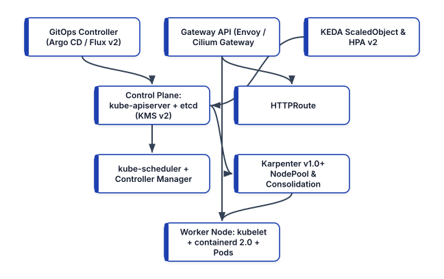


## The 2026 Container Orchestration Landscape

Over the past decade, the "orchestrator wars" decisively concluded. To make informed architectural decisions today, platform engineers must understand the distinct roles of modern orchestrators and why first-generation clustering tools have been retired:

```
+-----------------------------------------------------+
|    2026 CONTAINER ORCHESTRATION LANDSCAPE           |
+-----------------+-----------------------------------+
| ORCHESTRATOR    | PRODUCTION STATUS & FIT           |
+-----------------+-----------------------------------+
| Kubernetes      | Universal cloud-native OS (CNCF   |
| v1.31+ (EKS,    | Graduated). Declarative control   |
| GKE, AKS, Talos)| loops, CRDs, CNI/CSI, Karpenter,  |
|                 | and Gateway API.                  |
+-----------------+-----------------------------------+
| Amazon ECS on   | AWS-native serverless container   |
| AWS Fargate     | orchestrator. Zero control-plane  |
|                 | fee; deep IAM, ALB, and ECS       |
|                 | Service Connect integration.      |
+-----------------+-----------------------------------+
| HashiCorp Nomad | Lightweight single-binary         |
|                 | scheduler for edge, bare-metal,   |
|                 | or mixed non-container fleets.    |
+-----------------+-----------------------------------+
| Docker Swarm &  | LEGACY / RETIRED. Mesos retired   |
| Apache Mesos    | in 2021; Swarm lacks CRD APIs,    |
|                 | CNI/CSI, OIDC workload identity,  |
|                 | and modern admission ecosystems.  |
+-----------------+-----------------------------------+
```

Why did **Kubernetes** triumph over retired legacy alternatives like Docker Swarm? While legacy `docker swarm init` offered a simple CLI for joining a handful of Docker hosts, Swarm modeled orchestration as an imperative extension of the Docker daemon rather than an extensible, declarative API server. Kubernetes introduced the **Kubernetes Resource Model (KRM)** and **Custom Resource Definitions (CRDs)**—transforming the cluster from a mere container scheduler into a universal control plane capable of reconciling cloud infrastructure (Crossplane), service meshes (Cilium / Istio), certificates (`cert-manager`), and GitOps pipelines (Argo CD / Flux v2).

## Kubernetes v1.31+ Control Plane and Worker Node Architecture

A Kubernetes cluster is divided into two distinct planes that communicate exclusively via mutually authenticated TLS (mTLS) against the API server: the **Control Plane** (which maintains cluster state and makes scheduling decisions) and the **Data Plane / Worker Nodes** (which execute containerized application Pods).

### 1. The Control Plane Components
- **`kube-apiserver`**: The stateless front door to the Kubernetes control plane. Every `kubectl` command, controller loop, and `kubelet` heartbeat interacts solely with `kube-apiserver` over HTTPS REST/Protobuf. Each request passes through a four-stage pipeline: **Authentication** (OIDC tokens, X.509 client certificates, or ServiceAccount JWTs), **Authorization** (Role-Based Access Control `RBAC` or Attribute-Based Access Control), **Mutating Admission Controllers** (such as Kyverno policy mutation or sidecar/Pod Identity injection), and **Validating Admission Controllers** (including **ValidatingAdmissionPolicies** written in Common Expression Language `CEL` and **Pod Security Admission**).
- **`etcd`**: A strongly consistent, distributed key-value store based on the **Raft consensus algorithm**. `etcd` is the sole stateful component of the control plane, storing the serialized desired and actual state of every Kubernetes object under `/registry`. In production Kubernetes v1.31+ clusters, all sensitive resources (`Secrets`) stored in `etcd` are encrypted at rest using the **KMS v2 Encryption Provider API**, which uses envelope encryption with a cloud hardware security module (AWS KMS, GCP Cloud KMS, or HashiCorp Vault) and rotates data encryption keys (DEKs) automatically per write.
- **`kube-scheduler`**: Watches `kube-apiserver` for newly created Pods that lack a `spec.nodeName` assignment. For each pending Pod, the scheduler executes a two-phase cycle: **Filtering** (eliminating nodes that lack sufficient allocatable CPU/memory, fail `nodeSelector`/`nodeAffinity` rules, carry unmatched `Taints`, or violate `TopologySpreadConstraints`) and **Scoring** (ranking viable nodes based on image locality, bin-packing density, and zone balance) before binding the Pod to the winning node.
- **`kube-controller-manager` and `cloud-controller-manager`**: Execute continuous reconciliation loops (`ReplicaSet`, `Deployment`, `StatefulSet`, `Job`, `Node`, and cloud-specific `LoadBalancer` / `Route` controllers) that watch actual cluster state and drive it toward desired state.

### 2. The Worker Node Data Plane
- **`kubelet`**: The primary node agent running on every worker machine. Rather than receiving imperative "start container" commands, the `kubelet` watches `kube-apiserver` for Pod specs bound to its node name and drives **`containerd 2.0`** via the gRPC **Container Runtime Interface (CRI)**, mounts storage volumes via the **Container Storage Interface (CSI)**, and executes **Startup, Readiness, and Liveness Probes**.
- **CNI Plugin (Cilium eBPF or AWS VPC CNI)**: Implements the **Container Network Interface (CNI)** specification, assigning each Pod a routable IP address and programming Linux kernel eBPF maps (or network routes) to enforce Kubernetes `NetworkPolicy` segmentation.

## Just-in-Time Node Provisioning with Karpenter v1.0+ and EKS Auto Mode

Historically, scaling Kubernetes worker nodes required pre-configuring static cloud Auto Scaling Groups (ASGs) and running the Kubernetes Cluster Autoscaler. Whenever pods became `Pending`, Cluster Autoscaler had to guess which pre-defined instance group (`m5.xlarge` vs `c5.2xlarge`) to scale up, wait 3 to 5 minutes for EC2 instances to launch, and struggled to consolidate underutilized nodes when workloads scaled down.

Modern Kubernetes clusters on AWS use **Karpenter v1.0+** (or fully managed **Amazon EKS Auto Mode**, which embeds Karpenter directly into the EKS control plane). Karpenter bypasses static node groups entirely:
1. Karpenter watches unschedulable `Pending` pods directly from `kube-apiserver`.
2. It evaluates the aggregate CPU, memory, GPU, architecture (`amd64` / `arm64`), and topology constraints (`topology.kubernetes.io/zone`) of the pending pods in milliseconds.
3. It calls the EC2 `CreateFleet` API directly to provision the exact optimal mix of **AWS Graviton (`c7g`, `m7g`, `r7g`)** and x86 **Spot and On-Demand** instances.
4. During off-peak hours, Karpenter's **Consolidation loop** continuously identifies underutilized nodes, cordons and drains their pods gracefully onto denser or cheaper instances, and terminates the unneeded VMs to slash cloud compute spend by 30–50%.

Here is a production **Karpenter v1.0 (`karpenter.sh/v1`)** `NodePool` and `EC2NodeClass` configuration that provisions Graviton3/Graviton4 (`arm64`) and `amd64` nodes, enforces encrypted EBS volumes, and automatically rotates nodes every 14 days (`expireAfter: 336h`) to guarantee immutable OS patch hygiene:

```yaml
# karpenter-nodepool.yaml
apiVersion: karpenter.sh/v1
kind: NodePool
metadata:
  name: general-compute-pool
spec:
  template:
    metadata:
      labels:
        workload-tier: general
    spec:
      nodeClassRef:
        group: karpenter.k8s.aws
        kind: EC2NodeClass
        name: hardened-al2023
      # Enforce immutable 14-day maximum node lifetime
      expireAfter: 336h
      requirements:
        - key: kubernetes.io/arch
          operator: In
          values: ["arm64", "amd64"]
        - key: karpenter.sh/capacity-type
          operator: In
          values: ["on-demand", "spot"]
        - key: karpenter.k8s.aws/instance-category
          operator: In
          values: ["c", "m", "r"]
        - key: karpenter.k8s.aws/instance-generation
          operator: Gt
          values: ["6"]
  limits:
    cpu: "1000"
    memory: 4000Gi
  disruption:
    consolidationPolicy: WhenEmptyOrUnderutilized
    consolidateAfter: 30s
---
apiVersion: karpenter.k8s.aws/v1
kind: EC2NodeClass
metadata:
  name: hardened-al2023
spec:
  amiFamily: AL2023
  role: "KarpenterNodeRole-prod-cluster"
  amiSelectorTerms:
    - alias: al2023@latest
  subnetSelectorTerms:
    - tags:
        karpenter.sh/discovery: "prod-cluster"
  securityGroupSelectorTerms:
    - tags:
        karpenter.sh/discovery: "prod-cluster"
  metadataOptions:
    httpEndpoint: enabled
    # Enforce IMDSv2 with hop limit 1 (blocks Pod IMDS)
    httpTokens: required
    httpPutResponseHopLimit: 1
  blockDeviceMappings:
    - deviceName: /dev/xvda
      ebs:
        volumeSize: 50Gi
        volumeType: gp3
        encrypted: true
        deleteOnTermination: true
```

Notice `httpPutResponseHopLimit: 1` with `httpTokens: required` in `metadataOptions`. Setting the IMDSv2 hop limit to `1` ensures that only host-level processes (like the `kubelet`) can reach the EC2 Instance Metadata Service, mathematically preventing containerized application pods (which are an extra network hop away across the CNI `veth` interface) from stealing the underlying node's IAM role credentials! Application pods instead authenticate exclusively via **EKS Pod Identity**.

## Hardening Workloads with Pod Security Admission (PSA) and Topology Spread

In Kubernetes v1.25+, the legacy `PodSecurityPolicy` (PSP) resource was permanently removed and replaced by the built-in **Pod Security Admission (PSA)** controller, which enforces the **Kubernetes Pod Security Standards (PSS)**—`privileged`, `baseline`, and `restricted`—via simple namespace labels.

When you label an application namespace with `pod-security.kubernetes.io/enforce: restricted`, `kube-apiserver` automatically rejects any Pod that fails to drop `ALL` Linux capabilities, attempts to run as root, omits a `seccompProfile`, or mounts hostPath volumes:

```yaml
# payments-namespace.yaml
apiVersion: v1
kind: Namespace
metadata:
  name: payments
  labels:
    pod-security.kubernetes.io/enforce: restricted
    pod-security.kubernetes.io/enforce-version: latest
    pod-security.kubernetes.io/audit: restricted
    pod-security.kubernetes.io/warn: restricted
```

### Production-Grade Kubernetes Deployment and PodDisruptionBudget
Below is a complete, production-hardened `Deployment` and `PodDisruptionBudget` (`payments-deployment.yaml`) compliant with the `restricted` Pod Security Standard. It includes multi-zone `topologySpreadConstraints` (ensuring pods never concentrate in a single Availability Zone), `startupProbe`/`readinessProbe`/`livenessProbe` separation, guaranteed/burstable QoS resource boundaries, and an immutable read-only root filesystem:

```yaml
# payments-deployment.yaml
apiVersion: policy/v1
kind: PodDisruptionBudget
metadata:
  name: payments-service-pdb
  namespace: payments
spec:
  minAvailable: "75%"
  selector:
    matchLabels:
      app.kubernetes.io/name: payments-service
---
apiVersion: apps/v1
kind: Deployment
metadata:
  name: payments-service
  namespace: payments
  labels:
    app.kubernetes.io/name: payments-service
spec:
  replicas: 4
  revisionHistoryLimit: 5
  strategy:
    type: RollingUpdate
    rollingUpdate:
      maxSurge: 1
      maxUnavailable: 0
  selector:
    matchLabels:
      app.kubernetes.io/name: payments-service
  template:
    metadata:
      labels:
        app.kubernetes.io/name: payments-service
    spec:
      serviceAccountName: payments-pod-identity-sa
      automountServiceAccountToken: false
      securityContext:
        runAsNonRoot: true
        runAsUser: 65532
        runAsGroup: 65532
        fsGroup: 65532
        seccompProfile:
          type: RuntimeDefault
      # Spread replicas evenly across Zones
      topologySpreadConstraints:
        - maxSkew: 1
          topologyKey: topology.kubernetes.io/zone
          whenUnsatisfiable: DoNotSchedule
          labelSelector:
            matchLabels:
              app.kubernetes.io/name: payments-service
      containers:
        - name: payments-api
          image: >-
            111122223333.dkr.ecr.us-west-2.aws/pay:v2.4
          ports:
            - name: http
              containerPort: 8080
              protocol: TCP
          securityContext:
            allowPrivilegeEscalation: false
            readOnlyRootFilesystem: true
            capabilities:
              drop: ["ALL"]
          resources:
            requests:
              cpu: "500m"
              memory: "512Mi"
            limits:
              memory: "512Mi"
          startupProbe:
            httpGet:
              path: /healthz/startup
              port: http
            failureThreshold: 30
            periodSeconds: 2
          readinessProbe:
            httpGet:
              path: /healthz/ready
              port: http
            periodSeconds: 5
            failureThreshold: 3
          livenessProbe:
            httpGet:
              path: /healthz/live
              port: http
            periodSeconds: 10
            failureThreshold: 3
          volumeMounts:
            - name: tmp-scratch
              mountPath: /tmp
      volumes:
        - name: tmp-scratch
          emptyDir:
            medium: Memory
            sizeLimit: 64Mi
```

Notice two crucial reliability settings in this manifest:
1. **`maxUnavailable: 0` and `maxSurge: 1` paired with `readinessProbe`**: During a rolling update, Kubernetes never terminates an existing healthy Pod until a newly surged Pod passes its `startupProbe` and `readinessProbe` and is registered in the `EndpointSlice`.
2. **Memory `requests` equal to `limits`, with no hard CPU `limit` throttling**: Setting `requests.memory == limits.memory` (`512Mi`) protects the Pod from opportunistic OOM eviction under node memory pressure, while omitting a hard `limits.cpu` (or using Kubernetes v1.31+ in-place pod vertical scaling) avoids unnecessary CFS bandwidth throttling spikes when neighboring cores are idle.

## Progressive Delivery with the Kubernetes Gateway API (`Gateway` & `HTTPRoute`)

In first-generation Kubernetes clusters, exposing HTTP services and implementing Canary or Blue-Green traffic shifting required either ugly manual label-patching hacks (`kubectl patch service`) or vendor-specific `Ingress` annotations (`nginx.ingress.kubernetes.io/canary-weight`). Because the legacy `Ingress` API lacked native support for header matching, traffic weighting, mTLS, or role separation, every ingress controller invented incompatible custom annotations.

The **Kubernetes Gateway API (`gateway.networking.k8s.io/v1`)** supersedes `Ingress` with an expressive, portable, role-oriented architecture implemented natively by **Cilium**, **Envoy Gateway**, **Istio**, **NGINX**, and cloud load balancers:
- **Infrastructure Provider Role (`GatewayClass`)**: Defines the underlying data plane controller (e.g., `cilium` or `envoy-gateway`).
- **Cluster Operator / Platform Role (`Gateway`)**: Provisions the network load balancer listener ports, TLS certificates, and allowed route namespaces.
- **Application Developer Role (`HTTPRoute` / `GRPCRoute`)**: Attaches routing rules, header matches, request timeouts, and **weighted Canary / Blue-Green `backendRefs`** to the parent `Gateway`.

Here is how to execute a **90% Stable (Blue) / 10% Canary (Green) progressive rollout** natively using a Gateway API `HTTPRoute` without third-party annotation hacks:

```yaml
# payments-httproute-canary.yaml
apiVersion: gateway.networking.k8s.io/v1
kind: HTTPRoute
metadata:
  name: payments-traffic-route
  namespace: payments
spec:
  parentRefs:
    - name: prod-external-gateway
      namespace: infra-gateway
      sectionName: https-listener
  hostnames:
    - "api.payments.example.com"
  rules:
    # Rule 1: Route internal QA testers with header
    # X-Canary-Stage: true 100% to v2 Canary service
    - matches:
        - headers:
            - name: X-Canary-Stage
              value: "true"
      backendRefs:
        - name: payments-service-canary
          port: 8080
          weight: 100

    # Rule 2: Split production traffic 90% Stable /
    # 10% Canary across EndpointSlices
    - matches:
        - path:
            type: PathPrefix
            value: /v1/checkout
      backendRefs:
        - name: payments-service-stable
          port: 8080
          weight: 90
        - name: payments-service-canary
          port: 8080
          weight: 10
```

When paired with **Argo Rollouts** or **Flagger**, the progressive delivery controller automatically increments the `weight` fields inside this `HTTPRoute` (`10 -> 25 -> 50 -> 100`) while evaluating Prometheus SLO queries at each step.

## Event-Driven Autoscaling with KEDA (Kubernetes Event-Driven Autoscaling)

The standard Kubernetes `HorizontalPodAutoscaler` (HPA) defaults to scaling Pods based on average CPU or memory utilization. However, for asynchronous worker microservices consuming messages from Amazon SQS, Apache Kafka, or RabbitMQ, **CPU utilization is a lagging indicator**. A worker blocked on network I/O waiting for downstream API responses may exhibit only 15% CPU utilization while an SQS queue backlog balloons to 500,000 messages!

**KEDA (Kubernetes Event-Driven Autoscaling)**—a CNCF Graduated project—solves this by acting as a custom metrics server and event controller that scales Deployments or Jobs directly on external event sources (including **scale-to-zero** when a queue is empty) using workload identity authentication (`TriggerAuthentication`):

```yaml
# keda-sqs-autoscaler.yaml
apiVersion: keda.sh/v1alpha1
kind: TriggerAuthentication
metadata:
  name: keda-aws-pod-identity
  namespace: payments
spec:
  podIdentity:
    provider: aws
---
apiVersion: keda.sh/v1alpha1
kind: ScaledObject
metadata:
  name: order-processor-scaler
  namespace: payments
spec:
  scaleTargetRef:
    apiVersion: apps/v1
    kind: Deployment
    name: order-processor-worker
  pollingInterval: 10
  cooldownPeriod: 60
  minReplicaCount: 1
  maxReplicaCount: 50
  triggers:
    - type: aws-sqs-queue
      authenticationRef:
        name: keda-aws-pod-identity
      metadata:
        queueURL: >-
          https://sqs.us-west-2.aws/1111/OrderQueue
        queueLength: "25"
        awsRegion: "us-west-2"
        scaleOnInFlight: "true"
```

With `queueLength: "25"`, KEDA queries Amazon SQS every 10 seconds and dynamically scales `order-processor-worker` replicas so that each Pod handles at most 25 queued messages, scaling up to 50 replicas during flash sales and scaling back down to 1 replica once the queue drains.

## Serverless Container Orchestration with Amazon ECS on AWS Fargate

While Kubernetes is the standard for multi-team platforms and portable cloud-native ecosystems, not every workload requires managing a Kubernetes control plane. When an engineering team runs exclusively on AWS and wants to deploy containerized microservices with **zero cluster control-plane cost, zero worker node patching, and microVM-level hardware isolation per Pod/Task**, **Amazon Elastic Container Service (Amazon ECS) on AWS Fargate** is a compelling architectural choice.

Under the hood, AWS Fargate runs every ECS Task inside its own dedicated **Firecracker microVM** (or Nitro enclave boundary) attached to your VPC via an Elastic Network Interface (`awsvpc` mode), supports **AWS Graviton2/Graviton3 (`ARM64`)** compute at a 20% price-performance advantage, and provides built-in service discovery and Layer-7 traffic shifting via **Amazon ECS Service Connect**.

Rather than clicking through the AWS Management Console wizard (an anti-pattern that introduces configuration drift), always provision ECS Fargate clusters, Task Definitions, and Application Load Balanced services programmatically using **AWS CDK v2 L3 Patterns (`aws_ecs_patterns`)**:

```python
# stacks/ecs_fargate_stack.py
from aws_cdk import (
    Duration,
    Stack,
    aws_ec2 as ec2,
    aws_ecr as ecr,
    aws_ecs as ecs,
    aws_ecs_patterns as ecs_patterns,
)
from constructs import Construct


class ServerlessFargateServiceStack(Stack):
    def __init__(
        self,
        scope: Construct,
        construct_id: str,
        vpc: ec2.IVpc,
        repo: ecr.IRepository,
        image_digest: str,
        **kwargs,
    ) -> None:
        super().__init__(scope, construct_id, **kwargs)

        # 1. ECS Cluster with Container Insights
        cluster = ecs.Cluster(
            self,
            "PaymentsFargateCluster",
            vpc=vpc,
            container_insights_v2=(
                ecs.ContainerInsights.ENHANCED
            ),
        )

        # 2. ALB + Graviton2 Fargate Service Pattern
        cb = ecs.DeploymentCircuitBreaker(
            enable=True,
            rollback=True,
        )
        img_opts = (
            ecs_patterns
            .ApplicationLoadBalancedTaskImageOptions(
                image=(
                    ecs.ContainerImage
                    .from_ecr_repository(
                        repo, tag=image_digest
                    )
                ),
                container_port=8080,
                enable_logging=True,
            )
        )
        self.fargate_service = (
            ecs_patterns
            .ApplicationLoadBalancedFargateService(
                self,
                "PaymentsFargateService",
                cluster=cluster,
                cpu=1024,
                memory_limit_mib=2048,
                desired_count=3,
                runtime_platform=ecs.RuntimePlatform(
                    cpu_architecture=(
                        ecs.CpuArchitecture.ARM64
                    ),
                    operating_system_family=(
                        ecs.OperatingSystemFamily.LINUX
                    ),
                ),
                circuit_breaker=cb,
                task_image_options=img_opts,
                public_load_balancer=True,
            )
        )

        # 3. Target-Tracking Auto Scaling on ALB Req/s
        scalable_target = (
            self.fargate_service.service
            .auto_scale_task_count(
                min_capacity=3,
                max_capacity=30,
            )
        )
        scalable_target.scale_on_request_count(
            "ScaleOnAlbRequestRate",
            requests_per_target=1000,
            target_group=(
                self.fargate_service.target_group
            ),
            scale_in_cooldown=Duration.seconds(60),
            scale_out_cooldown=Duration.seconds(15),
        )
```

Notice `circuit_breaker=ecs.DeploymentCircuitBreaker(enable=True, rollback=True)`. If a newly deployed Fargate Task revision fails ALB health checks or crashes repeatedly on startup, ECS's built-in deployment circuit breaker automatically halts the rollout and rolls traffic back to the last known healthy Task Definition revision without human intervention.

## Summary

Modern container orchestration provides the self-healing, declarative substrate for cloud-native systems. Whether you standardize on **Kubernetes v1.31+**—powered by **Karpenter v1.0+** just-in-time node consolidation, **Pod Security Admission (`restricted`)**, the **Kubernetes Gateway API** for native canary routing, and **KEDA** for event-driven scaling—or leverage serverless **Amazon ECS on AWS Fargate** with deployment circuit breakers, declarative orchestration transforms hundreds of ephemeral containers into a resilient, unified platform. In Chapter 8, we instrument these orchestrated workloads with unified **OpenTelemetry** pipelines, **Prometheus/Thanos/Mimir**, **Grafana Loki & Tempo**, and **SLO Error Budget** engineering.


<div style="page-break-after: always;"></div>


# Chapter 8: Cloud-Native Observability: OpenTelemetry, Prometheus/Mimir, Loki, Tempo, and SLO Engineering

In a monolithic architecture running on a single server, diagnosing a production outage often meant logging into the box, running `top`, and grepping `/var/log/messages`. In a modern cloud-native architecture—where a single customer checkout request fans out across a Kubernetes Gateway API proxy, twelve polyglot microservices, three gRPC caches, an Amazon DynamoDB table, and an asynchronous Kafka or SQS event stream—traditional host-based monitoring is blind to the failure modes that actually impact users.

**Observability** is the mathematical property of a system that measures how well its internal state can be inferred solely from its external outputs (telemetry signals). While legacy **monitoring** asks whether known failure conditions have occurred (*"Is disk utilization above 85%?"*), **observability** equips engineers to ask arbitrary, exploratory questions about unknown failure modes across high-cardinality dimensions (*"Why are checkout requests specifically for customers on iOS build 18.4 routed through `us-west-2b` experiencing 2.4-second tail latency on database shard 7?"*).

In this chapter, we architect a unified 2026 observability stack centered on the **OpenTelemetry (OTel) Collector**, scale dimensional time-series metrics with **Prometheus** and **Grafana Mimir / Thanos**, correlate structured logs with **Grafana Loki** and **OpenSearch**, trace distributed execution paths with **Grafana Tempo**, **Jaeger v2**, and **AWS X-Ray (ADOT)**, link signals together using **Exemplars**, and replace noisy symptom alerts with **Multi-Window, Multi-Burn-Rate SLO Alerts**.


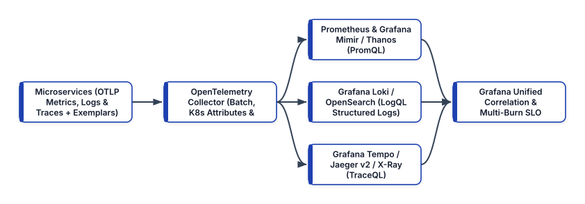


## The Unified Telemetry Paradigm: Signals, Context Propagation, and Exemplars

Historically, engineering teams treated **Metrics**, **Logs**, and **Traces** (alongside **Continuous Profiles**, covered in depth in Chapter 21) as three disconnected silos, installing separate vendor agents for each signal (`node_exporter` + `fluentd` + `jaeger-agent`). Disconnected agents caused severe operational friction: the metric agent labeled a Pod `pod_name="payments-7d9f"`, the log shipper labeled it `kubernetes.pod="payments-7d9f"`, and the tracing SDK called it `service="payments-api"`, making it impossible to pivot seamlessly from a latency spike on a graph to the exact offending trace and log lines.

Modern observability solves this by standardizing on two foundational specifications from the **Cloud Native Computing Foundation (CNCF)** and **W3C**:

1. **OpenTelemetry Semantic Conventions and OTLP**: Every telemetry signal emitted by an application or infrastructure daemon uses identical resource attributes (`service.name`, `service.version`, `deployment.environment.name`, `k8s.namespace.name`, `k8s.pod.name`) and is transmitted over a single multiplexed wire protocol—the **OpenTelemetry Protocol (OTLP)** over gRPC (`:4317`) or HTTP/Protobuf (`:4318`).
2. **W3C Trace Context (`traceparent`) and Exemplars**: Every incoming HTTP or gRPC request carries a standard `traceparent` header (`00-<32-hex-trace-id>-<16-hex-span-id>-01`). As the request executes:
   - The **Structured Logger** automatically injects `"trace_id"` and `"span_id"` into every emitted JSON log record.
   - The **Prometheus / OTel Histogram** attaches an **Exemplar**—a sample `trace_id` alongside the exact latency observation bucket—directly onto the time-series metric point.

```
+-----------------------------------------------------+
|      CORRELATING SIGNALS VIA W3C TRACE CONTEXT      |
+-----------------------------------------------------+
|                                                     |
|  [1. METRIC: Prometheus / Mimir Histogram]          |
|      http_request_duration_seconds_bucket{le="0.5"} |
|      └── Exemplar: { trace_id="4bf92f3577b34d..." } |
|                         |                           |
|       (1-Click Pivot in Grafana via trace_id)       |
|                         v                           |
|  [2. TRACE: Grafana Tempo / Jaeger v2 Waterfall]    |
|      Trace 4bf92f3577b34d... (Total: 482ms)         |
|      ├── Span A: api-gateway (12ms)                 |
|      └── Span B: payments -> DB (470ms, ERROR)      |
|                         |                           |
|       (1-Click Pivot to Pod Logs for Span B)        |
|                         v                           |
|  [3. LOG: Grafana Loki Structured JSON]             |
|      {"ts":"2026-10-25T08:14:02Z","level":"ERROR",  |
|       "trace_id":"4bf92f3577b34d...",               |
|       "msg":"Deadlock on shard 4","order":"8821"}   |
+-----------------------------------------------------+
```

## Architecting the OpenTelemetry Collector Pipeline

Rather than configuring microservices to talk directly to Prometheus, Loki, Tempo, or AWS CloudWatch/X-Ray endpoints, modern Kubernetes clusters deploy the **OpenTelemetry Collector (`otelcol-contrib`)** as a node DaemonSet or gateway deployment.

The OpenTelemetry Collector decouples application instrumentation from backend storage through a four-stage pipeline architecture:
- **Receivers (`otlp`, `prometheus`, `filelog`, `kubeletstats`)**: Ingest telemetry in OTLP, Prometheus, Zipkin, or container log formats.
- **Processors (`memory_limiter`, `k8sattributes`, `resourcedetection`, `transform`, `batch`)**: Enrich telemetry with Kubernetes Pod/Node labels, scrub sensitive PII (such as `Authorization` headers or credit card numbers), prevent out-of-memory crashes via `memory_limiter`, and compress payloads into efficient batches.
- **Connectors (`spanmetrics`)**: Compute RED metrics (Request rate, Error count, Duration histograms) directly from ingested trace spans before sampling, ensuring 100% accurate metrics even if only 10% of traces are stored!
- **Exporters (`prometheusremotewrite`, `otlp/tempo`, `loki`, `awsxray`)**: Fan out processed telemetry to one or more open-source or cloud backends simultaneously.

Here is a production-hardened **OpenTelemetry Collector (`otel-collector-config.yaml`)** configuration that ingests OTLP metrics, logs, and traces, enriches them with Kubernetes metadata, generates span metrics via the `spanmetrics` connector, and exports to **Prometheus/Mimir**, **Grafana Tempo**, and **Grafana Loki**:

```yaml
# otel-collector-config.yaml
receivers:
  otlp:
    protocols:
      grpc:
        endpoint: 0.0.0.0:4317
      http:
        endpoint: 0.0.0.0:4318

processors:
  # Always place memory_limiter first in the pipeline!
  memory_limiter:
    check_interval: 1s
    limit_percentage: 80
    spike_limit_percentage: 15

  # Automatically enrich signals with K8s Pod metadata
  k8sattributes:
    auth_type: "serviceAccount"
    passthrough: false
    extract:
      metadata:
        - k8s.pod.name
        - k8s.namespace.name
        - k8s.deployment.name
        - k8s.node.name

  # Batch telemetry to optimize network compression
  batch:
    send_batch_size: 8192
    timeout: 2s

connectors:
  # Derive RED metrics + Exemplars directly from spans
  spanmetrics:
    histogram:
      explicit:
        buckets: [10ms, 50ms, 100ms, 250ms, 500ms, 1s]
    exemplars:
      enabled: true

exporters:
  prometheusremotewrite:
    endpoint: >-
      http://mimir-distributor.monitoring:8080/push
    send_metadata: true

  otlp/tempo:
    endpoint: "tempo-distributor.monitoring.svc:4317"
    tls:
      insecure: true

  otlphttp/loki:
    endpoint: "http://loki-gateway.monitoring.svc/otlp"

service:
  pipelines:
    traces:
      receivers: [otlp]
      processors:
        - memory_limiter
        - k8sattributes
        - batch
      exporters: [otlp/tempo, spanmetrics]
    metrics:
      receivers: [otlp, spanmetrics]
      processors:
        - memory_limiter
        - k8sattributes
        - batch
      exporters: [prometheusremotewrite]
    logs:
      receivers: [otlp]
      processors:
        - memory_limiter
        - k8sattributes
        - batch
      exporters: [otlphttp/loki]
```

## Dimensional Metrics at Scale: Prometheus, Mimir, and Thanos

**Prometheus** (a CNCF Graduated project) is the standard metric engine for cloud-native systems. Unlike legacy hierarchical metric systems (like StatsD/Graphite), Prometheus models every time series as a metric name paired with an unordered set of key-value **labels** (`http_requests_total{service="payments", method="POST", status="200"}`) stored in a local Time-Series Database (TSDB) and queried via **PromQL**.

### Defending Against High-Cardinality Label Explosion
The most dangerous operational anti-pattern in Prometheus is **unbounded label cardinality**. Every unique combination of key-value labels creates a brand-new time series in the TSDB index in RAM.
- **Safe Bounded Labels**: `service`, `namespace`, `http_method`, `status_code`, `availability_zone` (multiplicative cardinality: `20 * 5 * 4 * 10 * 3 = 12,000` active series).
- **Fatal Unbounded Labels**: Putting `user_id`, `order_id`, `email`, `ip_address`, or full URL paths (`/orders/98412`) into a Prometheus label! With 5 million users, a single metric immediately spawns 5 million distinct time series, exhausting Prometheus memory and crashing the TSDB. High-cardinality identifiers belong exclusively in **Trace Attributes** and **Structured Logs**, linked to metrics via **Exemplars**.

### Scaling Beyond a Single Cluster: Grafana Mimir and Thanos
A standalone Prometheus server stores data on a single local disk and is not designed for multi-year retention or global multi-cluster queries. To achieve horizontally scalable, multi-tenant long-term storage backed by cheap cloud object storage (Amazon S3 or GCS), production platforms pair Prometheus (running in lightweight **Agent Mode** or via the OTel Collector) with **Grafana Mimir** or **Thanos**:
- **Thanos**: Extends existing Prometheus servers with a `Thanos Sidecar` (uploading 2-hour TSDB blocks to S3), `Thanos Store Gateway`, `Thanos Compactor` (performing downsampling to 5m and 1h resolutions), and `Thanos Querier` (deduplicating HA Prometheus pairs across clusters).
- **Grafana Mimir**: A horizontally scalable, microservice-based TSDB written to ingest hundreds of millions of active series via `remote_write` / OTLP, splitting ingestion across stateless `Distributors`, replicated in-memory `Ingesters`, S3-backed `Store-Gateways`, and parallel `Query-Frontends`.

## Structured Logging: Grafana Loki vs. OpenSearch / ELK

Application logs provide the granular, line-by-line context of state mutations and exceptions. In 2026, enterprise logging architectures generally follow one of two paths:

1. **Full-Text Indexed Engines (OpenSearch / Elasticsearch + Fluent Bit / Vector)**: Tokenizes and builds an inverted index over every field in every JSON log line. While powerful for arbitrary free-text analytics, full-text indices often consume as much disk space and JVM heap RAM as the raw log data itself.
2. **Label-Indexed Object-Storage Engines (Grafana Loki)**: Inspired by Prometheus, **Grafana Loki** does **not** index the full text of log messages. Instead, Loki indexes only the small set of Prometheus/Kubernetes metadata labels (`{namespace="payments", service_name="payments-api", level="ERROR"}`) and compresses the raw JSON log streams into chunks stored directly in Amazon S3. When you run a **LogQL** query in Grafana, Loki uses the tiny label index to narrow the search to the exact time window and S3 chunks, then parallel-greps the compressed chunks across stateless query workers at gigabytes per second—cutting logging infrastructure costs by 70–85%.

### Emitting Correlated JSON Structured Logs in Python
Unstructured multi-line text logs (`2026-10-25 ERROR Something broke for user 42`) require brittle regular expressions (`regex`) to parse. Always emit **single-line JSON structured logs** to `stdout` (following the 12-Factor App principle so `containerd` captures them automatically) with OpenTelemetry `trace_id` and `span_id` fields injected:

```python
# structured_logger.py
import json
import logging
import sys
from datetime import datetime, timezone
from opentelemetry import trace


class OTelJsonFormatter(logging.Formatter):
    def format(self, record: logging.LogRecord) -> str:
        span = trace.get_current_span()
        ctx = span.get_span_context()

        trace_id = (
            format(ctx.trace_id, "032x")
            if ctx.is_valid
            else None
        )
        span_id = (
            format(ctx.span_id, "016x")
            if ctx.is_valid
            else None
        )

        payload = {
            "timestamp": datetime.now(
                timezone.utc
            ).isoformat(),
            "severity": record.levelname,
            "service": "payments-service",
            "message": record.getMessage(),
            "logger": record.name,
            "trace_id": trace_id,
            "span_id": span_id,
        }
        return json.dumps(payload)


def get_structured_logger(
    name: str,
) -> logging.Logger:
    logger = logging.getLogger(name)
    logger.setLevel(logging.INFO)
    if not logger.handlers:
        handler = logging.StreamHandler(sys.stdout)
        handler.setFormatter(OTelJsonFormatter())
        logger.addHandler(handler)
    return logger
```

With structured JSON logs flowing into **Grafana Loki** via the OpenTelemetry Collector's `otlphttp/loki` exporter, engineers can execute expressive **LogQL** queries that filter by label, parse JSON fields on the fly, and aggregate error rates:

```promql
# LogQL: Find all ERROR logs in payments-service where
# latency_ms > 500 and extract the correlated trace_id
{namespace="payments", service_name="payments-service"}
  | json
  | severity = "ERROR"
  | latency_ms > 500
  | line_format "Trace={{.trace_id}} Msg={{.message}}"
```

## Distributed Tracing: Grafana Tempo, Jaeger v2, and AWS X-Ray (ADOT)

When a request traverses ten microservices, **Distributed Tracing** reconstructs the complete causal Directed Acyclic Graph (DAG) of **Spans**. Each Span records its `trace_id`, its own `span_id`, its `parent_span_id`, start and end nanosecond timestamps, status (`OK` or `ERROR`), and structured key-value attributes (such as `db.system="postgresql"`, `http.route="/v1/checkout"`, `http.response.status_code=503`).

### Modern Trace Storage: Grafana Tempo and Jaeger v2
Historically, running a distributed tracing backend like first-generation Jaeger required operating a massive Elasticsearch or Cassandra cluster just to index span tags, forcing teams to set tiny head-based sampling rates (such as `0.1%` of requests)—which meant that when a rare production bug occurred, the trace was almost never captured!

In 2026, two architectural advancements have solved trace storage economics:
1. **Grafana Tempo (Zero-Index Object Storage + TraceQL)**: Like Loki, **Grafana Tempo** requires only object storage (S3/GCS) and builds **zero full-text index** by default, storing trace blocks keyed by `trace_id` alongside compact Bloom filters and Parquet columnar blocks for high-speed **TraceQL** queries (`{ resource.service.name = "payments-service" && status = error && duration > 500ms }`).
2. **Jaeger v2 (OpenTelemetry Collector Core)**: The CNCF **Jaeger v2** architecture re-engineered Jaeger directly on top of the OpenTelemetry Collector framework, supporting native OTLP ingestion and ClickHouse / OpenSearch storage backends.
3. **AWS CloudWatch & AWS X-Ray via ADOT**: On AWS, deploying the **AWS Distro for OpenTelemetry (ADOT)** Collector exports OTLP traces directly to **AWS X-Ray** and metrics to **Amazon Managed Service for Prometheus (AMP)**, enabling unified service maps across EKS, ECS Fargate, API Gateway, and DynamoDB.

## Engineering Methodologies: RED, USE, and Multi-Burn-Rate SLO Alerts

Collecting terabytes of metrics, logs, and traces is useless—and counterproductive—if on-call engineers are bombarded with hundreds of low-signal alerts (`CPU > 75%`, `Pod restarted once`) that cause **alert fatigue**.

Modern Site Reliability Engineering structures dashboards around two complementary telemetry methodologies and gates paging alerts strictly on **SLO Error Budget Burn Rates**:

### 1. The USE Method (For Infrastructure and Kernel Resources)
Created by Brendan Gregg, the **USE Method** monitors hardware and OS resources (CPU cores, RAM, NVMe disks, network interfaces, eBPF maps):
- **Utilization**: Percentage of time the resource was busy servicing work (e.g., `node_cpu_seconds_total`).
- **Saturation**: Degree to which queued work cannot be serviced immediately (e.g., Linux CPU run-queue length `node_load1` or cgroup CPU throttling `container_cpu_cfs_throttled_seconds_total`).
- **Errors**: Count of hardware or kernel error events (e.g., NIC packet drops or NVMe I/O errors).

### 2. The RED Method (For Request-Driven Microservices)
Created by Tom Wilkie, the **RED Method** measures user-facing service health for every microservice endpoint:
- **Rate**: Requests per second (`sum(rate(http_server_requests_seconds_count[5m]))`).
- **Errors**: Failed requests (`5xx` or gRPC non-`OK`) per second.
- **Duration**: Distribution of request latency (specifically **P50, P95, and P99 percentiles** computed via `histogram_quantile()`).

### 3. Multi-Window, Multi-Burn-Rate SLO Alerting in Prometheus
Suppose our `payments-service` has a 28-day **Availability SLO of `99.9%`**, giving us an **Error Budget of `0.1%`** (`40.32 minutes` of permitted 5xx errors per 28 days, or `672 hours`).

A **Burn Rate of `1.0`** means the service is consuming its error budget at a rate that will exhaust the budget in exactly 28 days (`0.001` error ratio). A **Burn Rate of `14.4`** means the service will exhaust 2% of its entire monthly error budget in just **1 hour** (exhausting 100% of the budget in under 2 days!).

Following Google SRE best practices, we configure a **Multi-Window, Multi-Burn-Rate Alert** in Prometheus / Mimir (`payments-slo-rules.yaml`). We only page an engineer if **both** a long window (`1h`) **and** a short confirmation window (`5m`) exceed the `14.4x` burn rate threshold—guaranteeing fast detection while ensuring the alert resets within 5 minutes once the incident is resolved:

```yaml
# payments-slo-rules.yaml
apiVersion: monitoring.coreos.com/v1
kind: PrometheusRule
metadata:
  name: payments-slo-burn-rate-rules
  namespace: monitoring
spec:
  groups:
    - name: payments.slo.availability
      interval: 30s
      rules:
        # Pre-compute 5m and 1h error ratios
        - record: job:slo_errors:ratio_rate5m
          expr: |
            sum by (service) (
              rate(http_requests_total{
                service="payments-service",
                status=~"5.."
              }[5m])
            )
            /
            sum by (service) (
              rate(http_requests_total{
                service="payments-service"
              }[5m])
            )

        - record: job:slo_errors:ratio_rate1h
          expr: |
            sum by (service) (
              rate(http_requests_total{
                service="payments-service",
                status=~"5.."
              }[1h])
            )
            /
            sum by (service) (
              rate(http_requests_total{
                service="payments-service"
              }[1h])
            )

        # Page P1 Alert: 14.4x Burn Rate over 1h & 5m
        # (2% of 28-day 99.9% budget burned in 1h)
        - alert: PaymentsSloFastBurnCritical
          expr: |
            job:slo_errors:ratio_rate1h{
              service="payments-service"
            } > (14.4 * 0.001)
            and
            job:slo_errors:ratio_rate5m{
              service="payments-service"
            } > (14.4 * 0.001)
          for: 2m
          labels:
            severity: critical
            slo_tier: tier-1
          annotations:
            summary: >-
              High SLO Error Burn on payments-service
            description: >-
              Error rate exceeds 14.4x burn across
              1h and 5m windows. Check Tempo traces.
```

### Managing Observability as Code with the Grafana Operator
Just as infrastructure and Kubernetes workloads must never be mutated manually via `ClickOps`, production Grafana dashboards and data source correlations must never be edited by hand in the browser without version control.

Modern Platform Engineering teams manage Grafana declaratively using the **Grafana Operator (`grafana.integreatly.org/v1beta1`)** or **Terraform / Grafonnet**, committing `GrafanaDatasource` and `GrafanaDashboard` Custom Resources directly into the GitOps repository. Crucially, declaring the `GrafanaDatasource` in code allows you to bind **Prometheus/Mimir Exemplars** and **Loki `trace_id` derived fields** directly to your **Grafana Tempo** data source UID so that 1-click trace pivoting works automatically across every cluster:

```yaml
# grafana-datasources.yaml
apiVersion: grafana.integreatly.org/v1beta1
kind: GrafanaDatasource
metadata:
  name: unified-observability-sources
  namespace: monitoring
spec:
  instanceSelector:
    matchLabels:
      dashboards: "grafana-prod"
  datasource:
    name: Mimir-Prometheus
    type: prometheus
    uid: mimir-prod-uid
    access: proxy
    url: http://mimir-query.monitoring.svc:8080/prom
    isDefault: true
    jsonData:
      httpMethod: POST
      timeInterval: "15s"
      # Link Prometheus Histogram Exemplars -> Tempo
      exemplarTraceIdDestinations:
        - name: trace_id
          datasourceUid: tempo-prod-uid
```

When an on-call engineer opens a RED dashboard in Grafana during an incident, small diamond icons appear directly on the P99 latency histogram curve. Clicking any diamond immediately opens the exact slow trace waterfall in **Grafana Tempo**, and clicking the span icon jumps directly to the correlated JSON error logs in **Grafana Loki**.

## Summary

Modern cloud-native observability replaces fragmented vendor agents and noisy threshold alerts with a unified, mathematically rigorous engineering system. By instrumenting applications once with **OpenTelemetry**, routing signals through the **OTel Collector**, scaling dimensional metrics with **Prometheus** and **Grafana Mimir / Thanos**, indexing structured logs efficiently in **Grafana Loki**, storing 100% of traces in object-storage-backed **Grafana Tempo**, linking metrics to traces via **Exemplars** and **Grafana Operator** declarations, and alerting strictly on **Multi-Window SLO Burn Rates**, engineering teams can pinpoint the root cause of distributed failures in seconds. In Chapter 9, we secure both the delivery pipeline and the Kubernetes runtime using modern DevSecOps controls.


<div style="page-break-after: always;"></div>


# Chapter 9: DevSecOps Engineering: Policy-as-Code, Dynamic Secrets, eBPF Runtime Security, and OIDC Identity

In traditional enterprise security models, application security was treated as a compliance gate positioned at the very end of the software development lifecycle. Engineering teams spent months building features, only to have a manual penetration test or spreadsheet audit halt the production release for weeks while vulnerabilities were triaged. In a cloud-native organization deploying dozens of times per day via automated GitOps pipelines, manual security review gates are mathematically impossible.

**Modern DevSecOps** transforms security from a bureaucratic gate into an automated, cryptographically enforced engineering system embedded at every stage of the software lifecycle:
1. **Pre-Commit and CI Shift-Left Verification**: Automated secret scanning (**Gitleaks** / **TruffleHog**), vulnerability and misconfiguration scanning (**Trivy** and **Grype**), and AST-level static analysis (**Semgrep**).
2. **Kubernetes Admission Control (Policy-as-Code)**: Declarative admission webhooks and native in-process **ValidatingAdmissionPolicies (CEL)** alongside **Kyverno** and **OPA Gatekeeper** that inspect every API request to `kube-apiserver` and reject non-compliant, unsigned, or privileged workloads before they ever reach `etcd`.
3. **Zero-Trust Secrets Management**: Dynamic, short-lived credentials issued by **HashiCorp Vault / OpenBao** and **AWS Secrets Manager**, synchronized into Kubernetes via the **External Secrets Operator (ESO)** or mounted in memory via the **Secrets Store CSI Driver** using workload identity without ever storing plaintext secrets in Git.
4. **Kernel-Level Runtime Security**: Real-time Linux system call monitoring powered by **CNCF Falco** using modern **eBPF probes (`modern_ebpf`)** to detect anomalous process executions or container escapes in microseconds.
5. **Centralized OIDC Identity Federation**: Unifying human and machine access across Kubernetes (`kube-apiserver`), Grafana, Argo CD, and internal APIs using **Keycloak** and **Amazon Cognito** OpenID Connect (OIDC).


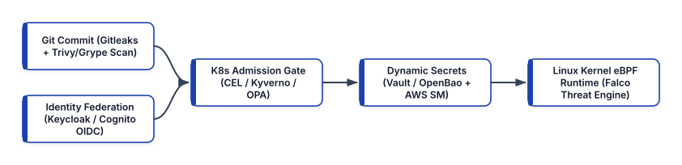


## Layer 1: Shift-Left Secret Detection and Vulnerability Scanning (Gitleaks, Trivy, and Grype)

The most cost-effective moment to remediate a vulnerability or leaked credential is before the pull request is merged. Once an API key or private certificate is committed to a Git repository's history, simply deleting the file in a subsequent commit does not erase the secret from previous Git blob objects—an attacker who clones the repository can trivially extract the secret via `git log -p`.

### Preventing Credential Leaks with Gitleaks
Every developer workstation (`pre-commit` hook) and CI pipeline should execute **Gitleaks** (or **TruffleHog**), which scans Git commit diffs against high-entropy rules and regular expressions for AWS keys, private RSA/Ed25519 keys, database connection strings, Slack webhooks, and OAuth tokens:

```toml
# .gitleaks.toml
title = "Enterprise Gitleaks Security Policy"

[extend]
useDefault = true

[[rules]]
id = "internal-payment-gateway-token"
description = "Internal Payment Gateway API Token"
regex = '''(?i)pay_live_[0-9a-zA-Z]{32}'''
tags = ["key", "payments", "critical"]
```

### Multi-Scanner Vulnerability and Misconfiguration Gates with Trivy and Grype
In CI pipelines, teams combine **Aqua Trivy** (an all-in-one scanner for OS packages, language lockfiles, Kubernetes/Terraform IaC misconfigurations, and embedded secrets) with **Anchore Grype** (paired with **Syft** SBOMs) to eliminate blind spots:

```bash
# 1. Generate a CycloneDX SBOM once with Syft
ECR_HOST="111122223333.dkr.ecr.us-west-2.amazonaws.com"
syft "${ECR_HOST}/payments:v2.4.0" \
  -o cyclonedx-json=sbom.cdx.json

# 2. Scan the SBOM offline in milliseconds with Grype,
#    failing the build on any CRITICAL or HIGH CVE
#    with an upstream fix available
grype sbom:./sbom.cdx.json \
  --only-fixed \
  --fail-on high

# 3. Scan Kubernetes & Terraform manifests with Trivy
trivy config \
  --severity CRITICAL,HIGH \
  --exit-code 1 \
  ./k8s-manifests/
```

Scanning a pre-generated `sbom.cdx.json` file with `grype` or `trivy sbom` takes less than 2 seconds because the scanner does not need to re-download or unpack multi-gigabyte container layers.

## Layer 2: Kubernetes Policy-as-Code Admission Control (CEL, Kyverno & OPA Gatekeeper)

What happens if a developer bypasses a CI check or attempts to deploy an unverified container image directly to the cluster? **Kubernetes Mutating and Validating Admission Controllers** act as the incorruptible firewall inside `kube-apiserver`. Every `CREATE`, `UPDATE`, or `DELETE` request must pass Admission Control before `kube-apiserver` persists the object into `etcd`.

```
+-----------------------------------------------------+
|     KUBERNETES POLICY-AS-CODE ADMISSION ENGINES     |
+------------------+----------------------------------+
| ADMISSION ENGINE | ARCHITECTURAL STRENGTHS          |
+------------------+----------------------------------+
| Native K8s CEL   | Built directly into kube-        |
| (ValidatingAdmis-| apiserver (v1.30+ GA). Zero      |
| sionPolicy)      | external webhook latency; fast   |
|                  | in-process CEL expressions.      |
+------------------+----------------------------------+
| Kyverno          | CNCF K8s-native policy engine.   |
| (kyverno.io/v1)  | Supports Validate, Mutate,       |
|                  | Generate, and native Sigstore    |
|                  | Cosign / OCI Referrers verify.   |
+------------------+----------------------------------+
| OPA Gatekeeper   | CNCF Graduated Rego engine.      |
| (Constraint-     | Ideal when sharing unified Rego  |
| Template)        | rules across K8s, Terraform, and |
|                  | Envoy API gateways.              |
+------------------+----------------------------------+
```

### In-Process Validation with Kubernetes `ValidatingAdmissionPolicy` (CEL)
Graduated to General Availability (GA) in Kubernetes v1.30+, **`ValidatingAdmissionPolicy`** executes **Common Expression Language (CEL)** rules directly inside the `kube-apiserver` binary without making an external HTTPS webhook call. This makes CEL policies immune to webhook network timeouts and ideal for fast structural invariants:

```yaml
# cel-disallow-host-network.yaml
apiVersion: admissionregistration.k8s.io/v1
kind: ValidatingAdmissionPolicy
metadata:
  name: disallow-host-namespaces
spec:
  failurePolicy: Fail
  matchConstraints:
    resourceRules:
      - apiGroups: [""]
        apiVersions: ["v1"]
        operations: ["CREATE", "UPDATE"]
        resources: ["pods"]
  validations:
    - expression: >-
        !has(object.spec.hostNetwork) ||
        object.spec.hostNetwork == false
      message: "Pods must not enable hostNetwork."
    - expression: >-
        !has(object.spec.hostPID) ||
        object.spec.hostPID == false
      message: "Pods must not enable hostPID."
---
apiVersion: admissionregistration.k8s.io/v1
kind: ValidatingAdmissionPolicyBinding
metadata:
  name: disallow-host-namespaces-binding
spec:
  policyName: disallow-host-namespaces
  validationActions: [Deny]
  matchResources:
    namespaceSelector:
      matchLabels:
        environment: production
```

### Enforcing Registry Governance and Keyless Cosign Signatures with Kyverno
While native CEL policies excel at fast structural checks, **Kyverno** extends admission control with **Mutating**, **Generating**, and **Cryptographic Image Verification (`verifyImages`)** capabilities.

Here is a production **Kyverno `ClusterPolicy`** (`kyverno-supply-chain-policy.yaml`) that enforces two mandatory rules across all application namespaces:
1. **Disallow Mutable Tags & Untrusted Registries**: Every container image must come from our hardened Amazon ECR registry and be pinned by an immutable `@sha256` digest.
2. **Cryptographic Signature Verification (`verifyImages`)**: Kyverno queries the OCI v1.1 Referrers API in Amazon ECR and verifies that the image digest carries a valid keyless **Sigstore Cosign** signature minted by our exact GitHub Actions OIDC workflow:

```yaml
# kyverno-supply-chain-policy.yaml
apiVersion: kyverno.io/v1
kind: ClusterPolicy
metadata:
  name: enforce-trusted-signed-images
spec:
  validationFailureAction: Enforce
  background: true
  webhookTimeoutSeconds: 15
  rules:
    - name: require-ecr-registry-and-digest
      match:
        any:
          - resources:
              kinds: ["Pod"]
              namespaces: ["payments", "orders"]
      validate:
        message: >-
          Images must originate from enterprise ECR
          and be pinned by @sha256 digest.
        pattern:
          spec:
            containers:
              - image: >-
                  *.dkr.ecr.*.amazonaws.com/*@sha256:*

    - name: verify-github-oidc-cosign-signature
      match:
        any:
          - resources:
              kinds: ["Pod"]
              namespaces: ["payments", "orders"]
      verifyImages:
        - imageReferences:
            - "*.dkr.ecr.*.amazonaws.com/*"
          mutateDigest: true
          required: true
          attestors:
            - count: 1
              entries:
                - keyless:
                    issuer: >-
                      https://token.actions.github.com
                    subjectRegExp: >-
                      ^https://github.com/org/.*
                    rekor:
                      url: https://rekor.sigstore.dev
```

If an attacker gains access to a developer's `kubectl` credentials and attempts to run `kubectl run backdoor --image=alpine:latest -n payments`, Kyverno immediately blocks the Pod creation with an admission denial!

### Writing Custom Rego Policies with OPA Gatekeeper
When teams use **OPA Gatekeeper** to enforce cross-platform policies in **Rego**, they define a reusable `ConstraintTemplate` (containing the parameterized Rego logic) paired with a custom `Constraint` resource:

```yaml
# gatekeeper-require-labels.yaml
apiVersion: templates.gatekeeper.sh/v1
kind: ConstraintTemplate
metadata:
  name: k8srequiredfinopslabels
spec:
  crd:
    spec:
      names:
        kind: K8sRequiredFinOpsLabels
      validation:
        openAPIV3Schema:
          type: object
          properties:
            labels:
              type: array
              items:
                type: string
  targets:
    - target: admission.k8s.gatekeeper.sh
      rego: |
        package k8srequiredfinopslabels

        violation[{"msg": msg}] {
          obj := input.review.object
          provided := {
            k | obj.metadata.labels[k]
          }
          required := {
            k | k := input.parameters.labels[_]
          }
          missing := required - provided
          count(missing) > 0
          msg := sprintf(
            "Missing FinOps labels: %v",
            [missing]
          )
        }
```

## Layer 3: Dynamic Secrets with HashiCorp Vault / OpenBao, AWS Secrets Manager, and ESO

Storing plaintext database passwords or third-party API keys inside Git repositories—or even managing base64-encoded Kubernetes `Secret` manifests by hand—is a major operational vulnerability. Modern DevSecOps architectures separate **secret storage and automated rotation** (handled by **HashiCorp Vault**, its open-source Linux Foundation fork **OpenBao**, or **AWS Secrets Manager**) from **Kubernetes workload consumption** (handled by the **External Secrets Operator `ESO`** or the **Secrets Store CSI Driver**).

### Dynamic Database Credentials in HashiCorp Vault / OpenBao
Unlike static secrets that sit unchanged for months, **Vault / OpenBao Dynamic Secrets** generate a brand-new, unique PostgreSQL or MySQL username and password *on demand* whenever a Pod starts, bound to a short lease (such as `1h` TTL, renewable up to `24h`). When the Pod terminates or the lease expires, Vault automatically executes `DROP ROLE` on the database, eradicating credential sprawl!

Here is how to configure a least-privilege HCL policy and the **Vault Kubernetes Auth Method** so that only Pods running as `payments-pod-identity-sa` in the `payments` namespace can request dynamic database credentials:

```hcl
# vault-payments-policy.hcl
path "database/creds/payments-postgres-rw" {
  capabilities = ["read"]
}

path "kv-v2/data/payments/stripe-api" {
  capabilities = ["read"]
}
```

Bind this policy to the Kubernetes ServiceAccount via the Vault / OpenBao CLI:

```bash
# Bind Kubernetes ServiceAccount to Vault Role
vault write auth/kubernetes/role/payments-app-role \
  bound_service_account_names=payments-sa \
  bound_service_account_namespaces=payments \
  policies=payments-policy \
  ttl=1h \
  max_ttl=24h
```

### Automated RDS Credential Rotation with AWS Secrets Manager and CDK v2
For workloads running on AWS, **AWS Secrets Manager** provides built-in, zero-downtime credential rotation for Amazon Aurora, RDS, DocumentDB, and Redshift. Using **AWS CDK v2**, you can provision an Aurora PostgreSQL cluster alongside a multi-user rotation schedule (`HostedRotation.postgre_sql_multi_user`) that alternates between two database users (`UserA` and `UserB`) every 7 days so active connections never drop during rotation:

```python
# stacks/secret_rotation_stack.py
from aws_cdk import (
    Duration,
    Stack,
    aws_rds as rds,
    aws_secretsmanager as sm,
)
from constructs import Construct


class DatabaseSecretRotationStack(Stack):
    def __init__(
        self,
        scope: Construct,
        construct_id: str,
        db_cluster: rds.IDatabaseCluster,
        **kwargs,
    ) -> None:
        super().__init__(scope, construct_id, **kwargs)

        # Rotate RDS credentials automatically every 7d
        db_cluster.add_rotation_single_user(
            automatically_after=Duration.days(7),
            exclude_characters=" %+~`#$&*()|[]{}:;<>",
        )
```

### Declarative Secret Synchronization with the External Secrets Operator (ESO)
How do you consume secrets stored in **AWS Secrets Manager** or **HashiCorp Vault / OpenBao** inside Kubernetes without modifying your application code to call Vault or AWS APIs directly?

The **External Secrets Operator (ESO)** (a CNCF project) introduces two declarative Custom Resources:
1. **`SecretStore` / `ClusterSecretStore`**: Defines how ESO authenticates to the upstream secret provider (using keyless **EKS Pod Identity** for AWS Secrets Manager or Kubernetes Auth for Vault/OpenBao).
2. **`ExternalSecret`**: Declares which upstream secret keys to fetch and how often (`refreshInterval: 1h`) to reconcile them into a native Kubernetes `Secret`.

Because the `ExternalSecret` YAML contains only the *name* (key path) of the secret and zero sensitive values, it is 100% safe to commit directly into your GitOps repository!

```yaml
# eso-aws-secrets-manager.yaml
apiVersion: external-secrets.io/v1beta1
kind: SecretStore
metadata:
  name: aws-secretsmanager-store
  namespace: payments
spec:
  provider:
    aws:
      service: SecretsManager
      region: us-west-2
      # Authenticate via EKS Pod Identity SA
      auth:
        jwt:
          serviceAccountRef:
            name: payments-pod-identity-sa
---
apiVersion: external-secrets.io/v1beta1
kind: ExternalSecret
metadata:
  name: payments-stripe-credentials
  namespace: payments
spec:
  refreshInterval: 1h
  secretStoreRef:
    name: aws-secretsmanager-store
    kind: SecretStore
  target:
    name: payments-runtime-secret
    creationPolicy: Owner
  data:
    - secretKey: STRIPE_WEBHOOK_SECRET
      remoteRef:
        key: prod/payments/stripe-config
        property: webhook_signing_secret
    - secretKey: DB_PASSWORD
      remoteRef:
        key: prod/payments/aurora-rds
        property: password
```

When AWS Secrets Manager automatically rotates the Aurora RDS password via its rotation Lambda, ESO detects the updated secret version on its next refresh cycle and updates `payments-runtime-secret` automatically.

## Layer 4: Kernel-Level Runtime Threat Detection with CNCF Falco (eBPF)

Admission controllers and image scanners protect the cluster *before* a container starts. But what if an application contains a zero-day remote code execution (RCE) vulnerability in a business logic endpoint, or a compromised dependency attempts to read `/var/run/secrets/kubernetes.io/serviceaccount/token` and open an outbound reverse shell at runtime?

**CNCF Falco** (a CNCF Graduated project) is the cloud-native runtime security engine. In 2026, Falco runs as a DaemonSet using its **Modern eBPF Probe (`engine.kind: modern_ebpf`)**, which embeds CO-RE (Compile Once – Run Everywhere) eBPF bytecode directly into the Falco binary without requiring kernel headers or external kernel modules (`kmod`) on worker nodes.

Falco intercepts Linux kernel system calls (`execve`, `openat`, `connect`, `socket`, `ptrace`, `setuid`, `chmod`) at the kernel tracepoint boundary, enriches them with Kubernetes Pod/Container metadata from `containerd`, and evaluates them against declarative security rules.

Here is a production custom **Falco Rule** (`falco-custom-rules.yaml`) that detects any unexpected process spawned inside our `payments-service` container (since our Distroless/Wolfi image should only ever execute `/opt/venv/bin/python`) or any attempt to read sensitive credential files:

```yaml
# falco-custom-rules.yaml
customRules:
  payments-runtime-rules.yaml: |-
    - macro: payments_container
      condition: >
        (k8s.ns.name = "payments" and
         container.name = "payments-api")

    - rule: Unauthorized Process in Payments Pod
      desc: >
        Detect any process execution inside payments
        other than the Python entrypoint.
      condition: >
        spawned_process and
        payments_container and
        not proc.exepath in (
          "/opt/venv/bin/python",
          "/usr/bin/python3.12"
        )
      output: >
        CRITICAL Runtime Alert: Unauthorized process
        spawned in Payments Pod (user=%user.name
        pod=%k8s.pod.name proc=%proc.cmdline
        exepath=%proc.exepath parent=%proc.pname)
      priority: CRITICAL
      tags: [runtime, container, mitre_execution]

    - rule: Container Reading SA Token or AWS Creds
      desc: >
        Detect non-Python processes reading Kubernetes
        ServiceAccount tokens or AWS credentials.
      condition: >
        open_read and
        payments_container and
        (fd.name startswith /var/run/secrets/ or
         fd.name startswith /root/.aws) and
        not proc.exepath = "/opt/venv/bin/python"
      output: >
        CRITICAL Credential Access: Unexpected binary
        reading secret file (file=%fd.name
        proc=%proc.cmdline pod=%k8s.pod.name)
      priority: CRITICAL
      tags: [runtime, credentials]
```

When paired with **Falcosidekick** and **Falco Talon** (the Kubernetes-native response engine for Falco), triggering a `CRITICAL` Falco rule can automatically isolate the compromised Pod within milliseconds by applying a deny-all `NetworkPolicy`, capturing a forensic memory/syscall dump, and terminating the Pod before an attacker can exfiltrate data.

## Layer 5: Zero-Trust Identity Federation with Keycloak and Amazon Cognito (OIDC)

The final pillar of a secure DevSecOps platform is **Identity and Access Management (IAM)**. Never create static client certificates (`system:masters`) for human engineers to access Kubernetes clusters, and never maintain separate local username/password databases across Argo CD, Grafana, Harbor, and internal microservices.

Instead, federate all human and workload authentication through a central **OpenID Connect (OIDC)** Identity Provider—such as **CNCF Keycloak** (for cloud-agnostic / self-hosted enterprise identity brokerage supporting WebAuthn/Passkeys, SAML 2.0, and LDAP federation) or **Amazon Cognito User Pools**.

In **Kubernetes v1.31+**, `kube-apiserver` supports **Structured Authentication Configuration (`apiserver.config.k8s.io/v1beta1`)**, which allows configuring multiple OIDC providers (for example, Keycloak for human engineers and GitHub Actions for CI automation) with CEL (Common Expression Language) claim validation rules without restarting the API server with legacy command-line flags:

```yaml
# kube-apiserver-authentication-config.yaml
apiVersion: apiserver.config.k8s.io/v1beta1
kind: AuthenticationConfiguration
jwt:
  - issuer:
      url: https://sso.example.com/realms/platform
      audiences:
        - k8s-cluster-prod
    claimMappings:
      username:
        claim: preferred_username
        prefix: "keycloak:"
      groups:
        claim: groups
        prefix: "keycloak:"
    claimValidationRules:
      # Require verified email & phishing-resistant MFA
      - expression: "claims.email_verified == true"
        message: "Email must be verified by IdP"
```

When an engineer runs `kubectl get pods` using the `kubelogin` (`kubectl oidc-login`) plugin, their browser authenticates via **Keycloak** (enforcing FIDO2/WebAuthn hardware passkeys), issues a short-lived OIDC JWT containing `"groups": ["sre-oncall"]`, and `kube-apiserver` maps that token directly to a Kubernetes `ClusterRoleBinding` for `keycloak:sre-oncall`. If an employee leaves the organization, disabling their single identity in Keycloak or Amazon Cognito immediately revokes access across Kubernetes, AWS IAM Identity Center, Argo CD, Harbor, and Grafana simultaneously.

## Summary

Securing a modern DevOps pipeline requires replacing manual compliance checklists with automated, defense-in-depth engineering controls across the entire lifecycle. By scanning code and SBOMs prior to merge with **Gitleaks**, **Trivy**, and **Grype**, enforcing cryptographic provenance and pod security at admission time with **Kubernetes CEL `ValidatingAdmissionPolicy`**, **Kyverno**, and **OPA Gatekeeper**, eliminating static credentials via **HashiCorp Vault / OpenBao**, **AWS Secrets Manager**, and the **External Secrets Operator (ESO)**, monitoring Linux kernel syscalls at runtime with **Falco eBPF**, and federating access via **Keycloak / Cognito OIDC**, engineering teams achieve continuous, verifiable security without slowing delivery velocity.


<div style="page-break-after: always;"></div>


# Chapter 10: Proxies, Load Balancers, and Service Meshes Demystified

Distributed cloud-native architectures depend on deterministic, observable, and cryptographically verifiable network data planes. As monolithic applications decompose into dozens or hundreds of loosely coupled microservices, the network boundary ceases to be a passive physical wire and becomes the primary execution fabric determining system availability, tail latency, and security posture. Every remote procedure call (RPC) traverses multiple layers of kernel socket buffers, L4 transport multiplexers, L7 application proxies, and zero-trust identity verifiers.

Understanding the engineering distinction between forward proxies, reverse proxies, L4/L7 load balancers, API gateways, Kubernetes Gateway API controllers, and service meshes is foundational to modern platform engineering. In this chapter, we examine the packet and frame mechanics of modern network intermediaries, implement production configurations for NGINX, HAProxy, Envoy Proxy, and Kong Gateway, configure vendor-neutral ingress routing via the Kubernetes Gateway API (`GatewayClass` and `HTTPRoute`), evaluate Istio Sidecar versus Ambient Mesh architectures (`ztunnel` and waypoint proxies), and replace deprecated cloud meshes such as AWS App Mesh with Amazon VPC Lattice and ECS Service Connect.


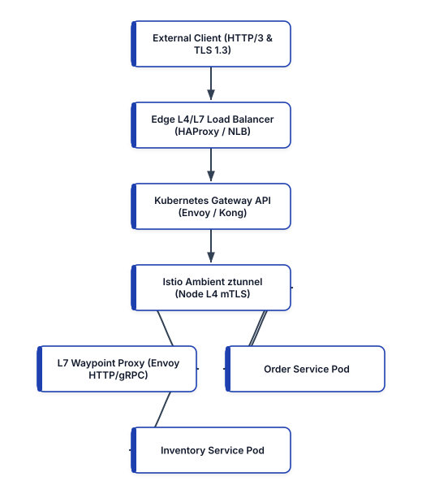


## Architectural Taxonomy: Proxies, Load Balancers, API Gateways, and Service Meshes

Although proxies, load balancers, API gateways, and service meshes all intercept and forward network packets, they operate at different points in the network topology and solve distinct distributed systems problems. Conflating these layers leads to redundant serialization overhead, cascading retry storms, and opaque failure domains.

### Forward Proxies and Egress Governance

A forward proxy sits adjacent to client workloads and mediates outbound connections toward external networks or third-party SaaS endpoints. Rather than allowing arbitrary application pods to open direct TCP connections to the public internet, platform teams route egress traffic through a hardened forward proxy fleet. The proxy enforces domain allowlists via TLS Server Name Indication (SNI) inspection or HTTP `CONNECT` tunneling, prevents Server-Side Request Forgery (SSRF) from reaching cloud instance metadata endpoints (`169.254.169.254`), injects outbound API partner credentials at the perimeter so application containers never hold raw secrets, and records structured egress audit logs.

### Reverse Proxies and Origin Shielding

A reverse proxy resides in front of backend origin servers and terminates incoming connections on their behalf. External clients communicate exclusively with the reverse proxy's virtual IP (VIP) or DNS hostname, remaining unaware of the internal topology, private IP addressing, or runtime characteristics of the upstream fleet. Reverse proxies offload computationally expensive operations from application runtimes, including TLS 1.3 handshake termination, OCSP stapling, HTTP/2 and HTTP/3 (QUIC) connection multiplexing, Brotli and Zstandard payload compression, slow-client buffering (protecting single-threaded or event-loop upstreams from Slowloris attacks), and static asset caching.

### Layer 4 vs. Layer 7 Load Balancers

Load balancers distribute incoming traffic across multiple healthy backend instances to maximize throughput, minimize tail latency ($p_{99}$), and eliminate single points of failure. Load balancing occurs primarily at two layers of the OSI model:

- **Layer 4 (Transport Layer) Load Balancing**: Operates on TCP, UDP, and TLS streams using the 5-tuple (source IP, source port, destination IP, destination port, and protocol). L4 load balancers—such as Linux IPVS (IP Virtual Server), Cilium eBPF Maglev load balancers, AWS Network Load Balancer (NLB), and HAProxy in `tcp` mode—make routing decisions without parsing application-layer payloads. By using consistent hashing (such as Google's Maglev algorithm) and Direct Server Return (DSR) or stateless NAT, L4 load balancers process millions of packets per second with sub-millisecond latency overhead.
- **Layer 7 (Application Layer) Load Balancing**: Terminates the client TCP and TLS connection, parses the application protocol (HTTP/1.1, HTTP/2, HTTP/3, or gRPC), and establishes a separate pooled connection to the chosen backend endpoint. Because the L7 balancer inspects URL paths, host headers, cookies, JWT claims, and gRPC method names, it can execute content-based routing, canary traffic splitting, per-route rate limiting, and active outlier detection. Moreover, L7 load balancers solve the **HTTP/2 and gRPC connection pinning problem**: because HTTP/2 multiplexes all streams over a single long-lived TCP connection, an L4 load balancer routes every request on that connection to a single backend pod, whereas an L7 load balancer demultiplexes individual HTTP/2 frames and balances them evenly across the entire backend fleet.

### Load Balancing Algorithms and Outlier Detection

Choosing the right load-balancing algorithm is critical for controlling tail latency under heterogeneous request costs:

1. **Round Robin and Weighted Round Robin**: Cycles sequentially through healthy endpoints. Effective only when all requests have identical computational cost and all backend nodes share identical hardware capacity.
2. **Least Request / Least Connections**: Routes each incoming request to the upstream host with the fewest active in-flight requests.
3. **Power of Two Choices (P2C)**: In distributed proxy fleets where many independent proxies balance traffic across the same upstream pool without shared state, strict Least Connections causes **herd behavior**—every proxy simultaneously sees that a newly launched or momentarily idle instance has zero connections and floods it with traffic. Envoy Proxy and modern load balancers mitigate this using **P2C**: for each request, the proxy selects two healthy backends uniformly at random and sends the request to whichever of the two currently has fewer active requests. P2C achieves near-optimal load distribution with $O(1)$ selection overhead and zero inter-proxy coordination.
4. **Consistent Hashing (Ring Hash / Maglev)**: Maps a request key (such as a session ID, tenant header, or source IP) onto a deterministic hash ring so stateful workloads, in-memory caches, or WebSocket rooms consistently land on the same upstream shard even when nodes join or leave the cluster.

## NGINX: High-Performance Reverse Proxy and Edge Load Balancing

NGINX uses an asynchronous, non-blocking, event-driven architecture built around Linux `epoll` (or `kqueue` on BSD). Rather than spawning a dedicated OS thread or process per connection, NGINX runs a fixed pool of worker processes—typically pinned one-to-one to physical CPU cores—each capable of multiplexing tens of thousands of concurrent connections within a single event loop.

### Production NGINX Reverse Proxy and Upstream Configuration

In a production cloud-native environment, a minimal `proxy_pass` directive is insufficient; omitted connection pooling or missing timeouts will exhaust ephemeral ports (`EADDRNOTAVAIL`) under high concurrency because NGINX defaults to HTTP/1.0 with `Connection: close` toward upstream servers. Below is a hardened, production-grade NGINX configuration implementing upstream keepalive pooling, TLS 1.3 termination, passive failure eviction, and request tracing correlation:

```nginx
# /etc/nginx/conf.d/payments-edge.conf
upstream payments_backend {
    zone payments_zone 64k;
    least_conn;

    server 10.24.1.10:8080 max_fails=3
        fail_timeout=10s;
    server 10.24.1.11:8080 max_fails=3
        fail_timeout=10s;
    server 10.24.1.12:8080 max_fails=3
        fail_timeout=10s;

    # Maintain pooled idle keepalive connections
    # per worker process to prevent port exhaustion
    keepalive 64;
    keepalive_requests 10000;
    keepalive_timeout 60s;
}

limit_req_zone $binary_remote_addr
    zone=api_rate_limit:10m rate=100r/s;

server {
    listen 443 ssl;
    http2 on;
    server_name api.payments.example.com;

    ssl_certificate     /etc/ssl/certs/payments.crt;
    ssl_certificate_key /etc/ssl/private/payments.key;
    ssl_protocols       TLSv1.3;
    ssl_session_cache   shared:SSL:20m;
    ssl_session_timeout 1d;

    location /v1/checkout {
        limit_req zone=api_rate_limit burst=50 nodelay;

        proxy_pass http://payments_backend;
        proxy_http_version 1.1;
        proxy_set_header Connection "";

        proxy_set_header Host $host;
        proxy_set_header X-Real-IP $remote_addr;
        proxy_set_header X-Forwarded-For
            $proxy_add_x_forwarded_for;
        proxy_set_header X-Request-ID $request_id;

        proxy_connect_timeout 2s;
        proxy_send_timeout    5s;
        proxy_read_timeout    10s;

        proxy_next_upstream error timeout http_502
            http_503;
        proxy_next_upstream_tries 2;
    }
}
```

Setting `proxy_http_version 1.1` alongside `proxy_set_header Connection ""` enables TCP connection reuse against the `keepalive 64` pool, eliminating TCP 3-way handshakes and TIME_WAIT socket accumulation on internal microservice calls. Furthermore, `proxy_next_upstream_tries 2` bounds retry amplification so a failing backend cannot trigger an exponential retry storm across the fleet.

## HAProxy: Ultra-Low-Latency L4/L7 Routing and Stick Tables

HAProxy (High Availability Proxy) remains the industry gold standard for high-throughput software load balancing, edge TLS termination, and stateful TCP/HTTP traffic governance. Its multi-threaded, lockless event loop and zero-copy kernel splicing (`splice()`) allow it to saturate 100 GbE network interfaces while maintaining deterministic sub-millisecond latency.

One of HAProxy's most powerful engineering primitives is **Stick Tables**—in-memory key-value stores replicated across HAProxy peers that track real-time client behavior (such as request rates, error ratios, and concurrent connections per IP or JWT subject) directly in the data path without external Redis round-trips.

```haproxy
# /etc/haproxy/haproxy.cfg
global
    log stdout format raw local0 info
    maxconn 100000
    nbthread 8

defaults
    mode http
    log global
    option httplog
    option dontlognull
    option http-keep-alive
    timeout connect 2s
    timeout client  30s
    timeout server  15s
    timeout http-keep-alive 60s

frontend edge_https_in
    bind :443 ssl crt /etc/haproxy/certs/edge.pem
        alpn h2,http/1.1
    # Track per-client HTTP request rate in memory
    stick-table type ipv6 size 1m expire 60s
        store http_req_rate(10s),http_err_rate(10s)
    http-request track-sc0 src
    # Reject abusive clients exceeding 200 req / 10s
    http-request deny deny_status 429
        if { sc_http_req_rate(0) gt 200 }

    acl is_grpc hdr(content-type) -m beg
        application/grpc
    use_backend grpc_services if is_grpc
    default_backend rest_services

backend grpc_services
    balance random(2)
    option httpchk GET /healthz
    http-check expect status 200
    server grpc1 10.24.2.10:9090 check proto h2
    server grpc2 10.24.2.11:9090 check proto h2
    server grpc3 10.24.2.12:9090 check proto h2

backend rest_services
    balance leastconn
    option httpchk GET /readyz
    http-check expect status 200
    server app1 10.24.3.10:8080 check inter 2s
        fall 3 rise 2
    server app2 10.24.3.11:8080 check inter 2s
        fall 3 rise 2
```

Notice the `balance random(2)` directive in the `grpc_services` backend: this activates Power of Two Random Choices (P2C) over persistent HTTP/2 (`proto h2`) channels, ensuring individual gRPC calls are multiplexed evenly across healthy backend servers.

## Envoy Proxy: The Universal Cloud-Native Data Plane

Created at Lyft and graduated within the CNCF, **Envoy Proxy** is a high-performance C++ L4/L7 proxy designed from first principles to serve as a universal data plane for large-scale microservice architectures, API gateways, and service meshes. Unlike legacy proxies configured primarily by reloading static files on disk via `SIGHUP`, Envoy is engineered around API-driven dynamic configuration known as the **xDS protocol suite**:

- **LDS (Listener Discovery Service)**: Dynamically configures network listeners (ports, unix domain sockets, and filter chains).
- **RDS (Route Discovery Service)**: Dynamically configures virtual hosts, URL prefixes, header matchers, and traffic-splitting weights.
- **CDS (Cluster Discovery Service)**: Dynamically defines logical upstream service groups, circuit-breaking thresholds, and outlier detection policies.
- **EDS (Endpoint Discovery Service)**: Streams real-time IP and port endpoints belonging to each cluster without requiring DNS polling.
- **SDS (Secret Discovery Service)**: Streams short-lived TLS certificates and SPIFFE X.509 SVIDs directly into memory without touching the filesystem.

### Production Envoy Configuration with Outlier Detection and Circuit Breaking

Below is a production Envoy configuration demonstrating HTTP/2 upstream pooling, strict circuit breaking (capping concurrent requests and pending queues to prevent cascading failures), and passive **outlier detection** that automatically ejects any backend node returning five consecutive `5xx` errors:

```yaml
# envoy-edge.yaml
admin:
  address:
    socket_address:
      address: 127.0.0.1
      port_value: 9901

static_resources:
  listeners:
    - name: ingress_listener
      address:
        socket_address:
          address: 0.0.0.0
          port_value: 10000
      filter_chains:
        - filters:
            - name: envoy.http_connection_manager
              typed_config:
                "@type": >-
                  type.googleapis.com/
                  envoy.HttpConnectionManager
                stat_prefix: edge_http
                codec_type: AUTO
                generate_request_id: true
                route_config:
                  name: primary_routes
                  virtual_hosts:
                    - name: catalog_vhost
                      domains: ["catalog.internal"]
                      routes:
                        - match:
                            prefix: "/api/v2/"
                          route:
                            cluster: catalog_cluster
                            timeout: 3s
                            retry_policy:
                              retry_on: >-
                                5xx,connect-failure,
                                reset
                              num_retries: 2
                              per_try_timeout: 1s
                http_filters:
                  - name: envoy.filters.http.router
                    typed_config:
                      "@type": >-
                        type.googleapis.com/
                        envoy.Router

  clusters:
    - name: catalog_cluster
      type: STRICT_DNS
      connect_timeout: 0.5s
      lb_policy: LEAST_REQUEST
      least_request_lb_config:
        choice_count: 2
      circuit_breakers:
        thresholds:
          - priority: DEFAULT
            max_connections: 1024
            max_pending_requests: 256
            max_requests: 2048
            max_retries: 32
      outlier_detection:
        consecutive_5xx: 5
        interval: 5s
        base_ejection_time: 30s
        max_ejection_percent: 50
      load_assignment:
        cluster_name: catalog_cluster
        endpoints:
          - lb_endpoints:
              - endpoint:
                  address:
                    socket_address:
                      address: catalog-svc.prod.svc
                      port_value: 8080
```

Setting `max_retries: 32` inside `circuit_breakers.thresholds` is one of Envoy's most important reliability safeguards: even if every route permits two retries, the cluster-wide retry budget limits the total number of concurrent retries across all requests to 32, preventing retry storms from crushing a recovering dependency.

## Kong Gateway: Declarative API Management at the Perimeter

While reverse proxies handle transport and routing mechanics, north-south public APIs require higher-level product and security governance: OIDC/OAuth2 token introspection, consumer-scoped rate limiting, payload validation, request transformation, and AI gateway token metering. **Kong Gateway** enables DB-less declarative API management where the entire gateway configuration is versioned in Git and loaded atomically into memory or reconciled via the Kong Ingress Controller.

Below is a declarative Kong 3.x configuration (`kong.yaml`) enforcing OIDC JWT verification, consumer rate limiting, and correlation ID injection:

```yaml
# kong.yaml (Declarative DB-less Configuration)
_format_version: "3.0"
_transform: true

services:
  - name: ledger-service
    url: http://ledger.prod.svc.cluster.local:8080
    connect_timeout: 2000
    read_timeout: 5000
    write_timeout: 5000
    retries: 2
    routes:
      - name: ledger-v1-route
        paths:
          - /v1/ledger
        methods:
          - GET
          - POST
        strip_path: false

plugins:
  - name: rate-limiting
    service: ledger-service
    config:
      second: 50
      minute: 1500
      policy: local
      fault_tolerant: true
      hide_client_headers: false

  - name: correlation-id
    service: ledger-service
    config:
      header_name: X-Correlation-ID
      generator: uuid#counter
      echo_downstream: true

  - name: jwt
    service: ledger-service
    config:
      claims_to_verify:
        - exp
        - nbf
      key_claim_name: kid
```

## Kubernetes Gateway API: The Modern Standard Replacing Ingress

For nearly a decade, Kubernetes users relied on the `Ingress` resource to expose HTTP workloads. However, the legacy `Ingress` API suffered from severe structural limitations: it lacked native support for header-based matching, traffic weighting, gRPC routing, TCP/TLS passthrough, and cross-namespace delegation. Consequently, every controller vendor (NGINX, Envoy, Kong, AWS ALB, Traefik) invented dozens of proprietary, non-portable YAML annotations.

The **Kubernetes Gateway API** (`gateway.networking.k8s.io/v1`) supersedes `Ingress` with a role-oriented, expressive, vendor-neutral specification implemented natively by Envoy Gateway, Istio, Cilium, Kong, NGINX Gateway Fabric, and cloud provider load balancers:

1. **`GatewayClass`**: Managed by the **Infrastructure Provider**; defines the controller implementation backing the gateway (e.g., `envoy-gateway`, `istio`, or `cilium`).
2. **`Gateway`**: Managed by the **Cluster Operator / Platform Team**; defines the network entry point, listeners, ports, and TLS certificates.
3. **`HTTPRoute` / `GRPCRoute` / `TLSRoute`**: Managed by **Application Developers** in their own namespaces; attaches to the shared `Gateway` and defines path rules, header filters, and weighted canary splits without requiring access to cluster-wide TLS certificates.

```yaml
# gateway-and-route.yaml
apiVersion: gateway.networking.k8s.io/v1
kind: GatewayClass
metadata:
  name: platform-envoy-gateway
spec:
  controllerName: >-
    gateway.envoyproxy.io/gatewayclass-controller
---
apiVersion: gateway.networking.k8s.io
kind: Gateway
metadata:
  name: prod-edge-gateway
  namespace: platform-ingress
spec:
  gatewayClassName: platform-envoy-gateway
  listeners:
    - name: https-api
      protocol: HTTPS
      port: 443
      hostname: "api.platform.example.com"
      tls:
        mode: Terminate
        certificateRefs:
          - kind: Secret
            name: api-platform-tls-cert
      allowedRoutes:
        namespaces:
          from: Selector
          selector:
            matchLabels:
              network.platform.io/ingress: "allowed"
---
apiVersion: gateway.networking.k8s.io/v1
kind: HTTPRoute
metadata:
  name: checkout-canary-route
  namespace: checkout-prod
spec:
  parentRefs:
    - name: prod-edge-gateway
      namespace: platform-ingress
  hostnames:
    - "api.platform.example.com"
  rules:
    - matches:
        - path:
            type: PathPrefix
            value: /v2/checkout
          headers:
            - name: X-Canary-Cohort
              value: "beta"
      backendRefs:
        - name: checkout-svc-v2
          port: 8080
          weight: 100
    - matches:
        - path:
            type: PathPrefix
            value: /v2/checkout
      backendRefs:
        - name: checkout-svc-v1
          port: 8080
          weight: 90
        - name: checkout-svc-v2
          port: 8080
          weight: 10
```

This declarative separation of concerns eliminates annotation sprawl: the platform security team controls TLS termination and namespace admission on the `Gateway` in `platform-ingress`, while the checkout engineering team autonomously manages a 90/10 canary rollout via `HTTPRoute` in `checkout-prod`.

## Istio Service Mesh: Sidecar vs. Ambient Mode Architecture

While edge gateways govern **north-south** traffic entering the cluster, a **Service Mesh** governs **east-west** service-to-service communication inside the cluster. It provides three core capabilities without requiring changes to application code:

1. **Zero-Trust Cryptographic Identity and mTLS**: Automatically issues short-lived X.509 certificates formatted according to the **SPIFFE** standard (`spiffe://cluster.local/ns/<namespace>/sa/<service-account>`) to every workload, encrypting all east-west traffic via mutual TLS and enforcing fine-grained authorization policies based on verified cryptographic identity rather than mutable pod IP addresses.
2. **Fine-Grained Traffic Management**: Enables per-service retries, deadline propagation, fault injection, request mirroring (dark launches), and locality-aware load balancing (keeping traffic within the same Availability Zone to eliminate cross-AZ data transfer fees).
3. **Uniform Golden-Signal Telemetry**: Emits standardized Prometheus metrics (`istio_requests_total`, `istio_request_duration_milliseconds`), distributed OpenTelemetry trace spans, and access logs across polyglot services.

### The Evolution from Sidecars to Istio Ambient Mode

Historically, Istio injected a dedicated Envoy proxy container (a **sidecar**) into every application pod alongside `iptables` or eBPF socket-redirection rules. While effective, the sidecar model introduced operational friction at scale: every pod paid a memory and CPU tax for its private Envoy instance, upgrading Envoy required restarting application pods, and complex L7 parsing ran on every hop even when teams only required L4 mTLS encryption.

In modern production deployments, **Istio Ambient Mode** decouples L4 secure overlay transport from L7 policy processing by splitting the data plane into two layers:

- **`ztunnel` (Zero-Trust Tunnel)**: A lightweight, high-performance Rust-based per-node agent running as a Kubernetes `DaemonSet`. `ztunnel` transparently intercepts pod traffic on the node, establishes mutual TLS using **HBONE** (HTTP-Based Overlay Network Environment—tunneling TCP streams over HTTP/2 `CONNECT` with SPIFFE identities), collects L4 telemetry, and enforces L4 `AuthorizationPolicy` rules with minimal memory footprint and zero sidecar injection.
- **Waypoint Proxies**: When a namespace or service explicitly requires L7 features (such as HTTP header routing, gRPC method-level authorization, retries, or rate limiting), the platform deploys an optional, shared Envoy **Waypoint Proxy** managed via the Kubernetes Gateway API.


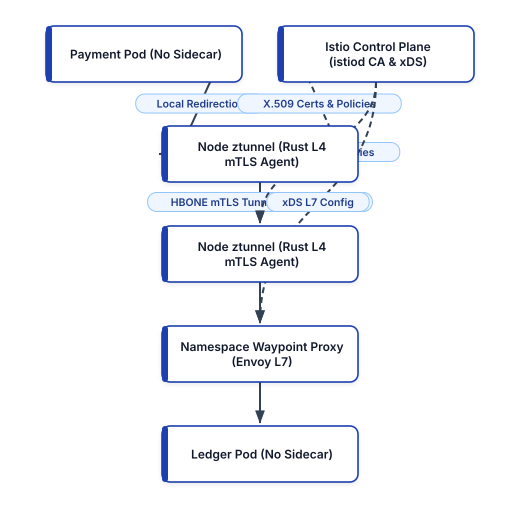


### Enrolling Namespaces in Istio Ambient Mode and Enforcing Zero-Trust Policy

Enrolling an existing namespace into Istio Ambient Mode requires a single label—no pod restarts or sidecar webhook mutations occur:

```bash
# Enable Istio Ambient L4 mTLS on the namespace
kubectl label namespace checkout-prod \
  istio.io/dataplane-mode=ambient

# Deploy an optional L7 Waypoint proxy for the
# namespace using the standard Gateway API CLI
istioctl waypoint apply -n checkout-prod \
  --enroll-namespace
```

Once Ambient Mode is active, platform teams enforce strict zero-trust access control using an Istio `PeerAuthentication` and `AuthorizationPolicy` manifest:

```yaml
# istio-zero-trust-policy.yaml
apiVersion: security.istio.io/v1
kind: PeerAuthentication
metadata:
  name: enforce-strict-mtls
  namespace: checkout-prod
spec:
  mtls:
    mode: STRICT
---
apiVersion: security.istio.io/v1
kind: AuthorizationPolicy
metadata:
  name: ledger-write-allowlist
  namespace: checkout-prod
spec:
  selector:
    matchLabels:
      app: ledger-service
  action: ALLOW
  rules:
    - from:
        - source:
            principals:
              - >-
                cluster.local/ns/checkout-prod/
                sa/payment-worker
      to:
        - operation:
            methods: ["POST"]
            paths: ["/v1/ledger/entries"]
```

With this policy applied, even if an attacker compromises an unrelated pod in the cluster, any attempt to call `POST /v1/ledger/entries` is rejected cryptographically because the caller lacks the SPIFFE certificate `spiffe://cluster.local/ns/checkout-prod/sa/payment-worker`.

## Cloud-Managed Service Connectivity: Amazon VPC Lattice and ECS Service Connect

> **Deprecation Architecture Note (Replacing AWS App Mesh)**: AWS officially deprecated **AWS App Mesh** (announcing its end-of-support transition in favor of **Amazon VPC Lattice** and **Amazon ECS Service Connect**). Operating self-managed Envoy sidecars across heterogeneous EC2, ECS, and EKS fleets required complex sidecar task definitions, manual Envoy image patching, and intricate VPC peering/Transit Gateway routing tables. Modern AWS architectures replace App Mesh with **Amazon VPC Lattice** for cross-VPC, cross-account, and multi-compute (EKS, ECS, Lambda, EC2) L7 service networking, or **ECS Service Connect** for intra-ECS cluster service discovery and resilience.

### How Amazon VPC Lattice Works

Amazon VPC Lattice is a fully managed application-layer (L7) networking service built directly into the AWS VPC infrastructure fabric. Instead of running Envoy sidecar containers inside customer pods or tasks, VPC Lattice exposes a link-local proxy endpoint inside the AWS Hypervisor/Nitro network fabric. It provides:

1. **Cross-VPC and Cross-Account Routing without IP Overlap Constraints**: Two VPCs with overlapping CIDR blocks (`10.0.0.0/16`) can communicate over a **VPC Lattice Service Network** without NAT gateways or Transit Gateway route table conflicts.
2. **Heterogeneous Compute Targets**: A single VPC Lattice `HTTPRoute` can split traffic across an Amazon EKS Kubernetes service (via the **AWS Gateway API Controller**), an Amazon ECS service, and an AWS Lambda function.
3. **IAM Zero-Trust Auth Policies**: Every service-to-service HTTP/gRPC request can be authenticated and authorized using AWS IAM SigV4 policies tied to the caller's IAM Role,VPC ID, or AWS Organization Principal ID.

### Configuring Amazon VPC Lattice with the Kubernetes Gateway API and IAM Auth

Because Amazon VPC Lattice natively implements the Kubernetes Gateway API (`application-networking.k8s.aws`), EKS platform engineers define cross-cluster routes using standard `Gateway` and `HTTPRoute` resources, alongside an IAM `AuthPolicy` that restricts invocation to authenticated principals within the organization:

```yaml
# vpc-lattice-gateway-route.yaml
apiVersion: gateway.networking.k8s.io/v1
kind: Gateway
metadata:
  name: enterprise-mesh-service-network
  namespace: checkout-prod
  annotations:
    application-networking.k8s.aws/lattice-vpc: "true"
spec:
  gatewayClassName: amazon-vpc-lattice
  listeners:
    - name: https
      protocol: HTTPS
      port: 443
---
apiVersion: gateway.networking.k8s.io/v1
kind: HTTPRoute
metadata:
  name: inventory-cross-vpc-route
  namespace: checkout-prod
spec:
  parentRefs:
    - name: enterprise-mesh-service-network
  rules:
    - matches:
        - path:
            type: PathPrefix
            value: /inventory
      backendRefs:
        - name: inventory-eks-svc
          kind: Service
          port: 8080
          weight: 85
        - name: inventory-serverless-fallback
          kind: ServiceImport
          port: 443
          weight: 15
```

To enforce zero-trust authentication on the VPC Lattice service so only authorized IAM execution roles inside the AWS Organization (`o-prodorg123`) can invoke the inventory endpoint over HTTPS, attach a VPC Lattice Auth Policy via Terraform / OpenTofu:

```hcl
# vpc-lattice-auth.tf
resource "aws_vpclattice_service" "inventory" {
  name               = "inventory-lattice-svc"
  auth_type          = "AWS_IAM"
  custom_domain_name = "inventory.internal.example.com"
}

resource "aws_vpclattice_auth_policy" "inventory_iam" {
  resource_identifier = (
    aws_vpclattice_service.inventory.arn
  )
  policy = jsonencode({
    Version = "2012-10-17"
    Statement = [
      {
        Effect    = "Allow"
        Principal = "*"
        Action    = "vpc-lattice-svcs:Invoke"
        Resource  = "*"
        Condition = {
          StringEquals = {
            "aws:PrincipalOrgID" = "o-prodorg123"
            "vpc-lattice-svcs:RequestMethod" = [
              "GET",
              "POST"
            ]
          }
        }
      }
    ]
  })
}
```

## Architectural Decision Matrix: Selecting the Right Network Layer

To avoid over-engineering or stacking redundant proxy layers, platform architects evaluate traffic requirements against operational complexity:

```text
+------------------+-----------------+----------------+
| Capability       | Reverse Proxy   | Service Mesh / |
|                  | & K8s Gateway   | VPC Lattice    |
+------------------+-----------------+----------------+
| Traffic Scope    | North-South     | East-West Pod  |
|                  | Edge & Ingress  | & Cross-VPC    |
| Identity Model   | Public TLS 1.3  | SPIFFE mTLS or |
|                  | Cert-Manager    | AWS IAM SigV4  |
| Config Plane     | GatewayClass &  | Ambient Node + |
|                  | HTTPRoute CRDs  | Waypoint Proxy |
| Compute Targets  | VMs, Bare Metal | K8s, ECS, EC2, |
|                  | & Containers    | & AWS Lambda   |
+------------------+-----------------+----------------+
```

## Production Best Practices for Proxies and Service Meshes

1. **Bound Retry Amplification to Prevent Cascading Outages**: Never configure retries at multiple proxy layers simultaneously. If an edge API Gateway retries 3 times, a Waypoint proxy retries 3 times, and the client SDK retries 3 times, a single slow database query triggers $3 \times 3 \times 3 = 27\times$ load amplification. Perform retries at most at one layer (ideally the immediate caller proxy), enforce strict per-try timeouts, and configure cluster-wide retry budgets (such as Envoy's `max_retries` threshold or Retry Budget percentages).
2. **Propagate Deadlines and Distributed Context Headers**: Configure every proxy and service mesh hop to preserve W3C Trace Context headers (`traceparent`, `tracestate`) and gRPC timeout deadlines (`grpc-timeout`). If an upstream caller has a 2-second deadline and 1.8 seconds have already elapsed, downstream services should immediately abort work after 200ms rather than wasting CPU on a response the client has already abandoned.
3. **Prefer Ambient Mesh (`ztunnel`) Over Universal Sidecar Injection**: Default to Istio Ambient Mode (`ztunnel`) for cluster-wide zero-trust mTLS and L4 authorization, deploying L7 Waypoint proxies selectively for namespaces that require HTTP header routing, circuit breaking, or gRPC method-level policies. This reduces cluster-wide proxy memory consumption by 70–85% and decouples application pod lifecycles from proxy security upgrades.
4. **Enable Locality-Weighted Load Balancing**: In multi-AZ Kubernetes clusters, cross-AZ network traffic incurs both cloud provider egress charges ($0.01/GB each way) and 1–2ms of additional round-trip latency. Configure Envoy and Istio `DestinationRule` locality load balancing (`localityLbSetting.enabled: true`) with failover thresholds so traffic stays within the caller's Availability Zone whenever healthy local endpoints exist.

## Summary

Modern cloud-native networking relies on a composable hierarchy of specialized proxies. NGINX and HAProxy deliver extreme performance at the transport and edge HTTP perimeter; Envoy Proxy and Kong Gateway provide API-driven observability, outlier detection, and consumer governance; the Kubernetes Gateway API unifies ingress and mesh traffic management under portable, role-oriented CRDs; Istio Ambient Mode delivers sidecarless SPIFFE mTLS and L7 waypoint routing; and Amazon VPC Lattice extends zero-trust L7 service networking across multi-VPC, multi-account cloud environments. In Chapter 11, we transition from the network data plane to the compute layer, examining modern serverless architectures and event-driven execution fabrics.


<div style="page-break-after: always;"></div>


# Chapter 11: Serverless Applications and Event-Driven Cloud Architectures

Serverless computing has evolved far beyond simple script triggers into a high-throughput, hardware-isolated, event-driven compute paradigm capable of powering mission-critical financial ledgers, real-time streaming pipelines, and low-latency AI inference APIs. In a serverless execution model, the cloud provider dynamically schedules micro-virtual machines, manages operating system kernel patching, scales concurrency horizontally within milliseconds of incoming demand, and meters billing at sub-millisecond or per-request granularity.

However, achieving predictable tail latency ($p_{99}$), cost efficiency, and transactional integrity in serverless systems requires deep mastery of the underlying execution environment lifecycle, microVM virtualization mechanics, asynchronous event brokers, workflow state machines, and non-relational data modeling. In this chapter, we examine the Firecracker microVM execution model powering AWS Lambda, implement modern performance primitives including **Lambda SnapStart**, **Response Streaming**, **AWS Lambda Web Adapter**, and **Arm64 Graviton3** runtimes, replace legacy WSGI wrappers (such as Zappa) with native container/adapter patterns, define production infrastructure using **AWS SAM** and **AWS CDK v2**, orchestrate point-to-point and massively parallel workflows with **Amazon EventBridge Pipes**, **EventBridge Scheduler**, and **AWS Step Functions Distributed Map**, and engineer **Amazon DynamoDB Single-Table Designs** for boundless horizontal scale.


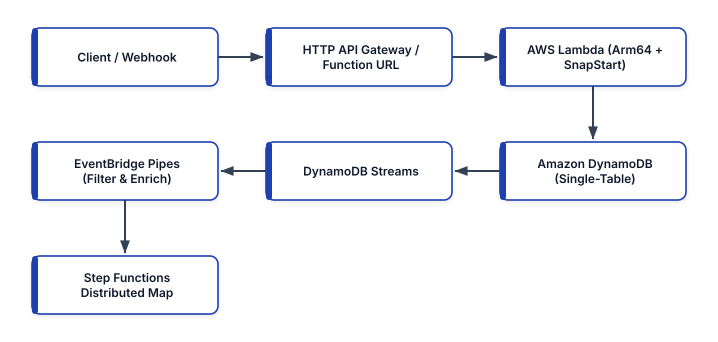


## The Serverless Execution Model: Firecracker MicroVMs and the Invocation Lifecycle

To engineer low-latency serverless systems, platform engineers must understand what happens beneath the abstraction when a function is invoked. AWS Lambda isolates tenant workloads using **Firecracker**, an open-source Virtual Machine Monitor (VMM) written in Rust that uses the Linux Kernel-based Virtual Machine (KVM) subsystem to create lightweight microVMs. Unlike traditional virtual machines that take seconds to boot and consume hundreds of megabytes of overhead, a Firecracker microVM boots a minimal Linux kernel in under 125 milliseconds with less than 5 MB of memory overhead per execution environment.

Every Lambda execution environment progresses through three distinct lifecycle phases:

1. **Init Phase (Cold Start)**: When an incoming event arrives and no idle execution environment is available, the Lambda control plane allocates a Firecracker microVM on a physical worker host, mounts the container image or `.zip` layer via a copy-on-write block device, starts the language runtime (e.g., Python 3.13, Node.js 22, Java 21, or Rust `provided.al2023`), initializes configured Lambda Extensions (such as the OpenTelemetry Collector or Parameters and Secrets extension), and executes all module-level initialization code outside the handler function.
2. **Invoke Phase (Warm Execution)**: The runtime invokes the registered function handler, passing the event payload and execution context. Notice that while the `Invoke` phase is running, the microVM has full access to its allocated vCPUs (scaled proportionally to configured memory, where $1,769\text{ MB} = 1\text{ full vCPU}$ and $10,240\text{ MB} = 6\text{ vCPUs}$). Once the handler returns a response, the microVM's processes are frozen (`cgroup` freezer) until the next invocation arrives.
3. **Shutdown Phase**: If an execution environment remains idle for an extended period, the control plane sends a `SIGTERM` signal to registered extensions and the runtime, allowing a brief window (up to 2,000 ms) to flush telemetry buffers and close database sockets before destroying the microVM.

### Mitigating Cold Starts with Lambda SnapStart

For runtimes with heavy initialization phases—such as Java (Spring Boot, Quarkus, Micronaut), .NET, or Python functions loading large machine-learning Dependencies and SDK clients—the `Init` phase can take 2 to 8 seconds, causing severe $p_{99}$ latency spikes during traffic bursts.

**AWS Lambda SnapStart** eliminates this initialization tax by shifting the `Init` phase from invocation time to **deployment publishing time**:


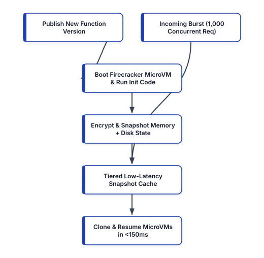


When you publish a new function version with SnapStart enabled, Lambda boots an execution environment, runs your entire `Init` phase (initializing classes, dependency injection graphs, and static resources), takes an encrypted Firecracker microVM snapshot of memory and disk state, and stores it in a tiered cache. When concurrent requests arrive, Lambda resumes new execution environments directly from the cached memory snapshot rather than booting from scratch, slashing cold-start latency by up to 90%.

Because resumed microVMs share the exact memory state captured during snapshot creation, engineers must observe **uniqueness and network socket safety rules**:

- **Cryptographic Randomness (PRNG)**: Modern Linux kernels (`getrandom()`) and OpenSSL/Java runtimes automatically reseed their pseudo-random number generators upon microVM resume, but custom user-space PRNGs seeded during `Init` must be reseeded inside a **Runtime Hook** (`register_after_restore` in Python or `CRaC` `afterRestore` in Java).
- **Ephemeral Connections and Stale Timestamps**: Pre-established TCP sockets or temporary credentials fetched during `Init` may expire before a snapshot is restored days later; always validate connection liveness or refresh tokens in the `after_restore` hook.

Here is a production Python 3.13 Lambda handler running on **Arm64 (AWS Graviton3)** using `snapshot_restore_py` runtime hooks and structured idempotency:

```python
# src/handlers/order_processor.py
import os
import time
import uuid
import boto3
from snapshot_restore_py import (
    register_before_snapshot,
    register_after_restore,
)

# Initialized once during SnapStart snapshot creation
dynamodb = boto3.resource("dynamodb")
TABLE_NAME = os.environ["ORDERS_TABLE_NAME"]
table = dynamodb.Table(TABLE_NAME)
BOOT_INSTANCE_ID = None


@register_before_snapshot
def pre_snapshot_warm():
    # Pre-load botocore endpoints & serializers
    # into memory before snapshot is captured
    _ = dynamodb.meta.client._endpoint


@register_after_restore
def post_restore_reseed():
    global BOOT_INSTANCE_ID
    # Generate a unique microVM instance ID after
    # cloning from the shared memory snapshot
    BOOT_INSTANCE_ID = str(uuid.uuid4())


def lambda_handler(event: dict, context) -> dict:
    order_id = event["order_id"]
    tenant_id = event["tenant_id"]
    amount_cents = int(event["amount_cents"])
    now_iso = time.strftime(
        "%Y-%m-%dT%H:%M:%SZ", time.gmtime()
    )

    # Conditional write guarantees idempotency if
    # upstream retries the same order_id event
    table.put_item(
        Item={
            "PK": f"TENANT#{tenant_id}",
            "SK": f"ORDER#{order_id}",
            "GSI1PK": "STATUS#PENDING",
            "GSI1SK": f"{now_iso}#{order_id}",
            "amount_cents": amount_cents,
            "worker_vm": BOOT_INSTANCE_ID,
            "created_at": now_iso,
        },
        ConditionExpression=(
            "attribute_not_exists(PK) AND "
            "attribute_not_exists(SK)"
        ),
    )

    return {
        "statusCode": 201,
        "order_id": order_id,
        "worker_vm": BOOT_INSTANCE_ID,
    }
```

## Replacing Legacy Wrappers (Zappa) with AWS Lambda Web Adapter and Response Streaming

> **Deprecation & Modernization Note (Eliminating Zappa)**: In early serverless adoption (circa 2017–2021), Python developers frequently used **Zappa** to wrap Flask or Django WSGI applications into AWS Lambda zip packages. Zappa relied on fragile monkey-patching of API Gateway proxy payloads into synthetic WSGI dictionaries, lacked native support for ASGI asynchronous streaming, struggled with binary dependency compilation across OS upgrades, and restricted portability. In modern 2026 architectures, **Zappa is obsolete**. Teams deploy standard, unmodified HTTP web frameworks (FastAPI, Express/Fastify, Go `net/http`, Rust Axum, or Spring Boot) using **AWS Lambda Web Adapter** and **Lambda Response Streaming**.

### How AWS Lambda Web Adapter Works

The **AWS Lambda Web Adapter** is an open-source, Rust-based Lambda Extension packaged as a container layer (`public.ecr.aws/awsguru/aws-lambda-adapter`). When added to a standard OCI container image or zip function, it registers with the Lambda Runtime API as an external extension, starts your normal web server (`uvicorn`, `gunicorn`, `node`, or a compiled Go/Rust binary) on local port `8080`, performs a readiness check against `/healthz`, and translates incoming Lambda events (from API Gateway, Application Load Balancer, or Lambda Function URLs) into standard HTTP requests over loopback `http://127.0.0.1:8080`.

Crucially, pairing AWS Lambda Web Adapter with **Lambda Response Streaming** (`InvokeMode: RESPONSE_STREAM`) lifts the traditional 6 MB buffered payload ceiling (supporting responses up to 200 MB) and lowers **Time to First Byte (TTFB)** to single-digit milliseconds—an essential capability for Server-Sent Events (SSE) and streaming Large Language Model (LLM) token responses.

```dockerfile
# Dockerfile (Portable FastAPI on Lambda & Kubernetes)
FROM public.ecr.aws/docker/library/python:3.13-slim

# Copy the AWS Lambda Web Adapter binary into
# the Lambda extensions directory
COPY --from=public.ecr.aws/awsguru/aws-lambda-adapter \
  /lambda-adapter /opt/extensions/lambda-adapter

ENV PORT=8080
ENV AWS_LWA_INVOKE_MODE=response_stream
ENV AWS_LWA_READINESS_CHECK_PATH=/healthz

WORKDIR /app
COPY requirements.txt .
RUN pip install --no-cache-dir -r requirements.txt
COPY app/ ./app/

# Identical entrypoint runs in Lambda, ECS, or EKS
CMD ["uvicorn", "app.main:app", "--host", "0.0.0.0", \
     "--port", "8080"]
```

And the corresponding FastAPI application (`app/main.py`) requires zero Lambda-specific handler glue:

```python
# app/main.py
import asyncio
from fastapi import FastAPI
from fastapi.responses import StreamingResponse

app = FastAPI()


@app.get("/healthz")
async def health_check():
    return {"status": "healthy"}


async def token_stream_generator(prompt: str):
    chunks = [
        "Analyzing ",
        "telemetry ",
        "stream ",
        f"for: {prompt}\n",
    ]
    for chunk in chunks:
        yield f"data: {chunk}\n\n"
        await asyncio.sleep(0.05)


@app.get("/v1/stream")
async def stream_inference(prompt: str = "prod-slo"):
    return StreamingResponse(
        token_stream_generator(prompt),
        media_type="text/event-stream",
    )
```

## Declarative Serverless Infrastructure: AWS SAM and AWS CDK v2

Provisioning serverless functions manually via the AWS Console or ad-hoc `aws lambda create-function` shell commands violates Infrastructure as Code (IaC) repeatability and cannot manage IAM least-privilege policies, Dead-Letter Queues (DLQs), or canary deployment alarms. Modern engineering organizations standardize on **AWS SAM (Serverless Application Model)** for YAML-driven serverless templates or **AWS CDK v2 (Cloud Development Kit)** for strongly typed TypeScript/Python constructs.

### Production AWS SAM Template with Arm64 Graviton3, SnapStart, and Canary Gradual Deployment

Below is a production `template.yaml` using AWS SAM (`AWS::Serverless-2016-10-31`) that configures an Arm64 Graviton3 function (delivering up to 34% better price-performance than x86_64), enables SnapStart on published versions, attaches a CodeDeploy gradual canary rollout (`Canary10Percent5Minutes`) with automatic CloudWatch Alarm rollback, and scopes IAM permissions to a single DynamoDB table:

```yaml
# template.yaml (AWS SAM)
AWSTemplateFormatVersion: "2010-09-09"
Transform: AWS::Serverless-2016-10-31
Description: Modern Order Processing Serverless Stack

Globals:
  Function:
    Runtime: python3.13
    Architectures:
      - arm64
    MemorySize: 1769
    Timeout: 10
    Tracing: Active

Resources:
  OrderProcessorFunction:
    Type: AWS::Serverless::Function
    Properties:
      CodeUri: src/handlers/
      Handler: order_processor.lambda_handler
      AutoPublishAlias: live
      SnapStart:
        ApplyOn: PublishedVersions
      DeploymentPreference:
        Type: Canary10Percent5Minutes
        Alarms:
          - !Ref OrderFunctionErrorAlarm
      Environment:
        Variables:
          ORDERS_TABLE_NAME: !Ref OrdersTable
      Policies:
        - DynamoDBCrudPolicy:
            TableName: !Ref OrdersTable
      Events:
        CreateOrderApi:
          Type: HttpApi
          Properties:
            Path: /v1/orders
            Method: POST

  OrderFunctionErrorAlarm:
    Type: AWS::CloudWatch::Alarm
    Properties:
      ComparisonOperator: GreaterThanThreshold
      EvaluationPeriods: 1
      MetricName: Errors
      Namespace: AWS/Lambda
      Period: 60
      Statistic: Sum
      Threshold: 2
      Dimensions:
        - Name: FunctionName
          Value: !Ref OrderProcessorFunction
```

### Type-Safe Serverless Architecture with AWS CDK v2 (TypeScript)

When building complex event-driven systems that combine APIs, DynamoDB streams, and Step Functions, **AWS CDK v2** provides compile-time validation and automatic least-privilege IAM `grant*` helper methods:

```typescript
// lib/serverless-ledger-stack.ts
import * as cdk from 'aws-cdk-lib';
import * as lambda from 'aws-cdk-lib/aws-lambda';
import * as dynamodb from 'aws-cdk-lib/aws-dynamodb';
import { Construct } from 'constructs';

export class ServerlessLedgerStack extends cdk.Stack {
  constructor(
    scope: Construct,
    id: string,
    props?: cdk.StackProps
  ) {
    super(scope, id, props);

    const ledgerTable = new dynamodb.TableV2(
      this,
      'LedgerSingleTable',
      {
        partitionKey: {
          name: 'PK',
          type: dynamodb.AttributeType.STRING,
        },
        sortKey: {
          name: 'SK',
          type: dynamodb.AttributeType.STRING,
        },
        billing: dynamodb.Billing.onDemand(),
        dynamoStream:
          dynamodb.StreamViewType.NEW_AND_OLD_IMAGES,
        pointInTimeRecoverySpecification: {
          pointInTimeRecoveryEnabled: true,
        },
      }
    );

    const DockerFn = lambda.DockerImageFunction;
    const streamingApp = new DockerFn(
      this,
      'StreamingInferenceFn',
      {
        code: lambda.DockerImageCode.fromImageAsset(
          './'
        ),
        architecture: lambda.Architecture.ARM_64,
        memorySize: 2048,
        timeout: cdk.Duration.seconds(30),
        environment: {
          TABLE_NAME: ledgerTable.tableName,
        },
      }
    );

    // Grant least-privilege read/write IAM policy
    ledgerTable.grantReadWriteData(streamingApp);

    // Expose streaming HTTP endpoint via Function URL
    streamingApp.addFunctionUrl({
      authType: lambda.FunctionUrlAuthType.AWS_IAM,
      invokeMode: lambda.InvokeMode.RESPONSE_STREAM,
    });
  }
}
```

## Event-Driven Integration: Amazon EventBridge Pipes, Scheduler, and Step Functions Distributed Map

A common anti-pattern in first-generation serverless architectures is writing hundreds of lines of "glue" Lambda functions whose only job is to read records from a DynamoDB Stream or SQS queue, filter out irrelevant events, enrich them via an HTTP call, and forward them to an EventBridge bus or Step Functions state machine. Every glue function adds code maintenance burden, cold-start latency, and per-invocation billing.

### Zero-Glue Point-to-Point Routing with Amazon EventBridge Pipes

**Amazon EventBridge Pipes** eliminates glue functions by providing a fully managed point-to-point integration pipeline with four built-in stages:

1. **Source**: Connects directly to DynamoDB Streams, Kinesis Data Streams, Amazon SQS, Amazon MSK (Kafka), or ActiveMQ/RabbitMQ.
2. **Filtering**: Evaluates declarative JSON pattern filters before any downstream compute is invoked, dropping unneeded events at zero compute cost.
3. **Enrichment (Optional)**: Invokes an API Destination, Lambda function, or Step Functions workflow only for matched events.
4. **Target**: Delivers the transformed batch with strict ordering guarantees to Step Functions, EventBridge Event Buses, SQS, Kinesis, or ECS tasks.

```yaml
# eventbridge-pipe.yaml
Name: dynamodb-high-value-orders-pipe
Source: >-
  arn:aws:dynamodb:us-east-1:111122223333:
  table/Orders/stream/2026-01
SourceParameters:
  DynamoDBStreamParameters:
    StartingPosition: LATEST
    BatchSize: 25
    MaximumBatchingWindowInSeconds: 2
  FilterCriteria:
    Filters:
      - Pattern: |
          {
            "eventName": ["INSERT"],
            "dynamodb": {
              "NewImage": {
                "amount_cents": {
                  "N": [{"numeric": [">=", 100000]}]
                }
              }
            }
          }
Target: >-
  arn:aws:states:us-east-1:111122223333:
  stateMachine:FraudAuditWorkflow
```

In this configuration, only newly inserted orders (`INSERT`) with `amount_cents >= 100000` ($1,000.00+) trigger the downstream `FraudAuditWorkflow`, saving 95%+ of downstream state machine invocations without writing a single line of Python or Node.js filtering code. Similarly, **Amazon EventBridge Scheduler** replaces legacy CloudWatch cron rules with a scalable scheduler capable of managing millions of one-time (`at()`) or recurring (`cron()`, `rate()`) schedules with built-in timezone awareness, retry policies, and Dead-Letter Queues—ideal for per-customer trial expirations or payment reminders.

### Massively Parallel Orchestration with AWS Step Functions Distributed Map

When a serverless workflow must process millions of objects stored in Amazon S3 (such as nightly financial reconciliation, genomic sequencing, or batch image transcoding), invoking a single Lambda function fails due to the 15-minute execution timeout limit. **AWS Step Functions Distributed Map** solves this by reading an S3 bucket inventory, CSV, or JSON manifest directly inside the state machine and spawning up to **10,000 parallel child workflow executions**, each invoking Lambda functions concurrently with automatic throttling protection and failure threshold controls:

```yaml
# step-functions-distributed-map.asl.yaml
Comment: Process 5M Parquet Ledger Partitions
StartAt: DistributedBatchReconcile
States:
  DistributedBatchReconcile:
    Type: Map
    ItemReader:
      Resource: arn:aws:states:::s3:listObjectsV2
      Parameters:
        Bucket: prod-financial-ledger-lake
        Prefix: partitions/2026-10/
    MaxConcurrency: 2500
    ToleratedFailurePercentage: 1
    ItemBatcher:
      MaxItemsPerBatch: 50
    ItemProcessor:
      ProcessorConfig:
        Mode: DISTRIBUTED
        ExecutionType: EXPRESS
      StartAt: ReconcileBatchWorker
      States:
        ReconcileBatchWorker:
          Type: Task
          Resource: arn:aws:states:::lambda:invoke
          Parameters:
            FunctionName: reconcile-worker:live
            Payload.$: $
          Retry:
            - ErrorEquals:
                - Lambda.TooManyRequestsException
                - Lambda.ServiceException
              IntervalSeconds: 2
              MaxAttempts: 5
              BackoffRate: 2.0
              JitterStrategy: FULL
          End: true
    End: true
```

## Amazon DynamoDB Single-Table Design for Serverless Scale

Traditional relational databases (PostgreSQL, MySQL) struggle under unthrottled serverless concurrency bursts unless fronted by connection proxies (such as Amazon RDS Proxy) or serverless distributed SQL engines (such as Amazon Aurora DSQL), because each concurrent Lambda microVM opens its own TCP database socket. **Amazon DynamoDB** is architecturally aligned with serverless compute: it communicates over stateless HTTPS API calls, scales horizontally across storage partitions without connection pools, and delivers consistent single-digit millisecond latency at any scale.

### Principles of DynamoDB Single-Table Modeling

Because DynamoDB intentionally omits relational `JOIN` operations (which degrade as table sizes grow), production DynamoDB architects use **Single-Table Design**: storing multiple related entity types (`TenantMetadata`, `CustomerAccount`, `OrderHeader`, `OrderItem`) inside a single physical table using overloaded generic primary keys (`PK` for Partition Key, `SK` for Sort Key) and Global Secondary Indexes (`GSI1PK`, `GSI1SK`). By colocating related entities under the same Partition Key (`PK`), a single `Query` request fetches a parent entity and all of its child records in a single network round-trip ($O(1)$ partition lookup):

```text
+---------------+--------------------+----------------+
| PK            | SK                 | GSI1PK / Attrs |
+---------------+--------------------+----------------+
| TENANT#t-900  | METADATA#PROFILE   | PLAN#ENT       |
| TENANT#t-900  | ORDER#2026#ord-01  | STATUS#PENDING |
| TENANT#t-900  | ORDER#2026#ord-02  | STATUS#SHIPPED |
| ORDER#ord-01  | ITEM#sku-4410      | QTY#3 / $49.00 |
| ORDER#ord-01  | ITEM#sku-8821      | QTY#1 / $120   |
+---------------+--------------------+----------------+
```

With this layout, an application can execute three critical access patterns with sub-5ms latency and zero table scans:

1. **Fetch Tenant Profile + Most Recent 50 Orders in One Query**: Query `PK = "TENANT#t-900"` with `SK >= "METADATA"` in descending order (`ScanIndexForward=False`).
2. **Fetch an Order and All Its Line Items**: Query `PK = "ORDER#ord-01"` with `SK begins_with("ITEM#")`.
3. **List All Pending Orders Across a Tenant or Status Cohort**: Query `GSI1` where `GSI1PK = "STATUS#PENDING"` sorted chronologically by `GSI1SK`.

## Production Serverless Best Practices

1. **Configure Memory Using Data-Driven Power Tuning**: In AWS Lambda, CPU, network bandwidth, and storage I/O scale linearly with allocated memory (`MemorySize`). Increasing a CPU-bound function from `512 MB` to `1769 MB` (1 full vCPU) often cuts execution duration by $3.5\times$, making the faster execution *cheaper* or cost-neutral while dramatically improving user-facing latency. Use the open-source **AWS Lambda Power Tuning** Step Functions state machine to benchmark every production function across memory tiers (`256 MB` to `10,240 MB`).
2. **Enforce End-to-End Idempotency**: Distributed event sources (EventBridge, SQS, DynamoDB Streams, API retries) guarantee **at-least-once delivery**, meaning your Lambda handler *will* occasionally receive duplicate events. Always enforce idempotency using DynamoDB conditional writes (`attribute_not_exists(PK)`) or the **Powertools for AWS Lambda** `@idempotent` decorator backed by a DynamoDB idempotency state table with TTL expiration.
3. **Protect Downstream Dependencies with Reserved Concurrency and SQS Buffers**: While Lambda can scale by 1,000 concurrent execution environments every 10 seconds per function, downstream third-party APIs or legacy databases cannot. Set `ReservedConcurrentExecutions` or use an SQS queue with `MaximumConcurrency` on the Lambda Event Source Mapping (`ScalingConfig.MaximumConcurrency`) to cap downstream pressure.
4. **Emit Structured JSON Logs and OpenTelemetry Traces**: Never log unstructured `print()` strings in serverless functions; when 2,000 concurrent microVMs write to CloudWatch Logs, unstructured lines are impossible to correlate. Use structured JSON logging (injecting `correlation_id`, `cold_start`, `function_request_id`, and `tenant_id` into every log event) and the lightweight **OpenTelemetry Lambda Layer** for distributed trace propagation across API Gateway, Lambda, DynamoDB, and Step Functions.

## Summary

Modern serverless engineering combines Firecracker microVM isolation, Arm64 Graviton3 efficiency, and Lambda SnapStart sub-150ms restoration with portable web adapters (`AWS Lambda Web Adapter` + `Response Streaming`) that eliminate legacy wrappers like Zappa. By orchestrating asynchronous workflows through EventBridge Pipes, EventBridge Scheduler, and Step Functions Distributed Map—backed by single-digit millisecond DynamoDB Single-Table Designs and codified in AWS SAM or CDK v2—teams build elastic cloud-native applications that scale from zero to tens of thousands of requests per second with minimal operational toil. In Chapter 12, we examine the declarative foundations of Infrastructure as Code (IaC) across OpenTofu, Terraform 1.9+, Pulumi, and policy-as-code governance.


<div style="page-break-after: always;"></div>


# Chapter 12: Infrastructure as Code: Foundations, Tooling, and Best Practices

Infrastructure as Code (IaC) is the foundational engineering discipline of defining, provisioning, mutating, and governing cloud infrastructure through version-controlled, machine-executable specifications rather than imperative CLI scripts or interactive web consoles ("ClickOps"). In modern platform engineering, an IaC repository is not merely a collection of provisioning templates; it is a deterministic directed acyclic graph (DAG) compiler, a cryptographic state ledger, and an automated policy enforcement engine that guarantees environmental parity across development, staging, and multi-region production estates.

Since HashiCorp's relicensing of Terraform to the Business Source License (BSL) in August 2023 and the Linux Foundation's subsequent creation of **OpenTofu** (now a CNCF project), the IaC landscape has undergone rapid architectural evolution. Modern HCL-based workflows in **OpenTofu 1.8+/1.9+ and Terraform 1.9+/1.10+** introduce config-driven `import` blocks, lossless refactoring via `moved` and `removed` blocks, continuous post-apply assertions via `check` blocks, client-side state encryption, and native Amazon S3 state locking (`use_lockfile = true`) that eliminates external DynamoDB lock tables. Simultaneously, general-purpose programming language IaC engines such as **Pulumi** and **AWS CDK v2** empower teams to author strongly typed infrastructure constructs, while shift-left static analyzers (**Trivy IaC** and **Checkov**) and policy-as-code engines (**Open Policy Agent / Rego** and **Cedar**) block misconfigurations before a single cloud API call is executed.


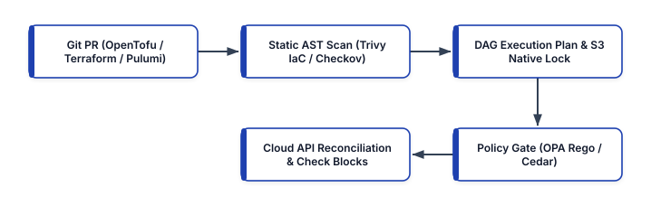


## Declarative vs. Imperative Infrastructure and the DAG Reconciliation Engine

Understanding how an IaC engine converges desired state onto live cloud APIs is critical for designing resilient module boundaries and avoiding state corruption.

- **Imperative (Procedural) Provisioning**: Scripts (such as Bash with AWS CLI or procedural SDK calls) specify the exact sequence of step-by-step commands to execute. If a script fails halfway through creating 40 resources, re-running it either fails on duplicate resource errors or creates orphaned duplicates because the script lacks a persistent state ledger and idempotency awareness.
- **Declarative State-Driven Reconciliation**: Tools like OpenTofu, Terraform, Pulumi, and AWS CloudFormation accept a declaration of the **target end state**. The engine queries the **State Backend** (the recorded mapping of logical resource identifiers to real-world cloud provider resource IDs), refreshes resource attributes against live cloud APIs, constructs a **Directed Acyclic Graph (DAG)** of resource dependencies, computes the minimal topological diff ($\Delta = \text{Desired} - \text{Actual}$), and executes create, update-in-place, or replace operations in parallel across independent graph branches.


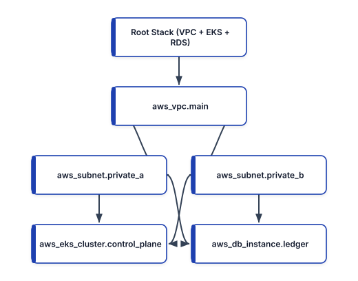


In the DAG above, the engine recognizes that `aws_subnet.private_a` and `aws_subnet.private_b` both depend on `aws_vpc.main.id`, so it provisions the VPC first, provisions both subnets concurrently, and then provisions `aws_eks_cluster.control_plane` and `aws_db_instance.ledger` in parallel once the subnet IDs resolve.

## Modern HCL Engineering: OpenTofu and Terraform 1.9+ / 1.10+

Modern HCL workflows eliminate the most dangerous operational anti-patterns of legacy Terraform—namely, manual `terraform state mv` / `terraform import` CLI mutations on production state files, unencrypted state payloads, and external DynamoDB lock table sprawl.

### Native S3 State Locking (`use_lockfile`) and State Encryption

Historically, storing remote state in Amazon S3 required provisioning and maintaining a separate Amazon DynamoDB table (`dynamodb_table = "terraform-locks"`) solely to manage distributed mutex locks during `plan` and `apply` operations. Now that Amazon S3 supports conditional writes (`If-None-Match: *`), both OpenTofu and Terraform 1.10+ support **native S3 state locking** (`use_lockfile = true`), writing a `.tflock` object directly to the S3 bucket using atomic conditional put requests. Furthermore, **OpenTofu native state encryption** allows teams to encrypt state files and plan files client-side using AWS KMS, GCP KMS, or PBKDF2 keys before the payload ever leaves the runner.

```hcl
# backend-and-providers.tf
terraform {
  required_version = ">= 1.9.0"

  required_providers {
    aws = {
      source  = "hashicorp/aws"
      version = "~> 5.75"
    }
  }

  backend "s3" {
    bucket       = "prod-platform-iac-state-us-east-1"
    key          = "network/core-vpc/terraform.tfstate"
    region       = "us-east-1"
    encrypt      = true
    # Native S3 conditional-write state locking
    # (No DynamoDB lock table required!)
    use_lockfile = true
  }

  # OpenTofu Client-Side State & Plan Encryption
  encryption {
    key_provider "aws_kms" "state_key" {
      kms_key_id = "alias/opentofu-state-encryption"
      region     = "us-east-1"
      key_spec   = "AES_256"
    }
    method "aes_gcm" "strong_gcm" {
      keys = key_provider.aws_kms.state_key
    }
    state {
      method   = method.aes_gcm.strong_gcm
      enforced = true
    }
    plan {
      method   = method.aes_gcm.strong_gcm
      enforced = true
    }
  }
}

provider "aws" {
  region = "us-east-1"

  default_tags {
    tags = {
      ManagedBy   = "OpenTofu"
      Environment = "production"
      Repository  = "github.com/org/platform-iac"
    }
  }
}
```

### Config-Driven Refactoring: `import`, `moved`, and `removed` Blocks

In legacy IaC workflows, renaming a resource or splitting a module required an engineer to obtain write credentials to the production state backend on their laptop and execute imperative `terraform state mv` or `terraform import` commands—bypassing Git pull request reviews and frequently breaking CI/CD pipelines.

Modern OpenTofu and Terraform 1.9+ solve this with **declarative lifecycle blocks** committed directly into Git:

1. **`import` block**: Brings an existing brownfield cloud resource under IaC management during the normal CI/CD `plan` and `apply` cycle (and supports `tofu plan -generate-config-out=generated.tf` to auto-generate HCL from live cloud resources).
2. **`moved` block**: Records in code that a resource or module address was renamed or relocated (for example, moving `aws_security_group.api` into `module.edge_security.aws_security_group.api`). During `plan`, the engine updates the state ledger seamlessly instead of destroying and recreating the live security group.
3. **`removed` block**: Instructs the engine to forget a resource from the state file (`lifecycle { destroy = false }`) without deleting the underlying cloud infrastructure.

### Continuous Infrastructure Assertions with `check` Blocks and Cross-Variable Validation

Traditional variable `validation` blocks only inspect static input strings before cloud APIs are called. Terraform 1.9+ and OpenTofu introduce:

- **Cross-object input `validation`**: Allows a variable validation rule to reference *other* variables and local values (e.g., verifying that `var.backup_retention_days >= 30` whenever `var.environment == "production"`).
- **`check` blocks**: Execute live data-source assertions *after* infrastructure is provisioned, verifying real-world operational health (such as TLS endpoint reachability or KMS rotation status) and emitting structured warnings without aborting the state commit.

```hcl
# main.tf (Modern HCL with import, moved, & check)
variable "environment" {
  type    = string
  default = "production"
}

variable "kms_deletion_window_days" {
  type    = number
  default = 30

  validation {
    # Terraform 1.9+ cross-variable validation
    condition = (
      var.environment != "production" ||
      var.kms_deletion_window_days >= 30
    )
    error_message = (
      "Production KMS keys require a deletion "
      "window of at least 30 days."
    )
  }
}

# Declaratively import an existing KMS key in Git
import {
  to = aws_kms_key.ledger_vault
  id = "1234abcd-12ab-34cd-56ef-1234567890ab"
}

# Lossless state refactoring without destroying key
moved {
  from = aws_kms_key.legacy_key
  to   = aws_kms_key.ledger_vault
}

resource "aws_kms_key" "ledger_vault" {
  description             = "Ledger encryption key"
  deletion_window_in_days = (
    var.kms_deletion_window_days
  )
  enable_key_rotation     = true

  lifecycle {
    prevent_destroy = true
    postcondition {
      condition     = self.enable_key_rotation == true
      error_message = "KMS key rotation must be on."
    }
  }
}

# Post-provisioning live operational assertion
check "verify_api_health_endpoint" {
  data "http" "ledger_health" {
    url      = "https://api.internal.example.io/health"
    insecure = false
  }

  assert {
    condition = (
      data.http.ledger_health.status_code == 200
    )
    error_message = (
      "Ledger API returned non-200 status after "
      "infrastructure apply!"
    )
  }
}
```

### Ephemeral Values and Write-Only Arguments (`ephemeral` Blocks)

One of the longest-standing security challenges in declarative IaC was that sensitive values fetched or generated during a run—such as random database bootstrap passwords, short-lived TLS client certificates, or Vault/Secrets Manager tokens—were serialized into plaintext inside `terraform.tfstate` and `tfplan.binary`. Even with remote S3 encryption at rest, anyone with read access to the state file could extract every secret managed by the workspace.

Terraform 1.10+ and modern OpenTofu address this architectural gap with **Ephemeral Resources (`ephemeral` blocks)**, `ephemeral = true` variables/outputs, and provider **write-only arguments** (`password_wo`). Ephemeral resources are opened during the evaluation phase, passed in-memory to downstream provider connections or write-only resource attributes, and closed at the end of the execution graph—**never persisted to either the plan artifact or the state file**:

```hcl
# ephemeral-credentials.tf
ephemeral "aws_secretsmanager_secret_version" "db_pw" {
  secret_id = aws_secretsmanager_secret.postgres_pw.id
}

resource "aws_db_instance" "ledger_primary" {
  identifier          = "prod-ledger-pg16"
  engine              = "postgres"
  engine_version      = "16.4"
  instance_class      = "db.r7g.xlarge"
  allocated_storage   = 200
  storage_encrypted   = true
  kms_key_id          = aws_kms_key.ledger_vault.arn
  skip_final_snapshot = false

  # Write-only password attribute: sent to AWS API
  # but NEVER written to terraform.tfstate!
  password_wo = (
    ephemeral.aws_secretsmanager_secret_version
    .db_pw.secret_string
  )
  password_wo_version = 1
}
```

When the team needs to rotate the database master password in Secrets Manager, incrementing `password_wo_version = 2` triggers an in-place update on the RDS instance using the new ephemeral secret without ever exposing the old or new password in the state artifact.

## General-Purpose Programming Languages for IaC: Pulumi and AWS CDK v2

While HCL excels at flat, declarative resource definitions, large platform teams often prefer authoring reusable infrastructure abstractions using general-purpose programming languages (TypeScript, Python, Go, C#). This unlocks native IDE autocompletion, compile-time type checking, standard package managers (`npm`, `uv`/`pip`, `go mod`), loops and polymorphism, and standard unit testing frameworks (`pytest`, `vitest`).

### Pulumi: Cloud-Native SDKs with Direct State Engine Execution

Unlike AWS CDK (which compiles TypeScript/Python into intermediate AWS CloudFormation YAML templates), **Pulumi** executes its own high-performance state and resource engine directly against cloud provider APIs (supporting AWS Native, Azure Native, Google Cloud, and Kubernetes providers with same-day API coverage). Pulumi manages state in Pulumi Cloud or self-managed S3/GCS/Azure Blob backends and provides **Pulumi ESC (Environments, Secrets, and Configurations)** for dynamic OIDC credential brokering.

Below is a production Pulumi program written in Python that provisions an encrypted Amazon S3 bucket with public access strictly blocked and exports its ARN:

```python
# __main__.py (Pulumi Python Infrastructure)
import pulumi
import pulumi_aws as aws

config = pulumi.Config()
env_name = config.require("environment")

audit_key = aws.kms.Key(
    "audit-log-kms-key",
    description=f"Audit KMS key for {env_name}",
    enable_key_rotation=True,
    deletion_window_in_days=30,
)

audit_bucket = aws.s3.BucketV2(
    "immutable-audit-logs",
    bucket_prefix=f"corp-audit-{env_name}-",
    force_destroy=False,
)

from pulumi_aws import s3

sse_default = {
    "sse_algorithm": "aws:kms",
    "kms_master_key_id": audit_key.arn,
}

s3.BucketServerSideEncryptionConfigurationV2(
    "audit-bucket-sse",
    bucket=audit_bucket.id,
    rules=[
        {
            "apply_server_side_encryption_by_default":
                sse_default,
            "bucket_key_enabled": True,
        }
    ],
)

aws.s3.BucketPublicAccessBlock(
    "audit-bucket-public-block",
    bucket=audit_bucket.id,
    block_public_acls=True,
    block_public_policy=True,
    ignore_public_acls=True,
    restrict_public_buckets=True,
)

pulumi.export("audit_bucket_arn", audit_bucket.arn)
```

### AWS CDK v2 and Construct Levels (L1, L2, and L3 Patterns)

For AWS-centric organizations, **AWS CDK v2** organizes infrastructure components into three architectural abstraction layers known as **Constructs**:

- **L1 Constructs (`Cfn*`)**: Auto-generated, 1-to-1 mappings of raw CloudFormation resources (e.g., `CfnBucket`). Require manual configuration of every security property.
- **L2 Constructs**: Curated, intent-based abstractions (e.g., `s3.Bucket`, `eks.Cluster`) that provide secure defaults, lifecycle helpers, and semantic IAM `grantRead()` / `grantWrite()` methods.
- **L3 Constructs (Patterns)**: Opinionated multi-resource architectures (e.g., `ApplicationLoadBalancedFargateService` or custom internal platform constructs) that wire together VPCs, ALB listeners, ECS clusters, log groups, and least-privilege IAM roles in 15 lines of code. Furthermore, **CDK Aspects** allow security teams to traverse the entire Construct tree at synthesis time (`cdk synth`) to enforce organization-wide compliance rules automatically.

## Shift-Left IaC Security: Static AST Scanning with Trivy IaC and Checkov

Waiting until resources are deployed into an AWS or GCP account to discover an unencrypted RDS database or a world-readable `0.0.0.0/0` SSH security group is both dangerous and expensive. Modern DevSecOps pipelines execute **static Abstract Syntax Tree (AST) and plan-graph analysis** on every Git pull request using **Trivy IaC** (`trivy config`) and **Checkov**.

Unlike simple regex linters, Checkov and Trivy parse variable references, module inputs, and dynamic locals across the full Terraform/OpenTofu plan graph, Kubernetes manifests, Helm charts, and Dockerfiles.

```bash
# Generate a deterministic binary plan and convert
# it to JSON for deep graph security evaluation
tofu init -input=false
tofu plan -out=tfplan.binary -input=false
tofu show -json tfplan.binary > tfplan.json

# Run Trivy IaC against the rendered plan & source
trivy config --severity HIGH,CRITICAL \
  --exit-code 1 ./

# Run Checkov graph policies against the plan JSON
checkov -f tfplan.json \
  --framework terraform_plan \
  --check CKV_AWS_16,CKV_AWS_19,CKV_AWS_23 \
  --compact
```

## Policy as Code: Open Policy Agent (OPA / Rego) and Cedar

While static scanners provide built-in security rules (e.g., "S3 buckets must be encrypted"), platform engineering teams must also enforce **organization-specific architectural and FinOps guardrails**—such as banning expensive GPU instance types in non-production workspaces, requiring mandatory cost-center tags (`CostCenter`, `DataClassification`), or prohibiting IAM policies with wildcard actions (`Action: "*"`).

### Enforcing Terraform Plan Policies with OPA and Rego

**Open Policy Agent (OPA)** evaluates structured JSON inputs (such as `tfplan.json` or Kubernetes admission review payloads) against declarative policies written in **Rego**. Below is a production Rego policy compatible with OPA v1 (`import rego.v1`) and **Conftest** that inspects every resource change in a Terraform/OpenTofu plan and blocks the pull request if any resource is missing a mandatory `CostCenter` tag or attempts to delete a production database:

```rego
# policy/terraform_guardrails.rego
package main

import rego.v1

required_tags := {"CostCenter", "Environment"}

# Deny any production database deletion in plan
deny contains msg if {
    some rc in input.resource_changes
    rc.type == "aws_db_instance"
    "delete" in rc.change.actions
    rc.change.before.tags.Environment == "production"
    msg := sprintf(
        "CRITICAL: Plan deletes prod RDS '%s'",
        [rc.address],
    )
}

# Deny taggable AWS resources missing required tags
deny contains msg if {
    some rc in input.resource_changes
    rc.mode == "managed"
    is_create_or_update(rc.change.actions)
    after_tags := object.get(
        rc.change.after, "tags_all", {}
    )
    missing := required_tags - {k | after_tags[k]}
    count(missing) > 0
    msg := sprintf(
        "Resource '%s' is missing required tags: %v",
        [rc.address, missing],
    )
}

is_create_or_update(actions) if {
    "create" in actions
}

is_create_or_update(actions) if {
    "update" in actions
}
```

### Fine-Grained Authorization and Guardrails with Cedar

Developed by AWS and open-sourced as a CNCF project, **Cedar** is a formally verified policy language engineered for fast, analyzable authorization and infrastructure governance. Unlike general-purpose query languages, Cedar's syntax (`permit` / `forbid` over `principal`, `action`, and `resource` with `when` / `unless` conditions) is designed to be verified mathematically via Automated Reasoning (SMT solvers) and evaluated in microseconds.

Here is a Cedar policy governing an internal platform deployment service, permitting deployment automation roles to apply infrastructure stacks only when the stack is non-production or accompanied by an approved change ticket and OIDC workload attestation:

```cedar
// policy/deployment_governance.cedar
forbid (
    principal,
    action == Platform::Action::"ApplyStack",
    resource
)
when {
    resource.environment == "production" &&
    !context.oidc_verified
};

permit (
    principal in Platform::Role::"GitOpsCiRunners",
    action == Platform::Action::"ApplyStack",
    resource is Platform::Stack
)
when {
    resource.environment != "production" ||
    (context.has_peer_approval == true &&
     context.security_scan_passed == true)
};
```

## Architectural Comparison of Modern IaC Ecosystems

```text
+---------------+------------------+------------------+
| Dimension     | OpenTofu 1.9+ /  | Pulumi &         |
|               | Terraform 1.10+  | AWS CDK v2       |
+---------------+------------------+------------------+
| Language      | Declarative HCL  | TypeScript, Go,  |
| Paradigm      | Domain Language  | Python, C#       |
| State Engine  | Direct S3 Native | Pulumi Engine or |
| & Locking     | Lockfile (.tflock| CloudFormation   |
| Refactoring   | Declarative      | Native IDE AST   |
| Ergonomics    | moved/import Blk | & Alias Mapping  |
| Best Fit Use  | Multi-Cloud Core | High-Level App   |
| Case          | Platform Stacks  | & L3 Constructs  |
+---------------+------------------+------------------+
```

## Production IaC Best Practices

1. **Decompose Monolithic States into Blast-Radius-Bounded Stacks ("Terraservices")**: Never store an entire company's VPCs, EKS clusters, RDS databases, and application queues inside a single state file. A monolithic state file slows `tofu plan` API refreshes to 20+ minutes and risks catastrophic blast radius if a state operation fails. Split state files by lifecycle cadence and blast radius: `01-network-foundation`, `02-data-stores`, `03-kubernetes-platform`, and `04-service-workloads`.
2. **Eliminate Long-Lived Cloud API Keys in CI/CD via OIDC Federation**: Never store static `AWS_ACCESS_KEY_ID` or `GOOGLE_APPLICATION_CREDENTIALS` JSON keys in GitHub Actions or GitLab CI secrets. Configure OpenID Connect (OIDC) federation so your CI runner or TACOS (Terraform Automation and Collaboration Software, such as Atlantis, Spacelift, or Env0) exchanges a short-lived cryptographic JWT for a 15-minute IAM role session scoped strictly to the target stack.
3. **Pin Provider and Module Versions Deterministically**: Commit the `.terraform.lock.hcl` dependency lock file to Git to verify cryptographic SHA-256 provider checksums across Linux/macOS architectures, and pin internal Git modules to immutable semantic version tags (`?ref=v2.4.1`) rather than mutable branch names (`?ref=main`).
4. **Apply Plans Atomically Through Pull Request Automation**: Enforce **Plan-on-PR, Apply-on-Merge** workflows (or lock-before-merge workflows) where the exact binary `tfplan` reviewed and approved by peers and verified by OPA/Checkov is the exact plan applied to production, preventing time-of-check to time-of-use (TOCTOU) drift.

## Summary

Modern Infrastructure as Code combines the declarative safety of OpenTofu and Terraform 1.9+/1.10+ (`use_lockfile` native S3 locking, client-side state encryption, `import`/`moved` refactoring blocks, and live `check` assertions) with the expressive power of general-purpose programming languages in Pulumi and AWS CDK v2. By embedding Trivy IaC, Checkov, OPA/Rego, and Cedar policy gates directly into the pull request lifecycle, platform teams transform infrastructure provisioning from an error-prone manual bottleneck into a self-service, cryptographically verifiable software engineering pipeline. In Chapter 13, we turn to observability, SLO burn-rate engineering, PromQL, dashboards-as-code, and eBPF continuous profiling.


<div style="page-break-after: always;"></div>


# Chapter 13: Infrastructure and Application Monitoring, SLOs, and Continuous Profiling

Modern cloud-native infrastructure cannot be operated effectively using static threshold alerts from the virtual machine era (such as paging an engineer whenever CPU utilization exceeds 80% for 5 minutes). In an elastic Kubernetes or serverless environment where pods scale horizontally in seconds and background batch jobs intentionally saturate available CPU cores, resource-threshold alerting produces relentless alert fatigue while failing to detect silent application brownouts, tail-latency regressions, or localized availability zone blackholes.

In modern Site Reliability Engineering (SRE) and platform engineering, monitoring is anchored around user-centric **Service Level Indicators (SLIs)**, **Service Level Objectives (SLOs)**, **Error Budgets**, and **Multi-Window, Multi-Burn-Rate Alerting**. When an SLO burn-rate alert fires, engineers correlate high-dimensional time-series metrics in **Prometheus (PromQL)**, inspect version-controlled **Grafana Dashboards-as-Code**, validate external perimeter reachability via **Synthetic Blackbox Probing**, and pinpoint CPU or memory hotspots down to the exact line of source code using low-overhead **eBPF Continuous Profiling** (Grafana Pyroscope / Parca).


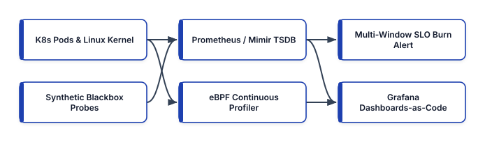


## Two Complementary Methodology Frameworks: USE and RED

Before writing queries or building dashboards, platform engineers separate telemetry into two distinct mental models depending on whether they are observing **infrastructure resources** or **request-driven services**:

### 1. The USE Method (for Infrastructure and Hardware Resources)

Formulated by Brendan Gregg, the **USE Method** evaluates every physical or virtual hardware resource (CPU cores, memory pages, NVMe block devices, network interfaces, Linux kernel conntrack tables, and storage controllers) across three dimensions:

- **Utilization**: The percentage of time the resource was busy servicing work, or the percentage of capacity currently allocated (e.g., `node_memory_Active_bytes / node_memory_MemTotal_bytes`).
- **Saturation**: The degree to which the resource has queued work it cannot immediately service, often manifested as run-queue length, CPU steal time, disk I/O wait queue depth (`aqu-sz`), or Linux `cgroup` CPU throttling (`container_cpu_cfs_throttled_periods_total`). Saturation is the earliest leading indicator of tail-latency degradation.
- **Errors**: Explicit hardware or kernel failure counters, such as TCP packet retransmissions, NIC CRC drops, NVMe I/O timeouts, or Out-Of-Memory (OOM) killer invocations (`node_vmstat_oom_kill`).

### 2. The RED Method (for Request-Driven Microservices)

Formulated by Tom Wilkie (and aligned with Google SRE's Four Golden Signals), the **RED Method** evaluates every microservice, API gateway, and queue consumer from the perspective of incoming work:

- **Rate**: The number of requests per second the service is handling (`http_requests_total`).
- **Errors**: The number of failed requests per second—both explicit HTTP `5xx` / gRPC `INTERNAL` status codes and implicit failures where a `200 OK` payload contains an error body or violates latency bounds.
- **Duration**: The distribution of time each request takes, tracked using native Prometheus histograms (`http_request_duration_seconds_bucket`) to compute accurate $p_{50}$, $p_{95}$, and $p_{99}$ quantiles across distributed replicas.

## SLIs, SLOs, Error Budgets, and Multi-Window Burn-Rate Engineering

To align engineering velocity with operational reliability, teams translate RED metrics into formal mathematical contracts:

- **Service Level Indicator (SLI)**: A quantitative ratio measuring the proportion of good events to total valid events over a time window:
  $$\text{SLI} = \frac{\text{Good Events}}{\text{Valid Events}} \times 100\%$$
  For example, an **Availability SLI** defines "Good Events" as all HTTP requests not returning `5xx`, while a **Latency SLI** defines "Good Events" as all HTTP requests completing in under `250ms`.
- **Service Level Objective (SLO)**: The target threshold for an SLI over a rolling compliance window (typically 28 or 30 days), such as $99.9\%$ availability over 30 days.
- **Error Budget**: The complement of the SLO: $\text{Error Budget} = 100\% - \text{SLO}$. For a $99.9\%$ SLO over a 30-day window ($43,200\text{ minutes}$), the service has an error budget of $0.1\%$, which equals **$43.2\text{ minutes}$ of total allowable downtime** (or $1,000$ failed requests per $1,000,000$ requests). As long as the remaining error budget is positive, product teams can deploy aggressively; if the error budget is exhausted, feature releases pause until reliability investments restore stability.

### Why Static Error-Rate Alerts Fail and Multi-Window Burn Rates Succeed

Suppose a service has a 30-day SLO of $99.9\%$ ($0.1\%$ allowed error rate). If you configure a naive alert to page whenever the 5-minute error rate exceeds $0.1\%$, two failure modes occur:
1. **Slow Burn Blindness**: An error rate of $0.09\%$ never triggers the alert, yet consumes $90\%$ of your monthly error budget silently.
2. **Reset Delay and Flapping**: A brief 2-minute network blip spikes the error rate, wakes up the on-call engineer at 3:00 AM, and resolves itself before they open their laptop.

Google SRE solved this using **Multi-Window, Multi-Burn-Rate Alerting**. The **Burn Rate** measures how fast the service is consuming its 30-day error budget relative to the baseline sustainable rate of $1.0$:

$$\text{Burn Rate} = \frac{\text{Observed Error Ratio}}{1 - \text{SLO}}$$

At a burn rate of $1.0$, the service exhausts its 30-day error budget in exactly 30 days. At a burn rate of **$14.4$**, the service consumes **$2\%$ of its entire 30-day error budget in just 1 hour** (exhausting the full budget in 50 hours). At a burn rate of **$6.0$**, the service consumes **$5\%$ of its 30-day error budget in 6 hours**.

To prevent false-positive pages after an outage has already ended, every burn-rate alert pairs a **Long Window** (e.g., `1h` or `6h`) with a **Short Confirmation Window** (`1/12` of the long window, i.e., `5m` or `30m`). The alert fires *only* when the burn rate exceeds the threshold in **both** windows simultaneously:


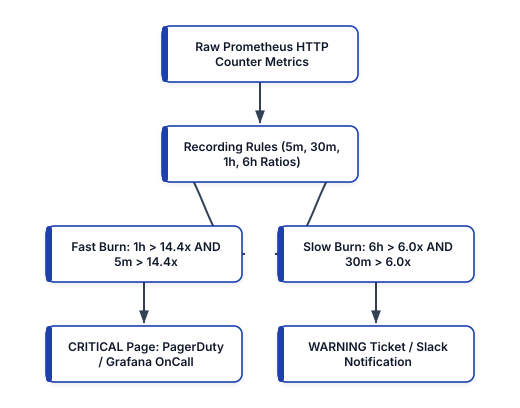


### Implementing Prometheus Recording Rules and Multi-Window Burn-Rate Alerts

Below is a production `PrometheusRule` manifest defining pre-computed SLI error ratios across `5m`, `30m`, `1h`, and `6h` windows and implementing the canonical $99.9\%$ SLO ($1 - 0.999 = 0.001$) multi-window burn-rate alerts in PromQL:

```yaml
# slo-burn-rate-rules.yaml
apiVersion: monitoring.coreos.com/v1
kind: PrometheusRule
metadata:
  name: checkout-service-slo-rules
  namespace: observability
spec:
  groups:
    - name: checkout.slo.recording
      interval: 30s
      rules:
        - record: job:slo_errors:ratio_rate5m
          expr: |
            sum by (job, namespace) (
              rate(http_requests_total{
                job="checkout-api",
                status=~"5.."
              }[5m])
            )
            /
            sum by (job, namespace) (
              rate(http_requests_total{
                job="checkout-api"
              }[5m])
            )

        - record: job:slo_errors:ratio_rate30m
          expr: |
            sum by (job, namespace) (
              rate(http_requests_total{
                job="checkout-api",
                status=~"5.."
              }[30m])
            )
            /
            sum by (job, namespace) (
              rate(http_requests_total{
                job="checkout-api"
              }[30m])
            )

        - record: job:slo_errors:ratio_rate1h
          expr: |
            sum by (job, namespace) (
              rate(http_requests_total{
                job="checkout-api",
                status=~"5.."
              }[1h])
            )
            /
            sum by (job, namespace) (
              rate(http_requests_total{
                job="checkout-api"
              }[1h])
            )

        - record: job:slo_errors:ratio_rate6h
          expr: |
            sum by (job, namespace) (
              rate(http_requests_total{
                job="checkout-api",
                status=~"5.."
              }[6h])
            )
            /
            sum by (job, namespace) (
              rate(http_requests_total{
                job="checkout-api"
              }[6h])
            )

    - name: checkout.slo.alerts
      rules:
        # Page: 2% of 30d budget burned in 1h (14.4x)
        - alert: CheckoutSLOFastBurnPage
          expr: |
            job:slo_errors:ratio_rate1h{
              job="checkout-api"
            } > (14.4 * 0.001)
            and
            job:slo_errors:ratio_rate5m{
              job="checkout-api"
            } > (14.4 * 0.001)
          for: 2m
          labels:
            severity: critical
            slo_tier: tier-1
          annotations:
            summary: "Checkout 99.9% SLO Fast Burn"
            runbook: "https://runbooks.internal/slo-01"

        # Page: 5% of 30d budget burned in 6h (6.0x)
        - alert: CheckoutSLOSustainedBurnPage
          expr: |
            job:slo_errors:ratio_rate6h{
              job="checkout-api"
            } > (6.0 * 0.001)
            and
            job:slo_errors:ratio_rate30m{
              job="checkout-api"
            } > (6.0 * 0.001)
          for: 5m
          labels:
            severity: critical
            slo_tier: tier-1
          annotations:
            summary: "Checkout 99.9% SLO 6h Burn"
```

## Advanced PromQL Engineering: Histograms, Native Histograms, and Cardinality Governance

Writing accurate **PromQL (Prometheus Query Language)** queries requires understanding how Prometheus stores counters, gauges, classic bucketed histograms, and modern **Prometheus Native Histograms** (sparse exponential buckets).

### Computing Tail Latency ($p_{99}$) Across Distributed Replicas

A frequent anti-pattern is averaging pre-calculated percentiles across pods (`avg(http_latency_p99)`), which is mathematically invalid when traffic or latency distributions are skewed across instances. Instead, applications expose monotonic histogram buckets (`_bucket{le="..."}`), and PromQL aggregates the rates of each bucket across all pods *before* interpolating the quantile:

```promql
# Classic Histogram p99 Latency by Route
histogram_quantile(
  0.99,
  sum by (le, route) (
    rate(
      http_request_duration_seconds_bucket{
        job="checkout-api"
      }[5m]
    )
  )
)

# Prometheus Native Histogram p99 Latency
# (No 'le' label required; high-resolution sparse
# exponential buckets are merged automatically!)
histogram_quantile(
  0.99,
  sum by (route) (
    rate(
      http_request_duration_seconds{
        job="checkout-api"
      }[5m]
    )
  )
)
```

### Cardinality Governance: Preventing TSDB Memory Explosions

In Prometheus, Amazon Managed Service for Prometheus (AMP), and Grafana Mimir, every unique combination of metric name and label key-value pairs creates a distinct **active time series** in memory and the inverted index. The total number of series is the Cartesian product of label cardinalities:

$$\text{Total Series} = |\text{Jobs}| \times |\text{Pods}| \times |\text{Methods}| \times |\text{Status Codes}| \times |\text{Buckets}|$$

If a developer accidentally attaches an unbounded label—such as `user_id`, `request_id`, `email`, or unnormalized URL path (`/orders/994812`)—cardinality explodes into tens of millions of series, causing Prometheus OOM crashes and runaway cloud observability bills. Enforce strict `metric_relabel_configs` at ingestion time inside your `ServiceMonitor` or scrape configuration to drop high-cardinality labels, strip transient debug series, and enforce per-scrape sample limits (`sampleLimit`):

```yaml
# servicemonitor-cardinality-guard.yaml
apiVersion: monitoring.coreos.com/v1
kind: ServiceMonitor
metadata:
  name: checkout-api-monitor
  namespace: observability
spec:
  # Hard ceiling on active series per target pod
  sampleLimit: 15000
  labelLimit: 30
  selector:
    matchLabels:
      app.kubernetes.io/name: checkout-api
  endpoints:
    - port: http-metrics
      interval: 15s
      scrapeTimeout: 10s
      metricRelabelings:
        # Strip accidental unbounded PII/request labels
        - action: labeldrop
          regex: "(user_id|session_id|trace_id|email)"
        # Drop high-volume debug go_memstats buckets
        - sourceLabels: [__name__]
          regex: "go_memstats_alloc_bytes_total"
          action: drop
```

### Alertmanager Routing Trees, Grouping, and Inhibition Rules

Even well-crafted SLO alerts can overwhelm responders if a shared dependency (such as a core database cluster or network transit gateway) fails and causes 15 downstream microservices to fire alerts simultaneously. **Prometheus Alertmanager** prevents alert storms using three mechanisms:

1. **Grouping (`group_by`)**: Consolidates related alerts sharing the same `cluster`, `namespace`, or `service` into a single notification payload after waiting `group_wait: 30s`.
2. **Inhibition (`inhibit_rules`)**: Suppresses downstream symptom alerts when a root-cause infrastructure alert is already active (for example, muting pod-level latency warnings in `us-east-1a` if a `KubernetesNodeNotReady` or `AuroraClusterUnavailable` critical alert is firing in the same zone).
3. **Time Intervals (`mute_time_intervals`)**: Automatically mutes non-critical staging or batch maintenance alerts outside business hours while keeping production `critical` SLO pages active $24 \times 7$.

```yaml
# alertmanager-config.yaml
route:
  receiver: "slack-platform-default"
  group_by: ["cluster", "namespace", "alertname"]
  group_wait: 30s
  group_interval: 5m
  repeat_interval: 4h
  routes:
    - matchers:
        - severity = "critical"
        - slo_tier = "tier-1"
      receiver: "pagerduty-sre-primary"
      group_wait: 10s

inhibit_rules:
  - source_matchers:
      - alertname = "ClusterDatabaseDown"
      - severity = "critical"
    target_matchers:
      - severity =~ "warning|critical"
    equal:
      - "cluster"
      - "namespace"
```

## Grafana Dashboards-as-Code with OpenTofu / Terraform and Grafonnet

Building dashboards manually by clicking in the Grafana UI leads to configuration drift, accidental deletions, and divergence across staging and production environments. Platform teams manage observability visualizations as **Dashboards-as-Code** using the **Grafana Foundation SDK / Grafonnet** (Jsonnet library) or the **Grafana Terraform/OpenTofu Provider**.

### Modular Dashboard Generation with Grafonnet (Jsonnet)

When an organization operates 100+ microservices, maintaining raw 2,000-line JSON dashboard files by hand is unsustainable. **Grafonnet** allows engineers to write concise, parameterized Jsonnet templates that compile into standardized Grafana JSON definitions during CI/CD:

```jsonnet
// dashboards/service_slo.jsonnet
local g = import 'grafonnet-latest/main.libsonnet';

local tsPanel = g.panel.timeSeries;
local promQuery = g.query.prometheus;

g.dashboard.new('Checkout Service RED & SLO')
+ g.dashboard.withUid('checkout-slo-grafonnet')
+ g.dashboard.withTimezone('utc')
+ g.dashboard.withRefresh('30s')
+ g.dashboard.withPanels([
  tsPanel.new('1h Error Budget Burn Rate')
  + tsPanel.queryOptions.withTargets([
    promQuery.new(
      '$PROMETHEUS_DS',
      'job:slo_errors:ratio_rate1h{job="checkout"}'
      + ' / 0.001'
    ),
  ])
  + tsPanel.gridPos.withW(12)
  + tsPanel.gridPos.withH(8),
])
```

### Provisioning Dashboards via OpenTofu / Terraform

Below is an OpenTofu / Terraform definition provisioning a standardized RED + SLO Burn Rate Grafana dashboard directly from Git:

```hcl
# grafana-slo-dashboard.tf
terraform {
  required_providers {
    grafana = {
      source  = "grafana/grafana"
      version = "~> 3.10"
    }
  }
}

resource "grafana_folder" "sre_platform" {
  title = "SRE Platform Golden Signals"
}

resource "grafana_dashboard" "checkout_slo" {
  folder    = grafana_folder.sre_platform.id
  overwrite = true

  config_json = jsonencode({
    title         = "Checkout Service - RED & SLO Burn"
    uid           = "checkout-red-slo-v2"
    schemaVersion = 39
    timezone      = "utc"
    refresh       = "30s"
    panels = [
      {
        id    = 1
        title = "1h Error Budget Burn (14.4x Crit)"
        type  = "timeseries"
        gridPos = {
          h = 8
          w = 12
          x = 0
          y = 0
        }
        targets = [
          {
            refId = "A"
            expr  = <<-EOT
              job:slo_errors:ratio_rate1h{
                job="checkout-api"
              } / 0.001
            EOT
          }
        ]
      },
      {
        id    = 2
        title = "Request Latency p99 by Route (sec)"
        type  = "timeseries"
        gridPos = {
          h = 8
          w = 12
          x = 12
          y = 0
        }
        targets = [
          {
            refId = "A"
            expr  = <<-EOT
              histogram_quantile(
                0.99,
                sum by (route) (
                  rate(
                    http_request_duration_seconds{
                      job="checkout-api"
                    }[5m]
                  )
                )
              )
            EOT
          }
        ]
      }
    ]
  })
}
```

## Synthetic Blackbox Probing: Validating External Reachability and TLS Expiry

Internal whitebox metrics (`http_requests_total`) suffer from a critical blind spot: if an edge DNS record is misconfigured, an AWS NLB security group drops all ingress packets, or an ingress gateway hangs, **zero requests reach your application pods**. Consequently, internal error rates read `0%` while 100% of external customers experience a total outage.

To close this blind spot, deploy the **Prometheus Blackbox Exporter** across external vantage points to continuously probe public DNS resolution, TCP handshakes, TLS 1.3 certificate validity (`probe_ssl_earliest_cert_expiry`), and HTTP status assertions:

```yaml
# blackbox-exporter-config.yaml
modules:
  https_api_synthetic:
    prober: http
    timeout: 5s
    http:
      valid_http_versions:
        - "HTTP/1.1"
        - "HTTP/2.0"
      valid_status_codes: [200]
      method: GET
      fail_if_not_ssl: true
      tls_config:
        insecure_skip_verify: false
        min_version: "TLS13"
```

Pairing this probe with a PromQL alert (`(probe_ssl_earliest_cert_expiry - time()) / 86400 < 14`) guarantees the platform team is alerted two weeks before any TLS certificate expires if `cert-manager` renewal fails.

## eBPF Continuous Profiling: Pinpointing Line-Level CPU and Memory Bottlenecks

Metrics tell you *that* CPU utilization or $p_{99}$ latency spiked, traces tell you *which service hop* was slow, and logs tell you *what error message* was emitted—but none of the three traditional pillars tell you **which exact function or line of code consumed 70% of CPU cycles** during a 3-minute traffic surge.

**eBPF Continuous Profiling**—implemented by **Grafana Pyroscope**, **Parca**, and the **OpenTelemetry eBPF Profiler** (`otelcol-ebpf-profiler`)—has become the **Fourth Pillar of Observability**. Using the Linux kernel `BPF_PROG_TYPE_PERF_EVENT` subsystem, an eBPF agent running as a privileged Kubernetes `DaemonSet` attaches to hardware performance counters at 19 Hz to 99 Hz (sampling stack traces across all running containers on the node 19–99 times per second). It unwinds stack frames for compiled binaries (Go, Rust, C/C++) using DWARF/frame pointers and interpreted/JIT runtimes (Python, Node.js, JVM) without requiring SDK code changes, adding less than **1% CPU overhead**.

```yaml
# pyroscope-ebpf-daemonset.yaml
apiVersion: apps/v1
kind: DaemonSet
metadata:
  name: pyroscope-ebpf-profiler
  namespace: observability
spec:
  selector:
    matchLabels:
      app: pyroscope-ebpf
  template:
    metadata:
      labels:
        app: pyroscope-ebpf
    spec:
      hostPID: true
      containers:
        - name: ebpf-profiler
          image: grafana/alloy:v1.4.2
          args:
            - run
            - /etc/alloy/config.alloy
          securityContext:
            privileged: true
          volumeMounts:
            - name: sysfs
              mountPath: /sys
              readOnly: true
      volumes:
        - name: sysfs
          hostPath:
            path: /sys
```

By correlating **Flame Graphs** directly with Prometheus exemplars and trace IDs (`span_id`), engineers can compare the CPU flame graph of version `v2.4.0` against canary version `v2.4.1`, immediately spotting an accidental regex backtracking loop or excessive JSON serialization allocation before promoting the canary to 100% of production traffic.

## Summary

Modern infrastructure and application monitoring replaces noisy static hardware thresholds with user-centric SLIs, SLOs, and multi-window burn-rate alerting. By combining USE infrastructure telemetry and RED application histograms in PromQL with version-controlled Grafana Dashboards-as-Code, external Blackbox synthetic probes, and always-on eBPF continuous profiling, engineering organizations achieve rapid fault isolation while protecting on-call engineers from alert fatigue. In Chapter 14, we explore how GitOps controllers continuously reconcile and synchronize Kubernetes and cloud infrastructure state.


<div style="page-break-after: always;"></div>


# Chapter 14: GitOps, Continuous Reconciliation, and Progressive Delivery

Traditional Continuous Integration and Continuous Delivery (CI/CD) pipelines rely on an **imperative push-based architecture**: when an engineer merges a pull request, a CI runner executes `kubectl apply`, `helm upgrade`, or `tofu apply` over the network against the target production cluster. While intuitive, push-based deployment pipelines introduce serious security and reliability flaws at scale. First, the external CI runner must hold god-mode cluster-admin credentials for every production Kubernetes cluster and cloud account, making the CI server the single highest-value target for supply-chain attackers. Second, edge-triggered CI jobs only execute when a commit occurs; if an operator manually mutates a live resource (`kubectl edit`), or if a transient node failure drops a state update, the live cluster silently drifts from Git until the next deployment weeks later.

**GitOps** replaces edge-triggered, push-based scripts with **level-triggered, pull-based continuous reconciliation** governed by the four **OpenGitOps Principles** (standardized by the CNCF GitOps Working Group):

1. **Declarative**: A system managed by GitOps must have its desired state expressed declaratively (Kubernetes YAML, Kustomize overlays, Helm charts, or Crossplane Compositions).
2. **Versioned and Immutable**: Desired state is stored in a system that enforces immutability, cryptographic versioning, and retains a complete version history (Git or signed OCI artifacts).
3. **Pulled Automatically**: Software agents running *inside* the target environment automatically pull the desired state declarations from the source repository.
4. **Continuously Reconciled**: Autonomous controllers continuously observe actual live system state, compute the structured diff against desired state, and converge the environment in a closed feedback loop ($\Delta = \text{Desired} - \text{Actual} \to 0$).

In this chapter, we engineer production GitOps platforms using **Argo CD** (`ApplicationSet` generators, App-of-Apps topologies, and ordered **Sync Waves**), configure **Flux v2** (`GitRepository`, `OCIRepository`, `Kustomization`, and `HelmRelease` controllers with automated drift remediation), unify Kubernetes and cloud infrastructure provisioning via **Crossplane Compositions v2**, and automate metric-driven canary deployments using **Argo Rollouts** and `AnalysisTemplate` gates.


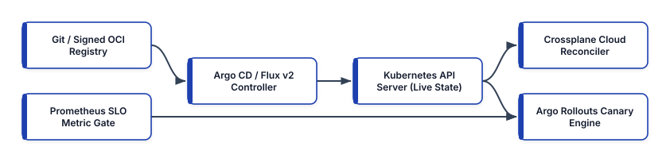


## Argo CD: Multi-Cluster GitOps with `ApplicationSet` and Sync Waves

**Argo CD** is a declarative, CNCF-graduated GitOps continuous delivery controller for Kubernetes. Architecturally, Argo CD operates three primary microservices inside the control plane namespace (`argocd`):

- **`argocd-repo-server`**: Clones Git repositories or pulls signed OCI Helm/manifest artifacts, renders templates (via Kustomize, Helm, or Jsonnet), and caches the resulting Kubernetes YAML manifests in Redis.
- **`argocd-application-controller`**: A stateful Kubernetes controller (sharded across replicas for large fleet scale) that continuously compares the rendered manifests from `argocd-repo-server` against live objects cached from target Kubernetes API servers, flagging `OutOfSync` drift and executing `selfHeal` convergence.
- **`argocd-server` & `argocd-applicationset-controller`**: Exposes the gRPC/REST API, Web UI, SSO OIDC RBAC enforcement, and dynamically generates `Application` resources across fleets of clusters.

### Scaling Beyond App-of-Apps with `ApplicationSet` Matrix Generators

In early Argo CD deployments, teams used the **App-of-Apps Pattern**—a parent Argo CD `Application` that pointed to a directory of child `Application` manifests. While still useful for bootstrapping a single cluster's add-ons, App-of-Apps requires writing boilerplate YAML for every new cluster-service combination.

The **Argo CD `ApplicationSet` controller** eliminates this boilerplate by combining declarative **Generators** (`Git`, `Clusters`, `List`, `PullRequest`, and `Matrix` / `Merge`). By combining a **Cluster Generator** (selecting registered clusters by label, e.g., `env: prod`) with a **Git Directory Generator** inside a **Matrix Generator**, adding a new microservice folder to Git or registering a new regional EKS cluster automatically instantiates and reconciles all required applications across the fleet.

### Deterministic Ordering with Sync Phases, Sync Waves, and Hooks

When bootstrapping a complex service stack, applying all manifests simultaneously can cause race conditions—for example, deploying an application pod before its database schema migration job completes, or creating a Custom Resource before its CustomResourceDefinition (CRD) is established.

Argo CD enforces deterministic execution order using **Sync Phases** (`PreSync`, `Sync`, `PostSync`, `SyncFail`) and numerical **Sync Waves** (`argocd.argoproj.io/sync-wave: "-1"`). Argo CD sorts resources by phase, then by wave number (lowest to highest, defaulting to `0`), and waits until every resource in wave $N$ reports `Healthy` before applying wave $N+1$:


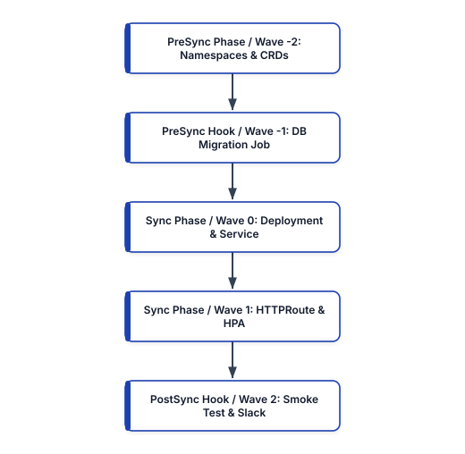


Below is a production `ApplicationSet` manifest combined with a `PreSync` database schema migration hook using Sync Waves:

```yaml
# argocd-applicationset-matrix.yaml
apiVersion: argoproj.io/v1alpha1
kind: ApplicationSet
metadata:
  name: platform-microservices-fleet
  namespace: argocd
spec:
  goTemplate: true
  generators:
    - matrix:
        generators:
          - clusters:
              selector:
                matchLabels:
                  environment: production
          - git:
              repoURL: >-
                https://github.com/org/gitops-fleet.git
              revision: main
              directories:
                - path: "services/*"
  template:
    metadata:
      name: "{{.path.basename}}-{{.name}}"
    spec:
      project: prod-workloads
      source:
        repoURL: >-
          https://github.com/org/gitops-fleet.git
        targetRevision: main
        path: "{{.path.path}}/overlays/prod"
      destination:
        server: "{{.server}}"
        namespace: "{{.path.basename}}"
      syncPolicy:
        automated:
          prune: true
          selfHeal: true
        syncOptions:
          - CreateNamespace=true
          - ServerSideApply=true
```

And the corresponding `PreSync` database migration `Job` inside the service overlay uses Sync Wave `-1` and automatic hook deletion (`BeforeHookCreation`):

```yaml
# services/ledger/base/migration-job.yaml
apiVersion: batch/v1
kind: Job
metadata:
  name: ledger-schema-migrate
  annotations:
    argocd.argoproj.io/hook: PreSync
    argocd.argoproj.io/sync-wave: "-1"
    argocd.argoproj.io/hook-delete-policy: >-
      BeforeHookCreation
spec:
  backoffLimit: 2
  template:
    spec:
      restartPolicy: Never
      containers:
        - name: atlas-migrate
          image: arigaio/atlas:0.28.0
          args:
            - schema
            - apply
            - --env
            - prod
```

Notice `ServerSideApply=true` in `syncOptions`: Kubernetes Server-Side Apply (SSA) delegates field ownership tracking to the Kubernetes API server (`metadata.managedFields`) rather than stuffing large client-side `kubectl.kubernetes.io/last-applied-configuration` JSON annotations onto objects, preventing 262 KB annotation size errors on large CRDs.

## Flux v2: Composable GitOps Toolkit and OCI Artifact Reconciliation

Developed on top of the **GitOps Toolkit**, **Flux v2** decomposes GitOps reconciliation into specialized, composable Kubernetes controllers:

- **Source Controller**: Fetches artifacts from `GitRepository`, `OCIRepository` (signed container registry bundles verified with Cosign), `HelmRepository`, and `Bucket` sources, verifying cryptographic signatures before exposing artifacts inside the cluster.
- **Kustomize Controller**: Continuously applies plain YAML or Kustomize overlays via Kubernetes Server-Side Apply, performs health checks (`wait: true`), decrypts secrets encrypted at rest with **Mozilla SOPS** (backed by AWS KMS, GCP KMS, Azure Key Vault, or `age`), and reverts manual cluster drift (`force: false`, `prune: true`).
- **Helm Controller**: Manages declarative `HelmRelease` lifecycles, automatically executing `helm test`, remediating failed upgrades via automated rollbacks (`remediateLastFailure: true`), and detecting drift inside Helm release resources (`driftDetection.mode: enabled`).
- **Notification & Image Automation Controllers**: Emit CloudEvents to Slack/Teams/PagerDuty and optionally commit verified container image digest updates back to Git.

Below is a production Flux v2 manifest pair demonstrating a Cosign-verified `OCIRepository` source and a `HelmRelease` with active drift correction and automatic rollback on failure:

```yaml
# flux-oci-and-helmrelease.yaml
apiVersion: source.toolkit.fluxcd.io/v1beta2
kind: OCIRepository
metadata:
  name: checkout-oci-manifests
  namespace: flux-system
spec:
  interval: 5m
  url: oci://ghcr.io/org/manifests/checkout-service
  ref:
    tag: v2.8.4
  verify:
    provider: cosign
    matchOIDCIdentity:
      - issuer: >-
          https://token.actions.githubusercontent.com
        subject: >-
          https://github.com/org/checkout/.github/*
---
apiVersion: helm.toolkit.fluxcd.io/v2
kind: HelmRelease
metadata:
  name: checkout-api
  namespace: checkout-prod
spec:
  interval: 10m
  chartRef:
    kind: OCIRepository
    name: checkout-oci-manifests
    namespace: flux-system
  driftDetection:
    mode: enabled
  install:
    remediation:
      retries: 3
  upgrade:
    cleanupOnFail: true
    remediation:
      retries: 3
      strategy: rollback
      remediateLastFailure: true
  values:
    replicaCount: 4
    resources:
      requests:
        cpu: "500m"
        memory: "512Mi"
```

## Extending GitOps to Cloud Infrastructure with Crossplane Compositions

Argo CD and Flux v2 reconcile Kubernetes API objects—but microservices also need cloud resources such as Amazon RDS PostgreSQL instances, S3 buckets, SQS queues, and IAM roles. Running Terraform in a separate CI pipeline creates a synchronization gap between cloud infrastructure provisioning and Kubernetes workload deployment.

**Crossplane** closes this gap by transforming a Kubernetes control plane into a universal cloud control plane. Crossplane installs **Providers** (`provider-aws`, `provider-gcp`, `provider-azure`) that represent cloud resources as native Kubernetes Custom Resources (**Managed Resources**, or MRs). Furthermore, platform teams author **CompositeResourceDefinitions (XRDs)** and **Compositions** (using pipeline-mode Composition Functions such as `function-patch-and-transform` or `function-go-templating`) to expose simplified, self-service **Claims** to application developers.

When a developer commits a 12-line `PostgresInstance` YAML claim to Git, Argo CD or Flux v2 syncs it into the cluster, and Crossplane continuously reconciles the underlying AWS RDS instance, KMS key, subnet group, and Kubernetes connection secret:

```yaml
# crossplane-composition-and-claim.yaml
apiVersion: apiextensions.crossplane.io/v1
kind: Composition
metadata:
  name: xpostgresinstances.aws.platform.io
spec:
  compositeTypeRef:
    apiVersion: platform.io/v1alpha1
    kind: XPostgresInstance
  mode: Pipeline
  pipeline:
    - step: patch-and-transform
      functionRef:
        name: function-patch-and-transform
      input:
        apiVersion: pt.fn.crossplane.io/v1beta1
        kind: Resources
        resources:
          - name: rds-instance
            base:
              apiVersion: rds.aws.upbound.io/v1beta1
              kind: Instance
              spec:
                forProvider:
                  region: us-east-1
                  engine: postgres
                  engineVersion: "16.4"
                  storageEncrypted: true
                  publiclyAccessible: false
                  autoMinorVersionUpgrade: true
            patches:
              - type: FromCompositeFieldPath
                fromFieldPath: spec.params.storageGB
                toFieldPath: >-
                  spec.forProvider.allocatedStorage
              - type: FromCompositeFieldPath
                fromFieldPath: spec.params.tierClass
                toFieldPath: >-
                  spec.forProvider.instanceClass
---
# Developer Self-Service Claim Committed to GitOps Repo
apiVersion: platform.io/v1alpha1
kind: PostgresInstance
metadata:
  name: ledger-db
  namespace: checkout-prod
spec:
  params:
    storageGB: 200
    tierClass: db.r7g.large
  writeConnectionSecretToRef:
    name: ledger-db-conn-credentials
```

## GitOps Repository Topologies and Rendered Manifest Promotion

One of the most consequential architectural decisions in GitOps is structuring repositories and promoting changes across environments (`dev` $\to$ `staging` $\to$ `prod`).

### Why Branch-per-Environment (`git checkout prod && git merge staging`) Is an Anti-Pattern

A common mistake made by teams migrating to GitOps is mapping environments to Git branches (`dev`, `staging`, `prod` branches) and promoting releases via `git merge staging -> prod`. This pattern inevitably fails because environments legitimately differ in replica counts, domain names, IAM role ARNs, and regional cluster identifiers. Once an engineer commits an environment-specific tweak to the `prod` branch, subsequent `git merge` operations either overwrite production settings with `staging` values or trigger perpetual merge conflicts.

### Kustomize Overlays on a Single Trunk (`main`) and the Rendered Manifests Pattern

Modern platform teams standardize on a **Single Trunk Branch (`main`)** using Kustomize directory overlays (`base/` + `overlays/dev/`, `overlays/staging/`, `overlays/prod/`), paired with the **Rendered Manifests Pattern** (implemented by tools such as **Akuity Kargo** and **Argo `gitops-promoter`**). Instead of trusting opaque Helm or Kustomize upgrades directly in production, the CI/promotion pipeline hydrates the overlay into flat, fully rendered Kubernetes YAML before committing to an environment-specific directory or OCI artifact tag. Consequently, every pull request shows the exact line-by-line Kubernetes resource diff that Argo CD or Flux v2 will apply.

```text
gitops-fleet/ (Single Trunk Branch: main)
├── apps/
│   └── checkout-api/
│       ├── base/
│       │   ├── kustomization.yaml
│       │   ├── deployment.yaml
│       │   └── service.yaml
│       └── overlays/
│           ├── dev/
│           │   └── kustomization.yaml
│           ├── staging/
│           │   └── kustomization.yaml
│           └── prod/
│               ├── kustomization.yaml
│               └── replica-patch.yaml
└── clusters/
    ├── prod-us-east-1/
    └── prod-eu-central-1/
```

## GitOps Secret Management: External Secrets Operator (ESO) vs. SOPS

Because Git serves as the immutable audit log in a GitOps architecture, **you must never commit unencrypted Kubernetes `Secret` manifests to a Git repository**. Even if a private repository is restricted today, every developer clone, CI cache, and backup snapshot retains the entire Git commit history indefinitely.

Platform engineering teams solve the "GitOps Secret Zero" problem using one of two production-hardened patterns:

1. **In-Repo Encryption at Rest (Mozilla SOPS + `age` / Cloud KMS or Sealed Secrets)**: Encrypted ciphertext is committed directly to Git, where only the secret's `data` values are encrypted while `metadata` keys remain readable for code review. The in-cluster GitOps controller (such as Flux `kustomize-controller`) holds the private decryption key or KMS IAM role and decrypts the secret in memory during reconciliation.
2. **Dynamic Out-of-Band Secret Synchronization (External Secrets Operator — ESO)**: No secret ciphertext is stored in Git at all. Instead, engineers commit a declarative **`ExternalSecret`** custom resource containing only the *metadata reference path* (such as `/prod/checkout/stripe-api-key`) pointing to an external vault (AWS Secrets Manager, GCP Secret Manager, Azure Key Vault, or HashiCorp Vault). The **External Secrets Operator** authenticates to the cloud vault using short-lived Kubernetes **Workload Identity** (IRSA / EKS Pod Identity) and dynamically creates and rotates the native Kubernetes `Secret` inside the namespace.

```yaml
# external-secret-sync.yaml
apiVersion: external-secrets.io/v1beta1
kind: ClusterSecretStore
metadata:
  name: aws-secrets-manager-prod
spec:
  provider:
    aws:
      service: SecretsManager
      region: us-east-1
      auth:
        jwt:
          serviceAccountRef:
            name: eso-irsa-controller
            namespace: external-secrets
---
apiVersion: external-secrets.io/v1beta1
kind: ExternalSecret
metadata:
  name: checkout-stripe-credentials
  namespace: checkout-prod
spec:
  # Automatically poll and rotate secret every 15m
  refreshInterval: 15m
  secretStoreRef:
    name: aws-secrets-manager-prod
    kind: ClusterSecretStore
  target:
    name: checkout-stripe-secret
    creationPolicy: Owner
  data:
    - secretKey: STRIPE_SECRET_KEY
      remoteRef:
        key: prod/checkout/payment-gateway
        property: stripe_secret_key
        conversionStrategy: Default
```

Using ESO with `refreshInterval: 15m` decouples secret rotation from Git commits: when AWS Secrets Manager rotates a database password or API key on a 30-day schedule, ESO updates the live Kubernetes `Secret` automatically without requiring a single Git commit.

## Progressive Delivery and Automated Canary Analysis with Argo Rollouts

A standard Kubernetes `Deployment` only supports a coarse `RollingUpdate` strategy: as soon as a new pod's `readinessProbe` returns `200 OK`, Kubernetes replaces the old pods at full speed. It has no ability to split traffic by exact percentages (e.g., `5%`), query Prometheus SLO burn rates during the rollout, or automatically abort and roll back if $p_{99}$ latency degrades under real user traffic.

**Argo Rollouts** replaces the standard `Deployment` object with a `Rollout` CRD that integrates natively with the **Kubernetes Gateway API** (`HTTPRoute`), Istio, Envoy, NGINX, and AWS ALB, paired with an **`AnalysisTemplate`** that continuously queries Prometheus, Datadog, or New Relic during each canary step:

```yaml
# argo-rollout-and-analysis.yaml
apiVersion: argoproj.io/v1alpha1
kind: AnalysisTemplate
metadata:
  name: checkout-slo-gate
  namespace: checkout-prod
spec:
  metrics:
    - name: success-rate-slo
      interval: 1m
      # Require >= 99.9% HTTP non-5xx success rate
      successCondition: result[0] >= 0.999
      failureLimit: 2
      provider:
        prometheus:
          address: >-
            http://prometheus.observability.svc:9090
          query: |
            1 - (
              sum(rate(http_requests_total{
                app="checkout-api",status=~"5.."
              }[2m]))
              /
              sum(rate(http_requests_total{
                app="checkout-api"
              }[2m]))
            )
---
apiVersion: argoproj.io/v1alpha1
kind: Rollout
metadata:
  name: checkout-api
  namespace: checkout-prod
spec:
  replicas: 10
  revisionHistoryLimit: 3
  selector:
    matchLabels:
      app: checkout-api
  strategy:
    canary:
      canaryService: checkout-api-canary
      stableService: checkout-api-stable
      trafficRouting:
        plugins:
          argoproj-labs/gatewayAPI:
            httpRoute: checkout-canary-route
            namespace: checkout-prod
      analysis:
        templates:
          - templateName: checkout-slo-gate
        startingStep: 1
      steps:
        - setWeight: 5
        - pause: { duration: 3m }
        - setWeight: 25
        - pause: { duration: 5m }
        - setWeight: 50
        - pause: { duration: 5m }
```

During this rollout, Argo Rollouts shifts 5% of live traffic to the canary via the Gateway API `HTTPRoute`, starts the `checkout-slo-gate` Prometheus analysis loop every 60 seconds, and advances through 25%, 50%, and 100% only if the live success rate remains $\ge 99.9\%$. If two consecutive Prometheus queries breach the threshold, Argo Rollouts immediately resets the `HTTPRoute` weight to `0%` on the canary and marks the rollout `Degraded`—achieving zero-human-intervention progressive delivery.

## Architectural Comparison: Argo CD vs. Flux v2 vs. Crossplane

```text
+------------------+-----------------+----------------+
| Capability       | Argo CD         | Flux v2        |
+------------------+-----------------+----------------+
| Architecture     | Centralized UI, | Composable     |
| Model            | API, AppSet     | K8s Controllers|
| Multi-Tenancy &  | Built-in OIDC,  | Native K8s RBAC|
| RBAC             | AppProjects, UI | ServiceAccounts|
| Artifact Sources | Git, Helm, OCI  | Git, Signed OCI|
|                  | Registries      | S3 Buckets     |
| Helm Lifecycle   | Renders via     | Native Helm    |
| Management       | helm template   | SDK Controller |
+------------------+-----------------+----------------+
```

## Production GitOps Best Practices

1. **Separate Application Source Repositories from GitOps Config Repositories**: Never store your Kubernetes deployment overlays inside the same Git repository as your application source code if CI commits image tag updates back to Git; doing so triggers infinite CI build loops unless carefully filtered (`[skip ci]`). Maintain dedicated GitOps state repositories (or OCI artifact repositories) so application CI pipelines build, test, sign, and push immutable container digests (`@sha256:...`), and open an automated pull request against the GitOps repository.
2. **Enable `ServerSideApply=true` and Resource Tracking Labels**: Always configure Argo CD (`ServerSideApply=true`, `annotation+label` tracking) and Flux v2 (which uses SSA natively) to rely on Kubernetes Server-Side Apply. SSA avoids `last-applied-configuration` annotation bloat and cleanly arbitrates field ownership when a HorizontalPodAutoscaler (HPA) or Karpenter controller co-manages fields alongside your GitOps reconciler.
3. **Ignore Dynamically Mutated Fields (`ignoreDifferences`)**: When an HPA dynamically scales `spec.replicas` from `4` to `18` during a traffic spike, a naive GitOps controller with `selfHeal: true` will fight the HPA and scale the deployment back down to `4` (causing a production outage!). Omit `spec.replicas` from Git manifests when an HPA is active, or explicitly configure `ignoreDifferences` on `/spec/replicas` and mutating webhook CA bundles.
4. **Verify Cryptographic Signatures Before Reconciliation**: Enforce commit signing (GPG / SSH / Sigstore Gitsign) on your GitOps repository `main` branch or use Flux v2 `OCIRepository` Cosign verification so that even if a registry or Git hosting token is compromised, the in-cluster reconciler refuses to apply unsigned manifests.

## Summary

GitOps elevates infrastructure and application delivery from brittle imperative scripts into a self-healing, cryptographically auditable control loop. By scaling multi-cluster orchestration with Argo CD `ApplicationSet` generators and Sync Waves, enforcing OCI artifact verification and Helm drift remediation with Flux v2, unifying cloud resource APIs via Crossplane Compositions, and gating every production release with Argo Rollouts SLO analysis, platform teams achieve both high deployment velocity and deterministic state convergence. In Chapter 15, we build the complete Infrastructure Testing and Validation pyramid—from static linters and native `terraform test` suites to Terratest and Chaos Engineering.


<div style="page-break-after: always;"></div>


# Chapter 15: Infrastructure Testing, Validation, and Chaos Engineering

For years, software engineers subjected application code to rigorous unit tests, contract assertions, integration suites, and load benchmarks, yet treated Infrastructure as Code (IaC) as untestable configuration—relying on manual visual inspection of `terraform plan` output before applying changes directly to production. As cloud estates grow to encompass thousands of IAM policies, VPC route tables, KMS encryption keys, and Kubernetes Custom Resources, visual inspection inevitably fails. A single mistyped CIDR block, an overly permissive IAM trust policy, or a missing multi-AZ failover setting can trigger a catastrophic security breach or multi-hour outage.

Modern platform engineering applies the same automated verification rigor to infrastructure code as to distributed systems software. However, unlike stateless application functions that execute in microseconds in memory, real cloud infrastructure takes minutes to provision and incurs financial cost. Therefore, effective validation relies on a structured **Infrastructure Testing Pyramid** that catches 90% of syntax, schema, security, and logic bugs in seconds offline before executing ephemeral real-cloud integration tests with **Terratest** and continuous resilience verification through **Chaos Engineering** (**AWS Fault Injection Service** and **Chaos Mesh**).


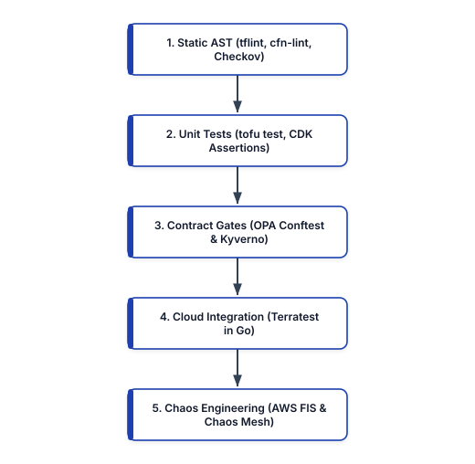


## The Infrastructure Testing Pyramid: Balancing Speed, Cost, and Fidelity

Every layer of the Infrastructure Testing Pyramid trades execution speed and cost against real-world cloud API fidelity:

```text
+--------------------+---------------+----------------+
| Testing Layer      | Execution     | Cloud API Cost |
|                    | Time          | & Fidelity     |
+--------------------+---------------+----------------+
| 1. Static Analysis | 1 - 5 sec     | $0 (Offline    |
| (tflint / Checkov) | (Pre-commit)  | AST & Schema)  |
| 2. Unit Tests      | 2 - 10 sec    | $0 (In-Memory  |
| (tftest / CDK)     | (CI Build)    | Mock Graph)    |
| 3. Contract Tests  | 5 - 15 sec    | $0 (Evaluates  |
| (OPA Conftest)     | (PR Plan Gate)| Plan JSON)     |
| 4. Integration     | 3 - 20 min    | $$ (Ephemeral  |
| (Terratest Go)     | (Merge / PR)  | Cloud Sandbox) |
| 5. Chaos & GameDay | 10 - 60 min   | $$$ (Live Prod |
| (AWS FIS / Mesh)   | (Scheduled)   | / Pre-Prod)    |
+--------------------+---------------+----------------+
```

By structuring CI/CD pipelines so that Layers 1, 2, and 3 execute on every commit in under 30 seconds, teams fail fast on invalid instance types, broken variable interpolation, and security regressions without waiting 15 minutes for an RDS instance or EKS cluster to provision.

## Layer 1: Deep Static Analysis with `tflint`, `cfn-lint`, and Checkov

Built-in commands like `tofu validate` or `terraform validate` only verify basic HCL syntax and internal attribute references; they do **not** know whether `"t3.superlarge"` is a valid Amazon EC2 instance type, whether an IAM policy JSON string is malformed, or whether an S3 bucket lacks server-side encryption.

### Provider-Aware Static Linting with `tflint`

**`tflint`** bridges this gap using provider-specific rulesets (`tflint-ruleset-aws`, `tflint-ruleset-google`, `tflint-ruleset-azurerm`) that validate resource arguments against official cloud provider API schemas, flag deprecated resource attributes, and enforce naming and tagging conventions:

```hcl
# .tflint.hcl
config {
  call_module_type = "all"
  force            = false
}

plugin "aws" {
  enabled = true
  version = "0.35.0"
  source  = (
    "github.com/terraform-linters/tflint-ruleset-aws"
  )
  deep_check = false
}

rule "terraform_documented_variables" {
  enabled = true
}

rule "terraform_naming_convention" {
  enabled = true
  format  = "snake_case"
}

rule "aws_instance_invalid_type" {
  enabled = true
}
```

### CloudFormation and SAM Static Validation with `cfn-lint`

For teams using AWS CloudFormation or AWS SAM (`template.yaml`), **`cfn-lint`** validates templates against the official AWS CloudFormation Resource Specification across all AWS regions, checking intrinsic functions (`!Sub`, `!Ref`, `!GetAtt`), IAM policy grammar, and state machine Amazon States Language (ASL) syntax before a stack deployment is ever initiated.

## Layer 2: Fast Unit Testing with Native `terraform test` (`tofu test`) and AWS CDK Assertions

Historically, unit testing Terraform modules required spinning up real cloud resources because HCL lacked a native testing framework or provider mocking layer. Starting in Terraform 1.6+ and OpenTofu 1.7+ (and enhanced in 1.8+/1.9+), HCL includes a **native unit and integration testing framework (`terraform test` / `tofu test`)** using `.tftest.hcl` files and **`mock_provider`** blocks.

### Native HCL Unit Tests with `mock_provider` and `command = plan`

Using `mock_provider "aws" {}` inside a `.tftest.hcl` suite allows engineers to execute `command = plan` or `command = apply` completely offline in milliseconds: the test engine synthesizes mock computed attributes (such as `arn` and `id`) and evaluates complex module conditionals, dynamic blocks, and output transformations without requiring AWS credentials:

```hcl
# tests/s3_vault_unit.tftest.hcl
mock_provider "aws" {
  mock_resource "aws_kms_key" {
    defaults = {
      arn = "arn:aws:kms:us-east-1:111122223333:key/m1"
    }
  }
}

variables {
  environment = "production"
  bucket_name = "ledger-settlement-archive"
}

run "verify_production_bucket_hardening" {
  command = plan

  assert {
    condition = (
      aws_s3_bucket.archive.bucket_prefix ==
      "prod-ledger-settlement-archive-"
    )
    error_message = "Prod bucket prefix is incorrect."
  }

  assert {
    condition = (
      aws_kms_key.vault.deletion_window_in_days == 30
    )
    error_message = "Prod KMS window must be 30 days."
  }

  assert {
    condition = (
      aws_s3_bucket_public_access_block.block
      .restrict_public_buckets == true
    )
    error_message = "Public access must be blocked."
  }
}

run "reject_short_kms_window_in_prod" {
  command = plan

  variables {
    kms_deletion_window_days = 7
  }

  expect_failures = [
    var.kms_deletion_window_days,
  ]
}
```

Notice `expect_failures = [var.kms_deletion_window_days]` in the second `run` block: this enables **negative unit testing**, proving that your variable validation rules actively reject insecure inputs!

### Fine-Grained Unit Testing with AWS CDK Assertions (`aws-cdk-lib/assertions`)

In AWS CDK v2, infrastructure constructs are tested using standard TypeScript/JavaScript unit test runners (`vitest` or `jest`) paired with the `Template` and `Match` assertion library. The test synthesizes the stack in memory (`Template.fromStack(stack)`) and inspects the resulting CloudFormation resources in milliseconds:

```typescript
// test/serverless-ledger-stack.test.ts
import { App } from 'aws-cdk-lib';
import {
  Template,
  Match,
} from 'aws-cdk-lib/assertions';
import {
  ServerlessLedgerStack,
} from '../lib/serverless-ledger-stack';

test('DynamoDB Enforces PITR and Streams', () => {
  const app = new App();
  const stack = new ServerlessLedgerStack(
    app,
    'TestStack'
  );
  const template = Template.fromStack(stack);

  template.hasResourceProperties(
    'AWS::DynamoDB::GlobalTable',
    {
      StreamSpecification: {
        StreamViewType: 'NEW_AND_OLD_IMAGES',
      },
      Replicas: Match.arrayWith([
        Match.objectLike({
          PointInTimeRecoverySpecification: {
            PointInTimeRecoveryEnabled: true,
          },
        }),
      ]),
    }
  );

  // Verify Lambda uses Arm64 Graviton3 architecture
  template.hasResourceProperties(
    'AWS::Lambda::Function',
    {
      Architectures: ['arm64'],
    }
  );
});
```

## Layer 3: Contract and Compliance Testing with OPA Conftest

While unit tests verify the internal logic of a single module, **Contract Testing** verifies that the assembled multi-module execution plan (`tfplan.json`) or rendered Kubernetes manifest bundle adheres to enterprise-wide interface contracts, network boundary rules, and security baselines.

**Conftest** (a CNCF Open Policy Agent subproject) evaluates structured configuration files (`.json`, `.yaml`, `.hcl`, `Dockerfile`, and `tfplan.json`) against Rego policies and integrates cleanly into pull request gates:

```yaml
# policy/k8s_security_contract.rego
package main

import rego.v1

containers contains c if {
    some c in input.spec.template.spec.containers
}

deny contains msg if {
    input.kind == "Deployment"
    some c in containers
    not c.securityContext.runAsNonRoot
    msg := sprintf(
        "Container '%s' in Deployment '%s' must set "
        + "securityContext.runAsNonRoot = true",
        [c.name, input.metadata.name],
    )
}

deny contains msg if {
    input.kind == "Deployment"
    some c in containers
    not c.resources.limits.memory
    msg := sprintf(
        "Container '%s' in '%s' lacks memory limits",
        [c.name, input.metadata.name],
    )
}
```

### Testing Kubernetes Admission Policies Offline with `kyverno test`

In addition to OPA Conftest, teams operating **Kyverno** or **Kubernetes ValidatingAdmissionPolicy** (CEL-based native admission control) must verify that their cluster guardrails neither allow non-compliant pods nor accidentally block legitimate platform workloads. The **`kyverno test`** CLI executes declarative test suites offline in CI against positive ("good") and negative ("bad") Kubernetes resource fixtures before policies are synced via GitOps:

```yaml
# tests/kyverno-test.yaml
apiVersion: cli.kyverno.io/v1alpha1
kind: Test
metadata:
  name: verify-non-root-admission-policy
policies:
  - ../policies/require-run-as-non-root.yaml
resources:
  - fixtures/compliant-checkout-pod.yaml
  - fixtures/non-compliant-root-pod.yaml
results:
  - policy: require-run-as-non-root
    rule: check-runasnonroot
    resources:
      - checkout-prod/compliant-checkout-pod
    kind: Pod
    result: pass
  - policy: require-run-as-non-root
    rule: check-runasnonroot
    resources:
      - checkout-prod/non-compliant-root-pod
    kind: Pod
    result: fail
```

## Layer 4: Real-Cloud Ephemeral Integration Testing with Terratest in Go

Static analyzers and unit mock providers cannot catch cloud-provider runtime behavior: IAM eventual consistency race conditions, VPC subnet routing blackholes, security group port mismatches, or invalid cloud service quotas. Only deploying the module into a real, isolated cloud sandbox account and executing live network assertions proves end-to-end correctness.

While earlier Chef/Puppet eras used **Test Kitchen** (`kitchen-terraform`) to converge virtual machines, modern cloud-native platform teams standardize on **Terratest**—a Go library developed by Gruntwork that orchestrates `tofu`/`terraform`, `kubectl`, `helm`, `packer`, and cloud SDKs directly inside standard Go tests (`go test`).

Terratest follows a four-stage lifecycle in every test function:
1. **Generate Unique Namespace (`random.UniqueId()`)**: Appends a random 6-character alphanumeric suffix to all resource names so dozens of concurrent pull request pipelines can run in the same sandbox AWS account without name collisions.
2. **Defer Teardown (`defer terraform.Destroy(t, opts)`)**: Uses Go's `defer` mechanism to guarantee that even if a test assertion panics or fails mid-run, `terraform destroy` executes automatically to prevent orphaned cloud charges.
3. **Provision (`terraform.InitAndApply(t, opts)`)**: Applies the HCL module against the real cloud API.
4. **Validate via Cloud SDK / HTTP Retries (`http_helper.HttpGetWithRetry`)**: Fetches outputs from the provisioned stack and probes live endpoints or cloud API state with exponential backoff.

```go
// test/vpc_and_alb_integration_test.go
package test

import (
	"crypto/tls"
	"fmt"
	"testing"
	"time"

	"github.com/gruntwork-io/terratest/modules/random"
	"github.com/gruntwork-io/terratest/modules/terraform"
	"github.com/stretchr/testify/require"
)

func TestCheckoutAlbModuleIntegration(t *testing.T) {
	t.Parallel()

	uniqueID := random.UniqueId()
	envName := fmt.Sprintf("ci-%s", uniqueID)

	tfOpts := terraform.WithDefaultRetryableErrors(
		t,
		&terraform.Options{
			TerraformBinary: "tofu",
			TerraformDir:    "../modules/checkout-alb",
			Vars: map[string]interface{}{
				"environment": envName,
				"vpc_cidr":    "10.99.0.0/16",
			},
		},
	)

	// Always destroy ephemeral cloud resources on exit
	defer terraform.Destroy(t, tfOpts)

	// Run tofu init and tofu apply in sandbox account
	terraform.InitAndApply(t, tfOpts)

	albDns := terraform.Output(
		t, tfOpts, "alb_dns_name",
	)
	require.NotEmpty(t, albDns)

	healthURL := fmt.Sprintf(
		"https://%s/healthz", albDns,
	)
	tlsCfg := &tls.Config{
		MinVersion: tls.VersionTLS13,
	}

	// Probe live HTTPS endpoint with retries for DNS
	http_helper.HttpGetWithRetry(
		t,
		healthURL,
		tlsCfg,
		200,
		`{"status":"healthy"}`,
		15,
		10*time.Second,
	)
}
```

### Ephemeral Sandbox Hygiene: LocalStack Emulation and Automated `cloud-nuke` Sweeps

Even with `defer terraform.Destroy(t, tfOpts)` in place, an integration test runner container can occasionally be terminated abruptly (`SIGKILL`) due to CI spot instance reclamation or network loss, leaving behind orphaned NAT Gateways, Elastic Load Balancers, or RDS instances in the sandbox cloud account.

To keep integration testing fast and cost-controlled, platform teams implement two complementary practices:

- **Fast Pre-Cloud API Emulation with LocalStack**: Before provisioning resources in a real AWS sandbox account, developers run `tflocal` / `tofu` against an ephemeral **LocalStack** container on their laptop or in a fast CI job. LocalStack emulates over 100 AWS APIs (S3, DynamoDB, SQS, SNS, Lambda, IAM, STS, KMS) locally on port `4566`, catching IAM action mismatches and event-source wiring errors in seconds at zero cloud cost.
- **Nightly Automated Sandbox Sweeps with `cloud-nuke` / `aws-nuke`**: Dedicated CI sandbox cloud accounts run a scheduled nightly job using **`cloud-nuke`** (by Gruntwork) that automatically deletes any resource older than 6 hours (`--older-than 6h`), guaranteeing that leaked resources from crashed integration test runs never accumulate into surprise monthly cloud bills.

## Layer 5: Chaos Engineering with AWS Fault Injection Service (FIS) and Chaos Mesh

Passing static analysis, unit tests, and integration tests proves that your infrastructure works when every cloud Availability Zone, network link, and upstream dependency is healthy. **Chaos Engineering** is the discipline of experimenting on a distributed system in order to build confidence in the system's capability to withstand turbulent and unexpected conditions in production.

Every formal Chaos Engineering experiment follows the four-step scientific method:

1. **Define the "Steady State" Hypothesis**: Measure a business/SLO metric (for example, "Checkout HTTP API maintains $\ge 99.95\%$ success rate and $p_{99} < 300\text{ ms}$ at 2,000 req/sec").
2. **Define an Explicit Stop Condition (Safety Abort)**: Configure an automated circuit breaker (such as a CloudWatch Alarm or Prometheus SLO Fast-Burn Alert) that immediately halts the fault injection and restores normal state if user-facing error budgets are breached.
3. **Inject Real-World Faults in a Bounded Blast Radius**: Introduce realistic failures—such as Availability Zone power loss, EC2/EKS node termination, RDS primary instance failover, 150ms cross-AZ network latency, or DNS resolution failure.
4. **Verify Automated Self-Healing and Observability**: Confirm that Envoy outlier detection, Kubernetes pod topology spread constraints, Aurora failover, and SLO alerts behave as designed.


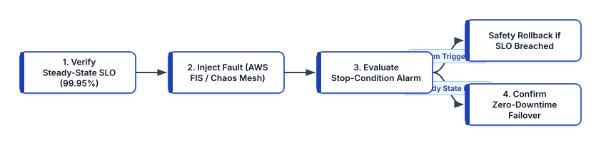


### Cloud-Layer Fault Injection with AWS Fault Injection Service (FIS)

**AWS Fault Injection Service (FIS)** orchestrates controlled chaos experiments directly at the AWS control plane and Nitro hypervisor level, including full **Availability Zone Power Interruption (`aws:ec2:stop-instances` + `aws:network:disrupt-connectivity`)**, RDS Multi-AZ failover, and EKS node group drains, guarded by mandatory CloudWatch stop conditions:

```hcl
# fis-az-failover-experiment.tf
resource "aws_fis_experiment_template" "az_blackhole" {
  description = "Verify Multi-AZ Checkout Resilience"
  role_arn    = aws_iam_role.fis_runner.arn

  stop_condition {
    source = "aws:cloudwatch:alarm"
    value  = aws_cloudwatch_alarm.slo_fast_burn.arn
  }

  action {
    name      = "disrupt_az_subnet_traffic"
    action_id = "aws:network:disrupt-connectivity"

    parameter {
      key   = "duration"
      value = "PT5M"
    }
    parameter {
      key   = "scope"
      value = "all"
    }

    target {
      key   = "Subnets"
      value = "target_az_a_subnets"
    }
  }

  target {
    name           = "target_az_a_subnets"
    resource_type  = "aws:ec2:subnet"
    selection_mode = "ALL"

    resource_tag {
      key   = "ChaosTargetAZ"
      value = "us-east-1a"
    }
  }
}
```

### Kubernetes Pod and Network Fault Injection with Chaos Mesh

Within Kubernetes clusters, **Chaos Mesh** (a CNCF incubation project) uses eBPF and Linux traffic control (`tc` `netem`) to inject pod failures, container kills, clock skew (`TimeChaos`), disk I/O latency (`IOChaos`), and network partitions (`NetworkChaos`) declaratively via Kubernetes CRDs:

```yaml
# chaos-mesh-network-latency.yaml
apiVersion: chaos-mesh.org/v1alpha1
kind: NetworkChaos
metadata:
  name: inject-payment-gateway-latency
  namespace: checkout-prod
spec:
  action: delay
  mode: fixed-percent
  value: "50"
  selector:
    namespaces:
      - checkout-prod
    labelSelectors:
      app: payment-worker
  delay:
    latency: "180ms"
    correlation: "25"
    jitter: "30ms"
  direction: to
  target:
    mode: all
    selector:
      namespaces:
        - checkout-prod
      labelSelectors:
        app: ledger-service
  duration: "5m"
```

This `NetworkChaos` manifest injects $180\text{ ms} \pm 30\text{ ms}$ of network latency onto 50% of `payment-worker` pods calling `ledger-service` for 5 minutes, verifying that Envoy's P2C load balancer and circuit breakers shift traffic toward low-latency replicas without dropping customer transactions.

## Production Infrastructure Testing Best Practices

1. **Never Run Integration Tests in Shared Staging or Production Accounts**: Always execute Terratest and ephemeral `tofu test` apply suites inside dedicated, isolated **CI Sandbox Cloud Accounts** managed under a separate AWS Organizations Organizational Unit (OU) with strict budget alarms and nightly `cloud-nuke` cleanup jobs.
2. **Use `t.Parallel()` and Unique Resource Prefixes**: Cloud provisioning is I/O-bound waiting on remote control planes. Always mark Terratest functions with `t.Parallel()` and inject `random.UniqueId()` into resource names and state keys so 10 module tests complete concurrently in 4 minutes instead of 40 minutes sequentially.
3. **Test Failure Modes Explicitly (`expect_failures` and Negative Fixtures)**: A security guardrail or variable validation rule that lacks a negative test case is an unverified assumption. For every `validation` block in OpenTofu/Terraform and every Rego/Kyverno policy, include at least one negative test case that asserts a non-compliant configuration is actively rejected.
4. **Automate Chaos Experiments in Pre-Production Before Running in Production**: Never start Chaos Engineering by injecting faults into live production traffic on day one. Graduate chaos experiments through staging and pre-production load-test environments first, verify that automated stop conditions halt the experiment within 30 seconds of a simulated SLO breach, and only then promote automated chaos checks into production windows.

## Summary

Validating modern infrastructure requires a multi-layered engineering defense. By combining millisecond static schema analysis (`tflint`, `cfn-lint`, Checkov), fast offline unit tests (`tofu test` / `terraform test` with `mock_provider` and AWS CDK Assertions), OPA Conftest contract gates, ephemeral real-cloud Go integration suites in Terratest, and stop-condition-guarded Chaos Engineering with AWS FIS and Chaos Mesh, teams eliminate configuration regressions before they ever impact customer reliability. In Chapter 16, we explore cloud-native application design patterns, Dapr, Workload Identity Federation, multi-cloud abstractions, and Kubernetes FinOps with OpenCost.


<div style="page-break-after: always;"></div>


# Chapter 16: Cloud-Native Development Patterns, Multi-Cloud Strategies, and FinOps

Building software that runs *in* the cloud is not the same as engineering **cloud-native** software. Lifting and shifting a stateful, file-system-coupled monolith onto cloud virtual machines inherits all the fragility of legacy data centers while multiplying cloud infrastructure costs. True cloud-native architectures are designed from first principles to thrive on ephemeral, elastic compute substrates across multiple Availability Zones and cloud providers.

In this chapter, we examine the evolution from the classic **12-Factor App** to the modern **15-Factor Cloud-Native Methodology**, decouple distributed microservice primitives (state stores, pub/sub brokers, distributed locks, and workflow orchestration) from vendor SDK lock-in using **Dapr (Distributed Application Runtime)**, architect multi-cloud control planes with **Crossplane** and **OpenTofu**, eliminate static cross-cloud IAM credentials using **Workload Identity Federation (OIDC / SPIFFE)** across AWS, Google Cloud, and Microsoft Azure, and implement real-time Kubernetes unit economics and **FinOps** governance with **OpenCost**.


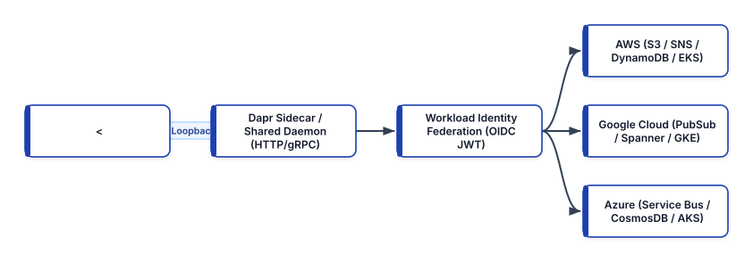


## From the 12-Factor App to the 15-Factor Cloud-Native Architecture

Originally published by Heroku engineers in 2011, the **Twelve-Factor App** established essential rules for stateless web applications: single-codebase tracking in Git, explicit dependency manifests, configuration via environment variables, stateless disposable processes (`SIGTERM` graceful shutdown), port binding, and treating logs as event streams written to `stdout`.

However, modern Kubernetes, serverless, and multi-cloud microservices require three critical architectural extensions known as the **15-Factor Cloud-Native Methodology**:

1. **API-First Design & Schema Contracts (Factor XIII)**: Every service boundary is defined *before* implementation using machine-verifiable interface schemas—**Protocol Buffers (gRPC / Buf)**, **OpenAPI 3.1**, or **AsyncAPI**—with automated backward-compatibility breaking-change detection in CI.
2. **Telemetry & Observability by Default (Factor XIV)**: Applications do not merely emit unstructured `stdout` lines; they expose standardized health endpoints (`/livez`, `/readyz`, `/startupz`), Prometheus RED metrics (`/metrics`), and **OpenTelemetry (OTel)** distributed trace context (`traceparent`) natively out of the box.
3. **Authentication, Authorization & Zero-Trust Identity (Factor XV)**: Security is not delegated solely to a perimeter firewall. Every workload authenticates outbound and inbound calls using short-lived cryptographic workload identities (OIDC JWTs or SPIFFE X.509 SVIDs) and least-privilege RBAC/ABAC policies.

```text
+--------------------+--------------------------------+
| 15-Factor Pillar   | Cloud-Native Implementation    |
+--------------------+--------------------------------+
| Disposability      | Fast startup (<2s) & graceful  |
| (Factor IX)        | SIGTERM drain hooks in K8s     |
| Backing Services   | Swappable via Dapr components  |
| (Factor IV)        | or Crossplane Secret mounts    |
| API First          | Buf Protobuf / OpenAPI 3.1     |
| (Factor XIII)      | schema compatibility gates     |
| Telemetry          | OpenTelemetry SDK + Prometheus |
| (Factor XIV)       | Native Histograms + /readyz    |
| Zero-Trust AuthN   | OIDC Workload Identity &       |
| (Factor XV)        | mTLS SPIFFE SVIDs (zero keys)  |
+--------------------+--------------------------------+
```

## Portable Distributed Primitives with Dapr (Distributed Application Runtime)

One of the hardest challenges in multi-cloud or hybrid-cloud engineering is **SDK lock-in**. When an application team imports `boto3` (AWS SDK) to publish messages to Amazon SNS/SQS and read state from Amazon DynamoDB, the business logic becomes tightly coupled to AWS API semantics, retry exceptions, and IAM signing mechanics. Running that same container on Google Cloud (GKE with Cloud Pub/Sub and Cloud Spanner), Microsoft Azure (AKS with Azure Service Bus and Cosmos DB), or an on-premises edge cluster requires rewriting the application code.

**Dapr (Distributed Application Runtime)**—a CNCF-graduated project—solves this by exposing portable **Building Block APIs** over local HTTP (`http://localhost:3500`) or gRPC (`localhost:50001`). Your application code communicates strictly with the local Dapr API (`v1.0/state`, `v1.0/publish`, `v1.0/invoke`, `v1.0/lock`, `v1.0/secrets`), while declarative Kubernetes `Component` YAML manifests bind those building blocks to the underlying cloud provider's native managed services!

### Swapping Cloud Backing Services Without Changing Application Code

Below are two Dapr `Component` manifests (`pubsub` and `statestore`) configured for an AWS production environment using Amazon SNS/SQS and DynamoDB. In a Google Cloud GKE cluster, the platform team simply deploys a `Component` with the identical metadata name (`order-events-pubsub`) backed by `pubsub.gcp.pubsub`—and the application container runs unmodified across both clouds:

```yaml
# dapr-aws-components.yaml
apiVersion: dapr.io/v1alpha1
kind: Component
metadata:
  name: order-events-pubsub
  namespace: checkout-prod
spec:
  type: pubsub.aws.snssqs
  version: v1
  metadata:
    - name: region
      value: "us-east-1"
    - name: disableEntityManagement
      value: "false"
    - name: messageVisibilityTimeout
      value: "60"
    - name: messageRetryLimit
      value: "5"
---
apiVersion: dapr.io/v1alpha1
kind: Component
metadata:
  name: order-state-store
  namespace: checkout-prod
spec:
  type: state.aws.dynamodb
  version: v1
  metadata:
    - name: table
      value: "prod-dapr-order-state"
    - name: region
      value: "us-east-1"
```

And the corresponding Python microservice publishes an event and saves transactional state using standard HTTP calls against `localhost:3500`—with zero cloud-vendor SDK imports:

```python
# app/checkout_dapr_service.py
import os
import httpx

DAPR_PORT = os.getenv("DAPR_HTTP_PORT", "3500")
BASE_URL = f"http://127.0.0.1:{DAPR_PORT}/v1.0"
PUBSUB_NAME = "order-events-pubsub"
STATE_STORE = "order-state-store"


async def process_cloud_agnostic_order(order: dict):
    order_id = order["order_id"]
    async with httpx.AsyncClient(timeout=3.0) as http:
        # 1. Persist state via Dapr State API
        state_url = f"{BASE_URL}/state/{STATE_STORE}"
        state_payload = [
            {
                "key": f"order-{order_id}",
                "value": order,
                "options": {
                    "concurrency": "first-write",
                    "consistency": "strong",
                },
            }
        ]
        r_state = await http.post(
            state_url, json=state_payload
        )
        r_state.raise_for_status()

        # 2. Publish CloudEvent via Dapr Pub/Sub API
        pub_url = (
            f"{BASE_URL}/publish/"
            f"{PUBSUB_NAME}/orders.created"
        )
        r_pub = await http.post(pub_url, json=order)
        r_pub.raise_for_status()

    return {
        "order_id": order_id,
        "status": "published",
    }
```

### Distributed Cloud-Native Design Patterns: Transactional Outbox, Bulkheads, and BFFs

Even with portable building blocks, distributed microservices introduce failure modes that never existed inside single-process monoliths:

- **The Transactional Outbox Pattern (Eliminating Dual-Write Corruption)**: Suppose a checkout service updates an order row in PostgreSQL (`COMMIT`) and then attempts to publish an `OrderCreated` message to Kafka or SNS. If the pod crashes or experiences a network partition millisecond after the database commit, the database reflects the order while downstream fulfillment services never receive the event. Conversely, publishing the event *before* committing the database transaction risks publishing phantom orders if the SQL commit rolls back. The **Transactional Outbox Pattern** solves this without slow distributed two-phase commits (2PC): the application inserts both the business record (`orders`) and the outbound event payload (`outbox_events`) inside a **single atomic local ACID database transaction**. An asynchronous relay (such as **Debezium Change Data Capture** reading the PostgreSQL Write-Ahead Log, DynamoDB Streams with EventBridge Pipes, or Dapr's built-in transactional outbox state configuration) tails the outbox table and guarantees at-least-once event publication.
- **The Bulkhead Pattern and Adaptive Concurrency**: Named after the watertight compartments of a ship's hull, a **Bulkhead** partitions connection pools, thread pools, and queue buffers per downstream dependency or tenant tier. If a secondary recommendation service becomes slow, only its dedicated 16-connection pool saturates, leaving the primary checkout and payment connection pools completely unaffected.
- **Backends for Frontends (BFF)**: Rather than forcing mobile, web, and third-party IoT clients to make 12 chatty round-trips across public cellular networks or consume a bloated one-size-fits-all REST endpoint, teams deploy client-specific **BFF gateways** (using gRPC-Web, GraphQL Federation, or lightweight Edge Workers) that aggregate, filter, and format internal gRPC microservice responses for each frontend experience.

## Multi-Cloud Control Plane Abstractions: Crossplane and OpenTofu

When organizations adopt a multi-cloud strategy—whether for regulatory data residency, M&A integration, best-of-breed AI/analytics services (e.g., running core transactional microservices on AWS EKS while consuming Google Cloud BigQuery/Vertex AI), or active-active disaster recovery—they must avoid building completely siloed operational toolchains for each cloud.

Platform engineering teams unify multi-cloud provisioning using two complementary patterns:

1. **OpenTofu / Terraform Multi-Provider Modules**: Define standardized module interfaces (`variables.tf` and `outputs.tf`) that accept provider-neutral inputs (such as CIDR ranges, retention periods, and tier sizes) and orchestrate `hashicorp/aws`, `hashicorp/google`, and `hashicorp/azurerm` resources within unified state pipelines.
2. **Crossplane Multi-Cloud Composite Resource Definitions (XRDs)**: Define a single internal platform API schema (such as `XObjectBucket` or `XEventStream`) and provide cloud-specific `Composition` implementations (`aws-s3-composition`, `gcp-gcs-composition`, `azure-blob-composition`). A workload deployed to an AWS EKS cluster or a GCP GKE cluster submits the exact same Kubernetes Claim YAML, and the cluster's local Crossplane controller selects the matching cloud `Composition` automatically via label selectors (`provider: aws` vs. `provider: gcp`).

## Workload Identity Federation Across AWS, GCP, and Azure (Zero Static Keys)

Historically, whenever a workload running in AWS (or GitHub Actions) needed to access a Google Cloud Storage bucket or an Azure Key Vault, engineers generated a long-lived IAM Service Account JSON key (`GOOGLE_APPLICATION_CREDENTIALS`) or Azure Client Secret and stored it as a static Kubernetes Secret. **Long-lived service account keys are one of the leading causes of cloud security breaches**: they do not expire automatically, are frequently leaked in logs or developer laptops, and are difficult to rotate without downtime.

Modern multi-cloud security mandates **Zero Long-Lived Service Account Keys** by using **OpenID Connect (OIDC) Workload Identity Federation**. Every modern Kubernetes cluster (EKS, GKE, AKS, or self-managed), CI/CD platform (GitHub Actions, GitLab), and cloud runtime exposes a cryptographically signed OIDC JSON Web Token (JWT) issuer endpoint (`/.well-known/openid-configuration` and `jwks.json`).


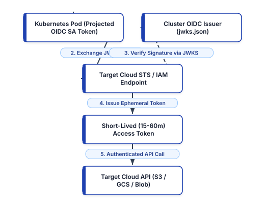


### How Cross-Cloud Workload Identity Federation Works

1. **Token Projection**: The Kubernetes kubelet automatically mounts a short-lived, auto-rotating OIDC ServiceAccount JWT into the pod at `/var/run/secrets/kubernetes.io/serviceaccount/token` with a specific `aud` (Audience) and `sub` (Subject: `system:serviceaccount:checkout-prod:analytics-exporter`).
2. **Cryptographic Token Exchange**: When the pod needs to write data to Google Cloud BigQuery from inside an AWS EKS cluster (or vice versa), the cloud SDK sends the Kubernetes JWT to the target cloud's Security Token Service (**AWS STS `AssumeRoleWithWebIdentity` / EKS Pod Identity**, **Google Cloud STS `Workload Identity Pool`**, or **Microsoft Entra ID Federated Identity Credentials**).
3. **JWKS Verification and Ephemeral Session Issuance**: The target cloud's STS verifies the JWT's cryptographic signature against the source cluster's public OIDC JWKS endpoint, checks that the `sub` and `aud` match the explicit trust policy, and returns a short-lived (15 to 60 minute) cloud access token. Zero static keys ever exist!

Below is an OpenTofu / Terraform configuration setting up **Google Cloud Workload Identity Federation** alongside **AWS EKS Pod Identity** (`aws_eks_pod_identity_association`) so a Kubernetes pod running in AWS EKS (`system:serviceaccount:checkout-prod:bigquery-sync`) can authenticate seamlessly to both AWS and Google Cloud with zero static secrets:

```hcl
# multi-cloud-workload-identity.tf
resource "aws_eks_pod_identity_association" "export" {
  cluster_name    = "prod-commerce-eks"
  namespace       = "checkout-prod"
  service_account = "bigquery-sync"
  role_arn        = aws_iam_role.s3_reader_role.arn
}

resource "google_iam_workload_identity_pool" "eks" {
  workload_identity_pool_id = "aws-eks-prod-pool"
  display_name              = "AWS EKS Production Pool"
  description               = "Federation for EKS Pods"
}

resource "google_iam_workload_identity_pool_provider"
"eks_provider" {
  workload_identity_pool_id = (
    google_iam_workload_identity_pool.eks
    .workload_identity_pool_id
  )
  workload_identity_pool_provider_id = "eks-us-east-1"

  attribute_mapping = {
    "google.subject"      = "assertion.sub"
    "attribute.namespace" = (
      "assertion['kubernetes.io']['namespace']"
    )
  }

  # Restrict admission strictly to checkout-prod SA
  attribute_condition = (
    "assertion.sub == 'system:serviceaccount:"
    "checkout-prod:bigquery-sync'"
  )

  oidc {
    issuer_uri = var.eks_oidc_issuer_url
    allowed_audiences = [
      "sts.googleapis.com",
    ]
  }
}

resource "google_service_account_iam_member" "bind" {
  service_account_id = (
    google_service_account.bq_writer.name
  )
  role = "roles/iam.workloadIdentityUser"
  member = (
    "principal://iam.googleapis.com/"
    "${google_iam_workload_identity_pool.eks.name}/"
    "subject/system:serviceaccount:"
    "checkout-prod:bigquery-sync"
  )
}
```

### Microsoft Azure Workload Identity Federation (`azurerm_federated_identity_credential`)

Similarly, when workloads running in AWS EKS or Google GKE need to authenticate to Microsoft Azure (such as Azure Key Vault, Azure OpenAI Service, or Azure Cosmos DB), Microsoft Entra ID (formerly Azure AD) supports **Federated Identity Credentials** attached to a User-Assigned Managed Identity. The pod presents its projected Kubernetes OIDC JWT, and Entra ID exchanges it for an Azure AD access token without a single client secret or certificate:

```hcl
# azure-federated-identity-from-eks.tf
resource "azurerm_user_assigned_identity" "cosmos" {
  name                = "id-eks-checkout-cosmos-prod"
  resource_group_name = azurerm_resource_group.sec.name
  location            = "eastus2"
}

resource "azurerm_federated_identity_credential"
"eks_federation" {
  name                = "fed-eks-checkout-prod"
  resource_group_name = azurerm_resource_group.sec.name
  parent_id           = (
    azurerm_user_assigned_identity.cosmos.id
  )
  audience = ["api://AzureADTokenExchange"]
  issuer   = var.eks_oidc_issuer_url
  subject  = (
    "system:serviceaccount:checkout-prod:cosmos-writer"
  )
}
```

## Cloud-Native FinOps and Real-Time Kubernetes Cost Allocation with OpenCost

In a multi-tenant Kubernetes and multi-cloud environment, a single monthly cloud invoice from AWS, GCP, or Azure provides zero visibility into which engineering team, microservice, or customer tenant drove a $40,000 compute spike. **FinOps** is the operational framework and cultural practice that brings financial accountability to the variable spend model of cloud computing, enabling engineering and finance teams to collaborate on data-driven speed, cost, and quality trade-offs.

### Real-Time Pod and Namespace Cost Attribution with OpenCost

**OpenCost** (a vendor-neutral CNCF Sandbox/Incubating project specification backed by Kubecost and major cloud providers) runs inside each Kubernetes cluster, ingests real-time node billing rates (including Spot/Preemptible discounts, Reserved Instance / Savings Plan amortization, and cross-AZ egress fees) from AWS Cost and Usage Reports (CUR), GCP Billing Export, and Azure Cost Management APIs, and correlates them with Prometheus container resource metrics (`container_cpu_usage_seconds_total`, `kube_pod_container_resource_requests`).

Crucially, OpenCost distinguishes between three cost metrics for every container:

- **Usage Cost**: The cost of the actual CPU core-hours and RAM byte-hours consumed by the container.
- **Request (Allocated) Cost**: The cost of the CPU and memory *reserved* via `resources.requests` (even if the pod sits idle, Kubernetes cannot schedule other workloads onto those reserved resources).
- **Idle / Slack Cost ($\text{Allocated} - \text{Usage}$)**: The exact dollar waste caused by over-provisioned resource requests!

```yaml
# opencost-prometheus-alerts.yaml
apiVersion: monitoring.coreos.com/v1
kind: PrometheusRule
metadata:
  name: finops-opencost-efficiency-alerts
  namespace: opencost
spec:
  groups:
    - name: finops.allocation.efficiency
      interval: 5m
      rules:
        # Flag namespaces wasting >60% of requested CPU
        - alert: NamespaceHighCpuSlackWaste
          expr: |
            (
              sum by (namespace) (
                rate(container_cpu_usage_seconds_total{
                  container!=""
                }[24h])
              )
              /
              sum by (namespace) (
                kube_pod_container_resource_requests{
                  resource="cpu"
                }
              )
            ) < 0.40
          for: 24h
          labels:
            severity: warning
            category: finops
          annotations:
            summary: "Namespace CPU utilization < 40%"
```

By exposing OpenCost metrics (`container_cpu_allocation`, `node_total_hourly_cost`, `pv_hourly_cost`) directly in Prometheus and Grafana alongside RED and SLO panels, developers see **Cost per 1,000 Requests** (Unit Economics) right next to latency and error rate on every release.

## Production Multi-Cloud and FinOps Best Practices

1. **Standardize on Open Standards at the Infrastructure Layer**: Avoid proprietary cloud orchestration lock-in where open CNCF standards provide equivalent maturity. Use **Kubernetes** for container orchestration, **OpenTelemetry** for traces/metrics/logs, **Prometheus/OpenMetrics** for time-series alerting, **Gateway API** for ingress/mesh routing, **Dapr** for portable microservice building blocks, and **OpenTofu / Crossplane** for declarative provisioning.
2. **Beware the Hidden Tax of Cross-Cloud and Cross-AZ Data Egress**: While cloud providers allow free data *ingress*, cross-AZ data transfer costs $\$0.01\text{–}\$0.02/\text{GB}$ and internet/cross-cloud data *egress* costs $\$0.05\text{–}\$0.09/\text{GB}$. Never design an active-active microservice architecture where a stateless compute tier in Cloud A makes synchronous chatty SQL queries to a database in Cloud B across the public internet; keep compute and data gravity colocated within the same cloud region and use asynchronous event replication across clouds.
3. **Set CPU Requests Proportional to P95 Usage and Omit Hard CPU Limits**: In Kubernetes, setting artificially low `resources.limits.cpu` triggers aggressive Linux kernel CFS bandwidth throttling (`container_cpu_cfs_throttled_periods_total`) even when the underlying worker node has 70% idle CPU capacity—inflating $p_{99}$ latency while wasting paid node capacity. Right-size `requests.cpu` using OpenCost/VPA historical recommendations and enforce strict `requests.memory == limits.memory` (Guaranteed QoS) for latency-sensitive workloads to prevent OOM eviction unpredictability.
4. **Enforce Mandatory FinOps Cost Allocation Labels at Admission Time**: Require every Kubernetes namespace and cloud resource to carry `cost-center`, `team`, `service`, and `environment` labels enforced via OPA/Kyverno admission webhooks so 100% of cloud spend is attributable in OpenCost without unallocated "dark spend."

## Summary

Modern cloud-native engineering synthesizes the 15-Factor methodology, Dapr's portable distributed building blocks, and Crossplane/OpenTofu control planes to deliver resilient microservices without cloud SDK lock-in. By replacing static cross-cloud credentials with OIDC Workload Identity Federation across AWS, GCP, and Azure, and embedding OpenCost unit-economics telemetry directly into developer dashboards, organizations achieve multi-cloud agility, cryptographic security, and disciplined financial efficiency. In Chapter 17, we explore event-driven infrastructure automation, Karpenter just-in-time Kubernetes node autoscaling, automated database schema migrations, and self-healing control loops.


<div style="page-break-after: always;"></div>


# Chapter 17: Infrastructure Automation, Karpenter Autoscaling, and Self-Healing Orchestration

In first-generation cloud operations, "infrastructure automation" was synonymous with scheduled cron scripts or centralized SSH task runners (such as legacy Rundeck or Ansible playbooks executed manually from a bastion host) that mutated pet virtual machines in place. As modern cloud estates scale to thousands of ephemeral containers, microVMs, and multi-region data stores, human-initiated runbooks and polling-based autoscalers can no longer react fast enough to sudden traffic surges, hardware degradation, or security findings.

Modern infrastructure automation is **event-driven, intent-based, and self-healing**. Instead of waiting for a human operator to acknowledge a pager alert and run a remediation script, platform teams engineer closed-loop control planes that react to telemetry and cloud state-change events within milliseconds. In this chapter, we architect **Event-Driven Infrastructure Automation** pipelines combining **Amazon EventBridge**, **AWS Step Functions**, and **AWS Systems Manager (SSM) Automation**, replace slow legacy Kubernetes node-group autoscalers with **Karpenter Just-in-Time Node Provisioning** (`NodePool` and `EC2NodeClass` consolidation), eliminate schema-related deployment outages using declarative **Database Migration Automation** (**Atlas** and **Flyway** with the **Expand-and-Contract Pattern**), and build **Self-Healing Control Loops** that automatically isolate, drain, and remediate degraded infrastructure.


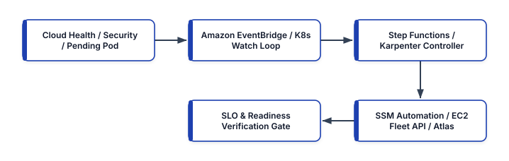


## Event-Driven Infrastructure Automation: EventBridge, Step Functions, and SSM Automation

Traditional infrastructure maintenance relied on periodic polling or manual intervention—for example, an engineer noticing a security group misconfiguration, an expiring TLS certificate, or an impaired EC2 hardware host and running an ad-hoc CLI script. Polling wastes API quota when nothing has changed and introduces minutes or hours of exposure when an incident occurs.

In an **Event-Driven Infrastructure Automation** architecture, every state transition in the cloud control plane emits a structured JSON event onto an **Amazon EventBridge** bus (via AWS CloudTrail API events, AWS Health events, Amazon GuardDuty security findings, or Amazon EBS/RDS lifecycle notifications). EventBridge evaluates low-latency declarative rules and triggers a durable **AWS Step Functions** state machine that orchestrates **AWS Systems Manager (SSM) Automation** runbooks, Kubernetes API hooks, and Slack/PagerDuty audit trails without opening a single inbound SSH port (`22`).

### Automated Self-Healing Workflow for Impaired Compute Nodes and Security Drift

Consider what happens when AWS detects underlying physical host hardware degradation (`AWS_EC2_INSTANCE_STORE_DRIVE_PERFORMANCE_DEGRADED` or `AWS_EC2_MAINTENANCE_SCHEDULED`) or when a disk volume approaches 90% capacity:

1. **Event Detection**: EventBridge matches the event payload and invokes an Automated Remediation Step Functions workflow.
2. **Pre-Flight Blast-Radius Check**: The workflow queries a DynamoDB lock table or Prometheus metric to confirm that fewer than 10% of fleet nodes have been auto-remediated in the last 15 minutes (a **Remediation Circuit Breaker** that prevents an automation bug from terminating the entire production fleet!).
3. **Graceful Workload Drain & Remediation**: Step Functions invokes an SSM Automation Document (`AWS-ConfigureK8sNodeDrain` or custom document) via the SSM Agent over an outbound HTTPS channel—cordoning the node, evicting pods while respecting `PodDisruptionBudget` (`PDB`) constraints, capturing an EBS forensic/diagnostic snapshot if needed, and replacing the underlying instance.
4. **Post-Remediation Verification**: The state machine verifies that replacement capacity is `Ready` and publishes a rich summary to the engineering team's incident channel.

```yaml
# eventbridge-to-sfn-remediation.yaml
AWSTemplateFormatVersion: "2010-09-09"
Description: Event-Driven Node Auto-Remediation Rule

Resources:
  ImpairedHostEventRule:
    Type: AWS::Events::Rule
    Properties:
      Name: detect-ec2-hardware-impairment
      State: ENABLED
      EventPattern:
        source:
          - aws.health
        detail-type:
          - AWS Health Event
        detail:
          service:
            - EC2
          eventTypeCategory:
            - issue
            - scheduledChange
      Targets:
        - Id: TriggerSelfHealingStateMachine
          Arn: !Ref NodeSelfHealingStateMachine
          RoleArn: !GetAtt EventBridgeInvokeRole.Arn
```

And the corresponding AWS Systems Manager (SSM) Automation document (`ssm-cordon-and-drain.yaml`) executes deterministically with zero SSH keys:

```yaml
# ssm-cordon-and-drain.yaml
schemaVersion: "0.3"
description: >-
  Gracefully cordon, drain, and recycle degraded K8s
  worker node via SSM RunCommand
assumeRole: "{{ AutomationAssumeRole }}"
parameters:
  InstanceId:
    type: String
  NodeName:
    type: String
  AutomationAssumeRole:
    type: String
mainSteps:
  - name: CordonAndDrainKubernetesNode
    action: aws:runCommand
    timeoutSeconds: 300
    onFailure: Abort
    inputs:
      DocumentName: AWS-RunShellScript
      InstanceIds:
        - "{{ InstanceId }}"
      Parameters:
        commands:
          - set -euo pipefail
          - >-
            kubectl cordon {{ NodeName }}
          - >-
            kubectl drain {{ NodeName }}
            --ignore-daemonsets
            --delete-emptydir-data
            --timeout=180s

  - name: TerminateDrainedInstance
    action: aws:changeInstanceState
    inputs:
      InstanceIds:
        - "{{ InstanceId }}"
      DesiredState: terminated
```

## Karpenter: Just-in-Time, Group-Less Kubernetes Node Autoscaling

For years, Kubernetes platform teams scaled worker nodes using the **Kubernetes Cluster Autoscaler (CAS)**. However, Cluster Autoscaler was architected around a rigid, legacy abstraction: **Cloud Provider Node Groups (AWS Auto Scaling Groups / Managed Node Groups)**. To handle diverse workloads (general-purpose microservices, memory-intensive Redis caches, Arm64 Graviton workers, and GPU inference pods), platform engineers had to pre-create dozens of separate Auto Scaling Groups, each pinned to fixed instance types and a single Availability Zone when persistent volumes (`EBS`) were involved. When pods became `Pending`, Cluster Autoscaler had to estimate which ASG might fit the pod, increment the ASG desired count, wait for the ASG controller to launch an instance, and wait 2–4 minutes before the kubelet registered.

### How Karpenter Eliminates Node Groups

Created at AWS and donated to the CNCF (`kubernetes-sigs/karpenter`), **Karpenter** eliminates Node Groups and Auto Scaling Groups entirely. Karpenter watches the Kubernetes API server directly for unschedulable (`Pending`) pods, evaluates all scheduling constraints in real time—including CPU/memory/GPU requests, `nodeSelector`, `nodeAffinity`, `topologySpreadConstraints`, taints/tolerations, and Availability Zone volume bindings—and calls the **EC2 Fleet API (`CreateFleet`) directly** to launch the single most cost-effective, right-sized instance (across hundreds of eligible On-Demand and Spot instance types) in **30 to 45 seconds**.


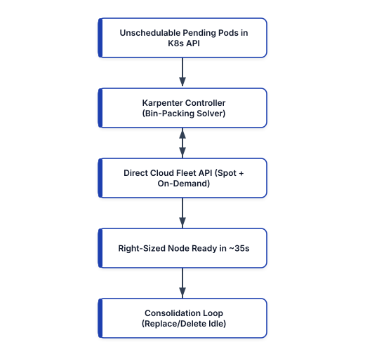


Even more importantly, Karpenter runs a continuous **Consolidation Control Loop** (`disruption.consolidationPolicy: WhenEmptyOrUnderutilized`):

- **Empty Node Deletion**: Immediately terminates nodes carrying zero non-DaemonSet workload pods.
- **Multi-Node-to-Single-Node Bin-Packing**: If traffic subsides and three `m7g.2xlarge` nodes are only 25% utilized, Karpenter automatically launches a single cheaper `m7g.xlarge` node, cordons and drains the three underutilized nodes while respecting `PodDisruptionBudgets`, and terminates the surplus capacity—cutting cluster EC2 spend by 30–50% automatically.

### Production Karpenter v1 `NodePool` and `EC2NodeClass` Configuration

Below is a production Karpenter v1 (`karpenter.sh/v1` and `karpenter.k8s.aws/v1`) configuration that provisions AWS Graviton (`arm64`) and `amd64` compute instances across both `spot` and `on-demand` capacity pools, enforces IMDSv2 hop limits for container security, and consolidates underutilized nodes after a 2-minute stabilization window:

```yaml
# karpenter-nodepool-and-nodeclass.yaml
apiVersion: karpenter.sh/v1
kind: NodePool
metadata:
  name: general-compute-pool
spec:
  template:
    spec:
      nodeClassRef:
        group: karpenter.k8s.aws
        kind: EC2NodeClass
        name: bottlerocket-default
      requirements:
        - key: kubernetes.io/arch
          operator: In
          values: ["arm64", "amd64"]
        - key: karpenter.sh/capacity-type
          operator: In
          values: ["spot", "on-demand"]
        - key: karpenter.k8s.aws/instance-category
          operator: In
          values: ["c", "m", "r"]
        - key: karpenter.k8s.aws/instance-generation
          operator: Gt
          values: ["6"]
      expireAfter: 336h
  limits:
    cpu: "2000"
    memory: 8000Gi
  disruption:
    consolidationPolicy: WhenEmptyOrUnderutilized
    consolidateAfter: 2m
    budgets:
      - nodes: "10%"
---
apiVersion: karpenter.k8s.aws/v1
kind: EC2NodeClass
metadata:
  name: bottlerocket-default
spec:
  amiSelectorTerms:
    - alias: bottlerocket@latest
  role: "KarpenterNodeRole-prod-eks"
  subnetSelectorTerms:
    - tags:
        karpenter.sh/discovery: "prod-eks"
  securityGroupSelectorTerms:
    - tags:
        karpenter.sh/discovery: "prod-eks"
  metadataOptions:
    httpEndpoint: enabled
    httpProtocolIPv6: disabled
    httpPutResponseHopLimit: 1
    httpTokens: required
  blockDeviceMappings:
    - deviceName: /dev/xvdb
      ebs:
        volumeSize: 100Gi
        volumeType: gp3
        encrypted: true
```

Notice `amiSelectorTerms: [{alias: bottlerocket@latest}]` and `expireAfter: 336h` (14 days): Karpenter automatically boots immutable, container-optimized **Bottlerocket Linux** nodes and gracefully recycles every node in the cluster at least once every 14 days, ensuring OS kernel security patches roll out continuously without manual maintenance windows!

### Pairing Karpenter with KEDA (Kubernetes Event-Driven Autoscaling)

While Karpenter scales **worker nodes** in response to `Pending` pods, something must first scale the **application pods** in response to incoming demand. The built-in Kubernetes `HorizontalPodAutoscaler` (HPA) traditionally relies on trailing indicators like CPU and memory utilization—which are useless for I/O-bound asynchronous consumers reading from Amazon SQS, Apache Kafka, or RabbitMQ, where a pod waiting on network I/O consumes only 15% CPU even while 500,000 messages pile up in the queue!

**KEDA (Kubernetes Event-Driven Autoscaling)**—a CNCF-graduated project—solves this by acting as a custom metrics adapter and event-driven controller with over 65 built-in **Scalers** (SQS, Kafka, Prometheus, Cron, PostgreSQL, Redis Streams). KEDA queries external event sources directly, scales deployments (including **scaling to zero** when queues are empty), and triggers Karpenter to launch right-sized nodes within seconds of a message burst:

```yaml
# keda-sqs-scaledobject.yaml
apiVersion: keda.sh/v1alpha1
kind: TriggerAuthentication
metadata:
  name: keda-aws-pod-identity
  namespace: checkout-prod
spec:
  podIdentity:
    provider: aws
---
apiVersion: keda.sh/v1alpha1
kind: ScaledObject
metadata:
  name: payment-settlement-worker-scaler
  namespace: checkout-prod
spec:
  scaleTargetRef:
    apiVersion: apps/v1
    kind: Deployment
    name: payment-settlement-worker
  pollingInterval: 10
  cooldownPeriod: 120
  minReplicaCount: 2
  maxReplicaCount: 80
  triggers:
    - type: aws-sqs-queue
      authenticationRef:
        name: keda-aws-pod-identity
      metadata:
        queueURL: >-
          https://sqs.us-east-1.amazonaws.com/
          111122223333/prod-settlement-queue
        queueLength: "25"
        awsRegion: "us-east-1"
        scaleOnInFlight: "false"
```

With `queueLength: "25"`, as soon as 1,000 messages arrive in `prod-settlement-queue`, KEDA immediately scales `payment-settlement-worker` to $1000 / 25 = 40$ replicas, and Karpenter provisions a single high-density Graviton Spot instance via the EC2 Fleet API to run all 40 pods.

## Database Schema Migration Automation: Atlas, Flyway, and the Expand-and-Contract Pattern

Stateless containers can be rolled back in 5 seconds by shifting an `HTTPRoute` weight back to version `v1`, but **relational databases have state gravity**. If version `v2` of a microservice executes a destructive SQL migration (`ALTER TABLE users DROP COLUMN full_name;`) during startup, and `v2` subsequently crashes or fails its canary SLO check, rolling the application containers back to `v1` causes an immediate total outage because `v1` still queries the dropped `full_name` column!

### Zero-Downtime Schema Evolution via the Expand-and-Contract Pattern

To maintain 100% availability and instant rollback safety during live deployments, platform teams enforce the **Three-Phase Expand-and-Contract (Parallel Change) Pattern**:

1. **Phase 1 — Expand (Backward-Compatible Schema Addition)**: Run an automated database migration that only *adds* nullable columns (`given_name`, `family_name`), new tables, or concurrent indexes (`CREATE INDEX CONCURRENTLY`) without modifying or dropping existing columns required by application `v1`.
2. **Phase 2 — Dual-Write & Backfill Application Rollout**: Deploy application `v2`, which writes to *both* the old column (`full_name`) and the new columns (`given_name`, `family_name`), while a background job backfills historical rows. If `v2` needs to be rolled back to `v1` during this phase, `v1` continues working seamlessly!
3. **Phase 3 — Contract (Cleanup Migration)**: Once `v2` is running at 100% in production and all reads have migrated to the new columns, a subsequent release removes the legacy `full_name` references from code and executes the final `DROP COLUMN` migration.

```text
+-------------+------------------+------------------+
| Migration   | Allowed SQL      | Forbidden SQL    |
| Phase       | Operations       | (Breaks Rollback)|
+-------------+------------------+------------------+
| 1. Expand   | ADD COLUMN(NULL) | DROP COLUMN,     |
| (Pre-Deploy)| CREATE TABLE,    | RENAME COLUMN,   |
|             | CONCURRENT INDEX | NOT NULL no def  |
| 2. Rollout  | Backfill rows in | Full-table locks |
| Dual-Write  | small batches    | ACCESS EXCLUSIVE |
| 3. Contract | DROP unused old  | Dropping active  |
| (Cleanup)   | column or table  | columns in use   |
+-------------+------------------+------------------+
```

### Declarative Schema-as-Code and Destructive Change Linting with Atlas

While traditional migration tools like **Flyway** and **Liquibase** execute versioned SQL files (`V001__init.sql`, `V002__add_index.sql`), modern cloud-native teams increasingly pair versioned migrations with **Atlas (`arigaio/atlas`)** and the **Atlas Kubernetes Operator**. Atlas brings Terraform-like declarative state diffing and **automated SQL safety linting (`atlas migrate lint`)** to database schemas—automatically failing a pull request if a migration contains a table-locking index creation or a backward-incompatible column drop:

```hcl
# atlas.hcl (Database Schema Linting & Config)
lint {
  destructive {
    error = true
  }
  concurrent_index {
    error = true
  }
  data_depend {
    error = true
  }
}

env "production" {
  src = "file://schema/ledger.hcl"
  dev = "docker://postgres/16/dev?search_path=public"
  migration {
    dir = "file://migrations"
  }
}
```

And using the **Atlas Kubernetes Operator**, database schema migrations become a declarative Kubernetes custom resource (`AtlasMigration`) reconciled directly inside your Argo CD or Flux v2 GitOps pipeline (at Sync Wave `-1` prior to the application rollout):

```yaml
# k8s/atlas-migration-resource.yaml
apiVersion: db.atlasgo.io/v1alpha1
kind: AtlasMigration
metadata:
  name: ledger-db-schema-v14
  namespace: checkout-prod
  annotations:
    argocd.argoproj.io/sync-wave: "-1"
spec:
  urlFrom:
    secretKeyRef:
      name: ledger-db-conn-credentials
      key: database_url
  dir:
    configMapRef:
      name: ledger-migrations-cm
```

## Engineering Self-Healing Control Loops: Kubernetes Operators and Remediation Circuit Breakers

The ultimate evolution of infrastructure automation is encoding domain-specific operational knowledge directly into **Kubernetes Operators** (built with `controller-runtime` in Go or `Kopf` in Python) and **Node Problem Detector (NPD)** loops.

Every Kubernetes controller implements the canonical level-triggered reconciliation equation:

$$\text{Reconcile}(Key) : \text{Observe}(\text{Live}) \xrightarrow{\text{Compare}} \text{Diff}(\text{Desired}, \text{Live}) \xrightarrow{\text{Actuate}} \text{Converge}()$$

When engineering custom self-healing control loops or automated remediation workflows, platform engineers must enforce three safety invariants to prevent **automation-induced cascading failures**:

1. **Remediation Rate Limiting and Blast-Radius Caps**: Never allow a self-healing loop to reboot, drain, or replace more than $X\%$ (e.g., $10\%$) of a cluster or service fleet within a rolling 30-minute window. If a faulty kernel configuration or expired root certificate causes 100% of nodes to report unhealthy simultaneously, an unbounded self-healing controller will terminate the entire cluster.
2. **Respect `PodDisruptionBudgets` (PDBs) and Quorum State**: Before draining a node or restarting a stateful pod (such as an `etcd`, Kafka, or CockroachDB replica), the automation controller must use the Kubernetes **Eviction API (`policy/v1/Eviction`)** rather than raw `DELETE /pods`, ensuring the API server rejects the eviction if doing so would violate quorum or drop available replicas below `minAvailable`.
3. **Exponential Backoff with Full Jitter on Failed Remediations**: If an automated remediation action fails to restore health, exponentially back off subsequent attempts and escalate to the on-call engineer rather than thrashing cloud API rate limits in a tight retry loop.

### Implementing a Self-Healing Kubernetes Operator in Python with `Kopf`

To see how a level-triggered reconciliation loop with a safety circuit breaker works in practice, below is a custom Kubernetes Operator written using **Kopf (Kubernetes Operator Pythonic Framework)**. It watches a custom `RedisCacheCluster` resource every 60 seconds (`@kopf.timer`), checks cluster shard health, enforces a global circuit-breaker limit (`MAX_HEALS_PER_WINDOW = 2`), and triggers an automated pod eviction via the Kubernetes Eviction API if a shard becomes wedged:

```python
# operator/redis_healer_operator.py
import time
import kopf
import kubernetes.client as k8s

HEAL_HISTORY: list[float] = []
WINDOW_SECONDS = 900
MAX_HEALS_PER_WINDOW = 2


def can_execute_remediation() -> bool:
    now = time.time()
    recent = [
        ts for ts in HEAL_HISTORY
        if now - ts < WINDOW_SECONDS
    ]
    HEAL_HISTORY.clear()
    HEAL_HISTORY.extend(recent)
    return len(HEAL_HISTORY) < MAX_HEALS_PER_WINDOW


@kopf.timer(
    "platform.io",
    "v1alpha1",
    "rediscacheclusters",
    interval=60.0,
)
def reconcile_cluster_health(
    spec, name, namespace, logger, **kwargs
):
    core_v1 = k8s.CoreV1Api()
    pods = core_v1.list_namespaced_pod(
        namespace=namespace,
        label_selector=f"cluster={name}",
    )

    for pod in pods.items:
        pod_name = pod.metadata.name
        statuses = pod.status.container_statuses or []
        for st in statuses:
            if st.restart_count > 10 and not st.ready:
                if not can_execute_remediation():
                    logger.error(
                        "Circuit open! Skipping "
                        f"auto-eviction for {pod_name}"
                    )
                    return {"status": "CircuitOpen"}

                HEAL_HISTORY.append(time.time())
                eviction = k8s.V1Eviction(
                    metadata=k8s.V1ObjectMeta(
                        name=pod_name,
                        namespace=namespace,
                    )
                )
                # Respect PodDisruptionBudget via Evict
                core_v1.create_namespaced_pod_eviction(
                    name=pod_name,
                    namespace=namespace,
                    body=eviction,
                )
                logger.info(
                    f"Evicted degraded pod {pod_name}"
                )
    return {"status": "Healthy"}
```

## Production Infrastructure Automation Best Practices

1. **Design Every Automation Step to Be Strictly Idempotent**: An EventBridge rule, Step Functions task, or Kubernetes operator reconciliation loop can always be invoked multiple times for the same underlying event. Ensure every script and API call checks current state before mutating resources (`kubectl cordon`, `CREATE INDEX IF NOT EXISTS`, or conditional DynamoDB state locks) so duplicate executions are safe no-ops.
2. **Eliminate Inbound SSH (`Port 22`) and Bastion Hosts in Production**: Replace SSH key management and bastion jump-hosts with outbound agent channels such as **AWS Systems Manager (SSM) Session Manager / Run Command** or ephemeral debug containers (`kubectl debug`) gated by IAM OIDC authentication and full session logging to immutable S3/CloudWatch audit buckets.
3. **Define `PodDisruptionBudgets` (PDBs) for Every Production Service**: Both Karpenter node consolidation and automated SSM node-drain workflows rely on Kubernetes `PodDisruptionBudget` objects (`minAvailable: 80%` or `maxUnavailable: 1`) to know how many replicas can be safely evicted concurrently. Any production deployment lacking a `PDB` risks simultaneous pod termination during node consolidation.
4. **Decouple Schema Migrations from Application Container Entrypoints**: Never run `atlas migrate apply` or `flyway migrate` inside the `CMD` entrypoint of 50 horizontally scaling application pods starting simultaneously—doing so causes database lock contention and crash-loop cascades if a migration takes longer than the Kubernetes `startupProbe`. Always execute migrations as a dedicated, single-concurrency `PreSync` Kubernetes `Job` or `AtlasMigration` CRD before rolling out new application pods.

## Summary

Modern infrastructure automation replaces brittle cron jobs and manual SSH bastion playbooks with event-driven control planes and self-healing reconciliation loops. By wiring Amazon EventBridge, Step Functions, and SSM Automation to remediate cloud hardware impairments automatically, deploying Karpenter for 35-second group-less Kubernetes node provisioning and continuous cost consolidation, and enforcing zero-downtime Expand-and-Contract database migrations with Atlas, platform teams eliminate operational toil while hardening system resilience. In Chapter 18, we examine what happens when novel, unforeseen failure modes exceed automated recovery: Incident Management, the Incident Command System (ICS), Blameless Postmortems, and On-Call engineering.


<div style="page-break-after: always;"></div>


# Chapter 18: Incident Management, On-Call Engineering, and Blameless Postmortems

Even in systems fortified with multi-AZ redundancy, progressive canary delivery, and automated self-healing loops, complex distributed architectures inevitably experience novel failure modes. Emergent interactions between retry budgets, BGP routing changes, database query planner shifts, and third-party SaaS brownouts guarantee that **failure is a normal property of large-scale socio-technical systems**. What separates high-performing engineering organizations from fragile ones is not the mythical absence of incidents, but how rapidly, systematically, and humanely they detect, coordinate, mitigate, and learn from production disruptions.

Legacy ITIL incident processes often relied on slow ticket queues, multi-tier L1/L2/L3 escalation handoffs, and punitive "root cause" finger-pointing that incentivized engineers to hide near-misses. Modern Site Reliability Engineering (SRE) replaces bureaucratic ticket routing with **You Build It, You Run It** on-call ownership, the **Incident Command System (ICS)**, **PagerDuty / Grafana OnCall** schedule-as-code automation, **Automated Triage Runbooks** that attach real-time diagnostic telemetry before a human responder even opens their laptop, proactive **GameDays**, rigorous **Blameless Postmortems** (Correction of Errors / COE), and continuous **DORA & Reliability Metric Engineering** (**MTTD**, **MTTR**, **Change Failure Rate**, and **Deployment Frequency**).


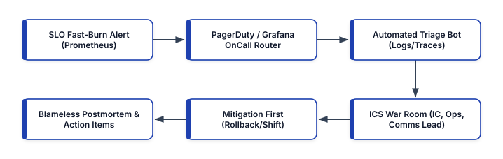


## The Anatomy of a Modern Incident Lifecycle and DORA Metrics

To engineer faster incident recovery without burning out on-call responders, platform teams decompose every incident timeline into four measurable intervals linked directly to the **DORA (DevOps Research and Assessment)** operational stability metrics:

1. **Time to Detect ($\text{TTD}$ / $\text{MTTD}$)**: The elapsed time between the onset of customer-impacting failure ($t_0$) and the moment an automated SLO fast-burn alert pages the primary on-call responder ($t_{\text{alert}}$). High-performing teams keep $\text{MTTD} < 3\text{ minutes}$ using multi-window SLO burn-rate alerts and synthetic blackbox probes.
2. **Time to Acknowledge & Triage ($\text{TTA}$)**: The elapsed time between the page firing ($t_{\text{alert}}$) and the responder acknowledging the incident, joining the incident channel, and identifying the affected failure domain ($t_{\text{triage}}$). Automated triage runbooks compress $\text{TTA}$ from 15 minutes down to under 2 minutes.
3. **Time to Mitigate / Restore ($\text{TTM}$ / $\text{MTTR}$)**: The elapsed time from incident start ($t_0$) to the restoration of customer-facing SLO compliance ($t_{\text{mitigated}}$). Crucially, **mitigation is not root-cause debugging**: during an active SEV-1 outage, responders prioritize immediate blast-radius containment—rolling back a canary deployment via Argo Rollouts, shifting Gateway API traffic away from an impaired region, disabling a feature flag via OpenFeature, or scaling up database read replicas—before investigating the underlying code bug.
4. **Change Failure Rate ($\text{CFR}$)**: The percentage of production deployments or infrastructure changes that result in degraded service or require an immediate rollback, hotfix, or patch. Elite organizations maintain $\text{CFR} \le 5\%$ with $\text{MTTR} < 1\text{ hour}$.

```text
+------------+----------------------+-----------------+
| Severity   | Customer & Business  | Response SLA &  |
| Level      | Impact Definition    | ICS Staffing    |
+------------+----------------------+-----------------+
| SEV-1      | Core checkout/ledger | Page < 2 min    |
| (Critical) | down; >14.4x SLO burn| Full ICS Bridge |
|            | or security breach   | + Exec Comms    |
| SEV-2      | Partial feature deg- | Page < 5 min    |
| (Major)    | radation; >6x burn   | IC + Ops Lead   |
| SEV-3      | Minor component bug; | Ticket / Slack  |
| (Minor)    | workaround active    | Business Hours  |
+------------+----------------------+-----------------+
```

## The Incident Command System (ICS): Coordinated Response Under Pressure

Adapted from the standardized emergency management framework originally developed to coordinate multi-agency wildfire responses, the **Incident Command System (ICS)** prevents the two most common failure modes of ad-hoc engineering war rooms: **diffusion of responsibility** (15 engineers talking over each other in a Slack channel while nobody executes a rollback) and **executive interruption** (senior leaders repeatedly asking responders *"What is the ETA?"* while those same responders are trying to read kernel logs).

In an ICS-structured incident response, responsibilities are explicitly separated into distinct roles that can scale up or down based on incident severity:


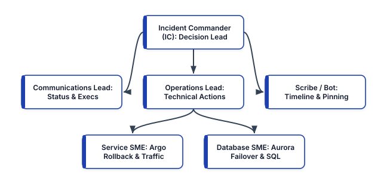


### Core Incident Command Roles

- **Incident Commander (IC)**: Holds single point of coordination and decision authority for the incident. **The IC does not write code or run terminal commands during a SEV-1.** Instead, the IC maintains the high-level mental model, assigns investigative tracks to Subject Matter Experts (SMEs), enforces time-boxed hypotheses (*"We will give database index tuning 5 minutes; if error rate is not below 0.5% by 14:20 UTC, we fail over to region B"*), and manages handoffs across shifts.
- **Operations Lead (OL)**: The technical lead who executes—or directs SMEs to execute—live changes to the production environment. Every mutation to production must be announced to the IC and Operations Lead before execution (*"Running `kubectl argo rollouts abort checkout-api` in `prod-us-east-1` now"*) to prevent two engineers from running conflicting commands simultaneously.
- **Communications Lead (CL)**: Shielding the technical responders from stakeholder interruptions, the Communications Lead posts structured updates at a predictable cadence (every 15 minutes for SEV-1, every 30 minutes for SEV-2) to internal executive channels, customer support desks, and the public Statuspage.
- **Scribe (and Automated ChatOps Bot)**: Captures key timestamps, Prometheus graph snapshots, hypotheses tested, and mitigation actions directly into the incident timeline document so the postmortem has an accurate forensic record.

## On-Call Engineering as Code: PagerDuty and Grafana OnCall

Manually managing on-call rotations, escalation delays, and alert routing rules in web dashboards leads to orphaned schedules when team members change roles or go on PTO. Modern SRE teams manage **On-Call Schedules, Escalation Policies, and Service Orchestrations as Code** using OpenTofu / Terraform with **PagerDuty** or **Grafana OnCall**.

### Humane On-Call Rotations and Follow-the-Sun Escalation Architecture

Sustainable on-call engineering treats responder sleep and cognitive health as a first-class reliability resource. Best-in-class on-call rotations enforce:

- **Follow-the-Sun Rotations (`12h` or `8h` Regional Hand-offs)**: When teams span North America, Europe (EMEA), and Asia-Pacific (APAC), daytime hours in Dublin and Singapore cover nighttime hours in San Francisco, eliminating 3:00 AM wake-up calls.
- **Primary + Secondary Shadow Escalation**: Every primary responder is backed by an automated 10-minute escalation to a secondary responder (and a 20-minute escalation to the Incident Commander rotation), ensuring a missed notification due to cell network dead zones never leaves an outage unstaffed.
- **Automated Alert Grouping and Noise Suppression**: High-urgency pages (`severity = critical`) are reserved strictly for **actionable, customer-impacting SLO burn alerts**. Non-actionable informational events or self-healed pod restarts are routed to asynchronous Slack channels or tickets.

Below is an OpenTofu / Terraform configuration defining a multi-tier **PagerDuty** escalation policy, schedule layer, and time-windowed event orchestration rule:

```hcl
# pagerduty-oncall-as-code.tf
terraform {
  required_providers {
    pagerduty = {
      source  = "PagerDuty/pagerduty"
      version = "~> 3.18"
    }
  }
}

resource "pagerduty_schedule" "checkout_primary" {
  name      = "Checkout Platform Primary On-Call"
  time_zone = "UTC"

  layer {
    name                   = "Weekly Primary Shift"
    start                  = "2026-01-01T09:00:00Z"
    rotation_virtual_start = "2026-01-01T09:00:00Z"
    rotation_turn_length_seconds = 604800
    users = [
      var.sre_engineer_1_id,
      var.sre_engineer_2_id,
      var.sre_engineer_3_id,
    ]
  }
}

resource "pagerduty_escalation_policy" "checkout_ep" {
  name      = "Checkout Tier-1 Escalation Policy"
  num_loops = 2

  rule {
    escalation_delay_in_minutes = 10
    target {
      type = "schedule_reference"
      id   = pagerduty_schedule.checkout_primary.id
    }
  }

  rule {
    escalation_delay_in_minutes = 15
    target {
      type = "schedule_reference"
      id   = var.incident_commander_schedule_id
    }
  }
}

resource "pagerduty_service" "checkout_tier1" {
  name                    = "Checkout API (Tier-1)"
  auto_resolve_timeout    = 14400
  acknowledgement_timeout = 600
  escalation_policy       = (
    pagerduty_escalation_policy.checkout_ep.id
  )
  alert_creation = "create_alerts_and_incidents"
}
```

### Cloud-Native Alert Routing with Grafana OnCall

For organizations standardized on the Grafana observability stack (Prometheus / Mimir, Loki, Tempo, and Pyroscope), **Grafana OnCall** provides native schedule-as-code integration directly linked to Alertmanager and Grafana Alerting rules, automatically creating dedicated Slack/Teams war rooms and attaching live panel snapshots whenever an escalation chain triggers:

```hcl
# grafana-oncall-routing.tf
resource "grafana_oncall_integration" "checkout_prom" {
  name = "Checkout Prometheus SLO Integration"
  type = "alertmanager"
  default_route {
    escalation_chain_id = (
      grafana_oncall_escalation_chain.tier1.id
    )
    slack {
      channel_id = var.sre_incidents_slack_channel_id
      enabled    = true
    }
  }
}

resource "grafana_oncall_escalation_chain" "tier1" {
  name = "Checkout Tier-1 Chain"
}

resource "grafana_oncall_escalation" "notify_primary" {
  escalation_chain_id = (
    grafana_oncall_escalation_chain.tier1.id
  )
  type          = "notify_on_call_from_schedule"
  position      = 0
  important     = true
  notify_on_call_from_schedule = (
    grafana_oncall_schedule.primary_rot.id
  )
}
```

## Automated Triage Runbooks: Compressing Time-to-Triage ($\text{TTA}$)

When an on-call engineer is paged at night, the first 10 minutes are typically spent executing the exact same mechanical diagnostic steps: checking which Git commit or Argo Rollout was deployed in the last 30 minutes, checking Kubernetes pod crash-loops and OOMKills (`LAST STATE: OOMKilled`), querying top 5xx error logs, and checking upstream dependency latency.

**Automated Triage Runbooks** execute these read-only diagnostic queries automatically the instant a PagerDuty or Grafana OnCall webhook fires, posting a structured **Incident Context Card** directly into the auto-created Slack incident war room before the responder even types a command!

Below is a production Python webhook triage responder that inspects recent Kubernetes rollout events, pod restart reasons (`OOMKilled` / `CrashLoopBackOff`), and recent deployment revisions for the alerting namespace:

```python
# automation/incident_triage_bot.py
import time
import kubernetes.client as k8s
import kubernetes.config as k8s_cfg


def collect_namespace_triage(namespace: str) -> dict:
    k8s_cfg.load_incluster_config()
    core = k8s.CoreV1Api()
    apps = k8s.AppsV1Api()

    degraded_pods = []
    pods = core.list_namespaced_pod(
        namespace=namespace
    )
    for pod in pods.items:
        for cs in pod.status.container_statuses or []:
            last_term = (
                cs.last_state.terminated
                if cs.last_state
                else None
            )
            reason = (
                last_term.reason
                if last_term
                else "None"
            )
            if cs.restart_count > 0 or not cs.ready:
                degraded_pods.append(
                    {
                        "pod": pod.metadata.name,
                        "ready": cs.ready,
                        "restarts": cs.restart_count,
                        "last_reason": reason,
                    }
                )

    recent_deploys = []
    deps = apps.list_namespaced_deployment(
        namespace=namespace
    )
    for dep in deps.items:
        rev = dep.metadata.annotations.get(
            "deployment.kubernetes.io/revision", "?"
        )
        img = (
            dep.spec.template.spec.containers[0].image
        )
        recent_deploys.append(
            {
                "deployment": dep.metadata.name,
                "revision": rev,
                "image": img,
            }
        )

    return {
        "timestamp_utc": time.strftime(
            "%Y-%m-%dT%H:%M:%SZ", time.gmtime()
        ),
        "namespace": namespace,
        "degraded_pods": degraded_pods[:10],
        "active_deployments": recent_deploys,
    }
```

When the responder joins `#inc-2026-1025-checkout-slo`, they immediately see that `checkout-api` revision `42` (`image: checkout:v2.9.1`) rolled out 4 minutes prior to the alert and 3 pods terminated with `last_reason: OOMKilled`—allowing the responder to execute an immediate rollback in 30 seconds.

## Proactive Operational Readiness: GameDays and Wheel of Misfortune Drills

A runbook or disaster recovery plan that has never been practiced by the live on-call team is a work of fiction. High-performing SRE organizations institutionalize two proactive training rituals:

1. **Wheel of Misfortune (Role-Play Drills for Onboarding Engineers)**: During a safe 45-minute team session, a new on-call engineer acts as the Incident Commander for a historical production outage scenario while a senior engineer acts as the "dungeon master" feeding real historical Prometheus graphs, log outputs, and console responses as the trainee queries them.
2. **Quarterly Live GameDays**: Scheduled, cross-team exercises where a designated Red Team injects a realistic failure (using AWS Fault Injection Service or Chaos Mesh in pre-production or canary production)—such as simulating a regional database failover, revoking an intermediate TLS certificate, or saturating a downstream payment partner API—while the active on-call rotation practices ICS roles, status page communications, and automated runbook execution under realistic conditions.

## Blameless Postmortems (Correction of Errors) and the Five Whys Beyond Human Error

Once an incident is mitigated and customer SLOs are restored, the most valuable phase of incident management begins: the **Blameless Postmortem** (referred to at Amazon as a **Correction of Errors — COE**).

### The Core Premise of Just Culture and Blameless Postmortems

Pioneered by Sidney Dekker (in aviation safety) and John Allspaw (in web operations), a **Blameless Postmortem** rests on a fundamental systems engineering truth: **human error is never the root cause of an incident; human error is a symptom of deeper systemic vulnerabilities in tools, guardrails, observability, or organizational incentives**.

If an engineer ran a script that accidentally deleted a production table, concluding *"Root Cause: Engineer X ran the wrong command; Action Item: Tell Engineer X to be more careful"* guarantees that six months later, **Engineer Y will make the exact same mistake**. Instead, a blameless investigation asks:
- *Why did the production database allow an unreviewed CLI session to execute an unguarded `DROP TABLE` without a role-separation policy?*
- *Why did the CLI tool lack an explicit environment confirmation prompt or dry-run diff?*
- *Why did automated point-in-time recovery take 45 minutes instead of 5 minutes?*

By assuming that the responder acted in good faith with the information and tools available to them at that moment, blameless postmortems incentivize engineers to surface every contributing factor honestly rather than hiding mistakes.

### Structured Blameless Postmortem Template (Markdown-as-Code)

Postmortems should be stored in version control, reviewed in a public engineering forum within 48–72 hours of any SEV-1/SEV-2 incident, and tracked via concrete Jira/GitHub engineering issues with assigned owners and SLO due dates:

```markdown
# Postmortem COE-2026-042: Checkout API Latency Spike

## 1. Executive Summary & Impact
- **Date / Duration**: 2026-10-24 (14:12 - 14:29 UTC,
  17 minutes total SLO impact)
- **SLO Budget Consumed**: 34% of 30-day 99.9% budget
- **Customer Impact**: 18,400 checkout requests failed
  with HTTP 504 Gateway Timeout.

## 2. Detection & Timeline (All Times UTC)
- **14:08**: Argo CD synced `checkout-api` v2.9.1.
- **14:12**: Connection pool exhaustion began on RDS.
- **14:14**: `CheckoutSLOFastBurnPage` fired (2m MTTD).
- **14:15**: Primary on-call acknowledged; Triage Bot
  identified v2.9.1 rollout correlation (TTA: 1m).
- **14:18**: IC ordered immediate Argo Rollout abort.
- **14:29**: Connection pool drained; SLO restored
  (MTTR: 17m).

## 3. Systemic Contributing Factors (Five Whys)
1. **Why did HTTP 504s occur?** Checkout pods blocked
   waiting for PostgreSQL connections.
2. **Why was the connection pool exhausted?** v2.9.1
   introduced an external webhook call *inside* an
   open SQL transaction block (`BEGIN ... COMMIT`).
3. **Why did unit/integration tests pass?** Mock
   webhooks returned in 2ms; in prod, partner API
   p99 was 1,800ms, holding DB locks 900x longer.
4. **Why did canary analysis not catch it earlier?**
   Canary step 1 lasted only 1m at 5% weight, which
   was insufficient to saturate the 200-conn pool.

## 4. Preventive Action Items (Tracked to Closure)
- **[P0 - Prevent]**: Add SQL transaction duration
  timeout (`idle_in_transaction_session_timeout = 2s`)
  in RDS parameter group (Owner: @db-team, Due: 10/28).
- **[P1 - Detect]**: Increase Argo Rollout Step 1
  soak window to 5m and add `pg_stat_activity` pool
  saturation metric to `AnalysisTemplate` (Due: 10/30).
```

## Production Incident Management and On-Call Best Practices

1. **Audit Pager Load Weekly ("Delete, Automate, or Downgrade")**: Track the exact number of pages per shift and conduct a weekly 15-minute **On-Call Handoff & Alert Review**. Following Google SRE guidelines, a healthy primary on-call shift should average fewer than **2 actionable pages per 12-hour shift**. Any alert that fired during the week and required zero human action ("flapping" or self-healing noise) must be immediately deleted, converted into an automated remediation workflow, or downgraded to a daytime ticket.
2. **Separate Mitigation from Root-Cause Investigation**: During an active outage, resist the temptation to attach a live debugger or inspect obscure code paths while customers are experiencing 5xx errors. Always ask: *"What changed in the last 60 minutes, and can we roll it back, shift traffic away, or disable a feature flag right now?"* Capture forensic artifacts (heap dumps, eBPF profiles, pod logs) asynchronously via your triage bot, restore customer service first, and investigate root causes during normal business hours.
3. **Enforce SLAs on Postmortem Action Items**: Writing a thorough Blameless Postmortem is pointless if its `P0` and `P1` corrective action items languish in the backlog while feature work takes priority. Assign an explicit engineering owner and a hard due date (e.g., 7 days for `P0` preventive guardrails, 30 days for `P1` items) to every postmortem action item, and review overdue reliability action items in executive engineering syncs.
4. **Compensate and Protect On-Call Engineers**: Sustainable reliability requires organizational commitment to responder wellbeing. Provide dedicated on-call stipends, automatic compensatory time off ("recovery mornings") whenever an engineer is paged during sleep hours, and a minimum rotation pool size of at least 6 to 8 engineers per primary schedule (combining related teams into shared rotations if individual squads are smaller).

## Summary

Resilient socio-technical systems depend on disciplined incident management and humane on-call engineering. By anchoring alerting to customer-facing SLOs, coordinating crisis response with the Incident Command System (ICS), codifying PagerDuty / Grafana OnCall rotations, automating diagnostic triage in seconds, practicing failure recovery through regular GameDays, and conducting rigorous Blameless Postmortems, engineering organizations continuously convert production disruptions into lasting architectural immunity. Together with the networking, serverless, IaC, observability, GitOps, testing, multi-cloud, and automation foundations covered across Chapters 10 through 17, these practices form the operational backbone of modern cloud-native engineering.


<div style="page-break-after: always;"></div>


# Chapter 19: Platform Engineering and Internal Developer Platforms (IDPs)

As organizations scale their cloud-native footprint from a handful of microservices to hundreds of distributed workloads across multiple Kubernetes clusters and cloud accounts, a structural bottleneck frequently emerges. The early DevOps mantra—"you build it, you run it"—was originally intended to dismantle the wall of confusion between application developers and systems operators. In practice, however, many engineering organizations misinterpreted this principle by expecting every product developer to become an expert in Terraform state locking, Amazon EKS IAM Roles for Service Accounts (IRSA), Helm chart templating, Prometheus scrape rules, OpenTelemetry collector configurations, and Kubernetes NetworkPolicies.

When every product team is forced to assemble its own cloud infrastructure and deployment pipelines from raw primitives, three systemic failure modes occur:

1. **Cognitive Overload and Context Switching**: Product engineers spend more than 40% of their sprint capacity debugging YAML indentation, cloud IAM permission boundaries, and CI/CD runner failures rather than shipping business features.
2. **Shadow Operations and Fragmented Standards**: Without a unified abstraction layer, five product teams will construct five incompatible Terraform module hierarchies and CI/CD workflows, creating a maintenance nightmare for security and Site Reliability Engineering (SRE) teams.
3. **Ticket-Driven Bottlenecks**: To regain control over security and cloud spend, infrastructure teams reintroduce manual approval gates and Jira ticket queues, inadvertently regressing to the exact pre-DevOps operational silos they sought to eliminate.

**Platform Engineering** resolves this tension by treating infrastructure, delivery pipelines, and operational guardrails as an internal **software product**. Rather than acting as a ticket-fulfillment back office, a dedicated Platform Engineering team designs, builds, and maintains an **Internal Developer Platform (IDP)**—a self-service layer of curated abstractions, automated APIs, and "Golden Paths" that empower application developers to provision compliant cloud resources and deploy workloads autonomously with minimal cognitive friction.


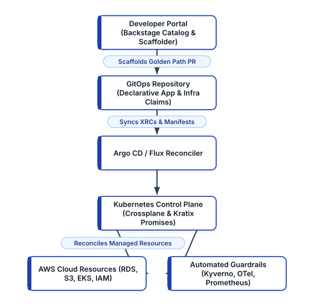


---

## Understanding Developer Cognitive Load and Team Topologies

To engineer an effective Internal Developer Platform, architects must first understand how human working memory interacts with complex distributed systems. Grounded in John Sweller's **Cognitive Load Theory** and popularized in software architecture by Matthew Skelton and Manual Pais in *Team Topologies*, developer cognitive load is divided into three distinct categories:

- **Intrinsic Cognitive Load**: The fundamental mental effort required to understand the core programming language, data structures, and algorithmic invariants of the task at hand (for example, writing thread-safe Python async handlers or designing an idempotent payment state machine).
- **Germane Cognitive Load**: The high-value mental capacity devoted to understanding the business domain, customer workflows, and domain-driven design boundaries (for example, modeling fraud detection rules or regional tax compliance).
- **Extraneous Cognitive Load**: The superfluous mental friction imposed by how the environment, tooling, and deployment mechanics are presented (for example, remembering which of fourteen AWS subnets is tagged for internal ALB ingress, or manually rotating a staging database credential in three separate secret stores).

The primary architectural objective of an Internal Developer Platform is **compressing extraneous cognitive load to near zero** so that engineering teams can allocate their finite working memory to germane business problems.

### Aligning Platform Teams with Team Topologies

An IDP succeeds only when paired with clear organizational interaction modes:

- **Stream-Aligned Teams**: Product engineering squads aligned to a single valuable stream of business work. They are the primary *customers* of the Internal Developer Platform.
- **Platform Team**: The product-minded infrastructure engineering group that builds and operates the IDP. They measure success through internal Net Promoter Score (NPS), Golden Path adoption rate, and time-to-first-deployment for new engineers.
- **Enabling Teams**: Specialist coaches (in security, observability, or performance engineering) who temporarily embed with stream-aligned teams to help them adopt platform capabilities and feed unmet requirements back into the Platform Team's roadmap.

---

## Designing Golden Paths and Paved Roads

A **Golden Path** (often called a **Paved Road**, a term pioneered by Netflix and Spotify) is an opinionated, step-by-step, automated workflow for accomplishing a recurring engineering task—such as launching a new Python FastAPI microservice, provisioning a production-ready PostgreSQL database with automated backups, or deploying an event-driven consumer backed by Amazon SQS.

Crucially, a Golden Path is **not a gilded cage**:

- **Opinionated by Default, Extensible by Exception**: For 90% of workloads that fit standard architectural patterns, the Golden Path provides a turnkey experience where security, observability, cost allocation tags, and high availability are pre-wired out of the box.
- **Escape Hatches for Specialized Workloads**: If a team is building a low-latency kernel-bypass trading engine or a custom GPU inference cluster that genuinely requires non-standard infrastructure, they are not blocked by the platform; however, stepping off the paved road means assuming explicit operational ownership of those custom primitives.
- **Lifecycle Day-2 Maintenance**: A true Golden Path does not stop at Day-1 repository scaffolding. If the platform team upgrades the base container image, patches a CVE in the OpenTelemetry sidecar, or migrates from Ingress to the Kubernetes Gateway API, Golden Path templates propagate those upgrades across downstream services via automated pull requests or versioned Crossplane compositions.

---

## Backstage: The Developer Portal and Software Catalog

Created at Spotify and donated to the Cloud Native Computing Foundation (CNCF) as an Incubating project, **Backstage** has become the industry-standard open-source framework for building unified developer portals. In a mature IDP architecture, Backstage serves as the single pane of glass over an organization's fragmented tooling ecosystem, anchored by three core pillars:

1. **The Software Catalog**: A centralized metadata graph that tracks ownership, lifecycle state (`experimental`, `production`, `deprecated`), dependencies, API contracts (OpenAPI, AsyncAPI, gRPC protobufs), and operational runbooks for every microservice, library, data pipeline, and cloud resource.
2. **Software Templates (Scaffolder)**: An extensible workflow orchestrator that turns Golden Paths into interactive self-service forms. When an engineer requests a new microservice, the Scaffolder renders Cookiecutter/Nunjucks templates, creates the GitHub repository, configures branch protection rules, registers the service in Argo CD, and adds it to the Software Catalog in under sixty seconds.
3. **TechDocs (Docs-like-Code)**: A built-in documentation pipeline that renders Markdown files stored directly alongside source code (`mkdocs.yml`) into a searchable, versioned engineering knowledge base.

### Defining a Backstage `catalog-info.yaml`Descriptor

Rather than maintaining stale spreadsheets or disconnected configuration management databases (CMDBs), Backstage follows a GitOps model where every repository declares its own metadata in a `catalog-info.yaml` file at the root of the codebase:

```yaml
# catalog-info.yaml
apiVersion: backstage.io/v1alpha1
kind: Component
metadata:
  name: checkout-payment-service
  description: Core PCI-compliant payment processor
  annotations:
    github.com/project-slug: acme-corp/checkout-svc
    backstage.io/techdocs-ref: dir:.
    argocd/app-name: checkout-payment-prod
    grafana/dashboard-selector: "app=checkout-svc"
    pagerduty.com/service-id: P9X8Y7Z
  tags:
    - python
    - fastapi
    - pci-tier-1
spec:
  type: service
  lifecycle: production
  owner: group:payments-stream-team
  system: commerce-checkout-platform
  providesApis:
    - payment-authorization-v2-api
  dependsOn:
    - resource:checkout-orders-postgres
    - component:fraud-scoring-engine
```

Notice how this single declarative manifest bridges organizational silos:

- **Ownership Clarity (`spec.owner`)**: During a 2:00 AM incident, on-call responders never have to guess which team owns `checkout-payment-service` or which PagerDuty escalation policy (`pagerduty.com/service-id`) applies.
- **Dependency Blast-Radius Mapping (`spec.dependsOn`)**: Because the service explicitly declares its dependency on `resource:checkout-orders-postgres` and `component:fraud-scoring-engine`, Backstage renders an interactive dependency graph showing upstream and downstream impact before a schema migration or maintenance window begins.

### Building a Self-Service Golden Path Scaffolder Template

To automate Day-1 service creation, platform engineers author a Backstage `Template` entity that prompts developers only for high-level domain parameters (`service_name`, `owner`, `database_tier`) while abstracting away the underlying Kubernetes and Terraform boilerplate:

```yaml
# golden-path-fastapi-template.yaml
apiVersion: backstage.io/v1beta3
kind: Template
metadata:
  name: python-fastapi-golden-path
  title: Production Python FastAPI Microservice
  description: >
    Scaffolds a hardened FastAPI service with OTel,
    Crossplane PostgreSQL claim, and Argo CD GitOps.
spec:
  owner: group:platform-engineering
  type: service
  parameters:
    - title: Service Identity & Ownership
      required:
        - component_id
        - owner
      properties:
        component_id:
          title: Service Name
          type: string
          pattern: "^[a-z0-9-]+$"
        owner:
          title: Owning Squad
          type: string
          ui:field: OwnerPicker
        db_size:
          title: PostgreSQL Storage Tier
          type: string
          enum: ["small-20gb", "medium-100gb"]
          default: "small-20gb"
  steps:
    - id: render-skeleton
      name: Render Golden Path Skeleton
      action: fetch:template
      input:
        url: ./skeleton
        values:
          name: ${{ parameters.component_id }}
          owner: ${{ parameters.owner }}
          db_size: ${{ parameters.db_size }}
    - id: publish-github
      name: Create Hardened GitHub Repository
      action: publish:github
      input:
        repoUrl: github.com?owner=acme-corp&repo=${{
          parameters.component_id }}
        defaultBranch: main
        protectDefaultBranch: true
    - id: register-catalog
      name: Register in Software Catalog
      action: catalog:register
      input:
        repoContentsUrl: >-
          ${{ steps['publish-github']
          .output.repoContentsUrl }}
        catalogInfoPath: "/catalog-info.yaml"
```

---

## Crossplane: Kubernetes-Native Cloud Control Planes

While Backstage solves the user interface and Day-1 scaffolding layer of an IDP, a critical question remains: *how should the platform provision and reconcile cloud infrastructure (such as Amazon RDS databases, S3 buckets, ElastiCache clusters, and IAM roles) alongside Kubernetes workloads?*

Traditional Infrastructure as Code tools like Terraform and AWS CDK excel at batch-oriented, CLI-driven execution, but they run only when triggered by a human or a CI job. If a someone manually modifies a security group in the AWS Console between CI runs, Terraform does not automatically heal the drift unless scheduled polling is bolted on. Furthermore, exposing raw Terraform modules to hundreds of application developers requires managing state file access, provider credentials, and HCL version compatibility across dozens of repositories.

**Crossplane** (a CNCF Graduated project) transforms a Kubernetes cluster into a **universal, continuous control plane** for any cloud provider API. By extending the Kubernetes API with Custom Resource Definitions (CRDs) and continuous reconciliation controllers, Crossplane enables platform teams to define **Cloud APIs as Kubernetes abstractions** using four core building blocks:

1. **Providers (`Provider-AWS`, `Provider-GCP`, `Provider-Azure`)**: Controllers running inside the platform cluster that know how to talk to external cloud APIs and expose low-level **Managed Resources** (such as `rds.aws.upbound.io/v1beta1/Instance` or `s3.aws.upbound.io/v1beta1/Bucket`).
2. **Composite Resource Definitions (`XRD`)**: The schema defined by the Platform Engineering team that specifies the simplified, high-level API contract exposed to application developers (for example, `XPostgreSQLInstance` requiring only `storageGB` and `engineVersion`).
3. **Compositions (`Composition`)**: The platform-owned implementation blueprint that maps a single developer-facing `XRD` into multiple underlying cloud Managed Resources (for example, an RDS instance, a KMS encryption key, a private DB subnet group, a security group, and an automated Kubernetes `Secret` containing the connection string).
4. **Claims (`CompositeResourceClaim` / `XRC`)**: The lightweight, namespace-scoped manifest that an application developer commits to their GitOps repository alongside their Kubernetes `Deployment` to request infrastructure.

### Step 1: Defining the Platform Contract with a Crossplane `XRD`

Suppose the Platform Engineering team wants to let product teams provision encrypted, multi-AZ PostgreSQL databases on AWS without ever touching VPC subnet IDs, KMS key policies, or parameter groups. First, the platform team defines a `CompositeResourceDefinition`:

```yaml
# xrd-postgresql.yaml
apiVersion: apiextensions.crossplane.io/v1
kind: CompositeResourceDefinition
metadata:
  name: xpostgresqlinstances.platform.acme.io
spec:
  group: platform.acme.io
  names:
    kind: XPostgreSQLInstance
    plural: xpostgresqlinstances
  claimNames:
    kind: PostgreSQLInstance
    plural: postgresqlinstances
  versions:
    - name: v1alpha1
      served: true
      referenceable: true
      schema:
        openAPIV3Schema:
          type: object
          properties:
            spec:
              type: object
              required:
                - parameters
              properties:
                parameters:
                  type: object
                  required:
                    - storageGB
                    - tier
                  properties:
                    storageGB:
                      type: integer
                      minimum: 20
                      maximum: 1000
                    tier:
                      type: string
                      enum: ["dev", "staging", "prod"]
```

### Step 2: Encoding Security and Operational Guardrails in a `Composition`

Next, the platform team authors a `Composition` that translates that simple `PostgreSQLInstance` claim into a hardened AWS RDS instance with mandatory storage encryption, automated backups, and non-public accessibility:

```yaml
# composition-aws-postgresql.yaml
apiVersion: apiextensions.crossplane.io/v1
kind: Composition
metadata:
  name: aws-postgresql-hardened
  labels:
    provider: aws
    compliance: soc2-pci
spec:
  compositeTypeRef:
    apiVersion: platform.acme.io/v1alpha1
    kind: XPostgreSQLInstance
  resources:
    - name: rds-instance
      base:
        apiVersion: rds.aws.upbound.io/v1beta1
        kind: Instance
        spec:
          forProvider:
            region: us-east-1
            engine: postgres
            engineVersion: "16.3"
            instanceClass: db.t4g.medium
            storageEncrypted: true
            publiclyAccessible: false
            skipFinalSnapshot: true
            backupRetentionPeriod: 7
            autoMinorVersionUpgrade: true
          writeConnectionSecretToRef:
            namespace: crossplane-system
      patches:
        - type: FromCompositeFieldPath
          fromFieldPath: spec.parameters.storageGB
          toFieldPath: >-
            spec.forProvider.allocatedStorage
```

### Step 3: Self-Service Consumption by Product Developers

Now, when a product engineer on the Checkout team needs a database for their microservice, they do not open an infrastructure ticket or write 300 lines of Terraform. They simply commit a 14-line `PostgreSQLInstance` claim into their service's GitOps folder:

```yaml
# claim-checkout-db.yaml
apiVersion: platform.acme.io/v1alpha1
kind: PostgreSQLInstance
metadata:
  name: checkout-orders-db
  namespace: team-payments
spec:
  parameters:
    storageGB: 100
    tier: prod
  writeConnectionSecretToRef:
    name: checkout-db-conn
```

Within minutes, Argo CD syncs the claim into the cluster, Crossplane reconciles the underlying AWS RDS instance and KMS encryption configuration, and the database credentials automatically appear inside the `team-payments` namespace as the Kubernetes secret `checkout-db-conn`. Better still, because Crossplane runs an active Kubernetes reconciliation loop, if someone accidentally enables public access on the RDS instance in the AWS Console, Crossplane detects the drift within seconds and restores `publiclyAccessible: false` automatically.

---

## Multi-Cluster Platform Orchestration with Kratix Promises

While Crossplane excels at composing cloud provider resources, large enterprise platforms often need to orchestrate entire **multi-step, multi-cluster platform capabilities**—such as provisioning a dedicated SaaS tenant environment that requires a namespace in three regional workload clusters, a Vault secret engine path, a Kafka topic ACL, a Trivy vulnerability scan before deployment, and a Grafana dashboard.

**Kratix** is an open-source framework for building composable Internal Developer Platforms on Kubernetes using the concept of **Promises**. A Kratix `Promise` encapsulates both the **API contract** (CRD) and a **multi-stage container pipeline** that transforms a developer's resource request into declarative state scheduled across fleet destinations (via GitOps or S3 state stores):

- **Day-1 & Day-2 Workflows as Containers**: Inside a Kratix Promise, `workflows.resource.configure` runs a chain of standard OCI containers whenever a developer creates or updates a request. Because pipeline stages are standard containers (written in Python, Go, Bash, or OPA), platform engineers can test their platform logic using standard unit tests before publishing the Promise.
- **Composable Promises (Promises of Promises)**: A high-level `MicroserviceEnvironment` Promise can emit lower-level requests for a `CrossplanePostgreSQL` Promise, a `RedisCache` Promise, and a `CertManagerTLS` Promise, allowing platform capabilities to be stacked like Lego bricks.

---

## Measuring Platform Success: DORA and SPACE Metrics for IDPs

An Internal Developer Platform is an internal product, and like any software product, it will stagnate or over-engineer the wrong abstractions unless governed by quantitative telemetry and qualitative developer feedback. High-performing Platform Engineering organizations combine **DORA (DevOps Research and Assessment)** operational metrics with the **SPACE framework** (Satisfaction, Performance, Activity, Communication, Efficiency/Flow):

- **Time to First Production Commit (Onboarding Velocity)**: Measures the elapsed wall-clock time from when a newly hired engineer joins the organization to when their first scaffolded service or feature is running in production. World-class IDPs compress this from weeks to under 4 hours.
- **Self-Service Fulfillment Ratio**: The percentage of infrastructure and environment requests fulfilled 100% autonomously via Backstage and GitOps/Crossplane without human intervention from a platform or SRE engineer (target: `>= 92%`).
- **Golden Path Adoption Rate**: The percentage of active production services using platform-maintained templates and Crossplane compositions rather than bespoke, hand-rolled configurations (target: `>= 80%`).
- **Change Lead Time & Deployment Frequency (DORA)**: Tracks whether platform abstractions genuinely accelerate delivery from `git commit` to production rollout without inflating Change Failure Rate (CFR).
- **Developer Platform NPS (Satisfaction)**: Quarterly surveys measuring developer friction, documentation clarity, and cognitive load reduction across stream-aligned squads.

### Automating Platform Health and Adoption Audits in Python

Platform teams should continuously audit their Kubernetes control plane to track Golden Path compliance and detect unattached or failing Crossplane claims before developers open support requests. The following Python verification script queries cluster-wide platform claims and computes a real-time IDP health report:

```python
# ch19_idp_claim_auditor.py
import json
from dataclasses import dataclass
from typing import List


@dataclass
class PlatformClaimStatus:
    name: str
    namespace: str
    kind: str
    synced: bool
    ready: bool
    golden_path_version: str


def evaluate_idp_fleet(
    claims: List[PlatformClaimStatus],
    min_version: str = "v2.1",
) -> dict:
    total = len(claims)
    healthy = sum(
        1 for c in claims if c.synced and c.ready
    )
    compliant = sum(
        1
        for c in claims
        if c.golden_path_version >= min_version
    )
    drift_alerts = [
        f"{c.namespace}/{c.name}"
        for c in claims
        if not (c.synced and c.ready)
    ]
    return {
        "total_claims": total,
        "ready_ratio": round(
            healthy / max(total, 1), 3
        ),
        "golden_path_compliance": round(
            compliant / max(total, 1), 3
        ),
        "degraded_claims": drift_alerts,
    }


if __name__ == "__main__":
    sample = [
        PlatformClaimStatus(
            "checkout-db",
            "team-payments",
            "PostgreSQLInstance",
            True,
            True,
            "v2.2",
        ),
        PlatformClaimStatus(
            "legacy-cache",
            "team-catalog",
            "RedisCluster",
            True,
            False,
            "v1.9",
        ),
    ]
    res = evaluate_idp_fleet(sample)
    print(json.dumps(res, indent=2))
```

---

## Anti-Patterns to Avoid When Building an IDP

Even well-funded Platform Engineering initiatives can fail if they fall into common architectural traps:

1. **Building a "Portals-First" Facade Over Manual Ticket Queues**: Deploying Backstage as a shiny web UI where clicking "Create Database" simply opens a Jira ticket for an operations engineer to run Terraform manually next Tuesday is not Platform Engineering—it is ticket-queue theater. Always automate the underlying control plane (Crossplane, Kratix, Argo CD) first, then expose it through the portal.
2. **Mandating a One-Size-Fits-All Abstraction**: Attempting to wrap every single AWS service parameter into a proprietary YAML DSL inevitably creates a leaky abstraction that is harder to learn than the underlying cloud provider. Keep `XRD` schemas focused on the 5 to 8 parameters developers actually care about, and encode the rest as opinionated platform defaults in the `Composition`.
3. **Treating Platform Engineering as a Rebranding of Sysadmin Gatekeeping**: If the platform team does not conduct user research with application developers, publish release notes, maintain TechDocs, and measure internal adoption, stream-aligned teams will route around the platform.

---

## Operational Checklist: Internal Developer Platform Readiness

Use the following verification checklist when designing or auditing your organization's Internal Developer Platform:

- [ ] **Service Ownership & Catalog**: Every production microservice, data pipeline, and shared cloud resource is registered in Backstage (`catalog-info.yaml`) with an explicit owning team, PagerDuty escalation policy, and dependency graph.
- [ ] **Turnkey Golden Path Templates**: Developers can scaffold a production-ready service—complete with CI/CD workflows, OpenTelemetry instrumentation, non-root Dockerfile, and GitOps deployment manifests—in under 5 minutes via Backstage Scaffolder.
- [ ] **Declarative Cloud Control Plane**: Cloud resources (RDS, S3, Redis, queues) are provisioned via Crossplane `CompositeResourceDefinitions` (`XRDs`) and `Compositions` that enforce encryption at rest, private networking, and automated secret injection by default.
- [ ] **Continuous Drift Healing**: Infrastructure state is reconciled continuously by Kubernetes controllers (Argo CD / Flux + Crossplane) rather than one-shot imperative CLI invocations.
- [ ] **Cognitive Load & DORA Telemetry**: Platform engineering success is tracked quarterly using Time to First Production Commit, Self-Service Fulfillment Ratio (`>= 90%`), and developer satisfaction metrics.


<div style="page-break-after: always;"></div>


# Chapter 20: eBPF Cloud-Native Networking, Cilium, and Ambient Service Mesh

For the first decade of Kubernetes in production, cloud-native networking and service mesh architectures relied on two foundational Linux mechanisms: **iptables** (Netfilter) for packet routing and network policy enforcement, and **per-pod Envoy sidecar proxies** for mutual TLS (mTLS), Layer 7 traffic management, and distributed telemetry. While these primitives powered the initial wave of container adoption, they hit severe performance, scalability, and operational walls as enterprise clusters grew to thousands of nodes and tens of thousands of ephemeral pods.

Consider what happens inside a traditional `kube-proxy` + iptables Kubernetes cluster running 10,000 Services:

- **O(N) Rule Traversal Latency**: Linux `iptables` was designed twenty-five years ago as a static host firewall, not a high-churn service routing table. Because `iptables` evaluates chains sequentially (`O(N)` complexity), every single network packet traversing a node must step through thousands of rules, inflating tail latency (`p99`) and consuming significant kernel CPU cycles.
- **Slow Control Plane Updates**: Whenever a single pod scales up or terminates, `kube-proxy` must serialize, lock, and rewrite the *entire* multi-megabyte `iptables` ruleset across every node in the cluster, taking seconds or even minutes during burst autoscaling events.
- **IP-Address Fragility in Security Policies**: Traditional Layer 3/Layer 4 firewalls identify workloads by IP address. In Kubernetes, where pod IP addresses churn every few minutes during rolling updates and horizontal autoscaling, IP-based firewall rules become stale almost immediately.
- **The Sidecar Resource and Operational Tax**: First-generation service meshes (such as classic Istio or Linkerd) injected a dedicated proxy container alongside every single application pod. To intercept traffic, an `initContainer` rewrote pod `iptables` rules so every inbound and outbound packet traversed the TCP/IP stack four extra times (`App -> Host TCP -> Envoy Sidecar -> Wire -> Remote Envoy Sidecar -> Remote Host TCP -> Remote App`). Across a 2,000-pod cluster, sidecars routinely consumed 15–30% of total cluster CPU and memory while forcing application teams to restart pods whenever the service mesh proxy required a security patch.

**Extended Berkeley Packet Filter (eBPF)** has fundamentally revolutionized cloud-native networking, observability, and runtime security by moving packet processing, identity enforcement, and system-call inspection directly into **verified, sandboxed, Just-In-Time (JIT) compiled programs running inside the Linux kernel**.


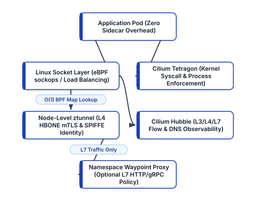


---

## How eBPF Works: Event-Driven Sandboxed Execution in the Linux Kernel

Historically, extending the behavior of the Linux kernel left engineers with two unappealing choices: either lobby upstream kernel maintainers for years to merge a new kernel feature, or maintain out-of-tree **Linux Kernel Modules (LKMs)** that could crash the entire host machine (`Kernel Panic`) if a single pointer dereference went awry.

**eBPF** introduces a safe, programmable execution engine directly inside the Linux kernel—analogous to how JavaScript and WebAssembly made web browsers dynamically programmable without recompiling the browser binary:

1. **Restricted C / Rust Source to eBPF Bytecode**: Engineers write event-driven eBPF programs in restricted C or Rust and compile them via `clang/LLVM` into architecture-independent eBPF bytecode.
2. **In-Kernel Static Verifier**: Before an eBPF program is allowed to attach to any kernel hook, the **Linux Kernel eBPF Verifier** performs exhaustive static analysis across every possible execution path. The verifier mathematically guarantees that the program:
   - Contains no unbounded loops (it must terminate in bounded time),
   - Never dereferences uninitialized or out-of-bounds memory pointers,
   - Never leaks kernel memory or crashes the host kernel, and
   - Stay within strict stack size limits.
3. **JIT Compilation to Native Machine Code**: Once approved by the verifier, the kernel's **Just-In-Time (JIT) compiler** translates the eBPF bytecode into native `x86_64` or `ARM64` machine instructions, achieving execution speed indistinguishable from compiled-in kernel code.
4. **Hook Attachment Points**: eBPF programs execute in response to kernel and user-space events, including:
   - **XDP (eXpress Data Path)**: Attaches directly inside the network interface card (NIC) driver *before* the Linux kernel even allocates a socket buffer (`sk_buff`), enabling line-rate DDoS mitigation and packet forwarding at tens of millions of packets per second.
   - **TC (Traffic Control Ingress/Egress)**: Intercepts packets at the kernel networking layer for container routing, NAT, and network policy enforcement.
   - **Socket Operations (`sockops` / `cgroup/connect4`)**: Intercepts `connect()`, `sendmsg()`, and `recvmsg()` system calls at the socket layer, allowing service-to-service load balancing and local-node socket splicing without traversing the TCP/IP stack below.
   - **Kernel Probes (`kprobes`), Tracepoints, and LSM Hooks**: Attaches to internal kernel functions (`sys_execve`, `tcp_connect`, `security_file_open`) for zero-overhead security enforcement and performance profiling.
5. **BPF Maps for High-Speed State Sharing**: eBPF programs store routing tables, connection tracking state, cryptographic identities, and metrics in **BPF Maps** (hash tables, ring buffers, and per-CPU arrays) that can be read and updated in `O(1)` constant time by both kernel eBPF programs and user-space control plane agents.

---

## Cilium CNI: Replacing `kube-proxy` and IP-Based Firewalls

**Cilium** (a CNCF Graduated project originally created by Isovalent, now part of Cisco) is an eBPF-native Container Network Interface (CNI) that replaces both legacy CNI plugins (such as Flannel or Calico iptables mode) and `kube-proxy` altogether.

### 1. `kube-proxy` Replacement via Socket-Level Load Balancing

When an application container calls `connect(10.96.0.15:80)` to reach a Kubernetes `ClusterIP` Service, Cilium does not let the packet travel down through the virtual Ethernet (`veth`) pair to be rewritten by thousands of `iptables` DNAT rules. Instead:

- Cilium attaches an eBPF program directly to the `connect()` system call at the Linux socket layer.
- It performs a single `O(1)` hash lookup in an eBPF map to translate the `ClusterIP` (`10.96.0.15:80`) directly into the healthy backend Pod IP (`10.244.3.42:8080`) before a single TCP SYN packet is even constructed.
- If the source pod and destination pod reside on the same worker node, Cilium uses `sockmap` to splice the two sockets together directly in kernel memory, completely bypassing the TCP/IP stack and Ethernet bridge.

### 2. Identity-Based Security (`CiliumIdentity`) vs. IP Filtering

Instead of writing fragile firewall rules tied to ephemeral pod IPs, Cilium assigns a cluster-wide cryptographic **Numeric Security Identity** (e.g., `Identity 14829`) to every group of pods sharing identical Kubernetes security labels (`app=checkout, env=prod, tier=backend`).

When Pod A sends a packet to Pod B, Cilium embeds Pod A's numeric security identity directly into the packet metadata (or VXLAN/Geneve encapsulation header). On the receiving node, an eBPF program performs an `O(1)` BPF map lookup (`Can Identity 14829 talk to Identity 29104 on port 8080 with HTTP GET /api/v1/orders?`) at line rate, regardless of whether the cluster has 10 pods or 100,000 pods.

### Authoring Layer 3–Layer 7 `CiliumNetworkPolicy` Manifests

Standard Kubernetes `NetworkPolicy` objects are restricted to Layer 3 and Layer 4 (IP CIDRs, namespaces, and TCP/UDP ports). They cannot express rules such as *"Allow `checkout-service` to call `GET /v1/inventory` on `catalog-service`, but block `DELETE /v1/inventory` and restrict external DNS egress strictly to `*.stripe.com`"*.

Cilium extends Kubernetes with the `CiliumNetworkPolicy` (and cluster-wide `CiliumClusterwideNetworkPolicy`) CRD, bringing **Layer 7 HTTP/gRPC/Kafka visibility** and **FQDN (DNS-aware) egress filtering** into declarative GitOps manifests:

```yaml
# cilium-l7-zero-trust-policy.yaml
apiVersion: "cilium.io/v2"
kind: CiliumNetworkPolicy
metadata:
  name: checkout-zero-trust-l7
  namespace: team-payments
spec:
  endpointSelector:
    matchLabels:
      app: checkout-service
      tier: backend
  ingress:
    - fromEndpoints:
        - matchLabels:
            app: api-gateway
      toPorts:
        - ports:
            - port: "8080"
              protocol: TCP
          rules:
            http:
              - method: "POST"
                path: "/api/v1/checkout"
              - method: "GET"
                path: "/healthz"
  egress:
    - toEndpoints:
        - matchLabels:
            io.kubernetes.pod.namespace: kube-system
            k8s-app: kube-dns
      toPorts:
        - ports:
            - port: "53"
              protocol: ANY
          rules:
            dns:
              - matchPattern: "*.stripe.com"
    - toFQDNs:
        - matchPattern: "api.stripe.com"
      toPorts:
        - ports:
            - port: "443"
              protocol: TCP
```

Look closely at how this `CiliumNetworkPolicy` hardens the workload:

- **L7 HTTP Method and Path Enforcement**: Even if `api-gateway` is compromised, it can only invoke `POST /api/v1/checkout` and `GET /healthz` on port `8080`. Any attempt to call `/admin/debug` or `DELETE` endpoints is rejected with `HTTP 403 Access Denied`.
- **DNS-Aware Egress (`toFQDNs`)**: By intercepting DNS responses in-band via eBPF (`dns.matchPattern: "*.stripe.com"`), Cilium dynamically maps the resolved IP addresses of `api.stripe.com` into the pod's allowed egress BPF map, blocking any data exfiltration to unauthorized external domains.

---

## Deep Network Observability with Cilium Hubble

In traditional Kubernetes clusters, debugging a dropped packet or intermittent `Connection Reset by Peer` error requires running `tcpdump` inside privileged debug containers or waiting minutes for VPC Flow Logs to aggregate in S3.

**Cilium Hubble** is the built-in observability layer that reads flow events directly from Cilium's in-kernel eBPF ring buffers (`perf` / BPF ringbuf) to provide real-time, zero-overhead visibility into every network connection, DNS lookup, HTTP status code, and policy verdict (`FORWARDED` vs. `DROPPED`):

```bash
# Observe dropped packets in team-payments in real time
hubble observe \
  --namespace team-payments \
  --verdict DROPPED \
  --follow

# Inspect Layer 7 HTTP 5xx errors in checkout-service
hubble observe \
  --pod team-payments/checkout-service \
  --protocol http \
  --http-status "5[0-9][0-9]"
```

Additionally, Hubble exports rich Prometheus metrics (`hubble_drop_total`, `hubble_http_requests_total`, `hubble_dns_queries_total`) labeled by Kubernetes workload identity rather than raw IP addresses, and provides an interactive **Hubble UI** service dependency map generated automatically from live kernel traffic.

---

## Kernel Runtime Security Enforcement with Cilium Tetragon

Network policies prevent unauthorized lateral movement between pods, but what happens if an attacker exploits a zero-day Remote Code Execution (RCE) vulnerability inside an allowed HTTP endpoint (`POST /api/v1/checkout`) and spawns `/bin/sh` or attempts to read `/var/run/secrets/kubernetes.io/serviceaccount/token`?

User-space security agents that monitor the Linux Audit subsystem (`auditd`) or asynchronous `ptrace` events suffer from a fatal flaw: **asynchronous TOCTOU (Time-of-Check to Time-of-Use) race conditions**. By the time an out-of-band detector notices that a container spawned `curl` to exfiltrate credentials and asks the Kubernetes API server to delete the pod, the credentials have already left the network.

**Cilium Tetragon** solves this by executing **synchronous in-kernel enforcement** via eBPF `TracingPolicy` CRDs. Because Tetragon attaches directly to Linux Security Module (LSM) hooks and kernel functions, it can inspect process lineage, file descriptors, Linux capabilities, and namespace boundaries *inside the system call context* and issue a `Sigkill` (`SIGKILL`) or `Override` (`-EPERM`) **before the malicious instruction completes**:

```yaml
# tetragon-block-shell-and-token-theft.yaml
apiVersion: cilium.io/v1alpha1
kind: TracingPolicyNamespaced
metadata:
  name: block-container-breakout-and-shells
  namespace: team-payments
spec:
  podSelector:
    matchLabels:
      app: checkout-service
  kprobes:
    - call: "security_bprm_check"
      syscall: false
      args:
        - index: 0
          type: "linux_binprm"
      selectors:
        - matchArgs:
            - index: 0
              operator: "Prefix"
              values:
                - "/bin/sh"
                - "/bin/bash"
                - "/usr/bin/curl"
                - "/usr/bin/nc"
          matchActions:
            - action: Sigkill
```

When `checkout-service` runs normally, Python processes HTTP requests and never invokes `security_bprm_check` for `/bin/sh` or `/usr/bin/curl`. If an exploit payload attempts to spawn a reverse shell, the kernel's `security_bprm_check` hook triggers Tetragon's eBPF program, which immediately terminates the offending process with `SIGKILL` in microseconds and emits a structured JSON security event containing the full process ancestry tree, Kubernetes Pod metadata, and binary SHA-256 digest.

---

## Sidecarless Service Mesh: Istio Ambient Mode and Cilium Mesh

As eBPF proved that Layer 3/Layer 4 networking and observability belong at the node/kernel level, the service mesh community re-architected how Layer 4 mutual TLS and Layer 7 traffic governance are delivered. Instead of injecting an Envoy sidecar container into every single pod, **Sidecarless Service Mesh** architectures—led by **Istio Ambient Mode** and **Cilium Service Mesh**—split the data plane into two distinct, decoupled layers:

### 1. The Secure Overlay Layer (L4 `ztunnel` DaemonSet)

In Istio Ambient Mode, every Kubernetes worker node runs a lightweight, shared, purpose-built Rust proxy called **ztunnel** (Zero-Trust Tunnel) as a node-level `DaemonSet`:

- **Zero Sidecar Injection**: Application pods run unmodified with a single container. Adding a namespace to the ambient mesh requires only a single label (`kubectl label namespace team-payments istio.io/dataplane-mode=ambient`) with **zero pod restarts**.
- **SPIFFE Cryptographic Identity & mTLS**: `ztunnel` automatically provisions X.509 workload certificates using the **SPIFFE** (Secure Production Identity Framework for Everyone) standard (`spiffe://cluster.local/ns/team-payments/sa/checkout-sa`) and encapsulates all inter-node traffic inside an HTTP CONNECT-based mTLS tunnel called **HBONE** (HTTP-Based Overlay Network Environment) on port `15008`.
- **90% Reduction in Mesh Memory Footprint**: Because a single Rust `ztunnel` instance handles L4 mTLS multiplexing and L4 `AuthorizationPolicy` enforcement for all pods on a node, organizations achieve full cluster-wide encryption-in-transit and cryptographic workload identity at a fraction of the CPU and RAM cost of per-pod Envoy sidecars.

### 2. The Layer 7 Processing Layer (On-Demand Waypoint Proxies)

Most microservices inside a cluster need mTLS encryption and L4 authorization, but only a subset require rich Layer 7 features such as HTTP header-based canary traffic splitting, gRPC retry budgets, fault injection, or OpenTelemetry L7 span generation.

In Ambient Mode, when a namespace or service needs Layer 7 governance, the platform deploys a **Waypoint Proxy**—an Envoy-based deployment scoped solely to that specific namespace or service account and managed via the standard **Kubernetes Gateway API**:

```yaml
# gateway-api-canary-httproute.yaml
apiVersion: gateway.networking.k8s.io/v1
kind: Gateway
metadata:
  name: payments-waypoint
  namespace: team-payments
  annotations:
    istio.io/for-service-account: checkout-sa
spec:
  gatewayClassName: istio-waypoint
  listeners:
    - name: mesh
      port: 15008
      protocol: HBONE
---
apiVersion: gateway.networking.k8s.io/v1
kind: HTTPRoute
metadata:
  name: checkout-canary-split
  namespace: team-payments
spec:
  parentRefs:
    - group: ""
      kind: Service
      name: checkout-service
      port: 8080
  rules:
    - matches:
        - headers:
            - name: x-canary-cohort
              value: "internal-beta"
      backendRefs:
        - name: checkout-service-v2
          port: 8080
    - backendRefs:
        - name: checkout-service-v1
          port: 8080
          weight: 90
        - name: checkout-service-v2
          port: 8080
          weight: 10
```

Notice the architectural elegance of combining **Kubernetes Gateway API** (`Gateway` and `HTTPRoute`) with **Ambient Mode**:

- **No Custom Vendor CRDs for Routing**: Unlike legacy `VirtualService` and `DestinationRule` manifests that locked routing configurations into a single vendor, `Gateway` and `HTTPRoute` are official, portable Kubernetes SIG-Network APIs supported uniformly across Cilium, Istio, Envoy Gateway, and cloud load balancers.
- **Blast-Radius Isolation**: Upgrading Envoy or tuning L7 filters affects only the isolated Waypoint deployment, never requiring a rolling restart of stateful or latency-sensitive application pods.

---

## Automating Zero-Trust Network Policy & Mesh Audits in Python

As clusters grow to hundreds of microservices, platform security engineers must continuously verify that no production namespace is accidentally left without a default-deny `CiliumNetworkPolicy` or excluded from `ambient` mTLS enrollment. Even a single unguarded namespace can serve as a lateral-movement staging ground if an external-facing pod is compromised.

The following Python verification script (`snippets/ch20_cilium_policy_validator.py`) inspects namespace labels and `CiliumNetworkPolicy` specifications to detect overly permissive wildcard rules (`0.0.0.0/0` egress without DNS FQDN restrictions) and missing sidecarless mesh enrollment:

```python
# ch20_cilium_policy_validator.py
import json
from dataclasses import dataclass
from typing import List


@dataclass
class NamespaceMeshAudit:
    namespace: str
    ambient_enabled: bool
    has_l7_cilium_policy: bool
    allows_wildcard_egress: bool
    tetragon_enforced: bool


def audit_zero_trust_posture(
    namespaces: List[NamespaceMeshAudit],
) -> dict:
    findings = []
    passed = 0
    for ns in namespaces:
        issues = []
        if not ns.ambient_enabled:
            issues.append(
                "Missing istio.io/dataplane-mode"
                "=ambient"
            )
        if not ns.has_l7_cilium_policy:
            issues.append(
                "Missing L7 CiliumNetworkPolicy"
            )
        if ns.allows_wildcard_egress:
            issues.append(
                "Unrestricted 0.0.0.0/0 egress allowed"
            )
        if not ns.tetragon_enforced:
            issues.append(
                "Missing Tetragon TracingPolicy"
            )
        if issues:
            findings.append(
                {
                    "namespace": ns.namespace,
                    "violations": issues,
                }
            )
        else:
            passed += 1
    return {
        "audited_namespaces": len(namespaces),
        "compliant_namespaces": passed,
        "non_compliant_findings": findings,
    }


if __name__ == "__main__":
    sample = [
        NamespaceMeshAudit(
            "team-payments", True, True, False, True
        ),
        NamespaceMeshAudit(
            "legacy-reporting",
            False,
            False,
            True,
            False,
        ),
    ]
    print(
        json.dumps(
            audit_zero_trust_posture(sample), indent=2
        )
    )
```

---

## Production Architecture Trade-Offs: SME vs. Enterprise eBPF Topologies

Choosing the right combination of Cilium, Hubble, Tetragon, and Ambient Service Mesh depends on your cluster scale, compliance requirements, and multi-cloud topology:

- **Lightweight SME Topology (2–50 Engineers, Single-Cluster EKS/GKE)**:
  - **Recommended Data Plane**: Managed Cilium CNI (such as GKE Dataplane V2 or AWS EKS with Cilium CNI) in `kube-proxy` replacement mode.
  - **East-West Encryption**: Enable Cilium's built-in **WireGuard transparent encryption** (`encryption.enabled=true, encryption.type=wireguard`). Because WireGuard runs directly inside the Linux kernel network stack and encrypts all node-to-node pod traffic automatically, lean SME teams get transparent encryption-in-transit without managing a full service mesh control plane.
  - **Observability & Runtime Security**: Enable Hubble Relay + Hubble UI for on-demand flow debugging and deploy a baseline cluster-wide Tetragon `TracingPolicy` blocking container namespace escapes and shell execution in internet-facing pods.
- **High-Assurance Regulated Enterprise Topology (Multi-Cluster / PCI-DSS / Zero-Trust)**:
  - **Recommended Data Plane**: Cilium CNI paired with **Cilium ClusterMesh** (or **Istio Ambient Mode** with `ztunnel` + Waypoint proxies) to enforce cryptographic **SPIFFE/SPIRE X.509 workload identity** at the per-ServiceAccount level across clusters and cloud regions.
  - **Granular L7 & DNS Policy Governance**: Enforce strict `CiliumNetworkPolicy` rules restricting east-west HTTP methods/paths (`rules.http`) and outbound FQDN resolution (`toFQDNs`), validated in CI/CD before Argo CD syncs changes.
  - **High-Volume Flow Archival**: Stream Hubble flow logs and Tetragon kernel security events via OpenTelemetry Collector into a SIEM or hot-warm-cold object storage tier for 365-day forensic auditability.

---

## Hands-On Synthesis Exercises

1. **Eliminating `kube-proxy` Bottlenecks (Analyze)**: A production Kubernetes cluster running 8,500 `ClusterIP` Services experiences 45-second delays between when a new pod passes its `readinessProbe` and when traffic actually reaches it, accompanied by high kernel `softirq` CPU usage on worker nodes. Explain the root cause in `iptables` sequential chain evaluation and detail how Cilium's eBPF `sockops` socket-level load balancing resolves both symptoms.
2. **Designing a Zero-Trust `CiliumNetworkPolicy` (Apply)**: Write a `CiliumNetworkPolicy` for an `order-processor` workload in namespace `commerce` that permits `POST /v2/orders` only from pods labeled `app=checkout-gateway`, denies all other HTTP methods and paths, and restricts external egress strictly to `api.sendgrid.com` on TCP port `443`.
3. **Synchronous vs. Asynchronous Runtime Defense (Evaluate)**: Compare an out-of-band container runtime security scanner polling Linux `auditd` logs every 3 seconds against a Cilium Tetragon `TracingPolicy` attached to `security_bprm_check` with `action: Sigkill`. Which architecture prevents single-packet credential exfiltration, and why?

---

## Operational Checklist: eBPF Networking & Ambient Mesh Hardening

Before promoting an eBPF CNI and sidecarless service mesh architecture to production, validate your cluster against the following engineering checklist:

- [ ] **Kernel & CNI Baseline**: Worker nodes run Linux Kernel `5.15+` (or `6.1+` LTS) with BPF Type Format (`BTF`) enabled and Cilium configured in `kubeProxyReplacement=true` mode for `O(1)` socket-level service load balancing.
- [ ] **Default-Deny Identity Network Policies**: Every production namespace enforces a baseline `CiliumNetworkPolicy` restricting ingress and egress strictly to explicitly authorized workload labels and DNS FQDNs (`toFQDNs`).
- [ ] **Real-Time Hubble Flow Telemetry**: Cilium Hubble is enabled with Prometheus metrics export (`hubble_drop_total`, `hubble_http_requests_total`) to alert on unexpected policy drops and anomalous DNS queries.
- [ ] **Synchronous Kernel Runtime Enforcement**: Cilium Tetragon `TracingPolicyNamespaced` policies guard high-value namespaces against unexpected shell execution (`/bin/sh`, `/bin/bash`), container namespace escape syscalls (`sys_unshare`, `sys_mount`), and service account token exfiltration.
- [ ] **Sidecarless Zero-Trust mTLS**: Namespaces are enrolled in Istio Ambient Mode (`istio.io/dataplane-mode=ambient`) or Cilium mutual authentication so 100% of east-west pod traffic is encrypted with SPIFFE workload identities via `ztunnel` without sidecar memory bloat.
- [ ] **Standardized Gateway API Routing**: North-south ingress and east-west L7 canary traffic splits use standard `gateway.networking.k8s.io/v1` (`Gateway` and `HTTPRoute`) manifests rather than deprecated `Ingress` annotations.


<div style="page-break-after: always;"></div>


# Chapter 21: OpenTelemetry Collector Pipelines, Continuous Profiling, and AI-Augmented SRE

In Chapters 8 and 13, we explored the foundational pillars of observability—metrics with Prometheus and Grafana, distributed tracing with Jaeger, and centralized logging with the ELK stack—alongside enterprise APM platforms. Yet as organizations scaled microservices across polyglot Kubernetes fleets, an acute operational problem emerged: **telemetry lock-in and signal fragmentation**.

Historically, collecting metrics, distributed traces, logs, and CPU profiles required installing three or four competing agents inside every container image and worker node: a Prometheus client library for metrics, a vendor-specific APM SDK for distributed traces, Fluent Bit or Logstash for logs, and a separate profiler agent for flame graphs. Worse still, because each signal was emitted by a different library with inconsistent metadata labels (`service_name` in traces vs. `app` in Prometheus vs. `k8s.pod.name` in logs), on-call Site Reliability Engineers (SREs) wasted precious incident triage minutes manually copying timestamps and guessing which log lines corresponded to a spiking latency trace.

Today, two transformative movements have redefined cloud-native observability and incident response:

1. **OpenTelemetry (OTel) and the Four Unified Signals**: Born from the merger of OpenTracing and OpenCensus and now the second highest-velocity project in the Cloud Native Computing Foundation (CNCF) after Kubernetes itself, **OpenTelemetry** provides a single, vendor-neutral standard for generating, correlating, transforming, and routing **Traces, Metrics, Logs, and Continuous Profiles** over the unified **OpenTelemetry Protocol (OTLP)**.
2. **AI-Augmented Site Reliability Engineering (AIOps & Agentic SRE)**: Armed with semantically correlated OTel telemetry streams, modern SRE teams pair deterministic **Service Level Objective (SLO) multi-window burn-rate alerts** with AI-augmented root-cause correlation engines that automatically join anomalous trace spans, Kubernetes change events, and continuous eBPF flame graphs to synthesize actionable incident hypotheses in seconds.


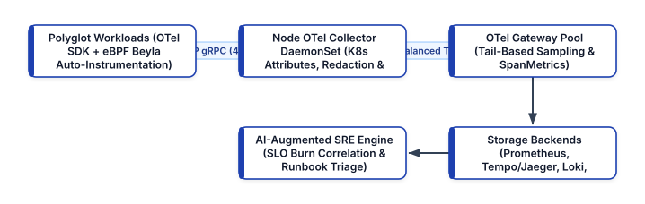


---

## The OpenTelemetry Reference Architecture: Correlating Traces, Metrics, Logs, and Profiles

The true power of OpenTelemetry lies not merely in replacing proprietary SDKs, but in enforcing **universal context propagation and semantic resource attribution** across every telemetry signal:

- **W3C `traceparent` Context Propagation**: Every inbound and outbound request carries a standardized W3C Trace Context header (`traceparent: 00-4bf92f3577b34da6a3ce929d0e0e4736-00f067aa0ba902b7-01`), binding distributed spans across HTTP, gRPC, Kafka, and SQS boundaries into a single causal Directed Acyclic Graph (DAG) identified by `trace_id` and `span_id`.
- **Log-to-Trace Correlation**: When an application logs an exception or warning while processing a request, the OpenTelemetry Logging Bridge automatically injects the active `trace_id`, `span_id`, and `trace_flags` into the structured JSON log record. In Grafana or any OTel-compatible UI, an engineer viewing a failed trace span can click directly into the exact log lines emitted during that specific millisecond on that specific pod.
- **Exemplars for Metric-to-Trace Jumping**: Traditional Prometheus histograms (`http_server_duration_seconds_bucket`) tell you *that* the 99th percentile latency spiked to 2.8 seconds, but not *which* customer request caused it. OpenTelemetry attaches **Exemplars**—sampled `trace_id` pointers embedded directly inside histogram bucket data points—allowing engineers to click a spike on a latency graph and jump straight to the exemplar distributed trace.
- **OpenTelemetry Semantic Conventions (`semconv`)**: OTel mandates standardized attribute names across all languages and runtimes (`service.name`, `service.version`, `deployment.environment`, `k8s.namespace.name`, `k8s.pod.name`, `http.request.method`, `db.system`, and `gen_ai.*` for AI workloads), ensuring dashboards and correlation queries work identically across Python, Go, Java, Rust, and Node.js services.

---

## Zero-Code Auto-Instrumentation with eBPF (Grafana Beyla & OTel eBPF)

One of the biggest practical hurdles in brownfield DevOps environments is instrumenting legacy or compiled services (such as C++, Go, or third-party binaries) where modifying source code to initialize an OpenTelemetry SDK and pass `context.Context` through every function signature would take months of refactoring.

By combining **eBPF uprobes and kprobes** with OpenTelemetry, tools such as **Grafana Beyla** (and the **OpenTelemetry eBPF Instrumentation** project) deliver **zero-code auto-instrumentation**:

- **Inspecting Runtime TLS and HTTP/gRPC Framing in Kernel/User-Space**: eBPF uprobes attach directly to `libssl.so` (`SSL_read` / `SSL_write`), Go `crypto/tls`, and kernel TCP socket calls, capturing cleartext HTTP/1.1, HTTP/2, gRPC, SQL, and Redis requests *before* encryption or *after* decryption without modifying a single line of application code or configuring MITM certificates.
- **Automatic RED Metrics and Distributed Spans**: Beyla automatically emits OpenTelemetry **RED metrics** (**R**ate, **E**rrors, **D**uration) and distributed trace spans over OTLP directly to the local OpenTelemetry Collector.

---

## Mastering the OpenTelemetry Collector Pipeline

In production Kubernetes clusters, applications should **never** send telemetry directly to external SaaS backends or storage databases. Instead, all telemetry flows through the **OpenTelemetry Collector**—a high-performance Go binary deployed in a two-tier topology:

1. **Tier 1: Node-Local Agent (`DaemonSet`)**: Runs on every worker node, receiving OTLP traffic over localhost/hostPort (`4317` gRPC / `4318` HTTP), enriching records with local Kubernetes pod metadata (`k8sattributes` processor), scrubbing sensitive PII (`transform` / `redaction` processor), protecting node memory (`memory_limiter`), and batching payloads.
2. **Tier 2: Centralized Collector Gateway (`Deployment`)**: A horizontally scaled pool of stateless collectors that receives trace spans routed deterministically by `trace_id` (via the `loadbalancing` exporter) to perform **Tail-Based Sampling** and **Span-to-Metrics (`spanmetrics`)** aggregation before exporting to permanent storage.

### Production-Hardened OpenTelemetry Collector Configuration

Below is a complete, production-ready OpenTelemetry Collector configuration demonstrating memory protection, Kubernetes metadata enrichment, PII attribute redaction, tail-based sampling, and multi-backend OTLP export:

```yaml
# otel-collector-gateway-config.yaml
receivers:
  otlp:
    protocols:
      grpc:
        endpoint: 0.0.0.0:4317
      http:
        endpoint: 0.0.0.0:4318

processors:
  memory_limiter:
    check_interval: 1s
    limit_percentage: 80
    spike_limit_percentage: 15

  k8sattributes:
    auth_type: "serviceAccount"
    extract:
      metadata:
        - k8s.namespace.name
        - k8s.deployment.name
        - k8s.pod.name
        - k8s.node.name

  attributes/redact_pii:
    actions:
      - key: http.request.header.authorization
        action: delete
      - key: db.statement
        action: hash

  tail_sampling:
    decision_wait: 10s
    num_traces: 50000
    expected_new_traces_per_sec: 1000
    policies:
      - name: keep-all-errors
        type: status_code
        status_code:
          status_codes: [ERROR]
      - name: keep-high-latency-p99
        type: latency
        latency:
          threshold_ms: 850
      - name: baseline-probabilistic-sample
        type: probabilistic
        probabilistic:
          sampling_percentage: 5.0

  batch:
    send_batch_size: 2048
    timeout: 2s

exporters:
  otlp/tempo:
    endpoint: tempo-distributor.observability:4317
    tls:
      insecure: false
  prometheusremotewrite:
    endpoint: http://mimir.obs:9009/api/v1/push

service:
  pipelines:
    traces:
      receivers: [otlp]
      processors:
        - memory_limiter
        - k8sattributes
        - attributes/redact_pii
        - tail_sampling
        - batch
      exporters: [otlp/tempo]
    metrics:
      receivers: [otlp]
      processors:
        - memory_limiter
        - k8sattributes
        - batch
      exporters: [prometheusremotewrite]
```

### Why Tail-Based Sampling Changes the Economics of Tracing

In **Head-Based Sampling**, the sampling decision is made at the very first ingress span before the request executes (for example, *"sample 1% of all incoming HTTP requests"*). If a catastrophic payment bug occurs on 0.05% of checkout requests, a 1% head-based sampler throws away **99% of your failure traces**, leaving engineers blind during postmortem investigations.

With **Tail-Based Sampling** in the OpenTelemetry Collector (`tail_sampling` processor above):

- The collector buffers spans belonging to a `trace_id` for a brief window (`decision_wait: 10s`).
- Once all spans in the trace arrive, the collector inspects the complete execution outcome:
  - Did **any** downstream microservice mark a span with `status_code: ERROR`? **Keep 100% of those traces.**
  - Did the end-to-end request duration exceed `850ms` (`keep-high-latency-p99`)? **Keep 100% of those slow traces.**
  - Was the request a fast, healthy `HTTP 200`? **Sample 5% (`baseline-probabilistic-sample`)** for baseline comparison while discarding 95% of repetitive healthy noise.
- Furthermore, by enabling the **SpanMetrics Connector** *before* the `tail_sampling` processor in the collector pipeline, you compute 100% accurate RED metrics (`calls_total`, `duration_milliseconds_bucket`) across **every single span**, then pay storage costs only for the high-value tail-sampled traces.

---

## The Fourth Pillar: Continuous Profiling with eBPF (Pyroscope & Parca)

Metrics tell you *when* CPU or memory spiked, traces tell you *which service endpoint* was slow, and logs tell you *what error message* was printed—but none of those three signals tell you **which exact line of code, regex evaluation, garbage-collection pause, or mutex lock contention** burned 90% of CPU cycles inside a specific container.

**Continuous Profiling** (standardized as OpenTelemetry's fourth signal alongside **Grafana Pyroscope** and **Parca**) uses Linux kernel `perf_event_open` eBPF stack-walking probes to sample call stacks across the entire Kubernetes node at 19Hz to 99Hz with **less than 1% CPU overhead**:

- **Always-On Production Flame Graphs**: Instead of trying to attach `py-spy` or `pprof` manually while a pod is crashing in production, continuous eBPF profiling records stack samples 24/7.
- **Span-Linked Profiles**: By linking OpenTelemetry `span_id` context into eBPF thread-local storage labels, engineers can highlight a slow 900ms database serialization span in Jaeger/Tempo and view the exact CPU flame graph executed during that single span.
- **FinOps Cost Reduction**: Continuous profiling routinely uncovers inefficient JSON serialization loops, unbuffered I/O calls, or cryptographic key re-initializations that account for 20–40% of total Kubernetes cluster CPU spend.

---

## SLO Multi-Window Burn-Rate Alerting vs. Naive Threshold Alerts

Before introducing AI into incident response, SRE teams must eliminate noisy, symptom-less threshold alerts (such as *"Page the on-call engineer whenever Pod CPU > 75% for 5 minutes"*). High CPU utilization on a batch worker is normal if user requests are succeeding within latency targets; conversely, a deadlock can cause 100% of checkout requests to time out while Pod CPU sits at 2%.

Modern SRE teams alert strictly on **Service Level Objective (SLO) Error Budget Burn Rate**:

- **Service Level Indicator (SLI)**: The quantitative ratio of good events to total valid events (for example, the proportion of `POST /api/v1/checkout` requests returning non-5xx responses in `< 400ms`).
- **Service Level Objective (SLO)**: The target reliability threshold over a rolling window (for example, `99.9%` over 28 days, leaving an **Error Budget** of `0.1%`, or `40.32 minutes` of permitted 100%-outage equivalent per 28 days).
- **Burn Rate**: How fast the service is consuming its 28-day error budget relative to a sustainable rate of `1.0x`. At a `14.4x` burn rate, the entire 28-day error budget will be exhausted in **48 hours** (`28 days / 14.4`).
- **Multi-Window, Multi-Burn-Rate Alerting**: Pioneered in the Google SRE Workbook, a page-worthy alert fires only when **both** a long window (e.g., 1 hour) **and** a short confirmation window (e.g., 5 minutes) exceed the critical burn-rate threshold (`14.4x`). The 5-minute window ensures the alert resets rapidly once the incident is mitigated, preventing false-positive pager fatigue after recovery.

---

## AI-Augmented SRE (AIOps): Automated Correlation and Triage

When a multi-window SLO burn-rate alert fires in a complex microservices mesh, dozens of downstream symptoms appear simultaneously: connection pools saturate, retry queues back up, and latency spikes across five upstream services.

**AI-Augmented SRE** uses structured OpenTelemetry graphs, deterministic anomaly scoring, and bounded Large Language Model (LLM) reasoning to compress **Mean Time to Detect (MTTD)** and **Mean Time to Resolve (MTTR)**:

1. **Automated Change-to-Telemetry Correlation**: Over 75% of production incidents are triggered by a recent deployment, feature-flag toggle, or infrastructure configuration change. When an SLO burn-rate spike is detected, the AI-SRE correlation pipeline automatically queries the OpenTelemetry `service.version` resource attributes, Argo CD sync history, and Kubernetes Event stream within a `[-30m, +5m]` window around the anomaly onset.
2. **Causal Trace Topology Traversal**: Rather than feeding raw gigabytes of logs into a prompt, a deterministic Python pre-processor walks the OpenTelemetry trace DAG from the ingress symptom down to the **deepest leaf span** exhibiting an elevated error rate or latency z-score.
3. **Human-in-the-Loop Safe Remediation**: While read-only diagnostic commands (`kubectl describe`, Hubble flow queries, Tempo trace lookups, git diff inspection) run autonomously to assemble an **Incident Triage Brief**, state-mutating remediations (`argocd app rollback`, traffic draining, pod scaling) require explicit one-click approval or deterministic policy verification.

### Implementing an SLO Burn-Rate & Root-Cause Correlator in Python

The following self-contained Python verification script (`snippets/ch21_slo_burn_correlator.py`) computes multi-window SLO burn rates and correlates error spikes against OpenTelemetry service deployments to pinpoint the root-cause release:

```python
# ch21_slo_burn_correlator.py
import json
from dataclasses import dataclass
from typing import List


@dataclass
class SpanWindowTelemetry:
    service: str
    version: str
    total_requests: int
    error_requests: int
    p99_ms: float
    deployed_minutes_ago: int


def analyze_slo_burn(
    windows: List[SpanWindowTelemetry],
    slo_target: float = 0.999,
) -> dict:
    error_budget = 1.0 - slo_target
    suspects = []
    for w in windows:
        err_rate = w.error_requests / max(
            w.total_requests, 1
        )
        burn_rate = round(err_rate / error_budget, 2)
        if burn_rate >= 14.4:
            score = burn_rate * (
                2.0
                if w.deployed_minutes_ago <= 30
                else 1.0
            )
            suspects.append(
                {
                    "service": w.service,
                    "version": w.version,
                    "burn_rate": burn_rate,
                    "p99_ms": w.p99_ms,
                    "recent_deploy": (
                        w.deployed_minutes_ago <= 30
                    ),
                    "rca_priority_score": round(
                        score, 2
                    ),
                }
            )
    suspects.sort(
        key=lambda x: x["rca_priority_score"],
        reverse=True,
    )
    return {
        "slo_target": slo_target,
        "page_oncall": len(suspects) > 0,
        "ranked_root_cause_candidates": suspects,
    }


if __name__ == "__main__":
    telemetry = [
        SpanWindowTelemetry(
            "api-gateway",
            "v1.4.0",
            10000,
            180,
            920.0,
            420,
        ),
        SpanWindowTelemetry(
            "payment-authorizer",
            "v2.8.1-rc3",
            2500,
            175,
            890.0,
            12,
        ),
    ]
    res = analyze_slo_burn(telemetry)
    print(json.dumps(res, indent=2))
```

Notice how `analyze_slo_burn` avoids attributing blame to `api-gateway` (which merely reflects downstream errors) and ranks `payment-authorizer` (`v2.8.1-rc3`, deployed 12 minutes ago with a `70.0x` error budget burn rate) as the primary root-cause candidate!

---

## Instrumented Python Microservice Example with OpenTelemetry SDK

While eBPF auto-instrumentation (Grafana Beyla) provides an immediate baseline for HTTP and gRPC transport spans, business-critical microservices should enrich active spans with **domain-specific attributes and span events** (such as `payment.currency`, `cart.item_count`, or `cache.hit`, while strictly excluding PII) so AI-SRE correlation engines can isolate tenant-specific or cohort-specific failures.

Below is a clean, self-contained Python OpenTelemetry instrumentation pattern demonstrating how to attach domain attributes and record structured exceptions on the current active span:

```python
# ch21_otel_domain_span_enrichment.py
import time
from dataclasses import dataclass
from typing import Dict


@dataclass
class SpanRecord:
    trace_id: str
    span_name: str
    attributes: Dict[str, object]
    status: str = "OK"
    duration_ms: float = 0.0


def process_checkout_with_telemetry(
    order_id: str,
    region: str,
    amount_cents: int,
) -> SpanRecord:
    start = time.monotonic()
    span = SpanRecord(
        trace_id="4bf92f3577b34da6a3ce929d0e0e4736",
        span_name="POST /api/v1/checkout",
        attributes={
            "service.name": "checkout-service",
            "deployment.environment": "production",
            "order.region": region,
            "order.amount_cents": amount_cents,
        },
    )
    try:
        if amount_cents <= 0:
            raise ValueError("Invalid order amount")
        span.attributes["payment.authorized"] = True
    except Exception as exc:
        span.status = "ERROR"
        span.attributes["exception.type"] = (
            type(exc).__name__
        )
        span.attributes["exception.message"] = str(exc)
    finally:
        span.duration_ms = round(
            (time.monotonic() - start) * 1000.0, 3
        )
    return span


if __name__ == "__main__":
    rec = process_checkout_with_telemetry(
        "ord-901", "eu-west-1", 4500
    )
    print(f"Span={rec.span_name} status={rec.status}")
```

---

## Controlling Observability FinOps: Cardinality & Telemetry Governance

One of the most expensive hidden failure modes in modern cloud-native operations is **metric cardinality explosion**. Unlike distributed trace spans and structured logs—which are indexed in columnar or object-storage backends designed for high-cardinality fields like `order_id` or `trace_id`—time-series metric databases (such as Prometheus, VictoriaMetrics, Amazon Managed Service for Prometheus, and Datadog Metrics) allocate a distinct time-series index in memory for **every unique combination of label key-value pairs**.

Consider what happens if a developer inadvertently adds `user_id` or `request_uuid` as a label on a Prometheus histogram with 12 latency buckets:

- Across `500,000` active daily users and `20` pods, a single metric generates `500,000 * 12 = 6,000,000` active time series, instantly exhausting Prometheus memory (`OOMKilled`) and inflating SaaS observability bills by tens of thousands of dollars per month.

To prevent cardinality explosions while preserving deep debuggability, enforce three architectural rules in your OpenTelemetry Collector pipeline:

1. **Keep High-Cardinality Identifiers in Traces and Logs, Never Metric Labels**: Store `user_id`, `tenant_id`, `order_id`, and `trace_id` as **OpenTelemetry Span Attributes** and **Metric Exemplars**, while restricting Prometheus metric labels strictly to bounded sets (`service.name`, `http.route`, `http.response.status_code`, `k8s.namespace.name`).
2. **Use `http.route` Templates Instead of Raw URL Paths**: Never label metrics with raw unparameterized URL paths (`/api/v1/orders/98412/invoice`), which create an unbounded number of time series. Always normalize routes to their low-cardinality template (`/api/v1/orders/{order_id}/invoice`) using the OTel HTTP instrumentation or the Collector's `transform` processor.
3. **Drop Unused Metrics & High-Volume Health-Check Spans at the Node Agent**: Use the OpenTelemetry Collector `filter` processor on the node `DaemonSet` to drop noisy `/healthz` and `/readyz` readiness probe spans before they ever consume network bandwidth or Gateway memory:

```yaml
# Drop synthetic kubelet healthcheck spans at the edge
processors:
  filter/drop_healthchecks:
    error_mode: ignore
    traces:
      span:
        - 'attributes["url.path"] == "/healthz"'
        - 'attributes["url.path"] == "/readyz"'
        - 'attributes["http.target"] == "/metrics"'
```

---

## Production Architecture Trade-Offs: SME vs. Enterprise Observability

- **Lightweight SME Observability Stack (Lean Cost, High Velocity)**:
  - **Collection**: Node-level OpenTelemetry Collector DaemonSet + Grafana Beyla eBPF auto-instrumentation for zero-code baseline spans and RED metrics.
  - **Storage & Visualization**: **Grafana LGTM Stack** (Loki for logs, Grafana for dashboards/SLO alerts, Tempo for object-storage-backed traces, Mimir/Prometheus for metrics, and Pyroscope for continuous profiles) running on object storage (Amazon S3 / GCS) with minimal local SSD state.
- **High-Scale Enterprise Observability Stack (Multi-Region, Petabyte Scale)**:
  - **Collection**: Two-tier OpenTelemetry Collector architecture (Node DaemonSets + Autoscaled Trace-ID-routed Gateway Pool) with `tail_sampling`, `spanmetrics` connector, and deterministic PII hashing.
  - **AI-Augmented SRE Integration**: Automated event-driven webhook from Alertmanager / PagerDuty into an read-only AI-SRE diagnostic service that correlates OTel `SpanMetrics`, Tempo error traces, Pyroscope CPU flame-graph diffs, and Argo CD commit diffs into the incident Slack channel within 15 seconds of alert firing.

---

## Hands-On Synthesis Exercises

1. **Head vs. Tail Sampling Economics (Evaluate)**: Your e-commerce platform processes 5,000 requests per second (`432,000,000` requests/day) with a `99.95%` success rate. Explain why a 1% head-based sampler fails to capture rare payment regressions, and calculate the daily trace storage reduction achieved by a tail-based sampling policy that keeps `100%` of errors, `100%` of requests slower than `1,000ms` (`0.2%` of traffic), and `2%` of normal healthy traffic.
2. **Defending Against Metric Cardinality Explosion (Analyze)**: An engineer proposes adding `customer_email` and `session_id` as labels on the `http_server_request_duration_seconds` Prometheus histogram so on-call engineers can see which customer experienced a slow request. Critique this proposal and explain how **OpenTelemetry Exemplars** achieve the exact same debugging goal with zero metric cardinality growth.
3. **Designing a Multi-Window SLO Alert (Apply)**: Calculate the 28-day error budget in minutes for a Tier-1 service with a `99.95%` availability SLO, and explain why combining a 1-hour burn-rate window with a 5-minute confirmation window (`14.4x` burn rate) prevents late-reset pager noise after an incident is resolved.

---

## Operational Checklist: OpenTelemetry & AI-Augmented SRE

Verify your observability pipeline and SRE alerting architecture against the following production checklist:

- [ ] **Unified OTLP Telemetry Standard**: All microservices emit traces, metrics, and structured logs using OpenTelemetry SDKs or eBPF auto-instrumentation (Beyla) with consistent `service.name`, `service.version`, and `deployment.environment` resource attributes.
- [ ] **Two-Tier Collector Architecture**: Node-local OTel Collector DaemonSets enforce `memory_limiter`, `k8sattributes` enrichment, and PII header redaction before forwarding to a trace-ID load-balanced Gateway tier.
- [ ] **Tail-Based Sampling + SpanMetrics**: The Collector Gateway computes 100% accurate RED metrics via `spanmetrics` and retains 100% of error traces and high-latency (`p99`) traces via `tail_sampling` while capping baseline storage costs.
- [ ] **Continuous eBPF Profiling**: Worker nodes run continuous eBPF stack profilers (Pyroscope / Parca) linked to OpenTelemetry span IDs with `< 1%` CPU overhead.
- [ ] **Multi-Window SLO Burn-Rate Alerting**: Pager notifications trigger only on confirmed multi-window error budget burn rates (`14.4x` over 1h/5m for critical pages), with automated root-cause correlation joining OTel traces against recent Argo CD / GitOps deployment events.


<div style="page-break-after: always;"></div>


# Chapter 22: Software Supply Chain Security with SLSA, Sigstore Cosign, and SBOM Attestations

In Chapters 4, 5, and 9, we established the foundations of Continuous Integration, Artifact Repositories, and DevSecOps pipeline scanning. However, a series of watershed software supply chain compromises—most notably **SolarWinds Orion** (where attackers injected malicious code directly inside a compromised build server after source code review), **Codecov** (where CI environment credentials were exfiltrated via a modified bash uploader), **Log4Shell (`CVE-2021-44228`)** (where deeply nested transitive dependencies hid vulnerable JNDI lookup code across thousands of enterprise containers), and the **XZ Utils (`CVE-2024-3094`)** backdoor—demonstrated that scanning source code in Git is no longer sufficient.

Modern cloud-native software is assembled from a complex global supply chain: a single Python or Go microservice container image typically pulls in 80 to 300 open-source packages, base OS layers, GitHub Actions workflow steps, and compiler toolchains. If an adversary compromises any link between the developer's `git commit` and the Kubernetes `kubelet` pulling the OCI container image—by poisoning a dependency, tampering with an ephemeral CI runner, or overwriting a mutable `:latest` image tag in Amazon ECR—traditional SAST and firewall controls will not stop the malicious workload from executing in production.

To defend against modern software supply chain attacks, cloud-native organizations enforce four cryptographic, verifiable controls across the artifact lifecycle:

1. **SLSA (Supply-chain Levels for Software Artifacts)**: The OpenSSF framework (originally derived from Google's internal Binary Authorization for Borg) that defines verifiable maturity levels (`SLSA Build L1` through `L3`) for build integrity and non-falsifiable in-toto provenance attestations.
2. **Keyless Cryptographic Signing with Sigstore (`Cosign`, `Fulcio`, and `Rekor`)**: Eliminating long-lived PGP/RSA private keys stored in CI secrets by binding ephemeral signing certificates to short-lived **OpenID Connect (OIDC)** workload identities and recording every signature in an immutable transparency log.
3. **Automated Software Bills of Materials (`SBOMs`) with CycloneDX and SPDX**: Generating machine-readable cryptographic inventories of every transitive package, license, and OS library inside every container image using **Syft** and **Trivy**, and attaching them as signed OCI attestations.
4. **Kubernetes Admission Verification with Kyverno / Policy-Controller**: Blocking any container image from starting in Amazon EKS or Kubernetes unless its immutable `@sha256` digest carries a valid Sigstore signature and a SLSA provenance attestation produced by an approved GitHub Actions or GitLab CI workflow.


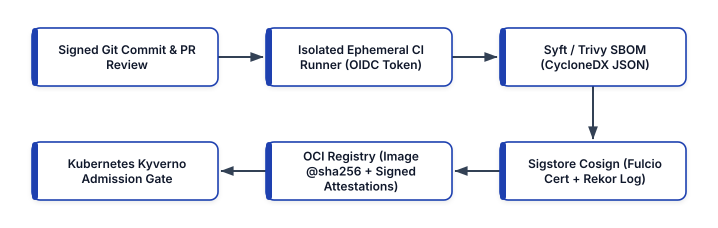


---

## Understanding the Software Supply Chain Threat Model (SLSA v1.0)

Every software supply chain contains eight distinct threat vectors—labeled **Threats A through H** in the Open Source Security Foundation (OpenSSF) **SLSA (Supply-chain Levels for Software Artifacts)** specification:

- **Source Threats (A–C)**: Submitting unauthorized code changes (Threat A), compromising the source control host (Threat B), or building from modified source code that differs from the reviewed Git commit (Threat C).
- **Build Threats (D–F)**: Compromising the CI/CD build platform (Threat D), injecting malicious build steps or tampered dependencies during compilation (Threat E), or bypassing the CI pipeline entirely to upload a hand-built artifact directly to the container registry (Threat F).
- **Package & Registry Threats (G–H)**: Compromising the artifact registry or overwriting a mutable tag like `v1.2.0` or `:latest` (Threat G), or tricking a production cluster into pulling an untrusted package via dependency confusion / typosquatting (Threat H).

### The SLSA Build Track Levels (`L1` to `L3`)

SLSA v1.0 organizes build integrity into three progressive, auditable levels:

- **SLSA Build Level 1 (Provenance Exists)**: The build process is fully scripted/automated and produces a machine-readable **provenance attestation** (`slsa.dev/provenance/v1` inside an `in-toto` statement) identifying what source commit was built, which workflow ran, and the exact SHA-256 digest of the resulting artifact. (Prevents manual laptop builds, though provenance is not yet cryptographically protected against a compromised CI job).
- **SLSA Build Level 2 (Hosted & Signed Provenance)**: The build runs on a dedicated hosted build service (such as GitHub Actions, GitLab CI, or Google Cloud Build) and the provenance is cryptographically signed by the build service so downstream consumers can verify its authenticity.
- **SLSA Build Level 3 (Hardened, Isolated Builds)**: The build executes inside an **ephemeral, isolated, single-tenant environment** where concurrent or sequential builds cannot influence one another or access the signing credentials used to generate provenance. Even if a developer's build script contains malicious code, it cannot forge the SLSA L3 provenance generated by the trusted build control plane.

---

## Keyless Artifact Signing with Sigstore: Cosign, Fulcio, and Rekor

Historically, signing container images (with tools like Docker Content Trust / Notary v1) failed to gain widespread DevOps adoption for one simple reason: **cryptographic key management is an operational nightmare**.

When teams generate a static RSA or ECDSA private key and store it as a CI secret (`COSIGN_PRIVATE_KEY`):

- Anyone with admin access to the CI project—or any malicious third-party CI plugin—can exfiltrate the private key.
- Rotating a compromised key invalidates previously signed images unless complex timestamp authorities and key-revocation lists are maintained.

**Sigstore** (a Linux Foundation / OpenSSF project) eliminates long-lived signing keys altogether by applying the same model that **Let's Encrypt** brought to HTTPS certificates—**Keyless OIDC Signing**:

1. **Ephemeral Key Pair Generation (`cosign`)**: During the CI build, `cosign` generates an in-memory, ephemeral ECDSA key pair whose private key is never written to disk and is destroyed the moment the build step finishes.
2. **Workload OIDC Identity Token**: `cosign` requests a short-lived, cryptographically signed **OpenID Connect (OIDC) JSON Web Token (JWT)** from the CI platform (for example, GitHub Actions' `https://token.actions.githubusercontent.com` issuer), which proves the exact repository (`acme-corp/checkout-svc`), workflow path (`.github/workflows/release.yml`), and Git ref (`refs/tags/v2.4.0`) currently executing.
3. **Short-Lived Code-Signing Certificate (`Fulcio`)**: `cosign` sends the public key and the OIDC token to **Fulcio** (Sigstore's free, root Certificate Authority). Fulcio verifies the OIDC JWT and issues an X.509 code-signing certificate valid for **only 10 minutes**, embedding the CI workflow identity directly into the certificate's Subject Alternative Name (SAN) extension.
4. **Immutable Transparency Log (`Rekor`)**: `cosign` signs the container image's `@sha256` digest with the ephemeral private key and records the signature, public key, and Fulcio certificate inside **Rekor**—an append-only, tamper-evident Merkle tree transparency log—receiving a signed inclusion timestamp.
5. **Verification Beyond Certificate Expiry**: When a Kubernetes cluster verifies the image months later, it does **not** need the 10-minute Fulcio certificate to still be unexpired! Instead, it verifies the cryptographic Rekor inclusion proof proving that the signature was created *during the 10-minute window* when the Fulcio certificate and OIDC identity were valid.

---

## Generating SBOMs and Attaching Signed OCI Attestations

An executive order (such as U.S. Executive Order 14028) and enterprise compliance frameworks (PCI-DSS v4.0, EU Cyber Resilience Act) mandate that organizations maintain an accurate **Software Bill of Materials (SBOM)** for every deployed software artifact.

An SBOM is a comprehensive, machine-readable inventory (in **OWASP CycloneDX** or **Linux Foundation SPDX** JSON format) listing every operating system package (`apk`, `deb`, `rpm`), language library (`pip`, `npm`, `go.mod`, `Cargo.lock`), version, cryptographic hash, and software license inside an image.

Rather than storing SBOM JSON files on a forgotten shared drive where they quickly drift out of sync with production containers, modern DevSecOps pipelines use **Syft** (or **Trivy**) to generate a CycloneDX SBOM and use `cosign attest` to attach the signed SBOM directly to the OCI image digest in the container registry!

### End-to-End GitHub Actions Workflow: Build, SBOM, Sign, and SLSA Attest

Here is a complete, production-hardened GitHub Actions workflow (wrapped to `<= 55` columns) that builds a container image by immutable digest, generates a CycloneDX SBOM, signs both the image and SBOM keylessly with Sigstore Cosign, and generates a verifiable SLSA v1.0 provenance attestation:

```yaml
# .github/workflows/slsa-supply-chain.yml
name: SLSA L3 & Sigstore Release Pipeline

on:
  push:
    tags: ["v*.*.*"]

permissions:
  contents: read
  packages: write
  id-token: write
  attestations: write

jobs:
  build-sign-attest:
    runs-on: ubuntu-latest
    steps:
      - name: Checkout Source Code
        uses: actions/checkout@v4

      - name: Install Cosign & Syft
        uses: sigstore/cosign-installer@v3.5.0

      - name: Login to GHCR OCI Registry
        uses: docker/login-action@v3
        with:
          registry: ghcr.io
          username: ${{ github.actor }}
          password: ${{ secrets.GITHUB_TOKEN }}

      - name: Build and Push by Digest
        id: build
        uses: docker/build-push-action@v6
        with:
          context: .
          push: true
          tags: ghcr.io/acme/checkout:${{
            github.ref_name }}

      - name: Keyless Cosign Image Signature
        env:
          DIGEST: ${{ steps.build.outputs.digest }}
          IMAGE: ghcr.io/acme/checkout
        run: |
          cosign sign --yes \
            "${IMAGE}@${DIGEST}"

      - name: Generate CycloneDX SBOM & Attest
        env:
          DIGEST: ${{ steps.build.outputs.digest }}
          IMAGE: ghcr.io/acme/checkout
        run: |
          syft "${IMAGE}@${DIGEST}" \
            -o cyclonedx-json=sbom.cdx.json
          cosign attest --yes \
            --predicate sbom.cdx.json \
            --type cyclonedx \
            "${IMAGE}@${DIGEST}"

      - name: Generate SLSA Build Provenance
        uses: actions/attest-build-provenance@v1
        with:
          subject-name: ghcr.io/acme/checkout
          subject-digest: ${{
            steps.build.outputs.digest }}
          push-to-registry: true
```

Look closely at three critical security details in this workflow:

1. **Least-Privilege `permissions` Block**: The job declares `id-token: write` (enabling GitHub's OIDC provider for Fulcio keyless signing) and `contents: read` (preventing the build job from pushing unauthorized commits back to the repository).
2. **Always Sign the `@sha256` Digest, Never the Mutable Tag**: Notice `cosign sign --yes "${IMAGE}@${DIGEST}"`. Tags like `v1.0.0` or `:latest` are mutable pointers; only the SHA-256 content-addressable digest uniquely identifies the exact binary layers.
3. **Bound In-Toto SBOM Attestation**: Running `cosign attest --predicate sbom.cdx.json --type cyclonedx` wraps the CycloneDX SBOM inside a signed DSSE (Dead Simple Signing Envelope) `in-toto` attestation and uploads it alongside the container image in the OCI registry.

### Verifying Signatures and Attestations from the CLI

Any engineer or automated gate can verify both the keyless signature and the embedded SBOM attestation in seconds using `cosign`:

```bash
# Verify keyless signature against OIDC identity
cosign verify \
  --certificate-identity-regexp \
    "https://github.com/acme/checkout/.*" \
  --certificate-oidc-issuer \
    "https://token.actions.githubusercontent.com" \
  ghcr.io/acme/checkout@sha256:4a8b9c...

# Verify signed CycloneDX SBOM attestation
cosign verify-attestation \
  --type cyclonedx \
  --certificate-identity-regexp \
    "https://github.com/acme/checkout/.*" \
  --certificate-oidc-issuer \
    "https://token.actions.githubusercontent.com" \
  ghcr.io/acme/checkout@sha256:4a8b9c...
```

---

## Enforcing Supply Chain Integrity in Kubernetes with Kyverno

Signing images and generating SLSA provenance in CI provides zero protection if an engineer (or an attacker with compromised `kubectl` credentials) can still run `kubectl run rogue --image=docker.io/attacker/cryptominer:latest` inside your production Kubernetes cluster.

To close the loop, a **Kubernetes Validating and Mutating Admission Controller**—such as **Kyverno** (a CNCF Incubating policy engine designed specifically for Kubernetes) or **Sigstore `policy-controller`**—must inspect every `Pod`, `Deployment`, `StatefulSet`, `DaemonSet`, and `CronJob` before the Kubernetes API server persists it to `etcd`.

Below is a production-grade `ClusterPolicy` for **Kyverno** that enforces three simultaneous Zero-Trust supply chain guarantees across all production namespaces:

1. **Tag-to-Digest Mutation (`mutateDigest: true`)**: Automatically resolves any image tag into its immutable `@sha256:` digest at admission time so a subsequent registry tag overwrite cannot alter running pods during node rescheduling.
2. **Keyless OIDC Signature Verification (`attestors`)**: Verifies via Fulcio and Rekor that the image was signed keylessly by the official `https://github.com/acme/*` release workflow.
3. **SLSA Provenance Attestation Check (`attestations`)**: Verifies that an `in-toto` SLSA v1.0 provenance attestation is attached to the image and originated from the `main` branch.

```yaml
# kyverno-verify-slsa-and-cosign.yaml
apiVersion: kyverno.io/v1
kind: ClusterPolicy
metadata:
  name: enforce-sigstore-and-slsa-provenance
spec:
  validationFailureAction: Enforce
  background: false
  webhookTimeoutSeconds: 15
  rules:
    - name: verify-keyless-signature-and-slsa
      match:
        any:
          - resources:
              kinds:
                - Pod
              namespaces:
                - "team-*"
                - "production"
      verifyImages:
        - imageReferences:
            - "ghcr.io/acme/*"
          mutateDigest: true
          verifyDigest: true
          required: true
          attestors:
            - count: 1
              entries:
                - keyless:
                    issuer: >-
                      https://token.actions.github.com
                    subjectRegExp: >-
                      https://github.com/acme/.+
                    rekor:
                      url: https://rekor.sigstore.dev
          attestations:
            - type: https://slsa.dev/provenance/v1
              attestors:
                - count: 1
                  entries:
                    - keyless:
                        issuer: >-
                          https://token.actions.github.com
                        subjectRegExp: >-
                          https://github.com/acme/.+
              conditions:
                - all:
                    - key: >-
                        {{ buildDefinition.buildType }}
                      operator: Equals
                      value: >-
                        https://slsa.dev/workflow/v1
```

When this `ClusterPolicy` is active in `Enforce` mode:

- If a developer attempts to deploy an unsigned image built on their laptop, Kyverno rejects the `Pod` creation immediately with a cryptographic verification error.
- If an attacker steals an ECR push token and pushes a tampered image directly to the registry without running the protected GitHub Actions workflow (`slsa-supply-chain.yml`), the Fulcio OIDC subject check fails and Kubernetes blocks the deployment.

---

## Automating Continuous CVE + VEX Triage Against Signed SBOMs

One major operational advantage of attaching CycloneDX SBOM attestations to every production container image is **zero-scan-time zero-day response**. When a critical new vulnerability is disclosed (for example, a zero-day in `libcrypto` or `urllib3`), security teams do not need to re-pull and unpack thousands of multi-gigabyte container images. Instead, they query the indexed CycloneDX SBOM JSON documents and filter out false positives using **VEX (Vulnerability Exploitability eXchange)** statements (which record whether the vulnerable function path is actually reachable in the deployed binary).

### Implementing a Python SLSA Provenance & CycloneDX SBOM Gate

To verify supply chain compliance directly inside CI/CD pipelines or pre-deployment promotion hooks, platform engineers can validate both the SLSA v1.0 provenance statement and the CycloneDX SBOM structure programmatically.

The following self-contained Python verification script (`snippets/ch22_slsa_sbom_verifier.py`) inspects a SLSA provenance predicate and a CycloneDX SBOM document, ensuring that the artifact was built by an approved trusted builder, originates from the expected source repository, and contains zero critical unmitigated CVEs:

```python
# ch22_slsa_sbom_verifier.py
import json
from dataclasses import dataclass
from typing import List


@dataclass
class ArtifactAttestationBundle:
    image_digest: str
    builder_id: str
    source_repo: str
    workflow_ref: str
    sbom_components: int
    unmitigated_critical_cves: List[str]


TRUSTED_BUILDER_PREFIX = (
    "https://github.com/actions/runner"
)
TRUSTED_REPO_PREFIX = "https://github.com/acme/"


def verify_supply_chain_bundle(
    bundle: ArtifactAttestationBundle,
) -> dict:
    violations = []
    if not bundle.image_digest.startswith("sha256:"):
        violations.append(
            "Artifact must be pinned by sha256 digest"
        )
    if not bundle.builder_id.startswith(
        TRUSTED_BUILDER_PREFIX
    ):
        violations.append(
            f"Untrusted builder: {bundle.builder_id}"
        )
    if not bundle.source_repo.startswith(
        TRUSTED_REPO_PREFIX
    ):
        violations.append(
            f"Untrusted repo: {bundle.source_repo}"
        )
    if bundle.sbom_components <= 0:
        violations.append(
            "Missing or empty CycloneDX SBOM inventory"
        )
    if bundle.unmitigated_critical_cves:
        cves = ", ".join(
            bundle.unmitigated_critical_cves
        )
        violations.append(
            f"Unmitigated critical CVEs: {cves}"
        )
    return {
        "image_digest": bundle.image_digest,
        "verified": len(violations) == 0,
        "slsa_level_compliant": len(violations) == 0,
        "violations": violations,
    }


if __name__ == "__main__":
    sample = ArtifactAttestationBundle(
        image_digest="sha256:8f4e2b9a1c3d...",
        builder_id=(
            "https://github.com/actions/runner/v2"
        ),
        source_repo=(
            "https://github.com/acme/checkout-service"
        ),
        workflow_ref="refs/tags/v2.4.0",
        sbom_components=64,
        unmitigated_critical_cves=[],
    )
    print(
        json.dumps(
            verify_supply_chain_bundle(sample),
            indent=2,
        )
    )
```

---

## Hardening Base Images: Distroless and Wolfi / Chainguard Images

Even with cryptographic signatures and SLSA Level 3 build provenance, a container image built on top of a bloated general-purpose Linux distribution (`FROM ubuntu:22.04` or `FROM debian:bookworm`) inherits hundreds of unnecessary system utilities (`bash`, `curl`, `apt`, `tar`, `awk`, `perl`) and dozens of recurring OS-level CVEs every month.

To minimize both the runtime attack surface and CVE triage toil, modern DevSecOps teams pair SLSA/Sigstore signing with **minimal, shell-less runtime images**:

1. **Google Distroless Images (`gcr.io/distroless/static-debian12`, `base-debian12`, `python3-debian12`)**: Contain **only** your application binary, its direct runtime language dependencies (`glibc`, `libssl`, or Python runtime), CA certificates, and `/etc/passwd`—with **no package manager (`apt`/`apk`) and no shell (`/bin/sh` or `/bin/bash`)**. If an attacker discovers a command-injection flaw in your application and attempts to execute `os.system("/bin/sh -c 'curl ...'")`, the `execve` system call immediately fails with `ENOENT (No such file or directory)`.
2. **Wolfi and Chainguard Base Images (`cgr.dev/chainguard/python`, `static`, `go`)**: Built from the ground up as a "undistro" designed specifically for cloud-native containers using APKv2 packages, **built-in SLSA provenance**, **automated daily rebuilds**, and **out-of-the-box CycloneDX/SPDX SBOMs** with near-zero known CVEs.

```dockerfile
# Hardened Multi-Stage Go Build with Distroless Runtime
FROM golang:1.22-alpine@sha256:f85fb98... AS builder
WORKDIR /src
COPY go.mod go.sum ./
RUN go mod download && go mod verify
COPY . .
RUN CGO_ENABLED=0 GOOS=linux GOARCH=amd64 \
    go build -ldflags="-s -w" -o /out/app ./cmd/server

# Final Stage: Non-root static distroless (No shell!)
FROM gcr.io/distroless/static-debian12:nonroot
COPY --from=builder /out/app /app
USER 65532:65532
EXPOSE 8080
ENTRYPOINT ["/app"]
```

---

## Production Architecture Trade-Offs: SME vs. Enterprise Supply Chain Security

- **Lightweight SME Supply Chain Baseline (Fast Setup, Zero Infrastructure Cost)**:
  - **Build & Provenance**: Use hosted GitHub Actions with `actions/attest-build-provenance` and public Sigstore (`Fulcio` + `Rekor`) keyless OIDC signing. Because public Sigstore is a free community-operated public good under the Linux Foundation, SMEs pay $0 in licensing or PKI infrastructure costs.
  - **SBOM & Scanning**: Run `syft` and `trivy` in GitHub Actions to block Critical/High CVEs on pull requests and attach CycloneDX SBOM attestations to release tags.
  - **Cluster Enforcement**: Deploy Kyverno in `Audit` mode for 14 days to identify unsigned legacy workloads, then switch production namespaces to `Enforce` mode.
- **High-Assurance Regulated Enterprise Supply Chain (Air-Gapped / Sovereign PKI)**:
  - **Build & Provenance**: Run ephemeral, hardware-isolated single-use CI runners (such as AWS Firecracker-backed runners or Tekton Chains on dedicated EKS nodes) achieving full **SLSA Build Level 3**.
  - **Private Sigstore Deployment**: For air-gapped or classified environments where recording build metadata in the public Rekor transparency log is prohibited by policy, deploy a private, self-hosted **Sigstore stack** (`Fulcio`, `Rekor`, `CTLog`, and `TUF` root metadata backed by AWS KMS or CloudHSM) inside the enterprise security enclave.
  - **Continuous SBOM + VEX Graph**: Ingest all signed CycloneDX SBOM and VEX attestations into an enterprise dependency graph (such as Dependency-Track or GUAC — Graph for Understanding Artifact Composition) to answer zero-day blast-radius queries across thousands of clusters in seconds.

---

## Hands-On Synthesis Exercises

1. **Keyless OIDC Signing vs. Static CI Secrets (Analyze)**: A security auditor asks: *"If Sigstore Fulcio issues a code-signing certificate that expires after only 10 minutes, why doesn't Kubernetes reject our container image when a node scales up and pulls the image 6 months later?"* Explain the role of the **Rekor transparency log inclusion timestamp** and the **OIDC identity bound inside the X.509 SAN extension** during verification.
2. **Defeating Mutable Tag Overwrites (Apply)**: An attacker compromises a developer's registry push token and overwrites `ghcr.io/acme/payments:v1.4.2` with a backdoored image. Explain why a Kyverno `ClusterPolicy` configured with `mutateDigest: true`, `verifyDigest: true`, and `attestors` bound to `.github/workflows/slsa-supply-chain.yml` prevents the backdoored image from ever running.
3. **Eliminating False Positives with VEX (Evaluate)**: A vulnerability scanner flags a `HIGH` severity CVE in an XML parsing sub-package inside `libxml2` present in your container's SBOM, threatening to block an urgent production hotfix. After code analysis, your team proves the vulnerable XML function is never linked or invoked by your application. Explain how publishing a signed **CycloneDX / OpenVEX (`not_affected` — `code_not_in_execute_path`)** attestation allows automated admission gates to pass the build with full audit traceability.

---

## Operational Checklist: Software Supply Chain Security

Use the following audit checklist to verify your software supply chain posture against SLSA v1.0 and CNCF security standards:

- [ ] **Pin All Third-Party CI Actions & Base Images by SHA-256 Digest**: All GitHub Actions (`uses: actions/checkout@<40-char-commit-sha>`) and `Dockerfile` `FROM` instructions pin immutable cryptographic digests rather than mutable version tags.
- [ ] **Ephemeral, Isolated Build Runners (SLSA L3)**: Production release artifacts are compiled strictly on ephemeral, single-use CI runners with zero persistent disk state between builds.
- [ ] **Keyless OIDC Signing with Sigstore Cosign**: Container images, Helm charts, and binaries are signed keylessly using short-lived Fulcio OIDC certificates and logged to the Rekor transparency log—with zero long-lived private signing keys stored in CI secrets.
- [ ] **Signed CycloneDX / SPDX SBOM Attestations**: Every release pipeline generates a comprehensive SBOM using Syft or Trivy and attaches it to the OCI image digest via `cosign attest`.
- [ ] **Enforced Kubernetes Admission Gate**: Kyverno or Sigstore `policy-controller` runs in `Enforce` mode across all production namespaces, mutating tags to `@sha256` digests and verifying both Cosign keyless signatures and SLSA v1.0 provenance before any container starts.


<div style="page-break-after: always;"></div>


# Conclusion: The Cloud-Native Horizon and Continuous Mastery

Across the twenty-two chapters of this Second Edition of *Mastering Modern DevOps: A Comprehensive Guide to Infrastructure, Automation, and Cloud-Native Technologies*, we have journeyed from the foundational principles that united software development and IT operations to the vanguard of modern cloud-native architecture.

Starting with programmatic Infrastructure as Code (AWS CDK v2, AWS SDK, OpenTofu/Terraform, and Pulumi) and immutable Configuration Management pipelines (Ansible, Molecule, and Packer), we built keyless Continuous Integration and Continuous Delivery pipelines (GitHub Actions OIDC, GitLab CI/CD, and Tekton), secured OCI v1.1 artifact registries (Amazon ECR, CNCF Harbor, JFrog Artifactory, Sonatype Nexus, and AWS CodeArtifact), hardened container runtimes (`containerd 2.0`, BuildKit, and Chainguard Wolfi/Distroless), and orchestrated distributed workloads across Kubernetes v1.31+ (with Karpenter, Gateway API, and KEDA) and Amazon ECS on AWS Fargate. We then layered on unified OpenTelemetry observability (Prometheus, Mimir/Thanos, Grafana Loki, and Tempo), DevSecOps admission and runtime security (Kyverno, OPA Gatekeeper, External Secrets Operator, and Falco eBPF), edge proxies and service meshes, serverless event-driven compute, GitOps reconciliation (Argo CD ApplicationSets and Flux v2), automated infrastructure verification (Terratest, OpenTofu test, and InSpec), workflow orchestration (Apache Airflow and Rundeck), and SLO burn-rate incident response.

Finally, in our four new Second Edition chapters, we tackled the architectural shifts defining the next decade of cloud-native engineering:

1. **Platform Engineering & Internal Developer Platforms (Chapter 19)**: Transforming fragmented infrastructure into self-service Golden Paths using **Backstage**, **Crossplane**, and **Kratix Promises** to eliminate extraneous developer cognitive load.
2. **eBPF Networking, Cilium, & Ambient Service Mesh (Chapter 20)**: Moving packet processing, L7 network policy enforcement, Hubble observability, Tetragon runtime security, and sidecarless mTLS (**Istio Ambient Mode** & **Gateway API**) directly into the Linux kernel and node-level zero-trust tunnels.
3. **OpenTelemetry Pipelines & AI-Augmented SRE (Chapter 21)**: Unifying traces, metrics, logs, and continuous eBPF flame graphs over **OpenTelemetry (OTLP)** with tail-based sampling and pairing **SLO multi-window burn-rate alerts** with AI-augmented root-cause correlation.
4. **Software Supply Chain Security with SLSA & Sigstore (Chapter 22)**: Enforcing cryptographic provenance from `git commit` to Kubernetes admission using **SLSA Build Level 3**, keyless OIDC signing with **Sigstore Cosign / Fulcio / Rekor**, **CycloneDX SBOM** attestations, and **Kyverno** admission policies.


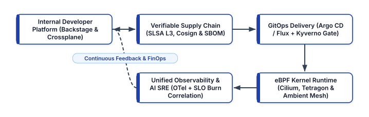


---

## The Future of DevOps

The DevOps philosophy has transformed the global technology industry over the past fifteen years—dismantling organizational silos between development, security, and operations, compressing release cycles from months to minutes, and fostering a culture of shared ownership and blameless learning. Yet the landscape of distributed systems never stands still. Looking ahead, four converging forces are shaping the next era of DevOps and Platform Engineering:

### 1. Autonomous and AI-Augmented Engineering (AIOps & Agentic Workflows)

Artificial Intelligence is evolving from passive code-completion assistants into active participants across the software delivery and reliability lifecycle. By grounding AI agents in deterministic guardrails—OpenTelemetry trace graphs, SLSA provenance metadata, Crossplane schemas, and Policy-as-Code admission gates—organizations can automate anomaly correlation, synthesize blameless postmortem timelines, generate targeted Terratest/InSpec suites, and propose right-sized Kubernetes resource requests without sacrificing deterministic safety.

### 2. Declarative Control Planes Everywhere (GitOps + Crossplane)

Infrastructure as Code has matured beyond static CLI runs into continuous, self-healing control planes. By combining GitOps reconcilers (Argo CD and Flux) with Kubernetes-native cloud control planes (Crossplane and Kratix), every piece of enterprise state—from AWS RDS databases and IAM roles to DNS records and service mesh policies—is continuously reconciled against version-controlled declarative intent.

### 3. Edge Computing, WebAssembly (Wasm), and MicroVM Density

With the proliferation of low-latency edge workloads, IoT telemetry, and multi-tenant serverless compute, DevOps platforms are expanding beyond centralized regional data centers. Lightweight hardware-virtualized microVMs (AWS Firecracker), eBPF kernel data planes, and portable WebAssembly (Wasm) components allow platform teams to schedule workloads across thousands of edge locations with sub-millisecond cold starts and cryptographic tenant isolation.

### 4. Zero-Trust DevSecOps and Cryptographic Attestation by Default

As supply chain adversaries grow more sophisticated, security can no longer rely on perimeter firewalls or post-deployment vulnerability tickets. In modern DevSecOps, every build artifact, base image, SBOM, and infrastructure change carries a verifiable cryptographic signature (Sigstore Cosign) and SLSA provenance attestation verified automatically at runtime before a single instruction executes.

---

## Staying Current with Emerging Technologies

In the rapidly evolving world of software engineering, staying current with emerging technologies is a non-negotiable requirement for DevOps, Platform, and Site Reliability Engineers. It is essential not only for individual career growth, but also for the resilience and competitive velocity of the organizations we serve.

### The Imperative of Technological Adaptability

The field of cloud-native computing is characterized by constant architectural evolution. Cloud computing, containerization, declarative Infrastructure as Code, Kubernetes orchestration, eBPF networking, OpenTelemetry, and Internal Developer Platforms have each reshaped how we design, build, test, deploy, and operate software.

Staying current with these shifts is never merely about memorizing the flags of the newest CLI tool. It is about cultivating **first-principles systems thinking**—understanding how Linux kernel namespaces, TCP congestion control, distributed consensus (`etcd`), cryptographic identity (SPIFFE/OIDC), and human cognitive load work underneath the abstractions—so you can evaluate new tools critically and adopt only those that solve genuine engineering problems.

### Strategies for Staying Current

1. **Adopt a Mindset of Continuous Learning**: Remain curious, open-minded, and proactive in exploring the Cloud Native Computing Foundation (CNCF) landscape, technical RFCs, engineering blogs, and postmortem write-ups from high-scale production incidents.
2. **Community Networking and Open-Source Participation**: Engage with peers through KubeCon, DevOpsDays, local meetups, and CNCF Special Interest Groups (SIGs). Reading upstream pull requests and sharing your own production lessons accelerates learning across the entire industry.
3. **Deliberate Hands-On Practice**: There is no substitute for building, breaking, and debugging real systems. Run the companion code in this book's repository (`01-cdk` through `12-serverless` and `snippets/`), spin up local Kind/Minikube clusters with Cilium and OpenTelemetry, and practice chaos engineering in sandboxed environments.
4. **Targeted Industry Certifications**: Structured hands-on certifications—such as the AWS Certified DevOps Engineer – Professional, Certified Kubernetes Administrator (CKA), Certified Kubernetes Security Specialist (CKS), and Prometheus/OpenTelemetry associate credentials—provide rigorous benchmarks to validate your practical mastery.

---

## Continuous Learning and Kaizen in Engineering Culture

The concept of continuous learning and improvement is anchored in the philosophy of **Kaizen**—a Japanese term translating to *"change for the better"* or *"continuous incremental improvement."* In the context of DevOps and Platform Engineering, Kaizen encompasses both the persistent pursuit of individual technical mastery and the relentless refinement of organizational sociotechnical systems:

- **Embrace a Growth Mindset**: View production outages, failed deployments, and architectural bottlenecks not as personal failings to be hidden, but as rich diagnostic signals that reveal where your platform's guardrails and mental models need strengthening.
- **Foster a Culture of Blameless Feedback**: Conduct structured, blameless postmortems after every significant incident, focusing on *what systemic conditions allowed an error to reach production* and *which automated control will prevent its recurrence*.
- **Experiment, Measure, and Iterate**: Treat every platform change as a scientific hypothesis measured against DORA metrics (Deployment Frequency, Lead Time for Changes, Change Failure Rate, Failed Deployment Recovery Time) and developer cognitive load.

Thank you for reading *Mastering Modern DevOps: A Comprehensive Guide to Infrastructure, Automation, and Cloud-Native Technologies (Second Edition)*. Whether you are writing your first AWS CDK construct, designing a multi-cluster Crossplane Internal Developer Platform, debugging an eBPF network flow in Cilium Hubble, or hardening a SLSA Level 3 supply chain, may the patterns, code examples, and principles in this book empower you to build resilient, secure, and joyful engineering systems.

# References

1. **Kim, G., Humble, J., Debois, P., Willis, J., & Forsgren, N.** *The DevOps Handbook: How to Create World-Class Agility, Reliability, & Security in Technology Organizations (Second Edition)*. IT Revolution Press, 2021.
2. **Humble, J., & Farley, D.** *Continuous Delivery: Reliable Software Releases through Build, Test, and Deployment Automation*. Addison-Wesley Professional, 2010.
3. **Forsgren, N., Humble, J., & Kim, G.** *Accelerate: The Science of Lean Software and DevOps: Building and Scaling High Performing Technology Organizations*. IT Revolution Press, 2018.
4. **Beyer, B., Jones, C., Petoff, J., & Murphy, N. R. (Eds.)**. *Site Reliability Engineering: How Google Runs Production Systems* & *The Site Reliability Workbook: Practical Ways to Implement SRE*. O'Reilly Media, 2016–2018. https://sre.google/books/
5. **Skelton, M., & Pais, M.** *Team Topologies: Organizing Business and Technology Teams for Fast Flow (Second Edition)*. IT Revolution Press, 2019–2024.
6. **Morris, K.** *Infrastructure as Code: Dynamic Systems for the Cloud Age (Second Edition)*. O'Reilly Media, 2020.
7. **Amazon Web Services (AWS)**. *AWS Cloud Development Kit (AWS CDK v2) Developer Guide and Construct Hub Reference*. Amazon Web Services, Inc., 2024–2025. https://docs.aws.amazon.com/cdk/v2/guide/home.html
8. **Amazon Web Services (AWS)**. *AWS SDK for Python (Boto3) Documentation & AWS X-Ray Developer Guide*. Amazon Web Services, Inc., 2024–2025. https://boto3.amazonaws.com/v1/documentation/api/latest/index.html
9. **Red Hat, Inc.** *Ansible Automation Platform & Ansible Core Documentation: Playbooks, Roles, and Collections Best Practices*. Red Hat, 2024–2025. https://docs.ansible.com/
10. **Continuous Delivery Foundation (CDF)**. *Jenkins User Documentation: Declarative and Scripted Pipeline Reference*. Jenkins Project, 2024. https://www.jenkins.io/doc/book/pipeline/
11. **GitLab, Inc.** *GitLab CI/CD Pipeline Configuration Reference & Runner Architecture*. GitLab Documentation, 2024–2025. https://docs.gitlab.com/ee/ci/
12. **GitHub, Inc.** *GitHub Actions Documentation: Workflow Syntax, OIDC Federated Authentication, and Artifact Attestations*. GitHub Docs, 2024–2025. https://docs.github.com/en/actions
13. **JFrog Ltd., Sonatype, Inc., & AWS**. *Enterprise Artifact Repository Management: JFrog Artifactory, Sonatype Nexus Repository, and AWS CodeArtifact Technical Guides*. 2024. https://jfrog.com/help/ and https://aws.amazon.com/codeartifact/
14. **Docker, Inc. & Cloud Native Computing Foundation (CNCF)**. *Dockerfile Best Practices, Multi-Stage Builds, and containerd High-Performance Container Runtime Specification*. CNCF Graduated Project, 2024–2025. https://docs.docker.com/build/building/best-practices/ and https://containerd.io/
15. **Kubernetes Project (CNCF)**. *Kubernetes Production-Grade Container Orchestration Documentation: Workloads, Services, Security Contexts, and Gateway API (`gateway.networking.k8s.io/v1`)*. Cloud Native Computing Foundation, 2024–2025. https://kubernetes.io/docs/ and https://gateway-api.sigs.k8s.io/
16. **Prometheus, Grafana Labs, & Jaeger (CNCF)**. *Cloud-Native Monitoring and Distributed Tracing: Prometheus Querying, Grafana Dashboards, and Jaeger Architecture*. CNCF Graduated Projects, 2024–2025. https://prometheus.io/docs/ and https://www.jaegertracing.io/docs/
17. **HashiCorp & AWS**. *Secrets Management in DevSecOps: HashiCorp Vault Architecture and AWS Secrets Manager Developer Guide*. 2024–2025. https://developer.hashicorp.com/vault/docs
18. **Envoy Proxy & Istio Project (CNCF)**. *Envoy High-Performance Edge/Service Proxy and Istio Service Mesh Documentation (Sidecar and Ambient Data Plane Modes)*. Cloud Native Computing Foundation, 2024–2025. https://www.envoyproxy.io/docs and https://istio.io/latest/docs/ambient/
19. **HashiCorp & Pulumi Corporation**. *Multi-Cloud Infrastructure as Code: Terraform Language Documentation and Pulumi Cloud Engineering Platform Reference*. 2024–2025. https://developer.hashicorp.com/terraform/docs and https://www.pulumi.com/docs/
20. **Argo Project & Flux Project (CNCF)**. *OpenGitOps Principles (`v1.0`), Argo CD Declarative GitOps Engine, and Flux v2 GitOps Toolkit for Kubernetes*. CNCF Graduated Projects, 2024–2025. https://argo-cd.readthedocs.io/ and https://fluxcd.io/flux/
21. **Gruntwork, Progress Chef, & Test Kitchen**. *Automated Infrastructure Testing and Compliance as Code: Terratest Go Library, Chef InSpec Profiles, and Test Kitchen Harness*. 2024. https://terratest.gruntwork.io/ and https://docs.chef.io/inspec/
22. **Apache Software Foundation & PagerDuty, Inc.** *Workflow Orchestration and Incident Response: Apache Airflow Documentation, Rundeck Runbook Automation, and PagerDuty Incident Response Guide*. 2024–2025. https://airflow.apache.org/docs/ and https://response.pagerduty.com/
23. **Backstage Project (Spotify / CNCF)**. *Backstage Open-Source Framework for Building Internal Developer Portals: Software Catalog, Scaffolder Templates, and TechDocs*. CNCF Incubating Project, 2024–2025. https://backstage.io/docs/
24. **Crossplane Project (Upbound / CNCF) & Kratix (Syntasso)**. *Crossplane Cloud-Native Control Planes (`CompositeResourceDefinitions` & `Compositions`) and Kratix Framework for Composable Internal Developer Platforms*. CNCF Graduated Project, 2024–2025. https://docs.crossplane.io/ and https://kratix.io/
25. **Forsgren, N., Storey, M.-A., Maddila, C., Zimmermann, T., Houck, B., & Butler, J.** *"The SPACE of Developer Productivity: There's More to It Than You Think"*. ACM Queue, vol. 19, no. 1, pp. 20–48, 2021. https://doi.org/10.1145/3454122.3454124
26. **Cilium Project (Isovalent / Cisco / CNCF)**. *Cilium eBPF-Based Networking, Observability (`Hubble`), and Synchronous Kernel Runtime Security Enforcement (`Tetragon`)*. Cloud Native Computing Foundation Graduated Project, 2024–2025. https://docs.cilium.io/ and https://tetragon.io/docs/
27. **OpenTelemetry Project (CNCF), Grafana Beyla, & Grafana Pyroscope**. *OpenTelemetry Specification (Traces, Metrics, Logs, and Profiles), OTel Collector Tail-Based Sampling, eBPF Auto-Instrumentation, and Continuous Profiling*. Cloud Native Computing Foundation, 2024–2025. https://opentelemetry.io/docs/
28. **Open Source Security Foundation (OpenSSF) & Linux Foundation**. *Supply-chain Levels for Software Artifacts (SLSA Specification v1.0) & Sigstore Keyless Signing Architecture (`Cosign`, `Fulcio`, and `Rekor`)*. OpenSSF, 2023–2025. https://slsa.dev/spec/v1.0/ and https://docs.sigstore.dev/
29. **OWASP CycloneDX, Anchore Syft, Aqua Trivy, & Kyverno (CNCF)**. *CycloneDX v1.6 SBOM/VEX Standard, Syft/Trivy Artifact Scanners, and Kyverno Kubernetes Policy Engine for Container Image Verification*. 2024–2025. https://cyclonedx.org/ and https://kyverno.io/docs/

<div style="page-break-after: always;"></div>


# Appendix: Snippets

## Snippet Guide

# Companion Code & Snippets Guide — *Mastering Modern DevOps (Second Edition)*

This directory contains self-contained, print-safe (`<= 55` columns per line) companion code examples and verification scripts for **Mastering Modern DevOps: A Comprehensive Guide to Infrastructure, Automation, and Cloud-Native Technologies (Second Edition)** by **Christian Chostak**, alongside the topic-specific project directories (`01-cdk` through `12-serverless`) at the root of the repository.

## Summary of Companion Snippets

- **`ch01_cdk_multi_stack_app.py`**: Chapter 1 — AWS CDK v2 multi-stack KMS key rotation and encrypted SQS queue synthesizer.
- **`ch02_boto3_resilient_sqs_worker.py`**: Chapter 2 — AWS SDK for Python (`boto3`) resilient SQS batch processor with partial batch failure reporting and AWS X-Ray trace attribution.
- **`ch03_ansible_hardened_web_role.yaml`**: Chapter 3 — Idempotent Ansible playbook for provisioning and reloading a hardened NGINX web fleet.
- **`ch04_github_actions_ci_matrix.yaml`**: Chapter 4 — GitHub Actions CI workflow with matrix Python testing, dependency caching, and a blocking Trivy vulnerability gate.
- **`ch06_multistage_nonroot.dockerfile`**: Chapter 6 — Multi-stage production Dockerfile with non-root user execution (`10001:10001`) and built-in healthcheck.
- **`ch07_kubernetes_blue_green_rollout.yaml`**: Chapter 7 — Hardened Kubernetes `Deployment` and `Service` manifests for zero-downtime blue/green traffic switching.
- **`ch08_prometheus_alert_rules.yaml`**: Chapter 8 — Prometheus scrape configuration and golden-signal 5xx error-rate alerting rule.
- **`ch14_argocd_gitops_application.yaml`**: Chapter 14 — Declarative Argo CD `Application` manifest with automated pruning and continuous drift self-healing.
- **`ch19_crossplane_postgresql_xrd.yaml`**: Chapter 19 — Crossplane `CompositeResourceDefinition` (`XRD`) exposing a self-service `PostgreSQLInstance` claim API for Internal Developer Platforms.
- **`ch19_idp_claim_auditor.py`**: Chapter 19 — Python verification tool auditing IDP Crossplane claim readiness and Golden Path template version compliance.
- **`ch20_cilium_l7_zero_trust_policy.yaml`**: Chapter 20 — Cilium eBPF Layer-7 `CiliumNetworkPolicy` enforcing HTTP method/path rules and DNS-aware (`toFQDNs`) egress filtering.
- **`ch20_cilium_policy_validator.py`**: Chapter 20 — Python zero-trust audit script verifying Istio Ambient Mode enrollment, Cilium L7 policies, and Tetragon runtime enforcement across Kubernetes namespaces.
- **`ch21_otel_collector_tail_sampling.yaml`**: Chapter 21 — Production OpenTelemetry Collector Gateway configuration with memory protection, Kubernetes metadata enrichment, PII redaction, and tail-based sampling.
- **`ch21_slo_burn_correlator.py`**: Chapter 21 — AI-Augmented SRE Python engine calculating multi-window SLO error-budget burn rates (`14.4x` threshold) and ranking root-cause candidates by deployment recency.
- **`ch22_kyverno_slsa_cosign_policy.yaml`**: Chapter 22 — Kyverno `ClusterPolicy` enforcing keyless Sigstore Cosign OIDC image signatures, tag-to-digest mutation, and SLSA v1.0 provenance attestations in Kubernetes.
- **`ch22_slsa_sbom_verifier.py`**: Chapter 22 — Python verification gate validating SLSA build provenance, trusted OIDC builder identity, and CycloneDX SBOM vulnerability status.

## Running the Verification Scripts

All Python verification scripts run on standard Python 3.11+ with zero external paid API dependencies:

```bash
python3 snippets/ch01_cdk_multi_stack_app.py
python3 snippets/ch02_boto3_resilient_sqs_worker.py
python3 snippets/ch19_idp_claim_auditor.py
python3 snippets/ch20_cilium_policy_validator.py
python3 snippets/ch21_slo_burn_correlator.py
python3 snippets/ch22_slsa_sbom_verifier.py
```

<div style="page-break-after: always;"></div>


## ch01_cdk_multi_stack_app.py

```python
#!/usr/bin/env python3
"""Ch 1: AWS CDK v2 Multi-Stack KMS + SQS Blueprint."""
import os
from dataclasses import dataclass


@dataclass
class CdkStackSynthesizer:
    account: str
    region: str
    encrypted: bool = True

    def synth_manifest(self) -> dict:
        return {
            "app": "ModernDevOpsCdkV2",
            "env": {
                "account": self.account,
                "region": self.region,
            },
            "stacks": [
                {
                    "id": "KeyStack",
                    "resource": "AWS::KMS::Key",
                    "rotation": True,
                },
                {
                    "id": "QueueStack",
                    "resource": "AWS::SQS::Queue",
                    "kms_encrypted": self.encrypted,
                },
            ],
        }


if __name__ == "__main__":
    region = os.getenv("REGION", "us-east-1")
    synth = CdkStackSynthesizer("123456789012", region)
    print(synth.synth_manifest())
```

<div style="page-break-after: always;"></div>


## ch02_boto3_resilient_sqs_worker.py

```python
#!/usr/bin/env python3
"""Ch 2: AWS SDK (Boto3) Resilient SQS Message
Handler."""
import json
from dataclasses import dataclass
from typing import Dict, List


@dataclass
class SqsMessage:
    message_id: str
    body: str
    attributes: Dict[str, str]


def process_sqs_batch(
    messages: List[SqsMessage],
) -> Dict[str, List[str]]:
    succeeded: List[str] = []
    failed: List[str] = []
    for msg in messages:
        try:
            payload = json.loads(msg.body)
            if "order_id" not in payload:
                raise ValueError("Missing order_id")
            succeeded.append(msg.message_id)
        except Exception:
            failed.append(msg.message_id)
    return {
        "processed": succeeded,
        "batchItemFailures": failed,
    }


if __name__ == "__main__":
    batch = [
        SqsMessage(
            "msg-01",
            '{"order_id": "ORD-100"}',
            {"AWSTraceHeader": "Root=1-6789"},
        )
    ]
    print(process_sqs_batch(batch))
```

<div style="page-break-after: always;"></div>


## ch03_ansible_hardened_web_role.yaml

```yaml
# Ch 3: Idempotent Ansible Playbook for Hardened NGINX
---
- name: Configure Production Web Fleet
  hosts: webservers
  become: true
  vars:
    http_port: 8080
  tasks:
    - name: Ensure NGINX package is installed
      ansible.builtin.package:
        name: nginx
        state: present

    - name: Deploy hardened nginx.conf template
      ansible.builtin.template:
        src: templates/nginx.conf.j2
        dest: /etc/nginx/nginx.conf
        owner: root
        group: root
        mode: "0644"
      notify: Reload NGINX

    - name: Ensure NGINX service is enabled and active
      ansible.builtin.service:
        name: nginx
        state: started
        enabled: true

  handlers:
    - name: Reload NGINX
      ansible.builtin.service:
        name: nginx
        state: reloaded
```

<div style="page-break-after: always;"></div>


## ch04_github_actions_ci_matrix.yaml

```yaml
# Ch 4: GitHub Actions CI/CD with Trivy Security Gate
name: Modern DevOps CI/CD Pipeline

on:
  push:
    branches: ["main"]
  pull_request:
    branches: ["main"]

permissions:
  contents: read
  security-events: write

jobs:
  verify-and-scan:
    runs-on: ubuntu-latest
    strategy:
      matrix:
        python-version: ["3.11", "3.12"]
    steps:
      - name: Checkout Repository
        uses: actions/checkout@v4

      - name: Set up Python ${{ matrix.python-version
}}
        uses: actions/setup-python@v5
        with:
          python-version: ${{ matrix.python-version }}
          cache: "pip"

      - name: Run Unit Test Suite
        run: python3 -m unittest discover -v

      - name: Run Trivy Vulnerability Scanner
        uses: aquasecurity/trivy-action@0.28.0
        with:
          scan-type: "fs"
          scan-ref: "."
          severity: "CRITICAL,HIGH"
          exit-code: "1"
```

<div style="page-break-after: always;"></div>


## ch06_multistage_nonroot.dockerfile

```dockerfile
# Ch 6: Multi-Stage Non-Root Production Dockerfile
FROM python:3.12-slim AS builder
WORKDIR /build
COPY requirements.txt .
RUN pip install --no-cache-dir \
    --prefix=/install -r requirements.txt

FROM python:3.12-slim AS runtime
WORKDIR /app
RUN groupadd -g 10001 appgrp && \
    useradd -u 10001 -g appgrp -s /sbin/nologin appusr
COPY --from=builder /install /usr/local
COPY --chown=appusr:appgrp . /app
USER 10001:10001
EXPOSE 8080
HEALTHCHECK --interval=30s --timeout=3s \
  CMD ["python3", "-c", "print('healthy')"]
ENTRYPOINT ["python3", "app.py"]
```

<div style="page-break-after: always;"></div>


## ch07_kubernetes_blue_green_rollout.yaml

```yaml
# Ch 7: Hardened Kubernetes Deployment & Service
apiVersion: apps/v1
kind: Deployment
metadata:
  name: checkout-api-blue
  namespace: production
  labels:
    app: checkout-api
    slot: blue
spec:
  replicas: 3
  selector:
    matchLabels:
      app: checkout-api
      slot: blue
  template:
    metadata:
      labels:
        app: checkout-api
        slot: blue
    spec:
      securityContext:
        runAsNonRoot: true
        runAsUser: 10001
      containers:
        - name: checkout-api
          image: ghcr.io/acme/checkout:v2.4.0
          ports:
            - containerPort: 8080
          resources:
            requests:
              cpu: "250m"
              memory: "256Mi"
            limits:
              cpu: "500m"
              memory: "512Mi"
          readinessProbe:
            httpGet:
              path: /healthz
              port: 8080
            initialDelaySeconds: 5
            periodSeconds: 10
---
apiVersion: v1
kind: Service
metadata:
  name: checkout-api-svc
  namespace: production
spec:
  selector:
    app: checkout-api
    slot: blue
  ports:
    - protocol: TCP
      port: 80
      targetPort: 8080
```

<div style="page-break-after: always;"></div>


## ch08_prometheus_alert_rules.yaml

```yaml
# Ch 8: Prometheus Scrape & Golden Signal Alert Rules
global:
  scrape_interval: 15s
  evaluation_interval: 15s

scrape_configs:
  - job_name: "kubernetes-microservices"
    static_configs:
      - targets: ["checkout-api.production:8080"]

groups:
  - name: checkout-golden-signals
    rules:
      - alert: HighCheckoutErrorRate
        expr: >
sum(rate(http_requests_total{status=~"5.."}[5m]))
          /
          sum(rate(http_requests_total[5m])) > 0.01
        for: 5m
        labels:
          severity: critical
        annotations:
          summary: "Checkout 5xx rate exceeded 1%"
```

<div style="page-break-after: always;"></div>


## ch14_argocd_gitops_application.yaml

```yaml
# Ch 14: Argo CD GitOps Application with Self-Healing
apiVersion: argoproj.io/v1alpha1
kind: Application
metadata:
  name: checkout-production
  namespace: argocd
spec:
  project: production-platform
  source:
    repoURL: https://github.com/acme/gitops-fleet.git
    targetRevision: main
    path: environments/production/checkout
  destination:
    server: https://kubernetes.default.svc
    namespace: production
  syncPolicy:
    automated:
      prune: true
      selfHeal: true
    syncOptions:
      - CreateNamespace=true
      - ApplyOutOfSyncOnly=true
```

<div style="page-break-after: always;"></div>


## ch19_crossplane_postgresql_xrd.yaml

```yaml
# Ch 19: Crossplane XRD & PostgreSQL Claim
apiVersion: apiextensions.crossplane.io/v1
kind: CompositeResourceDefinition
metadata:
  name: xpostgresqlinstances.platform.acme.io
spec:
  group: platform.acme.io
  names:
    kind: XPostgreSQLInstance
    plural: xpostgresqlinstances
  claimNames:
    kind: PostgreSQLInstance
    plural: postgresqlinstances
  versions:
    - name: v1alpha1
      served: true
      referenceable: true
      schema:
        openAPIV3Schema:
          type: object
          properties:
            spec:
              type: object
              properties:
                parameters:
                  type: object
                  required:
                    - storageGB
                    - tier
                  properties:
                    storageGB:
                      type: integer
                      minimum: 20
                      maximum: 1000
                    tier:
                      type: string
                      enum: ["dev", "staging", "prod"]
```

<div style="page-break-after: always;"></div>


## ch19_idp_claim_auditor.py

```python
#!/usr/bin/env python3
"""Ch 19: IDP Golden Path & Crossplane Claim
Auditor."""
import json
from dataclasses import dataclass
from typing import List


@dataclass
class PlatformClaimStatus:
    name: str
    namespace: str
    kind: str
    synced: bool
    ready: bool
    golden_path_version: str


def evaluate_idp_fleet(
    claims: List[PlatformClaimStatus],
    min_version: str = "v2.1",
) -> dict:
    total = len(claims)
    healthy = sum(
        1 for c in claims if c.synced and c.ready
    )
    compliant = sum(
        1
        for c in claims
        if c.golden_path_version >= min_version
    )
    drift_alerts = [
        f"{c.namespace}/{c.name}"
        for c in claims
        if not (c.synced and c.ready)
    ]
    return {
        "total_claims": total,
        "ready_ratio": round(
            healthy / max(total, 1), 3
        ),
        "golden_path_compliance": round(
            compliant / max(total, 1), 3
        ),
        "degraded_claims": drift_alerts,
    }


if __name__ == "__main__":
    sample = [
        PlatformClaimStatus(
            "checkout-db",
            "team-payments",
            "PostgreSQLInstance",
            True,
            True,
            "v2.2",
        ),
        PlatformClaimStatus(
            "legacy-cache",
            "team-catalog",
            "RedisCluster",
            True,
            False,
            "v1.9",
        ),
    ]
    print(json.dumps(evaluate_idp_fleet(sample),
indent=2))
```

<div style="page-break-after: always;"></div>


## ch20_cilium_l7_zero_trust_policy.yaml

```yaml
# Ch 20: Cilium eBPF Layer-7 HTTP & DNS NetworkPolicy
apiVersion: "cilium.io/v2"
kind: CiliumNetworkPolicy
metadata:
  name: checkout-zero-trust-l7
  namespace: team-payments
spec:
  endpointSelector:
    matchLabels:
      app: checkout-service
      tier: backend
  ingress:
    - fromEndpoints:
        - matchLabels:
            app: api-gateway
      toPorts:
        - ports:
            - port: "8080"
              protocol: TCP
          rules:
            http:
              - method: "POST"
                path: "/api/v1/checkout"
              - method: "GET"
                path: "/healthz"
  egress:
    - toEndpoints:
        - matchLabels:
            k8s:io.kubernetes.pod.namespace:
kube-system
            k8s-app: kube-dns
      toPorts:
        - ports:
            - port: "53"
              protocol: ANY
          rules:
            dns:
              - matchPattern: "*.stripe.com"
    - toFQDNs:
        - matchPattern: "api.stripe.com"
      toPorts:
        - ports:
            - port: "443"
              protocol: TCP
```

<div style="page-break-after: always;"></div>


## ch20_cilium_policy_validator.py

```python
#!/usr/bin/env python3
"""Ch 20: Cilium L7 & Ambient Service Mesh Auditor."""
import json
from dataclasses import dataclass
from typing import List


@dataclass
class NamespaceMeshAudit:
    namespace: str
    ambient_enabled: bool
    has_l7_cilium_policy: bool
    allows_wildcard_egress: bool
    tetragon_enforced: bool


def audit_zero_trust_posture(
    namespaces: List[NamespaceMeshAudit],
) -> dict:
    findings = []
    passed = 0
    for ns in namespaces:
        issues = []
        if not ns.ambient_enabled:
            issues.append(
                "Missing
istio.io/dataplane-mode=ambient"
            )
        if not ns.has_l7_cilium_policy:
            issues.append(
                "Missing L7 CiliumNetworkPolicy"
            )
        if ns.allows_wildcard_egress:
            issues.append(
                "Unrestricted 0.0.0.0/0 egress allowed"
            )
        if not ns.tetragon_enforced:
            issues.append(
                "Missing Tetragon TracingPolicy"
            )
        if issues:
            findings.append(
                {
                    "namespace": ns.namespace,
                    "violations": issues,
                }
            )
        else:
            passed += 1
    return {
        "audited_namespaces": len(namespaces),
        "compliant_namespaces": passed,
        "non_compliant_findings": findings,
    }


if __name__ == "__main__":
    sample = [
        NamespaceMeshAudit(
            "team-payments", True, True, False, True
        ),
        NamespaceMeshAudit(
            "legacy-reporting",
            False,
            False,
            True,
            False,
        ),
    ]
    print(
        json.dumps(
            audit_zero_trust_posture(sample), indent=2
        )
    )
```

<div style="page-break-after: always;"></div>


## ch21_otel_collector_tail_sampling.yaml

```yaml
# Ch 21: OpenTelemetry Collector Gateway Configuration
receivers:
  otlp:
    protocols:
      grpc:
        endpoint: 0.0.0.0:4317
      http:
        endpoint: 0.0.0.0:4318

processors:
  memory_limiter:
    check_interval: 1s
    limit_percentage: 80
    spike_limit_percentage: 15

  k8sattributes:
    auth_type: "serviceAccount"
    extract:
      metadata:
        - k8s.namespace.name
        - k8s.deployment.name
        - k8s.pod.name

  attributes/redact_pii:
    actions:
      - key: http.request.header.authorization
        action: delete
      - key: db.statement
        action: hash

  tail_sampling:
    decision_wait: 10s
    num_traces: 50000
    policies:
      - name: keep-all-errors
        type: status_code
        status_code:
          status_codes: [ERROR]
      - name: keep-high-latency-p99
        type: latency
        latency:
          threshold_ms: 850
      - name: baseline-probabilistic-sample
        type: probabilistic
        probabilistic:
          sampling_percentage: 5.0

  batch:
    send_batch_size: 2048
    timeout: 2s

exporters:
  otlp/tempo:
    endpoint: tempo.observability:4317
    tls:
      insecure: false

service:
  pipelines:
    traces:
      receivers: [otlp]
      processors:
        - memory_limiter
        - k8sattributes
        - attributes/redact_pii
        - tail_sampling
        - batch
      exporters: [otlp/tempo]
```

<div style="page-break-after: always;"></div>


## ch21_slo_burn_correlator.py

```python
#!/usr/bin/env python3
"""Ch 21: AI-SRE Multi-Window SLO Burn Correlator."""
import json
from dataclasses import dataclass
from typing import List


@dataclass
class SpanWindowTelemetry:
    service: str
    version: str
    total_requests: int
    error_requests: int
    p99_ms: float
    deployed_minutes_ago: int


def analyze_slo_burn(
    windows: List[SpanWindowTelemetry],
    slo_target: float = 0.999,
) -> dict:
    error_budget = 1.0 - slo_target
    suspects = []
    for w in windows:
        err_rate = w.error_requests / max(
            w.total_requests, 1
        )
        burn_rate = round(err_rate / error_budget, 2)
        if burn_rate >= 14.4:
            score = burn_rate * (
                2.0
                if w.deployed_minutes_ago <= 30
                else 1.0
            )
            suspects.append(
                {
                    "service": w.service,
                    "version": w.version,
                    "burn_rate": burn_rate,
                    "p99_ms": w.p99_ms,
                    "recent_deploy": (
                        w.deployed_minutes_ago <= 30
                    ),
                    "rca_priority_score": round(
                        score, 2
                    ),
                }
            )
    suspects.sort(
        key=lambda x: x["rca_priority_score"],
        reverse=True,
    )
    return {
        "slo_target": slo_target,
        "page_oncall": len(suspects) > 0,
        "ranked_root_cause_candidates": suspects,
    }


if __name__ == "__main__":
    telemetry = [
        SpanWindowTelemetry(
            "api-gateway",
            "v1.4.0",
            10000,
            180,
            920.0,
            420,
        ),
        SpanWindowTelemetry(
            "payment-authorizer",
            "v2.8.1-rc3",
            2500,
            175,
            890.0,
            12,
        ),
    ]
    print(json.dumps(analyze_slo_burn(telemetry),
indent=2))
```

<div style="page-break-after: always;"></div>


## ch22_kyverno_slsa_cosign_policy.yaml

```yaml
# Ch 22: Kyverno Policy for Cosign & SLSA Provenance
apiVersion: kyverno.io/v1
kind: ClusterPolicy
metadata:
  name: enforce-sigstore-and-slsa-provenance
spec:
  validationFailureAction: Enforce
  background: false
  webhookTimeoutSeconds: 15
  rules:
    - name: verify-keyless-signature-and-slsa
      match:
        any:
          - resources:
              kinds:
                - Pod
              namespaces:
                - "team-*"
                - "production"
      verifyImages:
        - imageReferences:
            - "ghcr.io/acme/*"
          mutateDigest: true
          verifyDigest: true
          required: true
          attestors:
            - count: 1
              entries:
                - keyless:
                    issuer: >-
https://token.actions.githubusercontent.com
                    subjectRegExp: >-
                      https://github.com/acme/.+
                    rekor:
                      url: https://rekor.sigstore.dev
          attestations:
            - type: https://slsa.dev/provenance/v1
              attestors:
                - count: 1
                  entries:
                    - keyless:
                        issuer: >-
https://token.actions.githubusercontent.com
                        subjectRegExp: >-
                          https://github.com/acme/.+
```

<div style="page-break-after: always;"></div>


## ch22_slsa_sbom_verifier.py

```python
#!/usr/bin/env python3
"""Ch 22: SLSA Provenance & CycloneDX SBOM Verifier."""
import json
from dataclasses import dataclass
from typing import List


@dataclass
class ArtifactAttestationBundle:
    image_digest: str
    builder_id: str
    source_repo: str
    workflow_ref: str
    sbom_components: int
    unmitigated_critical_cves: List[str]


TRUSTED_BUILDER_PREFIX = (
    "https://github.com/actions/runner"
)
TRUSTED_REPO_PREFIX = "https://github.com/acme/"


def verify_supply_chain_bundle(
    bundle: ArtifactAttestationBundle,
) -> dict:
    violations = []
    if not bundle.image_digest.startswith("sha256:"):
        violations.append(
            "Artifact must be pinned by sha256 digest"
        )
    if not bundle.builder_id.startswith(
        TRUSTED_BUILDER_PREFIX
    ):
        violations.append(
            f"Untrusted SLSA builder:
{bundle.builder_id}"
        )
    if not bundle.source_repo.startswith(
        TRUSTED_REPO_PREFIX
    ):
        violations.append(
            f"Untrusted source repo:
{bundle.source_repo}"
        )
    if bundle.sbom_components <= 0:
        violations.append(
            "Missing or empty CycloneDX SBOM inventory"
        )
    if bundle.unmitigated_critical_cves:
        cves = ", ".join(
            bundle.unmitigated_critical_cves
        )
        violations.append(
            f"Unmitigated critical CVEs: {cves}"
        )
    return {
        "image_digest": bundle.image_digest,
        "verified": len(violations) == 0,
        "slsa_level_compliant": len(violations) == 0,
        "violations": violations,
    }


if __name__ == "__main__":
    sample = ArtifactAttestationBundle(
        image_digest="sha256:8f4e2b9a1c3d...",
        builder_id=(
            "https://github.com/actions/runner/v2"
        ),
        source_repo=(
            "https://github.com/acme/checkout-service"
        ),
        workflow_ref="refs/tags/v2.4.0",
        sbom_components=64,
        unmitigated_critical_cves=[],
    )
    print(
        json.dumps(
            verify_supply_chain_bundle(sample),
            indent=2,
        )
    )
```