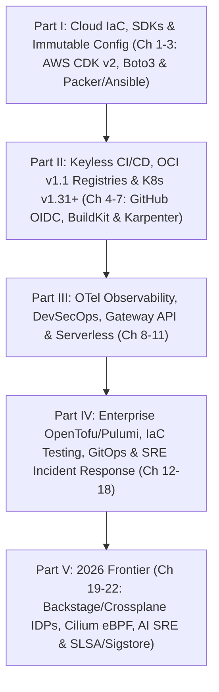

# Mastering Modern DevOps: A Comprehensive Guide to Infrastructure, Automation, and Cloud-Native Technologies (Second Edition)

## About the Author

**Christian Chostak** is a principal DevOps architect, cloud-native systems engineer, and technical leader with well over a decade of hands-on experience designing, automating, and securing resilient production infrastructure at scale. Throughout his career, he has spearheaded high-velocity DevOps, Platform Engineering, and DevSecOps transformations across organizations ranging from hyper-growth cloud-native startups to global enterprise financial and technology institutions. Christian's deep technical specialization spans declarative and programmatic Infrastructure as Code (AWS CDK v2, OpenTofu/Terraform, Pulumi, Crossplane), cloud-native container orchestration and kernel networking (Kubernetes, Amazon EKS, Cilium eBPF, Istio Ambient Mesh), keyless CI/CD and GitOps delivery architectures (GitHub Actions OIDC, Argo CD, Flux v2), OpenTelemetry observability pipelines, and cryptographic software supply chain security (SLSA, Sigstore Cosign, Kyverno).

Beyond his production architecture and systems engineering work, Christian is deeply committed to rigorous technical education and open knowledge sharing within the global cloud-native community. He is a frequent speaker at international engineering conferences and technical symposiums, where he dissects architectural lessons from large-scale distributed systems migrations and production incident post-mortems. His passion for engineering mentorship centers on guiding software engineers, systems administrators, platform engineers, and Site Reliability Engineers (SREs) from fragile manual operations to deterministic, self-healing cloud-native architectures.

Christian holds multiple top-tier industry certifications, including **AWS Certified DevOps Engineer – Professional** and **Certified Kubernetes Administrator (CKA)**, and earned a **Master's degree in Software Engineering** from IPP.

In this **Second Edition** of *Mastering Modern DevOps: A Comprehensive Guide to Infrastructure, Automation, and Cloud-Native Technologies*, Christian delivers a ground-up, phrase-by-phrase modernization of every foundational discipline—updating cloud SDKs, immutable OS pipelines, OCI v1.1 artifact registries, containerd 2.0 runtimes, Kubernetes v1.31+ orchestration, and eBPF runtime security—while introducing four comprehensive chapters dedicated to Internal Developer Platforms (IDPs), eBPF networking and sidecarless service meshes, OpenTelemetry with AI-augmented SRE, and SLSA/Sigstore software supply chain security.

## Preface to the Second Edition

*Mastering Modern DevOps: A Comprehensive Guide to Infrastructure, Automation, and Cloud-Native Technologies (Second Edition)* is an authoritative, production-grade engineering blueprint written for practitioners, architects, and technical leaders who build, operate, and secure modern cloud-native systems.

Since the publication of the First Edition, the cloud-native engineering landscape has undergone a fundamental structural transformation. Deprecated vendor services and legacy container tooling have given way to open standards, cryptographic identity federation, kernel-level telemetry, and declarative platform abstractions. A true Second Edition demands far more than appending new topics to existing text; every chapter in this volume has been rewritten from the ground up to reflect 2026 production engineering standards:

1. **Keyless Identity Federation and Programmatic Cloud IaC (Chapters 1–3)**: Static long-lived IAM access keys have been replaced across the board with short-lived OpenID Connect (OIDC) federation, AWS IAM Identity Center, and EKS Pod Identity. Infrastructure synthesis is built on **AWS CDK v2** (`aws-cdk-lib`) with automated policy-as-code validation via `cdk-nag`, **AWS SDK for Python (Boto3 v1.35+) and Go v2** with adaptive client-side rate limiting, and immutable image pipelines combining **Ansible**, **Molecule**, **HashiCorp Packer**, and reproducible **Nix / Devcontainer** toolchains.
2. **OCI v1.1 Supply Chains, BuildKit, and Kubernetes v1.31+ (Chapters 4–7)**: Legacy source control and deprecated registry layers have been superseded by keyless **GitHub Actions** and **GitLab CI** pipelines, **OCI v1.1 artifact registries** (Amazon ECR, Harbor, GitHub Container Registry) utilizing the Referrers API to bind CycloneDX SBOMs and Cosign signatures directly to container digests, **containerd 2.0** with **BuildKit** secret mounts and **Chainguard Wolfi / Distroless** base images, and **Kubernetes v1.31+** powered by **Karpenter** node consolidation, the **Kubernetes Gateway API**, **Pod Security Admission (PSA)**, and **KEDA** event-driven autoscaling.
3. **Unified OpenTelemetry, eBPF Runtime Security, and Multi-Cloud GitOps (Chapters 8–18)**: Disconnected monitoring silos have converged onto the **OpenTelemetry (OTel) Collector**, **Prometheus with Thanos/Mimir**, **Grafana Loki**, and **Grafana Tempo** driven by SLO error budgets. Pipeline and runtime security now enforce shift-left admission control via **Kyverno** and **OPA Gatekeeper**, kernel-level threat detection via **Falco eBPF**, and dynamic secret synchronization via the **External Secrets Operator (ESO)**. Infrastructure orchestration spans **Gateway API** and **Envoy** traffic management, **Serverless WebAssembly / AWS Lambda SnapStart**, **OpenTofu / Terraform v1.9+** with native test frameworks, **Argo CD ApplicationSets**, and **DAG-driven workflow engines**.
4. **The New Cloud-Native Frontier: IDPs, eBPF Meshes, AI-Augmented SRE, and SLSA Level 3 (Chapters 19–22)**: Four dedicated chapters explore the architectural pillars defining elite engineering organizations today:
   - **Platform Engineering and Internal Developer Platforms (Chapter 19)**: Eliminating ticket-ops and cognitive overload through product-managed IDPs built on **Backstage**, **Crossplane Composition Functions**, and **Kratix** promises.
   - **eBPF Cloud-Native Networking and Sidecarless Service Meshes (Chapter 20)**: Replacing kube-proxy `iptables` bottlenecks and high-memory sidecar proxies with **Cilium eBPF**, **Hubble** L7 flow visibility, **Tetragon** kernel enforcement, and **Istio Ambient Mode** (`ztunnel` and waypoint proxies).
   - **OpenTelemetry Collector Pipelines and AI-Augmented SRE (Chapter 21)**: Implementing zero-code eBPF auto-instrumentation, tail-based sampling, **Grafana Beyla**, continuous eBPF CPU/memory profiling, and **AI-augmented Site Reliability Engineering (AIOps)** for automated incident triage and root-cause correlation.
   - **Software Supply Chain Security with SLSA and Sigstore (Chapter 22)**: Achieving verifiable build provenance (**SLSA Build Level 3**), keyless cryptographic signing with **Sigstore Cosign**, **Fulcio**, and **Rekor**, automated **Syft/Trivy SBOM** attestation, and **Kyverno** cryptographic admission enforcement.

Every architectural pattern, configuration manifest, and code implementation in this book is engineered for immediate applicability in production environments. Welcome to the Second Edition of *Mastering Modern DevOps*.
