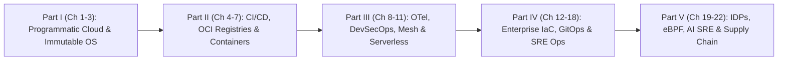

# Reader Guide: Who Should Read This Book and How to Use It

## Target Audience and Engineering Roles

*Mastering Modern DevOps: A Comprehensive Guide to Infrastructure, Automation, and Cloud-Native Technologies (Second Edition)* is written for practicing engineers, technical architects, and engineering leaders who design, build, secure, and operate distributed cloud-native systems. Because modern DevOps and Platform Engineering dissolve traditional boundaries between software construction and infrastructure operations, this book is structured to serve five core technical personas:

1. **DevOps, Platform, and Site Reliability Engineers (SREs)**: Practitioners responsible for Kubernetes cluster lifecycle management, Infrastructure as Code (IaC) module design, CI/CD and GitOps pipelines, observability stacks, and on-call reliability will find production-ready architectures covering AWS CDK v2, OpenTofu/Terraform, Crossplane, Karpenter, Cilium eBPF, OpenTelemetry, and SLSA Level 3 supply chains.
2. **Backend and Full-Stack Software Engineers**: Application developers who want to master how their services are packaged, attested, deployed, and observed in production will gain deep technical fluency in multi-stage BuildKit container builds, Distroless/Wolfi runtime hardening, AWS SDK resilience patterns (adaptive retries, paginators, EKS Pod Identity), Kubernetes Gateway API routing, and distributed tracing instrumentation.
3. **Cloud Architects and Infrastructure Engineers**: Systems administrators and cloud engineers transitioning from imperative script-based administration or legacy virtual machines to declarative, immutable cloud-native architectures will find rigorous step-by-step blueprints for eliminating configuration drift and automating multi-region failover.
4. **DevSecOps and Security Engineers**: Application security and cloud security engineers tasked with securing software delivery pipelines and Kubernetes runtimes will learn how to replace manual security review gates with automated policy-as-code (`cdk-nag`, Kyverno, OPA Gatekeeper), kernel-level runtime security (Falco and Tetragon eBPF), dynamic secret injection (HashiCorp Vault / OpenBao and External Secrets Operator), and keyless Sigstore Cosign attestations.
5. **Engineering Directors, VPs of Engineering, and Technical Educators**: Engineering leaders designing team topologies, establishing DORA and SPACE telemetry, or chartering an Internal Developer Platform (IDP) initiative will gain a comprehensive architectural framework for reducing developer cognitive load while strengthening operational governance.

## Architectural Structure of the Book

This book is organized into five cohesive parts spanning 22 chapters, progressing deliberately from programmatic cloud foundations to autonomous platform engineering:

- **Part I: Programmatic Cloud Infrastructure and Immutable Configuration (Chapters 1–3)** establishes the foundation of programmatic cloud engineering using AWS CDK v2 (`aws-cdk-lib` and `cdk-nag`), resilient cloud-native application integration with the AWS SDK (Boto3 v1.35+, Go v2, and JavaScript v3), and immutable host and container configuration using Ansible, Molecule, HashiCorp Packer, and Nix/Devcontainers.
- **Part II: Keyless Delivery Pipelines, OCI v1.1 Registries, and Container Orchestration (Chapters 4–7)** details end-to-end software packaging and orchestration: keyless OIDC CI/CD pipelines in GitHub Actions and GitLab CI, OCI v1.1 artifact registries (Amazon ECR and Harbor) with cryptographic referrers, containerd 2.0 and BuildKit image optimization on Wolfi/Distroless bases, and production orchestration on Kubernetes v1.31+ (EKS Auto Mode, Karpenter, Gateway API, and KEDA) alongside Amazon ECS on AWS Fargate.
- **Part III: Unified Observability, DevSecOps, Service Meshes, and Serverless Compute (Chapters 8–11)** covers production operations and runtime architecture: unified telemetry pipelines with the OpenTelemetry Collector, Prometheus/Thanos/Mimir, Loki, and Tempo; shift-left and runtime security with Kyverno, Falco eBPF, Trivy, and External Secrets Operator; high-performance ingress and service mesh routing with Envoy, Gateway API, and Istio; and event-driven serverless architectures across AWS Lambda, Google Cloud Functions (2nd Gen), and Azure Functions.
- **Part IV: Enterprise Infrastructure at Scale, Verification, GitOps, and Incident Response (Chapters 12–18)** addresses multi-team governance and operational resilience: multi-cloud IaC with OpenTofu/Terraform and Pulumi; automated infrastructure verification using Terratest, native Terraform tests, and Open Policy Agent (OPA); pull-based Kubernetes reconciliation with Argo CD ApplicationSets and Flux v2; DAG-driven workflow orchestration with Apache Airflow and Rundeck; and high-reliability incident management using SLO burn-rate alerts, PagerDuty, and blameless post-mortems.
- **Part V: The 2026 Cloud-Native Frontier (Chapters 19–22)** explores the four architectural pillars of modern cloud-native engineering: Internal Developer Platforms with Backstage, Crossplane, and Kratix; eBPF kernel networking and sidecarless service meshes with Cilium, Hubble, Tetragon, and Istio Ambient Mode; AI-augmented SRE and zero-code eBPF telemetry with OpenTelemetry; and cryptographic software supply chain security with SLSA Build Level 3 and Sigstore.

## How to Use Code Examples and Architectural Blueprints

Every chapter follows a rigorous engineering pedagogy: we begin with the underlying systems architecture and failure modes of legacy approaches, analyze the mechanics of modern cloud-native protocols and tools, and walk through complete, production-hardened code implementations.

All code listings, YAML manifests, HCL modules, TypeScript constructs, and Python automation scripts in this Second Edition adhere to strict production security and maintainability conventions:

- **Zero Long-Lived Static Credentials**: No example in this book relies on hardcoded API tokens or static IAM user access keys. All cloud interactions authenticate via short-lived OIDC tokens, IAM Identity Center sessions, or workload identity bindings (EKS Pod Identity / IRSA).
- **Pinned Immutable Versions and Digests**: Container bases, GitHub Actions workflows, and infrastructure providers use explicit semantic versions or cryptographic SHA-256 digests to prevent upstream tag-mutation attacks.
- **Print-Safe Formatting**: Complex commands and configuration blocks are structured cleanly across multiple lines so that every expression remains legible both in print and on screen without horizontal truncation.

Whether you read this volume sequentially from cover to cover to build a holistic mental model of cloud-native engineering, or use individual chapters as an architectural desk reference during production design reviews, the patterns in this book will equip you to engineer resilient, observable, and verifiable systems.
