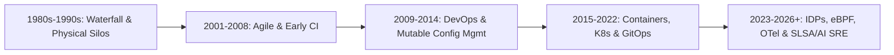

# The Evolution of DevOps: From Silos to Cloud-Native Engineering

The discipline known today as DevOps did not emerge in a vacuum; it is the culmination of four decades of systems engineering evolution, driven by the relentless growth of distributed computing scale and the economic necessity of rapid software iteration. Tracing this lineage—from sequential Waterfall mainframes and early configuration management scripts to Kubernetes orchestration, GitOps, Internal Developer Platforms (IDPs), and eBPF kernel telemetry—provides essential architectural context for why modern cloud-native stacks are designed the way they are.



## Phase 1: Waterfall, Physical Data Centers, and Operational Silos (1980s–1990s)

Throughout the 1980s and 1990s, enterprise software engineering was modeled after civil construction and physical manufacturing. Governed by the sequential **Waterfall model**, projects progressed linearly through multi-month phases: Requirements Gathering, Systems Design, Implementation, Integration Testing, and Operations Handover.

This software lifecycle mirrored the physical constraints of on-premises data centers. Provisioning a new production environment required submitting capital expenditure purchase orders, waiting months for physical rack-mounted servers and SAN storage arrays to ship, racking and cabling hardware, manually installing operating systems from physical media, and hand-editing configuration files in `/etc`.

Because infrastructure was scarce, expensive, and treated as long-lived "pet" servers nurtured by hand for years, organizations optimized for hardware utilization and change avoidance. Development teams wrote code in local environments that bore little resemblance to production Solaris, AIX, or Linux clusters. When a quarterly or annual release arrived, operations teams spent sleepless weekends following 100-page Word-document runbooks to deploy monolithic `.ear` or `.war` archives—inevitably encountering environment drift, missing shared libraries, and undocumented firewall rules.

## Phase 2: The Agile Revolution and Continuous Integration (2001–2008)

In February 2001, seventeen software practitioners published the *Manifesto for Agile Software Development*, catalyzing a fundamental shift away from rigid Waterfall specifications toward iterative development, small batch sizes, and continuous customer collaboration. Frameworks such as **Extreme Programming (XP)** and **Scrum** introduced automated unit testing, Test-Driven Development (TDD), and early **Continuous Integration (CI)** servers (such as CruiseControl and Hudson) that compiled code automatically whenever developers committed to version control.

Simultaneously, server virtualization (led by VMware ESX and Xen) decoupled operating systems from physical hardware, while the launch of **Amazon Elastic Compute Cloud (EC2)** and **Simple Storage Service (S3)** in 2006 transformed infrastructure from a capital procurement process into a programmable HTTP API.

Yet a critical bottleneck remained: while Agile enabled development teams to produce shippable code increments every two weeks, IT operations remained bound to manual server administration and ITIL Change Advisory Boards. Code piled up in staging environments waiting for operations approval, proving that software agility is impossible without infrastructure agility.

## Phase 3: The Birth of DevOps and First-Generation Configuration Management (2009–2014)

The catalyst for unifying Agile development with programmable operations crystallized between 2008 and 2009:

- At the **2008 Agile Conference** in Toronto, **Andrew Clay Shafer** and **Patrick Debois** met to discuss "Agile Infrastructure"—applying version control and automated testing practices to systems administration.
- At the **June 2009 O'Reilly Velocity Conference**, Flickr engineers **John Allspaw** and **Paul Hammond** delivered their landmark presentation, *"10+ Deploys per Day: Dev and Ops Cooperation at Flickr."* They demonstrated how shared automated deployment pipelines, feature flags, unified telemetry dashboards, and mutual trust between developers and operations allowed Flickr to deploy to production over ten times daily without sacrificing stability.
- Inspired by that talk, **Patrick Debois** organized the first **DevOpsDays** conference in Ghent, Belgium, in October 2009, coining the term **DevOps** and igniting a global engineering movement.
- In 2010, **Jez Humble** and **David Farley** published *Continuous Delivery*, formalizing the architecture of the automated **Deployment Pipeline**, while **Gene Kim**, **Kevin Behr**, and **George Spafford** codified the **Three Ways of DevOps** (Systems Thinking/Flow, Amplify Feedback Loops, and Culture of Continual Experimentation) in *The Phoenix Project* (2013) and *The DevOps Handbook* (2016).

Technologically, this era was defined by **first-generation Configuration Management** tools—**CFEngine**, **Puppet**, **Chef**, and subsequently **Ansible** and **SaltStack**—alongside early declarative cloud provisioning via **AWS CloudFormation** (2011) and **HashiCorp Terraform** (2014). Operations engineers began storing server state in Git. However, most deployments in this era still relied on **mutable infrastructure**: long-running virtual machines where convergence agents ran every 30 minutes to mutate packages and configuration files in place, leaving systems vulnerable to subtle package drift and partial convergence failures.

## Phase 4: The Container Revolution, Kubernetes, and GitOps (2015–2022)

Between 2013 and 2015, two technological breakthroughs shifted the industry from mutable virtual machines to immutable, declarative cloud-native systems:

1. **Linux Containers and OCI Standardization**: While Linux kernel namespaces and control groups (`cgroups`) had existed for years, **Docker** (2013) combined them with a layered copy-on-write filesystem and an intuitive image registry workflow. For the first time, an application and its exact user-space dependencies could be packaged into a single, immutable artifact that executed identically on a developer's laptop, a CI runner, and a production cluster. In 2015, the **Open Container Initiative (OCI)** standardized container runtime and image specifications, leading to lightweight, daemonless runtimes like **containerd** and **CRI-O**.
2. **Kubernetes and the Cloud Native Computing Foundation (CNCF)**: Drawn from Google's internal Borg cluster manager, **Kubernetes** was open-sourced in 2014 and donated as the founding project of the **CNCF** in 2015. Kubernetes introduced a revolutionary operational paradigm: **continuous declarative reconciliation**. Instead of writing imperative scripts to start processes on specific IP addresses, engineers submitted desired state manifests (`Deployment`, `Service`, `Ingress`) to an API server, and control-loop controllers continuously drove actual cluster state toward desired state.

As microservice architectures scaled on Kubernetes, supporting disciplines rapidly matured:
- **Prometheus** (2012/2016 CNCF) popularized pull-based dimensional time-series metrics and PromQL, while **Envoy Proxy** and **Istio** introduced dynamic Layer-7 traffic shifting and mutual TLS (mTLS) service meshes.
- **GitOps** (coined by Weaveworks in 2017 and realized at scale through **Flux** and **Argo CD**) extended Kubernetes reconciliation to Git repositories, eliminating push-based CI deployment scripts in favor of autonomous in-cluster pull controllers.
- **Site Reliability Engineering (SRE)**—codified by Google in 2016—provided the mathematical framework of SLIs, SLOs, Error Budgets, and toil elimination that brought engineering rigor to production operations.

## Phase 5: The Contemporary Cloud-Native Era (2023–2026 and Beyond)

While Kubernetes, containers, and IaC solved low-level infrastructure orchestration, their widespread adoption exposed a new set of scaling challenges in the early 2020s: developer cognitive overload from YAML sprawl, performance overhead from `iptables` and sidecar proxies, telemetry vendor lock-in, and sophisticated software supply chain attacks (such as SolarWinds, Log4Shell, and upstream CI compromises).

The modern 2026 DevOps architecture—the subject of this Second Edition—directly resolves these challenges across five transformative dimensions:

```
+-----------------------------------------------------+
|    EVOLUTION OF CLOUD-NATIVE ARCHITECTURES (2026)   |
+--------------------+--------------------------------+
| FIRST-GEN (2018+)  | 2026 SECOND EDITION STANDARD   |
+--------------------+--------------------------------+
| Raw K8s YAML &     | Internal Developer Platforms   |
| Ticket Queues      | (Backstage, Crossplane, Kratix)|
+--------------------+--------------------------------+
| Static IAM Keys &  | Keyless OIDC, EKS Pod Identity |
| Mutable Patching   | & Chainguard Wolfi/Distroless  |
+--------------------+--------------------------------+
| iptables & Heavy   | Cilium eBPF Routing, Tetragon  |
| Sidecar Proxies    | & Istio Ambient Sidecarless    |
+--------------------+--------------------------------+
| Disconnected       | Unified OpenTelemetry (OTel),  |
| Telemetry Agents   | eBPF Profiling & AI SRE        |
+--------------------+--------------------------------+
| Unverified Tags    | OCI v1.1 Referrers, CycloneDX, |
| (`:latest`)        | SLSA L3 & Sigstore Cosign      |
+--------------------+--------------------------------+
```

### 1. From Ticket-Ops and YAML Sprawl to Platform Engineering (IDPs)
Rather than forcing every product developer to become an expert in Kubernetes CNI tuning, IAM policy syntax, and Terraform state management, modern organizations treat their internal infrastructure as a product. Platform teams build **Internal Developer Platforms (IDPs)** using **Backstage** as the developer portal, **Crossplane** to expose custom Kubernetes APIs (`CompositeResourceDefinitions`) that provision cloud resources declaratively, and **Kratix** to orchestrate multi-cluster platform promises.

### 2. From `iptables` and Sidecar Proxies to Kernel-Native eBPF
Traditional Kubernetes networking relied on `iptables` rules that scaled poorly (`O(N)` latency degradation) in clusters with thousands of services, while first-generation service meshes injected a resource-heavy Envoy sidecar proxy into every single application pod. Today, **Extended Berkeley Packet Filter (eBPF)** allows sandboxed programs to run directly inside the Linux kernel socket and XDP layers. **Cilium** replaces `iptables` altogether, **Hubble** provides zero-overhead network observability, **Tetragon** and **Falco** enforce kernel-level security policies, and **Istio Ambient Mode** decouples L4 mTLS (`ztunnel`) and L7 policy enforcement from application pods.

### 3. From Proprietary Telemetry Agents to OpenTelemetry and AI-Augmented SRE
The convergence of OpenTracing and OpenCensus into **OpenTelemetry (OTel)**—now the second highest-velocity project in the CNCF after Kubernetes—has established a single, vendor-neutral wire protocol (**OTLP**) and collector architecture for metrics, logs, traces, and continuous profiles. Combined with eBPF auto-instrumentation (**Grafana Beyla** / OTel eBPF) and **AI-augmented SRE** engines that correlate high-cardinality trace anomalies against recent GitOps deployments and SLO burn rates, mean time to detection and root-cause isolation has dropped from hours to seconds.

### 4. From Implicit Trust to Cryptographic Supply Chain Provenance (SLSA & Sigstore)
Modern DevSecOps assumes that upstream dependencies and build environments are constant targets of compromise. Consequently, production clusters no longer trust container images simply because they reside in a private registry. Pipelines now generate **SLSA Build Level 3** provenance and **CycloneDX/SPDX SBOMs**, sign them using short-lived OIDC identities via **Sigstore Cosign** and **Fulcio** (recorded in the immutable **Rekor** transparency log), attach them via the **OCI v1.1 Referrers API**, and enforce cryptographic verification at Kubernetes admission time via **Kyverno**.

## Architectural Strategies for Sustaining DevOps Evolution

As you implement the technologies covered throughout this book, keep four enduring architectural principles at the forefront of your engineering strategy:

1. **Optimize for Cognitive Load and Fast Feedback**: Every tool or process added to a delivery pipeline must either reduce cognitive load for engineers or shorten the feedback loop between writing code and observing its behavior in production.
2. **Default to Declarative Reconciliation Over Imperative Scripting**: Imperative scripts execute once and leave systems vulnerable to subsequent drift. Declarative control loops (whether in Kubernetes, Crossplane, or Argo CD) continuously self-heal infrastructure when reality diverges from intent.
3. **Eliminate Long-Lived Secrets and Static Trust**: Treat every static credential as a liability waiting to be leaked. Design every pipeline, SDK client, and microservice around ephemeral, cryptographically verifiable workload identities.
4. **Measure Reliability Through User Experience**: Uptime percentages of individual servers are meaningless if users cannot complete transactions. Anchor all architectural decisions, deployment gates, and incident response workflows to user-centric SLIs, SLOs, and Error Budgets.
