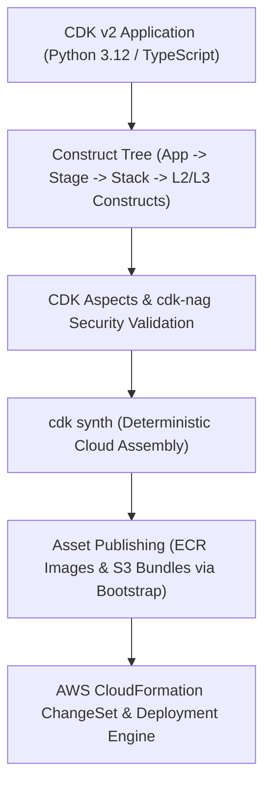

# Chapter 1: Mastering AWS CDK: Programmatic Infrastructure as Code

Infrastructure as Code (IaC) has evolved from static, ten-thousand-line YAML or JSON templates into full-featured software engineering frameworks. While first-generation declarative templates such as raw AWS CloudFormation eliminated manual console provisioning (`ClickOps`), they forced engineers to express complex cloud topologies without loops, type safety, modular encapsulation, or unit-testable abstractions. Copy-pasting hundreds of lines of YAML across staging and production environments inevitably reintroduced configuration drift and human error.

The **AWS Cloud Development Kit (AWS CDK v2)** resolves this tension by combining the expressive power of general-purpose programming languages—TypeScript, Python, Go, Java, and C#—with the deterministic state reconciliation of the AWS CloudFormation deployment engine. When you write an AWS CDK application, you do not execute imperative API calls directly against AWS endpoints; instead, you construct an in-memory object graph (the **Construct Tree**) that compiles—or *synthesizes*—into a deterministic **Cloud Assembly** containing CloudFormation templates, asset manifests, and deployment metadata.

In this chapter, we examine the internal architecture of AWS CDK v2 (`aws-cdk-lib` and `constructs` v10), configure keyless authentication via **AWS IAM Identity Center (SSO)** and **OpenID Connect (OIDC)**, engineer multi-tier production stacks using L1, L2, and L3 constructs, enforce shift-left compliance via **CDK Aspects** and **`cdk-nag`**, write fine-grained assertion suites, and automate multi-account delivery pipelines.



## The Architecture of AWS CDK v2 and the JSII Runtime

To use AWS CDK effectively in production, it is essential to understand how its multi-language engine and synthesis lifecycle work under the hood.

In legacy AWS CDK v1 (now deprecated and superseded by v2), every AWS service was distributed as a separate package (`@aws-cdk/aws-s3`, `@aws-cdk/aws-lambda`, and so on), which frequently caused dependency version mismatches when upgrading constructs. **AWS CDK v2** consolidated the entire stable construct library into a single monolithic package—`aws-cdk-lib` (in Python and TypeScript/npm)—paired with the standalone `constructs` v10 library, which defines the universal `Construct` base class used across AWS CDK, **CDK for Terraform (CDKTF)**, and **CDK for Kubernetes (cdk8s)**.

### How JSII Enables Polyglot Constructs
The AWS CDK core team writes the Construct Library once in **TypeScript**. Rather than maintaining separate ports in Python, Java, C#, and Go, AWS CDK uses **JSII (JavaScript Interop Interface)**. During compilation, JSII inspects the TypeScript type definitions and generates native language bindings for every target ecosystem. When you instantiate a construct in Python 3.12, the Python runtime communicates with an embedded Node.js JSII kernel process that executes the underlying TypeScript construct logic and returns strongly typed Python objects. This architecture guarantees that new AWS service features and security defaults ship simultaneously across all supported languages.

### The Four Phases of the CDK Lifecycle
Every execution of `cdk synth` or `cdk deploy` progresses deterministically through four distinct phases:

1. **Construction (Initialization)**: Your Python or TypeScript code executes, instantiating the root `App`, one or more `Stack` instances, and the nested tree of `Construct` nodes. During this phase, high-level L2 constructs automatically configure least-privilege IAM policies, security group rules, and resource dependencies.
2. **Preparation**: Constructs that implement the `inspect` or preparation hooks finalize cross-resource references and resolve lazy tokens (`Lazy.string()`, `Lazy.list()`).
3. **Validation (and Aspect Execution)**: The CDK framework traverses every node in the Construct Tree and invokes registered **Aspects** (`IAspect.visit()`), such as `cdk-nag` security scanners or corporate tagging enforcers, followed by each construct's `validate()` method. If any security or structural violation is recorded as an error annotation, synthesis halts immediately before touching AWS.
4. **Synthesis**: The Construct Tree serializes its state into the `cdk.out/` directory—known as the **Cloud Assembly**. This directory contains the generated CloudFormation JSON templates, asset manifests for container images and Lambda bundles, and tree metadata.

```
+-----------------------------------------------------+
|       AWS CDK v2 CONSTRUCT ABSTRACTION LEVELS       |
+-----------------+-----------------------------------+
| CONSTRUCT LEVEL | ARCHITECTURAL CHARACTERISTICS     |
+-----------------+-----------------------------------+
| L1 Constructs   | Direct 1:1 mappings of raw CFN    |
| (Cfn* Classes)  | resources (e.g. s3.CfnBucket).    |
|                 | Zero security defaults; used only |
|                 | for Day-0 escape hatches.         |
+-----------------+-----------------------------------+
| L2 Constructs   | Curated AWS abstractions (e.g.,   |
| (Standard Lib)  | s3.Bucket, kms.Key). Includes     |
|                 | secure defaults and intent-based  |
|                 | IAM grants (.grant_read_write()). |
+-----------------+-----------------------------------+
| L3 Constructs   | Multi-resource architectural      |
| (Patterns)      | patterns (e.g. Fargate + ALB) or  |
|                 | enterprise Golden Path modules.   |
+-----------------+-----------------------------------+
```

## Modern Workstation Setup and Keyless AWS Authentication

To run AWS CDK v2 in a 2026 engineering environment, you need **Node.js 22 LTS** (required by the JSII runtime and CDK CLI), **Python 3.12+** (for Python CDK development), and **AWS CLI v2**.

### Installing the Runtime and CDK v2 CLI
On Linux or macOS, verify that Node.js 22 LTS and Python 3.12+ are installed, then install the AWS CDK v2 CLI globally via `npm`:

```bash
# Verify Node.js 22+ and Python 3.12+ runtimes
node --version
python3 --version

# Install the latest AWS CDK v2 CLI globally
npm install -g aws-cdk@latest

# Confirm CDK v2 CLI installation
cdk --version
```

### Eliminating Static IAM Access Keys with AWS IAM Identity Center
In legacy AWS workflows, engineers ran `aws configure` and pasted long-lived IAM User access keys (`AKIA...`) into `~/.aws/credentials` in plaintext. **Storing static IAM access keys on developer laptops or in CI/CD secret stores is a critical security anti-pattern.** Leaked static keys remain one of the leading causes of cloud account compromises.

Modern AWS engineering mandates **short-lived, dynamically rotated session credentials** issued via **AWS IAM Identity Center (formerly AWS SSO)** for local development and **OpenID Connect (OIDC)** federation for CI/CD pipelines.

To configure keyless local authentication with AWS CLI v2, execute `aws configure sso`:

```bash
aws configure sso
```

The interactive prompt configures a named profile in `~/.aws/config` that authenticates through your organization's identity provider (such as Okta, Entra ID, or Keycloak) with hardware MFA and issues temporary STS credentials valid for 1 to 8 hours:

```ini
# ~/.aws/config
[sso-session enterprise-org]
sso_start_url = https://d-9067abc123.awsapps.com/start
sso_region = us-east-1
sso_registration_scopes = sso:account:access

[profile platform-dev]
sso_session = enterprise-org
sso_account_id = 111122223333
sso_role_name = PlatformEngineerAccess
region = us-west-2
output = json
```

Whenever you begin a development session, acquire fresh temporary credentials via the browser-backed OAuth 2.0 device authorization flow:

```bash
# Authenticate and cache temporary STS credentials
aws sso login --profile platform-dev

# Export profile for CDK CLI and Boto3 SDK discovery
export AWS_PROFILE=platform-dev

# Verify caller identity via STS
aws sts get-caller-identity
```

## Bootstrapping Target Environments Securely

Before deploying AWS CDK v2 stacks into an AWS account and region, the target environment must be **bootstrapped**. Because CDK applications frequently bundle local assets—such as Lambda function source code, static web assets, or Dockerfile builds—and because CloudFormation templates larger than 51,200 bytes cannot be passed inline via API calls, CDK provisions a dedicated `CDKToolkit` staging stack in each target `(account, region)` pair.

The modern CDK v2 bootstrap template provisions:
- An encrypted **Amazon S3 staging bucket** for CloudFormation templates and file assets.
- An **Amazon ECR repository** for container image assets built via BuildKit.
- Five scoped **IAM roles** (`LookupRole`, `FilePublishingRole`, `ImagePublishingRole`, `DeployRole`, and `CloudFormationExecutionRole`) that enable least-privilege cross-account deployments.
- An **SSM Parameter** (`/cdk-bootstrap/hnb659fds/version`) used by CDK to verify bootstrap compatibility.

In production environments, always bootstrap with explicit KMS encryption, termination protection, and a scoped execution policy:

```bash
cdk bootstrap aws://111122223333/us-west-2 \
  --cloudformation-execution-policies \
  arn:aws:iam::aws:policy/AdministratorAccess \
  --termination-protection \
  --trust 999988887777
```

In this command, `--trust 999988887777` permits a central CI/CD deployment account (`999988887777`) to assume the bootstrap deployment roles in the workload account (`111122223333`) without sharing static credentials across accounts.

## Initializing and Structuring a Production Python CDK v2 Project

To initialize a new Python CDK v2 project, create an empty directory and invoke `cdk init`:

```bash
mkdir platform-infra && cd platform-infra
cdk init app --language python
```

Create or activate the virtual environment and configure `requirements.txt` to include `aws-cdk-lib`, `constructs`, `cdk-nag` (for automated security policy enforcement), and `pytest` (for unit testing):

```text
# requirements.txt
aws-cdk-lib>=2.160.0,<3.0.0
constructs>=10.3.0,<11.0.0
cdk-nag>=2.28.0,<3.0.0
pytest>=8.3.0,<9.0.0
```

Install the dependencies into your isolated environment:

```bash
source .venv/bin/activate
pip install --upgrade pip
pip install -r requirements.txt
```

### Enterprise Multi-Stack Project Layout
As an infrastructure repository scales beyond a single proof-of-concept stack, organizing stateful resources (VPCs, KMS keys, RDS databases) separately from stateless compute (ECS Fargate services, Lambda functions) is critical to isolate blast radius and lifecycle cadence. A well-structured CDK v2 repository follows this layout:

```text
platform-infra/
├── app.py
├── cdk.json
├── requirements.txt
├── constructs_lib/
│   ├── __init__.py
│   └── secure_static_site.py
├── stacks/
│   ├── __init__.py
│   ├── network_stack.py
│   ├── data_stack.py
│   └── compute_stack.py
└── tests/
    ├── __init__.py
    └── test_platform_stacks.py
```

## Engineering Production Infrastructure with L2 and L3 Constructs

Let us build a production-grade infrastructure stack in `stacks/compute_stack.py` that demonstrates the power of L2 constructs, automatic dependency resolution, least-privilege `.grant_*()` IAM methods, and KMS encryption by default.

Suppose we are building an asynchronous order-processing microservice where an **AWS Lambda** function (running Python 3.12 on AWS Graviton2 `ARM_64` architecture) processes messages from an encrypted **Amazon SQS** queue (backed by a Dead-Letter Queue) and stores processed payloads in a KMS-encrypted **Amazon S3** bucket with public access strictly blocked:

```python
# stacks/compute_stack.py
from aws_cdk import (
    Duration,
    RemovalPolicy,
    Stack,
    aws_kms as kms,
    aws_lambda as _lambda,
    aws_lambda_event_sources as event_sources,
    aws_s3 as s3,
    aws_sqs as sqs,
)
from constructs import Construct


class OrderProcessingStack(Stack):
    def __init__(
        self,
        scope: Construct,
        construct_id: str,
        **kwargs,
    ) -> None:
        super().__init__(scope, construct_id, **kwargs)

        # 1. Customer-Managed KMS Key with Key Rotation
        cmk = kms.Key(
            self,
            "OrderEncryptionKey",
            enable_key_rotation=True,
            pending_window=Duration.days(30),
            removal_policy=RemovalPolicy.RETAIN,
        )

        # 2. Hardened S3 Bucket (Zero Public Access)
        self.archive_bucket = s3.Bucket(
            self,
            "OrderArchiveBucket",
            encryption=s3.BucketEncryption.KMS,
            encryption_key=cmk,
            bucket_key_enabled=True,
            block_public_access=(
                s3.BlockPublicAccess.BLOCK_ALL
            ),
            enforce_ssl=True,
            versioned=True,
            removal_policy=RemovalPolicy.RETAIN,
        )

        # 3. Dead-Letter Queue (DLQ) & Primary Queue
        dlq = sqs.Queue(
            self,
            "OrderProcessingDLQ",
            encryption=sqs.QueueEncryption.KMS,
            encryption_master_key=cmk,
            enforce_ssl=True,
            retention_period=Duration.days(14),
        )

        self.order_queue = sqs.Queue(
            self,
            "OrderProcessingQueue",
            encryption=sqs.QueueEncryption.KMS,
            encryption_master_key=cmk,
            enforce_ssl=True,
            visibility_timeout=Duration.seconds(90),
            receive_message_wait_time=(
                Duration.seconds(20)
            ),
            dead_letter_queue=sqs.DeadLetterQueue(
                max_receive_count=3,
                queue=dlq,
            ),
        )

        # 4. Graviton2 Python 3.12 Lambda Processor
        self.processor_fn = _lambda.Function(
            self,
            "OrderProcessorFn",
            runtime=_lambda.Runtime.PYTHON_3_12,
            architecture=_lambda.Architecture.ARM_64,
            handler="index.handler",
            timeout=Duration.seconds(30),
            memory_size=512,
            tracing=_lambda.Tracing.ACTIVE,
            code=_lambda.Code.from_inline(
                "import os, json\n"
                "def handler(event, context):\n"
                "    b = os.environ['BUCKET_NAME']\n"
                "    return {'ok': True, 'b': b}"
            ),
            environment={
                "BUCKET_NAME": (
                    self.archive_bucket.bucket_name
                ),
            },
        )

        # 5. Intent-Based Least-Privilege IAM Grants
        self.archive_bucket.grant_write(
            self.processor_fn
        )
        self.processor_fn.add_event_source(
            event_sources.SqsEventSource(
                self.order_queue,
                batch_size=10,
                report_batch_item_failures=True,
            )
        )
```

Notice what happens when `self.archive_bucket.grant_write(self.processor_fn)` is called on the L2 construct:
1. CDK inspects the `OrderArchiveBucket` and detects that it is encrypted with a customer-managed KMS key (`OrderEncryptionKey`).
2. CDK automatically attaches an IAM policy statement to `OrderProcessorFn`'s execution role granting `s3:PutObject` and `s3:AbortMultipartUpload` scoped strictly to that bucket's ARN.
3. Simultaneously, CDK grants `kms:Encrypt`, `kms:ReEncrypt*`, and `kms:GenerateDataKey*` on `OrderEncryptionKey` to the Lambda role. In raw CloudFormation or Terraform, forgetting to grant KMS key permissions alongside S3 bucket permissions is one of the most common causes of runtime `AccessDenied` failures. L2 constructs eliminate this entire class of defect.

### Implicit vs. Explicit Resource Dependencies
In 95% of cases, AWS CDK resolves deployment ordering implicitly via **Tokens**. When we pass `self.archive_bucket.bucket_name` into the `environment` dictionary of `OrderProcessorFn`, CDK inserts an unresolved CloudFormation `{ "Ref": "OrderArchiveBucket..." }` token. CloudFormation inspects that token reference and guarantees that the S3 bucket is created before the Lambda function.

When working with low-level **L1 constructs (`Cfn*`)** or custom resources where a dependency is operational rather than reference-based (for example, waiting for a VPC NAT Gateway route to propagate before starting an instance), you can declare an explicit dependency on the Construct Tree node:

```python
# Explicit node dependency between constructs
nat_route.node.add_dependency(internet_gateway_att)
```

## Authoring Reusable L3 Enterprise Constructs

One of the highest-leverage practices in Platform Engineering is packaging organizational security standards into reusable **L3 Constructs** distributed via a private Python index or npm registry (such as AWS CodeArtifact).

In legacy tutorials, static websites were frequently configured by setting `public_read_access=True` directly on an S3 bucket. In modern cloud security, public S3 buckets are strictly prohibited by AWS Organizations Service Control Policies (SCPs). Instead, static assets must reside in a completely private, KMS/SSE-S3 encrypted S3 bucket fronted by an **Amazon CloudFront distribution** using **Origin Access Control (OAC)** and TLS 1.2/1.3 enforcement.

Here is how to encapsulate this compliant architecture into a reusable L3 construct in `constructs_lib/secure_static_site.py`:

```python
# constructs_lib/secure_static_site.py
from aws_cdk import (
    RemovalPolicy,
    aws_cloudfront as cloudfront,
    aws_cloudfront_origins as origins,
    aws_s3 as s3,
    aws_s3_deployment as s3deploy,
)
from constructs import Construct


class SecureStaticSite(Construct):
    def __init__(
        self,
        scope: Construct,
        construct_id: str,
        asset_path: str,
    ) -> None:
        super().__init__(scope, construct_id)

        # Private S3 Bucket with SSL & Public Block
        self.site_bucket = s3.Bucket(
            self,
            "PrivateSiteBucket",
            encryption=s3.BucketEncryption.S3_MANAGED,
            block_public_access=(
                s3.BlockPublicAccess.BLOCK_ALL
            ),
            enforce_ssl=True,
            versioned=True,
            removal_policy=RemovalPolicy.RETAIN,
        )

        # CloudFront Distribution with Origin Access
        # Control (OAC) and HTTPS Redirect
        default_behav = cloudfront.BehaviorOptions(
            origin=(
                origins.S3BucketOrigin
                .with_origin_access_control(
                    self.site_bucket
                )
            ),
            viewer_protocol_policy=(
                cloudfront.ViewerProtocolPolicy
                .REDIRECT_TO_HTTPS
            ),
            compress=True,
        )

        self.distribution = cloudfront.Distribution(
            self,
            "SiteDistribution",
            default_root_object="index.html",
            minimum_protocol_version=(
                cloudfront.SecurityPolicyProtocol
                .TLS_V1_2_2021
            ),
            default_behavior=default_behav,
        )

        # Deploy Static Bundle & Invalidate Cache
        s3deploy.BucketDeployment(
            self,
            "AssetDeployment",
            sources=[
                s3deploy.Source.asset(asset_path)
            ],
            destination_bucket=self.site_bucket,
            distribution=self.distribution,
            distribution_paths=["/*"],
        )
```

Because every resource inside `SecureStaticSite` is scoped to `self` (the construct's own namespace), you can instantiate `SecureStaticSite` ten times inside the same stack (`SecureStaticSite(self, "DocsPortal", "./docs")`, `SecureStaticSite(self, "AdminUI", "./admin")`), and CDK's hierarchical path hashing guarantees globally unique logical IDs and physical resource names without collision.

## Shift-Left Governance with CDK Aspects and `cdk-nag`

Waiting until a CloudFormation deployment fails—or worse, until a post-deployment Cloud Security Posture Management (CSPM) scan flags a violation—slows down engineering velocity. AWS CDK v2 implements the **Visitor Pattern** via **Aspects (`IAspect`)**, allowing you to inspect, mutate, or validate every single construct in the tree before synthesis completes.

The industry-standard library for CDK security validation is **`cdk-nag`**, which bundles rule packs mapped to the **AWS Solutions Security Matrix**, **NIST 800-53 rev 5**, **HIPAA**, and **PCI-DSS**.

Here is how to wire both a custom cost-allocation tagging Aspect and `cdk-nag`'s `AwsSolutionsChecks` into `app.py`:

```python
# app.py
import os
import aws_cdk as cdk
from aws_cdk import Aspects, Tags
from cdk_nag import AwsSolutionsChecks, NagSuppressions
from stacks.compute_stack import OrderProcessingStack

app = cdk.App()

env = cdk.Environment(
    account=os.environ.get(
        "CDK_DEFAULT_ACCOUNT", "111122223333"
    ),
    region=os.environ.get(
        "CDK_DEFAULT_REGION", "us-west-2"
    ),
)

order_stack = OrderProcessingStack(
    app,
    "ProdOrderProcessingStack",
    env=env,
)

# Apply mandatory FinOps cost-allocation tags to all
# taggable resources in the Construct Tree
Tags.of(app).add("Environment", "production")
Tags.of(app).add("CostCenter", "CC-4092-Platform")
Tags.of(app).add("ManagedBy", "aws-cdk-v2")

# Documented, auditable suppression for L2 managed IAM
NagSuppressions.add_stack_suppressions(
    order_stack,
    [
        {
            "id": "AwsSolutions-IAM4",
            "reason": (
                "AWSLambdaBasicExecutionRole scoped "
                "exclusively to CloudWatch Logs."
            ),
        },
        {
            "id": "AwsSolutions-S1",
            "reason": (
                "S3 data events captured centrally "
                "via AWS Organization CloudTrail."
            ),
        },
    ],
)

# Enforce AWS Solutions security checks at synth time
Aspects.of(app).add(
    AwsSolutionsChecks(verbose=True)
)

app.synth()
```

When you execute `cdk synth`, `AwsSolutionsChecks` walks every L1 CloudFormation resource inside `ProdOrderProcessingStack`. If an engineer accidentally adds an unencrypted SQS queue, an overly permissive IAM wildcard policy (`*`), or an S3 bucket without `enforce_ssl=True`, `cdk synth` fails immediately with a detailed rule remediation report.

## Testing Infrastructure Code with `aws_cdk.assertions`

Because AWS CDK synthesizes deterministic CloudFormation templates, you can execute fast, offline unit tests in milliseconds using `pytest` and the `aws_cdk.assertions` module included directly inside `aws-cdk-lib`.

Assertion tests fall into two categories:
1. **Fine-Grained Assertions (`Template.has_resource_properties`, `Capture`, `Match`)**: Verify critical security properties, runtime configurations, and IAM policies.
2. **Snapshot Tests**: Compare the synthesized template against a committed baseline to detect unintended regressions during construct refactoring.

Below is a comprehensive `pytest` suite in `tests/test_platform_stacks.py`:

```python
# tests/test_platform_stacks.py
import aws_cdk as cdk
from aws_cdk.assertions import Capture, Match, Template
from stacks.compute_stack import OrderProcessingStack


def test_s3_bucket_enforces_kms_and_blocks_public():
    app = cdk.App()
    stack = OrderProcessingStack(
        app, "TestOrderStack"
    )
    template = Template.from_stack(stack)

    # Verify KMS encryption and public access block
    sse_cfg = [
        {
            "BucketKeyEnabled": True,
            "ServerSideEncryptionByDefault": {
                "SSEAlgorithm": "aws:kms",
                "KMSMasterKeyID": Match.any_value(),
            },
        }
    ]
    template.has_resource_properties(
        "AWS::S3::Bucket",
        {
            "BucketEncryption": {
                "ServerSideEncryptionConfiguration": (
                    sse_cfg
                )
            },
            "PublicAccessBlockConfiguration": {
                "BlockPublicAcls": True,
                "BlockPublicPolicy": True,
                "IgnorePublicAcls": True,
                "RestrictPublicBuckets": True,
            },
        },
    )


def test_lambda_uses_arm64_python312_and_active_xray():
    app = cdk.App()
    stack = OrderProcessingStack(
        app, "TestOrderStack"
    )
    template = Template.from_stack(stack)

    timeout_capture = Capture()
    template.has_resource_properties(
        "AWS::Lambda::Function",
        {
            "Runtime": "python3.12",
            "Architectures": ["arm64"],
            "TracingConfig": {"Mode": "Active"},
            "Timeout": timeout_capture,
        },
    )
    assert timeout_capture.as_number() == 30


def test_sqs_queue_configured_with_dlq_redrive():
    app = cdk.App()
    stack = OrderProcessingStack(
        app, "TestOrderStack"
    )
    template = Template.from_stack(stack)

    # Expect primary queue + DLQ = 2 queues
    template.resource_count_is("AWS::SQS::Queue", 2)
    template.has_resource_properties(
        "AWS::SQS::Queue",
        {
            "VisibilityTimeout": 90,
            "RedrivePolicy": {
                "deadLetterTargetArn": (
                    Match.any_value()
                ),
                "maxReceiveCount": 3,
            },
        },
    )
```

Execute the test suite using `pytest`:

```bash
pytest -v tests/
```

Notice that because `aws-cdk-lib` v2 bundles `aws_cdk.assertions` natively, no separate `aws-cdk.assertions` v1 package installation is required, and the entire test suite runs without making a single network call to AWS.

## Continuous Delivery with Modern CDK Pipelines and OIDC

Once your CDK application is tested and validated via `cdk-nag`, how should it be deployed across Staging and Production accounts? In modern 2026 architectures, teams use one of two patterns:

1. **GitHub Actions / GitLab CI with Keyless OIDC Federation** running `cdk diff` on pull requests and `cdk deploy --require-approval never` on merges to `main`.
2. **Self-Mutating AWS CDK Pipelines (`aws_cdk.pipelines.CodePipeline`)** integrated with GitHub via **AWS CodeConnections (formerly CodeStar Connections)**. Note that AWS deprecated AWS CodeCommit for new customers, and the legacy CDK v1 `CdkPipeline` / `SimpleSynthAction` classes have been superseded by the modern `CodePipeline` and `ShellStep` APIs.

Here is how to define a multi-stage, self-mutating CDK v2 pipeline using `CodePipeline`, `ShellStep`, and a GitHub CodeConnection:

```python
# stacks/pipeline_stack.py
import aws_cdk as cdk
from aws_cdk import Stack, Stage, pipelines
from constructs import Construct
from stacks.compute_stack import OrderProcessingStack


class ApplicationStage(Stage):
    def __init__(
        self,
        scope: Construct,
        construct_id: str,
        **kwargs,
    ) -> None:
        super().__init__(scope, construct_id, **kwargs)
        OrderProcessingStack(
            self, "OrderProcessingService"
        )


class PlatformPipelineStack(Stack):
    def __init__(
        self,
        scope: Construct,
        construct_id: str,
        connection_arn: str,
        **kwargs,
    ) -> None:
        super().__init__(scope, construct_id, **kwargs)

        source = (
            pipelines.CodePipelineSource.connection(
                "enterprise-org/platform-infra",
                "main",
                connection_arn=connection_arn,
            )
        )

        synth_step = pipelines.ShellStep(
            "SynthAndValidate",
            input=source,
            commands=[
                "npm install -g aws-cdk",
                "pip install -r requirements.txt",
                "pytest -v tests/",
                "cdk synth",
            ],
        )

        pipeline = pipelines.CodePipeline(
            self,
            "PlatformDeliveryPipeline",
            cross_account_keys=True,
            synth=synth_step,
        )

        # Deploy to Staging Account automatically
        staging = ApplicationStage(
            self,
            "Staging",
            env=cdk.Environment(
                account="222233334444",
                region="us-west-2",
            ),
        )
        pipeline.add_stage(staging)

        # Deploy to Production Account with Approval
        prod = ApplicationStage(
            self,
            "Production",
            env=cdk.Environment(
                account="333344445555",
                region="us-west-2",
            ),
        )
        pipeline.add_stage(
            prod,
            pre=[
                pipelines.ManualApprovalStep(
                    "PromoteToProd"
                )
            ],
        )
```

When `SynthAndValidate` runs, it executes `pytest` and `cdk synth` (which triggers `cdk-nag`). If all unit tests and security aspects pass, the pipeline self-mutates if new stages were added, publishes assets to the target accounts' bootstrap buckets, and rolls out the CloudFormation change sets across Staging and Production using short-lived cross-account IAM roles.

## Summary

AWS CDK v2 elevates Infrastructure as Code from static configuration files to a disciplined software engineering practice. By combining the unified `aws-cdk-lib` and `constructs` v10 hierarchy with keyless AWS IAM Identity Center authentication, hardened L2/L3 constructs, automated `cdk-nag` Aspect validation, and `aws_cdk.assertions` unit testing, engineering teams can provision complex multi-account cloud architectures with high velocity and cryptographic confidence. In Chapter 2, we move from provisioning cloud infrastructure to building resilient cloud-native applications using the AWS SDK.
