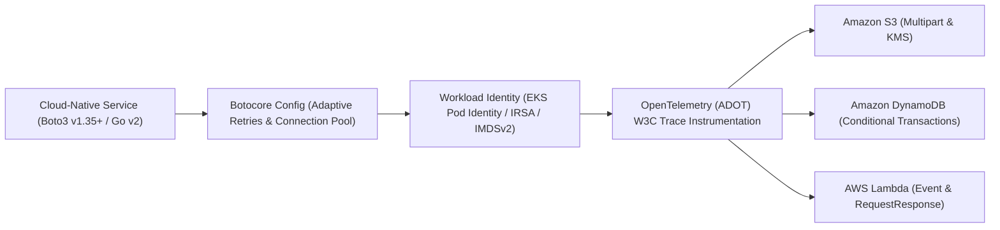

# Chapter 2: AWS SDK: Engineering Resilient Cloud-Native Applications

Provisioning cloud infrastructure via AWS CDK v2 is only half of the cloud-native equation; modern distributed applications must also interact directly with cloud data planes and control planes at runtime. Whether a microservice is streaming multi-gigabyte telemetry archives to Amazon S3, executing atomic conditional transactions against Amazon DynamoDB, publishing events to Amazon EventBridge, or invoking downstream AWS Lambda functions, all runtime communication flows through the **AWS Software Development Kit (AWS SDK)**.

However, a naive integration of the AWS SDK—instantiating default clients inside request handlers, relying on default retry policies, ignoring pagination tokens, or authenticating with static credentials—will inevitably fail under production load. Cloud networks experience transient packet loss, managed services enforce strict token-bucket rate limits (`ProvisionedThroughputExceededException`, `SlowDown`, `ThrottlingException`), and unconfigured socket timeouts can hang application worker threads indefinitely.

In this chapter, we engineer production-grade cloud integrations using **AWS SDK for Python (Boto3 v1.35+ / Botocore)** alongside modern architectural patterns applicable to **AWS SDK for Go v2** and **AWS SDK for JavaScript v3**. We examine zero-trust workload identity credential chains (**EKS Pod Identity**, **IRSA**, and **IMDSv2**), client-side **Adaptive Retry Mode**, high-concurrency connection pooling, **Paginators** and **Waiters**, multipart S3 streaming, idempotent DynamoDB transactions, **OpenTelemetry (ADOT)** distributed tracing, and hermetic unit testing with **Moto v5**.



## The Architecture of Modern AWS SDKs

Across all major programming languages, AWS has modernized its SDK architecture around modular service clients, pluggable middleware pipelines, and non-blocking I/O:

1. **AWS SDK for Python (Boto3 v1.35+ and Botocore)**: Built on top of the low-level `botocore` library, which implements AWS Signature Version 4 (`SigV4` and `SigV4a` multi-region signing), HTTP connection pooling (`urllib3`), event hooks, paginators, and retry state machines.
2. **AWS SDK for JavaScript / TypeScript v3 (`@aws-sdk/client-*`)**: Completely modularized into separate per-service packages (`@aws-sdk/client-s3`, `@aws-sdk/client-dynamodb`) to minimize serverless bundle sizes and cold-start latency.
3. **AWS SDK for Go v2 (`aws-sdk-go-v2`)**: Designed around zero-reflection performance, context-aware cancellation (`context.Context`), and strongly typed middleware stacks.

### Low-Level Clients vs. High-Level Resources in Boto3
In Boto3, AWS historically exposed two distinct interfaces:
- **High-Level `boto3.resource()`**: An object-oriented wrapper (such as `s3 = boto3.resource("s3")`) available only for a small subset of legacy AWS services. The AWS SDK team has frozen the `resource` interface and does not build `resource` abstractions for new AWS services.
- **Low-Level `boto3.client()`**: A direct, 1:1 data-driven client generated automatically from official Botocore service JSON models. It supports 100% of AWS APIs, exposes predictable dictionary payloads, integrates cleanly with static type checkers (`boto3-stubs` / `mypy`), and avoids hidden lazy-loading network calls.

**Production Best Practice**: Standardize on `boto3.client()` across all production microservices and automation tooling. Furthermore, because creating a `boto3.client()` parses massive JSON service definitions and initializes TLS connection pools, **always instantiate clients once at module or worker initialization time** (or inside a thread-safe dependency injection container) rather than recreating them inside hot request handlers or Lambda `handler()` invocations.

## Zero-Trust Credential Resolution Chains

A foundational rule of modern DevSecOps is that application code must never contain hardcoded AWS Access Keys (`AKIA...`) or read static secrets from `.env` files. Instead, the AWS SDK uses a deterministic **Credential Provider Chain** that automatically discovers short-lived, auto-rotating AWS STS (Security Token Service) credentials from the runtime environment.

```
+-----------------------------------------------------+
|       BOTO3 / BOTOCORE CREDENTIAL CHAIN (2026)      |
+------+----------------------------------------------+
| STEP | CREDENTIAL SOURCE & PRODUCTION USE CASE      |
+------+----------------------------------------------+
| 1    | Explicit Session Parameters (STS AssumeRole  |
|      | cross-account delegation or Moto tests).     |
+------+----------------------------------------------+
| 2    | Environment Variables (AWS_ACCESS_KEY_ID,    |
|      | AWS_SESSION_TOKEN) injected by AWS Lambda    |
|      | runtime or GitHub Actions OIDC step.         |
+------+----------------------------------------------+
| 3    | Container & Kubernetes Workload Identity:    |
|      | - EKS Pod Identity (169.254.170.23 token)    |
|      | - EKS IRSA (AWS_WEB_IDENTITY_TOKEN_FILE)     |
|      | - ECS Task Roles (Container Relative URI)    |
+------+----------------------------------------------+
| 4    | AWS IAM Identity Center (SSO) Profile        |
|      | (~/.aws/config) for local workstation dev.   |
+------+----------------------------------------------+
| 5    | EC2 Instance Metadata Service v2 (IMDSv2)    |
|      | via session-oriented PUT token requests.     |
+------+----------------------------------------------+
```

### EKS Pod Identity vs. IRSA
When running microservices on Amazon EKS (Kubernetes v1.31+), **EKS Pod Identity** is the modern successor to IAM Roles for Service Accounts (IRSA). Unlike IRSA—which required configuring an OIDC provider per cluster and embedding cluster-specific OIDC URLs inside IAM role trust policies—EKS Pod Identity runs an AWS-managed node daemon (`eks-pod-identity-agent`) listening on a link-local address (`169.254.170.23`).

When a Kubernetes Pod starts with an associated ServiceAccount, the EKS control plane automatically injects `AWS_CONTAINER_CREDENTIALS_FULL_URI` and `AWS_CONTAINER_AUTHORIZATION_TOKEN_FILE` into the container. Boto3 v1.34+ detects these variables natively, exchanges the projected Kubernetes service account token for temporary IAM credentials, and refreshes them seamlessly in the background before expiration. Your Python code requires **zero authentication boilerplate**.

## Resilience Engineering: Adaptive Retries, Timeouts, and Pooling

By default, a newly initialized Boto3 client uses conservative defaults (`max_pool_connections=10`, `connect_timeout=60`, `read_timeout=60`, and `legacy` or `standard` retry mode). In a high-throughput microservice or an asynchronous worker pool, these defaults create severe operational risks:
- If a downstream AWS API experiences latency degradation, a 60-second read timeout will block worker threads and trigger cascading HTTP `503 Service Unavailable` failures across upstream services.
- If 50 concurrent threads share a single `boto3.client()` with a connection pool size of 10, 40 threads will constantly discard and renegotiate TLS handshakes, spiking CPU utilization and tail latency.

### Configuring `botocore.config.Config` with Adaptive Retry Mode
Botocore supports three retry modes: `legacy`, `standard`, and `adaptive`. **Adaptive Retry Mode** builds upon `standard` exponential backoff with full jitter by adding a **client-side token-bucket rate limiter** (based on the CUBIC congestion control algorithm). When your application receives a `ThrottlingException` or `SlowDown` response from AWS, the client dynamically throttles its own outbound request rate to match the downstream service's available capacity, preventing retry storms during partial brownouts.

Here is the production factory pattern for creating hardened, resilient Boto3 clients:

```python
# cloud_clients.py
import os
import boto3
from botocore.config import Config


def create_resilient_client(
    service_name: str,
    region_name: str | None = None,
):
    """Instantiate a production-hardened Boto3 client
    with adaptive retries, strict socket timeouts,
    and expanded connection pooling.
    """
    target_region = region_name or os.environ.get(
        "AWS_REGION", "us-west-2"
    )

    resilient_config = Config(
        region_name=target_region,
        signature_version="v4",
        # Adaptive mode enables client-side rate
        # limiting + exponential backoff with jitter
        retries={
            "mode": "adaptive",
            "max_attempts": 5,
        },
        # Fail fast on dead sockets; bound read latency
        connect_timeout=3,
        read_timeout=10,
        # Keep TCP connections warm and support
        # concurrent worker threads without churn
        tcp_keepalive=True,
        max_pool_connections=50,
    )

    session = boto3.session.Session()
    return session.client(
        service_name, config=resilient_config
    )
```

## Eliminating Polling Loops with Paginators and Waiters

Two of the most frequent bugs in cloud automation scripts are incomplete list results caused by ignoring API pagination and flaky deployments caused by hardcoded `time.sleep()` loops.

### Mastering Paginators
Most AWS list and query APIs return at most 1,000 items per HTTP response (or 1 MB of data in DynamoDB) along with a `NextContinuationToken` or `LastEvaluatedKey`. If you call `s3_client.list_objects_v2(Bucket="my-bucket")` directly on a bucket containing 25,000 objects, your code silently ignores 24,000 objects.

Instead of manually managing continuation tokens in `while` loops, always use Botocore **Paginators**, which lazily yield pages (and support server-side filtering alongside client-side **JMESPath** filtering via `.search()`):

```python
# s3_inventory.py
from cloud_clients import create_resilient_client


def list_large_parquet_files(
    bucket_name: str, prefix: str, min_bytes: int
) -> list[str]:
    """Use a Botocore Paginator with JMESPath filtering
    to find objects larger than min_bytes across keys
    without exhausting application memory.
    """
    s3_client = create_resilient_client("s3")
    paginator = s3_client.get_paginator(
        "list_objects_v2"
    )

    page_iterator = paginator.paginate(
        Bucket=bucket_name,
        Prefix=prefix,
        PaginationConfig={"PageSize": 1000},
    )

    # Filter results directly using a JMESPath query
    jmespath_expr = (
        f"Contents[?Size >= `{min_bytes}` "
        f"&& ends_with(Key, `.parquet`)].Key"
    )

    matched_keys: list[str] = []
    for key in page_iterator.search(jmespath_expr):
        if key is not None:
            matched_keys.append(key)

    return matched_keys
```

### Mastering Waiters
When an API call initiates an asynchronous state transition—such as creating a DynamoDB table, launching an EC2 instance, or invalidating a CloudFront distribution—calling `time.sleep(30)` is either too slow or too short. Botocore **Waiters** poll the underlying `describe_*` API at service-tuned intervals with customizable backoff ceilings:

```python
# Wait deterministically for DynamoDB table activation
dynamodb_client = create_resilient_client("dynamodb")
waiter = dynamodb_client.get_waiter("table_exists")

waiter.wait(
    TableName="orders-production",
    WaiterConfig={
        "Delay": 5,
        "MaxAttempts": 24,
    },
)
```

## High-Throughput Amazon S3 Operations and KMS Security

Amazon S3 serves as the backbone for object storage, data lakehouse tables (Apache Iceberg / Parquet), and build artifacts. When transferring objects larger than a few megabytes, using raw `put_object` or `get_object` over a single HTTP stream underutilizes network bandwidth and forces a full re-upload if a connection drops at 99%.

Instead, use `boto3.s3.transfer.TransferConfig` with `upload_fileobj` and `download_fileobj`. This invokes the `s3transfer` engine to split streams automatically into parallel multipart chunks, compute SHA-256 checksums (`ChecksumAlgorithm="SHA256"`), and enforce KMS server-side encryption:

```python
# s3_transfer_service.py
from typing import BinaryIO
from boto3.s3.transfer import TransferConfig
from botocore.exceptions import ClientError
from cloud_clients import create_resilient_client

# Configure parallel multipart transfers:
# 16 MB threshold, 16 MB chunk size, 10 worker threads
MULTIPART_CONFIG = TransferConfig(
    multipart_threshold=16 * 1024 * 1024,
    multipart_chunksize=16 * 1024 * 1024,
    max_concurrency=10,
    use_threads=True,
)


def upload_encrypted_artifact(
    stream: BinaryIO,
    bucket: str,
    object_key: str,
    kms_key_arn: str,
) -> bool:
    """Stream an artifact to S3 via parallel multipart
    uploads, SHA-256 integrity checks, and KMS SSE.
    """
    s3_client = create_resilient_client("s3")
    extra_args = {
        "ServerSideEncryption": "aws:kms",
        "SSEKMSKeyId": kms_key_arn,
        "BucketKeyEnabled": True,
        "ChecksumAlgorithm": "SHA256",
        "ContentType": "application/octet-stream",
    }

    try:
        s3_client.upload_fileobj(
            Fileobj=stream,
            Bucket=bucket,
            Key=object_key,
            ExtraArgs=extra_args,
            Config=MULTIPART_CONFIG,
        )
        return True
    except ClientError as exc:
        err_code = exc.response.get("Error", {}).get(
            "Code", "Unknown"
        )
        raise RuntimeError(
            f"S3 upload failed [{err_code}]: {exc}"
        ) from exc
```

## Idempotent and Conditional Amazon DynamoDB Engineering

Amazon DynamoDB delivers consistent single-digit millisecond latency at virtually any scale, making it the default state store for serverless and cloud-native microservices. However, writing production DynamoDB code requires two architectural safeguards:
1. **On-Demand Billing (`PAY_PER_REQUEST`) or Warm Throughput**: Avoids manual capacity unit provisioning guesswork for spiky workloads.
2. **Idempotent Conditional Writes (`ConditionExpression`)**: Because Adaptive Retry Mode (or upstream message queues like SQS and EventBridge) employs *at-least-once* delivery semantics, a network timeout after DynamoDB commits a write can trigger a duplicate retry. Without a `ConditionExpression` checking an idempotency key or version counter, retries can corrupt state or double-charge customers.

Here is a complete, production-grade DynamoDB repository using the low-level client, optimistic concurrency control (`version`), and atomic conditional expressions:

```python
# order_repository.py
from datetime import datetime, timezone
from botocore.exceptions import ClientError
from cloud_clients import create_resilient_client


class OrderRepository:
    def __init__(self, table_name: str) -> None:
        self.table_name = table_name
        self.client = create_resilient_client(
            "dynamodb"
        )

    def create_order_idempotent(
        self,
        order_id: str,
        customer_id: str,
        amount_cents: int,
    ) -> dict[str, str]:
        """Insert a new order only if order_id does not
        already exist. Safely handles duplicate calls.
        """
        now_iso = datetime.now(
            timezone.utc
        ).isoformat()

        try:
            self.client.put_item(
                TableName=self.table_name,
                Item={
                    "pk": {"S": f"ORDER#{order_id}"},
                    "sk": {"S": "METADATA"},
                    "customer_id": {"S": customer_id},
                    "amount_cents": {
                        "N": str(amount_cents)
                    },
                    "status": {"S": "PENDING"},
                    "version": {"N": "1"},
                    "updated_at": {"S": now_iso},
                },
                ConditionExpression=(
                    "attribute_not_exists(pk)"
                ),
            )
            return {
                "order_id": order_id,
                "status": "CREATED",
            }
        except ClientError as exc:
            code = exc.response["Error"]["Code"]
            if (
                code
                == "ConditionalCheckFailedException"
            ):
                # Idempotent replay: order exists
                return {
                    "order_id": order_id,
                    "status": "ALREADY_EXISTS",
                }
            raise

    def transition_order_status(
        self,
        order_id: str,
        expected_version: int,
        new_status: str,
    ) -> int:
        """Optimistic locking update: bumps version
        atomically only if current version matches.
        """
        next_ver = expected_version + 1
        now_iso = datetime.now(
            timezone.utc
        ).isoformat()

        self.client.update_item(
            TableName=self.table_name,
            Key={
                "pk": {"S": f"ORDER#{order_id}"},
                "sk": {"S": "METADATA"},
            },
            UpdateExpression=(
                "SET #st = :new_st, "
                "#ver = :next_ver, "
                "updated_at = :now"
            ),
            ConditionExpression="#ver = :exp_ver",
            ExpressionAttributeNames={
                "#st": "status",
                "#ver": "version",
            },
            ExpressionAttributeValues={
                ":new_st": {"S": new_status},
                ":exp_ver": {
                    "N": str(expected_version)
                },
                ":next_ver": {"N": str(next_ver)},
                ":now": {"S": now_iso},
            },
        )
        return next_ver
```

## Invoking AWS Lambda and Tracing with OpenTelemetry (ADOT)

When invoking AWS Lambda functions programmatically via Boto3, engineers must choose between two execution models:
- **Synchronous (`InvocationType="RequestResponse"`)**: Blocks until the function returns a payload. Importantly, a `200 OK` HTTP status from the Lambda control plane only means Lambda accepted the invocation; if the function's Python code raised an unhandled exception, the response dictionary contains a `"FunctionError": "Unhandled"` key that you must explicitly inspect!
- **Asynchronous (`InvocationType="Event"`)**: Hands the event off to Lambda's internal durable queue (returning `202 Accepted` immediately) with built-in retries and Dead-Letter Queue / On-Failure Destination support.

```python
# lambda_invoker.py
import json
from cloud_clients import create_resilient_client


def invoke_risk_scorer_sync(
    function_name: str, payload: dict
) -> dict:
    """Invoke a Lambda function synchronously & verify
    both transport and execution-level errors.
    """
    lambda_client = create_resilient_client("lambda")
    response = lambda_client.invoke(
        FunctionName=function_name,
        InvocationType="RequestResponse",
        Payload=json.dumps(payload).encode("utf-8"),
    )

    raw_body = response["Payload"].read().decode(
        "utf-8"
    )
    parsed = json.loads(raw_body) if raw_body else {}

    # Crucial check: HTTP 200 can still carry a
    # runtime FunctionError inside the payload
    if "FunctionError" in response:
        err_type = response["FunctionError"]
        raise RuntimeError(
            f"Lambda runtime error [{err_type}]: "
            f"{parsed}"
        )

    return parsed
```

### Modernizing Distributed Tracing: From Legacy X-Ray SDK to OpenTelemetry (ADOT)
In first-generation AWS serverless applications, developers instrumented code using the proprietary `aws-xray-sdk` library. AWS has officially shifted its observability strategy to **OpenTelemetry (OTel)** via the **AWS Distro for OpenTelemetry (ADOT)**.

By attaching the managed ADOT Lambda Layer (`arn:aws:lambda:<region>:901920570463:layer:aws-otel-python-<arch>-ver-1-25-0:1`) or installing `opentelemetry-instrumentation-botocore`, every outbound Boto3 call to S3, DynamoDB, SQS, or Lambda automatically injects W3C `traceparent` and X-Ray trace headers without vendor lock-in:

```python
# telemetry_handler.py
from opentelemetry import trace
from opentelemetry.instrumentation.botocore import (
    BotocoreInstrumentor,
)
from order_repository import OrderRepository

# Auto-instrument all Botocore/Boto3 API calls once
# at module initialization time (outside the handler)
BotocoreInstrumentor().instrument()
tracer = trace.get_tracer("order.service.tracer")
repo = OrderRepository(table_name="orders-production")


def lambda_handler(event: dict, context: object):
    with tracer.start_as_current_span(
        "process_checkout_order"
    ) as span:
        order_id = event["order_id"]
        customer_id = event["customer_id"]
        amount = int(event["amount_cents"])

        span.set_attribute("order.id", order_id)
        span.set_attribute(
            "order.amount_cents", amount
        )

        result = repo.create_order_idempotent(
            order_id=order_id,
            customer_id=customer_id,
            amount_cents=amount,
        )
        return result
```

Because `BotocoreInstrumentor().instrument()` hooks directly into Botocore's event system, every `put_item` or `upload_fileobj` call emits rich OpenTelemetry span attributes (`rpc.system="aws-api"`, `rpc.service="DynamoDB"`, `aws.dynamodb.table_names`, `http.status_code`) that can be exported simultaneously to **AWS X-Ray**, **Grafana Tempo**, or **Datadog**.

## Hermetic Unit Testing with Moto v5 and Pytest

Testing application logic that relies on Boto3 should never require deploying to a shared development AWS account or mocking internal Botocore methods with brittle `unittest.mock.patch` calls. **Moto v5 (`moto[s3,dynamodb]`)** intercepts Botocore HTTP requests in memory and emulates stateful AWS APIs—including DynamoDB `ConditionExpression` evaluation, S3 KMS metadata, and pagination tokens—with complete fidelity.

Here is a complete, hermetic `pytest` test suite verifying our `OrderRepository` idempotency and optimistic locking logic using `@mock_aws`:

```python
# test_order_repository.py
import os
import boto3
import pytest
from botocore.exceptions import ClientError
from moto import mock_aws
from order_repository import OrderRepository


@pytest.fixture(autouse=True)
def aws_test_env(monkeypatch):
    """Ensure dummy credentials so tests never touch
    real AWS endpoints or developer SSO sessions.
    """
    monkeypatch.setenv("AWS_ACCESS_KEY_ID", "testing")
    monkeypatch.setenv(
        "AWS_SECRET_ACCESS_KEY", "testing"
    )
    monkeypatch.setenv("AWS_REGION", "us-west-2")


@mock_aws
def test_idempotent_order_creation_and_locking():
    # Provision in-memory DynamoDB table via Moto v5
    ddb = boto3.client(
        "dynamodb", region_name="us-west-2"
    )
    ddb.create_table(
        TableName="orders-test",
        KeySchema=[
            {
                "AttributeName": "pk",
                "KeyType": "HASH",
            },
            {
                "AttributeName": "sk",
                "KeyType": "RANGE",
            },
        ],
        AttributeDefinitions=[
            {
                "AttributeName": "pk",
                "AttributeType": "S",
            },
            {
                "AttributeName": "sk",
                "AttributeType": "S",
            },
        ],
        BillingMode="PAY_PER_REQUEST",
    )

    repo = OrderRepository(table_name="orders-test")

    # 1. First creation succeeds
    first = repo.create_order_idempotent(
        "ord-101", "cust-9", 4500
    )
    assert first["status"] == "CREATED"

    # 2. Duplicate retry is safely caught
    retry = repo.create_order_idempotent(
        "ord-101", "cust-9", 4500
    )
    assert retry["status"] == "ALREADY_EXISTS"

    # 3. Optimistic lock update with version=1 succeeds
    new_ver = repo.transition_order_status(
        "ord-101",
        expected_version=1,
        new_status="PAID",
    )
    assert new_ver == 2

    # 4. Stale version=1 update raises conflict
    with pytest.raises(ClientError) as exc_info:
        repo.transition_order_status(
            "ord-101",
            expected_version=1,
            new_status="SHIPPED",
        )
    err = exc_info.value.response["Error"]["Code"]
    assert err == "ConditionalCheckFailedException"
```

For multi-container integration tests that require executing actual Lambda containers, Step Functions state machines, or SQS-to-Lambda event source mappings locally in CI, teams pair unit-level `moto` tests with **LocalStack** running as an ephemeral service container.

## Summary

Engineering cloud-native applications with the AWS SDK requires designing for partial network failures, API rate limits, and zero-trust authentication from day one. By combining keyless workload identities (EKS Pod Identity and IAM Identity Center), `botocore.config.Config` with Adaptive Retry Mode, Botocore Paginators and Waiters, multipart KMS-encrypted S3 transfers, conditional DynamoDB transactions, OpenTelemetry auto-instrumentation, and hermetic Moto v5 tests, your microservices will operate with predictable resilience at scale. In Chapter 3, we turn our attention to operating system configuration management and immutable image pipelines.
