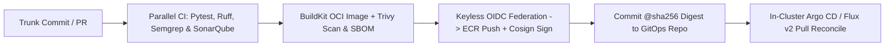

# Chapter 4: CI/CD Pipelines: Keyless Automation, Static Analysis, and GitOps Delivery

Continuous Integration and Continuous Delivery (CI/CD) form the central nervous system of a modern software engineering organization. Every line of application code, infrastructure construct, security policy, and Kubernetes manifest reaches production through an automated pipeline. Yet the architecture of CI/CD pipelines has changed dramatically over the past five years. First-generation pipelines—characterized by pet Jenkins servers running `cp myapp.war /srv/tomcat/webapps` over SSH, storing long-lived cloud administrator credentials in CI secret vaults, and executing imperative `kubectl apply` commands from external runners—have proven both operationally brittle and vulnerable to supply chain compromise.

In a 2026 cloud-native architecture, CI/CD is engineered around four strict principles:
1. **Trunk-Based Continuous Integration with DAG Parallelism**: Developers merge small, frequent commits into `main` verified by Directed Acyclic Graph (DAG) pipelines that execute linting, unit tests, Static Application Security Testing (SAST), and Software Composition Analysis (SCA) in parallel.
2. **Keyless OpenID Connect (OIDC) Federation**: CI runners never store static AWS, GCP, or Azure access keys. Every build job requests a cryptographically signed, short-lived OIDC JWT (`id-token: write`) scoped to the exact repository, branch, and environment.
3. **Immutable, Signed OCI Artifacts and SBOMs**: The output of Continuous Integration is never a mutable file copied onto a server; it is an immutable Open Container Initiative (OCI) artifact identified by its cryptographic `@sha256` digest, accompanied by a CycloneDX/SPDX Software Bill of Materials (SBOM) and a keyless **Sigstore Cosign** signature.
4. **Decoupled Pull-Based GitOps Delivery**: External CI runners do not hold cluster-admin credentials to push changes into production Kubernetes clusters. Instead, CI commits the verified image digest to a GitOps environment repository, and in-cluster controllers (**Argo CD** or **Flux v2**) pull and reconcile the desired state.

In this chapter, we engineer production pipelines across **GitHub Actions (with OIDC keyless federation)**, **GitLab CI/CD (with DAG `needs:` and `id_tokens`)**, **Kubernetes-native pipelines (Tekton and ephemeral Kubernetes Jenkins agents)**, integrated security gates (**Ruff, Semgrep, SonarQube, and Trivy**), and **Flux v2 / Argo CD GitOps** delivery.



## Architectural Evolution: From Push-Based Scripts to Keyless GitOps Pipelines

To appreciate why modern pipelines separate Continuous Integration (CI) from Continuous Delivery (CD), consider the blast radius of a traditional push-based pipeline. When a CI runner stores a static `AWS_SECRET_ACCESS_KEY` and a privileged `KUBECONFIG` token in its environment variables so it can run `helm upgrade` or `kubectl apply` against production, any compromise of a third-party CI plugin or upstream dependency during a build immediately grants the attacker full administrative control over production clusters.

```
+-----------------------------------------------------+
|        LEGACY PUSH CI/CD VS. MODERN CI + GITOPS     |
+------------------+----------------------------------+
| LAYER            | MODERN 2026 PRODUCTION STANDARD  |
+------------------+----------------------------------+
| Source Control & | Trunk-Based Dev on GitHub/GitLab |
| Branching Model  | (AWS CodeCommit is deprecated).  |
+------------------+----------------------------------+
| Cloud Auth       | Keyless OIDC Federation scoped   |
| from CI Runners  | by repo/branch JWT claims.       |
+------------------+----------------------------------+
| Code Quality &   | Fast AST Linters (Ruff), Semgrep |
| SAST / SCA Gates | SonarQube, and Trivy CVE/SBOM.   |
+------------------+----------------------------------+
| Packaging &      | BuildKit rootless OCI build +    |
| Provenance       | Cosign keyless sign + SLSA L3.   |
+------------------+----------------------------------+
| Production       | Pull-based GitOps via Argo CD or |
| Deployment       | Flux v2; zero cluster keys in CI.|
+------------------+----------------------------------+
```

By terminating the CI pipeline's responsibility at the artifact registry and the GitOps configuration repository, the production Kubernetes API server can remain completely private inside a VPC with zero inbound access from external CI SaaS networks.

## Engineering Keyless CI Workflows with GitHub Actions and OIDC

**GitHub Actions** executes workflows defined in `.github/workflows/*.yml` on ephemeral virtual machines or Kubernetes-managed Actions Runner Controller (ARC) pods.

### How Keyless OIDC Federation Works Under the Hood
When you configure `permissions: id-token: write` in a GitHub Actions job, GitHub's OIDC provider (`https://token.actions.githubusercontent.com`) mints a JSON Web Token (JWT) signed by GitHub's private key. This JWT contains verifiable claims identifying the exact workflow context:
- `iss`: `https://token.actions.githubusercontent.com`
- `aud`: `sts.amazonaws.com`
- `sub`: `repo:enterprise-org/payments-service:ref:refs/heads/main`
- `job_workflow_ref`: The exact workflow file and commit SHA being executed.

When the workflow calls `aws-actions/configure-aws-credentials@v4`, it presents this JWT to AWS Security Token Service (`AssumeRoleWithWebIdentity`). AWS STS verifies GitHub's cryptographic signature and checks the IAM Role's Trust Policy condition:

```json
{
  "Version": "2012-10-17",
  "Statement": [
    {
      "Effect": "Allow",
      "Principal": {
        "Federated": "arn:aws:iam::111122223333:oidc"
      },
      "Action": "sts:AssumeRoleWithWebIdentity",
      "Condition": {
        "StringEquals": {
          "oidc:aud": "sts.amazonaws.com",
          "oidc:sub": "repo:org/payments:ref:main"
        }
      }
    }
  ]
}
```

If the `sub` claim matches, AWS STS returns temporary credentials valid for a single hour. Feature branches (`refs/heads/feat-*`) cannot assume the production publishing role because their `sub` claim fails the strict `StringEquals` check.

### Complete Production GitHub Actions Pipeline
Below is a production-hardened `.github/workflows/ci-release.yml` workflow. Notice three critical security and performance practices:
1. **Least-Privilege `permissions` Block**: Top-level permissions are set to `contents: read`, elevating to `id-token: write` and `packages: write` only in the build/publish job.
2. **Parallel Quality and SAST Matrix**: **Ruff** (high-speed Rust-based Python linter/formatter), **Semgrep** (AST-based SAST security analysis), and **Pytest** run prior to building container layers.
3. **Integrated Trivy Vulnerability Scanning and Keyless Cosign Signing**: The built OCI image is scanned by **Trivy** for `CRITICAL` and `HIGH` CVEs with available fixes (`--ignore-unfixed`), pushed by digest to Amazon ECR, and signed keylessly with **Sigstore Cosign**.

```yaml
# .github/workflows/ci-release.yml
name: Production Keyless CI & Supply Chain Pipeline

on:
  push:
    branches: ["main"]
  pull_request:
    branches: ["main"]

permissions:
  contents: read

env:
  AWS_REGION: us-west-2
  ECR_REGISTRY: 111122223333.dkr.ecr.us-west-2.aws
  IMAGE_REPO: payments-service

jobs:
  quality-and-sast:
    name: Lint, SAST & Unit Tests
    runs-on: ubuntu-24.04
    steps:
      - name: Checkout Source Code
        uses: actions/checkout@v4

      - name: Set up Python 3.12 with Dependency Cache
        uses: actions/setup-python@v5
        with:
          python-version: "3.12"
          cache: "pip"

      - name: Install Application & Test Dependencies
        run: |
          python -m pip install --upgrade pip
          pip install ruff pytest pytest-cov semgrep
          pip install -r requirements.txt

      - name: Run Ruff Fast Linter & Format Check
        run: |
          ruff check .
          ruff format --check .

      - name: Run Semgrep SAST Security Rules
        run: |
          semgrep scan --config auto --error .

      - name: Execute Unit Tests with Coverage Gate
        run: |
          pytest --cov=src --cov-fail-under=85 tests/

  build-scan-and-sign:
    name: Build OCI Image, Scan CVEs & Sign
    needs: [quality-and-sast]
    if: >-
      github.event_name == 'push' &&
      github.ref == 'refs/heads/main'
    runs-on: ubuntu-24.04
    permissions:
      contents: read
      id-token: write
      security-events: write
    outputs:
      image_digest: ${{ steps.build.outputs.digest }}
    steps:
      - name: Checkout Repository
        uses: actions/checkout@v4

      - name: Set up Docker Buildx (BuildKit)
        uses: docker/setup-buildx-action@v3

      - name: Assume AWS Role via Keyless OIDC
        uses: aws-actions/configure-aws-credentials@v4
        with:
          role-to-assume: >-
            arn:aws:iam::111122223333:role/GHAEcrRole
          aws-region: ${{ env.AWS_REGION }}

      - name: Login to Amazon ECR
        uses: aws-actions/amazon-ecr-login@v2

      - name: Build & Push OCI Image with Cache
        id: build
        uses: docker/build-push-action@v6
        with:
          context: .
          push: true
          tags: >-
            ${{ env.ECR_REGISTRY }}/payments:latest
          cache-from: type=gha
          cache-to: type=gha,mode=max
          provenance: mode=max
          sbom: true

      - name: Scan Image with Trivy for Critical CVEs
        uses: aquasecurity/trivy-action@0.28.0
        with:
          image-ref: >-
            ${{ steps.build.outputs.digest }}
          format: "table"
          exit-code: "1"
          ignore-unfixed: true
          vuln-type: "os,library"
          severity: "CRITICAL,HIGH"

      - name: Install Sigstore Cosign CLI
        uses: sigstore/cosign-installer@v3.7.0

      - name: Sign Image Digest Keylessly via OIDC
        env:
          COSIGN_YES: "true"
        run: |
          IMAGE_URI="${ECR_REGISTRY}/${IMAGE_REPO}"
          DIGEST="${{ steps.build.outputs.digest }}"
          cosign sign "${IMAGE_URI}@${DIGEST}"
```

Notice the `provenance: mode=max` and `sbom: true` flags passed to `docker/build-push-action@v6`. BuildKit automatically generates an **SPDX Software Bill of Materials** and a **SLSA Provenance attestation** and attaches them directly to the image manifest in Amazon ECR, while `cosign sign` binds a cryptographic signature verified by GitHub's OIDC identity.

## GitLab CI/CD: DAG Pipelines, Kubernetes Runners, and `id_tokens`

In **GitLab CI/CD**, pipeline orchestration is defined in `.gitlab-ci.yml` and executed by **GitLab Runners**.

### Modernizing GitLab Runner Architecture
Historically, teams registered GitLab Runners manually on static virtual machines using a shared registration token. In GitLab 17+ (2026 standards), the legacy runner registration token flow has been replaced by **Runner Authentication Tokens (`glrt-...`)** deployed onto Kubernetes clusters via the official **GitLab Runner Helm Chart** using the **Kubernetes Executor**. Whenever a job starts, the runner dynamically provisions an isolated Kubernetes Pod with strict CPU/memory resource limits, executes the build steps inside rootless containers, and destroys the Pod immediately upon completion.

### Modern `.gitlab-ci.yml` Syntax: `rules:`, `needs:` DAGs, and `id_tokens:`
Two major syntax modernizations distinguish contemporary GitLab CI pipelines from legacy configurations:
1. **`rules:` Replaces Deprecated `only:` and `except:`**: The legacy `only: [master]` syntax is deprecated. Modern pipelines use expressive `rules:` blocks supporting boolean comparisons against `$CI_PIPELINE_SOURCE`, `$CI_COMMIT_BRANCH`, and file-path change detection (`changes:`).
2. **Directed Acyclic Graph (DAG) Execution via `needs:`**: By default, GitLab waits for every job in Stage A to finish before starting any job in Stage B. Adding `needs:` allows downstream jobs to start the instant their specific prerequisite finishes, cutting total pipeline wall-clock duration by 40–60%.
3. **First-Class OIDC via `id_tokens:`**: GitLab natively injects OIDC JWTs into environment variables specified under `id_tokens:`.

Here is a production `.gitlab-ci.yml` pipeline implementing DAG execution, SonarQube/Semgrep SAST, keyless AWS OIDC federation, and GitOps promotion:

```yaml
# .gitlab-ci.yml
stages:
  - verify
  - package
  - gitops_promote

variables:
  AWS_REGION: "us-west-2"
  ECR_HOST: "111122223333.dkr.ecr.us-west-2.aws"
  APP_IMAGE: "$ECR_HOST/payments-service"
  PYTHON_IMAGE: "python:3.12-slim-bookworm"

default:
  interruptible: true

lint_and_sast:
  stage: verify
  image: $PYTHON_IMAGE
  script:
    - pip install ruff semgrep
    - ruff check .
    - semgrep scan --config auto --error .
  rules:
    - if: $CI_PIPELINE_SOURCE == "merge_request_event"
    - if: $CI_COMMIT_BRANCH == $CI_DEFAULT_BRANCH

unit_tests:
  stage: verify
  image: $PYTHON_IMAGE
  script:
    - pip install pytest pytest-cov -r requirements.txt
    - pytest --cov=src --junitxml=report.xml
  artifacts:
    when: always
    reports:
      junit: report.xml
  rules:
    - if: $CI_PIPELINE_SOURCE == "merge_request_event"
    - if: $CI_COMMIT_BRANCH == $CI_DEFAULT_BRANCH

build_and_push_oci:
  stage: package
  # DAG: starts as soon as verify jobs succeed
  needs: ["lint_and_sast", "unit_tests"]
  image:
    name: gcr.io/kaniko-project/executor:v1.23.2-debug
    entrypoint: [""]
  id_tokens:
    GITLAB_OIDC_TOKEN:
      aud: https://gitlab.example.com
  script:
    - mkdir -p /kaniko/.docker
    # Configure Kaniko to exchange GitLab OIDC token
    - TOKEN_FILE="/tmp/oidc_token"
    - export AWS_WEB_IDENTITY_TOKEN_FILE="$TOKEN_FILE"
    - echo "$GITLAB_OIDC_TOKEN" > "$TOKEN_FILE"
    - ROLE="arn:aws:iam::111122223333:role/GitLabRole"
    - export AWS_ROLE_ARN="$ROLE"
    - /kaniko/executor
      --context "${CI_PROJECT_DIR}"
      --dockerfile "${CI_PROJECT_DIR}/Dockerfile"
      --destination "${APP_IMAGE}:${CI_COMMIT_SHA}"
      --digest-file /tmp/digest
    - echo "DIGEST=$(cat /tmp/digest)" >> build.env
  artifacts:
    reports:
      dotenv: build.env
  rules:
    - if: $CI_COMMIT_BRANCH == $CI_DEFAULT_BRANCH
```

Notice how `build_and_push_oci` uses **Kaniko** (or **BuildKit rootless**) to build and push the container image inside an unprivileged Kubernetes Pod without mounting `/var/run/docker.sock` (`Docker-in-Docker`), completely eliminating privileged container escape risks on the CI runner cluster.

## Kubernetes-Native Pipelines: Tekton, Argo Workflows, and Ephemeral Jenkins

While SaaS orchestrators like GitHub Actions and GitLab CI dominate cloud repositories, many regulated enterprises run self-hosted pipelines directly inside their Kubernetes clusters.

### Cloud-Native Execution with Tekton Pipelines and Argo Workflows
In Kubernetes-native CI architectures, **Tekton Pipelines** (a CNCF graduated project) and **Argo Workflows** replace monolithic CI servers with Kubernetes Custom Resource Definitions (CRDs):
- In **Tekton**, you define reusable `Task` CRDs (composed of sequential container `steps` sharing an emptyDir `/workspace` volume) and orchestrate them via `Pipeline` and `PipelineRun` CRDs.
- Because every `PipelineRun` is a native Kubernetes object, there is no central JVM coordinator to become a single point of failure, and workload identity is handled natively via Kubernetes `ServiceAccount` annotations (EKS Pod Identity or IRSA).

Here is a production Tekton `Task` and `Pipeline` specification (`tekton-pipeline.yaml`) that executes rootless **SonarQube** static quality analysis, **Ruff/Pytest** verification, and **BuildKit** daemonless image publishing inside an isolated Kubernetes namespace:

```yaml
# tekton-pipeline.yaml
apiVersion: tekton.dev/v1
kind: Task
metadata:
  name: pytest-and-sonarqube-gate
  namespace: ci-workloads
spec:
  params:
    - name: sonar-host-url
      type: string
    - name: sonar-project-key
      type: string
  workspaces:
    - name: source
  steps:
    - name: unit-test-coverage
      image: python:3.12-slim-bookworm
      workingDir: $(workspaces.source.path)
      script: |
        #!/usr/bin/env bash
        set -euo pipefail
        pip install ruff pytest pytest-cov
        pip install -r requirements.txt
        ruff check .
        pytest --cov=src --cov-report=xml:coverage.xml

    - name: sonarqube-quality-gate
      image: sonarsource/sonar-scanner-cli:11.1
      workingDir: $(workspaces.source.path)
      env:
        - name: SONAR_TOKEN
          valueFrom:
            secretKeyRef:
              name: sonarqube-ci-token
              key: token
      script: |
        #!/usr/bin/env sh
        set -eu
        KEY="$(params.sonar-project-key)"
        sonar-scanner \
          -Dsonar.projectKey="${KEY}" \
          -Dsonar.sources=src \
          -Dsonar.python.coverage.reportPaths=cov.xml \
          -Dsonar.host.url=$(params.sonar-host-url) \
          -Dsonar.qualitygate.wait=true
---
apiVersion: tekton.dev/v1
kind: Pipeline
metadata:
  name: microservice-ci-pipeline
  namespace: ci-workloads
spec:
  workspaces:
    - name: shared-workspace
  params:
    - name: git-url
      type: string
    - name: git-revision
      type: string
      default: main
    - name: image-reference
      type: string
  tasks:
    - name: fetch-repository
      taskRef:
        name: git-clone
      workspaces:
        - name: output
          workspace: shared-workspace
      params:
        - name: url
          value: $(params.git-url)
        - name: revision
          value: $(params.git-revision)

    - name: verify-and-scan
      runAfter: ["fetch-repository"]
      taskRef:
        name: pytest-and-sonarqube-gate
      workspaces:
        - name: source
          workspace: shared-workspace
      params:
        - name: sonar-host-url
          value: "https://sonar.internal.example.com"
        - name: sonar-project-key
          value: "payments-service"
```

Notice the `-Dsonar.qualitygate.wait=true` flag passed to `sonar-scanner`. This instructs the Tekton step to poll SonarQube's webhook state machine until the server-side AST analysis finishes, failing the `TaskRun` immediately if new code coverage drops below 80%, duplicated lines exceed 3%, or any security hotspot/vulnerability rating is worse than `A`.

### Modernizing Existing Enterprise Jenkins with Ephemeral Kubernetes Pod Agents
For organizations maintaining existing **Jenkins** investments, the legacy practice of running builds on static, shared agent VMs (`agent any`) or copying `.war` files onto Tomcat servers is strictly obsolete. Modern Jenkins architectures use the **Jenkins Kubernetes Plugin** combined with **Configuration as Code (JCasC)** so that the controller spins up an ephemeral, multi-container Kubernetes Pod for every single `Jenkinsfile` execution and tears it down immediately afterward:

```groovy
// Jenkinsfile (Ephemeral Kubernetes Pod Agent)
pipeline {
  agent {
    kubernetes {
      yaml '''
        apiVersion: v1
        kind: Pod
        spec:
          serviceAccountName: jenkins-ci-oidc-sa
          securityContext:
            runAsNonRoot: true
            runAsUser: 1000
          containers:
          - name: python
            image: python:3.12-slim-bookworm
            command: ["sleep", "infinity"]
          - name: trivy
            image: aquasec/trivy:0.56.2
            command: ["sleep", "infinity"]
      '''
    }
  }
  stages {
    stage('Lint & Unit Test') {
      steps {
        container('python') {
          sh '''
            python -m venv /tmp/venv
            . /tmp/venv/bin/activate
            pip install ruff pytest -r requirements.txt
            ruff check .
            pytest tests/
          '''
        }
      }
    }
    stage('Filesystem & Dependency Scan') {
      steps {
        container('trivy') {
          sh '''
            trivy fs --scanners vuln,secret,misconfig \
              --severity CRITICAL,HIGH \
              --exit-code 1 .
          '''
        }
      }
    }
  }
}
```

## Closing the Loop: Pull-Based GitOps Delivery with Argo CD and Flux v2

Once our CI pipeline has compiled, tested, scanned, pushed, and cryptographically signed the OCI image (`payments-service@sha256:4a8b9c...`), how does that artifact reach Staging and Production?

Rather than running `kubectl set image` from the CI runner, the pipeline updates a declarative **Kustomize** overlay or **HelmRelease** manifest inside a dedicated GitOps repository (`enterprise-org/k8s-gitops-fleet`), or relies on **Flux Image Automation Controller** / **Argo CD Image Updater** to observe the registry directly.

Here is how a **Flux v2 `Kustomization`** and **`HelmRelease`** (or **Argo CD `Application`**) continuously reconciles the production cluster state from Git and automatically rolls back if health checks fail:

```yaml
# clusters/production/payments-kustomization.yaml
apiVersion: kustomize.toolkit.fluxcd.io/v1
kind: Kustomization
metadata:
  name: payments-service-prod
  namespace: flux-system
spec:
  interval: 2m0s
  path: ./apps/production/payments-service
  prune: true
  wait: true
  timeout: 3m0s
  sourceRef:
    kind: GitRepository
    name: fleet-infra
  # Verify Cosign signature before applying!
  verify:
    provider: cosign
  healthChecks:
    - apiVersion: apps/v1
      kind: Deployment
      name: payments-service
      namespace: payments
```

When the in-cluster controller detects a new commit in `apps/production/payments-service/kustomization.yaml` pinning the newly verified `@sha256` image digest:
1. It validates the commit's cryptographic signature.
2. It applies the updated `Deployment` manifest to the local Kubernetes API server.
3. Paired with a progressive delivery controller such as **Argo Rollouts** or **Flagger**, traffic shifts gradually (`5% -> 25% -> 50% -> 100%`) while querying Prometheus SLO metrics. If the HTTP `5xx` error rate or P99 latency breaches the threshold during the canary window, the controller aborts the rollout and routes 100% of traffic back to the previous revision automatically.

## Summary

Modern CI/CD pipelines have evolved from brittle, credential-laden shell scripts into cryptographically verifiable software factories. By standardizing on trunk-based DAG workflows in GitHub Actions and GitLab CI, eliminating static cloud secrets via OIDC workload identity federation, enforcing shift-left SAST and CVE gates with Ruff, Semgrep, and Trivy, building rootless OCI images with BuildKit/Kaniko, signing digests with Sigstore Cosign, and decoupling deployment via pull-based GitOps controllers, engineering teams achieve both elite deployment velocity and zero-trust supply chain security. In Chapter 5, we examine the OCI v1.1 artifact registries and package repositories that store and govern these artifacts.
