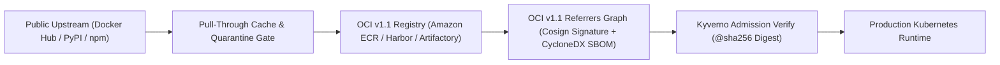

# Chapter 5: Artifact Repositories and OCI v1.1 Supply Chain Registries

Every modern software system is assembled from a complex graph of binary artifacts: operating system base layers, language packages (Python wheels, npm tarballs, Go modules, Maven JARs, Rust crates), Helm charts, Open Policy Agent (OPA) bundles, WebAssembly (Wasm) modules, and Open Container Initiative (OCI) container images. If a CI/CD pipeline pulls dependencies directly from public internet registries on every build without caching, provenance verification, or namespace isolation, the organization is exposed to three severe operational and security risks:
1. **Upstream Outages and Rate-Limiting**: A transient outage or anonymous pull rate-limit on Docker Hub, PyPI, or npm immediately halts production builds and Kubernetes node autoscaling across the entire enterprise.
2. **Tag Mutation Attacks**: In container and package registries that permit mutable tags, an attacker (or human error) can overwrite `v1.4.2` or `latest` with a malicious binary while keeping the tag string identical.
3. **Dependency Confusion and Typosquatting**: If an internal package name (`@corp/auth-utils` or `payments-common`) is registered by an attacker on public npm or PyPI with a higher semantic version number (`99.0.0`), misconfigured package managers will silently pull and execute the attacker's public package over the private internal library.

Modern DevOps architectures eliminate these failure modes by placing **OCI v1.1-compliant artifact registries** and **language package repositories** at the center of the software supply chain. In this chapter, we examine the architecture of **OCI v1.1 registries**, master the **OCI Referrers API** and **ORAS** for attaching SBOMs and **Sigstore Cosign** signatures to image digests, engineer production registries with **Amazon ECR**, **CNCF Harbor** (which completely superseded legacy, archived frontends like Portus), **JFrog Artifactory**, and **Sonatype Nexus**, and enforce **Dependency Confusion** defenses in **AWS CodeArtifact**.



## The OCI v1.1 Revolution: Content-Addressable Universal Registries

Historically, teams operated separate storage backends for every artifact type: a Docker Registry v2 for container images, a ChartMuseum server for Helm charts, and file servers for security policies and SBOMs. The **Open Container Initiative (OCI) Image and Distribution Specifications v1.1** unified these silos by transforming container registries into **universal, content-addressable Merkle-tree object stores**.

### How Content-Addressable Digests Work
In an OCI v1.1 registry (such as **Amazon ECR**, **CNCF Harbor**, **GitHub Container Registry `ghcr.io`**, or **Google Artifact Registry**), human-readable tags (`v2.1.0`, `main`, `latest`) are merely mutable pointers. The true identity of every artifact is its **cryptographic SHA-256 digest**, calculated over the canonical JSON representation of its OCI Manifest or Image Index:

```text
111122223333.dkr.ecr.us-west-2.aws/pay@sha256:8f4b2c...
```

An OCI Manifest contains:
- **`mediaType`**: Identifies the manifest structure (`application/vnd.oci.image.manifest.v1+json`).
- **`artifactType`**: Identifies the payload type (for example, `application/vnd.cncf.helm.config.v1+json` for a Helm chart, `application/vnd.cyclonedx+json` for a CycloneDX SBOM, or `application/vnd.dev.cosign.artifact.sig.v1+json` for a Cosign signature).
- **`config`**: A content-addressable blob descriptor containing runtime configuration.
- **`layers`**: An ordered array of content-addressable blob descriptors (each identified by its own `sha256` digest and byte size).
- **`subject` (Introduced in OCI v1.1)**: An optional descriptor pointing to another manifest's `sha256` digest in the same repository.

```
+-----------------------------------------------------+
|       OCI v1.1 REFERRERS GRAPH (MERKLE DAG)         |
+-----------------------------------------------------+
|                                                     |
|  [Multi-Arch Index: payments@sha256:8f4b2c...]      |
|     |                                |              |
|     +--> linux/amd64 Manifest        +--> arm64     |
|                                                     |
|     ^                 ^                  ^          |
|     | (subject)       | (subject)        | (subject)|
|  +--+----------+   +--+-----------+   +--+--------+ |
|  | Cosign OIDC |   | CycloneDX    |   | SLSA L3   | |
|  | Signature   |   | SBOM v1.6    |   | Provenance| |
|  +-------------+   +--------------+   +-----------+ |
+-----------------------------------------------------+
```

### The OCI v1.1 Referrers API and ORAS CLI
Before OCI v1.1, attaching a Software Bill of Materials (SBOM) or a cryptographic signature to a container image required encoding the image's digest into ugly pseudo-tags (such as `sha256-8f4b2c.sbom` or `sha256-8f4b2c.sig`), which cluttered repository tag listings and complicated lifecycle garbage collection.

With the **OCI v1.1 `subject` field and Referrers API (`/v2/<name>/referrers/<digest>`)**, tools like **ORAS (OCI Registry As Storage)**, **Sigstore Cosign**, and **Trivy** attach supply chain metadata directly to the parent image digest as a child node in a Directed Acyclic Graph (DAG). When a lifecycle policy deletes an expired container image, the registry automatically garbage-collects all of its attached SBOMs, signatures, and vulnerability attestations.

Here is how to use the **ORAS CLI** and **Syft** in a pipeline to generate a CycloneDX JSON SBOM, attach it to a container image via the OCI v1.1 Referrers API, and query the resulting supply chain graph:

```bash
# 1. Define the immutable OCI image digest URI
REG="111122223333.dkr.ecr.us-west-2.amazonaws.com"
DIGEST="sha256:8f4b2c9e1a7d3b5c0e2f4a6b8d0c2e4f"
IMAGE_REF="${REG}/payments@${DIGEST}"

# 2. Generate CycloneDX 1.6 SBOM from image digest
syft "${IMAGE_REF}" -o cyclonedx-json=sbom.cdx.json

# 3. Attach SBOM to image via OCI v1.1 subject field
oras attach \
  --artifact-type application/vnd.cyclonedx+json \
  "${IMAGE_REF}" \
  sbom.cdx.json:application/vnd.cyclonedx+json

# 4. Query the OCI v1.1 Referrers API to inspect the
#    attached SBOMs, Cosign signatures, & attestations
oras discover -o tree "${IMAGE_REF}"
```

Executing `oras discover -o tree` renders the complete cryptographic provenance tree bound to that specific image digest.

### Inspecting OCI v1.1 Manifests and Referrers with `crane` and `skopeo`
In production debugging and CI automation, pulling a 2 GB container image merely to inspect its labels, architecture variants, or attached SBOMs wastes time and network bandwidth. Modern container engineers use lightweight, daemonless OCI registry tools—specifically Google's **`crane`** (from `go-containerregistry`) and Red Hat's **`skopeo`**—to interact directly with the OCI Distribution HTTP API without a local Docker daemon.

For example, when `oras attach` binds our CycloneDX SBOM to `payments@sha256:8f4b2c...`, you can inspect the raw OCI v1.1 referrer manifest JSON using `crane manifest`:

```json
{
  "schemaVersion": 2,
  "mediaType": "application/vnd.oci.image.manifest.v1",
  "artifactType": "application/vnd.cyclonedx+json",
  "config": {
    "mediaType": "application/vnd.oci.empty.v1+json",
    "digest": "sha256:44136fa355b3678a1146ad16f7e8649",
    "size": 2
  },
  "layers": [
    {
      "mediaType": "application/vnd.cyclonedx+json",
      "digest": "sha256:9b1c8e2a4d6f8a0b2c4e6f8a0b2c",
      "size": 48120,
      "annotations": {
        "org.opencontainers.image.title": "sbom.json"
      }
    }
  ],
  "subject": {
    "mediaType": "application/vnd.oci.image.index.v1",
    "digest": "sha256:8f4b2c9e1a7d3b5c0e2f4a6b8d0c",
    "size": 1842
  }
}
```

Notice two defining features of this OCI v1.1 manifest:
1. **`config.mediaType` is `application/vnd.oci.empty.v1+json`**: Non-container artifacts (like SBOMs, OPA policies, or Helm charts) that do not need a container runtime configuration JSON use the standardized 2-byte `{}` empty config blob (`sha256:44136fa...`).
2. **`subject` points directly to the parent image digest**: Any OCI v1.1-compliant registry automatically indexes this `subject.digest` field and returns this manifest whenever an admission controller queries `GET /v2/payments/referrers/sha256:8f4b2c...?artifactType=application/vnd.cyclonedx%2Bjson`.

You can also copy images across registries (for example, promoting a verified image from a staging Harbor registry to a production Amazon ECR registry across cloud boundaries) using `crane copy` or `skopeo copy --all`, which streams compressed layer blobs directly from registry to registry without decompressing them onto disk.

## Amazon ECR: Immutable Tags, Pull-Through Caches, and Lifecycle Governance

For workloads running on AWS (Amazon EKS, Amazon ECS on Fargate, and AWS Lambda), **Amazon Elastic Container Registry (Amazon ECR)** provides a fully managed, OCI v1.1-compliant registry backed by Amazon S3 durability and IAM/KMS access controls.

To harden Amazon ECR for production in 2026, four architectural controls must be enabled on every repository:

1. **Tag Immutability (`ImageTagMutability="IMMUTABLE"`)**: Prevents any user or CI job from overwriting an existing version tag (`v1.2.0`), forcing every new build to publish a distinct tag and digest.
2. **KMS Envelope Encryption**: Encrypts all stored layers at rest using a Customer-Managed KMS Key (CMK).
3. **Enhanced Scanning with Amazon Inspector**: Unlike legacy basic scanning (which only scanned on push), **Amazon Inspector Enhanced Scanning** continuously monitors pushed images against live CVE feeds and emits an EventBridge alert the moment a newly disclosed zero-day CVE affects an already-stored image layer.
4. **Pull-Through Cache Rules**: Automatically caches public upstream images from **Amazon ECR Public**, **Kubernetes Registry (`registry.k8s.io`)**, **GitHub Container Registry (`ghcr.io`)**, **Chainguard**, and **Docker Hub** inside your private regional ECR registry. When a Kubernetes node pulls `111122223333.dkr.ecr.us-west-2.amazonaws.com/k8s-cache/pause:3.10`, ECR fetches it once from upstream, caches it locally in your region, scans it, and serves all subsequent pulls over private VPC endpoints (`com.amazonaws.us-west-2.ecr.dkr` and `s3`).

Here is how to provision a hardened Amazon ECR repository with tag immutability, KMS encryption, automated lifecycle pruning, and a Kubernetes pull-through cache rule using **AWS CDK v2** (`aws-cdk-lib`):

```python
# stacks/ecr_registry_stack.py
from aws_cdk import (
    Duration,
    RemovalPolicy,
    Stack,
    aws_ecr as ecr,
    aws_kms as kms,
)
from constructs import Construct


class HardenedContainerRegistryStack(Stack):
    def __init__(
        self,
        scope: Construct,
        construct_id: str,
        **kwargs,
    ) -> None:
        super().__init__(scope, construct_id, **kwargs)

        # 1. KMS Key for ECR Layer Encryption
        ecr_kms = kms.Key(
            self,
            "EcrLayerEncryptionKey",
            enable_key_rotation=True,
            removal_policy=RemovalPolicy.RETAIN,
        )

        # 2. Pull-Through Cache for registry.k8s.io
        ecr.CfnPullThroughCacheRule(
            self,
            "K8sUpstreamPullThroughCache",
            ecr_repository_prefix="k8s-upstream",
            upstream_registry_url="registry.k8s.io",
        )

        # 3. Immutable, KMS-Encrypted Application Repo
        self.payments_repo = ecr.Repository(
            self,
            "PaymentsServiceRepo",
            repository_name="payments-service",
            image_tag_mutability=(
                ecr.TagMutability.IMMUTABLE
            ),
            encryption=ecr.RepositoryEncryption.KMS,
            encryption_key=ecr_kms,
            image_scan_on_push=True,
            removal_policy=RemovalPolicy.RETAIN,
        )

        # 4. Lifecycle Policy: Purge untagged images
        #    after 3 days; retain last 30 prod releases
        self.payments_repo.add_lifecycle_rule(
            description="Expire untagged layers in 3d",
            tag_status=ecr.TagStatus.UNTAGGED,
            max_image_age=Duration.days(3),
            rule_priority=1,
        )
        self.payments_repo.add_lifecycle_rule(
            description="Retain last 30 tagged images",
            tag_status=ecr.TagStatus.ANY,
            max_image_count=30,
            rule_priority=2,
        )
```

## Cloud-Native Self-Hosted Registries with CNCF Harbor

In hybrid-cloud, multi-cloud, or air-gapped sovereign Kubernetes environments where teams require a vendor-neutral OCI v1.1 registry, **Harbor** (a CNCF Graduated project) is the undisputed industry standard. *(Note: Early first-generation Docker Registry web wrappers such as SUSE Portus have been permanently archived and deprecated; all self-hosted enterprise registry deployments should standardize on CNCF Harbor, JFrog Artifactory, or Sonatype Nexus.)*

Harbor provides a cloud-native architecture purpose-built for Kubernetes and DevSecOps:
- **Project-Level Multi-Tenancy and OIDC**: Integrates natively with enterprise OIDC providers (Keycloak, Okta, Entra ID, Dex) and issues scoped **Robot Accounts** for CI/CD pipelines.
- **Pluggable Vulnerability Scanning (Trivy)**: Scans container images and OCI Helm charts on push and on a nightly schedule.
- **Built-In Deployment Security Gates**: Harbor enforces project-level **Prevent Vulnerable Images from Running** policies (blocking any `docker pull` / `crictl pull` of an image containing a CVE above a configured CVSS v3 threshold, such as `HIGH` or `CRITICAL`) and **Cosign / Notation Signature Enforcement** (blocking pulls of unsigned images at the registry layer itself).
- **P2P Distribution for AI/ML and Large Images**: Integrates with **CNCF Dragonfly** and **Kraken** peer-to-peer distribution networks to pre-heat and distribute 20 GB+ AI/ML model weights and container images across thousands of GPU worker nodes without saturating registry egress bandwidth.

Here is a production `values.yaml` configuration for deploying **Harbor** onto Kubernetes via Helm with **Trivy** scanning, S3 object storage, and strict TLS:

```yaml
# harbor-values.yaml
expose:
  type: clusterIP
  tls:
    enabled: true
    certSource: secret
    secret:
      secretName: harbor-tls-cert
  clusterIP:
    name: harbor-core

externalURL: https://registry.internal.example.com

persistence:
  enabled: true
  imageChartStorage:
    type: s3
    s3:
      region: us-west-2
      bucket: enterprise-harbor-oci-storage-prod
      encrypt: true
      secure: true
      v4auth: true

trivy:
  enabled: true
  vulnType: "os,library"
  severity: "UNKNOWN,LOW,MEDIUM,HIGH,CRITICAL"
  ignoreUnfixed: false
  resources:
    requests:
      cpu: 500m
      memory: 1Gi
    limits:
      cpu: 2000m
      memory: 2Gi

metrics:
  enabled: true
  serviceMonitor:
    enabled: true
```

## Universal Package Governance: JFrog Artifactory, Sonatype Nexus, and AWS CodeArtifact

While OCI v1.1 registries store containers, Helm charts, and supply chain attestations, application builds also consume thousands of language-specific libraries from **PyPI**, **npm**, **Maven Central**, **NuGet**, **Cargo**, and **Go Proxy**.

Universal artifact managers—including **JFrog Artifactory**, **Sonatype Nexus Repository**, and **AWS CodeArtifact**—organize language repositories into a three-tier topology:

```
+-----------------------------------------------------+
|     THREE-TIER ENTERPRISE REPOSITORY TOPOLOGY       |
+------------------+----------------------------------+
| REPOSITORY TIER  | ARCHITECTURAL ROLE & CONTROLS    |
+------------------+----------------------------------+
| 1. Local /       | Stores internal first-party      |
|    Hosted Repo   | packages (`@corp/*`) built by    |
|                  | internal CI pipelines.           |
+------------------+----------------------------------+
| 2. Remote /      | Caches & scans public upstream   |
|    Proxy Repo    | packages (PyPI, npm, Maven).     |
|                  | Blocks malware & copyleft libs.  |
+------------------+----------------------------------+
| 3. Virtual /     | Exposes a single URL endpoint,   |
|    Group Repo    | enforcing Local-first resolution.|
+------------------+----------------------------------+
```

### Defending Against Dependency Confusion Attacks in AWS CodeArtifact
In 2021, security researcher Alex Birsan demonstrated **Dependency Confusion**: if a company uses an internal Python package named `acme-telemetry==1.2.0` hosted in a private repository, and an attacker uploads a package with the exact same name `acme-telemetry==99.0.0` to public PyPI, `pip install acme-telemetry` configured with both an `--index-url` and `--extra-index-url` will download and execute `99.0.0` from public PyPI because `99.0.0 > 1.2.0`.

To eliminate Dependency Confusion in **AWS CodeArtifact** (as well as Artifactory and Nexus), you must enforce two mandatory controls:
1. **Never use `pip --extra-index-url`**: Configure clients (`pip`, `uv`, `npm`, `mvn`) to point **exclusively** to your single internal CodeArtifact repository endpoint (`--index-url`), letting CodeArtifact manage upstream connections on the server side.
2. **Enforce Package Origin Controls (`put-package-origin-configuration`)**: When you publish an internal package (`corp-payments-sdk`) to AWS CodeArtifact, lock its package origin configuration to `upstream=BLOCK` and `publish=ALLOW`. Even if an attacker registers `corp-payments-sdk` on public PyPI with version `999.0.0`, AWS CodeArtifact is cryptographically forbidden from fetching any version of `corp-payments-sdk` from the public PyPI upstream connection!

Here is a complete automation script demonstrating keyless authentication to **AWS CodeArtifact**, configuring `pip`, and locking internal package origin controls against Dependency Confusion:

```bash
#!/usr/bin/env bash
set -euo pipefail

DOMAIN="enterprise-artifacts"
OWNER="111122223333"
REPO="python-virtual-repo"
REGION="us-west-2"

# 1. Authenticate pip to AWS CodeArtifact using short-
#    lived STS/OIDC token (valid for 12 hours)
aws codeartifact login \
  --tool pip \
  --domain "${DOMAIN}" \
  --domain-owner "${OWNER}" \
  --repository "${REPO}" \
  --region "${REGION}"

# 2. Lock internal package 'corp-payments-sdk' so
#    CodeArtifact NEVER fetches it from public PyPI
aws codeartifact put-package-origin-configuration \
  --domain "${DOMAIN}" \
  --domain-owner "${OWNER}" \
  --repository "${REPO}" \
  --format pypi \
  --package "corp-payments-sdk" \
  --restrictions publish=ALLOW,upstream=BLOCK \
  --region "${REGION}"
```

### Automated Quarantine Firewalls in JFrog Artifactory and Sonatype Nexus
In enterprise environments running **JFrog Artifactory (with JFrog Xray)** or **Sonatype Nexus Repository (with Nexus Firewall)**, the Remote/Proxy repository tier acts as an active security firewall between public package registries (PyPI, npm, Maven Central, Cargo) and internal developers:
- **Malware and Newly Published Package Quarantine**: Over 80% of open-source supply chain malware on npm and PyPI is detected within 48 hours of publication. Artifactory Curation and Nexus Firewall can be configured with a **Quarantine Age Policy** that holds newly published upstream package versions in quarantine until they pass automated static malware analysis (inspecting `setup.py` pre-install hooks and `package.json` `postinstall` scripts for obfuscated credential harvesting).
- **License Compliance Gates**: Automatically blocks packages bearing copyleft licenses (such as AGPLv3) from entering commercial microservice builds while permitting MIT, Apache-2.0, and BSD-3-Clause dependencies.
- **Artifactory Query Language (AQL) Lifecycle Cleanup**: In large enterprises generating terabytes of snapshot builds daily, engineers use AQL specifications (`cleanup-spec.json`) with the JFrog CLI (`jf rt del --spec=cleanup-spec.json`) to prune unpromoted staging artifacts that have not been downloaded in 30 days while preserving any artifact linked to a production build promotion record:

```json
{
  "files": [
    {
      "aql": {
        "items.find": {
          "repo": "docker-staging-local",
          "$and": [
            {
              "created": { "$before": "30d" }
            },
            {
              "stat.downloads": { "$eq": null }
            },
            {
              "@release.status": {
                "$ne": "promoted-to-prod"
              }
            }
          ]
        }
      }
    }
  ]
}
```

### Publishing and Consuming OCI Helm Charts and GitHub Attestations
In addition to language packages and container images, modern Kubernetes teams no longer host legacy `index.yaml`-based Helm chart web servers (which scaled poorly once `index.yaml` exceeded tens of megabytes). Since Helm v3.8+, **OCI Registry support is the standard mechanism for distributing Helm charts**:

```bash
# Package a Helm chart into a versioned .tgz archive
helm package ./charts/payments-service

# Push the Helm chart directly to an OCI v1.1 registry
ECR_CHARTS="oci://111122223333.dkr.ecr.us-west-2.aws"
helm push payments-service-2.4.0.tgz "${ECR_CHARTS}"

# Sign the OCI Helm chart digest keylessly with Cosign
CHART_DIGEST="sha256:3c9a1b..."
cosign sign "${ECR_CHARTS}/payments@${CHART_DIGEST}"
```

Similarly, for teams hosting source code and containers on **GitHub Container Registry (`ghcr.io`)**, GitHub's native `actions/attest-build-provenance@v2` and `actions/attest-sbom@v2` actions generate Sigstore-signed **in-toto SLSA v1.0 provenance bundles** and push them directly to `ghcr.io` via the OCI v1.1 Referrers API, allowing downstream consumers to verify any package with a single CLI call (`gh attestation verify oci://ghcr.io/enterprise-org/payments-service:v2.4.0 --owner enterprise-org`).

## Summary

Artifact repositories and OCI v1.1 registries are the cryptographic vaults of a modern software supply chain. By replacing mutable tags and unverified public pulls with content-addressable `@sha256` digests, attaching CycloneDX SBOMs and Sigstore Cosign signatures via the OCI v1.1 Referrers API and ORAS, hardening Amazon ECR and CNCF Harbor with continuous vulnerability scanning and pull-through caches, and enforcing Package Origin Controls in AWS CodeArtifact to defeat Dependency Confusion, engineering teams guarantee that every binary entering production is authentic, immutable, and auditable. In Chapter 6, we dive deep into the container runtime engine—**containerd 2.0**, **BuildKit**, and minimal **Wolfi/Distroless** images—that builds and executes these OCI artifacts.
