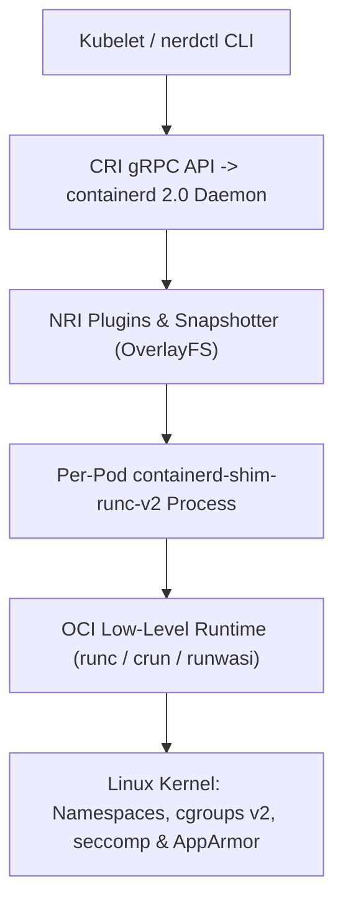

# Chapter 6: Container Runtimes, BuildKit, and Minimal OCI Engineering

Containers are the foundational unit of software packaging and execution in modern cloud-native infrastructure. Yet a surprising number of engineers treat containers as "lightweight virtual machines" and continue to write Dockerfiles using decade-old patterns: pulling mutable `:latest` tags, running sequential single-stage builds that bake compilers and package managers into production images, executing processes as `UID 0 (root)`, and copying private API tokens into intermediate image layers.

To engineer high-performance, zero-trust container workloads in 2026, you must understand what a container actually is at the Linux kernel level, how the modern **Open Container Initiative (OCI)** runtime stack (**`containerd 2.0`**, **`containerd-shim-runc-v2`**, and **`runc` / `crun`**) executes workloads on Kubernetes nodes, how **BuildKit** compiles multi-architecture images using concurrent Directed Acyclic Graphs (DAGs) with secret and cache mounts, and how **Chainguard Wolfi** and **Google Distroless** base images eliminate entire classes of vulnerabilities and post-exploitation shells.



## Linux Kernel Primitives: What a Container Actually Is

There is no object called a "container" inside the Linux kernel source code. A container is simply a standard host Linux process (created via the `clone(2)` and `execve(2)` system calls) that has been restricted by three orthogonal kernel mechanisms:

### 1. Kernel Namespaces (Isolation of Visibility: *What a Process Can See*)
Linux namespaces partition global kernel resources so that a group of processes sees its own isolated view of the system:
- **`pid` (Process ID)**: The container's entry process becomes `PID 1` inside the namespace, isolated from inspecting or signaling host processes.
- **`net` (Network)**: Provides an isolated network stack (`lo`, virtual Ethernet `veth` pairs, routing tables, IP addresses, and socket ports).
- **`mnt` (Mount)**: Isolates the filesystem mount table, combined with `pivot_root(2)` to swap the root filesystem (`/`) to the container's unpacked OCI image bundle.
- **`uts` (UNIX Time-Sharing)**: Isolates the hostname and NIS domain name.
- **`ipc` (Inter-Process Communication)**: Isolates POSIX message queues and System V shared memory segments.
- **`user` (User Namespace)**: Maps a non-root UID/GID on the host (for example, `UID 165536`) to `UID 0` inside the container, forming the foundation of **rootless containers** and Kubernetes **User Namespaces** (`hostUsers: false` in Kubernetes v1.31+).
- **`cgroup` (Control Group Namespace)**: Virtualizes `/proc/self/cgroup` so the process only sees its own relative control group hierarchy.

### 2. Control Groups v2 (`cgroups v2` — Resource Governance: *What a Process Can Use*)
While namespaces control visibility, **`cgroups v2`** (the unified control group hierarchy mandated across modern Linux distributions since Ubuntu 22.04+, RHEL 9+, and Amazon Linux 2023) enforces hardware resource ceilings across CPU weight (`cpu.weight`), hard CPU bandwidth quotas (`cpu.max`), memory limits (`memory.max` and `memory.high`), Block I/O throughput (`io.max`), and maximum process/thread counts (`pids.max`, which prevents fork-bomb denial-of-service attacks). When a container allocates memory beyond its `memory.max` cgroup boundary, the Linux kernel Out-Of-Memory (OOM) killer immediately terminates the process with exit code `137` (`128 + SIGKILL(9)`).

### 3. OverlayFS Copy-on-Write Snapshotters
OCI container images consist of an ordered stack of immutable, read-only tar archives (layers). When a container starts, **`containerd`** uses the Linux **OverlayFS** filesystem driver to mount the read-only image layers as `lowerdir` and places a thin, ephemeral read-write directory (`upperdir`) on top. If 50 containers on the same Kubernetes node share the same base layer digest, all 50 containers share the exact same physical blocks on disk and in the Linux page cache (`lowerdir`), starting in milliseconds with near-zero storage overhead.

## The Modern Runtime Stack: `containerd 2.0`, CRI, and OCI `runc` / `crun`

In the early days of Docker, the monolithic `dockerd` daemon handled everything: CLI UX, image building, volume management, networking, and container execution. When Kubernetes originally launched, the `kubelet` had to talk to `dockerd` through a translation bridge called `dockershim`, which then called `containerd`, which called `runc`.

To eliminate this unnecessary indirection, Docker spun out **`containerd`** to the Cloud Native Computing Foundation (CNCF) and donated the low-level runtime **`runc`** to the **Open Container Initiative (OCI)**. Today, Kubernetes (`kubelet`) communicates directly with **`containerd 2.0`** over the gRPC **Container Runtime Interface (CRI)**.

```
+-----------------------------------------------------+
|     ARCHITECTURE OF CONTAINERD 2.0 RUNTIME STACK    |
+--------------------+--------------------------------+
| RUNTIME COMPONENT  | ARCHITECTURAL RESPONSIBILITY   |
+--------------------+--------------------------------+
| containerd 2.0     | High-level CNCF CRI daemon.    |
| (CRI Server)       | Pulls OCI v1.1 images, manages |
|                    | OverlayFS, CNI, & NRI plugins. |
+--------------------+--------------------------------+
| containerd-shim-   | Lightweight per-Pod daemonless |
| runc-v2            | parent process. Keeps stdio    |
|                    | open & reports exit codes.     |
+--------------------+--------------------------------+
| runc / crun        | Low-level OCI Runtime Spec.    |
| (or runwasi)       | Sets up namespaces, cgroups v2,|
|                    | seccomp, calls execve & EXITS. |
+--------------------+--------------------------------+
```

### Why `runc` Exits After Starting Your Container
A crucial architectural detail surprises many engineers: **`runc` (or its fast C-based alternative `crun`) is not a long-running parent process of your container.**
1. When `containerd` starts a Pod, it spawns a lightweight `containerd-shim-runc-v2` process.
2. The shim invokes `runc create` and `runc start`, pointing to an OCI runtime bundle (`config.json` and `rootfs/`).
3. `runc` makes the Linux kernel syscalls to set up the namespaces, `cgroups v2`, capabilities, and `seccomp` filters, starts your application binary inside the container, and **immediately exits**.
4. `containerd-shim-runc-v2` remains as the direct parent of your container process. Because of this decoupled architecture, you can upgrade or restart the `containerd` daemon on a production Kubernetes node **with zero downtime to running containers**!

### What is New in `containerd 2.0`
Released as a major milestone for the CNCF ecosystem, **`containerd 2.0`** introduces:
- **First-Class Node Resource Interface (NRI) Enabled by Default**: Allows security and observability plugins (like Cilium, Falco, or topology-aware hardware managers) to hook directly into container lifecycle events and adjust cgroup/device allocations without patching `containerd`.
- **Transfer Service API**: Moves image pull, unpack, and registry authentication logic from the client into `containerd` core, improving pull performance and OCI v1.1 compatibility.
- **Unified Sandbox API for MicroVMs and WebAssembly**: Allows `containerd 2.0` to orchestrate standard Linux containers (`runc`/`crun`), **Kata Containers / Firecracker microVMs**, and **WebAssembly workloads (`runwasi` / SpinKube)** side by side on the same node using `RuntimeClass`.

### Interacting Directly with `containerd` via `nerdctl` and `crictl`
On production Kubernetes worker nodes, the Docker daemon (`dockerd`) is not installed. Engineers interact with `containerd` directly using two CLI tools:
- **`crictl`**: The Kubernetes CRI debugging CLI used to inspect Pods (`crictl pods`), containers (`crictl ps`), logs (`crictl logs`), and images (`crictl images`) on a node.
- **`nerdctl`**: A Docker-compatible CLI built natively for `containerd` that supports rootless containers, BuildKit builds (`nerdctl build`), OCI lazy-pulling (eStargz / SOCI), and Cosign verification out of the box.

## Mastering BuildKit: Concurrent DAG Builds, Cache Mounts, and Secret Mounts

When you build a container image today using `docker buildx build` or `nerdctl build`, the build is executed by **BuildKit** (`moby/buildkit`). Unlike the legacy Docker builder—which executed Dockerfile lines sequentially from top to bottom—BuildKit compiles your `Dockerfile` into an intermediate representation called **LLB (Low-Level Builder)**, which models build stages as a **concurrent Directed Acyclic Graph (DAG)**.

Independent stages in a multi-stage Dockerfile execute in parallel, unused stages are skipped entirely, and only the changed files in the build context are transferred over gRPC.

To unlock BuildKit's modern directives, always place the `# syntax=docker/dockerfile:1` frontend pragma on **Line 1** of every `Dockerfile`.

### 1. Eliminating Layer Bloat with `--mount=type=cache`
In legacy Dockerfiles, engineers ran `pip install --no-cache-dir` or `rm -rf /var/cache/apt/*` to avoid baking hundreds of megabytes of package manager cache into the image layer. However, disabling the cache meant that changing a single line in `requirements.txt` forced `pip` or `go build` to re-download and re-compile every dependency from scratch.

BuildKit's `RUN --mount=type=cache,target=/root/.cache/pip` solves both problems simultaneously: BuildKit mounts a persistent, high-speed cache directory managed by the host builder during the `RUN` step, speeding up subsequent builds by 10x, **without ever committing the cache directory into the final OCI image layer**.

### 2. Eliminating Credential Leaks with `--mount=type=secret`
Never pass private repository tokens, `.npmrc` credentials, or AWS keys via `ARG` or `ENV` in a Dockerfile! Any value passed to `ARG` or `ENV` is permanently recorded in plain text inside the image's OCI configuration metadata and is visible to anyone who runs `docker history --no-trunc <image>` or `crane config <image>`.

Instead, use `RUN --mount=type=secret,id=pip_netrc,target=/root/.netrc`. BuildKit mounts the secret as an in-memory `tmpfs` file strictly for the duration of that single `RUN` instruction and unmounts it immediately; the secret never touches disk and leaves zero trace in any image layer.

## Zero-CVE Minimal Runtimes: Chainguard Wolfi and Google Distroless

What base image should you use for the final runtime stage of your multi-stage build?
- **Standard Debian/Ubuntu Base Images (`python:3.12`, `node:22`)**: Often exceed 900 MB uncompressed and include `bash`, `curl`, `wget`, `apt`, `gcc`, and hundreds of system libraries. Every unnecessary library is a source of weekly CVEs that break your CI Trivy gates, and the presence of `/bin/sh` and `curl` gives an attacker exploiting an application RCE vulnerability an immediate interactive reverse shell.
- **Alpine Linux (`alpine:3.20`)**: While small (~7 MB), Alpine uses **`musl libc`** instead of the standard GNU C Library (**`glibc`**). In Python, pre-compiled `manylinux` (`glibc`) binary wheels (`numpy`, `pydantic-core`, `cryptography`, `grpcio`) cannot be used directly on `musl` unless `musllinux` wheels exist, often forcing slow source compilations, and `musl`'s DNS resolver has historically exhibited subtle differences under high concurrency in Kubernetes.
- **Chainguard Wolfi (`cgr.dev/chainguard/*`) and Google Distroless (`gcr.io/distroless/*`)**: The 2026 gold standard for production containers. **Wolfi** is a Linux "undistro" designed specifically for containers: it uses standard **`glibc`** (ensuring 100% compatibility and peak performance with Python, Go, Rust, Node.js, and Java), is rebuilt continuously from source with built-in SPDX SBOMs and Sigstore signatures, and provides runtime images that contain **zero shell (`/bin/sh`), zero package manager (`apk`), non-root user (`UID 65532` `nonroot`) by default, and near-zero CVEs**.

```
+-----------------------------------------------------+
|        COMPARISON OF CONTAINER BASE IMAGES          |
+--------------------+--------+--------+--------------+
| BASE IMAGE         | LIBC   | SHELL  | TYPICAL CVEs |
+--------------------+--------+--------+--------------+
| python:3.12 (Full) | glibc  | Yes    | 40 - 150+    |
+--------------------+--------+--------+--------------+
| python:3.12-slim   | glibc  | Yes    | 10 - 35      |
+--------------------+--------+--------+--------------+
| python:3.12-alpine | musl   | Yes    | 0 - 5        |
+--------------------+--------+--------+--------------+
| gcr.io/distroless/ | glibc  | NO     | 0 - 3        |
| python3-debian12   |        | SHELL  |              |
+--------------------+--------+--------+--------------+
| cgr.dev/chainguard/| glibc  | NO     | 0 (Zero-CVE  |
| python:latest      |        | SHELL  | Daily Build) |
+--------------------+--------+--------+--------------+
```

### Production Multi-Stage Dockerfile (BuildKit + Secret/Cache Mounts + Wolfi/Distroless)
Here is a complete, production-hardened multi-stage `Dockerfile` for a Python 3.12 microservice that compiles dependencies in a builder stage using BuildKit cache and secret mounts, and copies only the immutable virtual environment into a shell-less, non-root runtime stage:

```dockerfile
# syntax=docker/dockerfile:1.10

# =====================================================
# STAGE 1: Hermetic Builder with Cache & Secret Mounts
# =====================================================
FROM cgr.dev/chainguard/python:latest-dev AS builder

WORKDIR /build

# Configure isolated virtual environment path
ENV VIRTUAL_ENV=/opt/venv
RUN python -m venv "${VIRTUAL_ENV}"
ENV PATH="${VIRTUAL_ENV}/bin:${PATH}"

# Copy only dependency manifests first to maximize
# BuildKit layer cache hits when source code changes
COPY --link requirements.txt ./

# Use BuildKit cache mount for pip wheels and secret
# mount for private CodeArtifact/Artifactory .netrc
RUN --mount=type=cache,target=/root/.cache/pip \
    --mount=type=secret,id=netrc,target=/root/.netrc \
    pip install --upgrade pip && \
    pip install --no-compile -r requirements.txt

# =====================================================
# STAGE 2: Hardened Shell-less Non-Root Runtime Image
# =====================================================
FROM cgr.dev/chainguard/python:latest AS runtime

# OCI Standard Image Annotations for Supply Chain Trace
LABEL org.opencontainers.image.title="payments" \
      org.opencontainers.image.vendor="Enterprise"

WORKDIR /app

# Copy pre-built virtualenv from builder using --link
# for independent layer rebasing and read-only perms
COPY --link --from=builder --chown=65532:65532 \
     /opt/venv /opt/venv

# Copy application source code with non-root ownership
COPY --link --chown=65532:65532 src/ /app/src/

ENV PATH="/opt/venv/bin:${PATH}" \
    PYTHONDONTWRITEBYTECODE=1 \
    PYTHONUNBUFFERED=1

# Run strictly as unprivileged nonroot UID/GID 65532
USER 65532:65532

EXPOSE 8080

# Exec-form ENTRYPOINT (ensures app receives SIGTERM
# directly as PID 1 without requiring /bin/sh)
ENTRYPOINT ["/opt/venv/bin/python", "-m", "src.server"]
```

Let us highlight three advanced engineering patterns in this `Dockerfile`:
1. **`COPY --link`**: Introduced in BuildKit, `--link` creates an independent layer tarball that does not depend on previous layers in the stage. If the base image `cgr.dev/chainguard/python:latest` is updated tomorrow for a security patch, BuildKit can rebase your application layers onto the new base image digest in milliseconds without re-running the build!
2. **Exec-Form `ENTRYPOINT ["...", "..."]` for Signal Handling**: Because the runtime image contains no `/bin/sh` shell (for security), using the shell form `ENTRYPOINT python -m src.server` would fail to start. Moreover, the JSON array exec-form launches Python directly as `PID 1` inside the container namespace, guaranteeing that when Kubernetes terminates a Pod and sends `SIGTERM`, your application receives `SIGTERM` immediately to drain active HTTP connections gracefully.
3. **Building with BuildKit Secret Injection**: To build this image while passing the local `~/.netrc` credential securely into Stage 1, execute:

```bash
ECR_REPO="111122223333.dkr.ecr.us-west-2.amazonaws.com"
docker buildx build \
  --platform linux/amd64,linux/arm64 \
  --secret id=netrc,src="${HOME}/.netrc" \
  --tag "${ECR_REPO}/payments:v2.4.0" \
  --push .
```

## Runtime Hardening: Capabilities, Read-Only RootFS, and `seccomp`

Hardening the container image is only half of container security; you must also constrain the kernel privileges granted to the container process at runtime.

By default, a standard container runtime still grants 14 Linux capabilities (such as `CAP_NET_RAW`, which allows crafting raw ICMP/ARP spoofing packets, and `CAP_CHOWN`) and allows the container to write files anywhere inside its OverlayFS `upperdir`.

In production (whether running via `docker run` / `nerdctl run` or inside a Kubernetes `securityContext`), always enforce the **Five Golden Runtime Constraints**:
1. **Run as Non-Root (`--user 65532:65532`)**: Prevents UID 0 privilege escalation if a kernel vulnerability is discovered.
2. **Prevent Privilege Escalation (`--security-opt=no-new-privileges:true`)**: Blocks binaries with `setuid` or `setgid` file bits from elevating privileges via `execve(2)`.
3. **Drop All Linux Capabilities (`--cap-drop=ALL`)**: Strips all 41 Linux kernel capabilities from the process bounding set. Add back individual capabilities (such as `--cap-add=NET_BIND_SERVICE`) only if strictly required.
4. **Immutable Read-Only Root Filesystem (`--read-only`)**: Mounts the container's `/` filesystem as strictly read-only (`EROFS`), preventing an attacker who achieves remote code execution from writing malware or modifying application `.py`/`.js` files on disk. Mount an in-memory, non-executable `tmpfs` volume (`--tmpfs /tmp:rw,noexec,nosuid,size=64m`) for temporary scratch files.
5. **Enforce `seccomp` (Secure Computing Mode) and AppArmor Profiles**: The Linux kernel exposes over 350 system calls (`syscalls`), yet a typical microservice requires fewer than 70. The default **`RuntimeDefault` seccomp profile** in `containerd` blocks dangerous syscalls such as `kexec_load` (booting a new kernel), `mount`, `reboot`, `swapon`, `ptrace`, and `bpf` from inside unprivileged containers.

Here is how to launch our container locally with `nerdctl` (or `docker`) enforcing all five kernel-level protections plus `cgroups v2` memory and PID limits:

```bash
ECR_REPO="111122223333.dkr.ecr.us-west-2.amazonaws.com"
nerdctl run -d \
  --name payments-hardened \
  --user 65532:65532 \
  --read-only \
  --tmpfs /tmp:rw,noexec,nosuid,size=64m \
  --cap-drop=ALL \
  --security-opt=no-new-privileges:true \
  --security-opt seccomp=default \
  --memory=512m \
  --cpus=1.0 \
  --pids-limit=128 \
  -p 8080:8080 \
  "${ECR_REPO}/payments:v2.4.0"
```

### How to Debug Shell-less Distroless / Wolfi Containers in Production
A common question from operations teams transitioning to Distroless or Chainguard Wolfi runtime images is: *"If there is no `/bin/sh`, `curl`, or `tcpdump` inside the container, how do we troubleshoot a live container during a production incident?"*

You never need debugging tools baked into your application image! Both `docker`/`nerdctl` and Kubernetes (via **Ephemeral Debug Containers**) allow you to attach a separate troubleshooting container directly into the target container's `pid`, `net`, and `ipc` namespaces on demand:

```bash
# Attach an ephemeral Wolfi debug toolbox into the live
# Pod's PID and Network namespaces on Kubernetes v1.31+
kubectl debug -it payments-service-7d9f8b-x4k2p \
  -n payments \
  --target=payments-container \
  --image=cgr.dev/chainguard/wolfi-base:latest \
  --profile=general
```

Inside the attached debug session, your target application's filesystem is immediately visible at `/proc/1/root`, and you share its network interfaces and process table—giving engineers full diagnostic visibility while keeping the production image 100% shell-less and immutable.

## Summary

Modern container engineering goes far beyond writing a basic `Dockerfile`. By understanding how Linux namespaces, `cgroups v2`, and OverlayFS isolate processes, leveraging the daemonless `containerd 2.0` and `runc`/`crun` CRI runtime stack, compiling multi-architecture images with BuildKit cache mounts (`--mount=type=cache`), secret mounts (`--mount=type=secret`), and `COPY --link`, adopting zero-CVE Chainguard Wolfi and Distroless base images, and enforcing read-only root filesystems with `--cap-drop=ALL` and `seccomp`, you eliminate entire categories of runtime vulnerabilities. In Chapter 7, we scale these hardened containers across production clusters using **Kubernetes v1.31+** and **Amazon ECS on AWS Fargate**.
