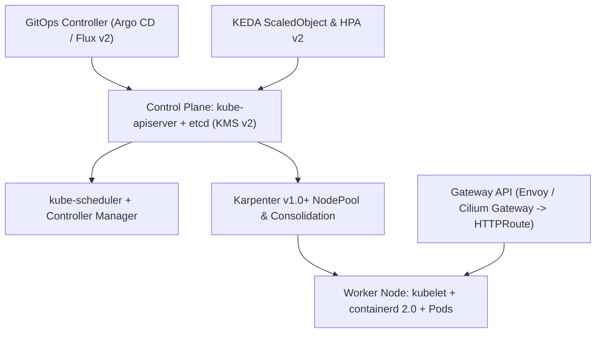

# Chapter 7: Container Orchestration: Kubernetes v1.31+, Karpenter, and Serverless Containers

Packaging a microservice into a hardened, rootless OCI container solves process isolation on a single Linux host. However, production cloud-native systems comprise hundreds or thousands of containers distributed across multi-zone compute fleets. Scheduling those containers across failure domains, reconciling node hardware failures, routing Layer-7 traffic with zero downtime during deployments, scaling replicas dynamically in response to event queues, and mounting encrypted persistent block storage require a distributed **Container Orchestration** control plane.

In this chapter, we examine the 2026 container orchestration landscape, dissect the control plane and data plane architecture of **Kubernetes v1.31+**, implement sub-minute just-in-time node provisioning and bin-packing with **Karpenter v1.0+ (and Amazon EKS Auto Mode)**, enforce **Pod Security Admission (PSA)** `restricted` standards, replace legacy `Ingress` manifests with the **Kubernetes Gateway API (`Gateway` and `HTTPRoute`)** for weighted canary and blue-green traffic shifting, configure event-driven autoscaling with **KEDA**, and engineer serverless container services on **Amazon ECS with AWS Fargate**.



## The 2026 Container Orchestration Landscape

Over the past decade, the "orchestrator wars" decisively concluded. To make informed architectural decisions today, platform engineers must understand the distinct roles of modern orchestrators and why first-generation clustering tools have been retired:

```
+-----------------------------------------------------+
|    2026 CONTAINER ORCHESTRATION LANDSCAPE           |
+-----------------+-----------------------------------+
| ORCHESTRATOR    | PRODUCTION STATUS & FIT           |
+-----------------+-----------------------------------+
| Kubernetes      | Universal cloud-native OS (CNCF   |
| v1.31+ (EKS,    | Graduated). Declarative control   |
| GKE, AKS, Talos)| loops, CRDs, CNI/CSI, Karpenter,  |
|                 | and Gateway API.                  |
+-----------------+-----------------------------------+
| Amazon ECS on   | AWS-native serverless container   |
| AWS Fargate     | orchestrator. Zero control-plane  |
|                 | fee; deep IAM, ALB, and ECS       |
|                 | Service Connect integration.      |
+-----------------+-----------------------------------+
| HashiCorp Nomad | Lightweight single-binary         |
|                 | scheduler for edge, bare-metal,   |
|                 | or mixed non-container fleets.    |
+-----------------+-----------------------------------+
| Docker Swarm &  | LEGACY / RETIRED. Mesos retired   |
| Apache Mesos    | in 2021; Swarm lacks CRD APIs,    |
|                 | CNI/CSI, OIDC workload identity,  |
|                 | and modern admission ecosystems.  |
+-----------------+-----------------------------------+
```

Why did **Kubernetes** triumph over retired legacy alternatives like Docker Swarm? While legacy `docker swarm init` offered a simple CLI for joining a handful of Docker hosts, Swarm modeled orchestration as an imperative extension of the Docker daemon rather than an extensible, declarative API server. Kubernetes introduced the **Kubernetes Resource Model (KRM)** and **Custom Resource Definitions (CRDs)**—transforming the cluster from a mere container scheduler into a universal control plane capable of reconciling cloud infrastructure (Crossplane), service meshes (Cilium / Istio), certificates (`cert-manager`), and GitOps pipelines (Argo CD / Flux v2).

## Kubernetes v1.31+ Control Plane and Worker Node Architecture

A Kubernetes cluster is divided into two distinct planes that communicate exclusively via mutually authenticated TLS (mTLS) against the API server: the **Control Plane** (which maintains cluster state and makes scheduling decisions) and the **Data Plane / Worker Nodes** (which execute containerized application Pods).

### 1. The Control Plane Components
- **`kube-apiserver`**: The stateless front door to the Kubernetes control plane. Every `kubectl` command, controller loop, and `kubelet` heartbeat interacts solely with `kube-apiserver` over HTTPS REST/Protobuf. Each request passes through a four-stage pipeline: **Authentication** (OIDC tokens, X.509 client certificates, or ServiceAccount JWTs), **Authorization** (Role-Based Access Control `RBAC` or Attribute-Based Access Control), **Mutating Admission Controllers** (such as Kyverno policy mutation or sidecar/Pod Identity injection), and **Validating Admission Controllers** (including **ValidatingAdmissionPolicies** written in Common Expression Language `CEL` and **Pod Security Admission**).
- **`etcd`**: A strongly consistent, distributed key-value store based on the **Raft consensus algorithm**. `etcd` is the sole stateful component of the control plane, storing the serialized desired and actual state of every Kubernetes object under `/registry`. In production Kubernetes v1.31+ clusters, all sensitive resources (`Secrets`) stored in `etcd` are encrypted at rest using the **KMS v2 Encryption Provider API**, which uses envelope encryption with a cloud hardware security module (AWS KMS, GCP Cloud KMS, or HashiCorp Vault) and rotates data encryption keys (DEKs) automatically per write.
- **`kube-scheduler`**: Watches `kube-apiserver` for newly created Pods that lack a `spec.nodeName` assignment. For each pending Pod, the scheduler executes a two-phase cycle: **Filtering** (eliminating nodes that lack sufficient allocatable CPU/memory, fail `nodeSelector`/`nodeAffinity` rules, carry unmatched `Taints`, or violate `TopologySpreadConstraints`) and **Scoring** (ranking viable nodes based on image locality, bin-packing density, and zone balance) before binding the Pod to the winning node.
- **`kube-controller-manager` and `cloud-controller-manager`**: Execute continuous reconciliation loops (`ReplicaSet`, `Deployment`, `StatefulSet`, `Job`, `Node`, and cloud-specific `LoadBalancer` / `Route` controllers) that watch actual cluster state and drive it toward desired state.

### 2. The Worker Node Data Plane
- **`kubelet`**: The primary node agent running on every worker machine. Rather than receiving imperative "start container" commands, the `kubelet` watches `kube-apiserver` for Pod specs bound to its node name and drives **`containerd 2.0`** via the gRPC **Container Runtime Interface (CRI)**, mounts storage volumes via the **Container Storage Interface (CSI)**, and executes **Startup, Readiness, and Liveness Probes**.
- **CNI Plugin (Cilium eBPF or AWS VPC CNI)**: Implements the **Container Network Interface (CNI)** specification, assigning each Pod a routable IP address and programming Linux kernel eBPF maps (or network routes) to enforce Kubernetes `NetworkPolicy` segmentation.

## Just-in-Time Node Provisioning with Karpenter v1.0+ and EKS Auto Mode

Historically, scaling Kubernetes worker nodes required pre-configuring static cloud Auto Scaling Groups (ASGs) and running the Kubernetes Cluster Autoscaler. Whenever pods became `Pending`, Cluster Autoscaler had to guess which pre-defined instance group (`m5.xlarge` vs `c5.2xlarge`) to scale up, wait 3 to 5 minutes for EC2 instances to launch, and struggled to consolidate underutilized nodes when workloads scaled down.

Modern Kubernetes clusters on AWS use **Karpenter v1.0+** (or fully managed **Amazon EKS Auto Mode**, which embeds Karpenter directly into the EKS control plane). Karpenter bypasses static node groups entirely:
1. Karpenter watches unschedulable `Pending` pods directly from `kube-apiserver`.
2. It evaluates the aggregate CPU, memory, GPU, architecture (`amd64` / `arm64`), and topology constraints (`topology.kubernetes.io/zone`) of the pending pods in milliseconds.
3. It calls the EC2 `CreateFleet` API directly to provision the exact optimal mix of **AWS Graviton (`c7g`, `m7g`, `r7g`)** and x86 **Spot and On-Demand** instances.
4. During off-peak hours, Karpenter's **Consolidation loop** continuously identifies underutilized nodes, cordons and drains their pods gracefully onto denser or cheaper instances, and terminates the unneeded VMs to slash cloud compute spend by 30–50%.

Here is a production **Karpenter v1.0 (`karpenter.sh/v1`)** `NodePool` and `EC2NodeClass` configuration that provisions Graviton3/Graviton4 (`arm64`) and `amd64` nodes, enforces encrypted EBS volumes, and automatically rotates nodes every 14 days (`expireAfter: 336h`) to guarantee immutable OS patch hygiene:

```yaml
# karpenter-nodepool.yaml
apiVersion: karpenter.sh/v1
kind: NodePool
metadata:
  name: general-compute-pool
spec:
  template:
    metadata:
      labels:
        workload-tier: general
    spec:
      nodeClassRef:
        group: karpenter.k8s.aws
        kind: EC2NodeClass
        name: hardened-al2023
      # Enforce immutable 14-day maximum node lifetime
      expireAfter: 336h
      requirements:
        - key: kubernetes.io/arch
          operator: In
          values: ["arm64", "amd64"]
        - key: karpenter.sh/capacity-type
          operator: In
          values: ["on-demand", "spot"]
        - key: karpenter.k8s.aws/instance-category
          operator: In
          values: ["c", "m", "r"]
        - key: karpenter.k8s.aws/instance-generation
          operator: Gt
          values: ["6"]
  limits:
    cpu: "1000"
    memory: 4000Gi
  disruption:
    consolidationPolicy: WhenEmptyOrUnderutilized
    consolidateAfter: 30s
---
apiVersion: karpenter.k8s.aws/v1
kind: EC2NodeClass
metadata:
  name: hardened-al2023
spec:
  amiFamily: AL2023
  role: "KarpenterNodeRole-prod-cluster"
  amiSelectorTerms:
    - alias: al2023@latest
  subnetSelectorTerms:
    - tags:
        karpenter.sh/discovery: "prod-cluster"
  securityGroupSelectorTerms:
    - tags:
        karpenter.sh/discovery: "prod-cluster"
  metadataOptions:
    httpEndpoint: enabled
    # Enforce IMDSv2 with hop limit 1 (blocks Pod IMDS)
    httpTokens: required
    httpPutResponseHopLimit: 1
  blockDeviceMappings:
    - deviceName: /dev/xvda
      ebs:
        volumeSize: 50Gi
        volumeType: gp3
        encrypted: true
        deleteOnTermination: true
```

Notice `httpPutResponseHopLimit: 1` with `httpTokens: required` in `metadataOptions`. Setting the IMDSv2 hop limit to `1` ensures that only host-level processes (like the `kubelet`) can reach the EC2 Instance Metadata Service, mathematically preventing containerized application pods (which are an extra network hop away across the CNI `veth` interface) from stealing the underlying node's IAM role credentials! Application pods instead authenticate exclusively via **EKS Pod Identity**.

## Hardening Workloads with Pod Security Admission (PSA) and Topology Spread

In Kubernetes v1.25+, the legacy `PodSecurityPolicy` (PSP) resource was permanently removed and replaced by the built-in **Pod Security Admission (PSA)** controller, which enforces the **Kubernetes Pod Security Standards (PSS)**—`privileged`, `baseline`, and `restricted`—via simple namespace labels.

When you label an application namespace with `pod-security.kubernetes.io/enforce: restricted`, `kube-apiserver` automatically rejects any Pod that fails to drop `ALL` Linux capabilities, attempts to run as root, omits a `seccompProfile`, or mounts hostPath volumes:

```yaml
# payments-namespace.yaml
apiVersion: v1
kind: Namespace
metadata:
  name: payments
  labels:
    pod-security.kubernetes.io/enforce: restricted
    pod-security.kubernetes.io/enforce-version: latest
    pod-security.kubernetes.io/audit: restricted
    pod-security.kubernetes.io/warn: restricted
```

### Production-Grade Kubernetes Deployment and PodDisruptionBudget
Below is a complete, production-hardened `Deployment` and `PodDisruptionBudget` (`payments-deployment.yaml`) compliant with the `restricted` Pod Security Standard. It includes multi-zone `topologySpreadConstraints` (ensuring pods never concentrate in a single Availability Zone), `startupProbe`/`readinessProbe`/`livenessProbe` separation, guaranteed/burstable QoS resource boundaries, and an immutable read-only root filesystem:

```yaml
# payments-deployment.yaml
apiVersion: policy/v1
kind: PodDisruptionBudget
metadata:
  name: payments-service-pdb
  namespace: payments
spec:
  minAvailable: "75%"
  selector:
    matchLabels:
      app.kubernetes.io/name: payments-service
---
apiVersion: apps/v1
kind: Deployment
metadata:
  name: payments-service
  namespace: payments
  labels:
    app.kubernetes.io/name: payments-service
spec:
  replicas: 4
  revisionHistoryLimit: 5
  strategy:
    type: RollingUpdate
    rollingUpdate:
      maxSurge: 1
      maxUnavailable: 0
  selector:
    matchLabels:
      app.kubernetes.io/name: payments-service
  template:
    metadata:
      labels:
        app.kubernetes.io/name: payments-service
    spec:
      serviceAccountName: payments-pod-identity-sa
      automountServiceAccountToken: false
      securityContext:
        runAsNonRoot: true
        runAsUser: 65532
        runAsGroup: 65532
        fsGroup: 65532
        seccompProfile:
          type: RuntimeDefault
      # Spread replicas evenly across Zones
      topologySpreadConstraints:
        - maxSkew: 1
          topologyKey: topology.kubernetes.io/zone
          whenUnsatisfiable: DoNotSchedule
          labelSelector:
            matchLabels:
              app.kubernetes.io/name: payments-service
      containers:
        - name: payments-api
          image: >-
            111122223333.dkr.ecr.us-west-2.aws/pay:v2.4
          ports:
            - name: http
              containerPort: 8080
              protocol: TCP
          securityContext:
            allowPrivilegeEscalation: false
            readOnlyRootFilesystem: true
            capabilities:
              drop: ["ALL"]
          resources:
            requests:
              cpu: "500m"
              memory: "512Mi"
            limits:
              memory: "512Mi"
          startupProbe:
            httpGet:
              path: /healthz/startup
              port: http
            failureThreshold: 30
            periodSeconds: 2
          readinessProbe:
            httpGet:
              path: /healthz/ready
              port: http
            periodSeconds: 5
            failureThreshold: 3
          livenessProbe:
            httpGet:
              path: /healthz/live
              port: http
            periodSeconds: 10
            failureThreshold: 3
          volumeMounts:
            - name: tmp-scratch
              mountPath: /tmp
      volumes:
        - name: tmp-scratch
          emptyDir:
            medium: Memory
            sizeLimit: 64Mi
```

Notice two crucial reliability settings in this manifest:
1. **`maxUnavailable: 0` and `maxSurge: 1` paired with `readinessProbe`**: During a rolling update, Kubernetes never terminates an existing healthy Pod until a newly surged Pod passes its `startupProbe` and `readinessProbe` and is registered in the `EndpointSlice`.
2. **Memory `requests` equal to `limits`, with no hard CPU `limit` throttling**: Setting `requests.memory == limits.memory` (`512Mi`) protects the Pod from opportunistic OOM eviction under node memory pressure, while omitting a hard `limits.cpu` (or using Kubernetes v1.31+ in-place pod vertical scaling) avoids unnecessary CFS bandwidth throttling spikes when neighboring cores are idle.

## Progressive Delivery with the Kubernetes Gateway API (`Gateway` & `HTTPRoute`)

In first-generation Kubernetes clusters, exposing HTTP services and implementing Canary or Blue-Green traffic shifting required either ugly manual label-patching hacks (`kubectl patch service`) or vendor-specific `Ingress` annotations (`nginx.ingress.kubernetes.io/canary-weight`). Because the legacy `Ingress` API lacked native support for header matching, traffic weighting, mTLS, or role separation, every ingress controller invented incompatible custom annotations.

The **Kubernetes Gateway API (`gateway.networking.k8s.io/v1`)** supersedes `Ingress` with an expressive, portable, role-oriented architecture implemented natively by **Cilium**, **Envoy Gateway**, **Istio**, **NGINX**, and cloud load balancers:
- **Infrastructure Provider Role (`GatewayClass`)**: Defines the underlying data plane controller (e.g., `cilium` or `envoy-gateway`).
- **Cluster Operator / Platform Role (`Gateway`)**: Provisions the network load balancer listener ports, TLS certificates, and allowed route namespaces.
- **Application Developer Role (`HTTPRoute` / `GRPCRoute`)**: Attaches routing rules, header matches, request timeouts, and **weighted Canary / Blue-Green `backendRefs`** to the parent `Gateway`.

Here is how to execute a **90% Stable (Blue) / 10% Canary (Green) progressive rollout** natively using a Gateway API `HTTPRoute` without third-party annotation hacks:

```yaml
# payments-httproute-canary.yaml
apiVersion: gateway.networking.k8s.io/v1
kind: HTTPRoute
metadata:
  name: payments-traffic-route
  namespace: payments
spec:
  parentRefs:
    - name: prod-external-gateway
      namespace: infra-gateway
      sectionName: https-listener
  hostnames:
    - "api.payments.example.com"
  rules:
    # Rule 1: Route internal QA testers with header
    # X-Canary-Stage: true 100% to v2 Canary service
    - matches:
        - headers:
            - name: X-Canary-Stage
              value: "true"
      backendRefs:
        - name: payments-service-canary
          port: 8080
          weight: 100

    # Rule 2: Split production traffic 90% Stable /
    # 10% Canary across EndpointSlices
    - matches:
        - path:
            type: PathPrefix
            value: /v1/checkout
      backendRefs:
        - name: payments-service-stable
          port: 8080
          weight: 90
        - name: payments-service-canary
          port: 8080
          weight: 10
```

When paired with **Argo Rollouts** or **Flagger**, the progressive delivery controller automatically increments the `weight` fields inside this `HTTPRoute` (`10 -> 25 -> 50 -> 100`) while evaluating Prometheus SLO queries at each step.

## Event-Driven Autoscaling with KEDA (Kubernetes Event-Driven Autoscaling)

The standard Kubernetes `HorizontalPodAutoscaler` (HPA) defaults to scaling Pods based on average CPU or memory utilization. However, for asynchronous worker microservices consuming messages from Amazon SQS, Apache Kafka, or RabbitMQ, **CPU utilization is a lagging indicator**. A worker blocked on network I/O waiting for downstream API responses may exhibit only 15% CPU utilization while an SQS queue backlog balloons to 500,000 messages!

**KEDA (Kubernetes Event-Driven Autoscaling)**—a CNCF Graduated project—solves this by acting as a custom metrics server and event controller that scales Deployments or Jobs directly on external event sources (including **scale-to-zero** when a queue is empty) using workload identity authentication (`TriggerAuthentication`):

```yaml
# keda-sqs-autoscaler.yaml
apiVersion: keda.sh/v1alpha1
kind: TriggerAuthentication
metadata:
  name: keda-aws-pod-identity
  namespace: payments
spec:
  podIdentity:
    provider: aws
---
apiVersion: keda.sh/v1alpha1
kind: ScaledObject
metadata:
  name: order-processor-scaler
  namespace: payments
spec:
  scaleTargetRef:
    apiVersion: apps/v1
    kind: Deployment
    name: order-processor-worker
  pollingInterval: 10
  cooldownPeriod: 60
  minReplicaCount: 1
  maxReplicaCount: 50
  triggers:
    - type: aws-sqs-queue
      authenticationRef:
        name: keda-aws-pod-identity
      metadata:
        queueURL: >-
          https://sqs.us-west-2.aws/1111/OrderQueue
        queueLength: "25"
        awsRegion: "us-west-2"
        scaleOnInFlight: "true"
```

With `queueLength: "25"`, KEDA queries Amazon SQS every 10 seconds and dynamically scales `order-processor-worker` replicas so that each Pod handles at most 25 queued messages, scaling up to 50 replicas during flash sales and scaling back down to 1 replica once the queue drains.

## Serverless Container Orchestration with Amazon ECS on AWS Fargate

While Kubernetes is the standard for multi-team platforms and portable cloud-native ecosystems, not every workload requires managing a Kubernetes control plane. When an engineering team runs exclusively on AWS and wants to deploy containerized microservices with **zero cluster control-plane cost, zero worker node patching, and microVM-level hardware isolation per Pod/Task**, **Amazon Elastic Container Service (Amazon ECS) on AWS Fargate** is a compelling architectural choice.

Under the hood, AWS Fargate runs every ECS Task inside its own dedicated **Firecracker microVM** (or Nitro enclave boundary) attached to your VPC via an Elastic Network Interface (`awsvpc` mode), supports **AWS Graviton2/Graviton3 (`ARM64`)** compute at a 20% price-performance advantage, and provides built-in service discovery and Layer-7 traffic shifting via **Amazon ECS Service Connect**.

Rather than clicking through the AWS Management Console wizard (an anti-pattern that introduces configuration drift), always provision ECS Fargate clusters, Task Definitions, and Application Load Balanced services programmatically using **AWS CDK v2 L3 Patterns (`aws_ecs_patterns`)**:

```python
# stacks/ecs_fargate_stack.py
from aws_cdk import (
    Duration,
    Stack,
    aws_ec2 as ec2,
    aws_ecr as ecr,
    aws_ecs as ecs,
    aws_ecs_patterns as ecs_patterns,
)
from constructs import Construct


class ServerlessFargateServiceStack(Stack):
    def __init__(
        self,
        scope: Construct,
        construct_id: str,
        vpc: ec2.IVpc,
        repo: ecr.IRepository,
        image_digest: str,
        **kwargs,
    ) -> None:
        super().__init__(scope, construct_id, **kwargs)

        # 1. ECS Cluster with Container Insights
        cluster = ecs.Cluster(
            self,
            "PaymentsFargateCluster",
            vpc=vpc,
            container_insights_v2=(
                ecs.ContainerInsights.ENHANCED
            ),
        )

        # 2. ALB + Graviton2 Fargate Service Pattern
        cb = ecs.DeploymentCircuitBreaker(
            enable=True,
            rollback=True,
        )
        img_opts = (
            ecs_patterns
            .ApplicationLoadBalancedTaskImageOptions(
                image=(
                    ecs.ContainerImage
                    .from_ecr_repository(
                        repo, tag=image_digest
                    )
                ),
                container_port=8080,
                enable_logging=True,
            )
        )
        self.fargate_service = (
            ecs_patterns
            .ApplicationLoadBalancedFargateService(
                self,
                "PaymentsFargateService",
                cluster=cluster,
                cpu=1024,
                memory_limit_mib=2048,
                desired_count=3,
                runtime_platform=ecs.RuntimePlatform(
                    cpu_architecture=(
                        ecs.CpuArchitecture.ARM64
                    ),
                    operating_system_family=(
                        ecs.OperatingSystemFamily.LINUX
                    ),
                ),
                circuit_breaker=cb,
                task_image_options=img_opts,
                public_load_balancer=True,
            )
        )

        # 3. Target-Tracking Auto Scaling on ALB Req/s
        scalable_target = (
            self.fargate_service.service
            .auto_scale_task_count(
                min_capacity=3,
                max_capacity=30,
            )
        )
        scalable_target.scale_on_request_count(
            "ScaleOnAlbRequestRate",
            requests_per_target=1000,
            target_group=(
                self.fargate_service.target_group
            ),
            scale_in_cooldown=Duration.seconds(60),
            scale_out_cooldown=Duration.seconds(15),
        )
```

Notice `circuit_breaker=ecs.DeploymentCircuitBreaker(enable=True, rollback=True)`. If a newly deployed Fargate Task revision fails ALB health checks or crashes repeatedly on startup, ECS's built-in deployment circuit breaker automatically halts the rollout and rolls traffic back to the last known healthy Task Definition revision without human intervention.

## Summary

Modern container orchestration provides the self-healing, declarative substrate for cloud-native systems. Whether you standardize on **Kubernetes v1.31+**—powered by **Karpenter v1.0+** just-in-time node consolidation, **Pod Security Admission (`restricted`)**, the **Kubernetes Gateway API** for native canary routing, and **KEDA** for event-driven scaling—or leverage serverless **Amazon ECS on AWS Fargate** with deployment circuit breakers, declarative orchestration transforms hundreds of ephemeral containers into a resilient, unified platform. In Chapter 8, we instrument these orchestrated workloads with unified **OpenTelemetry** pipelines, **Prometheus/Thanos/Mimir**, **Grafana Loki & Tempo**, and **SLO Error Budget** engineering.
