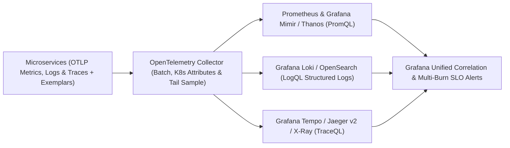

# Chapter 8: Cloud-Native Observability: OpenTelemetry, Prometheus/Mimir, Loki, Tempo, and SLO Engineering

In a monolithic architecture running on a single server, diagnosing a production outage often meant logging into the box, running `top`, and grepping `/var/log/messages`. In a modern cloud-native architecture—where a single customer checkout request fans out across a Kubernetes Gateway API proxy, twelve polyglot microservices, three gRPC caches, an Amazon DynamoDB table, and an asynchronous Kafka or SQS event stream—traditional host-based monitoring is blind to the failure modes that actually impact users.

**Observability** is the mathematical property of a system that measures how well its internal state can be inferred solely from its external outputs (telemetry signals). While legacy **monitoring** asks whether known failure conditions have occurred (*"Is disk utilization above 85%?"*), **observability** equips engineers to ask arbitrary, exploratory questions about unknown failure modes across high-cardinality dimensions (*"Why are checkout requests specifically for customers on iOS build 18.4 routed through `us-west-2b` experiencing 2.4-second tail latency on database shard 7?"*).

In this chapter, we architect a unified 2026 observability stack centered on the **OpenTelemetry (OTel) Collector**, scale dimensional time-series metrics with **Prometheus** and **Grafana Mimir / Thanos**, correlate structured logs with **Grafana Loki** and **OpenSearch**, trace distributed execution paths with **Grafana Tempo**, **Jaeger v2**, and **AWS X-Ray (ADOT)**, link signals together using **Exemplars**, and replace noisy symptom alerts with **Multi-Window, Multi-Burn-Rate SLO Alerts**.



## The Unified Telemetry Paradigm: Signals, Context Propagation, and Exemplars

Historically, engineering teams treated **Metrics**, **Logs**, and **Traces** (alongside **Continuous Profiles**, covered in depth in Chapter 21) as three disconnected silos, installing separate vendor agents for each signal (`node_exporter` + `fluentd` + `jaeger-agent`). Disconnected agents caused severe operational friction: the metric agent labeled a Pod `pod_name="payments-7d9f"`, the log shipper labeled it `kubernetes.pod="payments-7d9f"`, and the tracing SDK called it `service="payments-api"`, making it impossible to pivot seamlessly from a latency spike on a graph to the exact offending trace and log lines.

Modern observability solves this by standardizing on two foundational specifications from the **Cloud Native Computing Foundation (CNCF)** and **W3C**:

1. **OpenTelemetry Semantic Conventions and OTLP**: Every telemetry signal emitted by an application or infrastructure daemon uses identical resource attributes (`service.name`, `service.version`, `deployment.environment.name`, `k8s.namespace.name`, `k8s.pod.name`) and is transmitted over a single multiplexed wire protocol—the **OpenTelemetry Protocol (OTLP)** over gRPC (`:4317`) or HTTP/Protobuf (`:4318`).
2. **W3C Trace Context (`traceparent`) and Exemplars**: Every incoming HTTP or gRPC request carries a standard `traceparent` header (`00-<32-hex-trace-id>-<16-hex-span-id>-01`). As the request executes:
   - The **Structured Logger** automatically injects `"trace_id"` and `"span_id"` into every emitted JSON log record.
   - The **Prometheus / OTel Histogram** attaches an **Exemplar**—a sample `trace_id` alongside the exact latency observation bucket—directly onto the time-series metric point.

```
+-----------------------------------------------------+
|      CORRELATING SIGNALS VIA W3C TRACE CONTEXT      |
+-----------------------------------------------------+
|                                                     |
|  [1. METRIC: Prometheus / Mimir Histogram]          |
|      http_request_duration_seconds_bucket{le="0.5"} |
|      └── Exemplar: { trace_id="4bf92f3577b34d..." } |
|                         |                           |
|       (1-Click Pivot in Grafana via trace_id)       |
|                         v                           |
|  [2. TRACE: Grafana Tempo / Jaeger v2 Waterfall]    |
|      Trace 4bf92f3577b34d... (Total: 482ms)         |
|      ├── Span A: api-gateway (12ms)                 |
|      └── Span B: payments -> DB (470ms, ERROR)      |
|                         |                           |
|       (1-Click Pivot to Pod Logs for Span B)        |
|                         v                           |
|  [3. LOG: Grafana Loki Structured JSON]             |
|      {"ts":"2026-10-25T08:14:02Z","level":"ERROR",  |
|       "trace_id":"4bf92f3577b34d...",               |
|       "msg":"Deadlock on shard 4","order":"8821"}   |
+-----------------------------------------------------+
```

## Architecting the OpenTelemetry Collector Pipeline

Rather than configuring microservices to talk directly to Prometheus, Loki, Tempo, or AWS CloudWatch/X-Ray endpoints, modern Kubernetes clusters deploy the **OpenTelemetry Collector (`otelcol-contrib`)** as a node DaemonSet or gateway deployment.

The OpenTelemetry Collector decouples application instrumentation from backend storage through a four-stage pipeline architecture:
- **Receivers (`otlp`, `prometheus`, `filelog`, `kubeletstats`)**: Ingest telemetry in OTLP, Prometheus, Zipkin, or container log formats.
- **Processors (`memory_limiter`, `k8sattributes`, `resourcedetection`, `transform`, `batch`)**: Enrich telemetry with Kubernetes Pod/Node labels, scrub sensitive PII (such as `Authorization` headers or credit card numbers), prevent out-of-memory crashes via `memory_limiter`, and compress payloads into efficient batches.
- **Connectors (`spanmetrics`)**: Compute RED metrics (Request rate, Error count, Duration histograms) directly from ingested trace spans before sampling, ensuring 100% accurate metrics even if only 10% of traces are stored!
- **Exporters (`prometheusremotewrite`, `otlp/tempo`, `loki`, `awsxray`)**: Fan out processed telemetry to one or more open-source or cloud backends simultaneously.

Here is a production-hardened **OpenTelemetry Collector (`otel-collector-config.yaml`)** configuration that ingests OTLP metrics, logs, and traces, enriches them with Kubernetes metadata, generates span metrics via the `spanmetrics` connector, and exports to **Prometheus/Mimir**, **Grafana Tempo**, and **Grafana Loki**:

```yaml
# otel-collector-config.yaml
receivers:
  otlp:
    protocols:
      grpc:
        endpoint: 0.0.0.0:4317
      http:
        endpoint: 0.0.0.0:4318

processors:
  # Always place memory_limiter first in the pipeline!
  memory_limiter:
    check_interval: 1s
    limit_percentage: 80
    spike_limit_percentage: 15

  # Automatically enrich signals with K8s Pod metadata
  k8sattributes:
    auth_type: "serviceAccount"
    passthrough: false
    extract:
      metadata:
        - k8s.pod.name
        - k8s.namespace.name
        - k8s.deployment.name
        - k8s.node.name

  # Batch telemetry to optimize network compression
  batch:
    send_batch_size: 8192
    timeout: 2s

connectors:
  # Derive RED metrics + Exemplars directly from spans
  spanmetrics:
    histogram:
      explicit:
        buckets: [10ms, 50ms, 100ms, 250ms, 500ms, 1s]
    exemplars:
      enabled: true

exporters:
  prometheusremotewrite:
    endpoint: >-
      http://mimir-distributor.monitoring:8080/push
    send_metadata: true

  otlp/tempo:
    endpoint: "tempo-distributor.monitoring.svc:4317"
    tls:
      insecure: true

  otlphttp/loki:
    endpoint: "http://loki-gateway.monitoring.svc/otlp"

service:
  pipelines:
    traces:
      receivers: [otlp]
      processors:
        - memory_limiter
        - k8sattributes
        - batch
      exporters: [otlp/tempo, spanmetrics]
    metrics:
      receivers: [otlp, spanmetrics]
      processors:
        - memory_limiter
        - k8sattributes
        - batch
      exporters: [prometheusremotewrite]
    logs:
      receivers: [otlp]
      processors:
        - memory_limiter
        - k8sattributes
        - batch
      exporters: [otlphttp/loki]
```

## Dimensional Metrics at Scale: Prometheus, Mimir, and Thanos

**Prometheus** (a CNCF Graduated project) is the standard metric engine for cloud-native systems. Unlike legacy hierarchical metric systems (like StatsD/Graphite), Prometheus models every time series as a metric name paired with an unordered set of key-value **labels** (`http_requests_total{service="payments", method="POST", status="200"}`) stored in a local Time-Series Database (TSDB) and queried via **PromQL**.

### Defending Against High-Cardinality Label Explosion
The most dangerous operational anti-pattern in Prometheus is **unbounded label cardinality**. Every unique combination of key-value labels creates a brand-new time series in the TSDB index in RAM.
- **Safe Bounded Labels**: `service`, `namespace`, `http_method`, `status_code`, `availability_zone` (multiplicative cardinality: `20 * 5 * 4 * 10 * 3 = 12,000` active series).
- **Fatal Unbounded Labels**: Putting `user_id`, `order_id`, `email`, `ip_address`, or full URL paths (`/orders/98412`) into a Prometheus label! With 5 million users, a single metric immediately spawns 5 million distinct time series, exhausting Prometheus memory and crashing the TSDB. High-cardinality identifiers belong exclusively in **Trace Attributes** and **Structured Logs**, linked to metrics via **Exemplars**.

### Scaling Beyond a Single Cluster: Grafana Mimir and Thanos
A standalone Prometheus server stores data on a single local disk and is not designed for multi-year retention or global multi-cluster queries. To achieve horizontally scalable, multi-tenant long-term storage backed by cheap cloud object storage (Amazon S3 or GCS), production platforms pair Prometheus (running in lightweight **Agent Mode** or via the OTel Collector) with **Grafana Mimir** or **Thanos**:
- **Thanos**: Extends existing Prometheus servers with a `Thanos Sidecar` (uploading 2-hour TSDB blocks to S3), `Thanos Store Gateway`, `Thanos Compactor` (performing downsampling to 5m and 1h resolutions), and `Thanos Querier` (deduplicating HA Prometheus pairs across clusters).
- **Grafana Mimir**: A horizontally scalable, microservice-based TSDB written to ingest hundreds of millions of active series via `remote_write` / OTLP, splitting ingestion across stateless `Distributors`, replicated in-memory `Ingesters`, S3-backed `Store-Gateways`, and parallel `Query-Frontends`.

## Structured Logging: Grafana Loki vs. OpenSearch / ELK

Application logs provide the granular, line-by-line context of state mutations and exceptions. In 2026, enterprise logging architectures generally follow one of two paths:

1. **Full-Text Indexed Engines (OpenSearch / Elasticsearch + Fluent Bit / Vector)**: Tokenizes and builds an inverted index over every field in every JSON log line. While powerful for arbitrary free-text analytics, full-text indices often consume as much disk space and JVM heap RAM as the raw log data itself.
2. **Label-Indexed Object-Storage Engines (Grafana Loki)**: Inspired by Prometheus, **Grafana Loki** does **not** index the full text of log messages. Instead, Loki indexes only the small set of Prometheus/Kubernetes metadata labels (`{namespace="payments", service_name="payments-api", level="ERROR"}`) and compresses the raw JSON log streams into chunks stored directly in Amazon S3. When you run a **LogQL** query in Grafana, Loki uses the tiny label index to narrow the search to the exact time window and S3 chunks, then parallel-greps the compressed chunks across stateless query workers at gigabytes per second—cutting logging infrastructure costs by 70–85%.

### Emitting Correlated JSON Structured Logs in Python
Unstructured multi-line text logs (`2026-10-25 ERROR Something broke for user 42`) require brittle regular expressions (`regex`) to parse. Always emit **single-line JSON structured logs** to `stdout` (following the 12-Factor App principle so `containerd` captures them automatically) with OpenTelemetry `trace_id` and `span_id` fields injected:

```python
# structured_logger.py
import json
import logging
import sys
from datetime import datetime, timezone
from opentelemetry import trace


class OTelJsonFormatter(logging.Formatter):
    def format(self, record: logging.LogRecord) -> str:
        span = trace.get_current_span()
        ctx = span.get_span_context()

        trace_id = (
            format(ctx.trace_id, "032x")
            if ctx.is_valid
            else None
        )
        span_id = (
            format(ctx.span_id, "016x")
            if ctx.is_valid
            else None
        )

        payload = {
            "timestamp": datetime.now(
                timezone.utc
            ).isoformat(),
            "severity": record.levelname,
            "service": "payments-service",
            "message": record.getMessage(),
            "logger": record.name,
            "trace_id": trace_id,
            "span_id": span_id,
        }
        return json.dumps(payload)


def get_structured_logger(
    name: str,
) -> logging.Logger:
    logger = logging.getLogger(name)
    logger.setLevel(logging.INFO)
    if not logger.handlers:
        handler = logging.StreamHandler(sys.stdout)
        handler.setFormatter(OTelJsonFormatter())
        logger.addHandler(handler)
    return logger
```

With structured JSON logs flowing into **Grafana Loki** via the OpenTelemetry Collector's `otlphttp/loki` exporter, engineers can execute expressive **LogQL** queries that filter by label, parse JSON fields on the fly, and aggregate error rates:

```promql
# LogQL: Find all ERROR logs in payments-service where
# latency_ms > 500 and extract the correlated trace_id
{namespace="payments", service_name="payments-service"}
  | json
  | severity = "ERROR"
  | latency_ms > 500
  | line_format "Trace={{.trace_id}} Msg={{.message}}"
```

## Distributed Tracing: Grafana Tempo, Jaeger v2, and AWS X-Ray (ADOT)

When a request traverses ten microservices, **Distributed Tracing** reconstructs the complete causal Directed Acyclic Graph (DAG) of **Spans**. Each Span records its `trace_id`, its own `span_id`, its `parent_span_id`, start and end nanosecond timestamps, status (`OK` or `ERROR`), and structured key-value attributes (such as `db.system="postgresql"`, `http.route="/v1/checkout"`, `http.response.status_code=503`).

### Modern Trace Storage: Grafana Tempo and Jaeger v2
Historically, running a distributed tracing backend like first-generation Jaeger required operating a massive Elasticsearch or Cassandra cluster just to index span tags, forcing teams to set tiny head-based sampling rates (such as `0.1%` of requests)—which meant that when a rare production bug occurred, the trace was almost never captured!

In 2026, two architectural advancements have solved trace storage economics:
1. **Grafana Tempo (Zero-Index Object Storage + TraceQL)**: Like Loki, **Grafana Tempo** requires only object storage (S3/GCS) and builds **zero full-text index** by default, storing trace blocks keyed by `trace_id` alongside compact Bloom filters and Parquet columnar blocks for high-speed **TraceQL** queries (`{ resource.service.name = "payments-service" && status = error && duration > 500ms }`).
2. **Jaeger v2 (OpenTelemetry Collector Core)**: The CNCF **Jaeger v2** architecture re-engineered Jaeger directly on top of the OpenTelemetry Collector framework, supporting native OTLP ingestion and ClickHouse / OpenSearch storage backends.
3. **AWS CloudWatch & AWS X-Ray via ADOT**: On AWS, deploying the **AWS Distro for OpenTelemetry (ADOT)** Collector exports OTLP traces directly to **AWS X-Ray** and metrics to **Amazon Managed Service for Prometheus (AMP)**, enabling unified service maps across EKS, ECS Fargate, API Gateway, and DynamoDB.

## Engineering Methodologies: RED, USE, and Multi-Burn-Rate SLO Alerts

Collecting terabytes of metrics, logs, and traces is useless—and counterproductive—if on-call engineers are bombarded with hundreds of low-signal alerts (`CPU > 75%`, `Pod restarted once`) that cause **alert fatigue**.

Modern Site Reliability Engineering structures dashboards around two complementary telemetry methodologies and gates paging alerts strictly on **SLO Error Budget Burn Rates**:

### 1. The USE Method (For Infrastructure and Kernel Resources)
Created by Brendan Gregg, the **USE Method** monitors hardware and OS resources (CPU cores, RAM, NVMe disks, network interfaces, eBPF maps):
- **Utilization**: Percentage of time the resource was busy servicing work (e.g., `node_cpu_seconds_total`).
- **Saturation**: Degree to which queued work cannot be serviced immediately (e.g., Linux CPU run-queue length `node_load1` or cgroup CPU throttling `container_cpu_cfs_throttled_seconds_total`).
- **Errors**: Count of hardware or kernel error events (e.g., NIC packet drops or NVMe I/O errors).

### 2. The RED Method (For Request-Driven Microservices)
Created by Tom Wilkie, the **RED Method** measures user-facing service health for every microservice endpoint:
- **Rate**: Requests per second (`sum(rate(http_server_requests_seconds_count[5m]))`).
- **Errors**: Failed requests (`5xx` or gRPC non-`OK`) per second.
- **Duration**: Distribution of request latency (specifically **P50, P95, and P99 percentiles** computed via `histogram_quantile()`).

### 3. Multi-Window, Multi-Burn-Rate SLO Alerting in Prometheus
Suppose our `payments-service` has a 28-day **Availability SLO of `99.9%`**, giving us an **Error Budget of `0.1%`** (`40.32 minutes` of permitted 5xx errors per 28 days, or `672 hours`).

A **Burn Rate of `1.0`** means the service is consuming its error budget at a rate that will exhaust the budget in exactly 28 days (`0.001` error ratio). A **Burn Rate of `14.4`** means the service will exhaust 2% of its entire monthly error budget in just **1 hour** (exhausting 100% of the budget in under 2 days!).

Following Google SRE best practices, we configure a **Multi-Window, Multi-Burn-Rate Alert** in Prometheus / Mimir (`payments-slo-rules.yaml`). We only page an engineer if **both** a long window (`1h`) **and** a short confirmation window (`5m`) exceed the `14.4x` burn rate threshold—guaranteeing fast detection while ensuring the alert resets within 5 minutes once the incident is resolved:

```yaml
# payments-slo-rules.yaml
apiVersion: monitoring.coreos.com/v1
kind: PrometheusRule
metadata:
  name: payments-slo-burn-rate-rules
  namespace: monitoring
spec:
  groups:
    - name: payments.slo.availability
      interval: 30s
      rules:
        # Pre-compute 5m and 1h error ratios
        - record: job:slo_errors:ratio_rate5m
          expr: |
            sum by (service) (
              rate(http_requests_total{
                service="payments-service",
                status=~"5.."
              }[5m])
            )
            /
            sum by (service) (
              rate(http_requests_total{
                service="payments-service"
              }[5m])
            )

        - record: job:slo_errors:ratio_rate1h
          expr: |
            sum by (service) (
              rate(http_requests_total{
                service="payments-service",
                status=~"5.."
              }[1h])
            )
            /
            sum by (service) (
              rate(http_requests_total{
                service="payments-service"
              }[1h])
            )

        # Page P1 Alert: 14.4x Burn Rate over 1h & 5m
        # (2% of 28-day 99.9% budget burned in 1h)
        - alert: PaymentsSloFastBurnCritical
          expr: |
            job:slo_errors:ratio_rate1h{
              service="payments-service"
            } > (14.4 * 0.001)
            and
            job:slo_errors:ratio_rate5m{
              service="payments-service"
            } > (14.4 * 0.001)
          for: 2m
          labels:
            severity: critical
            slo_tier: tier-1
          annotations:
            summary: >-
              High SLO Error Burn on payments-service
            description: >-
              Error rate exceeds 14.4x burn across
              1h and 5m windows. Check Tempo traces.
```

### Managing Observability as Code with the Grafana Operator
Just as infrastructure and Kubernetes workloads must never be mutated manually via `ClickOps`, production Grafana dashboards and data source correlations must never be edited by hand in the browser without version control.

Modern Platform Engineering teams manage Grafana declaratively using the **Grafana Operator (`grafana.integreatly.org/v1beta1`)** or **Terraform / Grafonnet**, committing `GrafanaDatasource` and `GrafanaDashboard` Custom Resources directly into the GitOps repository. Crucially, declaring the `GrafanaDatasource` in code allows you to bind **Prometheus/Mimir Exemplars** and **Loki `trace_id` derived fields** directly to your **Grafana Tempo** data source UID so that 1-click trace pivoting works automatically across every cluster:

```yaml
# grafana-datasources.yaml
apiVersion: grafana.integreatly.org/v1beta1
kind: GrafanaDatasource
metadata:
  name: unified-observability-sources
  namespace: monitoring
spec:
  instanceSelector:
    matchLabels:
      dashboards: "grafana-prod"
  datasource:
    name: Mimir-Prometheus
    type: prometheus
    uid: mimir-prod-uid
    access: proxy
    url: http://mimir-query.monitoring.svc:8080/prom
    isDefault: true
    jsonData:
      httpMethod: POST
      timeInterval: "15s"
      # Link Prometheus Histogram Exemplars -> Tempo
      exemplarTraceIdDestinations:
        - name: trace_id
          datasourceUid: tempo-prod-uid
```

When an on-call engineer opens a RED dashboard in Grafana during an incident, small diamond icons appear directly on the P99 latency histogram curve. Clicking any diamond immediately opens the exact slow trace waterfall in **Grafana Tempo**, and clicking the span icon jumps directly to the correlated JSON error logs in **Grafana Loki**.

## Summary

Modern cloud-native observability replaces fragmented vendor agents and noisy threshold alerts with a unified, mathematically rigorous engineering system. By instrumenting applications once with **OpenTelemetry**, routing signals through the **OTel Collector**, scaling dimensional metrics with **Prometheus** and **Grafana Mimir / Thanos**, indexing structured logs efficiently in **Grafana Loki**, storing 100% of traces in object-storage-backed **Grafana Tempo**, linking metrics to traces via **Exemplars** and **Grafana Operator** declarations, and alerting strictly on **Multi-Window SLO Burn Rates**, engineering teams can pinpoint the root cause of distributed failures in seconds. In Chapter 9, we secure both the delivery pipeline and the Kubernetes runtime using modern DevSecOps controls.
