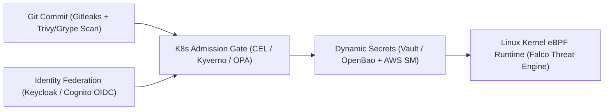

# Chapter 9: DevSecOps Engineering: Policy-as-Code, Dynamic Secrets, eBPF Runtime Security, and OIDC Identity

In traditional enterprise security models, application security was treated as a compliance gate positioned at the very end of the software development lifecycle. Engineering teams spent months building features, only to have a manual penetration test or spreadsheet audit halt the production release for weeks while vulnerabilities were triaged. In a cloud-native organization deploying dozens of times per day via automated GitOps pipelines, manual security review gates are mathematically impossible.

**Modern DevSecOps** transforms security from a bureaucratic gate into an automated, cryptographically enforced engineering system embedded at every stage of the software lifecycle:
1. **Pre-Commit and CI Shift-Left Verification**: Automated secret scanning (**Gitleaks** / **TruffleHog**), vulnerability and misconfiguration scanning (**Trivy** and **Grype**), and AST-level static analysis (**Semgrep**).
2. **Kubernetes Admission Control (Policy-as-Code)**: Declarative admission webhooks and native in-process **ValidatingAdmissionPolicies (CEL)** alongside **Kyverno** and **OPA Gatekeeper** that inspect every API request to `kube-apiserver` and reject non-compliant, unsigned, or privileged workloads before they ever reach `etcd`.
3. **Zero-Trust Secrets Management**: Dynamic, short-lived credentials issued by **HashiCorp Vault / OpenBao** and **AWS Secrets Manager**, synchronized into Kubernetes via the **External Secrets Operator (ESO)** or mounted in memory via the **Secrets Store CSI Driver** using workload identity without ever storing plaintext secrets in Git.
4. **Kernel-Level Runtime Security**: Real-time Linux system call monitoring powered by **CNCF Falco** using modern **eBPF probes (`modern_ebpf`)** to detect anomalous process executions or container escapes in microseconds.
5. **Centralized OIDC Identity Federation**: Unifying human and machine access across Kubernetes (`kube-apiserver`), Grafana, Argo CD, and internal APIs using **Keycloak** and **Amazon Cognito** OpenID Connect (OIDC).



## Layer 1: Shift-Left Secret Detection and Vulnerability Scanning (Gitleaks, Trivy, and Grype)

The most cost-effective moment to remediate a vulnerability or leaked credential is before the pull request is merged. Once an API key or private certificate is committed to a Git repository's history, simply deleting the file in a subsequent commit does not erase the secret from previous Git blob objects—an attacker who clones the repository can trivially extract the secret via `git log -p`.

### Preventing Credential Leaks with Gitleaks
Every developer workstation (`pre-commit` hook) and CI pipeline should execute **Gitleaks** (or **TruffleHog**), which scans Git commit diffs against high-entropy rules and regular expressions for AWS keys, private RSA/Ed25519 keys, database connection strings, Slack webhooks, and OAuth tokens:

```toml
# .gitleaks.toml
title = "Enterprise Gitleaks Security Policy"

[extend]
useDefault = true

[[rules]]
id = "internal-payment-gateway-token"
description = "Internal Payment Gateway API Token"
regex = '''(?i)pay_live_[0-9a-zA-Z]{32}'''
tags = ["key", "payments", "critical"]
```

### Multi-Scanner Vulnerability and Misconfiguration Gates with Trivy and Grype
In CI pipelines, teams combine **Aqua Trivy** (an all-in-one scanner for OS packages, language lockfiles, Kubernetes/Terraform IaC misconfigurations, and embedded secrets) with **Anchore Grype** (paired with **Syft** SBOMs) to eliminate blind spots:

```bash
# 1. Generate a CycloneDX SBOM once with Syft
ECR_HOST="111122223333.dkr.ecr.us-west-2.amazonaws.com"
syft "${ECR_HOST}/payments:v2.4.0" \
  -o cyclonedx-json=sbom.cdx.json

# 2. Scan the SBOM offline in milliseconds with Grype,
#    failing the build on any CRITICAL or HIGH CVE
#    with an upstream fix available
grype sbom:./sbom.cdx.json \
  --only-fixed \
  --fail-on high

# 3. Scan Kubernetes & Terraform manifests with Trivy
trivy config \
  --severity CRITICAL,HIGH \
  --exit-code 1 \
  ./k8s-manifests/
```

Scanning a pre-generated `sbom.cdx.json` file with `grype` or `trivy sbom` takes less than 2 seconds because the scanner does not need to re-download or unpack multi-gigabyte container layers.

## Layer 2: Kubernetes Policy-as-Code Admission Control (CEL, Kyverno & OPA Gatekeeper)

What happens if a developer bypasses a CI check or attempts to deploy an unverified container image directly to the cluster? **Kubernetes Mutating and Validating Admission Controllers** act as the incorruptible firewall inside `kube-apiserver`. Every `CREATE`, `UPDATE`, or `DELETE` request must pass Admission Control before `kube-apiserver` persists the object into `etcd`.

```
+-----------------------------------------------------+
|     KUBERNETES POLICY-AS-CODE ADMISSION ENGINES     |
+------------------+----------------------------------+
| ADMISSION ENGINE | ARCHITECTURAL STRENGTHS          |
+------------------+----------------------------------+
| Native K8s CEL   | Built directly into kube-        |
| (ValidatingAdmis-| apiserver (v1.30+ GA). Zero      |
| sionPolicy)      | external webhook latency; fast   |
|                  | in-process CEL expressions.      |
+------------------+----------------------------------+
| Kyverno          | CNCF K8s-native policy engine.   |
| (kyverno.io/v1)  | Supports Validate, Mutate,       |
|                  | Generate, and native Sigstore    |
|                  | Cosign / OCI Referrers verify.   |
+------------------+----------------------------------+
| OPA Gatekeeper   | CNCF Graduated Rego engine.      |
| (Constraint-     | Ideal when sharing unified Rego  |
| Template)        | rules across K8s, Terraform, and |
|                  | Envoy API gateways.              |
+------------------+----------------------------------+
```

### In-Process Validation with Kubernetes `ValidatingAdmissionPolicy` (CEL)
Graduated to General Availability (GA) in Kubernetes v1.30+, **`ValidatingAdmissionPolicy`** executes **Common Expression Language (CEL)** rules directly inside the `kube-apiserver` binary without making an external HTTPS webhook call. This makes CEL policies immune to webhook network timeouts and ideal for fast structural invariants:

```yaml
# cel-disallow-host-network.yaml
apiVersion: admissionregistration.k8s.io/v1
kind: ValidatingAdmissionPolicy
metadata:
  name: disallow-host-namespaces
spec:
  failurePolicy: Fail
  matchConstraints:
    resourceRules:
      - apiGroups: [""]
        apiVersions: ["v1"]
        operations: ["CREATE", "UPDATE"]
        resources: ["pods"]
  validations:
    - expression: >-
        !has(object.spec.hostNetwork) ||
        object.spec.hostNetwork == false
      message: "Pods must not enable hostNetwork."
    - expression: >-
        !has(object.spec.hostPID) ||
        object.spec.hostPID == false
      message: "Pods must not enable hostPID."
---
apiVersion: admissionregistration.k8s.io/v1
kind: ValidatingAdmissionPolicyBinding
metadata:
  name: disallow-host-namespaces-binding
spec:
  policyName: disallow-host-namespaces
  validationActions: [Deny]
  matchResources:
    namespaceSelector:
      matchLabels:
        environment: production
```

### Enforcing Registry Governance and Keyless Cosign Signatures with Kyverno
While native CEL policies excel at fast structural checks, **Kyverno** extends admission control with **Mutating**, **Generating**, and **Cryptographic Image Verification (`verifyImages`)** capabilities.

Here is a production **Kyverno `ClusterPolicy`** (`kyverno-supply-chain-policy.yaml`) that enforces two mandatory rules across all application namespaces:
1. **Disallow Mutable Tags & Untrusted Registries**: Every container image must come from our hardened Amazon ECR registry and be pinned by an immutable `@sha256` digest.
2. **Cryptographic Signature Verification (`verifyImages`)**: Kyverno queries the OCI v1.1 Referrers API in Amazon ECR and verifies that the image digest carries a valid keyless **Sigstore Cosign** signature minted by our exact GitHub Actions OIDC workflow:

```yaml
# kyverno-supply-chain-policy.yaml
apiVersion: kyverno.io/v1
kind: ClusterPolicy
metadata:
  name: enforce-trusted-signed-images
spec:
  validationFailureAction: Enforce
  background: true
  webhookTimeoutSeconds: 15
  rules:
    - name: require-ecr-registry-and-digest
      match:
        any:
          - resources:
              kinds: ["Pod"]
              namespaces: ["payments", "orders"]
      validate:
        message: >-
          Images must originate from enterprise ECR
          and be pinned by @sha256 digest.
        pattern:
          spec:
            containers:
              - image: >-
                  *.dkr.ecr.*.amazonaws.com/*@sha256:*

    - name: verify-github-oidc-cosign-signature
      match:
        any:
          - resources:
              kinds: ["Pod"]
              namespaces: ["payments", "orders"]
      verifyImages:
        - imageReferences:
            - "*.dkr.ecr.*.amazonaws.com/*"
          mutateDigest: true
          required: true
          attestors:
            - count: 1
              entries:
                - keyless:
                    issuer: >-
                      https://token.actions.github.com
                    subjectRegExp: >-
                      ^https://github.com/org/.*
                    rekor:
                      url: https://rekor.sigstore.dev
```

If an attacker gains access to a developer's `kubectl` credentials and attempts to run `kubectl run backdoor --image=alpine:latest -n payments`, Kyverno immediately blocks the Pod creation with an admission denial!

### Writing Custom Rego Policies with OPA Gatekeeper
When teams use **OPA Gatekeeper** to enforce cross-platform policies in **Rego**, they define a reusable `ConstraintTemplate` (containing the parameterized Rego logic) paired with a custom `Constraint` resource:

```yaml
# gatekeeper-require-labels.yaml
apiVersion: templates.gatekeeper.sh/v1
kind: ConstraintTemplate
metadata:
  name: k8srequiredfinopslabels
spec:
  crd:
    spec:
      names:
        kind: K8sRequiredFinOpsLabels
      validation:
        openAPIV3Schema:
          type: object
          properties:
            labels:
              type: array
              items:
                type: string
  targets:
    - target: admission.k8s.gatekeeper.sh
      rego: |
        package k8srequiredfinopslabels

        violation[{"msg": msg}] {
          obj := input.review.object
          provided := {
            k | obj.metadata.labels[k]
          }
          required := {
            k | k := input.parameters.labels[_]
          }
          missing := required - provided
          count(missing) > 0
          msg := sprintf(
            "Missing FinOps labels: %v",
            [missing]
          )
        }
```

## Layer 3: Dynamic Secrets with HashiCorp Vault / OpenBao, AWS Secrets Manager, and ESO

Storing plaintext database passwords or third-party API keys inside Git repositories—or even managing base64-encoded Kubernetes `Secret` manifests by hand—is a major operational vulnerability. Modern DevSecOps architectures separate **secret storage and automated rotation** (handled by **HashiCorp Vault**, its open-source Linux Foundation fork **OpenBao**, or **AWS Secrets Manager**) from **Kubernetes workload consumption** (handled by the **External Secrets Operator `ESO`** or the **Secrets Store CSI Driver**).

### Dynamic Database Credentials in HashiCorp Vault / OpenBao
Unlike static secrets that sit unchanged for months, **Vault / OpenBao Dynamic Secrets** generate a brand-new, unique PostgreSQL or MySQL username and password *on demand* whenever a Pod starts, bound to a short lease (such as `1h` TTL, renewable up to `24h`). When the Pod terminates or the lease expires, Vault automatically executes `DROP ROLE` on the database, eradicating credential sprawl!

Here is how to configure a least-privilege HCL policy and the **Vault Kubernetes Auth Method** so that only Pods running as `payments-pod-identity-sa` in the `payments` namespace can request dynamic database credentials:

```hcl
# vault-payments-policy.hcl
path "database/creds/payments-postgres-rw" {
  capabilities = ["read"]
}

path "kv-v2/data/payments/stripe-api" {
  capabilities = ["read"]
}
```

Bind this policy to the Kubernetes ServiceAccount via the Vault / OpenBao CLI:

```bash
# Bind Kubernetes ServiceAccount to Vault Role
vault write auth/kubernetes/role/payments-app-role \
  bound_service_account_names=payments-sa \
  bound_service_account_namespaces=payments \
  policies=payments-policy \
  ttl=1h \
  max_ttl=24h
```

### Automated RDS Credential Rotation with AWS Secrets Manager and CDK v2
For workloads running on AWS, **AWS Secrets Manager** provides built-in, zero-downtime credential rotation for Amazon Aurora, RDS, DocumentDB, and Redshift. Using **AWS CDK v2**, you can provision an Aurora PostgreSQL cluster alongside a multi-user rotation schedule (`HostedRotation.postgre_sql_multi_user`) that alternates between two database users (`UserA` and `UserB`) every 7 days so active connections never drop during rotation:

```python
# stacks/secret_rotation_stack.py
from aws_cdk import (
    Duration,
    Stack,
    aws_rds as rds,
    aws_secretsmanager as sm,
)
from constructs import Construct


class DatabaseSecretRotationStack(Stack):
    def __init__(
        self,
        scope: Construct,
        construct_id: str,
        db_cluster: rds.IDatabaseCluster,
        **kwargs,
    ) -> None:
        super().__init__(scope, construct_id, **kwargs)

        # Rotate RDS credentials automatically every 7d
        db_cluster.add_rotation_single_user(
            automatically_after=Duration.days(7),
            exclude_characters=" %+~`#$&*()|[]{}:;<>",
        )
```

### Declarative Secret Synchronization with the External Secrets Operator (ESO)
How do you consume secrets stored in **AWS Secrets Manager** or **HashiCorp Vault / OpenBao** inside Kubernetes without modifying your application code to call Vault or AWS APIs directly?

The **External Secrets Operator (ESO)** (a CNCF project) introduces two declarative Custom Resources:
1. **`SecretStore` / `ClusterSecretStore`**: Defines how ESO authenticates to the upstream secret provider (using keyless **EKS Pod Identity** for AWS Secrets Manager or Kubernetes Auth for Vault/OpenBao).
2. **`ExternalSecret`**: Declares which upstream secret keys to fetch and how often (`refreshInterval: 1h`) to reconcile them into a native Kubernetes `Secret`.

Because the `ExternalSecret` YAML contains only the *name* (key path) of the secret and zero sensitive values, it is 100% safe to commit directly into your GitOps repository!

```yaml
# eso-aws-secrets-manager.yaml
apiVersion: external-secrets.io/v1beta1
kind: SecretStore
metadata:
  name: aws-secretsmanager-store
  namespace: payments
spec:
  provider:
    aws:
      service: SecretsManager
      region: us-west-2
      # Authenticate via EKS Pod Identity SA
      auth:
        jwt:
          serviceAccountRef:
            name: payments-pod-identity-sa
---
apiVersion: external-secrets.io/v1beta1
kind: ExternalSecret
metadata:
  name: payments-stripe-credentials
  namespace: payments
spec:
  refreshInterval: 1h
  secretStoreRef:
    name: aws-secretsmanager-store
    kind: SecretStore
  target:
    name: payments-runtime-secret
    creationPolicy: Owner
  data:
    - secretKey: STRIPE_WEBHOOK_SECRET
      remoteRef:
        key: prod/payments/stripe-config
        property: webhook_signing_secret
    - secretKey: DB_PASSWORD
      remoteRef:
        key: prod/payments/aurora-rds
        property: password
```

When AWS Secrets Manager automatically rotates the Aurora RDS password via its rotation Lambda, ESO detects the updated secret version on its next refresh cycle and updates `payments-runtime-secret` automatically.

## Layer 4: Kernel-Level Runtime Threat Detection with CNCF Falco (eBPF)

Admission controllers and image scanners protect the cluster *before* a container starts. But what if an application contains a zero-day remote code execution (RCE) vulnerability in a business logic endpoint, or a compromised dependency attempts to read `/var/run/secrets/kubernetes.io/serviceaccount/token` and open an outbound reverse shell at runtime?

**CNCF Falco** (a CNCF Graduated project) is the cloud-native runtime security engine. In 2026, Falco runs as a DaemonSet using its **Modern eBPF Probe (`engine.kind: modern_ebpf`)**, which embeds CO-RE (Compile Once – Run Everywhere) eBPF bytecode directly into the Falco binary without requiring kernel headers or external kernel modules (`kmod`) on worker nodes.

Falco intercepts Linux kernel system calls (`execve`, `openat`, `connect`, `socket`, `ptrace`, `setuid`, `chmod`) at the kernel tracepoint boundary, enriches them with Kubernetes Pod/Container metadata from `containerd`, and evaluates them against declarative security rules.

Here is a production custom **Falco Rule** (`falco-custom-rules.yaml`) that detects any unexpected process spawned inside our `payments-service` container (since our Distroless/Wolfi image should only ever execute `/opt/venv/bin/python`) or any attempt to read sensitive credential files:

```yaml
# falco-custom-rules.yaml
customRules:
  payments-runtime-rules.yaml: |-
    - macro: payments_container
      condition: >
        (k8s.ns.name = "payments" and
         container.name = "payments-api")

    - rule: Unauthorized Process in Payments Pod
      desc: >
        Detect any process execution inside payments
        other than the Python entrypoint.
      condition: >
        spawned_process and
        payments_container and
        not proc.exepath in (
          "/opt/venv/bin/python",
          "/usr/bin/python3.12"
        )
      output: >
        CRITICAL Runtime Alert: Unauthorized process
        spawned in Payments Pod (user=%user.name
        pod=%k8s.pod.name proc=%proc.cmdline
        exepath=%proc.exepath parent=%proc.pname)
      priority: CRITICAL
      tags: [runtime, container, mitre_execution]

    - rule: Container Reading SA Token or AWS Creds
      desc: >
        Detect non-Python processes reading Kubernetes
        ServiceAccount tokens or AWS credentials.
      condition: >
        open_read and
        payments_container and
        (fd.name startswith /var/run/secrets/ or
         fd.name startswith /root/.aws) and
        not proc.exepath = "/opt/venv/bin/python"
      output: >
        CRITICAL Credential Access: Unexpected binary
        reading secret file (file=%fd.name
        proc=%proc.cmdline pod=%k8s.pod.name)
      priority: CRITICAL
      tags: [runtime, credentials]
```

When paired with **Falcosidekick** and **Falco Talon** (the Kubernetes-native response engine for Falco), triggering a `CRITICAL` Falco rule can automatically isolate the compromised Pod within milliseconds by applying a deny-all `NetworkPolicy`, capturing a forensic memory/syscall dump, and terminating the Pod before an attacker can exfiltrate data.

## Layer 5: Zero-Trust Identity Federation with Keycloak and Amazon Cognito (OIDC)

The final pillar of a secure DevSecOps platform is **Identity and Access Management (IAM)**. Never create static client certificates (`system:masters`) for human engineers to access Kubernetes clusters, and never maintain separate local username/password databases across Argo CD, Grafana, Harbor, and internal microservices.

Instead, federate all human and workload authentication through a central **OpenID Connect (OIDC)** Identity Provider—such as **CNCF Keycloak** (for cloud-agnostic / self-hosted enterprise identity brokerage supporting WebAuthn/Passkeys, SAML 2.0, and LDAP federation) or **Amazon Cognito User Pools**.

In **Kubernetes v1.31+**, `kube-apiserver` supports **Structured Authentication Configuration (`apiserver.config.k8s.io/v1beta1`)**, which allows configuring multiple OIDC providers (for example, Keycloak for human engineers and GitHub Actions for CI automation) with CEL (Common Expression Language) claim validation rules without restarting the API server with legacy command-line flags:

```yaml
# kube-apiserver-authentication-config.yaml
apiVersion: apiserver.config.k8s.io/v1beta1
kind: AuthenticationConfiguration
jwt:
  - issuer:
      url: https://sso.example.com/realms/platform
      audiences:
        - k8s-cluster-prod
    claimMappings:
      username:
        claim: preferred_username
        prefix: "keycloak:"
      groups:
        claim: groups
        prefix: "keycloak:"
    claimValidationRules:
      # Require verified email & phishing-resistant MFA
      - expression: "claims.email_verified == true"
        message: "Email must be verified by IdP"
```

When an engineer runs `kubectl get pods` using the `kubelogin` (`kubectl oidc-login`) plugin, their browser authenticates via **Keycloak** (enforcing FIDO2/WebAuthn hardware passkeys), issues a short-lived OIDC JWT containing `"groups": ["sre-oncall"]`, and `kube-apiserver` maps that token directly to a Kubernetes `ClusterRoleBinding` for `keycloak:sre-oncall`. If an employee leaves the organization, disabling their single identity in Keycloak or Amazon Cognito immediately revokes access across Kubernetes, AWS IAM Identity Center, Argo CD, Harbor, and Grafana simultaneously.

## Summary

Securing a modern DevOps pipeline requires replacing manual compliance checklists with automated, defense-in-depth engineering controls across the entire lifecycle. By scanning code and SBOMs prior to merge with **Gitleaks**, **Trivy**, and **Grype**, enforcing cryptographic provenance and pod security at admission time with **Kubernetes CEL `ValidatingAdmissionPolicy`**, **Kyverno**, and **OPA Gatekeeper**, eliminating static credentials via **HashiCorp Vault / OpenBao**, **AWS Secrets Manager**, and the **External Secrets Operator (ESO)**, monitoring Linux kernel syscalls at runtime with **Falco eBPF**, and federating access via **Keycloak / Cognito OIDC**, engineering teams achieve continuous, verifiable security without slowing delivery velocity.
