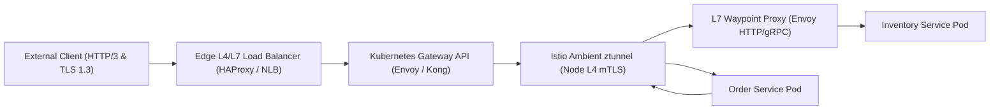
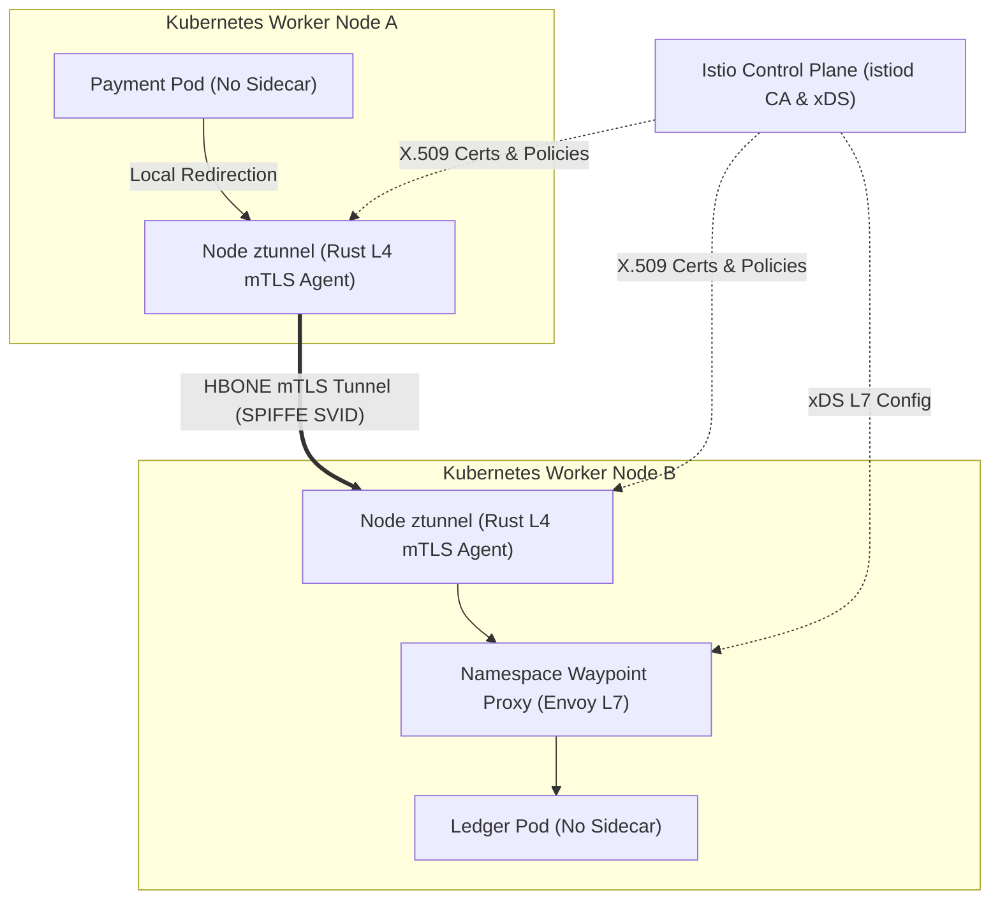

# Chapter 10: Proxies, Load Balancers, and Service Meshes Demystified

Distributed cloud-native architectures depend on deterministic, observable, and cryptographically verifiable network data planes. As monolithic applications decompose into dozens or hundreds of loosely coupled microservices, the network boundary ceases to be a passive physical wire and becomes the primary execution fabric determining system availability, tail latency, and security posture. Every remote procedure call (RPC) traverses multiple layers of kernel socket buffers, L4 transport multiplexers, L7 application proxies, and zero-trust identity verifiers.

Understanding the engineering distinction between forward proxies, reverse proxies, L4/L7 load balancers, API gateways, Kubernetes Gateway API controllers, and service meshes is foundational to modern platform engineering. In this chapter, we examine the packet and frame mechanics of modern network intermediaries, implement production configurations for NGINX, HAProxy, Envoy Proxy, and Kong Gateway, configure vendor-neutral ingress routing via the Kubernetes Gateway API (`GatewayClass` and `HTTPRoute`), evaluate Istio Sidecar versus Ambient Mesh architectures (`ztunnel` and waypoint proxies), and replace deprecated cloud meshes such as AWS App Mesh with Amazon VPC Lattice and ECS Service Connect.



## Architectural Taxonomy: Proxies, Load Balancers, API Gateways, and Service Meshes

Although proxies, load balancers, API gateways, and service meshes all intercept and forward network packets, they operate at different points in the network topology and solve distinct distributed systems problems. Conflating these layers leads to redundant serialization overhead, cascading retry storms, and opaque failure domains.

### Forward Proxies and Egress Governance

A forward proxy sits adjacent to client workloads and mediates outbound connections toward external networks or third-party SaaS endpoints. Rather than allowing arbitrary application pods to open direct TCP connections to the public internet, platform teams route egress traffic through a hardened forward proxy fleet. The proxy enforces domain allowlists via TLS Server Name Indication (SNI) inspection or HTTP `CONNECT` tunneling, prevents Server-Side Request Forgery (SSRF) from reaching cloud instance metadata endpoints (`169.254.169.254`), injects outbound API partner credentials at the perimeter so application containers never hold raw secrets, and records structured egress audit logs.

### Reverse Proxies and Origin Shielding

A reverse proxy resides in front of backend origin servers and terminates incoming connections on their behalf. External clients communicate exclusively with the reverse proxy's virtual IP (VIP) or DNS hostname, remaining unaware of the internal topology, private IP addressing, or runtime characteristics of the upstream fleet. Reverse proxies offload computationally expensive operations from application runtimes, including TLS 1.3 handshake termination, OCSP stapling, HTTP/2 and HTTP/3 (QUIC) connection multiplexing, Brotli and Zstandard payload compression, slow-client buffering (protecting single-threaded or event-loop upstreams from Slowloris attacks), and static asset caching.

### Layer 4 vs. Layer 7 Load Balancers

Load balancers distribute incoming traffic across multiple healthy backend instances to maximize throughput, minimize tail latency ($p_{99}$), and eliminate single points of failure. Load balancing occurs primarily at two layers of the OSI model:

- **Layer 4 (Transport Layer) Load Balancing**: Operates on TCP, UDP, and TLS streams using the 5-tuple (source IP, source port, destination IP, destination port, and protocol). L4 load balancers—such as Linux IPVS (IP Virtual Server), Cilium eBPF Maglev load balancers, AWS Network Load Balancer (NLB), and HAProxy in `tcp` mode—make routing decisions without parsing application-layer payloads. By using consistent hashing (such as Google's Maglev algorithm) and Direct Server Return (DSR) or stateless NAT, L4 load balancers process millions of packets per second with sub-millisecond latency overhead.
- **Layer 7 (Application Layer) Load Balancing**: Terminates the client TCP and TLS connection, parses the application protocol (HTTP/1.1, HTTP/2, HTTP/3, or gRPC), and establishes a separate pooled connection to the chosen backend endpoint. Because the L7 balancer inspects URL paths, host headers, cookies, JWT claims, and gRPC method names, it can execute content-based routing, canary traffic splitting, per-route rate limiting, and active outlier detection. Moreover, L7 load balancers solve the **HTTP/2 and gRPC connection pinning problem**: because HTTP/2 multiplexes all streams over a single long-lived TCP connection, an L4 load balancer routes every request on that connection to a single backend pod, whereas an L7 load balancer demultiplexes individual HTTP/2 frames and balances them evenly across the entire backend fleet.

### Load Balancing Algorithms and Outlier Detection

Choosing the right load-balancing algorithm is critical for controlling tail latency under heterogeneous request costs:

1. **Round Robin and Weighted Round Robin**: Cycles sequentially through healthy endpoints. Effective only when all requests have identical computational cost and all backend nodes share identical hardware capacity.
2. **Least Request / Least Connections**: Routes each incoming request to the upstream host with the fewest active in-flight requests.
3. **Power of Two Choices (P2C)**: In distributed proxy fleets where many independent proxies balance traffic across the same upstream pool without shared state, strict Least Connections causes **herd behavior**—every proxy simultaneously sees that a newly launched or momentarily idle instance has zero connections and floods it with traffic. Envoy Proxy and modern load balancers mitigate this using **P2C**: for each request, the proxy selects two healthy backends uniformly at random and sends the request to whichever of the two currently has fewer active requests. P2C achieves near-optimal load distribution with $O(1)$ selection overhead and zero inter-proxy coordination.
4. **Consistent Hashing (Ring Hash / Maglev)**: Maps a request key (such as a session ID, tenant header, or source IP) onto a deterministic hash ring so stateful workloads, in-memory caches, or WebSocket rooms consistently land on the same upstream shard even when nodes join or leave the cluster.

## NGINX: High-Performance Reverse Proxy and Edge Load Balancing

NGINX uses an asynchronous, non-blocking, event-driven architecture built around Linux `epoll` (or `kqueue` on BSD). Rather than spawning a dedicated OS thread or process per connection, NGINX runs a fixed pool of worker processes—typically pinned one-to-one to physical CPU cores—each capable of multiplexing tens of thousands of concurrent connections within a single event loop.

### Production NGINX Reverse Proxy and Upstream Configuration

In a production cloud-native environment, a minimal `proxy_pass` directive is insufficient; omitted connection pooling or missing timeouts will exhaust ephemeral ports (`EADDRNOTAVAIL`) under high concurrency because NGINX defaults to HTTP/1.0 with `Connection: close` toward upstream servers. Below is a hardened, production-grade NGINX configuration implementing upstream keepalive pooling, TLS 1.3 termination, passive failure eviction, and request tracing correlation:

```nginx
# /etc/nginx/conf.d/payments-edge.conf
upstream payments_backend {
    zone payments_zone 64k;
    least_conn;

    server 10.24.1.10:8080 max_fails=3
        fail_timeout=10s;
    server 10.24.1.11:8080 max_fails=3
        fail_timeout=10s;
    server 10.24.1.12:8080 max_fails=3
        fail_timeout=10s;

    # Maintain pooled idle keepalive connections
    # per worker process to prevent port exhaustion
    keepalive 64;
    keepalive_requests 10000;
    keepalive_timeout 60s;
}

limit_req_zone $binary_remote_addr
    zone=api_rate_limit:10m rate=100r/s;

server {
    listen 443 ssl;
    http2 on;
    server_name api.payments.example.com;

    ssl_certificate     /etc/ssl/certs/payments.crt;
    ssl_certificate_key /etc/ssl/private/payments.key;
    ssl_protocols       TLSv1.3;
    ssl_session_cache   shared:SSL:20m;
    ssl_session_timeout 1d;

    location /v1/checkout {
        limit_req zone=api_rate_limit burst=50 nodelay;

        proxy_pass http://payments_backend;
        proxy_http_version 1.1;
        proxy_set_header Connection "";

        proxy_set_header Host $host;
        proxy_set_header X-Real-IP $remote_addr;
        proxy_set_header X-Forwarded-For
            $proxy_add_x_forwarded_for;
        proxy_set_header X-Request-ID $request_id;

        proxy_connect_timeout 2s;
        proxy_send_timeout    5s;
        proxy_read_timeout    10s;

        proxy_next_upstream error timeout http_502
            http_503;
        proxy_next_upstream_tries 2;
    }
}
```

Setting `proxy_http_version 1.1` alongside `proxy_set_header Connection ""` enables TCP connection reuse against the `keepalive 64` pool, eliminating TCP 3-way handshakes and TIME_WAIT socket accumulation on internal microservice calls. Furthermore, `proxy_next_upstream_tries 2` bounds retry amplification so a failing backend cannot trigger an exponential retry storm across the fleet.

## HAProxy: Ultra-Low-Latency L4/L7 Routing and Stick Tables

HAProxy (High Availability Proxy) remains the industry gold standard for high-throughput software load balancing, edge TLS termination, and stateful TCP/HTTP traffic governance. Its multi-threaded, lockless event loop and zero-copy kernel splicing (`splice()`) allow it to saturate 100 GbE network interfaces while maintaining deterministic sub-millisecond latency.

One of HAProxy's most powerful engineering primitives is **Stick Tables**—in-memory key-value stores replicated across HAProxy peers that track real-time client behavior (such as request rates, error ratios, and concurrent connections per IP or JWT subject) directly in the data path without external Redis round-trips.

```haproxy
# /etc/haproxy/haproxy.cfg
global
    log stdout format raw local0 info
    maxconn 100000
    nbthread 8

defaults
    mode http
    log global
    option httplog
    option dontlognull
    option http-keep-alive
    timeout connect 2s
    timeout client  30s
    timeout server  15s
    timeout http-keep-alive 60s

frontend edge_https_in
    bind :443 ssl crt /etc/haproxy/certs/edge.pem
        alpn h2,http/1.1
    # Track per-client HTTP request rate in memory
    stick-table type ipv6 size 1m expire 60s
        store http_req_rate(10s),http_err_rate(10s)
    http-request track-sc0 src
    # Reject abusive clients exceeding 200 req / 10s
    http-request deny deny_status 429
        if { sc_http_req_rate(0) gt 200 }

    acl is_grpc hdr(content-type) -m beg
        application/grpc
    use_backend grpc_services if is_grpc
    default_backend rest_services

backend grpc_services
    balance random(2)
    option httpchk GET /healthz
    http-check expect status 200
    server grpc1 10.24.2.10:9090 check proto h2
    server grpc2 10.24.2.11:9090 check proto h2
    server grpc3 10.24.2.12:9090 check proto h2

backend rest_services
    balance leastconn
    option httpchk GET /readyz
    http-check expect status 200
    server app1 10.24.3.10:8080 check inter 2s
        fall 3 rise 2
    server app2 10.24.3.11:8080 check inter 2s
        fall 3 rise 2
```

Notice the `balance random(2)` directive in the `grpc_services` backend: this activates Power of Two Random Choices (P2C) over persistent HTTP/2 (`proto h2`) channels, ensuring individual gRPC calls are multiplexed evenly across healthy backend servers.

## Envoy Proxy: The Universal Cloud-Native Data Plane

Created at Lyft and graduated within the CNCF, **Envoy Proxy** is a high-performance C++ L4/L7 proxy designed from first principles to serve as a universal data plane for large-scale microservice architectures, API gateways, and service meshes. Unlike legacy proxies configured primarily by reloading static files on disk via `SIGHUP`, Envoy is engineered around API-driven dynamic configuration known as the **xDS protocol suite**:

- **LDS (Listener Discovery Service)**: Dynamically configures network listeners (ports, unix domain sockets, and filter chains).
- **RDS (Route Discovery Service)**: Dynamically configures virtual hosts, URL prefixes, header matchers, and traffic-splitting weights.
- **CDS (Cluster Discovery Service)**: Dynamically defines logical upstream service groups, circuit-breaking thresholds, and outlier detection policies.
- **EDS (Endpoint Discovery Service)**: Streams real-time IP and port endpoints belonging to each cluster without requiring DNS polling.
- **SDS (Secret Discovery Service)**: Streams short-lived TLS certificates and SPIFFE X.509 SVIDs directly into memory without touching the filesystem.

### Production Envoy Configuration with Outlier Detection and Circuit Breaking

Below is a production Envoy configuration demonstrating HTTP/2 upstream pooling, strict circuit breaking (capping concurrent requests and pending queues to prevent cascading failures), and passive **outlier detection** that automatically ejects any backend node returning five consecutive `5xx` errors:

```yaml
# envoy-edge.yaml
admin:
  address:
    socket_address:
      address: 127.0.0.1
      port_value: 9901

static_resources:
  listeners:
    - name: ingress_listener
      address:
        socket_address:
          address: 0.0.0.0
          port_value: 10000
      filter_chains:
        - filters:
            - name: envoy.http_connection_manager
              typed_config:
                "@type": >-
                  type.googleapis.com/
                  envoy.HttpConnectionManager
                stat_prefix: edge_http
                codec_type: AUTO
                generate_request_id: true
                route_config:
                  name: primary_routes
                  virtual_hosts:
                    - name: catalog_vhost
                      domains: ["catalog.internal"]
                      routes:
                        - match:
                            prefix: "/api/v2/"
                          route:
                            cluster: catalog_cluster
                            timeout: 3s
                            retry_policy:
                              retry_on: >-
                                5xx,connect-failure,
                                reset
                              num_retries: 2
                              per_try_timeout: 1s
                http_filters:
                  - name: envoy.filters.http.router
                    typed_config:
                      "@type": >-
                        type.googleapis.com/
                        envoy.Router

  clusters:
    - name: catalog_cluster
      type: STRICT_DNS
      connect_timeout: 0.5s
      lb_policy: LEAST_REQUEST
      least_request_lb_config:
        choice_count: 2
      circuit_breakers:
        thresholds:
          - priority: DEFAULT
            max_connections: 1024
            max_pending_requests: 256
            max_requests: 2048
            max_retries: 32
      outlier_detection:
        consecutive_5xx: 5
        interval: 5s
        base_ejection_time: 30s
        max_ejection_percent: 50
      load_assignment:
        cluster_name: catalog_cluster
        endpoints:
          - lb_endpoints:
              - endpoint:
                  address:
                    socket_address:
                      address: catalog-svc.prod.svc
                      port_value: 8080
```

Setting `max_retries: 32` inside `circuit_breakers.thresholds` is one of Envoy's most important reliability safeguards: even if every route permits two retries, the cluster-wide retry budget limits the total number of concurrent retries across all requests to 32, preventing retry storms from crushing a recovering dependency.

## Kong Gateway: Declarative API Management at the Perimeter

While reverse proxies handle transport and routing mechanics, north-south public APIs require higher-level product and security governance: OIDC/OAuth2 token introspection, consumer-scoped rate limiting, payload validation, request transformation, and AI gateway token metering. **Kong Gateway** enables DB-less declarative API management where the entire gateway configuration is versioned in Git and loaded atomically into memory or reconciled via the Kong Ingress Controller.

Below is a declarative Kong 3.x configuration (`kong.yaml`) enforcing OIDC JWT verification, consumer rate limiting, and correlation ID injection:

```yaml
# kong.yaml (Declarative DB-less Configuration)
_format_version: "3.0"
_transform: true

services:
  - name: ledger-service
    url: http://ledger.prod.svc.cluster.local:8080
    connect_timeout: 2000
    read_timeout: 5000
    write_timeout: 5000
    retries: 2
    routes:
      - name: ledger-v1-route
        paths:
          - /v1/ledger
        methods:
          - GET
          - POST
        strip_path: false

plugins:
  - name: rate-limiting
    service: ledger-service
    config:
      second: 50
      minute: 1500
      policy: local
      fault_tolerant: true
      hide_client_headers: false

  - name: correlation-id
    service: ledger-service
    config:
      header_name: X-Correlation-ID
      generator: uuid#counter
      echo_downstream: true

  - name: jwt
    service: ledger-service
    config:
      claims_to_verify:
        - exp
        - nbf
      key_claim_name: kid
```

## Kubernetes Gateway API: The Modern Standard Replacing Ingress

For nearly a decade, Kubernetes users relied on the `Ingress` resource to expose HTTP workloads. However, the legacy `Ingress` API suffered from severe structural limitations: it lacked native support for header-based matching, traffic weighting, gRPC routing, TCP/TLS passthrough, and cross-namespace delegation. Consequently, every controller vendor (NGINX, Envoy, Kong, AWS ALB, Traefik) invented dozens of proprietary, non-portable YAML annotations.

The **Kubernetes Gateway API** (`gateway.networking.k8s.io/v1`) supersedes `Ingress` with a role-oriented, expressive, vendor-neutral specification implemented natively by Envoy Gateway, Istio, Cilium, Kong, NGINX Gateway Fabric, and cloud provider load balancers:

1. **`GatewayClass`**: Managed by the **Infrastructure Provider**; defines the controller implementation backing the gateway (e.g., `envoy-gateway`, `istio`, or `cilium`).
2. **`Gateway`**: Managed by the **Cluster Operator / Platform Team**; defines the network entry point, listeners, ports, and TLS certificates.
3. **`HTTPRoute` / `GRPCRoute` / `TLSRoute`**: Managed by **Application Developers** in their own namespaces; attaches to the shared `Gateway` and defines path rules, header filters, and weighted canary splits without requiring access to cluster-wide TLS certificates.

```yaml
# gateway-and-route.yaml
apiVersion: gateway.networking.k8s.io/v1
kind: GatewayClass
metadata:
  name: platform-envoy-gateway
spec:
  controllerName: >-
    gateway.envoyproxy.io/gatewayclass-controller
---
apiVersion: gateway.networking.k8s.io
kind: Gateway
metadata:
  name: prod-edge-gateway
  namespace: platform-ingress
spec:
  gatewayClassName: platform-envoy-gateway
  listeners:
    - name: https-api
      protocol: HTTPS
      port: 443
      hostname: "api.platform.example.com"
      tls:
        mode: Terminate
        certificateRefs:
          - kind: Secret
            name: api-platform-tls-cert
      allowedRoutes:
        namespaces:
          from: Selector
          selector:
            matchLabels:
              network.platform.io/ingress: "allowed"
---
apiVersion: gateway.networking.k8s.io/v1
kind: HTTPRoute
metadata:
  name: checkout-canary-route
  namespace: checkout-prod
spec:
  parentRefs:
    - name: prod-edge-gateway
      namespace: platform-ingress
  hostnames:
    - "api.platform.example.com"
  rules:
    - matches:
        - path:
            type: PathPrefix
            value: /v2/checkout
          headers:
            - name: X-Canary-Cohort
              value: "beta"
      backendRefs:
        - name: checkout-svc-v2
          port: 8080
          weight: 100
    - matches:
        - path:
            type: PathPrefix
            value: /v2/checkout
      backendRefs:
        - name: checkout-svc-v1
          port: 8080
          weight: 90
        - name: checkout-svc-v2
          port: 8080
          weight: 10
```

This declarative separation of concerns eliminates annotation sprawl: the platform security team controls TLS termination and namespace admission on the `Gateway` in `platform-ingress`, while the checkout engineering team autonomously manages a 90/10 canary rollout via `HTTPRoute` in `checkout-prod`.

## Istio Service Mesh: Sidecar vs. Ambient Mode Architecture

While edge gateways govern **north-south** traffic entering the cluster, a **Service Mesh** governs **east-west** service-to-service communication inside the cluster. It provides three core capabilities without requiring changes to application code:

1. **Zero-Trust Cryptographic Identity and mTLS**: Automatically issues short-lived X.509 certificates formatted according to the **SPIFFE** standard (`spiffe://cluster.local/ns/<namespace>/sa/<service-account>`) to every workload, encrypting all east-west traffic via mutual TLS and enforcing fine-grained authorization policies based on verified cryptographic identity rather than mutable pod IP addresses.
2. **Fine-Grained Traffic Management**: Enables per-service retries, deadline propagation, fault injection, request mirroring (dark launches), and locality-aware load balancing (keeping traffic within the same Availability Zone to eliminate cross-AZ data transfer fees).
3. **Uniform Golden-Signal Telemetry**: Emits standardized Prometheus metrics (`istio_requests_total`, `istio_request_duration_milliseconds`), distributed OpenTelemetry trace spans, and access logs across polyglot services.

### The Evolution from Sidecars to Istio Ambient Mode

Historically, Istio injected a dedicated Envoy proxy container (a **sidecar**) into every application pod alongside `iptables` or eBPF socket-redirection rules. While effective, the sidecar model introduced operational friction at scale: every pod paid a memory and CPU tax for its private Envoy instance, upgrading Envoy required restarting application pods, and complex L7 parsing ran on every hop even when teams only required L4 mTLS encryption.

In modern production deployments, **Istio Ambient Mode** decouples L4 secure overlay transport from L7 policy processing by splitting the data plane into two layers:

- **`ztunnel` (Zero-Trust Tunnel)**: A lightweight, high-performance Rust-based per-node agent running as a Kubernetes `DaemonSet`. `ztunnel` transparently intercepts pod traffic on the node, establishes mutual TLS using **HBONE** (HTTP-Based Overlay Network Environment—tunneling TCP streams over HTTP/2 `CONNECT` with SPIFFE identities), collects L4 telemetry, and enforces L4 `AuthorizationPolicy` rules with minimal memory footprint and zero sidecar injection.
- **Waypoint Proxies**: When a namespace or service explicitly requires L7 features (such as HTTP header routing, gRPC method-level authorization, retries, or rate limiting), the platform deploys an optional, shared Envoy **Waypoint Proxy** managed via the Kubernetes Gateway API.



### Enrolling Namespaces in Istio Ambient Mode and Enforcing Zero-Trust Policy

Enrolling an existing namespace into Istio Ambient Mode requires a single label—no pod restarts or sidecar webhook mutations occur:

```bash
# Enable Istio Ambient L4 mTLS on the namespace
kubectl label namespace checkout-prod \
  istio.io/dataplane-mode=ambient

# Deploy an optional L7 Waypoint proxy for the
# namespace using the standard Gateway API CLI
istioctl waypoint apply -n checkout-prod \
  --enroll-namespace
```

Once Ambient Mode is active, platform teams enforce strict zero-trust access control using an Istio `PeerAuthentication` and `AuthorizationPolicy` manifest:

```yaml
# istio-zero-trust-policy.yaml
apiVersion: security.istio.io/v1
kind: PeerAuthentication
metadata:
  name: enforce-strict-mtls
  namespace: checkout-prod
spec:
  mtls:
    mode: STRICT
---
apiVersion: security.istio.io/v1
kind: AuthorizationPolicy
metadata:
  name: ledger-write-allowlist
  namespace: checkout-prod
spec:
  selector:
    matchLabels:
      app: ledger-service
  action: ALLOW
  rules:
    - from:
        - source:
            principals:
              - >-
                cluster.local/ns/checkout-prod/
                sa/payment-worker
      to:
        - operation:
            methods: ["POST"]
            paths: ["/v1/ledger/entries"]
```

With this policy applied, even if an attacker compromises an unrelated pod in the cluster, any attempt to call `POST /v1/ledger/entries` is rejected cryptographically because the caller lacks the SPIFFE certificate `spiffe://cluster.local/ns/checkout-prod/sa/payment-worker`.

## Cloud-Managed Service Connectivity: Amazon VPC Lattice and ECS Service Connect

> **Deprecation Architecture Note (Replacing AWS App Mesh)**: AWS officially deprecated **AWS App Mesh** (announcing its end-of-support transition in favor of **Amazon VPC Lattice** and **Amazon ECS Service Connect**). Operating self-managed Envoy sidecars across heterogeneous EC2, ECS, and EKS fleets required complex sidecar task definitions, manual Envoy image patching, and intricate VPC peering/Transit Gateway routing tables. Modern AWS architectures replace App Mesh with **Amazon VPC Lattice** for cross-VPC, cross-account, and multi-compute (EKS, ECS, Lambda, EC2) L7 service networking, or **ECS Service Connect** for intra-ECS cluster service discovery and resilience.

### How Amazon VPC Lattice Works

Amazon VPC Lattice is a fully managed application-layer (L7) networking service built directly into the AWS VPC infrastructure fabric. Instead of running Envoy sidecar containers inside customer pods or tasks, VPC Lattice exposes a link-local proxy endpoint inside the AWS Hypervisor/Nitro network fabric. It provides:

1. **Cross-VPC and Cross-Account Routing without IP Overlap Constraints**: Two VPCs with overlapping CIDR blocks (`10.0.0.0/16`) can communicate over a **VPC Lattice Service Network** without NAT gateways or Transit Gateway route table conflicts.
2. **Heterogeneous Compute Targets**: A single VPC Lattice `HTTPRoute` can split traffic across an Amazon EKS Kubernetes service (via the **AWS Gateway API Controller**), an Amazon ECS service, and an AWS Lambda function.
3. **IAM Zero-Trust Auth Policies**: Every service-to-service HTTP/gRPC request can be authenticated and authorized using AWS IAM SigV4 policies tied to the caller's IAM Role,VPC ID, or AWS Organization Principal ID.

### Configuring Amazon VPC Lattice with the Kubernetes Gateway API and IAM Auth

Because Amazon VPC Lattice natively implements the Kubernetes Gateway API (`application-networking.k8s.aws`), EKS platform engineers define cross-cluster routes using standard `Gateway` and `HTTPRoute` resources, alongside an IAM `AuthPolicy` that restricts invocation to authenticated principals within the organization:

```yaml
# vpc-lattice-gateway-route.yaml
apiVersion: gateway.networking.k8s.io/v1
kind: Gateway
metadata:
  name: enterprise-mesh-service-network
  namespace: checkout-prod
  annotations:
    application-networking.k8s.aws/lattice-vpc: "true"
spec:
  gatewayClassName: amazon-vpc-lattice
  listeners:
    - name: https
      protocol: HTTPS
      port: 443
---
apiVersion: gateway.networking.k8s.io/v1
kind: HTTPRoute
metadata:
  name: inventory-cross-vpc-route
  namespace: checkout-prod
spec:
  parentRefs:
    - name: enterprise-mesh-service-network
  rules:
    - matches:
        - path:
            type: PathPrefix
            value: /inventory
      backendRefs:
        - name: inventory-eks-svc
          kind: Service
          port: 8080
          weight: 85
        - name: inventory-serverless-fallback
          kind: ServiceImport
          port: 443
          weight: 15
```

To enforce zero-trust authentication on the VPC Lattice service so only authorized IAM execution roles inside the AWS Organization (`o-prodorg123`) can invoke the inventory endpoint over HTTPS, attach a VPC Lattice Auth Policy via Terraform / OpenTofu:

```hcl
# vpc-lattice-auth.tf
resource "aws_vpclattice_service" "inventory" {
  name               = "inventory-lattice-svc"
  auth_type          = "AWS_IAM"
  custom_domain_name = "inventory.internal.example.com"
}

resource "aws_vpclattice_auth_policy" "inventory_iam" {
  resource_identifier = (
    aws_vpclattice_service.inventory.arn
  )
  policy = jsonencode({
    Version = "2012-10-17"
    Statement = [
      {
        Effect    = "Allow"
        Principal = "*"
        Action    = "vpc-lattice-svcs:Invoke"
        Resource  = "*"
        Condition = {
          StringEquals = {
            "aws:PrincipalOrgID" = "o-prodorg123"
            "vpc-lattice-svcs:RequestMethod" = [
              "GET",
              "POST"
            ]
          }
        }
      }
    ]
  })
}
```

## Architectural Decision Matrix: Selecting the Right Network Layer

To avoid over-engineering or stacking redundant proxy layers, platform architects evaluate traffic requirements against operational complexity:

```text
+------------------+-----------------+----------------+
| Capability       | Reverse Proxy   | Service Mesh / |
|                  | & K8s Gateway   | VPC Lattice    |
+------------------+-----------------+----------------+
| Traffic Scope    | North-South     | East-West Pod  |
|                  | Edge & Ingress  | & Cross-VPC    |
| Identity Model   | Public TLS 1.3  | SPIFFE mTLS or |
|                  | Cert-Manager    | AWS IAM SigV4  |
| Config Plane     | GatewayClass &  | Ambient Node + |
|                  | HTTPRoute CRDs  | Waypoint Proxy |
| Compute Targets  | VMs, Bare Metal | K8s, ECS, EC2, |
|                  | & Containers    | & AWS Lambda   |
+------------------+-----------------+----------------+
```

## Production Best Practices for Proxies and Service Meshes

1. **Bound Retry Amplification to Prevent Cascading Outages**: Never configure retries at multiple proxy layers simultaneously. If an edge API Gateway retries 3 times, a Waypoint proxy retries 3 times, and the client SDK retries 3 times, a single slow database query triggers $3 \times 3 \times 3 = 27\times$ load amplification. Perform retries at most at one layer (ideally the immediate caller proxy), enforce strict per-try timeouts, and configure cluster-wide retry budgets (such as Envoy's `max_retries` threshold or Retry Budget percentages).
2. **Propagate Deadlines and Distributed Context Headers**: Configure every proxy and service mesh hop to preserve W3C Trace Context headers (`traceparent`, `tracestate`) and gRPC timeout deadlines (`grpc-timeout`). If an upstream caller has a 2-second deadline and 1.8 seconds have already elapsed, downstream services should immediately abort work after 200ms rather than wasting CPU on a response the client has already abandoned.
3. **Prefer Ambient Mesh (`ztunnel`) Over Universal Sidecar Injection**: Default to Istio Ambient Mode (`ztunnel`) for cluster-wide zero-trust mTLS and L4 authorization, deploying L7 Waypoint proxies selectively for namespaces that require HTTP header routing, circuit breaking, or gRPC method-level policies. This reduces cluster-wide proxy memory consumption by 70–85% and decouples application pod lifecycles from proxy security upgrades.
4. **Enable Locality-Weighted Load Balancing**: In multi-AZ Kubernetes clusters, cross-AZ network traffic incurs both cloud provider egress charges ($0.01/GB each way) and 1–2ms of additional round-trip latency. Configure Envoy and Istio `DestinationRule` locality load balancing (`localityLbSetting.enabled: true`) with failover thresholds so traffic stays within the caller's Availability Zone whenever healthy local endpoints exist.

## Summary

Modern cloud-native networking relies on a composable hierarchy of specialized proxies. NGINX and HAProxy deliver extreme performance at the transport and edge HTTP perimeter; Envoy Proxy and Kong Gateway provide API-driven observability, outlier detection, and consumer governance; the Kubernetes Gateway API unifies ingress and mesh traffic management under portable, role-oriented CRDs; Istio Ambient Mode delivers sidecarless SPIFFE mTLS and L7 waypoint routing; and Amazon VPC Lattice extends zero-trust L7 service networking across multi-VPC, multi-account cloud environments. In Chapter 11, we transition from the network data plane to the compute layer, examining modern serverless architectures and event-driven execution fabrics.
