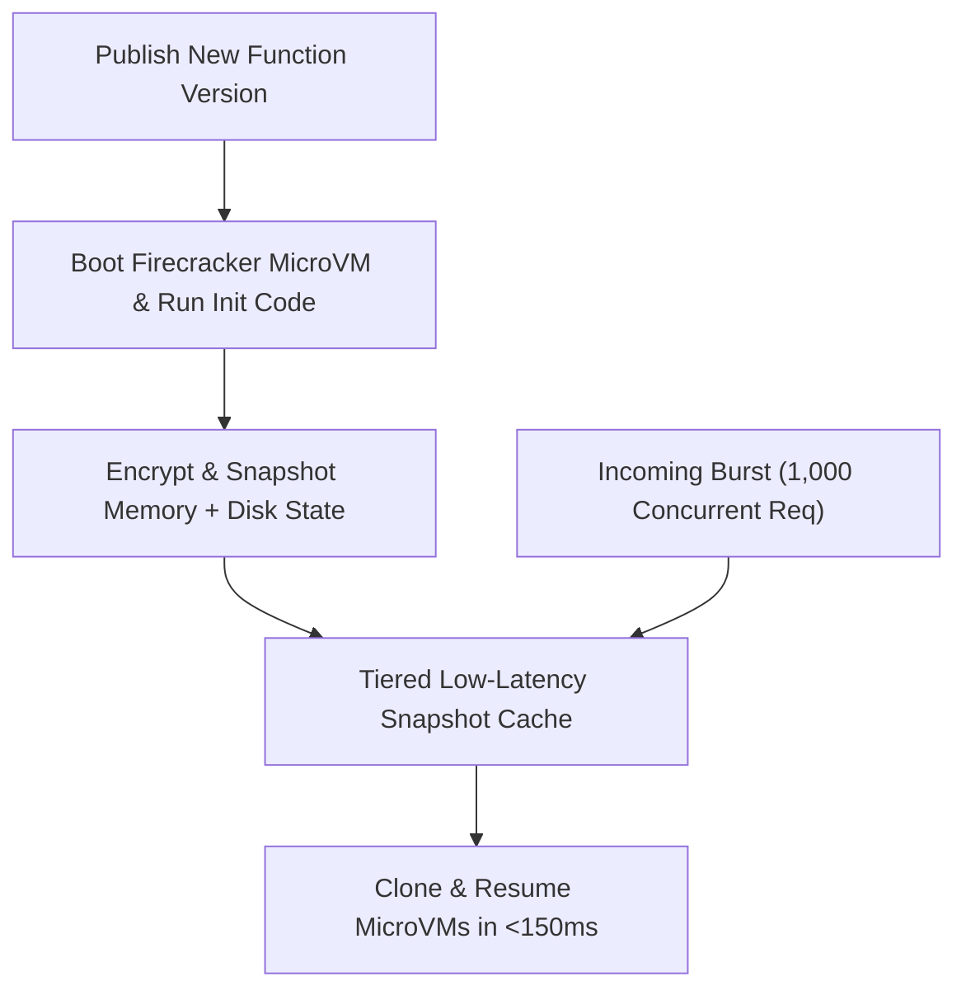

# Chapter 11: Serverless Applications and Event-Driven Cloud Architectures

Serverless computing has evolved far beyond simple script triggers into a high-throughput, hardware-isolated, event-driven compute paradigm capable of powering mission-critical financial ledgers, real-time streaming pipelines, and low-latency AI inference APIs. In a serverless execution model, the cloud provider dynamically schedules micro-virtual machines, manages operating system kernel patching, scales concurrency horizontally within milliseconds of incoming demand, and meters billing at sub-millisecond or per-request granularity.

However, achieving predictable tail latency ($p_{99}$), cost efficiency, and transactional integrity in serverless systems requires deep mastery of the underlying execution environment lifecycle, microVM virtualization mechanics, asynchronous event brokers, workflow state machines, and non-relational data modeling. In this chapter, we examine the Firecracker microVM execution model powering AWS Lambda, implement modern performance primitives including **Lambda SnapStart**, **Response Streaming**, **AWS Lambda Web Adapter**, and **Arm64 Graviton3** runtimes, replace legacy WSGI wrappers (such as Zappa) with native container/adapter patterns, define production infrastructure using **AWS SAM** and **AWS CDK v2**, orchestrate point-to-point and massively parallel workflows with **Amazon EventBridge Pipes**, **EventBridge Scheduler**, and **AWS Step Functions Distributed Map**, and engineer **Amazon DynamoDB Single-Table Designs** for boundless horizontal scale.


## The Serverless Execution Model: Firecracker MicroVMs and the Invocation Lifecycle

To engineer low-latency serverless systems, platform engineers must understand what happens beneath the abstraction when a function is invoked. AWS Lambda isolates tenant workloads using **Firecracker**, an open-source Virtual Machine Monitor (VMM) written in Rust that uses the Linux Kernel-based Virtual Machine (KVM) subsystem to create lightweight microVMs. Unlike traditional virtual machines that take seconds to boot and consume hundreds of megabytes of overhead, a Firecracker microVM boots a minimal Linux kernel in under 125 milliseconds with less than 5 MB of memory overhead per execution environment.

Every Lambda execution environment progresses through three distinct lifecycle phases:

1. **Init Phase (Cold Start)**: When an incoming event arrives and no idle execution environment is available, the Lambda control plane allocates a Firecracker microVM on a physical worker host, mounts the container image or `.zip` layer via a copy-on-write block device, starts the language runtime (e.g., Python 3.13, Node.js 22, Java 21, or Rust `provided.al2023`), initializes configured Lambda Extensions (such as the OpenTelemetry Collector or Parameters and Secrets extension), and executes all module-level initialization code outside the handler function.
2. **Invoke Phase (Warm Execution)**: The runtime invokes the registered function handler, passing the event payload and execution context. Notice that while the `Invoke` phase is running, the microVM has full access to its allocated vCPUs (scaled proportionally to configured memory, where $1,769\text{ MB} = 1\text{ full vCPU}$ and $10,240\text{ MB} = 6\text{ vCPUs}$). Once the handler returns a response, the microVM's processes are frozen (`cgroup` freezer) until the next invocation arrives.
3. **Shutdown Phase**: If an execution environment remains idle for an extended period, the control plane sends a `SIGTERM` signal to registered extensions and the runtime, allowing a brief window (up to 2,000 ms) to flush telemetry buffers and close database sockets before destroying the microVM.

### Mitigating Cold Starts with Lambda SnapStart

For runtimes with heavy initialization phases—such as Java (Spring Boot, Quarkus, Micronaut), .NET, or Python functions loading large machine-learning Dependencies and SDK clients—the `Init` phase can take 2 to 8 seconds, causing severe $p_{99}$ latency spikes during traffic bursts.

**AWS Lambda SnapStart** eliminates this initialization tax by shifting the `Init` phase from invocation time to **deployment publishing time**:



When you publish a new function version with SnapStart enabled, Lambda boots an execution environment, runs your entire `Init` phase (initializing classes, dependency injection graphs, and static resources), takes an encrypted Firecracker microVM snapshot of memory and disk state, and stores it in a tiered cache. When concurrent requests arrive, Lambda resumes new execution environments directly from the cached memory snapshot rather than booting from scratch, slashing cold-start latency by up to 90%.

Because resumed microVMs share the exact memory state captured during snapshot creation, engineers must observe **uniqueness and network socket safety rules**:

- **Cryptographic Randomness (PRNG)**: Modern Linux kernels (`getrandom()`) and OpenSSL/Java runtimes automatically reseed their pseudo-random number generators upon microVM resume, but custom user-space PRNGs seeded during `Init` must be reseeded inside a **Runtime Hook** (`register_after_restore` in Python or `CRaC` `afterRestore` in Java).
- **Ephemeral Connections and Stale Timestamps**: Pre-established TCP sockets or temporary credentials fetched during `Init` may expire before a snapshot is restored days later; always validate connection liveness or refresh tokens in the `after_restore` hook.

Here is a production Python 3.13 Lambda handler running on **Arm64 (AWS Graviton3)** using `snapshot_restore_py` runtime hooks and structured idempotency:

```python
# src/handlers/order_processor.py
import os
import time
import uuid
import boto3
from snapshot_restore_py import (
    register_before_snapshot,
    register_after_restore,
)

# Initialized once during SnapStart snapshot creation
dynamodb = boto3.resource("dynamodb")
TABLE_NAME = os.environ["ORDERS_TABLE_NAME"]
table = dynamodb.Table(TABLE_NAME)
BOOT_INSTANCE_ID = None


@register_before_snapshot
def pre_snapshot_warm():
    # Pre-load botocore endpoints & serializers
    # into memory before snapshot is captured
    _ = dynamodb.meta.client._endpoint


@register_after_restore
def post_restore_reseed():
    global BOOT_INSTANCE_ID
    # Generate a unique microVM instance ID after
    # cloning from the shared memory snapshot
    BOOT_INSTANCE_ID = str(uuid.uuid4())


def lambda_handler(event: dict, context) -> dict:
    order_id = event["order_id"]
    tenant_id = event["tenant_id"]
    amount_cents = int(event["amount_cents"])
    now_iso = time.strftime(
        "%Y-%m-%dT%H:%M:%SZ", time.gmtime()
    )

    # Conditional write guarantees idempotency if
    # upstream retries the same order_id event
    table.put_item(
        Item={
            "PK": f"TENANT#{tenant_id}",
            "SK": f"ORDER#{order_id}",
            "GSI1PK": "STATUS#PENDING",
            "GSI1SK": f"{now_iso}#{order_id}",
            "amount_cents": amount_cents,
            "worker_vm": BOOT_INSTANCE_ID,
            "created_at": now_iso,
        },
        ConditionExpression=(
            "attribute_not_exists(PK) AND "
            "attribute_not_exists(SK)"
        ),
    )

    return {
        "statusCode": 201,
        "order_id": order_id,
        "worker_vm": BOOT_INSTANCE_ID,
    }
```

## Replacing Legacy Wrappers (Zappa) with AWS Lambda Web Adapter and Response Streaming

> **Deprecation & Modernization Note (Eliminating Zappa)**: In early serverless adoption (circa 2017–2021), Python developers frequently used **Zappa** to wrap Flask or Django WSGI applications into AWS Lambda zip packages. Zappa relied on fragile monkey-patching of API Gateway proxy payloads into synthetic WSGI dictionaries, lacked native support for ASGI asynchronous streaming, struggled with binary dependency compilation across OS upgrades, and restricted portability. In modern 2026 architectures, **Zappa is obsolete**. Teams deploy standard, unmodified HTTP web frameworks (FastAPI, Express/Fastify, Go `net/http`, Rust Axum, or Spring Boot) using **AWS Lambda Web Adapter** and **Lambda Response Streaming**.

### How AWS Lambda Web Adapter Works

The **AWS Lambda Web Adapter** is an open-source, Rust-based Lambda Extension packaged as a container layer (`public.ecr.aws/awsguru/aws-lambda-adapter`). When added to a standard OCI container image or zip function, it registers with the Lambda Runtime API as an external extension, starts your normal web server (`uvicorn`, `gunicorn`, `node`, or a compiled Go/Rust binary) on local port `8080`, performs a readiness check against `/healthz`, and translates incoming Lambda events (from API Gateway, Application Load Balancer, or Lambda Function URLs) into standard HTTP requests over loopback `http://127.0.0.1:8080`.

Crucially, pairing AWS Lambda Web Adapter with **Lambda Response Streaming** (`InvokeMode: RESPONSE_STREAM`) lifts the traditional 6 MB buffered payload ceiling (supporting responses up to 200 MB) and lowers **Time to First Byte (TTFB)** to single-digit milliseconds—an essential capability for Server-Sent Events (SSE) and streaming Large Language Model (LLM) token responses.

```dockerfile
# Dockerfile (Portable FastAPI on Lambda & Kubernetes)
FROM public.ecr.aws/docker/library/python:3.13-slim

# Copy the AWS Lambda Web Adapter binary into
# the Lambda extensions directory
COPY --from=public.ecr.aws/awsguru/aws-lambda-adapter \
  /lambda-adapter /opt/extensions/lambda-adapter

ENV PORT=8080
ENV AWS_LWA_INVOKE_MODE=response_stream
ENV AWS_LWA_READINESS_CHECK_PATH=/healthz

WORKDIR /app
COPY requirements.txt .
RUN pip install --no-cache-dir -r requirements.txt
COPY app/ ./app/

# Identical entrypoint runs in Lambda, ECS, or EKS
CMD ["uvicorn", "app.main:app", "--host", "0.0.0.0", \
     "--port", "8080"]
```

And the corresponding FastAPI application (`app/main.py`) requires zero Lambda-specific handler glue:

```python
# app/main.py
import asyncio
from fastapi import FastAPI
from fastapi.responses import StreamingResponse

app = FastAPI()


@app.get("/healthz")
async def health_check():
    return {"status": "healthy"}


async def token_stream_generator(prompt: str):
    chunks = [
        "Analyzing ",
        "telemetry ",
        "stream ",
        f"for: {prompt}\n",
    ]
    for chunk in chunks:
        yield f"data: {chunk}\n\n"
        await asyncio.sleep(0.05)


@app.get("/v1/stream")
async def stream_inference(prompt: str = "prod-slo"):
    return StreamingResponse(
        token_stream_generator(prompt),
        media_type="text/event-stream",
    )
```

## Declarative Serverless Infrastructure: AWS SAM and AWS CDK v2

Provisioning serverless functions manually via the AWS Console or ad-hoc `aws lambda create-function` shell commands violates Infrastructure as Code (IaC) repeatability and cannot manage IAM least-privilege policies, Dead-Letter Queues (DLQs), or canary deployment alarms. Modern engineering organizations standardize on **AWS SAM (Serverless Application Model)** for YAML-driven serverless templates or **AWS CDK v2 (Cloud Development Kit)** for strongly typed TypeScript/Python constructs.

### Production AWS SAM Template with Arm64 Graviton3, SnapStart, and Canary Gradual Deployment

Below is a production `template.yaml` using AWS SAM (`AWS::Serverless-2016-10-31`) that configures an Arm64 Graviton3 function (delivering up to 34% better price-performance than x86_64), enables SnapStart on published versions, attaches a CodeDeploy gradual canary rollout (`Canary10Percent5Minutes`) with automatic CloudWatch Alarm rollback, and scopes IAM permissions to a single DynamoDB table:

```yaml
# template.yaml (AWS SAM)
AWSTemplateFormatVersion: "2010-09-09"
Transform: AWS::Serverless-2016-10-31
Description: Modern Order Processing Serverless Stack

Globals:
  Function:
    Runtime: python3.13
    Architectures:
      - arm64
    MemorySize: 1769
    Timeout: 10
    Tracing: Active

Resources:
  OrderProcessorFunction:
    Type: AWS::Serverless::Function
    Properties:
      CodeUri: src/handlers/
      Handler: order_processor.lambda_handler
      AutoPublishAlias: live
      SnapStart:
        ApplyOn: PublishedVersions
      DeploymentPreference:
        Type: Canary10Percent5Minutes
        Alarms:
          - !Ref OrderFunctionErrorAlarm
      Environment:
        Variables:
          ORDERS_TABLE_NAME: !Ref OrdersTable
      Policies:
        - DynamoDBCrudPolicy:
            TableName: !Ref OrdersTable
      Events:
        CreateOrderApi:
          Type: HttpApi
          Properties:
            Path: /v1/orders
            Method: POST

  OrderFunctionErrorAlarm:
    Type: AWS::CloudWatch::Alarm
    Properties:
      ComparisonOperator: GreaterThanThreshold
      EvaluationPeriods: 1
      MetricName: Errors
      Namespace: AWS/Lambda
      Period: 60
      Statistic: Sum
      Threshold: 2
      Dimensions:
        - Name: FunctionName
          Value: !Ref OrderProcessorFunction
```

### Type-Safe Serverless Architecture with AWS CDK v2 (TypeScript)

When building complex event-driven systems that combine APIs, DynamoDB streams, and Step Functions, **AWS CDK v2** provides compile-time validation and automatic least-privilege IAM `grant*` helper methods:

```typescript
// lib/serverless-ledger-stack.ts
import * as cdk from 'aws-cdk-lib';
import * as lambda from 'aws-cdk-lib/aws-lambda';
import * as dynamodb from 'aws-cdk-lib/aws-dynamodb';
import { Construct } from 'constructs';

export class ServerlessLedgerStack extends cdk.Stack {
  constructor(
    scope: Construct,
    id: string,
    props?: cdk.StackProps
  ) {
    super(scope, id, props);

    const ledgerTable = new dynamodb.TableV2(
      this,
      'LedgerSingleTable',
      {
        partitionKey: {
          name: 'PK',
          type: dynamodb.AttributeType.STRING,
        },
        sortKey: {
          name: 'SK',
          type: dynamodb.AttributeType.STRING,
        },
        billing: dynamodb.Billing.onDemand(),
        dynamoStream:
          dynamodb.StreamViewType.NEW_AND_OLD_IMAGES,
        pointInTimeRecoverySpecification: {
          pointInTimeRecoveryEnabled: true,
        },
      }
    );

    const DockerFn = lambda.DockerImageFunction;
    const streamingApp = new DockerFn(
      this,
      'StreamingInferenceFn',
      {
        code: lambda.DockerImageCode.fromImageAsset(
          './'
        ),
        architecture: lambda.Architecture.ARM_64,
        memorySize: 2048,
        timeout: cdk.Duration.seconds(30),
        environment: {
          TABLE_NAME: ledgerTable.tableName,
        },
      }
    );

    // Grant least-privilege read/write IAM policy
    ledgerTable.grantReadWriteData(streamingApp);

    // Expose streaming HTTP endpoint via Function URL
    streamingApp.addFunctionUrl({
      authType: lambda.FunctionUrlAuthType.AWS_IAM,
      invokeMode: lambda.InvokeMode.RESPONSE_STREAM,
    });
  }
}
```

## Event-Driven Integration: Amazon EventBridge Pipes, Scheduler, and Step Functions Distributed Map

A common anti-pattern in first-generation serverless architectures is writing hundreds of lines of "glue" Lambda functions whose only job is to read records from a DynamoDB Stream or SQS queue, filter out irrelevant events, enrich them via an HTTP call, and forward them to an EventBridge bus or Step Functions state machine. Every glue function adds code maintenance burden, cold-start latency, and per-invocation billing.

### Zero-Glue Point-to-Point Routing with Amazon EventBridge Pipes

**Amazon EventBridge Pipes** eliminates glue functions by providing a fully managed point-to-point integration pipeline with four built-in stages:

1. **Source**: Connects directly to DynamoDB Streams, Kinesis Data Streams, Amazon SQS, Amazon MSK (Kafka), or ActiveMQ/RabbitMQ.
2. **Filtering**: Evaluates declarative JSON pattern filters before any downstream compute is invoked, dropping unneeded events at zero compute cost.
3. **Enrichment (Optional)**: Invokes an API Destination, Lambda function, or Step Functions workflow only for matched events.
4. **Target**: Delivers the transformed batch with strict ordering guarantees to Step Functions, EventBridge Event Buses, SQS, Kinesis, or ECS tasks.

```yaml
# eventbridge-pipe.yaml
Name: dynamodb-high-value-orders-pipe
Source: >-
  arn:aws:dynamodb:us-east-1:111122223333:
  table/Orders/stream/2026-01
SourceParameters:
  DynamoDBStreamParameters:
    StartingPosition: LATEST
    BatchSize: 25
    MaximumBatchingWindowInSeconds: 2
  FilterCriteria:
    Filters:
      - Pattern: |
          {
            "eventName": ["INSERT"],
            "dynamodb": {
              "NewImage": {
                "amount_cents": {
                  "N": [{"numeric": [">=", 100000]}]
                }
              }
            }
          }
Target: >-
  arn:aws:states:us-east-1:111122223333:
  stateMachine:FraudAuditWorkflow
```

In this configuration, only newly inserted orders (`INSERT`) with `amount_cents >= 100000` ($1,000.00+) trigger the downstream `FraudAuditWorkflow`, saving 95%+ of downstream state machine invocations without writing a single line of Python or Node.js filtering code. Similarly, **Amazon EventBridge Scheduler** replaces legacy CloudWatch cron rules with a scalable scheduler capable of managing millions of one-time (`at()`) or recurring (`cron()`, `rate()`) schedules with built-in timezone awareness, retry policies, and Dead-Letter Queues—ideal for per-customer trial expirations or payment reminders.

### Massively Parallel Orchestration with AWS Step Functions Distributed Map

When a serverless workflow must process millions of objects stored in Amazon S3 (such as nightly financial reconciliation, genomic sequencing, or batch image transcoding), invoking a single Lambda function fails due to the 15-minute execution timeout limit. **AWS Step Functions Distributed Map** solves this by reading an S3 bucket inventory, CSV, or JSON manifest directly inside the state machine and spawning up to **10,000 parallel child workflow executions**, each invoking Lambda functions concurrently with automatic throttling protection and failure threshold controls:

```yaml
# step-functions-distributed-map.asl.yaml
Comment: Process 5M Parquet Ledger Partitions
StartAt: DistributedBatchReconcile
States:
  DistributedBatchReconcile:
    Type: Map
    ItemReader:
      Resource: arn:aws:states:::s3:listObjectsV2
      Parameters:
        Bucket: prod-financial-ledger-lake
        Prefix: partitions/2026-10/
    MaxConcurrency: 2500
    ToleratedFailurePercentage: 1
    ItemBatcher:
      MaxItemsPerBatch: 50
    ItemProcessor:
      ProcessorConfig:
        Mode: DISTRIBUTED
        ExecutionType: EXPRESS
      StartAt: ReconcileBatchWorker
      States:
        ReconcileBatchWorker:
          Type: Task
          Resource: arn:aws:states:::lambda:invoke
          Parameters:
            FunctionName: reconcile-worker:live
            Payload.$: $
          Retry:
            - ErrorEquals:
                - Lambda.TooManyRequestsException
                - Lambda.ServiceException
              IntervalSeconds: 2
              MaxAttempts: 5
              BackoffRate: 2.0
              JitterStrategy: FULL
          End: true
    End: true
```

## Amazon DynamoDB Single-Table Design for Serverless Scale

Traditional relational databases (PostgreSQL, MySQL) struggle under unthrottled serverless concurrency bursts unless fronted by connection proxies (such as Amazon RDS Proxy) or serverless distributed SQL engines (such as Amazon Aurora DSQL), because each concurrent Lambda microVM opens its own TCP database socket. **Amazon DynamoDB** is architecturally aligned with serverless compute: it communicates over stateless HTTPS API calls, scales horizontally across storage partitions without connection pools, and delivers consistent single-digit millisecond latency at any scale.

### Principles of DynamoDB Single-Table Modeling

Because DynamoDB intentionally omits relational `JOIN` operations (which degrade as table sizes grow), production DynamoDB architects use **Single-Table Design**: storing multiple related entity types (`TenantMetadata`, `CustomerAccount`, `OrderHeader`, `OrderItem`) inside a single physical table using overloaded generic primary keys (`PK` for Partition Key, `SK` for Sort Key) and Global Secondary Indexes (`GSI1PK`, `GSI1SK`). By colocating related entities under the same Partition Key (`PK`), a single `Query` request fetches a parent entity and all of its child records in a single network round-trip ($O(1)$ partition lookup):

```text
+---------------+--------------------+----------------+
| PK            | SK                 | GSI1PK / Attrs |
+---------------+--------------------+----------------+
| TENANT#t-900  | METADATA#PROFILE   | PLAN#ENT       |
| TENANT#t-900  | ORDER#2026#ord-01  | STATUS#PENDING |
| TENANT#t-900  | ORDER#2026#ord-02  | STATUS#SHIPPED |
| ORDER#ord-01  | ITEM#sku-4410      | QTY#3 / $49.00 |
| ORDER#ord-01  | ITEM#sku-8821      | QTY#1 / $120   |
+---------------+--------------------+----------------+
```

With this layout, an application can execute three critical access patterns with sub-5ms latency and zero table scans:

1. **Fetch Tenant Profile + Most Recent 50 Orders in One Query**: Query `PK = "TENANT#t-900"` with `SK >= "METADATA"` in descending order (`ScanIndexForward=False`).
2. **Fetch an Order and All Its Line Items**: Query `PK = "ORDER#ord-01"` with `SK begins_with("ITEM#")`.
3. **List All Pending Orders Across a Tenant or Status Cohort**: Query `GSI1` where `GSI1PK = "STATUS#PENDING"` sorted chronologically by `GSI1SK`.

## Production Serverless Best Practices

1. **Configure Memory Using Data-Driven Power Tuning**: In AWS Lambda, CPU, network bandwidth, and storage I/O scale linearly with allocated memory (`MemorySize`). Increasing a CPU-bound function from `512 MB` to `1769 MB` (1 full vCPU) often cuts execution duration by $3.5\times$, making the faster execution *cheaper* or cost-neutral while dramatically improving user-facing latency. Use the open-source **AWS Lambda Power Tuning** Step Functions state machine to benchmark every production function across memory tiers (`256 MB` to `10,240 MB`).
2. **Enforce End-to-End Idempotency**: Distributed event sources (EventBridge, SQS, DynamoDB Streams, API retries) guarantee **at-least-once delivery**, meaning your Lambda handler *will* occasionally receive duplicate events. Always enforce idempotency using DynamoDB conditional writes (`attribute_not_exists(PK)`) or the **Powertools for AWS Lambda** `@idempotent` decorator backed by a DynamoDB idempotency state table with TTL expiration.
3. **Protect Downstream Dependencies with Reserved Concurrency and SQS Buffers**: While Lambda can scale by 1,000 concurrent execution environments every 10 seconds per function, downstream third-party APIs or legacy databases cannot. Set `ReservedConcurrentExecutions` or use an SQS queue with `MaximumConcurrency` on the Lambda Event Source Mapping (`ScalingConfig.MaximumConcurrency`) to cap downstream pressure.
4. **Emit Structured JSON Logs and OpenTelemetry Traces**: Never log unstructured `print()` strings in serverless functions; when 2,000 concurrent microVMs write to CloudWatch Logs, unstructured lines are impossible to correlate. Use structured JSON logging (injecting `correlation_id`, `cold_start`, `function_request_id`, and `tenant_id` into every log event) and the lightweight **OpenTelemetry Lambda Layer** for distributed trace propagation across API Gateway, Lambda, DynamoDB, and Step Functions.

## Summary

Modern serverless engineering combines Firecracker microVM isolation, Arm64 Graviton3 efficiency, and Lambda SnapStart sub-150ms restoration with portable web adapters (`AWS Lambda Web Adapter` + `Response Streaming`) that eliminate legacy wrappers like Zappa. By orchestrating asynchronous workflows through EventBridge Pipes, EventBridge Scheduler, and Step Functions Distributed Map—backed by single-digit millisecond DynamoDB Single-Table Designs and codified in AWS SAM or CDK v2—teams build elastic cloud-native applications that scale from zero to tens of thousands of requests per second with minimal operational toil. In Chapter 12, we examine the declarative foundations of Infrastructure as Code (IaC) across OpenTofu, Terraform 1.9+, Pulumi, and policy-as-code governance.
