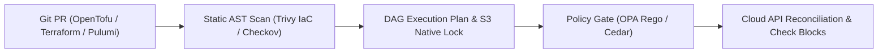
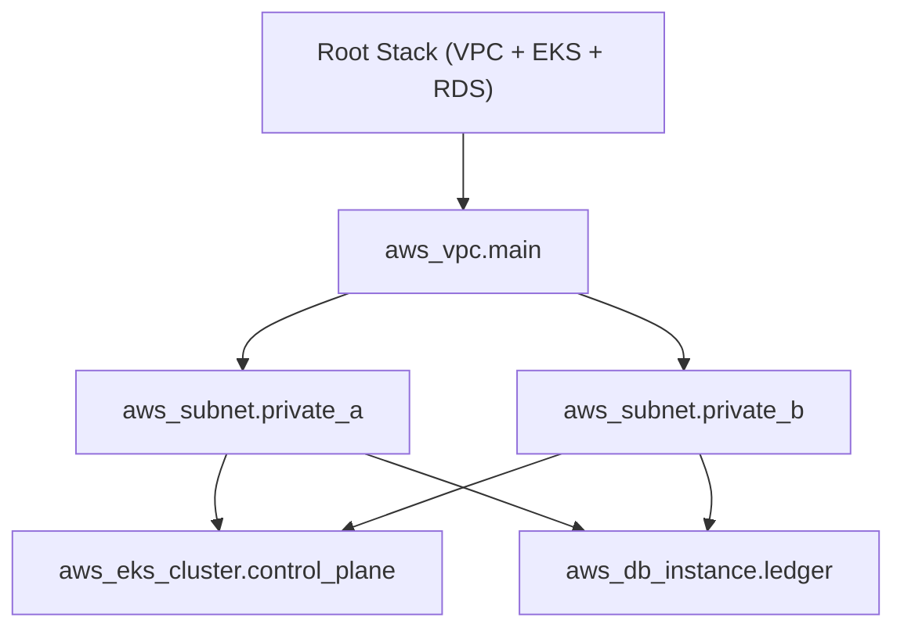

# Chapter 12: Infrastructure as Code: Foundations, Tooling, and Best Practices

Infrastructure as Code (IaC) is the foundational engineering discipline of defining, provisioning, mutating, and governing cloud infrastructure through version-controlled, machine-executable specifications rather than imperative CLI scripts or interactive web consoles ("ClickOps"). In modern platform engineering, an IaC repository is not merely a collection of provisioning templates; it is a deterministic directed acyclic graph (DAG) compiler, a cryptographic state ledger, and an automated policy enforcement engine that guarantees environmental parity across development, staging, and multi-region production estates.

Since HashiCorp's relicensing of Terraform to the Business Source License (BSL) in August 2023 and the Linux Foundation's subsequent creation of **OpenTofu** (now a CNCF project), the IaC landscape has undergone rapid architectural evolution. Modern HCL-based workflows in **OpenTofu 1.8+/1.9+ and Terraform 1.9+/1.10+** introduce config-driven `import` blocks, lossless refactoring via `moved` and `removed` blocks, continuous post-apply assertions via `check` blocks, client-side state encryption, and native Amazon S3 state locking (`use_lockfile = true`) that eliminates external DynamoDB lock tables. Simultaneously, general-purpose programming language IaC engines such as **Pulumi** and **AWS CDK v2** empower teams to author strongly typed infrastructure constructs, while shift-left static analyzers (**Trivy IaC** and **Checkov**) and policy-as-code engines (**Open Policy Agent / Rego** and **Cedar**) block misconfigurations before a single cloud API call is executed.



## Declarative vs. Imperative Infrastructure and the DAG Reconciliation Engine

Understanding how an IaC engine converges desired state onto live cloud APIs is critical for designing resilient module boundaries and avoiding state corruption.

- **Imperative (Procedural) Provisioning**: Scripts (such as Bash with AWS CLI or procedural SDK calls) specify the exact sequence of step-by-step commands to execute. If a script fails halfway through creating 40 resources, re-running it either fails on duplicate resource errors or creates orphaned duplicates because the script lacks a persistent state ledger and idempotency awareness.
- **Declarative State-Driven Reconciliation**: Tools like OpenTofu, Terraform, Pulumi, and AWS CloudFormation accept a declaration of the **target end state**. The engine queries the **State Backend** (the recorded mapping of logical resource identifiers to real-world cloud provider resource IDs), refreshes resource attributes against live cloud APIs, constructs a **Directed Acyclic Graph (DAG)** of resource dependencies, computes the minimal topological diff ($\Delta = \text{Desired} - \text{Actual}$), and executes create, update-in-place, or replace operations in parallel across independent graph branches.



In the DAG above, the engine recognizes that `aws_subnet.private_a` and `aws_subnet.private_b` both depend on `aws_vpc.main.id`, so it provisions the VPC first, provisions both subnets concurrently, and then provisions `aws_eks_cluster.control_plane` and `aws_db_instance.ledger` in parallel once the subnet IDs resolve.

## Modern HCL Engineering: OpenTofu and Terraform 1.9+ / 1.10+

Modern HCL workflows eliminate the most dangerous operational anti-patterns of legacy Terraform—namely, manual `terraform state mv` / `terraform import` CLI mutations on production state files, unencrypted state payloads, and external DynamoDB lock table sprawl.

### Native S3 State Locking (`use_lockfile`) and State Encryption

Historically, storing remote state in Amazon S3 required provisioning and maintaining a separate Amazon DynamoDB table (`dynamodb_table = "terraform-locks"`) solely to manage distributed mutex locks during `plan` and `apply` operations. Now that Amazon S3 supports conditional writes (`If-None-Match: *`), both OpenTofu and Terraform 1.10+ support **native S3 state locking** (`use_lockfile = true`), writing a `.tflock` object directly to the S3 bucket using atomic conditional put requests. Furthermore, **OpenTofu native state encryption** allows teams to encrypt state files and plan files client-side using AWS KMS, GCP KMS, or PBKDF2 keys before the payload ever leaves the runner.

```hcl
# backend-and-providers.tf
terraform {
  required_version = ">= 1.9.0"

  required_providers {
    aws = {
      source  = "hashicorp/aws"
      version = "~> 5.75"
    }
  }

  backend "s3" {
    bucket       = "prod-platform-iac-state-us-east-1"
    key          = "network/core-vpc/terraform.tfstate"
    region       = "us-east-1"
    encrypt      = true
    # Native S3 conditional-write state locking
    # (No DynamoDB lock table required!)
    use_lockfile = true
  }

  # OpenTofu Client-Side State & Plan Encryption
  encryption {
    key_provider "aws_kms" "state_key" {
      kms_key_id = "alias/opentofu-state-encryption"
      region     = "us-east-1"
      key_spec   = "AES_256"
    }
    method "aes_gcm" "strong_gcm" {
      keys = key_provider.aws_kms.state_key
    }
    state {
      method   = method.aes_gcm.strong_gcm
      enforced = true
    }
    plan {
      method   = method.aes_gcm.strong_gcm
      enforced = true
    }
  }
}

provider "aws" {
  region = "us-east-1"

  default_tags {
    tags = {
      ManagedBy   = "OpenTofu"
      Environment = "production"
      Repository  = "github.com/org/platform-iac"
    }
  }
}
```

### Config-Driven Refactoring: `import`, `moved`, and `removed` Blocks

In legacy IaC workflows, renaming a resource or splitting a module required an engineer to obtain write credentials to the production state backend on their laptop and execute imperative `terraform state mv` or `terraform import` commands—bypassing Git pull request reviews and frequently breaking CI/CD pipelines.

Modern OpenTofu and Terraform 1.9+ solve this with **declarative lifecycle blocks** committed directly into Git:

1. **`import` block**: Brings an existing brownfield cloud resource under IaC management during the normal CI/CD `plan` and `apply` cycle (and supports `tofu plan -generate-config-out=generated.tf` to auto-generate HCL from live cloud resources).
2. **`moved` block**: Records in code that a resource or module address was renamed or relocated (for example, moving `aws_security_group.api` into `module.edge_security.aws_security_group.api`). During `plan`, the engine updates the state ledger seamlessly instead of destroying and recreating the live security group.
3. **`removed` block**: Instructs the engine to forget a resource from the state file (`lifecycle { destroy = false }`) without deleting the underlying cloud infrastructure.

### Continuous Infrastructure Assertions with `check` Blocks and Cross-Variable Validation

Traditional variable `validation` blocks only inspect static input strings before cloud APIs are called. Terraform 1.9+ and OpenTofu introduce:

- **Cross-object input `validation`**: Allows a variable validation rule to reference *other* variables and local values (e.g., verifying that `var.backup_retention_days >= 30` whenever `var.environment == "production"`).
- **`check` blocks**: Execute live data-source assertions *after* infrastructure is provisioned, verifying real-world operational health (such as TLS endpoint reachability or KMS rotation status) and emitting structured warnings without aborting the state commit.

```hcl
# main.tf (Modern HCL with import, moved, & check)
variable "environment" {
  type    = string
  default = "production"
}

variable "kms_deletion_window_days" {
  type    = number
  default = 30

  validation {
    # Terraform 1.9+ cross-variable validation
    condition = (
      var.environment != "production" ||
      var.kms_deletion_window_days >= 30
    )
    error_message = (
      "Production KMS keys require a deletion "
      "window of at least 30 days."
    )
  }
}

# Declaratively import an existing KMS key in Git
import {
  to = aws_kms_key.ledger_vault
  id = "1234abcd-12ab-34cd-56ef-1234567890ab"
}

# Lossless state refactoring without destroying key
moved {
  from = aws_kms_key.legacy_key
  to   = aws_kms_key.ledger_vault
}

resource "aws_kms_key" "ledger_vault" {
  description             = "Ledger encryption key"
  deletion_window_in_days = (
    var.kms_deletion_window_days
  )
  enable_key_rotation     = true

  lifecycle {
    prevent_destroy = true
    postcondition {
      condition     = self.enable_key_rotation == true
      error_message = "KMS key rotation must be on."
    }
  }
}

# Post-provisioning live operational assertion
check "verify_api_health_endpoint" {
  data "http" "ledger_health" {
    url      = "https://api.internal.example.io/health"
    insecure = false
  }

  assert {
    condition = (
      data.http.ledger_health.status_code == 200
    )
    error_message = (
      "Ledger API returned non-200 status after "
      "infrastructure apply!"
    )
  }
}
```

### Ephemeral Values and Write-Only Arguments (`ephemeral` Blocks)

One of the longest-standing security challenges in declarative IaC was that sensitive values fetched or generated during a run—such as random database bootstrap passwords, short-lived TLS client certificates, or Vault/Secrets Manager tokens—were serialized into plaintext inside `terraform.tfstate` and `tfplan.binary`. Even with remote S3 encryption at rest, anyone with read access to the state file could extract every secret managed by the workspace.

Terraform 1.10+ and modern OpenTofu address this architectural gap with **Ephemeral Resources (`ephemeral` blocks)**, `ephemeral = true` variables/outputs, and provider **write-only arguments** (`password_wo`). Ephemeral resources are opened during the evaluation phase, passed in-memory to downstream provider connections or write-only resource attributes, and closed at the end of the execution graph—**never persisted to either the plan artifact or the state file**:

```hcl
# ephemeral-credentials.tf
ephemeral "aws_secretsmanager_secret_version" "db_pw" {
  secret_id = aws_secretsmanager_secret.postgres_pw.id
}

resource "aws_db_instance" "ledger_primary" {
  identifier          = "prod-ledger-pg16"
  engine              = "postgres"
  engine_version      = "16.4"
  instance_class      = "db.r7g.xlarge"
  allocated_storage   = 200
  storage_encrypted   = true
  kms_key_id          = aws_kms_key.ledger_vault.arn
  skip_final_snapshot = false

  # Write-only password attribute: sent to AWS API
  # but NEVER written to terraform.tfstate!
  password_wo = (
    ephemeral.aws_secretsmanager_secret_version
    .db_pw.secret_string
  )
  password_wo_version = 1
}
```

When the team needs to rotate the database master password in Secrets Manager, incrementing `password_wo_version = 2` triggers an in-place update on the RDS instance using the new ephemeral secret without ever exposing the old or new password in the state artifact.

## General-Purpose Programming Languages for IaC: Pulumi and AWS CDK v2

While HCL excels at flat, declarative resource definitions, large platform teams often prefer authoring reusable infrastructure abstractions using general-purpose programming languages (TypeScript, Python, Go, C#). This unlocks native IDE autocompletion, compile-time type checking, standard package managers (`npm`, `uv`/`pip`, `go mod`), loops and polymorphism, and standard unit testing frameworks (`pytest`, `vitest`).

### Pulumi: Cloud-Native SDKs with Direct State Engine Execution

Unlike AWS CDK (which compiles TypeScript/Python into intermediate AWS CloudFormation YAML templates), **Pulumi** executes its own high-performance state and resource engine directly against cloud provider APIs (supporting AWS Native, Azure Native, Google Cloud, and Kubernetes providers with same-day API coverage). Pulumi manages state in Pulumi Cloud or self-managed S3/GCS/Azure Blob backends and provides **Pulumi ESC (Environments, Secrets, and Configurations)** for dynamic OIDC credential brokering.

Below is a production Pulumi program written in Python that provisions an encrypted Amazon S3 bucket with public access strictly blocked and exports its ARN:

```python
# __main__.py (Pulumi Python Infrastructure)
import pulumi
import pulumi_aws as aws

config = pulumi.Config()
env_name = config.require("environment")

audit_key = aws.kms.Key(
    "audit-log-kms-key",
    description=f"Audit KMS key for {env_name}",
    enable_key_rotation=True,
    deletion_window_in_days=30,
)

audit_bucket = aws.s3.BucketV2(
    "immutable-audit-logs",
    bucket_prefix=f"corp-audit-{env_name}-",
    force_destroy=False,
)

from pulumi_aws import s3

sse_default = {
    "sse_algorithm": "aws:kms",
    "kms_master_key_id": audit_key.arn,
}

s3.BucketServerSideEncryptionConfigurationV2(
    "audit-bucket-sse",
    bucket=audit_bucket.id,
    rules=[
        {
            "apply_server_side_encryption_by_default":
                sse_default,
            "bucket_key_enabled": True,
        }
    ],
)

aws.s3.BucketPublicAccessBlock(
    "audit-bucket-public-block",
    bucket=audit_bucket.id,
    block_public_acls=True,
    block_public_policy=True,
    ignore_public_acls=True,
    restrict_public_buckets=True,
)

pulumi.export("audit_bucket_arn", audit_bucket.arn)
```

### AWS CDK v2 and Construct Levels (L1, L2, and L3 Patterns)

For AWS-centric organizations, **AWS CDK v2** organizes infrastructure components into three architectural abstraction layers known as **Constructs**:

- **L1 Constructs (`Cfn*`)**: Auto-generated, 1-to-1 mappings of raw CloudFormation resources (e.g., `CfnBucket`). Require manual configuration of every security property.
- **L2 Constructs**: Curated, intent-based abstractions (e.g., `s3.Bucket`, `eks.Cluster`) that provide secure defaults, lifecycle helpers, and semantic IAM `grantRead()` / `grantWrite()` methods.
- **L3 Constructs (Patterns)**: Opinionated multi-resource architectures (e.g., `ApplicationLoadBalancedFargateService` or custom internal platform constructs) that wire together VPCs, ALB listeners, ECS clusters, log groups, and least-privilege IAM roles in 15 lines of code. Furthermore, **CDK Aspects** allow security teams to traverse the entire Construct tree at synthesis time (`cdk synth`) to enforce organization-wide compliance rules automatically.

## Shift-Left IaC Security: Static AST Scanning with Trivy IaC and Checkov

Waiting until resources are deployed into an AWS or GCP account to discover an unencrypted RDS database or a world-readable `0.0.0.0/0` SSH security group is both dangerous and expensive. Modern DevSecOps pipelines execute **static Abstract Syntax Tree (AST) and plan-graph analysis** on every Git pull request using **Trivy IaC** (`trivy config`) and **Checkov**.

Unlike simple regex linters, Checkov and Trivy parse variable references, module inputs, and dynamic locals across the full Terraform/OpenTofu plan graph, Kubernetes manifests, Helm charts, and Dockerfiles.

```bash
# Generate a deterministic binary plan and convert
# it to JSON for deep graph security evaluation
tofu init -input=false
tofu plan -out=tfplan.binary -input=false
tofu show -json tfplan.binary > tfplan.json

# Run Trivy IaC against the rendered plan & source
trivy config --severity HIGH,CRITICAL \
  --exit-code 1 ./

# Run Checkov graph policies against the plan JSON
checkov -f tfplan.json \
  --framework terraform_plan \
  --check CKV_AWS_16,CKV_AWS_19,CKV_AWS_23 \
  --compact
```

## Policy as Code: Open Policy Agent (OPA / Rego) and Cedar

While static scanners provide built-in security rules (e.g., "S3 buckets must be encrypted"), platform engineering teams must also enforce **organization-specific architectural and FinOps guardrails**—such as banning expensive GPU instance types in non-production workspaces, requiring mandatory cost-center tags (`CostCenter`, `DataClassification`), or prohibiting IAM policies with wildcard actions (`Action: "*"`).

### Enforcing Terraform Plan Policies with OPA and Rego

**Open Policy Agent (OPA)** evaluates structured JSON inputs (such as `tfplan.json` or Kubernetes admission review payloads) against declarative policies written in **Rego**. Below is a production Rego policy compatible with OPA v1 (`import rego.v1`) and **Conftest** that inspects every resource change in a Terraform/OpenTofu plan and blocks the pull request if any resource is missing a mandatory `CostCenter` tag or attempts to delete a production database:

```rego
# policy/terraform_guardrails.rego
package main

import rego.v1

required_tags := {"CostCenter", "Environment"}

# Deny any production database deletion in plan
deny contains msg if {
    some rc in input.resource_changes
    rc.type == "aws_db_instance"
    "delete" in rc.change.actions
    rc.change.before.tags.Environment == "production"
    msg := sprintf(
        "CRITICAL: Plan deletes prod RDS '%s'",
        [rc.address],
    )
}

# Deny taggable AWS resources missing required tags
deny contains msg if {
    some rc in input.resource_changes
    rc.mode == "managed"
    is_create_or_update(rc.change.actions)
    after_tags := object.get(
        rc.change.after, "tags_all", {}
    )
    missing := required_tags - {k | after_tags[k]}
    count(missing) > 0
    msg := sprintf(
        "Resource '%s' is missing required tags: %v",
        [rc.address, missing],
    )
}

is_create_or_update(actions) if {
    "create" in actions
}

is_create_or_update(actions) if {
    "update" in actions
}
```

### Fine-Grained Authorization and Guardrails with Cedar

Developed by AWS and open-sourced as a CNCF project, **Cedar** is a formally verified policy language engineered for fast, analyzable authorization and infrastructure governance. Unlike general-purpose query languages, Cedar's syntax (`permit` / `forbid` over `principal`, `action`, and `resource` with `when` / `unless` conditions) is designed to be verified mathematically via Automated Reasoning (SMT solvers) and evaluated in microseconds.

Here is a Cedar policy governing an internal platform deployment service, permitting deployment automation roles to apply infrastructure stacks only when the stack is non-production or accompanied by an approved change ticket and OIDC workload attestation:

```cedar
// policy/deployment_governance.cedar
forbid (
    principal,
    action == Platform::Action::"ApplyStack",
    resource
)
when {
    resource.environment == "production" &&
    !context.oidc_verified
};

permit (
    principal in Platform::Role::"GitOpsCiRunners",
    action == Platform::Action::"ApplyStack",
    resource is Platform::Stack
)
when {
    resource.environment != "production" ||
    (context.has_peer_approval == true &&
     context.security_scan_passed == true)
};
```

## Architectural Comparison of Modern IaC Ecosystems

```text
+---------------+------------------+------------------+
| Dimension     | OpenTofu 1.9+ /  | Pulumi &         |
|               | Terraform 1.10+  | AWS CDK v2       |
+---------------+------------------+------------------+
| Language      | Declarative HCL  | TypeScript, Go,  |
| Paradigm      | Domain Language  | Python, C#       |
| State Engine  | Direct S3 Native | Pulumi Engine or |
| & Locking     | Lockfile (.tflock| CloudFormation   |
| Refactoring   | Declarative      | Native IDE AST   |
| Ergonomics    | moved/import Blk | & Alias Mapping  |
| Best Fit Use  | Multi-Cloud Core | High-Level App   |
| Case          | Platform Stacks  | & L3 Constructs  |
+---------------+------------------+------------------+
```

## Production IaC Best Practices

1. **Decompose Monolithic States into Blast-Radius-Bounded Stacks ("Terraservices")**: Never store an entire company's VPCs, EKS clusters, RDS databases, and application queues inside a single state file. A monolithic state file slows `tofu plan` API refreshes to 20+ minutes and risks catastrophic blast radius if a state operation fails. Split state files by lifecycle cadence and blast radius: `01-network-foundation`, `02-data-stores`, `03-kubernetes-platform`, and `04-service-workloads`.
2. **Eliminate Long-Lived Cloud API Keys in CI/CD via OIDC Federation**: Never store static `AWS_ACCESS_KEY_ID` or `GOOGLE_APPLICATION_CREDENTIALS` JSON keys in GitHub Actions or GitLab CI secrets. Configure OpenID Connect (OIDC) federation so your CI runner or TACOS (Terraform Automation and Collaboration Software, such as Atlantis, Spacelift, or Env0) exchanges a short-lived cryptographic JWT for a 15-minute IAM role session scoped strictly to the target stack.
3. **Pin Provider and Module Versions Deterministically**: Commit the `.terraform.lock.hcl` dependency lock file to Git to verify cryptographic SHA-256 provider checksums across Linux/macOS architectures, and pin internal Git modules to immutable semantic version tags (`?ref=v2.4.1`) rather than mutable branch names (`?ref=main`).
4. **Apply Plans Atomically Through Pull Request Automation**: Enforce **Plan-on-PR, Apply-on-Merge** workflows (or lock-before-merge workflows) where the exact binary `tfplan` reviewed and approved by peers and verified by OPA/Checkov is the exact plan applied to production, preventing time-of-check to time-of-use (TOCTOU) drift.

## Summary

Modern Infrastructure as Code combines the declarative safety of OpenTofu and Terraform 1.9+/1.10+ (`use_lockfile` native S3 locking, client-side state encryption, `import`/`moved` refactoring blocks, and live `check` assertions) with the expressive power of general-purpose programming languages in Pulumi and AWS CDK v2. By embedding Trivy IaC, Checkov, OPA/Rego, and Cedar policy gates directly into the pull request lifecycle, platform teams transform infrastructure provisioning from an error-prone manual bottleneck into a self-service, cryptographically verifiable software engineering pipeline. In Chapter 13, we turn to observability, SLO burn-rate engineering, PromQL, dashboards-as-code, and eBPF continuous profiling.
