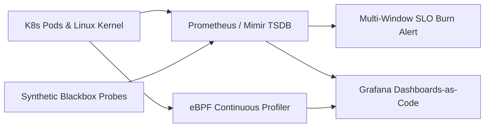
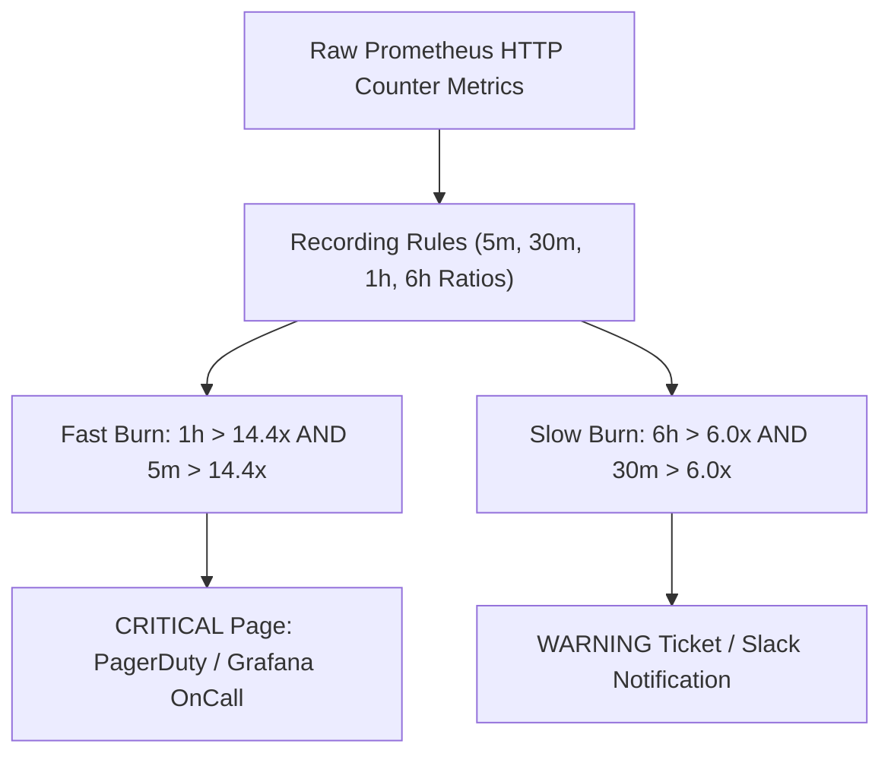

# Chapter 13: Infrastructure and Application Monitoring, SLOs, and Continuous Profiling

Modern cloud-native infrastructure cannot be operated effectively using static threshold alerts from the virtual machine era (such as paging an engineer whenever CPU utilization exceeds 80% for 5 minutes). In an elastic Kubernetes or serverless environment where pods scale horizontally in seconds and background batch jobs intentionally saturate available CPU cores, resource-threshold alerting produces relentless alert fatigue while failing to detect silent application brownouts, tail-latency regressions, or localized availability zone blackholes.

In modern Site Reliability Engineering (SRE) and platform engineering, monitoring is anchored around user-centric **Service Level Indicators (SLIs)**, **Service Level Objectives (SLOs)**, **Error Budgets**, and **Multi-Window, Multi-Burn-Rate Alerting**. When an SLO burn-rate alert fires, engineers correlate high-dimensional time-series metrics in **Prometheus (PromQL)**, inspect version-controlled **Grafana Dashboards-as-Code**, validate external perimeter reachability via **Synthetic Blackbox Probing**, and pinpoint CPU or memory hotspots down to the exact line of source code using low-overhead **eBPF Continuous Profiling** (Grafana Pyroscope / Parca).



## Two Complementary Methodology Frameworks: USE and RED

Before writing queries or building dashboards, platform engineers separate telemetry into two distinct mental models depending on whether they are observing **infrastructure resources** or **request-driven services**:

### 1. The USE Method (for Infrastructure and Hardware Resources)

Formulated by Brendan Gregg, the **USE Method** evaluates every physical or virtual hardware resource (CPU cores, memory pages, NVMe block devices, network interfaces, Linux kernel conntrack tables, and storage controllers) across three dimensions:

- **Utilization**: The percentage of time the resource was busy servicing work, or the percentage of capacity currently allocated (e.g., `node_memory_Active_bytes / node_memory_MemTotal_bytes`).
- **Saturation**: The degree to which the resource has queued work it cannot immediately service, often manifested as run-queue length, CPU steal time, disk I/O wait queue depth (`aqu-sz`), or Linux `cgroup` CPU throttling (`container_cpu_cfs_throttled_periods_total`). Saturation is the earliest leading indicator of tail-latency degradation.
- **Errors**: Explicit hardware or kernel failure counters, such as TCP packet retransmissions, NIC CRC drops, NVMe I/O timeouts, or Out-Of-Memory (OOM) killer invocations (`node_vmstat_oom_kill`).

### 2. The RED Method (for Request-Driven Microservices)

Formulated by Tom Wilkie (and aligned with Google SRE's Four Golden Signals), the **RED Method** evaluates every microservice, API gateway, and queue consumer from the perspective of incoming work:

- **Rate**: The number of requests per second the service is handling (`http_requests_total`).
- **Errors**: The number of failed requests per second—both explicit HTTP `5xx` / gRPC `INTERNAL` status codes and implicit failures where a `200 OK` payload contains an error body or violates latency bounds.
- **Duration**: The distribution of time each request takes, tracked using native Prometheus histograms (`http_request_duration_seconds_bucket`) to compute accurate $p_{50}$, $p_{95}$, and $p_{99}$ quantiles across distributed replicas.

## SLIs, SLOs, Error Budgets, and Multi-Window Burn-Rate Engineering

To align engineering velocity with operational reliability, teams translate RED metrics into formal mathematical contracts:

- **Service Level Indicator (SLI)**: A quantitative ratio measuring the proportion of good events to total valid events over a time window:
  $$\text{SLI} = \frac{\text{Good Events}}{\text{Valid Events}} \times 100\%$$
  For example, an **Availability SLI** defines "Good Events" as all HTTP requests not returning `5xx`, while a **Latency SLI** defines "Good Events" as all HTTP requests completing in under `250ms`.
- **Service Level Objective (SLO)**: The target threshold for an SLI over a rolling compliance window (typically 28 or 30 days), such as $99.9\%$ availability over 30 days.
- **Error Budget**: The complement of the SLO: $\text{Error Budget} = 100\% - \text{SLO}$. For a $99.9\%$ SLO over a 30-day window ($43,200\text{ minutes}$), the service has an error budget of $0.1\%$, which equals **$43.2\text{ minutes}$ of total allowable downtime** (or $1,000$ failed requests per $1,000,000$ requests). As long as the remaining error budget is positive, product teams can deploy aggressively; if the error budget is exhausted, feature releases pause until reliability investments restore stability.

### Why Static Error-Rate Alerts Fail and Multi-Window Burn Rates Succeed

Suppose a service has a 30-day SLO of $99.9\%$ ($0.1\%$ allowed error rate). If you configure a naive alert to page whenever the 5-minute error rate exceeds $0.1\%$, two failure modes occur:
1. **Slow Burn Blindness**: An error rate of $0.09\%$ never triggers the alert, yet consumes $90\%$ of your monthly error budget silently.
2. **Reset Delay and Flapping**: A brief 2-minute network blip spikes the error rate, wakes up the on-call engineer at 3:00 AM, and resolves itself before they open their laptop.

Google SRE solved this using **Multi-Window, Multi-Burn-Rate Alerting**. The **Burn Rate** measures how fast the service is consuming its 30-day error budget relative to the baseline sustainable rate of $1.0$:

$$\text{Burn Rate} = \frac{\text{Observed Error Ratio}}{1 - \text{SLO}}$$

At a burn rate of $1.0$, the service exhausts its 30-day error budget in exactly 30 days. At a burn rate of **$14.4$**, the service consumes **$2\%$ of its entire 30-day error budget in just 1 hour** (exhausting the full budget in 50 hours). At a burn rate of **$6.0$**, the service consumes **$5\%$ of its 30-day error budget in 6 hours**.

To prevent false-positive pages after an outage has already ended, every burn-rate alert pairs a **Long Window** (e.g., `1h` or `6h`) with a **Short Confirmation Window** (`1/12` of the long window, i.e., `5m` or `30m`). The alert fires *only* when the burn rate exceeds the threshold in **both** windows simultaneously:



### Implementing Prometheus Recording Rules and Multi-Window Burn-Rate Alerts

Below is a production `PrometheusRule` manifest defining pre-computed SLI error ratios across `5m`, `30m`, `1h`, and `6h` windows and implementing the canonical $99.9\%$ SLO ($1 - 0.999 = 0.001$) multi-window burn-rate alerts in PromQL:

```yaml
# slo-burn-rate-rules.yaml
apiVersion: monitoring.coreos.com/v1
kind: PrometheusRule
metadata:
  name: checkout-service-slo-rules
  namespace: observability
spec:
  groups:
    - name: checkout.slo.recording
      interval: 30s
      rules:
        - record: job:slo_errors:ratio_rate5m
          expr: |
            sum by (job, namespace) (
              rate(http_requests_total{
                job="checkout-api",
                status=~"5.."
              }[5m])
            )
            /
            sum by (job, namespace) (
              rate(http_requests_total{
                job="checkout-api"
              }[5m])
            )

        - record: job:slo_errors:ratio_rate30m
          expr: |
            sum by (job, namespace) (
              rate(http_requests_total{
                job="checkout-api",
                status=~"5.."
              }[30m])
            )
            /
            sum by (job, namespace) (
              rate(http_requests_total{
                job="checkout-api"
              }[30m])
            )

        - record: job:slo_errors:ratio_rate1h
          expr: |
            sum by (job, namespace) (
              rate(http_requests_total{
                job="checkout-api",
                status=~"5.."
              }[1h])
            )
            /
            sum by (job, namespace) (
              rate(http_requests_total{
                job="checkout-api"
              }[1h])
            )

        - record: job:slo_errors:ratio_rate6h
          expr: |
            sum by (job, namespace) (
              rate(http_requests_total{
                job="checkout-api",
                status=~"5.."
              }[6h])
            )
            /
            sum by (job, namespace) (
              rate(http_requests_total{
                job="checkout-api"
              }[6h])
            )

    - name: checkout.slo.alerts
      rules:
        # Page: 2% of 30d budget burned in 1h (14.4x)
        - alert: CheckoutSLOFastBurnPage
          expr: |
            job:slo_errors:ratio_rate1h{
              job="checkout-api"
            } > (14.4 * 0.001)
            and
            job:slo_errors:ratio_rate5m{
              job="checkout-api"
            } > (14.4 * 0.001)
          for: 2m
          labels:
            severity: critical
            slo_tier: tier-1
          annotations:
            summary: "Checkout 99.9% SLO Fast Burn"
            runbook: "https://runbooks.internal/slo-01"

        # Page: 5% of 30d budget burned in 6h (6.0x)
        - alert: CheckoutSLOSustainedBurnPage
          expr: |
            job:slo_errors:ratio_rate6h{
              job="checkout-api"
            } > (6.0 * 0.001)
            and
            job:slo_errors:ratio_rate30m{
              job="checkout-api"
            } > (6.0 * 0.001)
          for: 5m
          labels:
            severity: critical
            slo_tier: tier-1
          annotations:
            summary: "Checkout 99.9% SLO 6h Burn"
```

## Advanced PromQL Engineering: Histograms, Native Histograms, and Cardinality Governance

Writing accurate **PromQL (Prometheus Query Language)** queries requires understanding how Prometheus stores counters, gauges, classic bucketed histograms, and modern **Prometheus Native Histograms** (sparse exponential buckets).

### Computing Tail Latency ($p_{99}$) Across Distributed Replicas

A frequent anti-pattern is averaging pre-calculated percentiles across pods (`avg(http_latency_p99)`), which is mathematically invalid when traffic or latency distributions are skewed across instances. Instead, applications expose monotonic histogram buckets (`_bucket{le="..."}`), and PromQL aggregates the rates of each bucket across all pods *before* interpolating the quantile:

```promql
# Classic Histogram p99 Latency by Route
histogram_quantile(
  0.99,
  sum by (le, route) (
    rate(
      http_request_duration_seconds_bucket{
        job="checkout-api"
      }[5m]
    )
  )
)

# Prometheus Native Histogram p99 Latency
# (No 'le' label required; high-resolution sparse
# exponential buckets are merged automatically!)
histogram_quantile(
  0.99,
  sum by (route) (
    rate(
      http_request_duration_seconds{
        job="checkout-api"
      }[5m]
    )
  )
)
```

### Cardinality Governance: Preventing TSDB Memory Explosions

In Prometheus, Amazon Managed Service for Prometheus (AMP), and Grafana Mimir, every unique combination of metric name and label key-value pairs creates a distinct **active time series** in memory and the inverted index. The total number of series is the Cartesian product of label cardinalities:

$$\text{Total Series} = |\text{Jobs}| \times |\text{Pods}| \times |\text{Methods}| \times |\text{Status Codes}| \times |\text{Buckets}|$$

If a developer accidentally attaches an unbounded label—such as `user_id`, `request_id`, `email`, or unnormalized URL path (`/orders/994812`)—cardinality explodes into tens of millions of series, causing Prometheus OOM crashes and runaway cloud observability bills. Enforce strict `metric_relabel_configs` at ingestion time inside your `ServiceMonitor` or scrape configuration to drop high-cardinality labels, strip transient debug series, and enforce per-scrape sample limits (`sampleLimit`):

```yaml
# servicemonitor-cardinality-guard.yaml
apiVersion: monitoring.coreos.com/v1
kind: ServiceMonitor
metadata:
  name: checkout-api-monitor
  namespace: observability
spec:
  # Hard ceiling on active series per target pod
  sampleLimit: 15000
  labelLimit: 30
  selector:
    matchLabels:
      app.kubernetes.io/name: checkout-api
  endpoints:
    - port: http-metrics
      interval: 15s
      scrapeTimeout: 10s
      metricRelabelings:
        # Strip accidental unbounded PII/request labels
        - action: labeldrop
          regex: "(user_id|session_id|trace_id|email)"
        # Drop high-volume debug go_memstats buckets
        - sourceLabels: [__name__]
          regex: "go_memstats_alloc_bytes_total"
          action: drop
```

### Alertmanager Routing Trees, Grouping, and Inhibition Rules

Even well-crafted SLO alerts can overwhelm responders if a shared dependency (such as a core database cluster or network transit gateway) fails and causes 15 downstream microservices to fire alerts simultaneously. **Prometheus Alertmanager** prevents alert storms using three mechanisms:

1. **Grouping (`group_by`)**: Consolidates related alerts sharing the same `cluster`, `namespace`, or `service` into a single notification payload after waiting `group_wait: 30s`.
2. **Inhibition (`inhibit_rules`)**: Suppresses downstream symptom alerts when a root-cause infrastructure alert is already active (for example, muting pod-level latency warnings in `us-east-1a` if a `KubernetesNodeNotReady` or `AuroraClusterUnavailable` critical alert is firing in the same zone).
3. **Time Intervals (`mute_time_intervals`)**: Automatically mutes non-critical staging or batch maintenance alerts outside business hours while keeping production `critical` SLO pages active $24 \times 7$.

```yaml
# alertmanager-config.yaml
route:
  receiver: "slack-platform-default"
  group_by: ["cluster", "namespace", "alertname"]
  group_wait: 30s
  group_interval: 5m
  repeat_interval: 4h
  routes:
    - matchers:
        - severity = "critical"
        - slo_tier = "tier-1"
      receiver: "pagerduty-sre-primary"
      group_wait: 10s

inhibit_rules:
  - source_matchers:
      - alertname = "ClusterDatabaseDown"
      - severity = "critical"
    target_matchers:
      - severity =~ "warning|critical"
    equal:
      - "cluster"
      - "namespace"
```

## Grafana Dashboards-as-Code with OpenTofu / Terraform and Grafonnet

Building dashboards manually by clicking in the Grafana UI leads to configuration drift, accidental deletions, and divergence across staging and production environments. Platform teams manage observability visualizations as **Dashboards-as-Code** using the **Grafana Foundation SDK / Grafonnet** (Jsonnet library) or the **Grafana Terraform/OpenTofu Provider**.

### Modular Dashboard Generation with Grafonnet (Jsonnet)

When an organization operates 100+ microservices, maintaining raw 2,000-line JSON dashboard files by hand is unsustainable. **Grafonnet** allows engineers to write concise, parameterized Jsonnet templates that compile into standardized Grafana JSON definitions during CI/CD:

```jsonnet
// dashboards/service_slo.jsonnet
local g = import 'grafonnet-latest/main.libsonnet';

local tsPanel = g.panel.timeSeries;
local promQuery = g.query.prometheus;

g.dashboard.new('Checkout Service RED & SLO')
+ g.dashboard.withUid('checkout-slo-grafonnet')
+ g.dashboard.withTimezone('utc')
+ g.dashboard.withRefresh('30s')
+ g.dashboard.withPanels([
  tsPanel.new('1h Error Budget Burn Rate')
  + tsPanel.queryOptions.withTargets([
    promQuery.new(
      '$PROMETHEUS_DS',
      'job:slo_errors:ratio_rate1h{job="checkout"}'
      + ' / 0.001'
    ),
  ])
  + tsPanel.gridPos.withW(12)
  + tsPanel.gridPos.withH(8),
])
```

### Provisioning Dashboards via OpenTofu / Terraform

Below is an OpenTofu / Terraform definition provisioning a standardized RED + SLO Burn Rate Grafana dashboard directly from Git:

```hcl
# grafana-slo-dashboard.tf
terraform {
  required_providers {
    grafana = {
      source  = "grafana/grafana"
      version = "~> 3.10"
    }
  }
}

resource "grafana_folder" "sre_platform" {
  title = "SRE Platform Golden Signals"
}

resource "grafana_dashboard" "checkout_slo" {
  folder    = grafana_folder.sre_platform.id
  overwrite = true

  config_json = jsonencode({
    title         = "Checkout Service - RED & SLO Burn"
    uid           = "checkout-red-slo-v2"
    schemaVersion = 39
    timezone      = "utc"
    refresh       = "30s"
    panels = [
      {
        id    = 1
        title = "1h Error Budget Burn (14.4x Crit)"
        type  = "timeseries"
        gridPos = {
          h = 8
          w = 12
          x = 0
          y = 0
        }
        targets = [
          {
            refId = "A"
            expr  = <<-EOT
              job:slo_errors:ratio_rate1h{
                job="checkout-api"
              } / 0.001
            EOT
          }
        ]
      },
      {
        id    = 2
        title = "Request Latency p99 by Route (sec)"
        type  = "timeseries"
        gridPos = {
          h = 8
          w = 12
          x = 12
          y = 0
        }
        targets = [
          {
            refId = "A"
            expr  = <<-EOT
              histogram_quantile(
                0.99,
                sum by (route) (
                  rate(
                    http_request_duration_seconds{
                      job="checkout-api"
                    }[5m]
                  )
                )
              )
            EOT
          }
        ]
      }
    ]
  })
}
```

## Synthetic Blackbox Probing: Validating External Reachability and TLS Expiry

Internal whitebox metrics (`http_requests_total`) suffer from a critical blind spot: if an edge DNS record is misconfigured, an AWS NLB security group drops all ingress packets, or an ingress gateway hangs, **zero requests reach your application pods**. Consequently, internal error rates read `0%` while 100% of external customers experience a total outage.

To close this blind spot, deploy the **Prometheus Blackbox Exporter** across external vantage points to continuously probe public DNS resolution, TCP handshakes, TLS 1.3 certificate validity (`probe_ssl_earliest_cert_expiry`), and HTTP status assertions:

```yaml
# blackbox-exporter-config.yaml
modules:
  https_api_synthetic:
    prober: http
    timeout: 5s
    http:
      valid_http_versions:
        - "HTTP/1.1"
        - "HTTP/2.0"
      valid_status_codes: [200]
      method: GET
      fail_if_not_ssl: true
      tls_config:
        insecure_skip_verify: false
        min_version: "TLS13"
```

Pairing this probe with a PromQL alert (`(probe_ssl_earliest_cert_expiry - time()) / 86400 < 14`) guarantees the platform team is alerted two weeks before any TLS certificate expires if `cert-manager` renewal fails.

## eBPF Continuous Profiling: Pinpointing Line-Level CPU and Memory Bottlenecks

Metrics tell you *that* CPU utilization or $p_{99}$ latency spiked, traces tell you *which service hop* was slow, and logs tell you *what error message* was emitted—but none of the three traditional pillars tell you **which exact function or line of code consumed 70% of CPU cycles** during a 3-minute traffic surge.

**eBPF Continuous Profiling**—implemented by **Grafana Pyroscope**, **Parca**, and the **OpenTelemetry eBPF Profiler** (`otelcol-ebpf-profiler`)—has become the **Fourth Pillar of Observability**. Using the Linux kernel `BPF_PROG_TYPE_PERF_EVENT` subsystem, an eBPF agent running as a privileged Kubernetes `DaemonSet` attaches to hardware performance counters at 19 Hz to 99 Hz (sampling stack traces across all running containers on the node 19–99 times per second). It unwinds stack frames for compiled binaries (Go, Rust, C/C++) using DWARF/frame pointers and interpreted/JIT runtimes (Python, Node.js, JVM) without requiring SDK code changes, adding less than **1% CPU overhead**.

```yaml
# pyroscope-ebpf-daemonset.yaml
apiVersion: apps/v1
kind: DaemonSet
metadata:
  name: pyroscope-ebpf-profiler
  namespace: observability
spec:
  selector:
    matchLabels:
      app: pyroscope-ebpf
  template:
    metadata:
      labels:
        app: pyroscope-ebpf
    spec:
      hostPID: true
      containers:
        - name: ebpf-profiler
          image: grafana/alloy:v1.4.2
          args:
            - run
            - /etc/alloy/config.alloy
          securityContext:
            privileged: true
          volumeMounts:
            - name: sysfs
              mountPath: /sys
              readOnly: true
      volumes:
        - name: sysfs
          hostPath:
            path: /sys
```

By correlating **Flame Graphs** directly with Prometheus exemplars and trace IDs (`span_id`), engineers can compare the CPU flame graph of version `v2.4.0` against canary version `v2.4.1`, immediately spotting an accidental regex backtracking loop or excessive JSON serialization allocation before promoting the canary to 100% of production traffic.

## Summary

Modern infrastructure and application monitoring replaces noisy static hardware thresholds with user-centric SLIs, SLOs, and multi-window burn-rate alerting. By combining USE infrastructure telemetry and RED application histograms in PromQL with version-controlled Grafana Dashboards-as-Code, external Blackbox synthetic probes, and always-on eBPF continuous profiling, engineering organizations achieve rapid fault isolation while protecting on-call engineers from alert fatigue. In Chapter 14, we explore how GitOps controllers continuously reconcile and synchronize Kubernetes and cloud infrastructure state.
