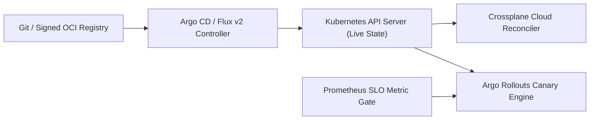
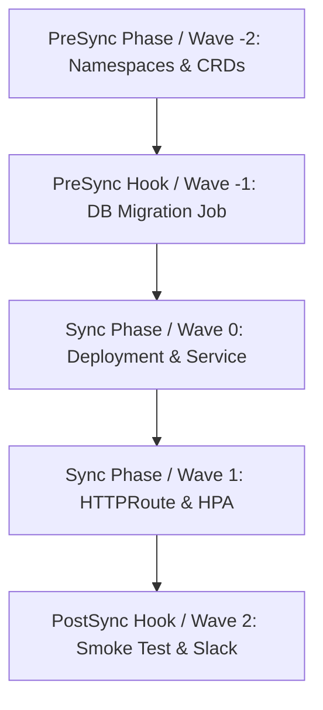

# Chapter 14: GitOps, Continuous Reconciliation, and Progressive Delivery

Traditional Continuous Integration and Continuous Delivery (CI/CD) pipelines rely on an **imperative push-based architecture**: when an engineer merges a pull request, a CI runner executes `kubectl apply`, `helm upgrade`, or `tofu apply` over the network against the target production cluster. While intuitive, push-based deployment pipelines introduce serious security and reliability flaws at scale. First, the external CI runner must hold god-mode cluster-admin credentials for every production Kubernetes cluster and cloud account, making the CI server the single highest-value target for supply-chain attackers. Second, edge-triggered CI jobs only execute when a commit occurs; if an operator manually mutates a live resource (`kubectl edit`), or if a transient node failure drops a state update, the live cluster silently drifts from Git until the next deployment weeks later.

**GitOps** replaces edge-triggered, push-based scripts with **level-triggered, pull-based continuous reconciliation** governed by the four **OpenGitOps Principles** (standardized by the CNCF GitOps Working Group):

1. **Declarative**: A system managed by GitOps must have its desired state expressed declaratively (Kubernetes YAML, Kustomize overlays, Helm charts, or Crossplane Compositions).
2. **Versioned and Immutable**: Desired state is stored in a system that enforces immutability, cryptographic versioning, and retains a complete version history (Git or signed OCI artifacts).
3. **Pulled Automatically**: Software agents running *inside* the target environment automatically pull the desired state declarations from the source repository.
4. **Continuously Reconciled**: Autonomous controllers continuously observe actual live system state, compute the structured diff against desired state, and converge the environment in a closed feedback loop ($\Delta = \text{Desired} - \text{Actual} \to 0$).

In this chapter, we engineer production GitOps platforms using **Argo CD** (`ApplicationSet` generators, App-of-Apps topologies, and ordered **Sync Waves**), configure **Flux v2** (`GitRepository`, `OCIRepository`, `Kustomization`, and `HelmRelease` controllers with automated drift remediation), unify Kubernetes and cloud infrastructure provisioning via **Crossplane Compositions v2**, and automate metric-driven canary deployments using **Argo Rollouts** and `AnalysisTemplate` gates.



## Argo CD: Multi-Cluster GitOps with `ApplicationSet` and Sync Waves

**Argo CD** is a declarative, CNCF-graduated GitOps continuous delivery controller for Kubernetes. Architecturally, Argo CD operates three primary microservices inside the control plane namespace (`argocd`):

- **`argocd-repo-server`**: Clones Git repositories or pulls signed OCI Helm/manifest artifacts, renders templates (via Kustomize, Helm, or Jsonnet), and caches the resulting Kubernetes YAML manifests in Redis.
- **`argocd-application-controller`**: A stateful Kubernetes controller (sharded across replicas for large fleet scale) that continuously compares the rendered manifests from `argocd-repo-server` against live objects cached from target Kubernetes API servers, flagging `OutOfSync` drift and executing `selfHeal` convergence.
- **`argocd-server` & `argocd-applicationset-controller`**: Exposes the gRPC/REST API, Web UI, SSO OIDC RBAC enforcement, and dynamically generates `Application` resources across fleets of clusters.

### Scaling Beyond App-of-Apps with `ApplicationSet` Matrix Generators

In early Argo CD deployments, teams used the **App-of-Apps Pattern**—a parent Argo CD `Application` that pointed to a directory of child `Application` manifests. While still useful for bootstrapping a single cluster's add-ons, App-of-Apps requires writing boilerplate YAML for every new cluster-service combination.

The **Argo CD `ApplicationSet` controller** eliminates this boilerplate by combining declarative **Generators** (`Git`, `Clusters`, `List`, `PullRequest`, and `Matrix` / `Merge`). By combining a **Cluster Generator** (selecting registered clusters by label, e.g., `env: prod`) with a **Git Directory Generator** inside a **Matrix Generator**, adding a new microservice folder to Git or registering a new regional EKS cluster automatically instantiates and reconciles all required applications across the fleet.

### Deterministic Ordering with Sync Phases, Sync Waves, and Hooks

When bootstrapping a complex service stack, applying all manifests simultaneously can cause race conditions—for example, deploying an application pod before its database schema migration job completes, or creating a Custom Resource before its CustomResourceDefinition (CRD) is established.

Argo CD enforces deterministic execution order using **Sync Phases** (`PreSync`, `Sync`, `PostSync`, `SyncFail`) and numerical **Sync Waves** (`argocd.argoproj.io/sync-wave: "-1"`). Argo CD sorts resources by phase, then by wave number (lowest to highest, defaulting to `0`), and waits until every resource in wave $N$ reports `Healthy` before applying wave $N+1$:



Below is a production `ApplicationSet` manifest combined with a `PreSync` database schema migration hook using Sync Waves:

```yaml
# argocd-applicationset-matrix.yaml
apiVersion: argoproj.io/v1alpha1
kind: ApplicationSet
metadata:
  name: platform-microservices-fleet
  namespace: argocd
spec:
  goTemplate: true
  generators:
    - matrix:
        generators:
          - clusters:
              selector:
                matchLabels:
                  environment: production
          - git:
              repoURL: >-
                https://github.com/org/gitops-fleet.git
              revision: main
              directories:
                - path: "services/*"
  template:
    metadata:
      name: "{{.path.basename}}-{{.name}}"
    spec:
      project: prod-workloads
      source:
        repoURL: >-
          https://github.com/org/gitops-fleet.git
        targetRevision: main
        path: "{{.path.path}}/overlays/prod"
      destination:
        server: "{{.server}}"
        namespace: "{{.path.basename}}"
      syncPolicy:
        automated:
          prune: true
          selfHeal: true
        syncOptions:
          - CreateNamespace=true
          - ServerSideApply=true
```

And the corresponding `PreSync` database migration `Job` inside the service overlay uses Sync Wave `-1` and automatic hook deletion (`BeforeHookCreation`):

```yaml
# services/ledger/base/migration-job.yaml
apiVersion: batch/v1
kind: Job
metadata:
  name: ledger-schema-migrate
  annotations:
    argocd.argoproj.io/hook: PreSync
    argocd.argoproj.io/sync-wave: "-1"
    argocd.argoproj.io/hook-delete-policy: >-
      BeforeHookCreation
spec:
  backoffLimit: 2
  template:
    spec:
      restartPolicy: Never
      containers:
        - name: atlas-migrate
          image: arigaio/atlas:0.28.0
          args:
            - schema
            - apply
            - --env
            - prod
```

Notice `ServerSideApply=true` in `syncOptions`: Kubernetes Server-Side Apply (SSA) delegates field ownership tracking to the Kubernetes API server (`metadata.managedFields`) rather than stuffing large client-side `kubectl.kubernetes.io/last-applied-configuration` JSON annotations onto objects, preventing 262 KB annotation size errors on large CRDs.

## Flux v2: Composable GitOps Toolkit and OCI Artifact Reconciliation

Developed on top of the **GitOps Toolkit**, **Flux v2** decomposes GitOps reconciliation into specialized, composable Kubernetes controllers:

- **Source Controller**: Fetches artifacts from `GitRepository`, `OCIRepository` (signed container registry bundles verified with Cosign), `HelmRepository`, and `Bucket` sources, verifying cryptographic signatures before exposing artifacts inside the cluster.
- **Kustomize Controller**: Continuously applies plain YAML or Kustomize overlays via Kubernetes Server-Side Apply, performs health checks (`wait: true`), decrypts secrets encrypted at rest with **Mozilla SOPS** (backed by AWS KMS, GCP KMS, Azure Key Vault, or `age`), and reverts manual cluster drift (`force: false`, `prune: true`).
- **Helm Controller**: Manages declarative `HelmRelease` lifecycles, automatically executing `helm test`, remediating failed upgrades via automated rollbacks (`remediateLastFailure: true`), and detecting drift inside Helm release resources (`driftDetection.mode: enabled`).
- **Notification & Image Automation Controllers**: Emit CloudEvents to Slack/Teams/PagerDuty and optionally commit verified container image digest updates back to Git.

Below is a production Flux v2 manifest pair demonstrating a Cosign-verified `OCIRepository` source and a `HelmRelease` with active drift correction and automatic rollback on failure:

```yaml
# flux-oci-and-helmrelease.yaml
apiVersion: source.toolkit.fluxcd.io/v1beta2
kind: OCIRepository
metadata:
  name: checkout-oci-manifests
  namespace: flux-system
spec:
  interval: 5m
  url: oci://ghcr.io/org/manifests/checkout-service
  ref:
    tag: v2.8.4
  verify:
    provider: cosign
    matchOIDCIdentity:
      - issuer: >-
          https://token.actions.githubusercontent.com
        subject: >-
          https://github.com/org/checkout/.github/*
---
apiVersion: helm.toolkit.fluxcd.io/v2
kind: HelmRelease
metadata:
  name: checkout-api
  namespace: checkout-prod
spec:
  interval: 10m
  chartRef:
    kind: OCIRepository
    name: checkout-oci-manifests
    namespace: flux-system
  driftDetection:
    mode: enabled
  install:
    remediation:
      retries: 3
  upgrade:
    cleanupOnFail: true
    remediation:
      retries: 3
      strategy: rollback
      remediateLastFailure: true
  values:
    replicaCount: 4
    resources:
      requests:
        cpu: "500m"
        memory: "512Mi"
```

## Extending GitOps to Cloud Infrastructure with Crossplane Compositions

Argo CD and Flux v2 reconcile Kubernetes API objects—but microservices also need cloud resources such as Amazon RDS PostgreSQL instances, S3 buckets, SQS queues, and IAM roles. Running Terraform in a separate CI pipeline creates a synchronization gap between cloud infrastructure provisioning and Kubernetes workload deployment.

**Crossplane** closes this gap by transforming a Kubernetes control plane into a universal cloud control plane. Crossplane installs **Providers** (`provider-aws`, `provider-gcp`, `provider-azure`) that represent cloud resources as native Kubernetes Custom Resources (**Managed Resources**, or MRs). Furthermore, platform teams author **CompositeResourceDefinitions (XRDs)** and **Compositions** (using pipeline-mode Composition Functions such as `function-patch-and-transform` or `function-go-templating`) to expose simplified, self-service **Claims** to application developers.

When a developer commits a 12-line `PostgresInstance` YAML claim to Git, Argo CD or Flux v2 syncs it into the cluster, and Crossplane continuously reconciles the underlying AWS RDS instance, KMS key, subnet group, and Kubernetes connection secret:

```yaml
# crossplane-composition-and-claim.yaml
apiVersion: apiextensions.crossplane.io/v1
kind: Composition
metadata:
  name: xpostgresinstances.aws.platform.io
spec:
  compositeTypeRef:
    apiVersion: platform.io/v1alpha1
    kind: XPostgresInstance
  mode: Pipeline
  pipeline:
    - step: patch-and-transform
      functionRef:
        name: function-patch-and-transform
      input:
        apiVersion: pt.fn.crossplane.io/v1beta1
        kind: Resources
        resources:
          - name: rds-instance
            base:
              apiVersion: rds.aws.upbound.io/v1beta1
              kind: Instance
              spec:
                forProvider:
                  region: us-east-1
                  engine: postgres
                  engineVersion: "16.4"
                  storageEncrypted: true
                  publiclyAccessible: false
                  autoMinorVersionUpgrade: true
            patches:
              - type: FromCompositeFieldPath
                fromFieldPath: spec.params.storageGB
                toFieldPath: >-
                  spec.forProvider.allocatedStorage
              - type: FromCompositeFieldPath
                fromFieldPath: spec.params.tierClass
                toFieldPath: >-
                  spec.forProvider.instanceClass
---
# Developer Self-Service Claim Committed to GitOps Repo
apiVersion: platform.io/v1alpha1
kind: PostgresInstance
metadata:
  name: ledger-db
  namespace: checkout-prod
spec:
  params:
    storageGB: 200
    tierClass: db.r7g.large
  writeConnectionSecretToRef:
    name: ledger-db-conn-credentials
```

## GitOps Repository Topologies and Rendered Manifest Promotion

One of the most consequential architectural decisions in GitOps is structuring repositories and promoting changes across environments (`dev` $\to$ `staging` $\to$ `prod`).

### Why Branch-per-Environment (`git checkout prod && git merge staging`) Is an Anti-Pattern

A common mistake made by teams migrating to GitOps is mapping environments to Git branches (`dev`, `staging`, `prod` branches) and promoting releases via `git merge staging -> prod`. This pattern inevitably fails because environments legitimately differ in replica counts, domain names, IAM role ARNs, and regional cluster identifiers. Once an engineer commits an environment-specific tweak to the `prod` branch, subsequent `git merge` operations either overwrite production settings with `staging` values or trigger perpetual merge conflicts.

### Kustomize Overlays on a Single Trunk (`main`) and the Rendered Manifests Pattern

Modern platform teams standardize on a **Single Trunk Branch (`main`)** using Kustomize directory overlays (`base/` + `overlays/dev/`, `overlays/staging/`, `overlays/prod/`), paired with the **Rendered Manifests Pattern** (implemented by tools such as **Akuity Kargo** and **Argo `gitops-promoter`**). Instead of trusting opaque Helm or Kustomize upgrades directly in production, the CI/promotion pipeline hydrates the overlay into flat, fully rendered Kubernetes YAML before committing to an environment-specific directory or OCI artifact tag. Consequently, every pull request shows the exact line-by-line Kubernetes resource diff that Argo CD or Flux v2 will apply.

```text
gitops-fleet/ (Single Trunk Branch: main)
├── apps/
│   └── checkout-api/
│       ├── base/
│       │   ├── kustomization.yaml
│       │   ├── deployment.yaml
│       │   └── service.yaml
│       └── overlays/
│           ├── dev/
│           │   └── kustomization.yaml
│           ├── staging/
│           │   └── kustomization.yaml
│           └── prod/
│               ├── kustomization.yaml
│               └── replica-patch.yaml
└── clusters/
    ├── prod-us-east-1/
    └── prod-eu-central-1/
```

## GitOps Secret Management: External Secrets Operator (ESO) vs. SOPS

Because Git serves as the immutable audit log in a GitOps architecture, **you must never commit unencrypted Kubernetes `Secret` manifests to a Git repository**. Even if a private repository is restricted today, every developer clone, CI cache, and backup snapshot retains the entire Git commit history indefinitely.

Platform engineering teams solve the "GitOps Secret Zero" problem using one of two production-hardened patterns:

1. **In-Repo Encryption at Rest (Mozilla SOPS + `age` / Cloud KMS or Sealed Secrets)**: Encrypted ciphertext is committed directly to Git, where only the secret's `data` values are encrypted while `metadata` keys remain readable for code review. The in-cluster GitOps controller (such as Flux `kustomize-controller`) holds the private decryption key or KMS IAM role and decrypts the secret in memory during reconciliation.
2. **Dynamic Out-of-Band Secret Synchronization (External Secrets Operator — ESO)**: No secret ciphertext is stored in Git at all. Instead, engineers commit a declarative **`ExternalSecret`** custom resource containing only the *metadata reference path* (such as `/prod/checkout/stripe-api-key`) pointing to an external vault (AWS Secrets Manager, GCP Secret Manager, Azure Key Vault, or HashiCorp Vault). The **External Secrets Operator** authenticates to the cloud vault using short-lived Kubernetes **Workload Identity** (IRSA / EKS Pod Identity) and dynamically creates and rotates the native Kubernetes `Secret` inside the namespace.

```yaml
# external-secret-sync.yaml
apiVersion: external-secrets.io/v1beta1
kind: ClusterSecretStore
metadata:
  name: aws-secrets-manager-prod
spec:
  provider:
    aws:
      service: SecretsManager
      region: us-east-1
      auth:
        jwt:
          serviceAccountRef:
            name: eso-irsa-controller
            namespace: external-secrets
---
apiVersion: external-secrets.io/v1beta1
kind: ExternalSecret
metadata:
  name: checkout-stripe-credentials
  namespace: checkout-prod
spec:
  # Automatically poll and rotate secret every 15m
  refreshInterval: 15m
  secretStoreRef:
    name: aws-secrets-manager-prod
    kind: ClusterSecretStore
  target:
    name: checkout-stripe-secret
    creationPolicy: Owner
  data:
    - secretKey: STRIPE_SECRET_KEY
      remoteRef:
        key: prod/checkout/payment-gateway
        property: stripe_secret_key
        conversionStrategy: Default
```

Using ESO with `refreshInterval: 15m` decouples secret rotation from Git commits: when AWS Secrets Manager rotates a database password or API key on a 30-day schedule, ESO updates the live Kubernetes `Secret` automatically without requiring a single Git commit.

## Progressive Delivery and Automated Canary Analysis with Argo Rollouts

A standard Kubernetes `Deployment` only supports a coarse `RollingUpdate` strategy: as soon as a new pod's `readinessProbe` returns `200 OK`, Kubernetes replaces the old pods at full speed. It has no ability to split traffic by exact percentages (e.g., `5%`), query Prometheus SLO burn rates during the rollout, or automatically abort and roll back if $p_{99}$ latency degrades under real user traffic.

**Argo Rollouts** replaces the standard `Deployment` object with a `Rollout` CRD that integrates natively with the **Kubernetes Gateway API** (`HTTPRoute`), Istio, Envoy, NGINX, and AWS ALB, paired with an **`AnalysisTemplate`** that continuously queries Prometheus, Datadog, or New Relic during each canary step:

```yaml
# argo-rollout-and-analysis.yaml
apiVersion: argoproj.io/v1alpha1
kind: AnalysisTemplate
metadata:
  name: checkout-slo-gate
  namespace: checkout-prod
spec:
  metrics:
    - name: success-rate-slo
      interval: 1m
      # Require >= 99.9% HTTP non-5xx success rate
      successCondition: result[0] >= 0.999
      failureLimit: 2
      provider:
        prometheus:
          address: >-
            http://prometheus.observability.svc:9090
          query: |
            1 - (
              sum(rate(http_requests_total{
                app="checkout-api",status=~"5.."
              }[2m]))
              /
              sum(rate(http_requests_total{
                app="checkout-api"
              }[2m]))
            )
---
apiVersion: argoproj.io/v1alpha1
kind: Rollout
metadata:
  name: checkout-api
  namespace: checkout-prod
spec:
  replicas: 10
  revisionHistoryLimit: 3
  selector:
    matchLabels:
      app: checkout-api
  strategy:
    canary:
      canaryService: checkout-api-canary
      stableService: checkout-api-stable
      trafficRouting:
        plugins:
          argoproj-labs/gatewayAPI:
            httpRoute: checkout-canary-route
            namespace: checkout-prod
      analysis:
        templates:
          - templateName: checkout-slo-gate
        startingStep: 1
      steps:
        - setWeight: 5
        - pause: { duration: 3m }
        - setWeight: 25
        - pause: { duration: 5m }
        - setWeight: 50
        - pause: { duration: 5m }
```

During this rollout, Argo Rollouts shifts 5% of live traffic to the canary via the Gateway API `HTTPRoute`, starts the `checkout-slo-gate` Prometheus analysis loop every 60 seconds, and advances through 25%, 50%, and 100% only if the live success rate remains $\ge 99.9\%$. If two consecutive Prometheus queries breach the threshold, Argo Rollouts immediately resets the `HTTPRoute` weight to `0%` on the canary and marks the rollout `Degraded`—achieving zero-human-intervention progressive delivery.

## Architectural Comparison: Argo CD vs. Flux v2 vs. Crossplane

```text
+------------------+-----------------+----------------+
| Capability       | Argo CD         | Flux v2        |
+------------------+-----------------+----------------+
| Architecture     | Centralized UI, | Composable     |
| Model            | API, AppSet     | K8s Controllers|
| Multi-Tenancy &  | Built-in OIDC,  | Native K8s RBAC|
| RBAC             | AppProjects, UI | ServiceAccounts|
| Artifact Sources | Git, Helm, OCI  | Git, Signed OCI|
|                  | Registries      | S3 Buckets     |
| Helm Lifecycle   | Renders via     | Native Helm    |
| Management       | helm template   | SDK Controller |
+------------------+-----------------+----------------+
```

## Production GitOps Best Practices

1. **Separate Application Source Repositories from GitOps Config Repositories**: Never store your Kubernetes deployment overlays inside the same Git repository as your application source code if CI commits image tag updates back to Git; doing so triggers infinite CI build loops unless carefully filtered (`[skip ci]`). Maintain dedicated GitOps state repositories (or OCI artifact repositories) so application CI pipelines build, test, sign, and push immutable container digests (`@sha256:...`), and open an automated pull request against the GitOps repository.
2. **Enable `ServerSideApply=true` and Resource Tracking Labels**: Always configure Argo CD (`ServerSideApply=true`, `annotation+label` tracking) and Flux v2 (which uses SSA natively) to rely on Kubernetes Server-Side Apply. SSA avoids `last-applied-configuration` annotation bloat and cleanly arbitrates field ownership when a HorizontalPodAutoscaler (HPA) or Karpenter controller co-manages fields alongside your GitOps reconciler.
3. **Ignore Dynamically Mutated Fields (`ignoreDifferences`)**: When an HPA dynamically scales `spec.replicas` from `4` to `18` during a traffic spike, a naive GitOps controller with `selfHeal: true` will fight the HPA and scale the deployment back down to `4` (causing a production outage!). Omit `spec.replicas` from Git manifests when an HPA is active, or explicitly configure `ignoreDifferences` on `/spec/replicas` and mutating webhook CA bundles.
4. **Verify Cryptographic Signatures Before Reconciliation**: Enforce commit signing (GPG / SSH / Sigstore Gitsign) on your GitOps repository `main` branch or use Flux v2 `OCIRepository` Cosign verification so that even if a registry or Git hosting token is compromised, the in-cluster reconciler refuses to apply unsigned manifests.

## Summary

GitOps elevates infrastructure and application delivery from brittle imperative scripts into a self-healing, cryptographically auditable control loop. By scaling multi-cluster orchestration with Argo CD `ApplicationSet` generators and Sync Waves, enforcing OCI artifact verification and Helm drift remediation with Flux v2, unifying cloud resource APIs via Crossplane Compositions, and gating every production release with Argo Rollouts SLO analysis, platform teams achieve both high deployment velocity and deterministic state convergence. In Chapter 15, we build the complete Infrastructure Testing and Validation pyramid—from static linters and native `terraform test` suites to Terratest and Chaos Engineering.
