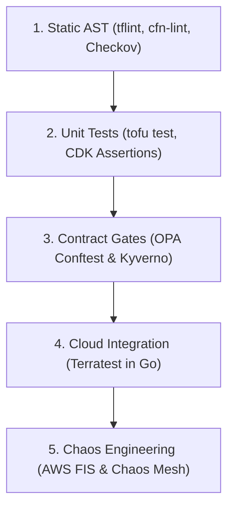
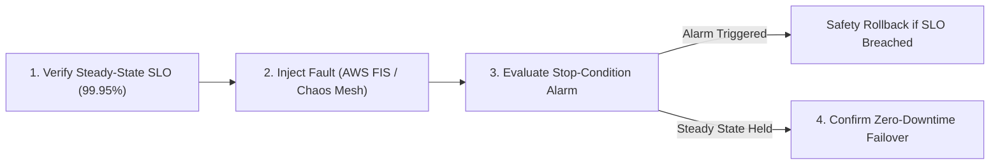

# Chapter 15: Infrastructure Testing, Validation, and Chaos Engineering

For years, software engineers subjected application code to rigorous unit tests, contract assertions, integration suites, and load benchmarks, yet treated Infrastructure as Code (IaC) as untestable configuration—relying on manual visual inspection of `terraform plan` output before applying changes directly to production. As cloud estates grow to encompass thousands of IAM policies, VPC route tables, KMS encryption keys, and Kubernetes Custom Resources, visual inspection inevitably fails. A single mistyped CIDR block, an overly permissive IAM trust policy, or a missing multi-AZ failover setting can trigger a catastrophic security breach or multi-hour outage.

Modern platform engineering applies the same automated verification rigor to infrastructure code as to distributed systems software. However, unlike stateless application functions that execute in microseconds in memory, real cloud infrastructure takes minutes to provision and incurs financial cost. Therefore, effective validation relies on a structured **Infrastructure Testing Pyramid** that catches 90% of syntax, schema, security, and logic bugs in seconds offline before executing ephemeral real-cloud integration tests with **Terratest** and continuous resilience verification through **Chaos Engineering** (**AWS Fault Injection Service** and **Chaos Mesh**).



## The Infrastructure Testing Pyramid: Balancing Speed, Cost, and Fidelity

Every layer of the Infrastructure Testing Pyramid trades execution speed and cost against real-world cloud API fidelity:

```text
+--------------------+---------------+----------------+
| Testing Layer      | Execution     | Cloud API Cost |
|                    | Time          | & Fidelity     |
+--------------------+---------------+----------------+
| 1. Static Analysis | 1 - 5 sec     | $0 (Offline    |
| (tflint / Checkov) | (Pre-commit)  | AST & Schema)  |
| 2. Unit Tests      | 2 - 10 sec    | $0 (In-Memory  |
| (tftest / CDK)     | (CI Build)    | Mock Graph)    |
| 3. Contract Tests  | 5 - 15 sec    | $0 (Evaluates  |
| (OPA Conftest)     | (PR Plan Gate)| Plan JSON)     |
| 4. Integration     | 3 - 20 min    | $$ (Ephemeral  |
| (Terratest Go)     | (Merge / PR)  | Cloud Sandbox) |
| 5. Chaos & GameDay | 10 - 60 min   | $$$ (Live Prod |
| (AWS FIS / Mesh)   | (Scheduled)   | / Pre-Prod)    |
+--------------------+---------------+----------------+
```

By structuring CI/CD pipelines so that Layers 1, 2, and 3 execute on every commit in under 30 seconds, teams fail fast on invalid instance types, broken variable interpolation, and security regressions without waiting 15 minutes for an RDS instance or EKS cluster to provision.

## Layer 1: Deep Static Analysis with `tflint`, `cfn-lint`, and Checkov

Built-in commands like `tofu validate` or `terraform validate` only verify basic HCL syntax and internal attribute references; they do **not** know whether `"t3.superlarge"` is a valid Amazon EC2 instance type, whether an IAM policy JSON string is malformed, or whether an S3 bucket lacks server-side encryption.

### Provider-Aware Static Linting with `tflint`

**`tflint`** bridges this gap using provider-specific rulesets (`tflint-ruleset-aws`, `tflint-ruleset-google`, `tflint-ruleset-azurerm`) that validate resource arguments against official cloud provider API schemas, flag deprecated resource attributes, and enforce naming and tagging conventions:

```hcl
# .tflint.hcl
config {
  call_module_type = "all"
  force            = false
}

plugin "aws" {
  enabled = true
  version = "0.35.0"
  source  = (
    "github.com/terraform-linters/tflint-ruleset-aws"
  )
  deep_check = false
}

rule "terraform_documented_variables" {
  enabled = true
}

rule "terraform_naming_convention" {
  enabled = true
  format  = "snake_case"
}

rule "aws_instance_invalid_type" {
  enabled = true
}
```

### CloudFormation and SAM Static Validation with `cfn-lint`

For teams using AWS CloudFormation or AWS SAM (`template.yaml`), **`cfn-lint`** validates templates against the official AWS CloudFormation Resource Specification across all AWS regions, checking intrinsic functions (`!Sub`, `!Ref`, `!GetAtt`), IAM policy grammar, and state machine Amazon States Language (ASL) syntax before a stack deployment is ever initiated.

## Layer 2: Fast Unit Testing with Native `terraform test` (`tofu test`) and AWS CDK Assertions

Historically, unit testing Terraform modules required spinning up real cloud resources because HCL lacked a native testing framework or provider mocking layer. Starting in Terraform 1.6+ and OpenTofu 1.7+ (and enhanced in 1.8+/1.9+), HCL includes a **native unit and integration testing framework (`terraform test` / `tofu test`)** using `.tftest.hcl` files and **`mock_provider`** blocks.

### Native HCL Unit Tests with `mock_provider` and `command = plan`

Using `mock_provider "aws" {}` inside a `.tftest.hcl` suite allows engineers to execute `command = plan` or `command = apply` completely offline in milliseconds: the test engine synthesizes mock computed attributes (such as `arn` and `id`) and evaluates complex module conditionals, dynamic blocks, and output transformations without requiring AWS credentials:

```hcl
# tests/s3_vault_unit.tftest.hcl
mock_provider "aws" {
  mock_resource "aws_kms_key" {
    defaults = {
      arn = "arn:aws:kms:us-east-1:111122223333:key/m1"
    }
  }
}

variables {
  environment = "production"
  bucket_name = "ledger-settlement-archive"
}

run "verify_production_bucket_hardening" {
  command = plan

  assert {
    condition = (
      aws_s3_bucket.archive.bucket_prefix ==
      "prod-ledger-settlement-archive-"
    )
    error_message = "Prod bucket prefix is incorrect."
  }

  assert {
    condition = (
      aws_kms_key.vault.deletion_window_in_days == 30
    )
    error_message = "Prod KMS window must be 30 days."
  }

  assert {
    condition = (
      aws_s3_bucket_public_access_block.block
      .restrict_public_buckets == true
    )
    error_message = "Public access must be blocked."
  }
}

run "reject_short_kms_window_in_prod" {
  command = plan

  variables {
    kms_deletion_window_days = 7
  }

  expect_failures = [
    var.kms_deletion_window_days,
  ]
}
```

Notice `expect_failures = [var.kms_deletion_window_days]` in the second `run` block: this enables **negative unit testing**, proving that your variable validation rules actively reject insecure inputs!

### Fine-Grained Unit Testing with AWS CDK Assertions (`aws-cdk-lib/assertions`)

In AWS CDK v2, infrastructure constructs are tested using standard TypeScript/JavaScript unit test runners (`vitest` or `jest`) paired with the `Template` and `Match` assertion library. The test synthesizes the stack in memory (`Template.fromStack(stack)`) and inspects the resulting CloudFormation resources in milliseconds:

```typescript
// test/serverless-ledger-stack.test.ts
import { App } from 'aws-cdk-lib';
import {
  Template,
  Match,
} from 'aws-cdk-lib/assertions';
import {
  ServerlessLedgerStack,
} from '../lib/serverless-ledger-stack';

test('DynamoDB Enforces PITR and Streams', () => {
  const app = new App();
  const stack = new ServerlessLedgerStack(
    app,
    'TestStack'
  );
  const template = Template.fromStack(stack);

  template.hasResourceProperties(
    'AWS::DynamoDB::GlobalTable',
    {
      StreamSpecification: {
        StreamViewType: 'NEW_AND_OLD_IMAGES',
      },
      Replicas: Match.arrayWith([
        Match.objectLike({
          PointInTimeRecoverySpecification: {
            PointInTimeRecoveryEnabled: true,
          },
        }),
      ]),
    }
  );

  // Verify Lambda uses Arm64 Graviton3 architecture
  template.hasResourceProperties(
    'AWS::Lambda::Function',
    {
      Architectures: ['arm64'],
    }
  );
});
```

## Layer 3: Contract and Compliance Testing with OPA Conftest

While unit tests verify the internal logic of a single module, **Contract Testing** verifies that the assembled multi-module execution plan (`tfplan.json`) or rendered Kubernetes manifest bundle adheres to enterprise-wide interface contracts, network boundary rules, and security baselines.

**Conftest** (a CNCF Open Policy Agent subproject) evaluates structured configuration files (`.json`, `.yaml`, `.hcl`, `Dockerfile`, and `tfplan.json`) against Rego policies and integrates cleanly into pull request gates:

```yaml
# policy/k8s_security_contract.rego
package main

import rego.v1

containers contains c if {
    some c in input.spec.template.spec.containers
}

deny contains msg if {
    input.kind == "Deployment"
    some c in containers
    not c.securityContext.runAsNonRoot
    msg := sprintf(
        "Container '%s' in Deployment '%s' must set "
        + "securityContext.runAsNonRoot = true",
        [c.name, input.metadata.name],
    )
}

deny contains msg if {
    input.kind == "Deployment"
    some c in containers
    not c.resources.limits.memory
    msg := sprintf(
        "Container '%s' in '%s' lacks memory limits",
        [c.name, input.metadata.name],
    )
}
```

### Testing Kubernetes Admission Policies Offline with `kyverno test`

In addition to OPA Conftest, teams operating **Kyverno** or **Kubernetes ValidatingAdmissionPolicy** (CEL-based native admission control) must verify that their cluster guardrails neither allow non-compliant pods nor accidentally block legitimate platform workloads. The **`kyverno test`** CLI executes declarative test suites offline in CI against positive ("good") and negative ("bad") Kubernetes resource fixtures before policies are synced via GitOps:

```yaml
# tests/kyverno-test.yaml
apiVersion: cli.kyverno.io/v1alpha1
kind: Test
metadata:
  name: verify-non-root-admission-policy
policies:
  - ../policies/require-run-as-non-root.yaml
resources:
  - fixtures/compliant-checkout-pod.yaml
  - fixtures/non-compliant-root-pod.yaml
results:
  - policy: require-run-as-non-root
    rule: check-runasnonroot
    resources:
      - checkout-prod/compliant-checkout-pod
    kind: Pod
    result: pass
  - policy: require-run-as-non-root
    rule: check-runasnonroot
    resources:
      - checkout-prod/non-compliant-root-pod
    kind: Pod
    result: fail
```

## Layer 4: Real-Cloud Ephemeral Integration Testing with Terratest in Go

Static analyzers and unit mock providers cannot catch cloud-provider runtime behavior: IAM eventual consistency race conditions, VPC subnet routing blackholes, security group port mismatches, or invalid cloud service quotas. Only deploying the module into a real, isolated cloud sandbox account and executing live network assertions proves end-to-end correctness.

While earlier Chef/Puppet eras used **Test Kitchen** (`kitchen-terraform`) to converge virtual machines, modern cloud-native platform teams standardize on **Terratest**—a Go library developed by Gruntwork that orchestrates `tofu`/`terraform`, `kubectl`, `helm`, `packer`, and cloud SDKs directly inside standard Go tests (`go test`).

Terratest follows a four-stage lifecycle in every test function:
1. **Generate Unique Namespace (`random.UniqueId()`)**: Appends a random 6-character alphanumeric suffix to all resource names so dozens of concurrent pull request pipelines can run in the same sandbox AWS account without name collisions.
2. **Defer Teardown (`defer terraform.Destroy(t, opts)`)**: Uses Go's `defer` mechanism to guarantee that even if a test assertion panics or fails mid-run, `terraform destroy` executes automatically to prevent orphaned cloud charges.
3. **Provision (`terraform.InitAndApply(t, opts)`)**: Applies the HCL module against the real cloud API.
4. **Validate via Cloud SDK / HTTP Retries (`http_helper.HttpGetWithRetry`)**: Fetches outputs from the provisioned stack and probes live endpoints or cloud API state with exponential backoff.

```go
// test/vpc_and_alb_integration_test.go
package test

import (
	"crypto/tls"
	"fmt"
	"testing"
	"time"

	"github.com/gruntwork-io/terratest/modules/random"
	"github.com/gruntwork-io/terratest/modules/terraform"
	"github.com/stretchr/testify/require"
)

func TestCheckoutAlbModuleIntegration(t *testing.T) {
	t.Parallel()

	uniqueID := random.UniqueId()
	envName := fmt.Sprintf("ci-%s", uniqueID)

	tfOpts := terraform.WithDefaultRetryableErrors(
		t,
		&terraform.Options{
			TerraformBinary: "tofu",
			TerraformDir:    "../modules/checkout-alb",
			Vars: map[string]interface{}{
				"environment": envName,
				"vpc_cidr":    "10.99.0.0/16",
			},
		},
	)

	// Always destroy ephemeral cloud resources on exit
	defer terraform.Destroy(t, tfOpts)

	// Run tofu init and tofu apply in sandbox account
	terraform.InitAndApply(t, tfOpts)

	albDns := terraform.Output(
		t, tfOpts, "alb_dns_name",
	)
	require.NotEmpty(t, albDns)

	healthURL := fmt.Sprintf(
		"https://%s/healthz", albDns,
	)
	tlsCfg := &tls.Config{
		MinVersion: tls.VersionTLS13,
	}

	// Probe live HTTPS endpoint with retries for DNS
	http_helper.HttpGetWithRetry(
		t,
		healthURL,
		tlsCfg,
		200,
		`{"status":"healthy"}`,
		15,
		10*time.Second,
	)
}
```

### Ephemeral Sandbox Hygiene: LocalStack Emulation and Automated `cloud-nuke` Sweeps

Even with `defer terraform.Destroy(t, tfOpts)` in place, an integration test runner container can occasionally be terminated abruptly (`SIGKILL`) due to CI spot instance reclamation or network loss, leaving behind orphaned NAT Gateways, Elastic Load Balancers, or RDS instances in the sandbox cloud account.

To keep integration testing fast and cost-controlled, platform teams implement two complementary practices:

- **Fast Pre-Cloud API Emulation with LocalStack**: Before provisioning resources in a real AWS sandbox account, developers run `tflocal` / `tofu` against an ephemeral **LocalStack** container on their laptop or in a fast CI job. LocalStack emulates over 100 AWS APIs (S3, DynamoDB, SQS, SNS, Lambda, IAM, STS, KMS) locally on port `4566`, catching IAM action mismatches and event-source wiring errors in seconds at zero cloud cost.
- **Nightly Automated Sandbox Sweeps with `cloud-nuke` / `aws-nuke`**: Dedicated CI sandbox cloud accounts run a scheduled nightly job using **`cloud-nuke`** (by Gruntwork) that automatically deletes any resource older than 6 hours (`--older-than 6h`), guaranteeing that leaked resources from crashed integration test runs never accumulate into surprise monthly cloud bills.

## Layer 5: Chaos Engineering with AWS Fault Injection Service (FIS) and Chaos Mesh

Passing static analysis, unit tests, and integration tests proves that your infrastructure works when every cloud Availability Zone, network link, and upstream dependency is healthy. **Chaos Engineering** is the discipline of experimenting on a distributed system in order to build confidence in the system's capability to withstand turbulent and unexpected conditions in production.

Every formal Chaos Engineering experiment follows the four-step scientific method:

1. **Define the "Steady State" Hypothesis**: Measure a business/SLO metric (for example, "Checkout HTTP API maintains $\ge 99.95\%$ success rate and $p_{99} < 300\text{ ms}$ at 2,000 req/sec").
2. **Define an Explicit Stop Condition (Safety Abort)**: Configure an automated circuit breaker (such as a CloudWatch Alarm or Prometheus SLO Fast-Burn Alert) that immediately halts the fault injection and restores normal state if user-facing error budgets are breached.
3. **Inject Real-World Faults in a Bounded Blast Radius**: Introduce realistic failures—such as Availability Zone power loss, EC2/EKS node termination, RDS primary instance failover, 150ms cross-AZ network latency, or DNS resolution failure.
4. **Verify Automated Self-Healing and Observability**: Confirm that Envoy outlier detection, Kubernetes pod topology spread constraints, Aurora failover, and SLO alerts behave as designed.



### Cloud-Layer Fault Injection with AWS Fault Injection Service (FIS)

**AWS Fault Injection Service (FIS)** orchestrates controlled chaos experiments directly at the AWS control plane and Nitro hypervisor level, including full **Availability Zone Power Interruption (`aws:ec2:stop-instances` + `aws:network:disrupt-connectivity`)**, RDS Multi-AZ failover, and EKS node group drains, guarded by mandatory CloudWatch stop conditions:

```hcl
# fis-az-failover-experiment.tf
resource "aws_fis_experiment_template" "az_blackhole" {
  description = "Verify Multi-AZ Checkout Resilience"
  role_arn    = aws_iam_role.fis_runner.arn

  stop_condition {
    source = "aws:cloudwatch:alarm"
    value  = aws_cloudwatch_alarm.slo_fast_burn.arn
  }

  action {
    name      = "disrupt_az_subnet_traffic"
    action_id = "aws:network:disrupt-connectivity"

    parameter {
      key   = "duration"
      value = "PT5M"
    }
    parameter {
      key   = "scope"
      value = "all"
    }

    target {
      key   = "Subnets"
      value = "target_az_a_subnets"
    }
  }

  target {
    name           = "target_az_a_subnets"
    resource_type  = "aws:ec2:subnet"
    selection_mode = "ALL"

    resource_tag {
      key   = "ChaosTargetAZ"
      value = "us-east-1a"
    }
  }
}
```

### Kubernetes Pod and Network Fault Injection with Chaos Mesh

Within Kubernetes clusters, **Chaos Mesh** (a CNCF incubation project) uses eBPF and Linux traffic control (`tc` `netem`) to inject pod failures, container kills, clock skew (`TimeChaos`), disk I/O latency (`IOChaos`), and network partitions (`NetworkChaos`) declaratively via Kubernetes CRDs:

```yaml
# chaos-mesh-network-latency.yaml
apiVersion: chaos-mesh.org/v1alpha1
kind: NetworkChaos
metadata:
  name: inject-payment-gateway-latency
  namespace: checkout-prod
spec:
  action: delay
  mode: fixed-percent
  value: "50"
  selector:
    namespaces:
      - checkout-prod
    labelSelectors:
      app: payment-worker
  delay:
    latency: "180ms"
    correlation: "25"
    jitter: "30ms"
  direction: to
  target:
    mode: all
    selector:
      namespaces:
        - checkout-prod
      labelSelectors:
        app: ledger-service
  duration: "5m"
```

This `NetworkChaos` manifest injects $180\text{ ms} \pm 30\text{ ms}$ of network latency onto 50% of `payment-worker` pods calling `ledger-service` for 5 minutes, verifying that Envoy's P2C load balancer and circuit breakers shift traffic toward low-latency replicas without dropping customer transactions.

## Production Infrastructure Testing Best Practices

1. **Never Run Integration Tests in Shared Staging or Production Accounts**: Always execute Terratest and ephemeral `tofu test` apply suites inside dedicated, isolated **CI Sandbox Cloud Accounts** managed under a separate AWS Organizations Organizational Unit (OU) with strict budget alarms and nightly `cloud-nuke` cleanup jobs.
2. **Use `t.Parallel()` and Unique Resource Prefixes**: Cloud provisioning is I/O-bound waiting on remote control planes. Always mark Terratest functions with `t.Parallel()` and inject `random.UniqueId()` into resource names and state keys so 10 module tests complete concurrently in 4 minutes instead of 40 minutes sequentially.
3. **Test Failure Modes Explicitly (`expect_failures` and Negative Fixtures)**: A security guardrail or variable validation rule that lacks a negative test case is an unverified assumption. For every `validation` block in OpenTofu/Terraform and every Rego/Kyverno policy, include at least one negative test case that asserts a non-compliant configuration is actively rejected.
4. **Automate Chaos Experiments in Pre-Production Before Running in Production**: Never start Chaos Engineering by injecting faults into live production traffic on day one. Graduate chaos experiments through staging and pre-production load-test environments first, verify that automated stop conditions halt the experiment within 30 seconds of a simulated SLO breach, and only then promote automated chaos checks into production windows.

## Summary

Validating modern infrastructure requires a multi-layered engineering defense. By combining millisecond static schema analysis (`tflint`, `cfn-lint`, Checkov), fast offline unit tests (`tofu test` / `terraform test` with `mock_provider` and AWS CDK Assertions), OPA Conftest contract gates, ephemeral real-cloud Go integration suites in Terratest, and stop-condition-guarded Chaos Engineering with AWS FIS and Chaos Mesh, teams eliminate configuration regressions before they ever impact customer reliability. In Chapter 16, we explore cloud-native application design patterns, Dapr, Workload Identity Federation, multi-cloud abstractions, and Kubernetes FinOps with OpenCost.
