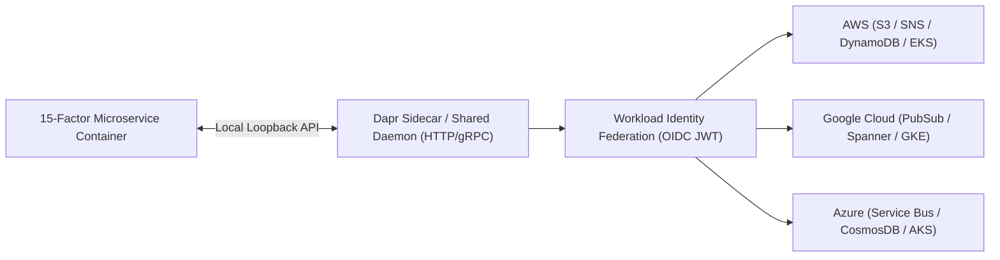
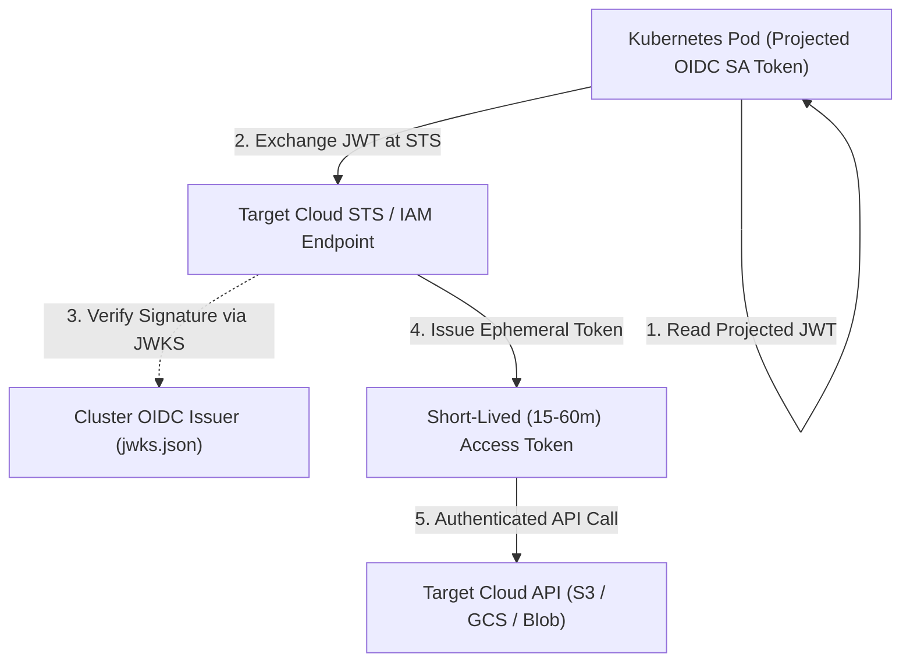

# Chapter 16: Cloud-Native Development Patterns, Multi-Cloud Strategies, and FinOps

Building software that runs *in* the cloud is not the same as engineering **cloud-native** software. Lifting and shifting a stateful, file-system-coupled monolith onto cloud virtual machines inherits all the fragility of legacy data centers while multiplying cloud infrastructure costs. True cloud-native architectures are designed from first principles to thrive on ephemeral, elastic compute substrates across multiple Availability Zones and cloud providers.

In this chapter, we examine the evolution from the classic **12-Factor App** to the modern **15-Factor Cloud-Native Methodology**, decouple distributed microservice primitives (state stores, pub/sub brokers, distributed locks, and workflow orchestration) from vendor SDK lock-in using **Dapr (Distributed Application Runtime)**, architect multi-cloud control planes with **Crossplane** and **OpenTofu**, eliminate static cross-cloud IAM credentials using **Workload Identity Federation (OIDC / SPIFFE)** across AWS, Google Cloud, and Microsoft Azure, and implement real-time Kubernetes unit economics and **FinOps** governance with **OpenCost**.



## From the 12-Factor App to the 15-Factor Cloud-Native Architecture

Originally published by Heroku engineers in 2011, the **Twelve-Factor App** established essential rules for stateless web applications: single-codebase tracking in Git, explicit dependency manifests, configuration via environment variables, stateless disposable processes (`SIGTERM` graceful shutdown), port binding, and treating logs as event streams written to `stdout`.

However, modern Kubernetes, serverless, and multi-cloud microservices require three critical architectural extensions known as the **15-Factor Cloud-Native Methodology**:

1. **API-First Design & Schema Contracts (Factor XIII)**: Every service boundary is defined *before* implementation using machine-verifiable interface schemas—**Protocol Buffers (gRPC / Buf)**, **OpenAPI 3.1**, or **AsyncAPI**—with automated backward-compatibility breaking-change detection in CI.
2. **Telemetry & Observability by Default (Factor XIV)**: Applications do not merely emit unstructured `stdout` lines; they expose standardized health endpoints (`/livez`, `/readyz`, `/startupz`), Prometheus RED metrics (`/metrics`), and **OpenTelemetry (OTel)** distributed trace context (`traceparent`) natively out of the box.
3. **Authentication, Authorization & Zero-Trust Identity (Factor XV)**: Security is not delegated solely to a perimeter firewall. Every workload authenticates outbound and inbound calls using short-lived cryptographic workload identities (OIDC JWTs or SPIFFE X.509 SVIDs) and least-privilege RBAC/ABAC policies.

```text
+--------------------+--------------------------------+
| 15-Factor Pillar   | Cloud-Native Implementation    |
+--------------------+--------------------------------+
| Disposability      | Fast startup (<2s) & graceful  |
| (Factor IX)        | SIGTERM drain hooks in K8s     |
| Backing Services   | Swappable via Dapr components  |
| (Factor IV)        | or Crossplane Secret mounts    |
| API First          | Buf Protobuf / OpenAPI 3.1     |
| (Factor XIII)      | schema compatibility gates     |
| Telemetry          | OpenTelemetry SDK + Prometheus |
| (Factor XIV)       | Native Histograms + /readyz    |
| Zero-Trust AuthN   | OIDC Workload Identity &       |
| (Factor XV)        | mTLS SPIFFE SVIDs (zero keys)  |
+--------------------+--------------------------------+
```

## Portable Distributed Primitives with Dapr (Distributed Application Runtime)

One of the hardest challenges in multi-cloud or hybrid-cloud engineering is **SDK lock-in**. When an application team imports `boto3` (AWS SDK) to publish messages to Amazon SNS/SQS and read state from Amazon DynamoDB, the business logic becomes tightly coupled to AWS API semantics, retry exceptions, and IAM signing mechanics. Running that same container on Google Cloud (GKE with Cloud Pub/Sub and Cloud Spanner), Microsoft Azure (AKS with Azure Service Bus and Cosmos DB), or an on-premises edge cluster requires rewriting the application code.

**Dapr (Distributed Application Runtime)**—a CNCF-graduated project—solves this by exposing portable **Building Block APIs** over local HTTP (`http://localhost:3500`) or gRPC (`localhost:50001`). Your application code communicates strictly with the local Dapr API (`v1.0/state`, `v1.0/publish`, `v1.0/invoke`, `v1.0/lock`, `v1.0/secrets`), while declarative Kubernetes `Component` YAML manifests bind those building blocks to the underlying cloud provider's native managed services!

### Swapping Cloud Backing Services Without Changing Application Code

Below are two Dapr `Component` manifests (`pubsub` and `statestore`) configured for an AWS production environment using Amazon SNS/SQS and DynamoDB. In a Google Cloud GKE cluster, the platform team simply deploys a `Component` with the identical metadata name (`order-events-pubsub`) backed by `pubsub.gcp.pubsub`—and the application container runs unmodified across both clouds:

```yaml
# dapr-aws-components.yaml
apiVersion: dapr.io/v1alpha1
kind: Component
metadata:
  name: order-events-pubsub
  namespace: checkout-prod
spec:
  type: pubsub.aws.snssqs
  version: v1
  metadata:
    - name: region
      value: "us-east-1"
    - name: disableEntityManagement
      value: "false"
    - name: messageVisibilityTimeout
      value: "60"
    - name: messageRetryLimit
      value: "5"
---
apiVersion: dapr.io/v1alpha1
kind: Component
metadata:
  name: order-state-store
  namespace: checkout-prod
spec:
  type: state.aws.dynamodb
  version: v1
  metadata:
    - name: table
      value: "prod-dapr-order-state"
    - name: region
      value: "us-east-1"
```

And the corresponding Python microservice publishes an event and saves transactional state using standard HTTP calls against `localhost:3500`—with zero cloud-vendor SDK imports:

```python
# app/checkout_dapr_service.py
import os
import httpx

DAPR_PORT = os.getenv("DAPR_HTTP_PORT", "3500")
BASE_URL = f"http://127.0.0.1:{DAPR_PORT}/v1.0"
PUBSUB_NAME = "order-events-pubsub"
STATE_STORE = "order-state-store"


async def process_cloud_agnostic_order(order: dict):
    order_id = order["order_id"]
    async with httpx.AsyncClient(timeout=3.0) as http:
        # 1. Persist state via Dapr State API
        state_url = f"{BASE_URL}/state/{STATE_STORE}"
        state_payload = [
            {
                "key": f"order-{order_id}",
                "value": order,
                "options": {
                    "concurrency": "first-write",
                    "consistency": "strong",
                },
            }
        ]
        r_state = await http.post(
            state_url, json=state_payload
        )
        r_state.raise_for_status()

        # 2. Publish CloudEvent via Dapr Pub/Sub API
        pub_url = (
            f"{BASE_URL}/publish/"
            f"{PUBSUB_NAME}/orders.created"
        )
        r_pub = await http.post(pub_url, json=order)
        r_pub.raise_for_status()

    return {
        "order_id": order_id,
        "status": "published",
    }
```

### Distributed Cloud-Native Design Patterns: Transactional Outbox, Bulkheads, and BFFs

Even with portable building blocks, distributed microservices introduce failure modes that never existed inside single-process monoliths:

- **The Transactional Outbox Pattern (Eliminating Dual-Write Corruption)**: Suppose a checkout service updates an order row in PostgreSQL (`COMMIT`) and then attempts to publish an `OrderCreated` message to Kafka or SNS. If the pod crashes or experiences a network partition millisecond after the database commit, the database reflects the order while downstream fulfillment services never receive the event. Conversely, publishing the event *before* committing the database transaction risks publishing phantom orders if the SQL commit rolls back. The **Transactional Outbox Pattern** solves this without slow distributed two-phase commits (2PC): the application inserts both the business record (`orders`) and the outbound event payload (`outbox_events`) inside a **single atomic local ACID database transaction**. An asynchronous relay (such as **Debezium Change Data Capture** reading the PostgreSQL Write-Ahead Log, DynamoDB Streams with EventBridge Pipes, or Dapr's built-in transactional outbox state configuration) tails the outbox table and guarantees at-least-once event publication.
- **The Bulkhead Pattern and Adaptive Concurrency**: Named after the watertight compartments of a ship's hull, a **Bulkhead** partitions connection pools, thread pools, and queue buffers per downstream dependency or tenant tier. If a secondary recommendation service becomes slow, only its dedicated 16-connection pool saturates, leaving the primary checkout and payment connection pools completely unaffected.
- **Backends for Frontends (BFF)**: Rather than forcing mobile, web, and third-party IoT clients to make 12 chatty round-trips across public cellular networks or consume a bloated one-size-fits-all REST endpoint, teams deploy client-specific **BFF gateways** (using gRPC-Web, GraphQL Federation, or lightweight Edge Workers) that aggregate, filter, and format internal gRPC microservice responses for each frontend experience.

## Multi-Cloud Control Plane Abstractions: Crossplane and OpenTofu

When organizations adopt a multi-cloud strategy—whether for regulatory data residency, M&A integration, best-of-breed AI/analytics services (e.g., running core transactional microservices on AWS EKS while consuming Google Cloud BigQuery/Vertex AI), or active-active disaster recovery—they must avoid building completely siloed operational toolchains for each cloud.

Platform engineering teams unify multi-cloud provisioning using two complementary patterns:

1. **OpenTofu / Terraform Multi-Provider Modules**: Define standardized module interfaces (`variables.tf` and `outputs.tf`) that accept provider-neutral inputs (such as CIDR ranges, retention periods, and tier sizes) and orchestrate `hashicorp/aws`, `hashicorp/google`, and `hashicorp/azurerm` resources within unified state pipelines.
2. **Crossplane Multi-Cloud Composite Resource Definitions (XRDs)**: Define a single internal platform API schema (such as `XObjectBucket` or `XEventStream`) and provide cloud-specific `Composition` implementations (`aws-s3-composition`, `gcp-gcs-composition`, `azure-blob-composition`). A workload deployed to an AWS EKS cluster or a GCP GKE cluster submits the exact same Kubernetes Claim YAML, and the cluster's local Crossplane controller selects the matching cloud `Composition` automatically via label selectors (`provider: aws` vs. `provider: gcp`).

## Workload Identity Federation Across AWS, GCP, and Azure (Zero Static Keys)

Historically, whenever a workload running in AWS (or GitHub Actions) needed to access a Google Cloud Storage bucket or an Azure Key Vault, engineers generated a long-lived IAM Service Account JSON key (`GOOGLE_APPLICATION_CREDENTIALS`) or Azure Client Secret and stored it as a static Kubernetes Secret. **Long-lived service account keys are one of the leading causes of cloud security breaches**: they do not expire automatically, are frequently leaked in logs or developer laptops, and are difficult to rotate without downtime.

Modern multi-cloud security mandates **Zero Long-Lived Service Account Keys** by using **OpenID Connect (OIDC) Workload Identity Federation**. Every modern Kubernetes cluster (EKS, GKE, AKS, or self-managed), CI/CD platform (GitHub Actions, GitLab), and cloud runtime exposes a cryptographically signed OIDC JSON Web Token (JWT) issuer endpoint (`/.well-known/openid-configuration` and `jwks.json`).



### How Cross-Cloud Workload Identity Federation Works

1. **Token Projection**: The Kubernetes kubelet automatically mounts a short-lived, auto-rotating OIDC ServiceAccount JWT into the pod at `/var/run/secrets/kubernetes.io/serviceaccount/token` with a specific `aud` (Audience) and `sub` (Subject: `system:serviceaccount:checkout-prod:analytics-exporter`).
2. **Cryptographic Token Exchange**: When the pod needs to write data to Google Cloud BigQuery from inside an AWS EKS cluster (or vice versa), the cloud SDK sends the Kubernetes JWT to the target cloud's Security Token Service (**AWS STS `AssumeRoleWithWebIdentity` / EKS Pod Identity**, **Google Cloud STS `Workload Identity Pool`**, or **Microsoft Entra ID Federated Identity Credentials**).
3. **JWKS Verification and Ephemeral Session Issuance**: The target cloud's STS verifies the JWT's cryptographic signature against the source cluster's public OIDC JWKS endpoint, checks that the `sub` and `aud` match the explicit trust policy, and returns a short-lived (15 to 60 minute) cloud access token. Zero static keys ever exist!

Below is an OpenTofu / Terraform configuration setting up **Google Cloud Workload Identity Federation** alongside **AWS EKS Pod Identity** (`aws_eks_pod_identity_association`) so a Kubernetes pod running in AWS EKS (`system:serviceaccount:checkout-prod:bigquery-sync`) can authenticate seamlessly to both AWS and Google Cloud with zero static secrets:

```hcl
# multi-cloud-workload-identity.tf
resource "aws_eks_pod_identity_association" "export" {
  cluster_name    = "prod-commerce-eks"
  namespace       = "checkout-prod"
  service_account = "bigquery-sync"
  role_arn        = aws_iam_role.s3_reader_role.arn
}

resource "google_iam_workload_identity_pool" "eks" {
  workload_identity_pool_id = "aws-eks-prod-pool"
  display_name              = "AWS EKS Production Pool"
  description               = "Federation for EKS Pods"
}

resource "google_iam_workload_identity_pool_provider"
"eks_provider" {
  workload_identity_pool_id = (
    google_iam_workload_identity_pool.eks
    .workload_identity_pool_id
  )
  workload_identity_pool_provider_id = "eks-us-east-1"

  attribute_mapping = {
    "google.subject"      = "assertion.sub"
    "attribute.namespace" = (
      "assertion['kubernetes.io']['namespace']"
    )
  }

  # Restrict admission strictly to checkout-prod SA
  attribute_condition = (
    "assertion.sub == 'system:serviceaccount:"
    "checkout-prod:bigquery-sync'"
  )

  oidc {
    issuer_uri = var.eks_oidc_issuer_url
    allowed_audiences = [
      "sts.googleapis.com",
    ]
  }
}

resource "google_service_account_iam_member" "bind" {
  service_account_id = (
    google_service_account.bq_writer.name
  )
  role = "roles/iam.workloadIdentityUser"
  member = (
    "principal://iam.googleapis.com/"
    "${google_iam_workload_identity_pool.eks.name}/"
    "subject/system:serviceaccount:"
    "checkout-prod:bigquery-sync"
  )
}
```

### Microsoft Azure Workload Identity Federation (`azurerm_federated_identity_credential`)

Similarly, when workloads running in AWS EKS or Google GKE need to authenticate to Microsoft Azure (such as Azure Key Vault, Azure OpenAI Service, or Azure Cosmos DB), Microsoft Entra ID (formerly Azure AD) supports **Federated Identity Credentials** attached to a User-Assigned Managed Identity. The pod presents its projected Kubernetes OIDC JWT, and Entra ID exchanges it for an Azure AD access token without a single client secret or certificate:

```hcl
# azure-federated-identity-from-eks.tf
resource "azurerm_user_assigned_identity" "cosmos" {
  name                = "id-eks-checkout-cosmos-prod"
  resource_group_name = azurerm_resource_group.sec.name
  location            = "eastus2"
}

resource "azurerm_federated_identity_credential"
"eks_federation" {
  name                = "fed-eks-checkout-prod"
  resource_group_name = azurerm_resource_group.sec.name
  parent_id           = (
    azurerm_user_assigned_identity.cosmos.id
  )
  audience = ["api://AzureADTokenExchange"]
  issuer   = var.eks_oidc_issuer_url
  subject  = (
    "system:serviceaccount:checkout-prod:cosmos-writer"
  )
}
```

## Cloud-Native FinOps and Real-Time Kubernetes Cost Allocation with OpenCost

In a multi-tenant Kubernetes and multi-cloud environment, a single monthly cloud invoice from AWS, GCP, or Azure provides zero visibility into which engineering team, microservice, or customer tenant drove a $40,000 compute spike. **FinOps** is the operational framework and cultural practice that brings financial accountability to the variable spend model of cloud computing, enabling engineering and finance teams to collaborate on data-driven speed, cost, and quality trade-offs.

### Real-Time Pod and Namespace Cost Attribution with OpenCost

**OpenCost** (a vendor-neutral CNCF Sandbox/Incubating project specification backed by Kubecost and major cloud providers) runs inside each Kubernetes cluster, ingests real-time node billing rates (including Spot/Preemptible discounts, Reserved Instance / Savings Plan amortization, and cross-AZ egress fees) from AWS Cost and Usage Reports (CUR), GCP Billing Export, and Azure Cost Management APIs, and correlates them with Prometheus container resource metrics (`container_cpu_usage_seconds_total`, `kube_pod_container_resource_requests`).

Crucially, OpenCost distinguishes between three cost metrics for every container:

- **Usage Cost**: The cost of the actual CPU core-hours and RAM byte-hours consumed by the container.
- **Request (Allocated) Cost**: The cost of the CPU and memory *reserved* via `resources.requests` (even if the pod sits idle, Kubernetes cannot schedule other workloads onto those reserved resources).
- **Idle / Slack Cost ($\text{Allocated} - \text{Usage}$)**: The exact dollar waste caused by over-provisioned resource requests!

```yaml
# opencost-prometheus-alerts.yaml
apiVersion: monitoring.coreos.com/v1
kind: PrometheusRule
metadata:
  name: finops-opencost-efficiency-alerts
  namespace: opencost
spec:
  groups:
    - name: finops.allocation.efficiency
      interval: 5m
      rules:
        # Flag namespaces wasting >60% of requested CPU
        - alert: NamespaceHighCpuSlackWaste
          expr: |
            (
              sum by (namespace) (
                rate(container_cpu_usage_seconds_total{
                  container!=""
                }[24h])
              )
              /
              sum by (namespace) (
                kube_pod_container_resource_requests{
                  resource="cpu"
                }
              )
            ) < 0.40
          for: 24h
          labels:
            severity: warning
            category: finops
          annotations:
            summary: "Namespace CPU utilization < 40%"
```

By exposing OpenCost metrics (`container_cpu_allocation`, `node_total_hourly_cost`, `pv_hourly_cost`) directly in Prometheus and Grafana alongside RED and SLO panels, developers see **Cost per 1,000 Requests** (Unit Economics) right next to latency and error rate on every release.

## Production Multi-Cloud and FinOps Best Practices

1. **Standardize on Open Standards at the Infrastructure Layer**: Avoid proprietary cloud orchestration lock-in where open CNCF standards provide equivalent maturity. Use **Kubernetes** for container orchestration, **OpenTelemetry** for traces/metrics/logs, **Prometheus/OpenMetrics** for time-series alerting, **Gateway API** for ingress/mesh routing, **Dapr** for portable microservice building blocks, and **OpenTofu / Crossplane** for declarative provisioning.
2. **Beware the Hidden Tax of Cross-Cloud and Cross-AZ Data Egress**: While cloud providers allow free data *ingress*, cross-AZ data transfer costs $\$0.01\text{–}\$0.02/\text{GB}$ and internet/cross-cloud data *egress* costs $\$0.05\text{–}\$0.09/\text{GB}$. Never design an active-active microservice architecture where a stateless compute tier in Cloud A makes synchronous chatty SQL queries to a database in Cloud B across the public internet; keep compute and data gravity colocated within the same cloud region and use asynchronous event replication across clouds.
3. **Set CPU Requests Proportional to P95 Usage and Omit Hard CPU Limits**: In Kubernetes, setting artificially low `resources.limits.cpu` triggers aggressive Linux kernel CFS bandwidth throttling (`container_cpu_cfs_throttled_periods_total`) even when the underlying worker node has 70% idle CPU capacity—inflating $p_{99}$ latency while wasting paid node capacity. Right-size `requests.cpu` using OpenCost/VPA historical recommendations and enforce strict `requests.memory == limits.memory` (Guaranteed QoS) for latency-sensitive workloads to prevent OOM eviction unpredictability.
4. **Enforce Mandatory FinOps Cost Allocation Labels at Admission Time**: Require every Kubernetes namespace and cloud resource to carry `cost-center`, `team`, `service`, and `environment` labels enforced via OPA/Kyverno admission webhooks so 100% of cloud spend is attributable in OpenCost without unallocated "dark spend."

## Summary

Modern cloud-native engineering synthesizes the 15-Factor methodology, Dapr's portable distributed building blocks, and Crossplane/OpenTofu control planes to deliver resilient microservices without cloud SDK lock-in. By replacing static cross-cloud credentials with OIDC Workload Identity Federation across AWS, GCP, and Azure, and embedding OpenCost unit-economics telemetry directly into developer dashboards, organizations achieve multi-cloud agility, cryptographic security, and disciplined financial efficiency. In Chapter 17, we explore event-driven infrastructure automation, Karpenter just-in-time Kubernetes node autoscaling, automated database schema migrations, and self-healing control loops.
