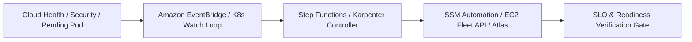
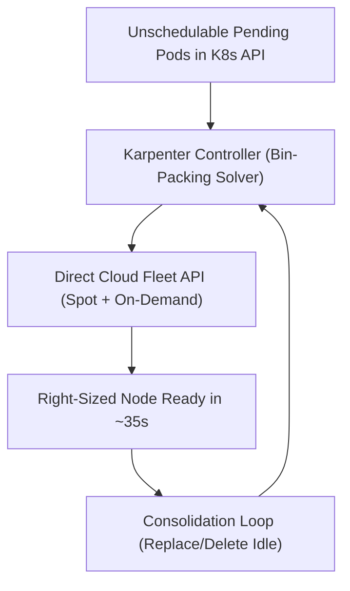

# Chapter 17: Infrastructure Automation, Karpenter Autoscaling, and Self-Healing Orchestration

In first-generation cloud operations, "infrastructure automation" was synonymous with scheduled cron scripts or centralized SSH task runners (such as legacy Rundeck or Ansible playbooks executed manually from a bastion host) that mutated pet virtual machines in place. As modern cloud estates scale to thousands of ephemeral containers, microVMs, and multi-region data stores, human-initiated runbooks and polling-based autoscalers can no longer react fast enough to sudden traffic surges, hardware degradation, or security findings.

Modern infrastructure automation is **event-driven, intent-based, and self-healing**. Instead of waiting for a human operator to acknowledge a pager alert and run a remediation script, platform teams engineer closed-loop control planes that react to telemetry and cloud state-change events within milliseconds. In this chapter, we architect **Event-Driven Infrastructure Automation** pipelines combining **Amazon EventBridge**, **AWS Step Functions**, and **AWS Systems Manager (SSM) Automation**, replace slow legacy Kubernetes node-group autoscalers with **Karpenter Just-in-Time Node Provisioning** (`NodePool` and `EC2NodeClass` consolidation), eliminate schema-related deployment outages using declarative **Database Migration Automation** (**Atlas** and **Flyway** with the **Expand-and-Contract Pattern**), and build **Self-Healing Control Loops** that automatically isolate, drain, and remediate degraded infrastructure.



## Event-Driven Infrastructure Automation: EventBridge, Step Functions, and SSM Automation

Traditional infrastructure maintenance relied on periodic polling or manual intervention—for example, an engineer noticing a security group misconfiguration, an expiring TLS certificate, or an impaired EC2 hardware host and running an ad-hoc CLI script. Polling wastes API quota when nothing has changed and introduces minutes or hours of exposure when an incident occurs.

In an **Event-Driven Infrastructure Automation** architecture, every state transition in the cloud control plane emits a structured JSON event onto an **Amazon EventBridge** bus (via AWS CloudTrail API events, AWS Health events, Amazon GuardDuty security findings, or Amazon EBS/RDS lifecycle notifications). EventBridge evaluates low-latency declarative rules and triggers a durable **AWS Step Functions** state machine that orchestrates **AWS Systems Manager (SSM) Automation** runbooks, Kubernetes API hooks, and Slack/PagerDuty audit trails without opening a single inbound SSH port (`22`).

### Automated Self-Healing Workflow for Impaired Compute Nodes and Security Drift

Consider what happens when AWS detects underlying physical host hardware degradation (`AWS_EC2_INSTANCE_STORE_DRIVE_PERFORMANCE_DEGRADED` or `AWS_EC2_MAINTENANCE_SCHEDULED`) or when a disk volume approaches 90% capacity:

1. **Event Detection**: EventBridge matches the event payload and invokes an Automated Remediation Step Functions workflow.
2. **Pre-Flight Blast-Radius Check**: The workflow queries a DynamoDB lock table or Prometheus metric to confirm that fewer than 10% of fleet nodes have been auto-remediated in the last 15 minutes (a **Remediation Circuit Breaker** that prevents an automation bug from terminating the entire production fleet!).
3. **Graceful Workload Drain & Remediation**: Step Functions invokes an SSM Automation Document (`AWS-ConfigureK8sNodeDrain` or custom document) via the SSM Agent over an outbound HTTPS channel—cordoning the node, evicting pods while respecting `PodDisruptionBudget` (`PDB`) constraints, capturing an EBS forensic/diagnostic snapshot if needed, and replacing the underlying instance.
4. **Post-Remediation Verification**: The state machine verifies that replacement capacity is `Ready` and publishes a rich summary to the engineering team's incident channel.

```yaml
# eventbridge-to-sfn-remediation.yaml
AWSTemplateFormatVersion: "2010-09-09"
Description: Event-Driven Node Auto-Remediation Rule

Resources:
  ImpairedHostEventRule:
    Type: AWS::Events::Rule
    Properties:
      Name: detect-ec2-hardware-impairment
      State: ENABLED
      EventPattern:
        source:
          - aws.health
        detail-type:
          - AWS Health Event
        detail:
          service:
            - EC2
          eventTypeCategory:
            - issue
            - scheduledChange
      Targets:
        - Id: TriggerSelfHealingStateMachine
          Arn: !Ref NodeSelfHealingStateMachine
          RoleArn: !GetAtt EventBridgeInvokeRole.Arn
```

And the corresponding AWS Systems Manager (SSM) Automation document (`ssm-cordon-and-drain.yaml`) executes deterministically with zero SSH keys:

```yaml
# ssm-cordon-and-drain.yaml
schemaVersion: "0.3"
description: >-
  Gracefully cordon, drain, and recycle degraded K8s
  worker node via SSM RunCommand
assumeRole: "{{ AutomationAssumeRole }}"
parameters:
  InstanceId:
    type: String
  NodeName:
    type: String
  AutomationAssumeRole:
    type: String
mainSteps:
  - name: CordonAndDrainKubernetesNode
    action: aws:runCommand
    timeoutSeconds: 300
    onFailure: Abort
    inputs:
      DocumentName: AWS-RunShellScript
      InstanceIds:
        - "{{ InstanceId }}"
      Parameters:
        commands:
          - set -euo pipefail
          - >-
            kubectl cordon {{ NodeName }}
          - >-
            kubectl drain {{ NodeName }}
            --ignore-daemonsets
            --delete-emptydir-data
            --timeout=180s

  - name: TerminateDrainedInstance
    action: aws:changeInstanceState
    inputs:
      InstanceIds:
        - "{{ InstanceId }}"
      DesiredState: terminated
```

## Karpenter: Just-in-Time, Group-Less Kubernetes Node Autoscaling

For years, Kubernetes platform teams scaled worker nodes using the **Kubernetes Cluster Autoscaler (CAS)**. However, Cluster Autoscaler was architected around a rigid, legacy abstraction: **Cloud Provider Node Groups (AWS Auto Scaling Groups / Managed Node Groups)**. To handle diverse workloads (general-purpose microservices, memory-intensive Redis caches, Arm64 Graviton workers, and GPU inference pods), platform engineers had to pre-create dozens of separate Auto Scaling Groups, each pinned to fixed instance types and a single Availability Zone when persistent volumes (`EBS`) were involved. When pods became `Pending`, Cluster Autoscaler had to estimate which ASG might fit the pod, increment the ASG desired count, wait for the ASG controller to launch an instance, and wait 2–4 minutes before the kubelet registered.

### How Karpenter Eliminates Node Groups

Created at AWS and donated to the CNCF (`kubernetes-sigs/karpenter`), **Karpenter** eliminates Node Groups and Auto Scaling Groups entirely. Karpenter watches the Kubernetes API server directly for unschedulable (`Pending`) pods, evaluates all scheduling constraints in real time—including CPU/memory/GPU requests, `nodeSelector`, `nodeAffinity`, `topologySpreadConstraints`, taints/tolerations, and Availability Zone volume bindings—and calls the **EC2 Fleet API (`CreateFleet`) directly** to launch the single most cost-effective, right-sized instance (across hundreds of eligible On-Demand and Spot instance types) in **30 to 45 seconds**.



Even more importantly, Karpenter runs a continuous **Consolidation Control Loop** (`disruption.consolidationPolicy: WhenEmptyOrUnderutilized`):

- **Empty Node Deletion**: Immediately terminates nodes carrying zero non-DaemonSet workload pods.
- **Multi-Node-to-Single-Node Bin-Packing**: If traffic subsides and three `m7g.2xlarge` nodes are only 25% utilized, Karpenter automatically launches a single cheaper `m7g.xlarge` node, cordons and drains the three underutilized nodes while respecting `PodDisruptionBudgets`, and terminates the surplus capacity—cutting cluster EC2 spend by 30–50% automatically.

### Production Karpenter v1 `NodePool` and `EC2NodeClass` Configuration

Below is a production Karpenter v1 (`karpenter.sh/v1` and `karpenter.k8s.aws/v1`) configuration that provisions AWS Graviton (`arm64`) and `amd64` compute instances across both `spot` and `on-demand` capacity pools, enforces IMDSv2 hop limits for container security, and consolidates underutilized nodes after a 2-minute stabilization window:

```yaml
# karpenter-nodepool-and-nodeclass.yaml
apiVersion: karpenter.sh/v1
kind: NodePool
metadata:
  name: general-compute-pool
spec:
  template:
    spec:
      nodeClassRef:
        group: karpenter.k8s.aws
        kind: EC2NodeClass
        name: bottlerocket-default
      requirements:
        - key: kubernetes.io/arch
          operator: In
          values: ["arm64", "amd64"]
        - key: karpenter.sh/capacity-type
          operator: In
          values: ["spot", "on-demand"]
        - key: karpenter.k8s.aws/instance-category
          operator: In
          values: ["c", "m", "r"]
        - key: karpenter.k8s.aws/instance-generation
          operator: Gt
          values: ["6"]
      expireAfter: 336h
  limits:
    cpu: "2000"
    memory: 8000Gi
  disruption:
    consolidationPolicy: WhenEmptyOrUnderutilized
    consolidateAfter: 2m
    budgets:
      - nodes: "10%"
---
apiVersion: karpenter.k8s.aws/v1
kind: EC2NodeClass
metadata:
  name: bottlerocket-default
spec:
  amiSelectorTerms:
    - alias: bottlerocket@latest
  role: "KarpenterNodeRole-prod-eks"
  subnetSelectorTerms:
    - tags:
        karpenter.sh/discovery: "prod-eks"
  securityGroupSelectorTerms:
    - tags:
        karpenter.sh/discovery: "prod-eks"
  metadataOptions:
    httpEndpoint: enabled
    httpProtocolIPv6: disabled
    httpPutResponseHopLimit: 1
    httpTokens: required
  blockDeviceMappings:
    - deviceName: /dev/xvdb
      ebs:
        volumeSize: 100Gi
        volumeType: gp3
        encrypted: true
```

Notice `amiSelectorTerms: [{alias: bottlerocket@latest}]` and `expireAfter: 336h` (14 days): Karpenter automatically boots immutable, container-optimized **Bottlerocket Linux** nodes and gracefully recycles every node in the cluster at least once every 14 days, ensuring OS kernel security patches roll out continuously without manual maintenance windows!

### Pairing Karpenter with KEDA (Kubernetes Event-Driven Autoscaling)

While Karpenter scales **worker nodes** in response to `Pending` pods, something must first scale the **application pods** in response to incoming demand. The built-in Kubernetes `HorizontalPodAutoscaler` (HPA) traditionally relies on trailing indicators like CPU and memory utilization—which are useless for I/O-bound asynchronous consumers reading from Amazon SQS, Apache Kafka, or RabbitMQ, where a pod waiting on network I/O consumes only 15% CPU even while 500,000 messages pile up in the queue!

**KEDA (Kubernetes Event-Driven Autoscaling)**—a CNCF-graduated project—solves this by acting as a custom metrics adapter and event-driven controller with over 65 built-in **Scalers** (SQS, Kafka, Prometheus, Cron, PostgreSQL, Redis Streams). KEDA queries external event sources directly, scales deployments (including **scaling to zero** when queues are empty), and triggers Karpenter to launch right-sized nodes within seconds of a message burst:

```yaml
# keda-sqs-scaledobject.yaml
apiVersion: keda.sh/v1alpha1
kind: TriggerAuthentication
metadata:
  name: keda-aws-pod-identity
  namespace: checkout-prod
spec:
  podIdentity:
    provider: aws
---
apiVersion: keda.sh/v1alpha1
kind: ScaledObject
metadata:
  name: payment-settlement-worker-scaler
  namespace: checkout-prod
spec:
  scaleTargetRef:
    apiVersion: apps/v1
    kind: Deployment
    name: payment-settlement-worker
  pollingInterval: 10
  cooldownPeriod: 120
  minReplicaCount: 2
  maxReplicaCount: 80
  triggers:
    - type: aws-sqs-queue
      authenticationRef:
        name: keda-aws-pod-identity
      metadata:
        queueURL: >-
          https://sqs.us-east-1.amazonaws.com/
          111122223333/prod-settlement-queue
        queueLength: "25"
        awsRegion: "us-east-1"
        scaleOnInFlight: "false"
```

With `queueLength: "25"`, as soon as 1,000 messages arrive in `prod-settlement-queue`, KEDA immediately scales `payment-settlement-worker` to $1000 / 25 = 40$ replicas, and Karpenter provisions a single high-density Graviton Spot instance via the EC2 Fleet API to run all 40 pods.

## Database Schema Migration Automation: Atlas, Flyway, and the Expand-and-Contract Pattern

Stateless containers can be rolled back in 5 seconds by shifting an `HTTPRoute` weight back to version `v1`, but **relational databases have state gravity**. If version `v2` of a microservice executes a destructive SQL migration (`ALTER TABLE users DROP COLUMN full_name;`) during startup, and `v2` subsequently crashes or fails its canary SLO check, rolling the application containers back to `v1` causes an immediate total outage because `v1` still queries the dropped `full_name` column!

### Zero-Downtime Schema Evolution via the Expand-and-Contract Pattern

To maintain 100% availability and instant rollback safety during live deployments, platform teams enforce the **Three-Phase Expand-and-Contract (Parallel Change) Pattern**:

1. **Phase 1 — Expand (Backward-Compatible Schema Addition)**: Run an automated database migration that only *adds* nullable columns (`given_name`, `family_name`), new tables, or concurrent indexes (`CREATE INDEX CONCURRENTLY`) without modifying or dropping existing columns required by application `v1`.
2. **Phase 2 — Dual-Write & Backfill Application Rollout**: Deploy application `v2`, which writes to *both* the old column (`full_name`) and the new columns (`given_name`, `family_name`), while a background job backfills historical rows. If `v2` needs to be rolled back to `v1` during this phase, `v1` continues working seamlessly!
3. **Phase 3 — Contract (Cleanup Migration)**: Once `v2` is running at 100% in production and all reads have migrated to the new columns, a subsequent release removes the legacy `full_name` references from code and executes the final `DROP COLUMN` migration.

```text
+-------------+------------------+------------------+
| Migration   | Allowed SQL      | Forbidden SQL    |
| Phase       | Operations       | (Breaks Rollback)|
+-------------+------------------+------------------+
| 1. Expand   | ADD COLUMN(NULL) | DROP COLUMN,     |
| (Pre-Deploy)| CREATE TABLE,    | RENAME COLUMN,   |
|             | CONCURRENT INDEX | NOT NULL no def  |
| 2. Rollout  | Backfill rows in | Full-table locks |
| Dual-Write  | small batches    | ACCESS EXCLUSIVE |
| 3. Contract | DROP unused old  | Dropping active  |
| (Cleanup)   | column or table  | columns in use   |
+-------------+------------------+------------------+
```

### Declarative Schema-as-Code and Destructive Change Linting with Atlas

While traditional migration tools like **Flyway** and **Liquibase** execute versioned SQL files (`V001__init.sql`, `V002__add_index.sql`), modern cloud-native teams increasingly pair versioned migrations with **Atlas (`arigaio/atlas`)** and the **Atlas Kubernetes Operator**. Atlas brings Terraform-like declarative state diffing and **automated SQL safety linting (`atlas migrate lint`)** to database schemas—automatically failing a pull request if a migration contains a table-locking index creation or a backward-incompatible column drop:

```hcl
# atlas.hcl (Database Schema Linting & Config)
lint {
  destructive {
    error = true
  }
  concurrent_index {
    error = true
  }
  data_depend {
    error = true
  }
}

env "production" {
  src = "file://schema/ledger.hcl"
  dev = "docker://postgres/16/dev?search_path=public"
  migration {
    dir = "file://migrations"
  }
}
```

And using the **Atlas Kubernetes Operator**, database schema migrations become a declarative Kubernetes custom resource (`AtlasMigration`) reconciled directly inside your Argo CD or Flux v2 GitOps pipeline (at Sync Wave `-1` prior to the application rollout):

```yaml
# k8s/atlas-migration-resource.yaml
apiVersion: db.atlasgo.io/v1alpha1
kind: AtlasMigration
metadata:
  name: ledger-db-schema-v14
  namespace: checkout-prod
  annotations:
    argocd.argoproj.io/sync-wave: "-1"
spec:
  urlFrom:
    secretKeyRef:
      name: ledger-db-conn-credentials
      key: database_url
  dir:
    configMapRef:
      name: ledger-migrations-cm
```

## Engineering Self-Healing Control Loops: Kubernetes Operators and Remediation Circuit Breakers

The ultimate evolution of infrastructure automation is encoding domain-specific operational knowledge directly into **Kubernetes Operators** (built with `controller-runtime` in Go or `Kopf` in Python) and **Node Problem Detector (NPD)** loops.

Every Kubernetes controller implements the canonical level-triggered reconciliation equation:

$$\text{Reconcile}(Key) : \text{Observe}(\text{Live}) \xrightarrow{\text{Compare}} \text{Diff}(\text{Desired}, \text{Live}) \xrightarrow{\text{Actuate}} \text{Converge}()$$

When engineering custom self-healing control loops or automated remediation workflows, platform engineers must enforce three safety invariants to prevent **automation-induced cascading failures**:

1. **Remediation Rate Limiting and Blast-Radius Caps**: Never allow a self-healing loop to reboot, drain, or replace more than $X\%$ (e.g., $10\%$) of a cluster or service fleet within a rolling 30-minute window. If a faulty kernel configuration or expired root certificate causes 100% of nodes to report unhealthy simultaneously, an unbounded self-healing controller will terminate the entire cluster.
2. **Respect `PodDisruptionBudgets` (PDBs) and Quorum State**: Before draining a node or restarting a stateful pod (such as an `etcd`, Kafka, or CockroachDB replica), the automation controller must use the Kubernetes **Eviction API (`policy/v1/Eviction`)** rather than raw `DELETE /pods`, ensuring the API server rejects the eviction if doing so would violate quorum or drop available replicas below `minAvailable`.
3. **Exponential Backoff with Full Jitter on Failed Remediations**: If an automated remediation action fails to restore health, exponentially back off subsequent attempts and escalate to the on-call engineer rather than thrashing cloud API rate limits in a tight retry loop.

### Implementing a Self-Healing Kubernetes Operator in Python with `Kopf`

To see how a level-triggered reconciliation loop with a safety circuit breaker works in practice, below is a custom Kubernetes Operator written using **Kopf (Kubernetes Operator Pythonic Framework)**. It watches a custom `RedisCacheCluster` resource every 60 seconds (`@kopf.timer`), checks cluster shard health, enforces a global circuit-breaker limit (`MAX_HEALS_PER_WINDOW = 2`), and triggers an automated pod eviction via the Kubernetes Eviction API if a shard becomes wedged:

```python
# operator/redis_healer_operator.py
import time
import kopf
import kubernetes.client as k8s

HEAL_HISTORY: list[float] = []
WINDOW_SECONDS = 900
MAX_HEALS_PER_WINDOW = 2


def can_execute_remediation() -> bool:
    now = time.time()
    recent = [
        ts for ts in HEAL_HISTORY
        if now - ts < WINDOW_SECONDS
    ]
    HEAL_HISTORY.clear()
    HEAL_HISTORY.extend(recent)
    return len(HEAL_HISTORY) < MAX_HEALS_PER_WINDOW


@kopf.timer(
    "platform.io",
    "v1alpha1",
    "rediscacheclusters",
    interval=60.0,
)
def reconcile_cluster_health(
    spec, name, namespace, logger, **kwargs
):
    core_v1 = k8s.CoreV1Api()
    pods = core_v1.list_namespaced_pod(
        namespace=namespace,
        label_selector=f"cluster={name}",
    )

    for pod in pods.items:
        pod_name = pod.metadata.name
        statuses = pod.status.container_statuses or []
        for st in statuses:
            if st.restart_count > 10 and not st.ready:
                if not can_execute_remediation():
                    logger.error(
                        "Circuit open! Skipping "
                        f"auto-eviction for {pod_name}"
                    )
                    return {"status": "CircuitOpen"}

                HEAL_HISTORY.append(time.time())
                eviction = k8s.V1Eviction(
                    metadata=k8s.V1ObjectMeta(
                        name=pod_name,
                        namespace=namespace,
                    )
                )
                # Respect PodDisruptionBudget via Evict
                core_v1.create_namespaced_pod_eviction(
                    name=pod_name,
                    namespace=namespace,
                    body=eviction,
                )
                logger.info(
                    f"Evicted degraded pod {pod_name}"
                )
    return {"status": "Healthy"}
```

## Production Infrastructure Automation Best Practices

1. **Design Every Automation Step to Be Strictly Idempotent**: An EventBridge rule, Step Functions task, or Kubernetes operator reconciliation loop can always be invoked multiple times for the same underlying event. Ensure every script and API call checks current state before mutating resources (`kubectl cordon`, `CREATE INDEX IF NOT EXISTS`, or conditional DynamoDB state locks) so duplicate executions are safe no-ops.
2. **Eliminate Inbound SSH (`Port 22`) and Bastion Hosts in Production**: Replace SSH key management and bastion jump-hosts with outbound agent channels such as **AWS Systems Manager (SSM) Session Manager / Run Command** or ephemeral debug containers (`kubectl debug`) gated by IAM OIDC authentication and full session logging to immutable S3/CloudWatch audit buckets.
3. **Define `PodDisruptionBudgets` (PDBs) for Every Production Service**: Both Karpenter node consolidation and automated SSM node-drain workflows rely on Kubernetes `PodDisruptionBudget` objects (`minAvailable: 80%` or `maxUnavailable: 1`) to know how many replicas can be safely evicted concurrently. Any production deployment lacking a `PDB` risks simultaneous pod termination during node consolidation.
4. **Decouple Schema Migrations from Application Container Entrypoints**: Never run `atlas migrate apply` or `flyway migrate` inside the `CMD` entrypoint of 50 horizontally scaling application pods starting simultaneously—doing so causes database lock contention and crash-loop cascades if a migration takes longer than the Kubernetes `startupProbe`. Always execute migrations as a dedicated, single-concurrency `PreSync` Kubernetes `Job` or `AtlasMigration` CRD before rolling out new application pods.

## Summary

Modern infrastructure automation replaces brittle cron jobs and manual SSH bastion playbooks with event-driven control planes and self-healing reconciliation loops. By wiring Amazon EventBridge, Step Functions, and SSM Automation to remediate cloud hardware impairments automatically, deploying Karpenter for 35-second group-less Kubernetes node provisioning and continuous cost consolidation, and enforcing zero-downtime Expand-and-Contract database migrations with Atlas, platform teams eliminate operational toil while hardening system resilience. In Chapter 18, we examine what happens when novel, unforeseen failure modes exceed automated recovery: Incident Management, the Incident Command System (ICS), Blameless Postmortems, and On-Call engineering.
