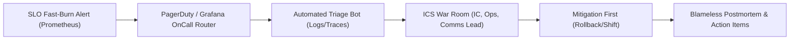
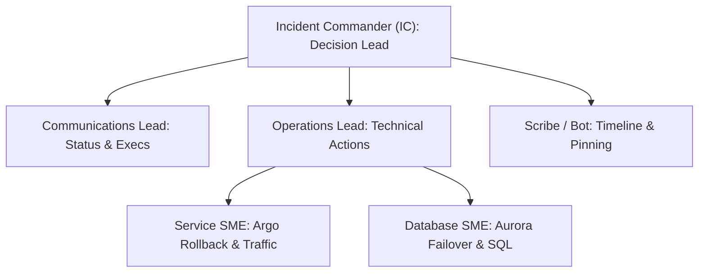

# Chapter 18: Incident Management, On-Call Engineering, and Blameless Postmortems

Even in systems fortified with multi-AZ redundancy, progressive canary delivery, and automated self-healing loops, complex distributed architectures inevitably experience novel failure modes. Emergent interactions between retry budgets, BGP routing changes, database query planner shifts, and third-party SaaS brownouts guarantee that **failure is a normal property of large-scale socio-technical systems**. What separates high-performing engineering organizations from fragile ones is not the mythical absence of incidents, but how rapidly, systematically, and humanely they detect, coordinate, mitigate, and learn from production disruptions.

Legacy ITIL incident processes often relied on slow ticket queues, multi-tier L1/L2/L3 escalation handoffs, and punitive "root cause" finger-pointing that incentivized engineers to hide near-misses. Modern Site Reliability Engineering (SRE) replaces bureaucratic ticket routing with **You Build It, You Run It** on-call ownership, the **Incident Command System (ICS)**, **PagerDuty / Grafana OnCall** schedule-as-code automation, **Automated Triage Runbooks** that attach real-time diagnostic telemetry before a human responder even opens their laptop, proactive **GameDays**, rigorous **Blameless Postmortems** (Correction of Errors / COE), and continuous **DORA & Reliability Metric Engineering** (**MTTD**, **MTTR**, **Change Failure Rate**, and **Deployment Frequency**).



## The Anatomy of a Modern Incident Lifecycle and DORA Metrics

To engineer faster incident recovery without burning out on-call responders, platform teams decompose every incident timeline into four measurable intervals linked directly to the **DORA (DevOps Research and Assessment)** operational stability metrics:

1. **Time to Detect ($\text{TTD}$ / $\text{MTTD}$)**: The elapsed time between the onset of customer-impacting failure ($t_0$) and the moment an automated SLO fast-burn alert pages the primary on-call responder ($t_{\text{alert}}$). High-performing teams keep $\text{MTTD} < 3\text{ minutes}$ using multi-window SLO burn-rate alerts and synthetic blackbox probes.
2. **Time to Acknowledge & Triage ($\text{TTA}$)**: The elapsed time between the page firing ($t_{\text{alert}}$) and the responder acknowledging the incident, joining the incident channel, and identifying the affected failure domain ($t_{\text{triage}}$). Automated triage runbooks compress $\text{TTA}$ from 15 minutes down to under 2 minutes.
3. **Time to Mitigate / Restore ($\text{TTM}$ / $\text{MTTR}$)**: The elapsed time from incident start ($t_0$) to the restoration of customer-facing SLO compliance ($t_{\text{mitigated}}$). Crucially, **mitigation is not root-cause debugging**: during an active SEV-1 outage, responders prioritize immediate blast-radius containment—rolling back a canary deployment via Argo Rollouts, shifting Gateway API traffic away from an impaired region, disabling a feature flag via OpenFeature, or scaling up database read replicas—before investigating the underlying code bug.
4. **Change Failure Rate ($\text{CFR}$)**: The percentage of production deployments or infrastructure changes that result in degraded service or require an immediate rollback, hotfix, or patch. Elite organizations maintain $\text{CFR} \le 5\%$ with $\text{MTTR} < 1\text{ hour}$.

```text
+------------+----------------------+-----------------+
| Severity   | Customer & Business  | Response SLA &  |
| Level      | Impact Definition    | ICS Staffing    |
+------------+----------------------+-----------------+
| SEV-1      | Core checkout/ledger | Page < 2 min    |
| (Critical) | down; >14.4x SLO burn| Full ICS Bridge |
|            | or security breach   | + Exec Comms    |
| SEV-2      | Partial feature deg- | Page < 5 min    |
| (Major)    | radation; >6x burn   | IC + Ops Lead   |
| SEV-3      | Minor component bug; | Ticket / Slack  |
| (Minor)    | workaround active    | Business Hours  |
+------------+----------------------+-----------------+
```

## The Incident Command System (ICS): Coordinated Response Under Pressure

Adapted from the standardized emergency management framework originally developed to coordinate multi-agency wildfire responses, the **Incident Command System (ICS)** prevents the two most common failure modes of ad-hoc engineering war rooms: **diffusion of responsibility** (15 engineers talking over each other in a Slack channel while nobody executes a rollback) and **executive interruption** (senior leaders repeatedly asking responders *"What is the ETA?"* while those same responders are trying to read kernel logs).

In an ICS-structured incident response, responsibilities are explicitly separated into distinct roles that can scale up or down based on incident severity:



### Core Incident Command Roles

- **Incident Commander (IC)**: Holds single point of coordination and decision authority for the incident. **The IC does not write code or run terminal commands during a SEV-1.** Instead, the IC maintains the high-level mental model, assigns investigative tracks to Subject Matter Experts (SMEs), enforces time-boxed hypotheses (*"We will give database index tuning 5 minutes; if error rate is not below 0.5% by 14:20 UTC, we fail over to region B"*), and manages handoffs across shifts.
- **Operations Lead (OL)**: The technical lead who executes—or directs SMEs to execute—live changes to the production environment. Every mutation to production must be announced to the IC and Operations Lead before execution (*"Running `kubectl argo rollouts abort checkout-api` in `prod-us-east-1` now"*) to prevent two engineers from running conflicting commands simultaneously.
- **Communications Lead (CL)**: Shielding the technical responders from stakeholder interruptions, the Communications Lead posts structured updates at a predictable cadence (every 15 minutes for SEV-1, every 30 minutes for SEV-2) to internal executive channels, customer support desks, and the public Statuspage.
- **Scribe (and Automated ChatOps Bot)**: Captures key timestamps, Prometheus graph snapshots, hypotheses tested, and mitigation actions directly into the incident timeline document so the postmortem has an accurate forensic record.

## On-Call Engineering as Code: PagerDuty and Grafana OnCall

Manually managing on-call rotations, escalation delays, and alert routing rules in web dashboards leads to orphaned schedules when team members change roles or go on PTO. Modern SRE teams manage **On-Call Schedules, Escalation Policies, and Service Orchestrations as Code** using OpenTofu / Terraform with **PagerDuty** or **Grafana OnCall**.

### Humane On-Call Rotations and Follow-the-Sun Escalation Architecture

Sustainable on-call engineering treats responder sleep and cognitive health as a first-class reliability resource. Best-in-class on-call rotations enforce:

- **Follow-the-Sun Rotations (`12h` or `8h` Regional Hand-offs)**: When teams span North America, Europe (EMEA), and Asia-Pacific (APAC), daytime hours in Dublin and Singapore cover nighttime hours in San Francisco, eliminating 3:00 AM wake-up calls.
- **Primary + Secondary Shadow Escalation**: Every primary responder is backed by an automated 10-minute escalation to a secondary responder (and a 20-minute escalation to the Incident Commander rotation), ensuring a missed notification due to cell network dead zones never leaves an outage unstaffed.
- **Automated Alert Grouping and Noise Suppression**: High-urgency pages (`severity = critical`) are reserved strictly for **actionable, customer-impacting SLO burn alerts**. Non-actionable informational events or self-healed pod restarts are routed to asynchronous Slack channels or tickets.

Below is an OpenTofu / Terraform configuration defining a multi-tier **PagerDuty** escalation policy, schedule layer, and time-windowed event orchestration rule:

```hcl
# pagerduty-oncall-as-code.tf
terraform {
  required_providers {
    pagerduty = {
      source  = "PagerDuty/pagerduty"
      version = "~> 3.18"
    }
  }
}

resource "pagerduty_schedule" "checkout_primary" {
  name      = "Checkout Platform Primary On-Call"
  time_zone = "UTC"

  layer {
    name                   = "Weekly Primary Shift"
    start                  = "2026-01-01T09:00:00Z"
    rotation_virtual_start = "2026-01-01T09:00:00Z"
    rotation_turn_length_seconds = 604800
    users = [
      var.sre_engineer_1_id,
      var.sre_engineer_2_id,
      var.sre_engineer_3_id,
    ]
  }
}

resource "pagerduty_escalation_policy" "checkout_ep" {
  name      = "Checkout Tier-1 Escalation Policy"
  num_loops = 2

  rule {
    escalation_delay_in_minutes = 10
    target {
      type = "schedule_reference"
      id   = pagerduty_schedule.checkout_primary.id
    }
  }

  rule {
    escalation_delay_in_minutes = 15
    target {
      type = "schedule_reference"
      id   = var.incident_commander_schedule_id
    }
  }
}

resource "pagerduty_service" "checkout_tier1" {
  name                    = "Checkout API (Tier-1)"
  auto_resolve_timeout    = 14400
  acknowledgement_timeout = 600
  escalation_policy       = (
    pagerduty_escalation_policy.checkout_ep.id
  )
  alert_creation = "create_alerts_and_incidents"
}
```

### Cloud-Native Alert Routing with Grafana OnCall

For organizations standardized on the Grafana observability stack (Prometheus / Mimir, Loki, Tempo, and Pyroscope), **Grafana OnCall** provides native schedule-as-code integration directly linked to Alertmanager and Grafana Alerting rules, automatically creating dedicated Slack/Teams war rooms and attaching live panel snapshots whenever an escalation chain triggers:

```hcl
# grafana-oncall-routing.tf
resource "grafana_oncall_integration" "checkout_prom" {
  name = "Checkout Prometheus SLO Integration"
  type = "alertmanager"
  default_route {
    escalation_chain_id = (
      grafana_oncall_escalation_chain.tier1.id
    )
    slack {
      channel_id = var.sre_incidents_slack_channel_id
      enabled    = true
    }
  }
}

resource "grafana_oncall_escalation_chain" "tier1" {
  name = "Checkout Tier-1 Chain"
}

resource "grafana_oncall_escalation" "notify_primary" {
  escalation_chain_id = (
    grafana_oncall_escalation_chain.tier1.id
  )
  type          = "notify_on_call_from_schedule"
  position      = 0
  important     = true
  notify_on_call_from_schedule = (
    grafana_oncall_schedule.primary_rot.id
  )
}
```

## Automated Triage Runbooks: Compressing Time-to-Triage ($\text{TTA}$)

When an on-call engineer is paged at night, the first 10 minutes are typically spent executing the exact same mechanical diagnostic steps: checking which Git commit or Argo Rollout was deployed in the last 30 minutes, checking Kubernetes pod crash-loops and OOMKills (`LAST STATE: OOMKilled`), querying top 5xx error logs, and checking upstream dependency latency.

**Automated Triage Runbooks** execute these read-only diagnostic queries automatically the instant a PagerDuty or Grafana OnCall webhook fires, posting a structured **Incident Context Card** directly into the auto-created Slack incident war room before the responder even types a command!

Below is a production Python webhook triage responder that inspects recent Kubernetes rollout events, pod restart reasons (`OOMKilled` / `CrashLoopBackOff`), and recent deployment revisions for the alerting namespace:

```python
# automation/incident_triage_bot.py
import time
import kubernetes.client as k8s
import kubernetes.config as k8s_cfg


def collect_namespace_triage(namespace: str) -> dict:
    k8s_cfg.load_incluster_config()
    core = k8s.CoreV1Api()
    apps = k8s.AppsV1Api()

    degraded_pods = []
    pods = core.list_namespaced_pod(
        namespace=namespace
    )
    for pod in pods.items:
        for cs in pod.status.container_statuses or []:
            last_term = (
                cs.last_state.terminated
                if cs.last_state
                else None
            )
            reason = (
                last_term.reason
                if last_term
                else "None"
            )
            if cs.restart_count > 0 or not cs.ready:
                degraded_pods.append(
                    {
                        "pod": pod.metadata.name,
                        "ready": cs.ready,
                        "restarts": cs.restart_count,
                        "last_reason": reason,
                    }
                )

    recent_deploys = []
    deps = apps.list_namespaced_deployment(
        namespace=namespace
    )
    for dep in deps.items:
        rev = dep.metadata.annotations.get(
            "deployment.kubernetes.io/revision", "?"
        )
        img = (
            dep.spec.template.spec.containers[0].image
        )
        recent_deploys.append(
            {
                "deployment": dep.metadata.name,
                "revision": rev,
                "image": img,
            }
        )

    return {
        "timestamp_utc": time.strftime(
            "%Y-%m-%dT%H:%M:%SZ", time.gmtime()
        ),
        "namespace": namespace,
        "degraded_pods": degraded_pods[:10],
        "active_deployments": recent_deploys,
    }
```

When the responder joins `#inc-2026-1025-checkout-slo`, they immediately see that `checkout-api` revision `42` (`image: checkout:v2.9.1`) rolled out 4 minutes prior to the alert and 3 pods terminated with `last_reason: OOMKilled`—allowing the responder to execute an immediate rollback in 30 seconds.

## Proactive Operational Readiness: GameDays and Wheel of Misfortune Drills

A runbook or disaster recovery plan that has never been practiced by the live on-call team is a work of fiction. High-performing SRE organizations institutionalize two proactive training rituals:

1. **Wheel of Misfortune (Role-Play Drills for Onboarding Engineers)**: During a safe 45-minute team session, a new on-call engineer acts as the Incident Commander for a historical production outage scenario while a senior engineer acts as the "dungeon master" feeding real historical Prometheus graphs, log outputs, and console responses as the trainee queries them.
2. **Quarterly Live GameDays**: Scheduled, cross-team exercises where a designated Red Team injects a realistic failure (using AWS Fault Injection Service or Chaos Mesh in pre-production or canary production)—such as simulating a regional database failover, revoking an intermediate TLS certificate, or saturating a downstream payment partner API—while the active on-call rotation practices ICS roles, status page communications, and automated runbook execution under realistic conditions.

## Blameless Postmortems (Correction of Errors) and the Five Whys Beyond Human Error

Once an incident is mitigated and customer SLOs are restored, the most valuable phase of incident management begins: the **Blameless Postmortem** (referred to at Amazon as a **Correction of Errors — COE**).

### The Core Premise of Just Culture and Blameless Postmortems

Pioneered by Sidney Dekker (in aviation safety) and John Allspaw (in web operations), a **Blameless Postmortem** rests on a fundamental systems engineering truth: **human error is never the root cause of an incident; human error is a symptom of deeper systemic vulnerabilities in tools, guardrails, observability, or organizational incentives**.

If an engineer ran a script that accidentally deleted a production table, concluding *"Root Cause: Engineer X ran the wrong command; Action Item: Tell Engineer X to be more careful"* guarantees that six months later, **Engineer Y will make the exact same mistake**. Instead, a blameless investigation asks:
- *Why did the production database allow an unreviewed CLI session to execute an unguarded `DROP TABLE` without a role-separation policy?*
- *Why did the CLI tool lack an explicit environment confirmation prompt or dry-run diff?*
- *Why did automated point-in-time recovery take 45 minutes instead of 5 minutes?*

By assuming that the responder acted in good faith with the information and tools available to them at that moment, blameless postmortems incentivize engineers to surface every contributing factor honestly rather than hiding mistakes.

### Structured Blameless Postmortem Template (Markdown-as-Code)

Postmortems should be stored in version control, reviewed in a public engineering forum within 48–72 hours of any SEV-1/SEV-2 incident, and tracked via concrete Jira/GitHub engineering issues with assigned owners and SLO due dates:

```markdown
# Postmortem COE-2026-042: Checkout API Latency Spike

## 1. Executive Summary & Impact
- **Date / Duration**: 2026-10-24 (14:12 - 14:29 UTC,
  17 minutes total SLO impact)
- **SLO Budget Consumed**: 34% of 30-day 99.9% budget
- **Customer Impact**: 18,400 checkout requests failed
  with HTTP 504 Gateway Timeout.

## 2. Detection & Timeline (All Times UTC)
- **14:08**: Argo CD synced `checkout-api` v2.9.1.
- **14:12**: Connection pool exhaustion began on RDS.
- **14:14**: `CheckoutSLOFastBurnPage` fired (2m MTTD).
- **14:15**: Primary on-call acknowledged; Triage Bot
  identified v2.9.1 rollout correlation (TTA: 1m).
- **14:18**: IC ordered immediate Argo Rollout abort.
- **14:29**: Connection pool drained; SLO restored
  (MTTR: 17m).

## 3. Systemic Contributing Factors (Five Whys)
1. **Why did HTTP 504s occur?** Checkout pods blocked
   waiting for PostgreSQL connections.
2. **Why was the connection pool exhausted?** v2.9.1
   introduced an external webhook call *inside* an
   open SQL transaction block (`BEGIN ... COMMIT`).
3. **Why did unit/integration tests pass?** Mock
   webhooks returned in 2ms; in prod, partner API
   p99 was 1,800ms, holding DB locks 900x longer.
4. **Why did canary analysis not catch it earlier?**
   Canary step 1 lasted only 1m at 5% weight, which
   was insufficient to saturate the 200-conn pool.

## 4. Preventive Action Items (Tracked to Closure)
- **[P0 - Prevent]**: Add SQL transaction duration
  timeout (`idle_in_transaction_session_timeout = 2s`)
  in RDS parameter group (Owner: @db-team, Due: 10/28).
- **[P1 - Detect]**: Increase Argo Rollout Step 1
  soak window to 5m and add `pg_stat_activity` pool
  saturation metric to `AnalysisTemplate` (Due: 10/30).
```

## Production Incident Management and On-Call Best Practices

1. **Audit Pager Load Weekly ("Delete, Automate, or Downgrade")**: Track the exact number of pages per shift and conduct a weekly 15-minute **On-Call Handoff & Alert Review**. Following Google SRE guidelines, a healthy primary on-call shift should average fewer than **2 actionable pages per 12-hour shift**. Any alert that fired during the week and required zero human action ("flapping" or self-healing noise) must be immediately deleted, converted into an automated remediation workflow, or downgraded to a daytime ticket.
2. **Separate Mitigation from Root-Cause Investigation**: During an active outage, resist the temptation to attach a live debugger or inspect obscure code paths while customers are experiencing 5xx errors. Always ask: *"What changed in the last 60 minutes, and can we roll it back, shift traffic away, or disable a feature flag right now?"* Capture forensic artifacts (heap dumps, eBPF profiles, pod logs) asynchronously via your triage bot, restore customer service first, and investigate root causes during normal business hours.
3. **Enforce SLAs on Postmortem Action Items**: Writing a thorough Blameless Postmortem is pointless if its `P0` and `P1` corrective action items languish in the backlog while feature work takes priority. Assign an explicit engineering owner and a hard due date (e.g., 7 days for `P0` preventive guardrails, 30 days for `P1` items) to every postmortem action item, and review overdue reliability action items in executive engineering syncs.
4. **Compensate and Protect On-Call Engineers**: Sustainable reliability requires organizational commitment to responder wellbeing. Provide dedicated on-call stipends, automatic compensatory time off ("recovery mornings") whenever an engineer is paged during sleep hours, and a minimum rotation pool size of at least 6 to 8 engineers per primary schedule (combining related teams into shared rotations if individual squads are smaller).

## Summary

Resilient socio-technical systems depend on disciplined incident management and humane on-call engineering. By anchoring alerting to customer-facing SLOs, coordinating crisis response with the Incident Command System (ICS), codifying PagerDuty / Grafana OnCall rotations, automating diagnostic triage in seconds, practicing failure recovery through regular GameDays, and conducting rigorous Blameless Postmortems, engineering organizations continuously convert production disruptions into lasting architectural immunity. Together with the networking, serverless, IaC, observability, GitOps, testing, multi-cloud, and automation foundations covered across Chapters 10 through 17, these practices form the operational backbone of modern cloud-native engineering.
