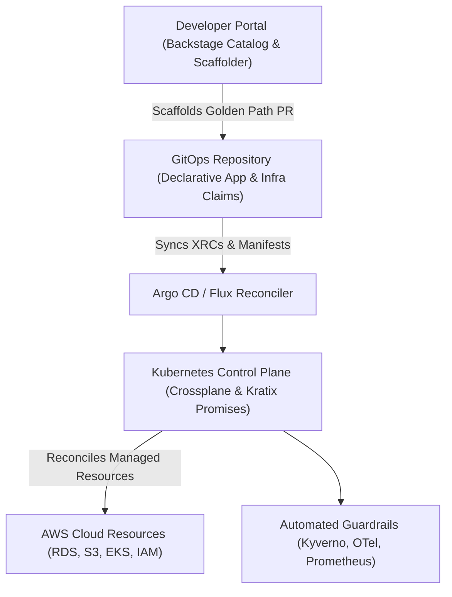

# Chapter 19: Platform Engineering and Internal Developer Platforms (IDPs)

As organizations scale their cloud-native footprint from a handful of microservices to hundreds of distributed workloads across multiple Kubernetes clusters and cloud accounts, a structural bottleneck frequently emerges. The early DevOps mantra—"you build it, you run it"—was originally intended to dismantle the wall of confusion between application developers and systems operators. In practice, however, many engineering organizations misinterpreted this principle by expecting every product developer to become an expert in Terraform state locking, Amazon EKS IAM Roles for Service Accounts (IRSA), Helm chart templating, Prometheus scrape rules, OpenTelemetry collector configurations, and Kubernetes NetworkPolicies.

When every product team is forced to assemble its own cloud infrastructure and deployment pipelines from raw primitives, three systemic failure modes occur:

1. **Cognitive Overload and Context Switching**: Product engineers spend more than 40% of their sprint capacity debugging YAML indentation, cloud IAM permission boundaries, and CI/CD runner failures rather than shipping business features.
2. **Shadow Operations and Fragmented Standards**: Without a unified abstraction layer, five product teams will construct five incompatible Terraform module hierarchies and CI/CD workflows, creating a maintenance nightmare for security and Site Reliability Engineering (SRE) teams.
3. **Ticket-Driven Bottlenecks**: To regain control over security and cloud spend, infrastructure teams reintroduce manual approval gates and Jira ticket queues, inadvertently regressing to the exact pre-DevOps operational silos they sought to eliminate.

**Platform Engineering** resolves this tension by treating infrastructure, delivery pipelines, and operational guardrails as an internal **software product**. Rather than acting as a ticket-fulfillment back office, a dedicated Platform Engineering team designs, builds, and maintains an **Internal Developer Platform (IDP)**—a self-service layer of curated abstractions, automated APIs, and "Golden Paths" that empower application developers to provision compliant cloud resources and deploy workloads autonomously with minimal cognitive friction.



---

## Understanding Developer Cognitive Load and Team Topologies

To engineer an effective Internal Developer Platform, architects must first understand how human working memory interacts with complex distributed systems. Grounded in John Sweller's **Cognitive Load Theory** and popularized in software architecture by Matthew Skelton and Manual Pais in *Team Topologies*, developer cognitive load is divided into three distinct categories:

- **Intrinsic Cognitive Load**: The fundamental mental effort required to understand the core programming language, data structures, and algorithmic invariants of the task at hand (for example, writing thread-safe Python async handlers or designing an idempotent payment state machine).
- **Germane Cognitive Load**: The high-value mental capacity devoted to understanding the business domain, customer workflows, and domain-driven design boundaries (for example, modeling fraud detection rules or regional tax compliance).
- **Extraneous Cognitive Load**: The superfluous mental friction imposed by how the environment, tooling, and deployment mechanics are presented (for example, remembering which of fourteen AWS subnets is tagged for internal ALB ingress, or manually rotating a staging database credential in three separate secret stores).

The primary architectural objective of an Internal Developer Platform is **compressing extraneous cognitive load to near zero** so that engineering teams can allocate their finite working memory to germane business problems.

### Aligning Platform Teams with Team Topologies

An IDP succeeds only when paired with clear organizational interaction modes:

- **Stream-Aligned Teams**: Product engineering squads aligned to a single valuable stream of business work. They are the primary *customers* of the Internal Developer Platform.
- **Platform Team**: The product-minded infrastructure engineering group that builds and operates the IDP. They measure success through internal Net Promoter Score (NPS), Golden Path adoption rate, and time-to-first-deployment for new engineers.
- **Enabling Teams**: Specialist coaches (in security, observability, or performance engineering) who temporarily embed with stream-aligned teams to help them adopt platform capabilities and feed unmet requirements back into the Platform Team's roadmap.

---

## Designing Golden Paths and Paved Roads

A **Golden Path** (often called a **Paved Road**, a term pioneered by Netflix and Spotify) is an opinionated, step-by-step, automated workflow for accomplishing a recurring engineering task—such as launching a new Python FastAPI microservice, provisioning a production-ready PostgreSQL database with automated backups, or deploying an event-driven consumer backed by Amazon SQS.

Crucially, a Golden Path is **not a gilded cage**:

- **Opinionated by Default, Extensible by Exception**: For 90% of workloads that fit standard architectural patterns, the Golden Path provides a turnkey experience where security, observability, cost allocation tags, and high availability are pre-wired out of the box.
- **Escape Hatches for Specialized Workloads**: If a team is building a low-latency kernel-bypass trading engine or a custom GPU inference cluster that genuinely requires non-standard infrastructure, they are not blocked by the platform; however, stepping off the paved road means assuming explicit operational ownership of those custom primitives.
- **Lifecycle Day-2 Maintenance**: A true Golden Path does not stop at Day-1 repository scaffolding. If the platform team upgrades the base container image, patches a CVE in the OpenTelemetry sidecar, or migrates from Ingress to the Kubernetes Gateway API, Golden Path templates propagate those upgrades across downstream services via automated pull requests or versioned Crossplane compositions.

---

## Backstage: The Developer Portal and Software Catalog

Created at Spotify and donated to the Cloud Native Computing Foundation (CNCF) as an Incubating project, **Backstage** has become the industry-standard open-source framework for building unified developer portals. In a mature IDP architecture, Backstage serves as the single pane of glass over an organization's fragmented tooling ecosystem, anchored by three core pillars:

1. **The Software Catalog**: A centralized metadata graph that tracks ownership, lifecycle state (`experimental`, `production`, `deprecated`), dependencies, API contracts (OpenAPI, AsyncAPI, gRPC protobufs), and operational runbooks for every microservice, library, data pipeline, and cloud resource.
2. **Software Templates (Scaffolder)**: An extensible workflow orchestrator that turns Golden Paths into interactive self-service forms. When an engineer requests a new microservice, the Scaffolder renders Cookiecutter/Nunjucks templates, creates the GitHub repository, configures branch protection rules, registers the service in Argo CD, and adds it to the Software Catalog in under sixty seconds.
3. **TechDocs (Docs-like-Code)**: A built-in documentation pipeline that renders Markdown files stored directly alongside source code (`mkdocs.yml`) into a searchable, versioned engineering knowledge base.

### Defining a Backstage `catalog-info.yaml`Descriptor

Rather than maintaining stale spreadsheets or disconnected configuration management databases (CMDBs), Backstage follows a GitOps model where every repository declares its own metadata in a `catalog-info.yaml` file at the root of the codebase:

```yaml
# catalog-info.yaml
apiVersion: backstage.io/v1alpha1
kind: Component
metadata:
  name: checkout-payment-service
  description: Core PCI-compliant payment processor
  annotations:
    github.com/project-slug: acme-corp/checkout-svc
    backstage.io/techdocs-ref: dir:.
    argocd/app-name: checkout-payment-prod
    grafana/dashboard-selector: "app=checkout-svc"
    pagerduty.com/service-id: P9X8Y7Z
  tags:
    - python
    - fastapi
    - pci-tier-1
spec:
  type: service
  lifecycle: production
  owner: group:payments-stream-team
  system: commerce-checkout-platform
  providesApis:
    - payment-authorization-v2-api
  dependsOn:
    - resource:checkout-orders-postgres
    - component:fraud-scoring-engine
```

Notice how this single declarative manifest bridges organizational silos:

- **Ownership Clarity (`spec.owner`)**: During a 2:00 AM incident, on-call responders never have to guess which team owns `checkout-payment-service` or which PagerDuty escalation policy (`pagerduty.com/service-id`) applies.
- **Dependency Blast-Radius Mapping (`spec.dependsOn`)**: Because the service explicitly declares its dependency on `resource:checkout-orders-postgres` and `component:fraud-scoring-engine`, Backstage renders an interactive dependency graph showing upstream and downstream impact before a schema migration or maintenance window begins.

### Building a Self-Service Golden Path Scaffolder Template

To automate Day-1 service creation, platform engineers author a Backstage `Template` entity that prompts developers only for high-level domain parameters (`service_name`, `owner`, `database_tier`) while abstracting away the underlying Kubernetes and Terraform boilerplate:

```yaml
# golden-path-fastapi-template.yaml
apiVersion: backstage.io/v1beta3
kind: Template
metadata:
  name: python-fastapi-golden-path
  title: Production Python FastAPI Microservice
  description: >
    Scaffolds a hardened FastAPI service with OTel,
    Crossplane PostgreSQL claim, and Argo CD GitOps.
spec:
  owner: group:platform-engineering
  type: service
  parameters:
    - title: Service Identity & Ownership
      required:
        - component_id
        - owner
      properties:
        component_id:
          title: Service Name
          type: string
          pattern: "^[a-z0-9-]+$"
        owner:
          title: Owning Squad
          type: string
          ui:field: OwnerPicker
        db_size:
          title: PostgreSQL Storage Tier
          type: string
          enum: ["small-20gb", "medium-100gb"]
          default: "small-20gb"
  steps:
    - id: render-skeleton
      name: Render Golden Path Skeleton
      action: fetch:template
      input:
        url: ./skeleton
        values:
          name: ${{ parameters.component_id }}
          owner: ${{ parameters.owner }}
          db_size: ${{ parameters.db_size }}
    - id: publish-github
      name: Create Hardened GitHub Repository
      action: publish:github
      input:
        repoUrl: github.com?owner=acme-corp&repo=${{
          parameters.component_id }}
        defaultBranch: main
        protectDefaultBranch: true
    - id: register-catalog
      name: Register in Software Catalog
      action: catalog:register
      input:
        repoContentsUrl: >-
          ${{ steps['publish-github']
          .output.repoContentsUrl }}
        catalogInfoPath: "/catalog-info.yaml"
```

---

## Crossplane: Kubernetes-Native Cloud Control Planes

While Backstage solves the user interface and Day-1 scaffolding layer of an IDP, a critical question remains: *how should the platform provision and reconcile cloud infrastructure (such as Amazon RDS databases, S3 buckets, ElastiCache clusters, and IAM roles) alongside Kubernetes workloads?*

Traditional Infrastructure as Code tools like Terraform and AWS CDK excel at batch-oriented, CLI-driven execution, but they run only when triggered by a human or a CI job. If a someone manually modifies a security group in the AWS Console between CI runs, Terraform does not automatically heal the drift unless scheduled polling is bolted on. Furthermore, exposing raw Terraform modules to hundreds of application developers requires managing state file access, provider credentials, and HCL version compatibility across dozens of repositories.

**Crossplane** (a CNCF Graduated project) transforms a Kubernetes cluster into a **universal, continuous control plane** for any cloud provider API. By extending the Kubernetes API with Custom Resource Definitions (CRDs) and continuous reconciliation controllers, Crossplane enables platform teams to define **Cloud APIs as Kubernetes abstractions** using four core building blocks:

1. **Providers (`Provider-AWS`, `Provider-GCP`, `Provider-Azure`)**: Controllers running inside the platform cluster that know how to talk to external cloud APIs and expose low-level **Managed Resources** (such as `rds.aws.upbound.io/v1beta1/Instance` or `s3.aws.upbound.io/v1beta1/Bucket`).
2. **Composite Resource Definitions (`XRD`)**: The schema defined by the Platform Engineering team that specifies the simplified, high-level API contract exposed to application developers (for example, `XPostgreSQLInstance` requiring only `storageGB` and `engineVersion`).
3. **Compositions (`Composition`)**: The platform-owned implementation blueprint that maps a single developer-facing `XRD` into multiple underlying cloud Managed Resources (for example, an RDS instance, a KMS encryption key, a private DB subnet group, a security group, and an automated Kubernetes `Secret` containing the connection string).
4. **Claims (`CompositeResourceClaim` / `XRC`)**: The lightweight, namespace-scoped manifest that an application developer commits to their GitOps repository alongside their Kubernetes `Deployment` to request infrastructure.

### Step 1: Defining the Platform Contract with a Crossplane `XRD`

Suppose the Platform Engineering team wants to let product teams provision encrypted, multi-AZ PostgreSQL databases on AWS without ever touching VPC subnet IDs, KMS key policies, or parameter groups. First, the platform team defines a `CompositeResourceDefinition`:

```yaml
# xrd-postgresql.yaml
apiVersion: apiextensions.crossplane.io/v1
kind: CompositeResourceDefinition
metadata:
  name: xpostgresqlinstances.platform.acme.io
spec:
  group: platform.acme.io
  names:
    kind: XPostgreSQLInstance
    plural: xpostgresqlinstances
  claimNames:
    kind: PostgreSQLInstance
    plural: postgresqlinstances
  versions:
    - name: v1alpha1
      served: true
      referenceable: true
      schema:
        openAPIV3Schema:
          type: object
          properties:
            spec:
              type: object
              required:
                - parameters
              properties:
                parameters:
                  type: object
                  required:
                    - storageGB
                    - tier
                  properties:
                    storageGB:
                      type: integer
                      minimum: 20
                      maximum: 1000
                    tier:
                      type: string
                      enum: ["dev", "staging", "prod"]
```

### Step 2: Encoding Security and Operational Guardrails in a `Composition`

Next, the platform team authors a `Composition` that translates that simple `PostgreSQLInstance` claim into a hardened AWS RDS instance with mandatory storage encryption, automated backups, and non-public accessibility:

```yaml
# composition-aws-postgresql.yaml
apiVersion: apiextensions.crossplane.io/v1
kind: Composition
metadata:
  name: aws-postgresql-hardened
  labels:
    provider: aws
    compliance: soc2-pci
spec:
  compositeTypeRef:
    apiVersion: platform.acme.io/v1alpha1
    kind: XPostgreSQLInstance
  resources:
    - name: rds-instance
      base:
        apiVersion: rds.aws.upbound.io/v1beta1
        kind: Instance
        spec:
          forProvider:
            region: us-east-1
            engine: postgres
            engineVersion: "16.3"
            instanceClass: db.t4g.medium
            storageEncrypted: true
            publiclyAccessible: false
            skipFinalSnapshot: true
            backupRetentionPeriod: 7
            autoMinorVersionUpgrade: true
          writeConnectionSecretToRef:
            namespace: crossplane-system
      patches:
        - type: FromCompositeFieldPath
          fromFieldPath: spec.parameters.storageGB
          toFieldPath: >-
            spec.forProvider.allocatedStorage
```

### Step 3: Self-Service Consumption by Product Developers

Now, when a product engineer on the Checkout team needs a database for their microservice, they do not open an infrastructure ticket or write 300 lines of Terraform. They simply commit a 14-line `PostgreSQLInstance` claim into their service's GitOps folder:

```yaml
# claim-checkout-db.yaml
apiVersion: platform.acme.io/v1alpha1
kind: PostgreSQLInstance
metadata:
  name: checkout-orders-db
  namespace: team-payments
spec:
  parameters:
    storageGB: 100
    tier: prod
  writeConnectionSecretToRef:
    name: checkout-db-conn
```

Within minutes, Argo CD syncs the claim into the cluster, Crossplane reconciles the underlying AWS RDS instance and KMS encryption configuration, and the database credentials automatically appear inside the `team-payments` namespace as the Kubernetes secret `checkout-db-conn`. Better still, because Crossplane runs an active Kubernetes reconciliation loop, if someone accidentally enables public access on the RDS instance in the AWS Console, Crossplane detects the drift within seconds and restores `publiclyAccessible: false` automatically.

---

## Multi-Cluster Platform Orchestration with Kratix Promises

While Crossplane excels at composing cloud provider resources, large enterprise platforms often need to orchestrate entire **multi-step, multi-cluster platform capabilities**—such as provisioning a dedicated SaaS tenant environment that requires a namespace in three regional workload clusters, a Vault secret engine path, a Kafka topic ACL, a Trivy vulnerability scan before deployment, and a Grafana dashboard.

**Kratix** is an open-source framework for building composable Internal Developer Platforms on Kubernetes using the concept of **Promises**. A Kratix `Promise` encapsulates both the **API contract** (CRD) and a **multi-stage container pipeline** that transforms a developer's resource request into declarative state scheduled across fleet destinations (via GitOps or S3 state stores):

- **Day-1 & Day-2 Workflows as Containers**: Inside a Kratix Promise, `workflows.resource.configure` runs a chain of standard OCI containers whenever a developer creates or updates a request. Because pipeline stages are standard containers (written in Python, Go, Bash, or OPA), platform engineers can test their platform logic using standard unit tests before publishing the Promise.
- **Composable Promises (Promises of Promises)**: A high-level `MicroserviceEnvironment` Promise can emit lower-level requests for a `CrossplanePostgreSQL` Promise, a `RedisCache` Promise, and a `CertManagerTLS` Promise, allowing platform capabilities to be stacked like Lego bricks.

---

## Measuring Platform Success: DORA and SPACE Metrics for IDPs

An Internal Developer Platform is an internal product, and like any software product, it will stagnate or over-engineer the wrong abstractions unless governed by quantitative telemetry and qualitative developer feedback. High-performing Platform Engineering organizations combine **DORA (DevOps Research and Assessment)** operational metrics with the **SPACE framework** (Satisfaction, Performance, Activity, Communication, Efficiency/Flow):

- **Time to First Production Commit (Onboarding Velocity)**: Measures the elapsed wall-clock time from when a newly hired engineer joins the organization to when their first scaffolded service or feature is running in production. World-class IDPs compress this from weeks to under 4 hours.
- **Self-Service Fulfillment Ratio**: The percentage of infrastructure and environment requests fulfilled 100% autonomously via Backstage and GitOps/Crossplane without human intervention from a platform or SRE engineer (target: `>= 92%`).
- **Golden Path Adoption Rate**: The percentage of active production services using platform-maintained templates and Crossplane compositions rather than bespoke, hand-rolled configurations (target: `>= 80%`).
- **Change Lead Time & Deployment Frequency (DORA)**: Tracks whether platform abstractions genuinely accelerate delivery from `git commit` to production rollout without inflating Change Failure Rate (CFR).
- **Developer Platform NPS (Satisfaction)**: Quarterly surveys measuring developer friction, documentation clarity, and cognitive load reduction across stream-aligned squads.

### Automating Platform Health and Adoption Audits in Python

Platform teams should continuously audit their Kubernetes control plane to track Golden Path compliance and detect unattached or failing Crossplane claims before developers open support requests. The following Python verification script queries cluster-wide platform claims and computes a real-time IDP health report:

```python
# ch19_idp_claim_auditor.py
import json
from dataclasses import dataclass
from typing import List


@dataclass
class PlatformClaimStatus:
    name: str
    namespace: str
    kind: str
    synced: bool
    ready: bool
    golden_path_version: str


def evaluate_idp_fleet(
    claims: List[PlatformClaimStatus],
    min_version: str = "v2.1",
) -> dict:
    total = len(claims)
    healthy = sum(
        1 for c in claims if c.synced and c.ready
    )
    compliant = sum(
        1
        for c in claims
        if c.golden_path_version >= min_version
    )
    drift_alerts = [
        f"{c.namespace}/{c.name}"
        for c in claims
        if not (c.synced and c.ready)
    ]
    return {
        "total_claims": total,
        "ready_ratio": round(
            healthy / max(total, 1), 3
        ),
        "golden_path_compliance": round(
            compliant / max(total, 1), 3
        ),
        "degraded_claims": drift_alerts,
    }


if __name__ == "__main__":
    sample = [
        PlatformClaimStatus(
            "checkout-db",
            "team-payments",
            "PostgreSQLInstance",
            True,
            True,
            "v2.2",
        ),
        PlatformClaimStatus(
            "legacy-cache",
            "team-catalog",
            "RedisCluster",
            True,
            False,
            "v1.9",
        ),
    ]
    res = evaluate_idp_fleet(sample)
    print(json.dumps(res, indent=2))
```

---

## Anti-Patterns to Avoid When Building an IDP

Even well-funded Platform Engineering initiatives can fail if they fall into common architectural traps:

1. **Building a "Portals-First" Facade Over Manual Ticket Queues**: Deploying Backstage as a shiny web UI where clicking "Create Database" simply opens a Jira ticket for an operations engineer to run Terraform manually next Tuesday is not Platform Engineering—it is ticket-queue theater. Always automate the underlying control plane (Crossplane, Kratix, Argo CD) first, then expose it through the portal.
2. **Mandating a One-Size-Fits-All Abstraction**: Attempting to wrap every single AWS service parameter into a proprietary YAML DSL inevitably creates a leaky abstraction that is harder to learn than the underlying cloud provider. Keep `XRD` schemas focused on the 5 to 8 parameters developers actually care about, and encode the rest as opinionated platform defaults in the `Composition`.
3. **Treating Platform Engineering as a Rebranding of Sysadmin Gatekeeping**: If the platform team does not conduct user research with application developers, publish release notes, maintain TechDocs, and measure internal adoption, stream-aligned teams will route around the platform.

---

## Operational Checklist: Internal Developer Platform Readiness

Use the following verification checklist when designing or auditing your organization's Internal Developer Platform:

- [ ] **Service Ownership & Catalog**: Every production microservice, data pipeline, and shared cloud resource is registered in Backstage (`catalog-info.yaml`) with an explicit owning team, PagerDuty escalation policy, and dependency graph.
- [ ] **Turnkey Golden Path Templates**: Developers can scaffold a production-ready service—complete with CI/CD workflows, OpenTelemetry instrumentation, non-root Dockerfile, and GitOps deployment manifests—in under 5 minutes via Backstage Scaffolder.
- [ ] **Declarative Cloud Control Plane**: Cloud resources (RDS, S3, Redis, queues) are provisioned via Crossplane `CompositeResourceDefinitions` (`XRDs`) and `Compositions` that enforce encryption at rest, private networking, and automated secret injection by default.
- [ ] **Continuous Drift Healing**: Infrastructure state is reconciled continuously by Kubernetes controllers (Argo CD / Flux + Crossplane) rather than one-shot imperative CLI invocations.
- [ ] **Cognitive Load & DORA Telemetry**: Platform engineering success is tracked quarterly using Time to First Production Commit, Self-Service Fulfillment Ratio (`>= 90%`), and developer satisfaction metrics.
