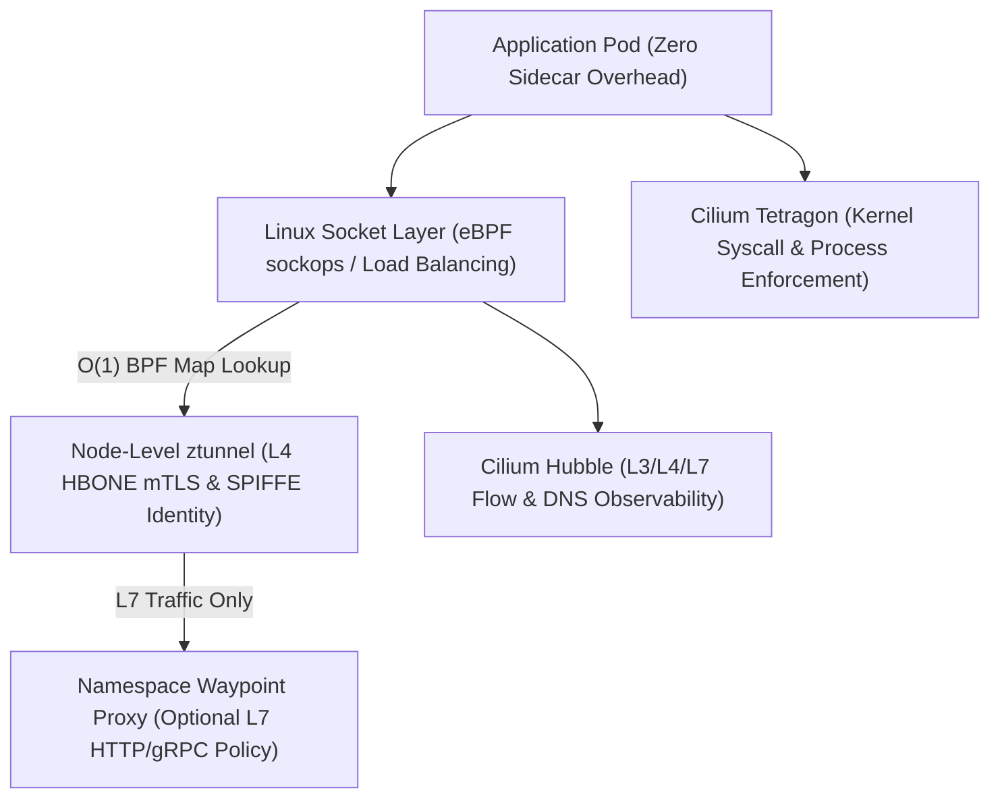

# Chapter 20: eBPF Cloud-Native Networking, Cilium, and Ambient Service Mesh

For the first decade of Kubernetes in production, cloud-native networking and service mesh architectures relied on two foundational Linux mechanisms: **iptables** (Netfilter) for packet routing and network policy enforcement, and **per-pod Envoy sidecar proxies** for mutual TLS (mTLS), Layer 7 traffic management, and distributed telemetry. While these primitives powered the initial wave of container adoption, they hit severe performance, scalability, and operational walls as enterprise clusters grew to thousands of nodes and tens of thousands of ephemeral pods.

Consider what happens inside a traditional `kube-proxy` + iptables Kubernetes cluster running 10,000 Services:

- **O(N) Rule Traversal Latency**: Linux `iptables` was designed twenty-five years ago as a static host firewall, not a high-churn service routing table. Because `iptables` evaluates chains sequentially (`O(N)` complexity), every single network packet traversing a node must step through thousands of rules, inflating tail latency (`p99`) and consuming significant kernel CPU cycles.
- **Slow Control Plane Updates**: Whenever a single pod scales up or terminates, `kube-proxy` must serialize, lock, and rewrite the *entire* multi-megabyte `iptables` ruleset across every node in the cluster, taking seconds or even minutes during burst autoscaling events.
- **IP-Address Fragility in Security Policies**: Traditional Layer 3/Layer 4 firewalls identify workloads by IP address. In Kubernetes, where pod IP addresses churn every few minutes during rolling updates and horizontal autoscaling, IP-based firewall rules become stale almost immediately.
- **The Sidecar Resource and Operational Tax**: First-generation service meshes (such as classic Istio or Linkerd) injected a dedicated proxy container alongside every single application pod. To intercept traffic, an `initContainer` rewrote pod `iptables` rules so every inbound and outbound packet traversed the TCP/IP stack four extra times (`App -> Host TCP -> Envoy Sidecar -> Wire -> Remote Envoy Sidecar -> Remote Host TCP -> Remote App`). Across a 2,000-pod cluster, sidecars routinely consumed 15–30% of total cluster CPU and memory while forcing application teams to restart pods whenever the service mesh proxy required a security patch.

**Extended Berkeley Packet Filter (eBPF)** has fundamentally revolutionized cloud-native networking, observability, and runtime security by moving packet processing, identity enforcement, and system-call inspection directly into **verified, sandboxed, Just-In-Time (JIT) compiled programs running inside the Linux kernel**.



---

## How eBPF Works: Event-Driven Sandboxed Execution in the Linux Kernel

Historically, extending the behavior of the Linux kernel left engineers with two unappealing choices: either lobby upstream kernel maintainers for years to merge a new kernel feature, or maintain out-of-tree **Linux Kernel Modules (LKMs)** that could crash the entire host machine (`Kernel Panic`) if a single pointer dereference went awry.

**eBPF** introduces a safe, programmable execution engine directly inside the Linux kernel—analogous to how JavaScript and WebAssembly made web browsers dynamically programmable without recompiling the browser binary:

1. **Restricted C / Rust Source to eBPF Bytecode**: Engineers write event-driven eBPF programs in restricted C or Rust and compile them via `clang/LLVM` into architecture-independent eBPF bytecode.
2. **In-Kernel Static Verifier**: Before an eBPF program is allowed to attach to any kernel hook, the **Linux Kernel eBPF Verifier** performs exhaustive static analysis across every possible execution path. The verifier mathematically guarantees that the program:
   - Contains no unbounded loops (it must terminate in bounded time),
   - Never dereferences uninitialized or out-of-bounds memory pointers,
   - Never leaks kernel memory or crashes the host kernel, and
   - Stay within strict stack size limits.
3. **JIT Compilation to Native Machine Code**: Once approved by the verifier, the kernel's **Just-In-Time (JIT) compiler** translates the eBPF bytecode into native `x86_64` or `ARM64` machine instructions, achieving execution speed indistinguishable from compiled-in kernel code.
4. **Hook Attachment Points**: eBPF programs execute in response to kernel and user-space events, including:
   - **XDP (eXpress Data Path)**: Attaches directly inside the network interface card (NIC) driver *before* the Linux kernel even allocates a socket buffer (`sk_buff`), enabling line-rate DDoS mitigation and packet forwarding at tens of millions of packets per second.
   - **TC (Traffic Control Ingress/Egress)**: Intercepts packets at the kernel networking layer for container routing, NAT, and network policy enforcement.
   - **Socket Operations (`sockops` / `cgroup/connect4`)**: Intercepts `connect()`, `sendmsg()`, and `recvmsg()` system calls at the socket layer, allowing service-to-service load balancing and local-node socket splicing without traversing the TCP/IP stack below.
   - **Kernel Probes (`kprobes`), Tracepoints, and LSM Hooks**: Attaches to internal kernel functions (`sys_execve`, `tcp_connect`, `security_file_open`) for zero-overhead security enforcement and performance profiling.
5. **BPF Maps for High-Speed State Sharing**: eBPF programs store routing tables, connection tracking state, cryptographic identities, and metrics in **BPF Maps** (hash tables, ring buffers, and per-CPU arrays) that can be read and updated in `O(1)` constant time by both kernel eBPF programs and user-space control plane agents.

---

## Cilium CNI: Replacing `kube-proxy` and IP-Based Firewalls

**Cilium** (a CNCF Graduated project originally created by Isovalent, now part of Cisco) is an eBPF-native Container Network Interface (CNI) that replaces both legacy CNI plugins (such as Flannel or Calico iptables mode) and `kube-proxy` altogether.

### 1. `kube-proxy` Replacement via Socket-Level Load Balancing

When an application container calls `connect(10.96.0.15:80)` to reach a Kubernetes `ClusterIP` Service, Cilium does not let the packet travel down through the virtual Ethernet (`veth`) pair to be rewritten by thousands of `iptables` DNAT rules. Instead:

- Cilium attaches an eBPF program directly to the `connect()` system call at the Linux socket layer.
- It performs a single `O(1)` hash lookup in an eBPF map to translate the `ClusterIP` (`10.96.0.15:80`) directly into the healthy backend Pod IP (`10.244.3.42:8080`) before a single TCP SYN packet is even constructed.
- If the source pod and destination pod reside on the same worker node, Cilium uses `sockmap` to splice the two sockets together directly in kernel memory, completely bypassing the TCP/IP stack and Ethernet bridge.

### 2. Identity-Based Security (`CiliumIdentity`) vs. IP Filtering

Instead of writing fragile firewall rules tied to ephemeral pod IPs, Cilium assigns a cluster-wide cryptographic **Numeric Security Identity** (e.g., `Identity 14829`) to every group of pods sharing identical Kubernetes security labels (`app=checkout, env=prod, tier=backend`).

When Pod A sends a packet to Pod B, Cilium embeds Pod A's numeric security identity directly into the packet metadata (or VXLAN/Geneve encapsulation header). On the receiving node, an eBPF program performs an `O(1)` BPF map lookup (`Can Identity 14829 talk to Identity 29104 on port 8080 with HTTP GET /api/v1/orders?`) at line rate, regardless of whether the cluster has 10 pods or 100,000 pods.

### Authoring Layer 3–Layer 7 `CiliumNetworkPolicy` Manifests

Standard Kubernetes `NetworkPolicy` objects are restricted to Layer 3 and Layer 4 (IP CIDRs, namespaces, and TCP/UDP ports). They cannot express rules such as *"Allow `checkout-service` to call `GET /v1/inventory` on `catalog-service`, but block `DELETE /v1/inventory` and restrict external DNS egress strictly to `*.stripe.com`"*.

Cilium extends Kubernetes with the `CiliumNetworkPolicy` (and cluster-wide `CiliumClusterwideNetworkPolicy`) CRD, bringing **Layer 7 HTTP/gRPC/Kafka visibility** and **FQDN (DNS-aware) egress filtering** into declarative GitOps manifests:

```yaml
# cilium-l7-zero-trust-policy.yaml
apiVersion: "cilium.io/v2"
kind: CiliumNetworkPolicy
metadata:
  name: checkout-zero-trust-l7
  namespace: team-payments
spec:
  endpointSelector:
    matchLabels:
      app: checkout-service
      tier: backend
  ingress:
    - fromEndpoints:
        - matchLabels:
            app: api-gateway
      toPorts:
        - ports:
            - port: "8080"
              protocol: TCP
          rules:
            http:
              - method: "POST"
                path: "/api/v1/checkout"
              - method: "GET"
                path: "/healthz"
  egress:
    - toEndpoints:
        - matchLabels:
            io.kubernetes.pod.namespace: kube-system
            k8s-app: kube-dns
      toPorts:
        - ports:
            - port: "53"
              protocol: ANY
          rules:
            dns:
              - matchPattern: "*.stripe.com"
    - toFQDNs:
        - matchPattern: "api.stripe.com"
      toPorts:
        - ports:
            - port: "443"
              protocol: TCP
```

Look closely at how this `CiliumNetworkPolicy` hardens the workload:

- **L7 HTTP Method and Path Enforcement**: Even if `api-gateway` is compromised, it can only invoke `POST /api/v1/checkout` and `GET /healthz` on port `8080`. Any attempt to call `/admin/debug` or `DELETE` endpoints is rejected with `HTTP 403 Access Denied`.
- **DNS-Aware Egress (`toFQDNs`)**: By intercepting DNS responses in-band via eBPF (`dns.matchPattern: "*.stripe.com"`), Cilium dynamically maps the resolved IP addresses of `api.stripe.com` into the pod's allowed egress BPF map, blocking any data exfiltration to unauthorized external domains.

---

## Deep Network Observability with Cilium Hubble

In traditional Kubernetes clusters, debugging a dropped packet or intermittent `Connection Reset by Peer` error requires running `tcpdump` inside privileged debug containers or waiting minutes for VPC Flow Logs to aggregate in S3.

**Cilium Hubble** is the built-in observability layer that reads flow events directly from Cilium's in-kernel eBPF ring buffers (`perf` / BPF ringbuf) to provide real-time, zero-overhead visibility into every network connection, DNS lookup, HTTP status code, and policy verdict (`FORWARDED` vs. `DROPPED`):

```bash
# Observe dropped packets in team-payments in real time
hubble observe \
  --namespace team-payments \
  --verdict DROPPED \
  --follow

# Inspect Layer 7 HTTP 5xx errors in checkout-service
hubble observe \
  --pod team-payments/checkout-service \
  --protocol http \
  --http-status "5[0-9][0-9]"
```

Additionally, Hubble exports rich Prometheus metrics (`hubble_drop_total`, `hubble_http_requests_total`, `hubble_dns_queries_total`) labeled by Kubernetes workload identity rather than raw IP addresses, and provides an interactive **Hubble UI** service dependency map generated automatically from live kernel traffic.

---

## Kernel Runtime Security Enforcement with Cilium Tetragon

Network policies prevent unauthorized lateral movement between pods, but what happens if an attacker exploits a zero-day Remote Code Execution (RCE) vulnerability inside an allowed HTTP endpoint (`POST /api/v1/checkout`) and spawns `/bin/sh` or attempts to read `/var/run/secrets/kubernetes.io/serviceaccount/token`?

User-space security agents that monitor the Linux Audit subsystem (`auditd`) or asynchronous `ptrace` events suffer from a fatal flaw: **asynchronous TOCTOU (Time-of-Check to Time-of-Use) race conditions**. By the time an out-of-band detector notices that a container spawned `curl` to exfiltrate credentials and asks the Kubernetes API server to delete the pod, the credentials have already left the network.

**Cilium Tetragon** solves this by executing **synchronous in-kernel enforcement** via eBPF `TracingPolicy` CRDs. Because Tetragon attaches directly to Linux Security Module (LSM) hooks and kernel functions, it can inspect process lineage, file descriptors, Linux capabilities, and namespace boundaries *inside the system call context* and issue a `Sigkill` (`SIGKILL`) or `Override` (`-EPERM`) **before the malicious instruction completes**:

```yaml
# tetragon-block-shell-and-token-theft.yaml
apiVersion: cilium.io/v1alpha1
kind: TracingPolicyNamespaced
metadata:
  name: block-container-breakout-and-shells
  namespace: team-payments
spec:
  podSelector:
    matchLabels:
      app: checkout-service
  kprobes:
    - call: "security_bprm_check"
      syscall: false
      args:
        - index: 0
          type: "linux_binprm"
      selectors:
        - matchArgs:
            - index: 0
              operator: "Prefix"
              values:
                - "/bin/sh"
                - "/bin/bash"
                - "/usr/bin/curl"
                - "/usr/bin/nc"
          matchActions:
            - action: Sigkill
```

When `checkout-service` runs normally, Python processes HTTP requests and never invokes `security_bprm_check` for `/bin/sh` or `/usr/bin/curl`. If an exploit payload attempts to spawn a reverse shell, the kernel's `security_bprm_check` hook triggers Tetragon's eBPF program, which immediately terminates the offending process with `SIGKILL` in microseconds and emits a structured JSON security event containing the full process ancestry tree, Kubernetes Pod metadata, and binary SHA-256 digest.

---

## Sidecarless Service Mesh: Istio Ambient Mode and Cilium Mesh

As eBPF proved that Layer 3/Layer 4 networking and observability belong at the node/kernel level, the service mesh community re-architected how Layer 4 mutual TLS and Layer 7 traffic governance are delivered. Instead of injecting an Envoy sidecar container into every single pod, **Sidecarless Service Mesh** architectures—led by **Istio Ambient Mode** and **Cilium Service Mesh**—split the data plane into two distinct, decoupled layers:

### 1. The Secure Overlay Layer (L4 `ztunnel` DaemonSet)

In Istio Ambient Mode, every Kubernetes worker node runs a lightweight, shared, purpose-built Rust proxy called **ztunnel** (Zero-Trust Tunnel) as a node-level `DaemonSet`:

- **Zero Sidecar Injection**: Application pods run unmodified with a single container. Adding a namespace to the ambient mesh requires only a single label (`kubectl label namespace team-payments istio.io/dataplane-mode=ambient`) with **zero pod restarts**.
- **SPIFFE Cryptographic Identity & mTLS**: `ztunnel` automatically provisions X.509 workload certificates using the **SPIFFE** (Secure Production Identity Framework for Everyone) standard (`spiffe://cluster.local/ns/team-payments/sa/checkout-sa`) and encapsulates all inter-node traffic inside an HTTP CONNECT-based mTLS tunnel called **HBONE** (HTTP-Based Overlay Network Environment) on port `15008`.
- **90% Reduction in Mesh Memory Footprint**: Because a single Rust `ztunnel` instance handles L4 mTLS multiplexing and L4 `AuthorizationPolicy` enforcement for all pods on a node, organizations achieve full cluster-wide encryption-in-transit and cryptographic workload identity at a fraction of the CPU and RAM cost of per-pod Envoy sidecars.

### 2. The Layer 7 Processing Layer (On-Demand Waypoint Proxies)

Most microservices inside a cluster need mTLS encryption and L4 authorization, but only a subset require rich Layer 7 features such as HTTP header-based canary traffic splitting, gRPC retry budgets, fault injection, or OpenTelemetry L7 span generation.

In Ambient Mode, when a namespace or service needs Layer 7 governance, the platform deploys a **Waypoint Proxy**—an Envoy-based deployment scoped solely to that specific namespace or service account and managed via the standard **Kubernetes Gateway API**:

```yaml
# gateway-api-canary-httproute.yaml
apiVersion: gateway.networking.k8s.io/v1
kind: Gateway
metadata:
  name: payments-waypoint
  namespace: team-payments
  annotations:
    istio.io/for-service-account: checkout-sa
spec:
  gatewayClassName: istio-waypoint
  listeners:
    - name: mesh
      port: 15008
      protocol: HBONE
---
apiVersion: gateway.networking.k8s.io/v1
kind: HTTPRoute
metadata:
  name: checkout-canary-split
  namespace: team-payments
spec:
  parentRefs:
    - group: ""
      kind: Service
      name: checkout-service
      port: 8080
  rules:
    - matches:
        - headers:
            - name: x-canary-cohort
              value: "internal-beta"
      backendRefs:
        - name: checkout-service-v2
          port: 8080
    - backendRefs:
        - name: checkout-service-v1
          port: 8080
          weight: 90
        - name: checkout-service-v2
          port: 8080
          weight: 10
```

Notice the architectural elegance of combining **Kubernetes Gateway API** (`Gateway` and `HTTPRoute`) with **Ambient Mode**:

- **No Custom Vendor CRDs for Routing**: Unlike legacy `VirtualService` and `DestinationRule` manifests that locked routing configurations into a single vendor, `Gateway` and `HTTPRoute` are official, portable Kubernetes SIG-Network APIs supported uniformly across Cilium, Istio, Envoy Gateway, and cloud load balancers.
- **Blast-Radius Isolation**: Upgrading Envoy or tuning L7 filters affects only the isolated Waypoint deployment, never requiring a rolling restart of stateful or latency-sensitive application pods.

---

## Automating Zero-Trust Network Policy & Mesh Audits in Python

As clusters grow to hundreds of microservices, platform security engineers must continuously verify that no production namespace is accidentally left without a default-deny `CiliumNetworkPolicy` or excluded from `ambient` mTLS enrollment. Even a single unguarded namespace can serve as a lateral-movement staging ground if an external-facing pod is compromised.

The following Python verification script (`snippets/ch20_cilium_policy_validator.py`) inspects namespace labels and `CiliumNetworkPolicy` specifications to detect overly permissive wildcard rules (`0.0.0.0/0` egress without DNS FQDN restrictions) and missing sidecarless mesh enrollment:

```python
# ch20_cilium_policy_validator.py
import json
from dataclasses import dataclass
from typing import List


@dataclass
class NamespaceMeshAudit:
    namespace: str
    ambient_enabled: bool
    has_l7_cilium_policy: bool
    allows_wildcard_egress: bool
    tetragon_enforced: bool


def audit_zero_trust_posture(
    namespaces: List[NamespaceMeshAudit],
) -> dict:
    findings = []
    passed = 0
    for ns in namespaces:
        issues = []
        if not ns.ambient_enabled:
            issues.append(
                "Missing istio.io/dataplane-mode"
                "=ambient"
            )
        if not ns.has_l7_cilium_policy:
            issues.append(
                "Missing L7 CiliumNetworkPolicy"
            )
        if ns.allows_wildcard_egress:
            issues.append(
                "Unrestricted 0.0.0.0/0 egress allowed"
            )
        if not ns.tetragon_enforced:
            issues.append(
                "Missing Tetragon TracingPolicy"
            )
        if issues:
            findings.append(
                {
                    "namespace": ns.namespace,
                    "violations": issues,
                }
            )
        else:
            passed += 1
    return {
        "audited_namespaces": len(namespaces),
        "compliant_namespaces": passed,
        "non_compliant_findings": findings,
    }


if __name__ == "__main__":
    sample = [
        NamespaceMeshAudit(
            "team-payments", True, True, False, True
        ),
        NamespaceMeshAudit(
            "legacy-reporting",
            False,
            False,
            True,
            False,
        ),
    ]
    print(
        json.dumps(
            audit_zero_trust_posture(sample), indent=2
        )
    )
```

---

## Production Architecture Trade-Offs: SME vs. Enterprise eBPF Topologies

Choosing the right combination of Cilium, Hubble, Tetragon, and Ambient Service Mesh depends on your cluster scale, compliance requirements, and multi-cloud topology:

- **Lightweight SME Topology (2–50 Engineers, Single-Cluster EKS/GKE)**:
  - **Recommended Data Plane**: Managed Cilium CNI (such as GKE Dataplane V2 or AWS EKS with Cilium CNI) in `kube-proxy` replacement mode.
  - **East-West Encryption**: Enable Cilium's built-in **WireGuard transparent encryption** (`encryption.enabled=true, encryption.type=wireguard`). Because WireGuard runs directly inside the Linux kernel network stack and encrypts all node-to-node pod traffic automatically, lean SME teams get transparent encryption-in-transit without managing a full service mesh control plane.
  - **Observability & Runtime Security**: Enable Hubble Relay + Hubble UI for on-demand flow debugging and deploy a baseline cluster-wide Tetragon `TracingPolicy` blocking container namespace escapes and shell execution in internet-facing pods.
- **High-Assurance Regulated Enterprise Topology (Multi-Cluster / PCI-DSS / Zero-Trust)**:
  - **Recommended Data Plane**: Cilium CNI paired with **Cilium ClusterMesh** (or **Istio Ambient Mode** with `ztunnel` + Waypoint proxies) to enforce cryptographic **SPIFFE/SPIRE X.509 workload identity** at the per-ServiceAccount level across clusters and cloud regions.
  - **Granular L7 & DNS Policy Governance**: Enforce strict `CiliumNetworkPolicy` rules restricting east-west HTTP methods/paths (`rules.http`) and outbound FQDN resolution (`toFQDNs`), validated in CI/CD before Argo CD syncs changes.
  - **High-Volume Flow Archival**: Stream Hubble flow logs and Tetragon kernel security events via OpenTelemetry Collector into a SIEM or hot-warm-cold object storage tier for 365-day forensic auditability.

---

## Hands-On Synthesis Exercises

1. **Eliminating `kube-proxy` Bottlenecks (Analyze)**: A production Kubernetes cluster running 8,500 `ClusterIP` Services experiences 45-second delays between when a new pod passes its `readinessProbe` and when traffic actually reaches it, accompanied by high kernel `softirq` CPU usage on worker nodes. Explain the root cause in `iptables` sequential chain evaluation and detail how Cilium's eBPF `sockops` socket-level load balancing resolves both symptoms.
2. **Designing a Zero-Trust `CiliumNetworkPolicy` (Apply)**: Write a `CiliumNetworkPolicy` for an `order-processor` workload in namespace `commerce` that permits `POST /v2/orders` only from pods labeled `app=checkout-gateway`, denies all other HTTP methods and paths, and restricts external egress strictly to `api.sendgrid.com` on TCP port `443`.
3. **Synchronous vs. Asynchronous Runtime Defense (Evaluate)**: Compare an out-of-band container runtime security scanner polling Linux `auditd` logs every 3 seconds against a Cilium Tetragon `TracingPolicy` attached to `security_bprm_check` with `action: Sigkill`. Which architecture prevents single-packet credential exfiltration, and why?

---

## Operational Checklist: eBPF Networking & Ambient Mesh Hardening

Before promoting an eBPF CNI and sidecarless service mesh architecture to production, validate your cluster against the following engineering checklist:

- [ ] **Kernel & CNI Baseline**: Worker nodes run Linux Kernel `5.15+` (or `6.1+` LTS) with BPF Type Format (`BTF`) enabled and Cilium configured in `kubeProxyReplacement=true` mode for `O(1)` socket-level service load balancing.
- [ ] **Default-Deny Identity Network Policies**: Every production namespace enforces a baseline `CiliumNetworkPolicy` restricting ingress and egress strictly to explicitly authorized workload labels and DNS FQDNs (`toFQDNs`).
- [ ] **Real-Time Hubble Flow Telemetry**: Cilium Hubble is enabled with Prometheus metrics export (`hubble_drop_total`, `hubble_http_requests_total`) to alert on unexpected policy drops and anomalous DNS queries.
- [ ] **Synchronous Kernel Runtime Enforcement**: Cilium Tetragon `TracingPolicyNamespaced` policies guard high-value namespaces against unexpected shell execution (`/bin/sh`, `/bin/bash`), container namespace escape syscalls (`sys_unshare`, `sys_mount`), and service account token exfiltration.
- [ ] **Sidecarless Zero-Trust mTLS**: Namespaces are enrolled in Istio Ambient Mode (`istio.io/dataplane-mode=ambient`) or Cilium mutual authentication so 100% of east-west pod traffic is encrypted with SPIFFE workload identities via `ztunnel` without sidecar memory bloat.
- [ ] **Standardized Gateway API Routing**: North-south ingress and east-west L7 canary traffic splits use standard `gateway.networking.k8s.io/v1` (`Gateway` and `HTTPRoute`) manifests rather than deprecated `Ingress` annotations.
