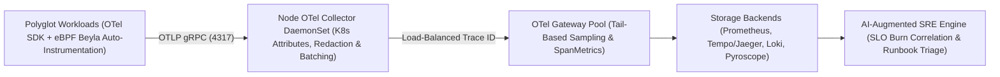

# Chapter 21: OpenTelemetry Collector Pipelines, Continuous Profiling, and AI-Augmented SRE

In Chapters 8 and 13, we explored the foundational pillars of observability—metrics with Prometheus and Grafana, distributed tracing with Jaeger, and centralized logging with the ELK stack—alongside enterprise APM platforms. Yet as organizations scaled microservices across polyglot Kubernetes fleets, an acute operational problem emerged: **telemetry lock-in and signal fragmentation**.

Historically, collecting metrics, distributed traces, logs, and CPU profiles required installing three or four competing agents inside every container image and worker node: a Prometheus client library for metrics, a vendor-specific APM SDK for distributed traces, Fluent Bit or Logstash for logs, and a separate profiler agent for flame graphs. Worse still, because each signal was emitted by a different library with inconsistent metadata labels (`service_name` in traces vs. `app` in Prometheus vs. `k8s.pod.name` in logs), on-call Site Reliability Engineers (SREs) wasted precious incident triage minutes manually copying timestamps and guessing which log lines corresponded to a spiking latency trace.

Today, two transformative movements have redefined cloud-native observability and incident response:

1. **OpenTelemetry (OTel) and the Four Unified Signals**: Born from the merger of OpenTracing and OpenCensus and now the second highest-velocity project in the Cloud Native Computing Foundation (CNCF) after Kubernetes itself, **OpenTelemetry** provides a single, vendor-neutral standard for generating, correlating, transforming, and routing **Traces, Metrics, Logs, and Continuous Profiles** over the unified **OpenTelemetry Protocol (OTLP)**.
2. **AI-Augmented Site Reliability Engineering (AIOps & Agentic SRE)**: Armed with semantically correlated OTel telemetry streams, modern SRE teams pair deterministic **Service Level Objective (SLO) multi-window burn-rate alerts** with AI-augmented root-cause correlation engines that automatically join anomalous trace spans, Kubernetes change events, and continuous eBPF flame graphs to synthesize actionable incident hypotheses in seconds.



---

## The OpenTelemetry Reference Architecture: Correlating Traces, Metrics, Logs, and Profiles

The true power of OpenTelemetry lies not merely in replacing proprietary SDKs, but in enforcing **universal context propagation and semantic resource attribution** across every telemetry signal:

- **W3C `traceparent` Context Propagation**: Every inbound and outbound request carries a standardized W3C Trace Context header (`traceparent: 00-4bf92f3577b34da6a3ce929d0e0e4736-00f067aa0ba902b7-01`), binding distributed spans across HTTP, gRPC, Kafka, and SQS boundaries into a single causal Directed Acyclic Graph (DAG) identified by `trace_id` and `span_id`.
- **Log-to-Trace Correlation**: When an application logs an exception or warning while processing a request, the OpenTelemetry Logging Bridge automatically injects the active `trace_id`, `span_id`, and `trace_flags` into the structured JSON log record. In Grafana or any OTel-compatible UI, an engineer viewing a failed trace span can click directly into the exact log lines emitted during that specific millisecond on that specific pod.
- **Exemplars for Metric-to-Trace Jumping**: Traditional Prometheus histograms (`http_server_duration_seconds_bucket`) tell you *that* the 99th percentile latency spiked to 2.8 seconds, but not *which* customer request caused it. OpenTelemetry attaches **Exemplars**—sampled `trace_id` pointers embedded directly inside histogram bucket data points—allowing engineers to click a spike on a latency graph and jump straight to the exemplar distributed trace.
- **OpenTelemetry Semantic Conventions (`semconv`)**: OTel mandates standardized attribute names across all languages and runtimes (`service.name`, `service.version`, `deployment.environment`, `k8s.namespace.name`, `k8s.pod.name`, `http.request.method`, `db.system`, and `gen_ai.*` for AI workloads), ensuring dashboards and correlation queries work identically across Python, Go, Java, Rust, and Node.js services.

---

## Zero-Code Auto-Instrumentation with eBPF (Grafana Beyla & OTel eBPF)

One of the biggest practical hurdles in brownfield DevOps environments is instrumenting legacy or compiled services (such as C++, Go, or third-party binaries) where modifying source code to initialize an OpenTelemetry SDK and pass `context.Context` through every function signature would take months of refactoring.

By combining **eBPF uprobes and kprobes** with OpenTelemetry, tools such as **Grafana Beyla** (and the **OpenTelemetry eBPF Instrumentation** project) deliver **zero-code auto-instrumentation**:

- **Inspecting Runtime TLS and HTTP/gRPC Framing in Kernel/User-Space**: eBPF uprobes attach directly to `libssl.so` (`SSL_read` / `SSL_write`), Go `crypto/tls`, and kernel TCP socket calls, capturing cleartext HTTP/1.1, HTTP/2, gRPC, SQL, and Redis requests *before* encryption or *after* decryption without modifying a single line of application code or configuring MITM certificates.
- **Automatic RED Metrics and Distributed Spans**: Beyla automatically emits OpenTelemetry **RED metrics** (**R**ate, **E**rrors, **D**uration) and distributed trace spans over OTLP directly to the local OpenTelemetry Collector.

---

## Mastering the OpenTelemetry Collector Pipeline

In production Kubernetes clusters, applications should **never** send telemetry directly to external SaaS backends or storage databases. Instead, all telemetry flows through the **OpenTelemetry Collector**—a high-performance Go binary deployed in a two-tier topology:

1. **Tier 1: Node-Local Agent (`DaemonSet`)**: Runs on every worker node, receiving OTLP traffic over localhost/hostPort (`4317` gRPC / `4318` HTTP), enriching records with local Kubernetes pod metadata (`k8sattributes` processor), scrubbing sensitive PII (`transform` / `redaction` processor), protecting node memory (`memory_limiter`), and batching payloads.
2. **Tier 2: Centralized Collector Gateway (`Deployment`)**: A horizontally scaled pool of stateless collectors that receives trace spans routed deterministically by `trace_id` (via the `loadbalancing` exporter) to perform **Tail-Based Sampling** and **Span-to-Metrics (`spanmetrics`)** aggregation before exporting to permanent storage.

### Production-Hardened OpenTelemetry Collector Configuration

Below is a complete, production-ready OpenTelemetry Collector configuration demonstrating memory protection, Kubernetes metadata enrichment, PII attribute redaction, tail-based sampling, and multi-backend OTLP export:

```yaml
# otel-collector-gateway-config.yaml
receivers:
  otlp:
    protocols:
      grpc:
        endpoint: 0.0.0.0:4317
      http:
        endpoint: 0.0.0.0:4318

processors:
  memory_limiter:
    check_interval: 1s
    limit_percentage: 80
    spike_limit_percentage: 15

  k8sattributes:
    auth_type: "serviceAccount"
    extract:
      metadata:
        - k8s.namespace.name
        - k8s.deployment.name
        - k8s.pod.name
        - k8s.node.name

  attributes/redact_pii:
    actions:
      - key: http.request.header.authorization
        action: delete
      - key: db.statement
        action: hash

  tail_sampling:
    decision_wait: 10s
    num_traces: 50000
    expected_new_traces_per_sec: 1000
    policies:
      - name: keep-all-errors
        type: status_code
        status_code:
          status_codes: [ERROR]
      - name: keep-high-latency-p99
        type: latency
        latency:
          threshold_ms: 850
      - name: baseline-probabilistic-sample
        type: probabilistic
        probabilistic:
          sampling_percentage: 5.0

  batch:
    send_batch_size: 2048
    timeout: 2s

exporters:
  otlp/tempo:
    endpoint: tempo-distributor.observability:4317
    tls:
      insecure: false
  prometheusremotewrite:
    endpoint: http://mimir.obs:9009/api/v1/push

service:
  pipelines:
    traces:
      receivers: [otlp]
      processors:
        - memory_limiter
        - k8sattributes
        - attributes/redact_pii
        - tail_sampling
        - batch
      exporters: [otlp/tempo]
    metrics:
      receivers: [otlp]
      processors:
        - memory_limiter
        - k8sattributes
        - batch
      exporters: [prometheusremotewrite]
```

### Why Tail-Based Sampling Changes the Economics of Tracing

In **Head-Based Sampling**, the sampling decision is made at the very first ingress span before the request executes (for example, *"sample 1% of all incoming HTTP requests"*). If a catastrophic payment bug occurs on 0.05% of checkout requests, a 1% head-based sampler throws away **99% of your failure traces**, leaving engineers blind during postmortem investigations.

With **Tail-Based Sampling** in the OpenTelemetry Collector (`tail_sampling` processor above):

- The collector buffers spans belonging to a `trace_id` for a brief window (`decision_wait: 10s`).
- Once all spans in the trace arrive, the collector inspects the complete execution outcome:
  - Did **any** downstream microservice mark a span with `status_code: ERROR`? **Keep 100% of those traces.**
  - Did the end-to-end request duration exceed `850ms` (`keep-high-latency-p99`)? **Keep 100% of those slow traces.**
  - Was the request a fast, healthy `HTTP 200`? **Sample 5% (`baseline-probabilistic-sample`)** for baseline comparison while discarding 95% of repetitive healthy noise.
- Furthermore, by enabling the **SpanMetrics Connector** *before* the `tail_sampling` processor in the collector pipeline, you compute 100% accurate RED metrics (`calls_total`, `duration_milliseconds_bucket`) across **every single span**, then pay storage costs only for the high-value tail-sampled traces.

---

## The Fourth Pillar: Continuous Profiling with eBPF (Pyroscope & Parca)

Metrics tell you *when* CPU or memory spiked, traces tell you *which service endpoint* was slow, and logs tell you *what error message* was printed—but none of those three signals tell you **which exact line of code, regex evaluation, garbage-collection pause, or mutex lock contention** burned 90% of CPU cycles inside a specific container.

**Continuous Profiling** (standardized as OpenTelemetry's fourth signal alongside **Grafana Pyroscope** and **Parca**) uses Linux kernel `perf_event_open` eBPF stack-walking probes to sample call stacks across the entire Kubernetes node at 19Hz to 99Hz with **less than 1% CPU overhead**:

- **Always-On Production Flame Graphs**: Instead of trying to attach `py-spy` or `pprof` manually while a pod is crashing in production, continuous eBPF profiling records stack samples 24/7.
- **Span-Linked Profiles**: By linking OpenTelemetry `span_id` context into eBPF thread-local storage labels, engineers can highlight a slow 900ms database serialization span in Jaeger/Tempo and view the exact CPU flame graph executed during that single span.
- **FinOps Cost Reduction**: Continuous profiling routinely uncovers inefficient JSON serialization loops, unbuffered I/O calls, or cryptographic key re-initializations that account for 20–40% of total Kubernetes cluster CPU spend.

---

## SLO Multi-Window Burn-Rate Alerting vs. Naive Threshold Alerts

Before introducing AI into incident response, SRE teams must eliminate noisy, symptom-less threshold alerts (such as *"Page the on-call engineer whenever Pod CPU > 75% for 5 minutes"*). High CPU utilization on a batch worker is normal if user requests are succeeding within latency targets; conversely, a deadlock can cause 100% of checkout requests to time out while Pod CPU sits at 2%.

Modern SRE teams alert strictly on **Service Level Objective (SLO) Error Budget Burn Rate**:

- **Service Level Indicator (SLI)**: The quantitative ratio of good events to total valid events (for example, the proportion of `POST /api/v1/checkout` requests returning non-5xx responses in `< 400ms`).
- **Service Level Objective (SLO)**: The target reliability threshold over a rolling window (for example, `99.9%` over 28 days, leaving an **Error Budget** of `0.1%`, or `40.32 minutes` of permitted 100%-outage equivalent per 28 days).
- **Burn Rate**: How fast the service is consuming its 28-day error budget relative to a sustainable rate of `1.0x`. At a `14.4x` burn rate, the entire 28-day error budget will be exhausted in **48 hours** (`28 days / 14.4`).
- **Multi-Window, Multi-Burn-Rate Alerting**: Pioneered in the Google SRE Workbook, a page-worthy alert fires only when **both** a long window (e.g., 1 hour) **and** a short confirmation window (e.g., 5 minutes) exceed the critical burn-rate threshold (`14.4x`). The 5-minute window ensures the alert resets rapidly once the incident is mitigated, preventing false-positive pager fatigue after recovery.

---

## AI-Augmented SRE (AIOps): Automated Correlation and Triage

When a multi-window SLO burn-rate alert fires in a complex microservices mesh, dozens of downstream symptoms appear simultaneously: connection pools saturate, retry queues back up, and latency spikes across five upstream services.

**AI-Augmented SRE** uses structured OpenTelemetry graphs, deterministic anomaly scoring, and bounded Large Language Model (LLM) reasoning to compress **Mean Time to Detect (MTTD)** and **Mean Time to Resolve (MTTR)**:

1. **Automated Change-to-Telemetry Correlation**: Over 75% of production incidents are triggered by a recent deployment, feature-flag toggle, or infrastructure configuration change. When an SLO burn-rate spike is detected, the AI-SRE correlation pipeline automatically queries the OpenTelemetry `service.version` resource attributes, Argo CD sync history, and Kubernetes Event stream within a `[-30m, +5m]` window around the anomaly onset.
2. **Causal Trace Topology Traversal**: Rather than feeding raw gigabytes of logs into a prompt, a deterministic Python pre-processor walks the OpenTelemetry trace DAG from the ingress symptom down to the **deepest leaf span** exhibiting an elevated error rate or latency z-score.
3. **Human-in-the-Loop Safe Remediation**: While read-only diagnostic commands (`kubectl describe`, Hubble flow queries, Tempo trace lookups, git diff inspection) run autonomously to assemble an **Incident Triage Brief**, state-mutating remediations (`argocd app rollback`, traffic draining, pod scaling) require explicit one-click approval or deterministic policy verification.

### Implementing an SLO Burn-Rate & Root-Cause Correlator in Python

The following self-contained Python verification script (`snippets/ch21_slo_burn_correlator.py`) computes multi-window SLO burn rates and correlates error spikes against OpenTelemetry service deployments to pinpoint the root-cause release:

```python
# ch21_slo_burn_correlator.py
import json
from dataclasses import dataclass
from typing import List


@dataclass
class SpanWindowTelemetry:
    service: str
    version: str
    total_requests: int
    error_requests: int
    p99_ms: float
    deployed_minutes_ago: int


def analyze_slo_burn(
    windows: List[SpanWindowTelemetry],
    slo_target: float = 0.999,
) -> dict:
    error_budget = 1.0 - slo_target
    suspects = []
    for w in windows:
        err_rate = w.error_requests / max(
            w.total_requests, 1
        )
        burn_rate = round(err_rate / error_budget, 2)
        if burn_rate >= 14.4:
            score = burn_rate * (
                2.0
                if w.deployed_minutes_ago <= 30
                else 1.0
            )
            suspects.append(
                {
                    "service": w.service,
                    "version": w.version,
                    "burn_rate": burn_rate,
                    "p99_ms": w.p99_ms,
                    "recent_deploy": (
                        w.deployed_minutes_ago <= 30
                    ),
                    "rca_priority_score": round(
                        score, 2
                    ),
                }
            )
    suspects.sort(
        key=lambda x: x["rca_priority_score"],
        reverse=True,
    )
    return {
        "slo_target": slo_target,
        "page_oncall": len(suspects) > 0,
        "ranked_root_cause_candidates": suspects,
    }


if __name__ == "__main__":
    telemetry = [
        SpanWindowTelemetry(
            "api-gateway",
            "v1.4.0",
            10000,
            180,
            920.0,
            420,
        ),
        SpanWindowTelemetry(
            "payment-authorizer",
            "v2.8.1-rc3",
            2500,
            175,
            890.0,
            12,
        ),
    ]
    res = analyze_slo_burn(telemetry)
    print(json.dumps(res, indent=2))
```

Notice how `analyze_slo_burn` avoids attributing blame to `api-gateway` (which merely reflects downstream errors) and ranks `payment-authorizer` (`v2.8.1-rc3`, deployed 12 minutes ago with a `70.0x` error budget burn rate) as the primary root-cause candidate!

---

## Instrumented Python Microservice Example with OpenTelemetry SDK

While eBPF auto-instrumentation (Grafana Beyla) provides an immediate baseline for HTTP and gRPC transport spans, business-critical microservices should enrich active spans with **domain-specific attributes and span events** (such as `payment.currency`, `cart.item_count`, or `cache.hit`, while strictly excluding PII) so AI-SRE correlation engines can isolate tenant-specific or cohort-specific failures.

Below is a clean, self-contained Python OpenTelemetry instrumentation pattern demonstrating how to attach domain attributes and record structured exceptions on the current active span:

```python
# ch21_otel_domain_span_enrichment.py
import time
from dataclasses import dataclass
from typing import Dict


@dataclass
class SpanRecord:
    trace_id: str
    span_name: str
    attributes: Dict[str, object]
    status: str = "OK"
    duration_ms: float = 0.0


def process_checkout_with_telemetry(
    order_id: str,
    region: str,
    amount_cents: int,
) -> SpanRecord:
    start = time.monotonic()
    span = SpanRecord(
        trace_id="4bf92f3577b34da6a3ce929d0e0e4736",
        span_name="POST /api/v1/checkout",
        attributes={
            "service.name": "checkout-service",
            "deployment.environment": "production",
            "order.region": region,
            "order.amount_cents": amount_cents,
        },
    )
    try:
        if amount_cents <= 0:
            raise ValueError("Invalid order amount")
        span.attributes["payment.authorized"] = True
    except Exception as exc:
        span.status = "ERROR"
        span.attributes["exception.type"] = (
            type(exc).__name__
        )
        span.attributes["exception.message"] = str(exc)
    finally:
        span.duration_ms = round(
            (time.monotonic() - start) * 1000.0, 3
        )
    return span


if __name__ == "__main__":
    rec = process_checkout_with_telemetry(
        "ord-901", "eu-west-1", 4500
    )
    print(f"Span={rec.span_name} status={rec.status}")
```

---

## Controlling Observability FinOps: Cardinality & Telemetry Governance

One of the most expensive hidden failure modes in modern cloud-native operations is **metric cardinality explosion**. Unlike distributed trace spans and structured logs—which are indexed in columnar or object-storage backends designed for high-cardinality fields like `order_id` or `trace_id`—time-series metric databases (such as Prometheus, VictoriaMetrics, Amazon Managed Service for Prometheus, and Datadog Metrics) allocate a distinct time-series index in memory for **every unique combination of label key-value pairs**.

Consider what happens if a developer inadvertently adds `user_id` or `request_uuid` as a label on a Prometheus histogram with 12 latency buckets:

- Across `500,000` active daily users and `20` pods, a single metric generates `500,000 * 12 = 6,000,000` active time series, instantly exhausting Prometheus memory (`OOMKilled`) and inflating SaaS observability bills by tens of thousands of dollars per month.

To prevent cardinality explosions while preserving deep debuggability, enforce three architectural rules in your OpenTelemetry Collector pipeline:

1. **Keep High-Cardinality Identifiers in Traces and Logs, Never Metric Labels**: Store `user_id`, `tenant_id`, `order_id`, and `trace_id` as **OpenTelemetry Span Attributes** and **Metric Exemplars**, while restricting Prometheus metric labels strictly to bounded sets (`service.name`, `http.route`, `http.response.status_code`, `k8s.namespace.name`).
2. **Use `http.route` Templates Instead of Raw URL Paths**: Never label metrics with raw unparameterized URL paths (`/api/v1/orders/98412/invoice`), which create an unbounded number of time series. Always normalize routes to their low-cardinality template (`/api/v1/orders/{order_id}/invoice`) using the OTel HTTP instrumentation or the Collector's `transform` processor.
3. **Drop Unused Metrics & High-Volume Health-Check Spans at the Node Agent**: Use the OpenTelemetry Collector `filter` processor on the node `DaemonSet` to drop noisy `/healthz` and `/readyz` readiness probe spans before they ever consume network bandwidth or Gateway memory:

```yaml
# Drop synthetic kubelet healthcheck spans at the edge
processors:
  filter/drop_healthchecks:
    error_mode: ignore
    traces:
      span:
        - 'attributes["url.path"] == "/healthz"'
        - 'attributes["url.path"] == "/readyz"'
        - 'attributes["http.target"] == "/metrics"'
```

---

## Production Architecture Trade-Offs: SME vs. Enterprise Observability

- **Lightweight SME Observability Stack (Lean Cost, High Velocity)**:
  - **Collection**: Node-level OpenTelemetry Collector DaemonSet + Grafana Beyla eBPF auto-instrumentation for zero-code baseline spans and RED metrics.
  - **Storage & Visualization**: **Grafana LGTM Stack** (Loki for logs, Grafana for dashboards/SLO alerts, Tempo for object-storage-backed traces, Mimir/Prometheus for metrics, and Pyroscope for continuous profiles) running on object storage (Amazon S3 / GCS) with minimal local SSD state.
- **High-Scale Enterprise Observability Stack (Multi-Region, Petabyte Scale)**:
  - **Collection**: Two-tier OpenTelemetry Collector architecture (Node DaemonSets + Autoscaled Trace-ID-routed Gateway Pool) with `tail_sampling`, `spanmetrics` connector, and deterministic PII hashing.
  - **AI-Augmented SRE Integration**: Automated event-driven webhook from Alertmanager / PagerDuty into an read-only AI-SRE diagnostic service that correlates OTel `SpanMetrics`, Tempo error traces, Pyroscope CPU flame-graph diffs, and Argo CD commit diffs into the incident Slack channel within 15 seconds of alert firing.

---

## Hands-On Synthesis Exercises

1. **Head vs. Tail Sampling Economics (Evaluate)**: Your e-commerce platform processes 5,000 requests per second (`432,000,000` requests/day) with a `99.95%` success rate. Explain why a 1% head-based sampler fails to capture rare payment regressions, and calculate the daily trace storage reduction achieved by a tail-based sampling policy that keeps `100%` of errors, `100%` of requests slower than `1,000ms` (`0.2%` of traffic), and `2%` of normal healthy traffic.
2. **Defending Against Metric Cardinality Explosion (Analyze)**: An engineer proposes adding `customer_email` and `session_id` as labels on the `http_server_request_duration_seconds` Prometheus histogram so on-call engineers can see which customer experienced a slow request. Critique this proposal and explain how **OpenTelemetry Exemplars** achieve the exact same debugging goal with zero metric cardinality growth.
3. **Designing a Multi-Window SLO Alert (Apply)**: Calculate the 28-day error budget in minutes for a Tier-1 service with a `99.95%` availability SLO, and explain why combining a 1-hour burn-rate window with a 5-minute confirmation window (`14.4x` burn rate) prevents late-reset pager noise after an incident is resolved.

---

## Operational Checklist: OpenTelemetry & AI-Augmented SRE

Verify your observability pipeline and SRE alerting architecture against the following production checklist:

- [ ] **Unified OTLP Telemetry Standard**: All microservices emit traces, metrics, and structured logs using OpenTelemetry SDKs or eBPF auto-instrumentation (Beyla) with consistent `service.name`, `service.version`, and `deployment.environment` resource attributes.
- [ ] **Two-Tier Collector Architecture**: Node-local OTel Collector DaemonSets enforce `memory_limiter`, `k8sattributes` enrichment, and PII header redaction before forwarding to a trace-ID load-balanced Gateway tier.
- [ ] **Tail-Based Sampling + SpanMetrics**: The Collector Gateway computes 100% accurate RED metrics via `spanmetrics` and retains 100% of error traces and high-latency (`p99`) traces via `tail_sampling` while capping baseline storage costs.
- [ ] **Continuous eBPF Profiling**: Worker nodes run continuous eBPF stack profilers (Pyroscope / Parca) linked to OpenTelemetry span IDs with `< 1%` CPU overhead.
- [ ] **Multi-Window SLO Burn-Rate Alerting**: Pager notifications trigger only on confirmed multi-window error budget burn rates (`14.4x` over 1h/5m for critical pages), with automated root-cause correlation joining OTel traces against recent Argo CD / GitOps deployment events.
