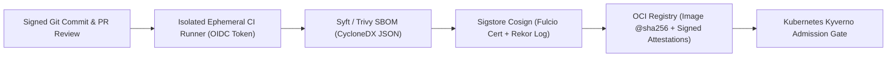

# Chapter 22: Software Supply Chain Security with SLSA, Sigstore Cosign, and SBOM Attestations

In Chapters 4, 5, and 9, we established the foundations of Continuous Integration, Artifact Repositories, and DevSecOps pipeline scanning. However, a series of watershed software supply chain compromises—most notably **SolarWinds Orion** (where attackers injected malicious code directly inside a compromised build server after source code review), **Codecov** (where CI environment credentials were exfiltrated via a modified bash uploader), **Log4Shell (`CVE-2021-44228`)** (where deeply nested transitive dependencies hid vulnerable JNDI lookup code across thousands of enterprise containers), and the **XZ Utils (`CVE-2024-3094`)** backdoor—demonstrated that scanning source code in Git is no longer sufficient.

Modern cloud-native software is assembled from a complex global supply chain: a single Python or Go microservice container image typically pulls in 80 to 300 open-source packages, base OS layers, GitHub Actions workflow steps, and compiler toolchains. If an adversary compromises any link between the developer's `git commit` and the Kubernetes `kubelet` pulling the OCI container image—by poisoning a dependency, tampering with an ephemeral CI runner, or overwriting a mutable `:latest` image tag in Amazon ECR—traditional SAST and firewall controls will not stop the malicious workload from executing in production.

To defend against modern software supply chain attacks, cloud-native organizations enforce four cryptographic, verifiable controls across the artifact lifecycle:

1. **SLSA (Supply-chain Levels for Software Artifacts)**: The OpenSSF framework (originally derived from Google's internal Binary Authorization for Borg) that defines verifiable maturity levels (`SLSA Build L1` through `L3`) for build integrity and non-falsifiable in-toto provenance attestations.
2. **Keyless Cryptographic Signing with Sigstore (`Cosign`, `Fulcio`, and `Rekor`)**: Eliminating long-lived PGP/RSA private keys stored in CI secrets by binding ephemeral signing certificates to short-lived **OpenID Connect (OIDC)** workload identities and recording every signature in an immutable transparency log.
3. **Automated Software Bills of Materials (`SBOMs`) with CycloneDX and SPDX**: Generating machine-readable cryptographic inventories of every transitive package, license, and OS library inside every container image using **Syft** and **Trivy**, and attaching them as signed OCI attestations.
4. **Kubernetes Admission Verification with Kyverno / Policy-Controller**: Blocking any container image from starting in Amazon EKS or Kubernetes unless its immutable `@sha256` digest carries a valid Sigstore signature and a SLSA provenance attestation produced by an approved GitHub Actions or GitLab CI workflow.



---

## Understanding the Software Supply Chain Threat Model (SLSA v1.0)

Every software supply chain contains eight distinct threat vectors—labeled **Threats A through H** in the Open Source Security Foundation (OpenSSF) **SLSA (Supply-chain Levels for Software Artifacts)** specification:

- **Source Threats (A–C)**: Submitting unauthorized code changes (Threat A), compromising the source control host (Threat B), or building from modified source code that differs from the reviewed Git commit (Threat C).
- **Build Threats (D–F)**: Compromising the CI/CD build platform (Threat D), injecting malicious build steps or tampered dependencies during compilation (Threat E), or bypassing the CI pipeline entirely to upload a hand-built artifact directly to the container registry (Threat F).
- **Package & Registry Threats (G–H)**: Compromising the artifact registry or overwriting a mutable tag like `v1.2.0` or `:latest` (Threat G), or tricking a production cluster into pulling an untrusted package via dependency confusion / typosquatting (Threat H).

### The SLSA Build Track Levels (`L1` to `L3`)

SLSA v1.0 organizes build integrity into three progressive, auditable levels:

- **SLSA Build Level 1 (Provenance Exists)**: The build process is fully scripted/automated and produces a machine-readable **provenance attestation** (`slsa.dev/provenance/v1` inside an `in-toto` statement) identifying what source commit was built, which workflow ran, and the exact SHA-256 digest of the resulting artifact. (Prevents manual laptop builds, though provenance is not yet cryptographically protected against a compromised CI job).
- **SLSA Build Level 2 (Hosted & Signed Provenance)**: The build runs on a dedicated hosted build service (such as GitHub Actions, GitLab CI, or Google Cloud Build) and the provenance is cryptographically signed by the build service so downstream consumers can verify its authenticity.
- **SLSA Build Level 3 (Hardened, Isolated Builds)**: The build executes inside an **ephemeral, isolated, single-tenant environment** where concurrent or sequential builds cannot influence one another or access the signing credentials used to generate provenance. Even if a developer's build script contains malicious code, it cannot forge the SLSA L3 provenance generated by the trusted build control plane.

---

## Keyless Artifact Signing with Sigstore: Cosign, Fulcio, and Rekor

Historically, signing container images (with tools like Docker Content Trust / Notary v1) failed to gain widespread DevOps adoption for one simple reason: **cryptographic key management is an operational nightmare**.

When teams generate a static RSA or ECDSA private key and store it as a CI secret (`COSIGN_PRIVATE_KEY`):

- Anyone with admin access to the CI project—or any malicious third-party CI plugin—can exfiltrate the private key.
- Rotating a compromised key invalidates previously signed images unless complex timestamp authorities and key-revocation lists are maintained.

**Sigstore** (a Linux Foundation / OpenSSF project) eliminates long-lived signing keys altogether by applying the same model that **Let's Encrypt** brought to HTTPS certificates—**Keyless OIDC Signing**:

1. **Ephemeral Key Pair Generation (`cosign`)**: During the CI build, `cosign` generates an in-memory, ephemeral ECDSA key pair whose private key is never written to disk and is destroyed the moment the build step finishes.
2. **Workload OIDC Identity Token**: `cosign` requests a short-lived, cryptographically signed **OpenID Connect (OIDC) JSON Web Token (JWT)** from the CI platform (for example, GitHub Actions' `https://token.actions.githubusercontent.com` issuer), which proves the exact repository (`acme-corp/checkout-svc`), workflow path (`.github/workflows/release.yml`), and Git ref (`refs/tags/v2.4.0`) currently executing.
3. **Short-Lived Code-Signing Certificate (`Fulcio`)**: `cosign` sends the public key and the OIDC token to **Fulcio** (Sigstore's free, root Certificate Authority). Fulcio verifies the OIDC JWT and issues an X.509 code-signing certificate valid for **only 10 minutes**, embedding the CI workflow identity directly into the certificate's Subject Alternative Name (SAN) extension.
4. **Immutable Transparency Log (`Rekor`)**: `cosign` signs the container image's `@sha256` digest with the ephemeral private key and records the signature, public key, and Fulcio certificate inside **Rekor**—an append-only, tamper-evident Merkle tree transparency log—receiving a signed inclusion timestamp.
5. **Verification Beyond Certificate Expiry**: When a Kubernetes cluster verifies the image months later, it does **not** need the 10-minute Fulcio certificate to still be unexpired! Instead, it verifies the cryptographic Rekor inclusion proof proving that the signature was created *during the 10-minute window* when the Fulcio certificate and OIDC identity were valid.

---

## Generating SBOMs and Attaching Signed OCI Attestations

An executive order (such as U.S. Executive Order 14028) and enterprise compliance frameworks (PCI-DSS v4.0, EU Cyber Resilience Act) mandate that organizations maintain an accurate **Software Bill of Materials (SBOM)** for every deployed software artifact.

An SBOM is a comprehensive, machine-readable inventory (in **OWASP CycloneDX** or **Linux Foundation SPDX** JSON format) listing every operating system package (`apk`, `deb`, `rpm`), language library (`pip`, `npm`, `go.mod`, `Cargo.lock`), version, cryptographic hash, and software license inside an image.

Rather than storing SBOM JSON files on a forgotten shared drive where they quickly drift out of sync with production containers, modern DevSecOps pipelines use **Syft** (or **Trivy**) to generate a CycloneDX SBOM and use `cosign attest` to attach the signed SBOM directly to the OCI image digest in the container registry!

### End-to-End GitHub Actions Workflow: Build, SBOM, Sign, and SLSA Attest

Here is a complete, production-hardened GitHub Actions workflow (wrapped to `<= 55` columns) that builds a container image by immutable digest, generates a CycloneDX SBOM, signs both the image and SBOM keylessly with Sigstore Cosign, and generates a verifiable SLSA v1.0 provenance attestation:

```yaml
# .github/workflows/slsa-supply-chain.yml
name: SLSA L3 & Sigstore Release Pipeline

on:
  push:
    tags: ["v*.*.*"]

permissions:
  contents: read
  packages: write
  id-token: write
  attestations: write

jobs:
  build-sign-attest:
    runs-on: ubuntu-latest
    steps:
      - name: Checkout Source Code
        uses: actions/checkout@v4

      - name: Install Cosign & Syft
        uses: sigstore/cosign-installer@v3.5.0

      - name: Login to GHCR OCI Registry
        uses: docker/login-action@v3
        with:
          registry: ghcr.io
          username: ${{ github.actor }}
          password: ${{ secrets.GITHUB_TOKEN }}

      - name: Build and Push by Digest
        id: build
        uses: docker/build-push-action@v6
        with:
          context: .
          push: true
          tags: ghcr.io/acme/checkout:${{
            github.ref_name }}

      - name: Keyless Cosign Image Signature
        env:
          DIGEST: ${{ steps.build.outputs.digest }}
          IMAGE: ghcr.io/acme/checkout
        run: |
          cosign sign --yes \
            "${IMAGE}@${DIGEST}"

      - name: Generate CycloneDX SBOM & Attest
        env:
          DIGEST: ${{ steps.build.outputs.digest }}
          IMAGE: ghcr.io/acme/checkout
        run: |
          syft "${IMAGE}@${DIGEST}" \
            -o cyclonedx-json=sbom.cdx.json
          cosign attest --yes \
            --predicate sbom.cdx.json \
            --type cyclonedx \
            "${IMAGE}@${DIGEST}"

      - name: Generate SLSA Build Provenance
        uses: actions/attest-build-provenance@v1
        with:
          subject-name: ghcr.io/acme/checkout
          subject-digest: ${{
            steps.build.outputs.digest }}
          push-to-registry: true
```

Look closely at three critical security details in this workflow:

1. **Least-Privilege `permissions` Block**: The job declares `id-token: write` (enabling GitHub's OIDC provider for Fulcio keyless signing) and `contents: read` (preventing the build job from pushing unauthorized commits back to the repository).
2. **Always Sign the `@sha256` Digest, Never the Mutable Tag**: Notice `cosign sign --yes "${IMAGE}@${DIGEST}"`. Tags like `v1.0.0` or `:latest` are mutable pointers; only the SHA-256 content-addressable digest uniquely identifies the exact binary layers.
3. **Bound In-Toto SBOM Attestation**: Running `cosign attest --predicate sbom.cdx.json --type cyclonedx` wraps the CycloneDX SBOM inside a signed DSSE (Dead Simple Signing Envelope) `in-toto` attestation and uploads it alongside the container image in the OCI registry.

### Verifying Signatures and Attestations from the CLI

Any engineer or automated gate can verify both the keyless signature and the embedded SBOM attestation in seconds using `cosign`:

```bash
# Verify keyless signature against OIDC identity
cosign verify \
  --certificate-identity-regexp \
    "https://github.com/acme/checkout/.*" \
  --certificate-oidc-issuer \
    "https://token.actions.githubusercontent.com" \
  ghcr.io/acme/checkout@sha256:4a8b9c...

# Verify signed CycloneDX SBOM attestation
cosign verify-attestation \
  --type cyclonedx \
  --certificate-identity-regexp \
    "https://github.com/acme/checkout/.*" \
  --certificate-oidc-issuer \
    "https://token.actions.githubusercontent.com" \
  ghcr.io/acme/checkout@sha256:4a8b9c...
```

---

## Enforcing Supply Chain Integrity in Kubernetes with Kyverno

Signing images and generating SLSA provenance in CI provides zero protection if an engineer (or an attacker with compromised `kubectl` credentials) can still run `kubectl run rogue --image=docker.io/attacker/cryptominer:latest` inside your production Kubernetes cluster.

To close the loop, a **Kubernetes Validating and Mutating Admission Controller**—such as **Kyverno** (a CNCF Incubating policy engine designed specifically for Kubernetes) or **Sigstore `policy-controller`**—must inspect every `Pod`, `Deployment`, `StatefulSet`, `DaemonSet`, and `CronJob` before the Kubernetes API server persists it to `etcd`.

Below is a production-grade `ClusterPolicy` for **Kyverno** that enforces three simultaneous Zero-Trust supply chain guarantees across all production namespaces:

1. **Tag-to-Digest Mutation (`mutateDigest: true`)**: Automatically resolves any image tag into its immutable `@sha256:` digest at admission time so a subsequent registry tag overwrite cannot alter running pods during node rescheduling.
2. **Keyless OIDC Signature Verification (`attestors`)**: Verifies via Fulcio and Rekor that the image was signed keylessly by the official `https://github.com/acme/*` release workflow.
3. **SLSA Provenance Attestation Check (`attestations`)**: Verifies that an `in-toto` SLSA v1.0 provenance attestation is attached to the image and originated from the `main` branch.

```yaml
# kyverno-verify-slsa-and-cosign.yaml
apiVersion: kyverno.io/v1
kind: ClusterPolicy
metadata:
  name: enforce-sigstore-and-slsa-provenance
spec:
  validationFailureAction: Enforce
  background: false
  webhookTimeoutSeconds: 15
  rules:
    - name: verify-keyless-signature-and-slsa
      match:
        any:
          - resources:
              kinds:
                - Pod
              namespaces:
                - "team-*"
                - "production"
      verifyImages:
        - imageReferences:
            - "ghcr.io/acme/*"
          mutateDigest: true
          verifyDigest: true
          required: true
          attestors:
            - count: 1
              entries:
                - keyless:
                    issuer: >-
                      https://token.actions.github.com
                    subjectRegExp: >-
                      https://github.com/acme/.+
                    rekor:
                      url: https://rekor.sigstore.dev
          attestations:
            - type: https://slsa.dev/provenance/v1
              attestors:
                - count: 1
                  entries:
                    - keyless:
                        issuer: >-
                          https://token.actions.github.com
                        subjectRegExp: >-
                          https://github.com/acme/.+
              conditions:
                - all:
                    - key: >-
                        {{ buildDefinition.buildType }}
                      operator: Equals
                      value: >-
                        https://slsa.dev/workflow/v1
```

When this `ClusterPolicy` is active in `Enforce` mode:

- If a developer attempts to deploy an unsigned image built on their laptop, Kyverno rejects the `Pod` creation immediately with a cryptographic verification error.
- If an attacker steals an ECR push token and pushes a tampered image directly to the registry without running the protected GitHub Actions workflow (`slsa-supply-chain.yml`), the Fulcio OIDC subject check fails and Kubernetes blocks the deployment.

---

## Automating Continuous CVE + VEX Triage Against Signed SBOMs

One major operational advantage of attaching CycloneDX SBOM attestations to every production container image is **zero-scan-time zero-day response**. When a critical new vulnerability is disclosed (for example, a zero-day in `libcrypto` or `urllib3`), security teams do not need to re-pull and unpack thousands of multi-gigabyte container images. Instead, they query the indexed CycloneDX SBOM JSON documents and filter out false positives using **VEX (Vulnerability Exploitability eXchange)** statements (which record whether the vulnerable function path is actually reachable in the deployed binary).

### Implementing a Python SLSA Provenance & CycloneDX SBOM Gate

To verify supply chain compliance directly inside CI/CD pipelines or pre-deployment promotion hooks, platform engineers can validate both the SLSA v1.0 provenance statement and the CycloneDX SBOM structure programmatically.

The following self-contained Python verification script (`snippets/ch22_slsa_sbom_verifier.py`) inspects a SLSA provenance predicate and a CycloneDX SBOM document, ensuring that the artifact was built by an approved trusted builder, originates from the expected source repository, and contains zero critical unmitigated CVEs:

```python
# ch22_slsa_sbom_verifier.py
import json
from dataclasses import dataclass
from typing import List


@dataclass
class ArtifactAttestationBundle:
    image_digest: str
    builder_id: str
    source_repo: str
    workflow_ref: str
    sbom_components: int
    unmitigated_critical_cves: List[str]


TRUSTED_BUILDER_PREFIX = (
    "https://github.com/actions/runner"
)
TRUSTED_REPO_PREFIX = "https://github.com/acme/"


def verify_supply_chain_bundle(
    bundle: ArtifactAttestationBundle,
) -> dict:
    violations = []
    if not bundle.image_digest.startswith("sha256:"):
        violations.append(
            "Artifact must be pinned by sha256 digest"
        )
    if not bundle.builder_id.startswith(
        TRUSTED_BUILDER_PREFIX
    ):
        violations.append(
            f"Untrusted builder: {bundle.builder_id}"
        )
    if not bundle.source_repo.startswith(
        TRUSTED_REPO_PREFIX
    ):
        violations.append(
            f"Untrusted repo: {bundle.source_repo}"
        )
    if bundle.sbom_components <= 0:
        violations.append(
            "Missing or empty CycloneDX SBOM inventory"
        )
    if bundle.unmitigated_critical_cves:
        cves = ", ".join(
            bundle.unmitigated_critical_cves
        )
        violations.append(
            f"Unmitigated critical CVEs: {cves}"
        )
    return {
        "image_digest": bundle.image_digest,
        "verified": len(violations) == 0,
        "slsa_level_compliant": len(violations) == 0,
        "violations": violations,
    }


if __name__ == "__main__":
    sample = ArtifactAttestationBundle(
        image_digest="sha256:8f4e2b9a1c3d...",
        builder_id=(
            "https://github.com/actions/runner/v2"
        ),
        source_repo=(
            "https://github.com/acme/checkout-service"
        ),
        workflow_ref="refs/tags/v2.4.0",
        sbom_components=64,
        unmitigated_critical_cves=[],
    )
    print(
        json.dumps(
            verify_supply_chain_bundle(sample),
            indent=2,
        )
    )
```

---

## Hardening Base Images: Distroless and Wolfi / Chainguard Images

Even with cryptographic signatures and SLSA Level 3 build provenance, a container image built on top of a bloated general-purpose Linux distribution (`FROM ubuntu:22.04` or `FROM debian:bookworm`) inherits hundreds of unnecessary system utilities (`bash`, `curl`, `apt`, `tar`, `awk`, `perl`) and dozens of recurring OS-level CVEs every month.

To minimize both the runtime attack surface and CVE triage toil, modern DevSecOps teams pair SLSA/Sigstore signing with **minimal, shell-less runtime images**:

1. **Google Distroless Images (`gcr.io/distroless/static-debian12`, `base-debian12`, `python3-debian12`)**: Contain **only** your application binary, its direct runtime language dependencies (`glibc`, `libssl`, or Python runtime), CA certificates, and `/etc/passwd`—with **no package manager (`apt`/`apk`) and no shell (`/bin/sh` or `/bin/bash`)**. If an attacker discovers a command-injection flaw in your application and attempts to execute `os.system("/bin/sh -c 'curl ...'")`, the `execve` system call immediately fails with `ENOENT (No such file or directory)`.
2. **Wolfi and Chainguard Base Images (`cgr.dev/chainguard/python`, `static`, `go`)**: Built from the ground up as a "undistro" designed specifically for cloud-native containers using APKv2 packages, **built-in SLSA provenance**, **automated daily rebuilds**, and **out-of-the-box CycloneDX/SPDX SBOMs** with near-zero known CVEs.

```dockerfile
# Hardened Multi-Stage Go Build with Distroless Runtime
FROM golang:1.22-alpine@sha256:f85fb98... AS builder
WORKDIR /src
COPY go.mod go.sum ./
RUN go mod download && go mod verify
COPY . .
RUN CGO_ENABLED=0 GOOS=linux GOARCH=amd64 \
    go build -ldflags="-s -w" -o /out/app ./cmd/server

# Final Stage: Non-root static distroless (No shell!)
FROM gcr.io/distroless/static-debian12:nonroot
COPY --from=builder /out/app /app
USER 65532:65532
EXPOSE 8080
ENTRYPOINT ["/app"]
```

---

## Production Architecture Trade-Offs: SME vs. Enterprise Supply Chain Security

- **Lightweight SME Supply Chain Baseline (Fast Setup, Zero Infrastructure Cost)**:
  - **Build & Provenance**: Use hosted GitHub Actions with `actions/attest-build-provenance` and public Sigstore (`Fulcio` + `Rekor`) keyless OIDC signing. Because public Sigstore is a free community-operated public good under the Linux Foundation, SMEs pay $0 in licensing or PKI infrastructure costs.
  - **SBOM & Scanning**: Run `syft` and `trivy` in GitHub Actions to block Critical/High CVEs on pull requests and attach CycloneDX SBOM attestations to release tags.
  - **Cluster Enforcement**: Deploy Kyverno in `Audit` mode for 14 days to identify unsigned legacy workloads, then switch production namespaces to `Enforce` mode.
- **High-Assurance Regulated Enterprise Supply Chain (Air-Gapped / Sovereign PKI)**:
  - **Build & Provenance**: Run ephemeral, hardware-isolated single-use CI runners (such as AWS Firecracker-backed runners or Tekton Chains on dedicated EKS nodes) achieving full **SLSA Build Level 3**.
  - **Private Sigstore Deployment**: For air-gapped or classified environments where recording build metadata in the public Rekor transparency log is prohibited by policy, deploy a private, self-hosted **Sigstore stack** (`Fulcio`, `Rekor`, `CTLog`, and `TUF` root metadata backed by AWS KMS or CloudHSM) inside the enterprise security enclave.
  - **Continuous SBOM + VEX Graph**: Ingest all signed CycloneDX SBOM and VEX attestations into an enterprise dependency graph (such as Dependency-Track or GUAC — Graph for Understanding Artifact Composition) to answer zero-day blast-radius queries across thousands of clusters in seconds.

---

## Hands-On Synthesis Exercises

1. **Keyless OIDC Signing vs. Static CI Secrets (Analyze)**: A security auditor asks: *"If Sigstore Fulcio issues a code-signing certificate that expires after only 10 minutes, why doesn't Kubernetes reject our container image when a node scales up and pulls the image 6 months later?"* Explain the role of the **Rekor transparency log inclusion timestamp** and the **OIDC identity bound inside the X.509 SAN extension** during verification.
2. **Defeating Mutable Tag Overwrites (Apply)**: An attacker compromises a developer's registry push token and overwrites `ghcr.io/acme/payments:v1.4.2` with a backdoored image. Explain why a Kyverno `ClusterPolicy` configured with `mutateDigest: true`, `verifyDigest: true`, and `attestors` bound to `.github/workflows/slsa-supply-chain.yml` prevents the backdoored image from ever running.
3. **Eliminating False Positives with VEX (Evaluate)**: A vulnerability scanner flags a `HIGH` severity CVE in an XML parsing sub-package inside `libxml2` present in your container's SBOM, threatening to block an urgent production hotfix. After code analysis, your team proves the vulnerable XML function is never linked or invoked by your application. Explain how publishing a signed **CycloneDX / OpenVEX (`not_affected` — `code_not_in_execute_path`)** attestation allows automated admission gates to pass the build with full audit traceability.

---

## Operational Checklist: Software Supply Chain Security

Use the following audit checklist to verify your software supply chain posture against SLSA v1.0 and CNCF security standards:

- [ ] **Pin All Third-Party CI Actions & Base Images by SHA-256 Digest**: All GitHub Actions (`uses: actions/checkout@<40-char-commit-sha>`) and `Dockerfile` `FROM` instructions pin immutable cryptographic digests rather than mutable version tags.
- [ ] **Ephemeral, Isolated Build Runners (SLSA L3)**: Production release artifacts are compiled strictly on ephemeral, single-use CI runners with zero persistent disk state between builds.
- [ ] **Keyless OIDC Signing with Sigstore Cosign**: Container images, Helm charts, and binaries are signed keylessly using short-lived Fulcio OIDC certificates and logged to the Rekor transparency log—with zero long-lived private signing keys stored in CI secrets.
- [ ] **Signed CycloneDX / SPDX SBOM Attestations**: Every release pipeline generates a comprehensive SBOM using Syft or Trivy and attaches it to the OCI image digest via `cosign attest`.
- [ ] **Enforced Kubernetes Admission Gate**: Kyverno or Sigstore `policy-controller` runs in `Enforce` mode across all production namespaces, mutating tags to `@sha256` digests and verifying both Cosign keyless signatures and SLSA v1.0 provenance before any container starts.
