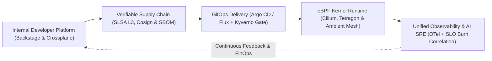

# Conclusion: The Cloud-Native Horizon and Continuous Mastery

Across the twenty-two chapters of this Second Edition of *Mastering Modern DevOps: A Comprehensive Guide to Infrastructure, Automation, and Cloud-Native Technologies*, we have journeyed from the foundational principles that united software development and IT operations to the vanguard of modern cloud-native architecture.

Starting with programmatic Infrastructure as Code (AWS CDK v2, AWS SDK, OpenTofu/Terraform, and Pulumi) and immutable Configuration Management pipelines (Ansible, Molecule, and Packer), we built keyless Continuous Integration and Continuous Delivery pipelines (GitHub Actions OIDC, GitLab CI/CD, and Tekton), secured OCI v1.1 artifact registries (Amazon ECR, CNCF Harbor, JFrog Artifactory, Sonatype Nexus, and AWS CodeArtifact), hardened container runtimes (`containerd 2.0`, BuildKit, and Chainguard Wolfi/Distroless), and orchestrated distributed workloads across Kubernetes v1.31+ (with Karpenter, Gateway API, and KEDA) and Amazon ECS on AWS Fargate. We then layered on unified OpenTelemetry observability (Prometheus, Mimir/Thanos, Grafana Loki, and Tempo), DevSecOps admission and runtime security (Kyverno, OPA Gatekeeper, External Secrets Operator, and Falco eBPF), edge proxies and service meshes, serverless event-driven compute, GitOps reconciliation (Argo CD ApplicationSets and Flux v2), automated infrastructure verification (Terratest, OpenTofu test, and InSpec), workflow orchestration (Apache Airflow and Rundeck), and SLO burn-rate incident response.

Finally, in our four new Second Edition chapters, we tackled the architectural shifts defining the next decade of cloud-native engineering:

1. **Platform Engineering & Internal Developer Platforms (Chapter 19)**: Transforming fragmented infrastructure into self-service Golden Paths using **Backstage**, **Crossplane**, and **Kratix Promises** to eliminate extraneous developer cognitive load.
2. **eBPF Networking, Cilium, & Ambient Service Mesh (Chapter 20)**: Moving packet processing, L7 network policy enforcement, Hubble observability, Tetragon runtime security, and sidecarless mTLS (**Istio Ambient Mode** & **Gateway API**) directly into the Linux kernel and node-level zero-trust tunnels.
3. **OpenTelemetry Pipelines & AI-Augmented SRE (Chapter 21)**: Unifying traces, metrics, logs, and continuous eBPF flame graphs over **OpenTelemetry (OTLP)** with tail-based sampling and pairing **SLO multi-window burn-rate alerts** with AI-augmented root-cause correlation.
4. **Software Supply Chain Security with SLSA & Sigstore (Chapter 22)**: Enforcing cryptographic provenance from `git commit` to Kubernetes admission using **SLSA Build Level 3**, keyless OIDC signing with **Sigstore Cosign / Fulcio / Rekor**, **CycloneDX SBOM** attestations, and **Kyverno** admission policies.

---

## The Future of DevOps

The DevOps philosophy has transformed the global technology industry over the past fifteen years—dismantling organizational silos between development, security, and operations, compressing release cycles from months to minutes, and fostering a culture of shared ownership and blameless learning. Yet the landscape of distributed systems never stands still. Looking ahead, four converging forces are shaping the next era of DevOps and Platform Engineering:

### 1. Autonomous and AI-Augmented Engineering (AIOps & Agentic Workflows)

Artificial Intelligence is evolving from passive code-completion assistants into active participants across the software delivery and reliability lifecycle. By grounding AI agents in deterministic guardrails—OpenTelemetry trace graphs, SLSA provenance metadata, Crossplane schemas, and Policy-as-Code admission gates—organizations can automate anomaly correlation, synthesize blameless postmortem timelines, generate targeted Terratest/InSpec suites, and propose right-sized Kubernetes resource requests without sacrificing deterministic safety.

### 2. Declarative Control Planes Everywhere (GitOps + Crossplane)

Infrastructure as Code has matured beyond static CLI runs into continuous, self-healing control planes. By combining GitOps reconcilers (Argo CD and Flux) with Kubernetes-native cloud control planes (Crossplane and Kratix), every piece of enterprise state—from AWS RDS databases and IAM roles to DNS records and service mesh policies—is continuously reconciled against version-controlled declarative intent.

### 3. Edge Computing, WebAssembly (Wasm), and MicroVM Density

With the proliferation of low-latency edge workloads, IoT telemetry, and multi-tenant serverless compute, DevOps platforms are expanding beyond centralized regional data centers. Lightweight hardware-virtualized microVMs (AWS Firecracker), eBPF kernel data planes, and portable WebAssembly (Wasm) components allow platform teams to schedule workloads across thousands of edge locations with sub-millisecond cold starts and cryptographic tenant isolation.

### 4. Zero-Trust DevSecOps and Cryptographic Attestation by Default

As supply chain adversaries grow more sophisticated, security can no longer rely on perimeter firewalls or post-deployment vulnerability tickets. In modern DevSecOps, every build artifact, base image, SBOM, and infrastructure change carries a verifiable cryptographic signature (Sigstore Cosign) and SLSA provenance attestation verified automatically at runtime before a single instruction executes.

---

## Staying Current with Emerging Technologies

In the rapidly evolving world of software engineering, staying current with emerging technologies is a non-negotiable requirement for DevOps, Platform, and Site Reliability Engineers. It is essential not only for individual career growth, but also for the resilience and competitive velocity of the organizations we serve.

### The Imperative of Technological Adaptability

The field of cloud-native computing is characterized by constant architectural evolution. Cloud computing, containerization, declarative Infrastructure as Code, Kubernetes orchestration, eBPF networking, OpenTelemetry, and Internal Developer Platforms have each reshaped how we design, build, test, deploy, and operate software.

Staying current with these shifts is never merely about memorizing the flags of the newest CLI tool. It is about cultivating **first-principles systems thinking**—understanding how Linux kernel namespaces, TCP congestion control, distributed consensus (`etcd`), cryptographic identity (SPIFFE/OIDC), and human cognitive load work underneath the abstractions—so you can evaluate new tools critically and adopt only those that solve genuine engineering problems.

### Strategies for Staying Current

1. **Adopt a Mindset of Continuous Learning**: Remain curious, open-minded, and proactive in exploring the Cloud Native Computing Foundation (CNCF) landscape, technical RFCs, engineering blogs, and postmortem write-ups from high-scale production incidents.
2. **Community Networking and Open-Source Participation**: Engage with peers through KubeCon, DevOpsDays, local meetups, and CNCF Special Interest Groups (SIGs). Reading upstream pull requests and sharing your own production lessons accelerates learning across the entire industry.
3. **Deliberate Hands-On Practice**: There is no substitute for building, breaking, and debugging real systems. Run the companion code in this book's repository (`01-cdk` through `12-serverless` and `snippets/`), spin up local Kind/Minikube clusters with Cilium and OpenTelemetry, and practice chaos engineering in sandboxed environments.
4. **Targeted Industry Certifications**: Structured hands-on certifications—such as the AWS Certified DevOps Engineer – Professional, Certified Kubernetes Administrator (CKA), Certified Kubernetes Security Specialist (CKS), and Prometheus/OpenTelemetry associate credentials—provide rigorous benchmarks to validate your practical mastery.

---

## Continuous Learning and Kaizen in Engineering Culture

The concept of continuous learning and improvement is anchored in the philosophy of **Kaizen**—a Japanese term translating to *"change for the better"* or *"continuous incremental improvement."* In the context of DevOps and Platform Engineering, Kaizen encompasses both the persistent pursuit of individual technical mastery and the relentless refinement of organizational sociotechnical systems:

- **Embrace a Growth Mindset**: View production outages, failed deployments, and architectural bottlenecks not as personal failings to be hidden, but as rich diagnostic signals that reveal where your platform's guardrails and mental models need strengthening.
- **Foster a Culture of Blameless Feedback**: Conduct structured, blameless postmortems after every significant incident, focusing on *what systemic conditions allowed an error to reach production* and *which automated control will prevent its recurrence*.
- **Experiment, Measure, and Iterate**: Treat every platform change as a scientific hypothesis measured against DORA metrics (Deployment Frequency, Lead Time for Changes, Change Failure Rate, Failed Deployment Recovery Time) and developer cognitive load.

Thank you for reading *Mastering Modern DevOps: A Comprehensive Guide to Infrastructure, Automation, and Cloud-Native Technologies (Second Edition)*. Whether you are writing your first AWS CDK construct, designing a multi-cluster Crossplane Internal Developer Platform, debugging an eBPF network flow in Cilium Hubble, or hardening a SLSA Level 3 supply chain, may the patterns, code examples, and principles in this book empower you to build resilient, secure, and joyful engineering systems.
